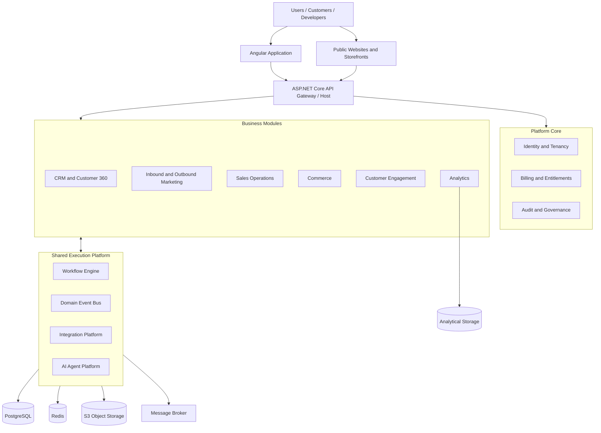
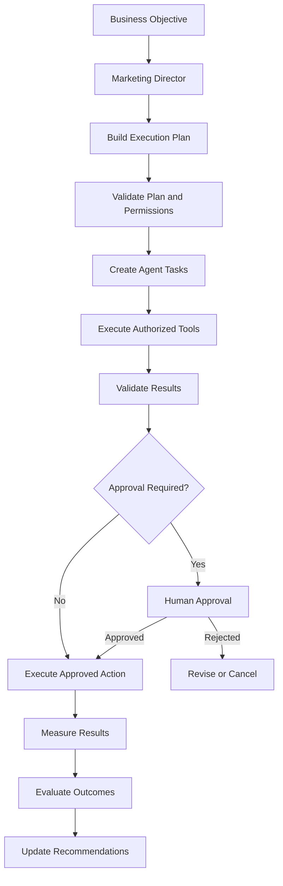

# 1. Executive Product Requirements Document

## 1.1 Product definition

The product is a multi-tenant, AI-native Growth Operating System combining:

- Inbound marketing
- Outbound marketing
- Marketing automation
- CRM and customer intelligence
- Sales engagement and sales operations
- E-commerce and digital commerce
- Customer engagement and support
- Marketing and revenue analytics
- AI agents and autonomous operations
- Integrations and extensibility

The system must support individual professionals, freelancers, startups, SMBs, marketing agencies, mid-market businesses and large enterprises.

It must offer two deployment models:

1. **Managed SaaS:** Multi-tenant cloud platform operated by the vendor.
2. **Self-hosted / dedicated:** Customer-controlled deployment, including isolated enterprise environments.

## 1.2 Product objectives

| Objective | Expected outcome |
|---|---|
| Unified customer intelligence | One consistent customer profile across all modules |
| Omnichannel marketing | Coordinate inbound and outbound communication |
| Marketing automation | Automate repetitive marketing operations |
| AI-driven execution | AI assists and executes approved operations |
| Revenue optimization | Connect marketing activities to commercial outcomes |
| Modular architecture | Enable independent development and future extraction |
| Extensibility | Allow custom modules, integrations and applications |
| Enterprise readiness | Security, scalability, reliability and auditability |
| Deployment flexibility | SaaS and self-hosted options |

## 1.3 Target customer segments

| Segment | Main needs |
|---|---|
| Freelancers | Contacts, campaigns, forms and simple CRM |
| Startups | Lead acquisition, automation and sales pipelines |
| SMBs | Integrated marketing, sales, commerce and support |
| Marketing agencies | Multi-client workspaces, campaigns and reporting |
| E-commerce businesses | Customer segmentation, lifecycle marketing and retention |
| B2B companies | Prospecting, ABM, outreach and revenue operations |
| Enterprises | Advanced permissions, integrations, governance and dedicated deployments |

The platform should use modular feature entitlements rather than separate products for each segment.

## 1.4 User roles

- Platform Super Administrator
- Platform Support Administrator
- Organization Owner
- Organization Administrator
- Workspace Administrator
- Marketing Manager
- Marketing Specialist
- SEO Specialist
- Social Media Manager
- Advertising Manager
- Sales Manager
- Sales Representative
- CRM Administrator
- Customer Support Agent
- Customer Success Manager
- E-commerce Manager
- Analyst
- Finance/Billing Manager
- Developer / Integration Administrator
- AI Agent Administrator
- Read-only / Auditor
- External Agency Collaborator

Permissions must be configurable and support custom roles.

## 1.5 Core customer lifecycle

The platform must support the complete journey:

1. Discover a business through organic search, advertisements, social media or outbound prospecting.
2. Visit a website, landing page or storefront.
3. Interact with content, forms, chat or campaigns.
4. Become a known lead or contact.
5. Receive enrichment, segmentation and qualification.
6. Enter marketing or sales journeys.
7. Communicate through authorized channels.
8. Become a qualified opportunity.
9. Receive proposals, quotes or contracts.
10. Purchase products or services.
11. Receive onboarding and customer support.
12. Participate in retention, loyalty and upselling campaigns.
13. Generate measurable lifetime revenue.

Every relevant event should be associated with the correct person, company, account and commercial context.

---

# 2. Complete Functional Module Catalog

The following is the target product scope. Modules are logical product boundaries, not necessarily independently deployed applications.

## Domain A — Platform Foundation

### A1. Multi-Tenancy and Organization Management

Requirements:

- Multi-tenant organizations.
- Multiple workspaces per organization.
- Workspace-level resource organization.
- Multiple brands and business units.
- Agency/client account relationships.
- Tenant-specific configuration.
- Tenant-level data isolation.
- Custom domains and branding.
- Tenant provisioning and lifecycle management.
- Tenant-level feature entitlements.
- Tenant-specific integration credentials.
- Usage limits and quotas.

### A2. Identity and Access Management

- Authentication and authorization.
- Email/password and passwordless authentication.
- OAuth 2.0 / OpenID Connect.
- MFA.
- SSO and enterprise identity providers.
- RBAC and resource-level permissions.
- Custom roles.
- Invitations and membership management.
- API keys and service accounts.
- Session management.
- Authentication audit trails.

### A3. Subscription and Billing

- Subscription plans.
- Feature-based entitlements.
- Usage-based billing.
- Seat-based billing.
- Credit-based AI consumption.
- Channel usage billing.
- Invoices and payments.
- Trials and promotional plans.
- Add-ons.
- Plan upgrades and downgrades.
- Subscription lifecycle.
- Self-hosted licensing and activation.

### A4. Audit, Security and Governance

- Immutable audit events.
- Administrative activity tracking.
- Sensitive action approval.
- Data export and deletion.
- Encryption and secrets management.
- Retention policies.
- Data residency configuration.
- Security monitoring.
- Compliance reporting.
- Backup and recovery management.

---

## Domain B — Customer Intelligence and CRM

### B1. Unified CRM

Core entities:

- Contacts
- Companies
- Leads
- Accounts
- Opportunities
- Deals
- Activities
- Tasks
- Notes
- Tags
- Custom fields
- Relationships

Requirements:

- Custom objects and fields.
- Duplicate detection.
- Contact merging.
- Company/contact relationships.
- Bulk imports and exports.
- Advanced filtering.
- Saved views.
- Ownership and assignment.
- Custom pipelines.
- Activity history.
- CRM automation.

### B2. Customer 360

One unified profile showing:

- Identity information.
- Company and account relationships.
- Lead source and attribution.
- Marketing consent and preferences.
- Website interactions.
- Form submissions.
- Email history.
- SMS and WhatsApp interactions.
- Social conversations.
- Calls and meeting history.
- Sales activities.
- Purchases and orders.
- Subscriptions.
- Support tickets.
- Customer feedback.
- AI-generated summaries.
- Customer lifetime value.
- Customer health and engagement scores.

### B3. Customer Data Platform

- Unified identity resolution.
- Anonymous and known visitor association.
- First-party event collection.
- Customer data ingestion.
- Data normalization.
- Audience construction.
- Behavioral segmentation.
- Event-based segmentation.
- Customer profile projections.
- Consent-aware activation.
- Data quality and deduplication.

### B4. Lead and Account Intelligence

- Lead scoring.
- Account scoring.
- ICP matching.
- Company enrichment.
- Contact enrichment.
- Buying intent.
- Buying signals.
- Account-based marketing.
- Qualification frameworks.
- Lead routing.
- Territory management.

---

## Domain C — Inbound Marketing

### C1. Website and CMS

- Multi-site management.
- Multi-domain publishing.
- Pages and content blocks.
- Visual page builder.
- Templates and reusable sections.
- Blog and article management.
- Media library.
- Custom URLs.
- SEO metadata.
- Schema markup.
- Multilingual content.
- Drafts, approvals and publishing.
- Content versioning.
- Forms and embedded widgets.

### C2. Landing Pages and Funnels

- Visual landing-page builder.
- Conversion funnels.
- Lead capture.
- Forms and surveys.
- Multi-step forms.
- Popups and banners.
- Lead magnets.
- Thank-you pages.
- A/B testing.
- Conversion tracking.
- Personalization.
- Dynamic content.
- Funnel analytics.

### C3. SEO and GEO/AEO

- Keyword research.
- Search intent.
- Keyword clustering.
- Competitor SEO.
- Technical SEO auditing.
- On-page optimization.
- Internal linking.
- Backlink monitoring.
- Local SEO.
- Content gap analysis.
- Search performance.
- Structured data.
- Sitemap management.
- AI search visibility monitoring.
- Search-oriented content optimization.

SEO integrations must respect the access limitations of search engine providers.

### C4. Content Marketing

- Editorial calendars.
- Content planning.
- Content briefs.
- Article production.
- Content approval.
- Content repurposing.
- Content distribution.
- Content performance.
- Brand voice management.
- Content libraries.
- AI-generated text and media.
- Content versioning.

### C5. Social Media Management

- Social account connections.
- Publishing calendar.
- Post creation.
- Media and video publishing.
- Scheduling.
- Content approval.
- Cross-platform publishing.
- Social inbox.
- Comments and engagement.
- Social listening.
- Mention monitoring.
- Hashtag research.
- Analytics.
- Competitor monitoring.
- Influencer discovery.

### C6. Advertising Management

- Meta Ads integration.
- Google Ads integration.
- LinkedIn Ads integration.
- Campaign management.
- Audience synchronization.
- Creative management.
- Conversion tracking.
- Budget monitoring.
- Performance reporting.
- Attribution.
- Campaign recommendations.
- Advertising optimization.
- Experimentation.

The platform should initially orchestrate advertising through official provider APIs rather than attempt to recreate the advertising networks themselves.

---

## Domain D — Outbound Marketing

### D1. Prospecting

- Company discovery.
- Contact discovery.
- ICP-based prospect searches.
- Prospect list management.
- Company intelligence.
- Contact enrichment.
- Email verification.
- Buying signals.
- Website visitor identification where legally and technically supported.
- Prospect scoring.
- Data source provenance.
- Suppression and exclusion lists.

### D2. Email Marketing

- Campaign creation.
- Newsletter management.
- Transactional email integrations.
- Email templates.
- Visual email editor.
- Segmentation.
- Personalization.
- Scheduling.
- A/B testing.
- Drip campaigns.
- Behavioral triggers.
- Deliverability monitoring.
- Bounce management.
- Unsubscribe management.
- Suppression lists.
- Sender-domain management.
- Email analytics.

Separate bulk marketing email, transactional email and cold outreach into distinct operational policies and sending configurations.

### D3. Cold Outreach

- Prospect-based campaigns.
- Email sequences.
- Personalized messages.
- Follow-up scheduling.
- Inbox management.
- Sender account management.
- Reply detection.
- Reply classification.
- Meeting booking.
- Sequence optimization.
- Deliverability monitoring.
- Suppression and opt-out synchronization.

### D4. LinkedIn Outreach

- Account connection through approved integrations.
- Prospect tracking.
- Message drafting.
- Sales task sequences.
- Conversation tracking where authorized.
- Social engagement monitoring.
- LinkedIn campaign analytics where available.

Do not implement unauthorized scraping or prohibited automated account actions.

### D5. WhatsApp Marketing

- Official WhatsApp Business Platform integration.
- Business phone number management.
- Approved message templates.
- Template synchronization.
- Incoming and outgoing messages.
- Opt-in management.
- Customer support conversations.
- Campaign segmentation.
- Delivery and read status.
- WhatsApp automation.
- Human handoff.
- Template and messaging cost tracking.

### D6. SMS Marketing

- SMS providers.
- Sender registration.
- Contact consent.
- Campaign management.
- Bulk sending.
- Personalized messages.
- Two-way messaging.
- Delivery tracking.
- Opt-out handling.
- Geographic messaging restrictions.

### D7. Voice Marketing and Calling

- Inbound and outbound calling integrations.
- Dialer management.
- Call campaigns.
- AI voice agents.
- Call recording subject to applicable law.
- Transcription.
- Call summaries.
- Sentiment and intent analysis.
- Call outcome classification.
- Appointment booking.
- Call analytics.

### D8. Omnichannel Outreach Sequences

A single sequence should be capable of coordinating:

- Email.
- LinkedIn tasks and permitted actions.
- WhatsApp.
- SMS.
- Voice.
- Website chat.
- Other connected social channels.

Sequences must support:

- Time-based conditions.
- Behavioral conditions.
- Reply-based branching.
- Channel availability.
- Consent checks.
- Business-hour rules.
- Stop conditions.
- Human intervention.
- Retry and failure handling.

---

## Domain E — Marketing Automation

### E1. Visual Workflow Builder

A shared workflow engine for the entire platform.

Trigger types:

- Event-based.
- Schedule-based.
- Webhook-based.
- Form submission.
- Customer behavior.
- CRM changes.
- Purchase events.
- Subscription events.
- Support events.
- Manual triggers.
- AI-generated recommendations requiring authorization.

Workflow node types:

- Trigger.
- Condition.
- Branch.
- Delay.
- Wait-until.
- Action.
- HTTP request.
- AI task.
- Approval.
- Assignment.
- Notification.
- Loop with explicit bounds.
- Sub-workflow.
- Exit.

Requirements:

- Visual drag-and-drop editor.
- Versioning.
- Draft and published states.
- Testing and simulation.
- Execution history.
- Error handling.
- Retries.
- Idempotency.
- Rate limiting.
- Timeouts.
- Cancellation.
- Workflow templates.
- Workflow permissions.

### E2. Customer Journeys

- Audience entry.
- Behavioral triggers.
- Multi-channel communication.
- Customer lifecycle stages.
- Dynamic segmentation.
- Branching.
- Goal conditions.
- Exit conditions.
- Conversion tracking.
- Journey analytics.
- Frequency controls.
- AI-assisted optimization.

### E3. Campaign Management

- Campaign planning.
- Campaign briefs.
- Campaign execution.
- Channel coordination.
- Campaign approvals.
- Campaign budgets.
- Campaign calendars.
- Performance tracking.
- Revenue attribution.

---

## Domain F — Sales Operations

### F1. Sales Pipeline

- Multiple pipelines.
- Custom deal stages.
- Lead-to-deal conversion.
- Deal assignment.
- Deal activities.
- Sales tasks.
- Deal scoring.
- Deal aging.
- Forecasting.
- Pipeline reporting.

### F2. Sales Engagement

- Meeting scheduling.
- Calendar integration.
- Appointment reminders.
- Sales sequences.
- Call management.
- Email tracking.
- Sales activity logging.
- Meeting summaries.
- Follow-up generation.

### F3. Quotes, Proposals and Contracts

- Quote generation.
- Proposal templates.
- Pricing rules.
- Discount management.
- Approval workflows.
- Contract generation.
- E-signature integration.
- Contract lifecycle.
- Renewal management.
- Document storage.

### F4. Sales Performance

- Sales targets.
- Commission plans.
- Revenue forecasting.
- Team performance.
- Sales activity analytics.
- Conversion rates.
- Sales coaching.
- Opportunity intelligence.

---

## Domain G — Commerce and Monetization

### G1. Product Catalog

- Physical products.
- Digital products.
- Services.
- Product variants.
- Categories.
- Attributes.
- Pricing.
- Price lists.
- Bundles.
- Inventory references.
- Product media.

### G2. Storefront

- Multiple storefronts.
- Custom domains.
- Product pages.
- Collections.
- Search.
- Cart.
- Checkout.
- Customer accounts.
- Promotions.
- Coupons.
- Tax configuration.
- Shipping configuration.
- Localization.

### G3. Orders and Fulfillment

- Orders.
- Order items.
- Payments.
- Refunds.
- Fulfillment.
- Shipping.
- Inventory.
- Returns.
- Notifications.
- Order lifecycle automation.

### G4. Subscriptions and Digital Products

- Recurring plans.
- Subscription lifecycle.
- Trials.
- Renewals.
- Cancellations.
- Dunning.
- Digital delivery.
- Membership access.
- Usage-based billing.

### G5. B2B Commerce

- Business accounts.
- Contract pricing.
- Customer-specific price lists.
- Quotes.
- Purchase orders.
- Approval processes.
- B2B catalogs.
- Account hierarchies.

### G6. Marketplace

A future extensible ecosystem supporting:

- Third-party vendors.
- Vendor catalogs.
- Marketplace listings.
- Applications.
- Extensions.
- Integration packages.
- Agent and workflow templates.

---

## Domain H — Customer Engagement and Retention

### H1. Unified Inbox

- Email conversations.
- WhatsApp conversations.
- SMS conversations.
- Social conversations.
- Website chat.
- Voice interaction records.
- Assignment.
- Teams and queues.
- Internal notes.
- Conversation tags.
- SLA tracking.
- AI-assisted replies.
- Human handoff.

### H2. Customer Support

- Ticket management.
- Ticket priorities.
- Ticket categories.
- SLA policies.
- Routing.
- Escalations.
- Knowledge base.
- Help center.
- Customer satisfaction.
- Support analytics.

### H3. Customer Success

- Customer health scoring.
- Onboarding.
- Success plans.
- Renewal tracking.
- Adoption monitoring.
- Customer feedback.
- Churn prevention.
- Expansion opportunities.

### H4. Loyalty and Referral

- Loyalty programs.
- Reward points.
- Membership tiers.
- Referral programs.
- Affiliate tracking.
- Reward rules.
- Redemption.
- Retention campaigns.

---

## Domain I — Analytics and Intelligence

### I1. Marketing Analytics

- Traffic.
- Acquisition sources.
- Campaign performance.
- Channel performance.
- Conversion rates.
- Lead generation.
- Cost per lead.
- Customer acquisition cost.
- Return on advertising spend.

### I2. Revenue Analytics

- Revenue attribution.
- Marketing-sourced revenue.
- Marketing-influenced revenue.
- Sales pipeline contribution.
- Customer lifetime value.
- Cohort analysis.
- Retention.
- Churn.
- Revenue forecasting.

### I3. Product and Customer Analytics

- User behavior.
- Funnel analysis.
- Customer journeys.
- Event analysis.
- Segmentation.
- Cohort retention.
- Feature adoption.
- Customer health.

### I4. Reporting and BI

- Custom dashboards.
- Report builder.
- Scheduled reports.
- Data exports.
- Saved reports.
- Cross-module reporting.
- Executive dashboards.
- AI-generated insights.

---

## Domain J — AI and Autonomous Operations

### J1. AI Platform

- Provider management.
- Model routing.
- Prompt management.
- Structured output validation.
- Token and cost tracking.
- Model evaluation.
- Context management.
- Memory management.
- Retrieval-augmented generation.
- Multimodal AI.
- AI tool registry.

### J2. AI Agents

- Marketing Director.
- Research Agent.
- SEO Agent.
- Content Agent.
- Social Media Agent.
- Advertising Agent.
- Prospecting Agent.
- Outreach Agent.
- Sales Agent.
- CRM Agent.
- Customer Support Agent.
- Analytics Agent.
- Optimization Agent.

Agents should be configured using reusable skills and tools rather than each being a separate application.

### J3. AI Mission Center

- Objective definition.
- Mission planning.
- Task decomposition.
- Agent delegation.
- Execution tracking.
- Approval queues.
- Budget controls.
- Task retries.
- Execution logs.
- Mission reporting.

### J4. AI Governance

- Supervised autonomy.
- Approval policies.
- Tool-level authorization.
- Agent identity.
- Model and prompt versioning.
- Output evaluation.
- Audit trails.
- Data access boundaries.
- Safety policies.
- Cost budgets.

---

## Domain K — Integrations and Developer Platform

### K1. Integration Framework

- OAuth connections.
- API credentials.
- Webhooks.
- Event subscriptions.
- Provider adapters.
- Synchronization.
- Retry policies.
- Error monitoring.
- Credential rotation.

### K2. Integration Marketplace

- First-party integrations.
- Third-party integrations.
- Custom connectors.
- Integration installation.
- Configuration.
- Permissions.
- Versioning.
- Marketplace billing.

### K3. Public Developer Platform

- REST API.
- Webhooks.
- SDKs.
- API documentation.
- API keys.
- OAuth applications.
- Rate limits.
- Developer portal.
- Sandbox environments.
- Custom application registration.

---

# 3. Architecture and Module Boundaries

## 3.1 Architectural approach

**Modular monolith first, explicit service boundaries from day one.**

Use:

- .NET 10 / ASP.NET Core.
- Vertical Slice Architecture.
- Domain-driven design.
- Explicit bounded contexts.
- Domain events.
- Application-level module contracts.
- Dependency inversion.
- PostgreSQL.
- Background processing.
- API-first integrations.

Each module owns its business rules, database tables, application services and event contracts.

No module should directly manipulate another module's internal tables.

## 3.2 High-level architecture



## 3.3 Bounded contexts and module ownership

| Module | Owns | Publishes events |
|---|---|---|
| Tenancy | Organizations, workspaces, memberships | TenantCreated |
| IAM | Users, roles, permissions | UserInvited, RoleChanged |
| Billing | Plans, subscriptions, usage | SubscriptionChanged |
| CRM | Contacts, companies, leads, deals | ContactCreated, DealWon |
| Customer Data | Profiles, identities, events | IdentityResolved |
| Marketing | Campaigns, audiences, content | CampaignPublished |
| Prospecting | Prospects, enrichment, lists | ProspectQualified |
| Engagement | Messages, conversations | MessageReceived |
| Automation | Workflows, executions | WorkflowCompleted |
| Sales | Quotes, contracts, meetings | QuoteAccepted |
| Commerce | Products, orders, payments | OrderPaid |
| Support | Tickets, knowledge base | TicketResolved |
| Analytics | Metrics, attribution, reports | InsightGenerated |
| AI | Agents, missions, tools, evaluations | AgentTaskCompleted |
| Integrations | Connections, webhooks, sync | IntegrationFailed |

Additional modules include CMS, SEO, social publishing, advertising, loyalty and developer marketplace.

## 3.4 Module dependency rules

1. Platform Kernel provides shared technical primitives only.
2. CRM owns canonical contact and company records.
3. Customer Data owns identity resolution and behavioral profiles.
4. Marketing owns campaigns and audience activation.
5. Engagement owns channel connections, messages and conversations.
6. Automation owns workflow definitions and execution state.
7. AI owns agent definitions, missions, tools and execution policies.
8. Commerce owns products, orders, payments and subscriptions.
9. Analytics owns analytical projections and attribution calculations.
10. Other modules communicate through contracts and published events.

Avoid a universal shared database repository or service that lets every module read and write everything.

Cross-module references should use stable identifiers and contracts. Use foreign keys primarily within module-owned data boundaries.

## 3.5 Recommended solution structure

```text
growth-platform/
│
├── apps/
│   ├── web-angular/
│   ├── public-web/
│   ├── api/
│   └── workers/
│
├── src/
│   ├── BuildingBlocks/
│   │   ├── Domain/
│   │   ├── Application/
│   │   ├── Persistence/
│   │   ├── Messaging/
│   │   ├── MultiTenancy/
│   │   ├── Authorization/
│   │   ├── Observability/
│   │   └── Testing/
│   │
│   ├── Modules/
│   │   ├── Identity/
│   │   ├── Tenancy/
│   │   ├── Billing/
│   │   ├── CRM/
│   │   ├── CustomerData/
│   │   ├── Marketing/
│   │   ├── CMS/
│   │   ├── SEO/
│   │   ├── Social/
│   │   ├── Advertising/
│   │   ├── Prospecting/
│   │   ├── Email/
│   │   ├── Messaging/
│   │   ├── Voice/
│   │   ├── Automation/
│   │   ├── Sales/
│   │   ├── Commerce/
│   │   ├── Subscriptions/
│   │   ├── Support/
│   │   ├── Loyalty/
│   │   ├── Analytics/
│   │   ├── AI/
│   │   ├── Integrations/
│   │   └── Marketplace/
│   │
│   └── Contracts/
│
├── frontend/
│   └── projects/
│       ├── shell/
│       ├── core/
│       ├── shared/
│       └── features/
│
├── infrastructure/
│   ├── docker/
│   ├── coolify/
│   ├── monitoring/
│   ├── database/
│   └── backup/
│
├── docs/
│   ├── architecture/
│   ├── api/
│   ├── modules/
│   ├── security/
│   └── decisions/
│
└── tests/
    ├── Architecture/
    ├── Integration/
    ├── EndToEnd/
    └── Performance/
```

Use a consistent module-internal vertical slice structure:

```text
Modules/CRM/
├── Domain/
├── Contracts/
├── Features/
│   ├── Contacts/
│   │   ├── Create/
│   │   ├── Update/
│   │   ├── GetById/
│   │   └── Search/
│   ├── Companies/
│   ├── Leads/
│   ├── Deals/
│   └── Activities/
├── Infrastructure/
├── Endpoints/
├── Events/
├── Permissions/
└── CRMModule.cs
```

Keep module contracts public and implementation details private.

## 3.6 Frontend architecture

Use Angular as a modular application with:

- Core shell.
- Feature-based lazy loading.
- Shared design system.
- Feature-level permissions.
- Central API client generation from OpenAPI.
- State management only where justified.
- Reactive forms.
- Real-time updates through SignalR.
- Tenant-aware navigation.
- Feature entitlements.
- Internationalization.
- RTL support.

Recommended feature organization:

```text
frontend/projects/features/
├── dashboard/
├── crm/
├── marketing/
├── campaigns/
├── content/
├── seo/
├── social/
├── advertising/
├── prospecting/
├── outreach/
├── automation/
├── sales/
├── commerce/
├── conversations/
├── support/
├── analytics/
├── ai-center/
├── integrations/
└── administration/
```

Build one consistent application shell, not a separate frontend application for every module.

---

# 4. Multi-Tenancy and Data Isolation

## 4.1 Recommended tenancy model

Use a shared PostgreSQL database and shared tables for the initial SaaS architecture.

Every tenant-owned record must include `tenant_id`.

Recommended hierarchy:

```text
Platform
 ├── Tenant / Organization
 │    ├── Workspaces
 │    │    ├── Brands
 │    │    ├── Teams
 │    │    ├── Campaigns
 │    │    ├── Contacts
 │    │    └── Workflows
 │    ├── Users / Memberships
 │    ├── Billing
 │    └── Integrations
```

Important distinctions:

- Tenant is the security and billing boundary.
- Workspace is the operational collaboration boundary.
- Brand is a marketing identity boundary.
- Team is an organizational permission boundary.

Do not assume that one company requires only one workspace or one brand.

## 4.2 Isolation enforcement

Implement:

- Tenant resolution from authenticated context.
- Tenant-scoped query filters.
- Tenant-scoped repository operations.
- PostgreSQL Row-Level Security as defense in depth.
- Tenant-aware background jobs.
- Tenant-scoped Redis keys.
- Tenant-aware object storage paths.
- Tenant-isolated vector search.
- Tenant-isolated agent memory.
- Tenant-aware event consumers.
- Automated cross-tenant isolation tests.

Never trust a client-supplied `tenant_id` as proof of authorization.

For dedicated enterprise deployments, support a separate database or isolated installation using the same module contracts and migration system.

## 4.3 Data classification

| Classification | Examples |
|---|---|
| Platform | Global configuration, product catalog |
| Tenant | Contacts, campaigns, workflows |
| Workspace | Team-specific operations |
| Brand | Brand voice, assets, website content |
| User | Preferences, personal API tokens |
| Sensitive | Credentials, consent records, financial data |
| Analytical | Aggregated events and reporting |

---

# 5. Complete Logical Database Schema

## 5.1 Database design principles

- PostgreSQL as the transactional system of record.
- UUID primary keys.
- `tenant_id` on tenant-owned entities.
- `workspace_id` where workspace isolation is relevant.
- `created_at`, `updated_at` and optional `deleted_at`.
- UTC timestamps.
- JSONB for flexible configuration and custom metadata, not as a replacement for relational modeling.
- Explicit unique constraints.
- Indexes on tenant-scoped lookup columns.
- Optimistic concurrency where appropriate.
- Outbox/inbox messaging.
- Append-only audit and event history where required.
- Partition high-volume event tables when justified.

Use `snake_case` for database objects.

Suggested PostgreSQL schemas:

```text
platform
identity
tenancy
billing
crm
customer_data
marketing
content
seo
social
advertising
prospecting
engagement
automation
sales
commerce
support
loyalty
analytics
ai
integrations
audit
```

These are PostgreSQL namespaces within one database, not separate databases for each module.

## 5.2 Platform and tenancy tables

| Table | Important fields |
|---|---|
| `tenancy.tenants` | id, name, slug, status, deployment_mode, settings |
| `tenancy.workspaces` | id, tenant_id, name, slug, status |
| `tenancy.brands` | id, tenant_id, workspace_id, name, domain, settings |
| `tenancy.teams` | id, tenant_id, workspace_id, name |
| `tenancy.team_members` | id, tenant_id, team_id, user_id |
| `identity.users` | id, email, password_hash, status, last_login_at |
| `identity.memberships` | id, tenant_id, workspace_id, user_id, status |
| `identity.roles` | id, tenant_id, name, scope |
| `identity.permissions` | id, code, description |
| `identity.role_permissions` | id, role_id, permission_id |
| `identity.membership_roles` | id, membership_id, role_id |
| `identity.api_keys` | id, tenant_id, name, key_hash, scopes, expires_at |
| `identity.sessions` | id, user_id, expires_at |
| `identity.oauth_connections` | id, tenant_id, provider, external_account_id |
| `platform.feature_entitlements` | id, plan_id, feature_code, configuration |
| `billing.plans` | id, name, billing_interval, price, currency |
| `billing.subscriptions` | id, tenant_id, plan_id, status, current_period_start, current_period_end |
| `billing.usage_records` | id, tenant_id, metric, quantity, recorded_at |
| `billing.invoices` | id, tenant_id, subscription_id, amount, currency, status |
| `billing.payments` | id, tenant_id, invoice_id, provider, external_reference, status |

## 5.3 CRM tables

| Table | Important fields |
|---|---|
| `crm.contacts` | id, tenant_id, first_name, last_name, email, phone, owner_id, lifecycle_stage |
| `crm.companies` | id, tenant_id, name, website, industry, size, country |
| `crm.contact_emails` | id, tenant_id, contact_id, email, is_primary, verification_status |
| `crm.contact_phones` | id, tenant_id, contact_id, phone, type, is_primary |
| `crm.company_contacts` | id, tenant_id, company_id, contact_id, relationship |
| `crm.leads` | id, tenant_id, contact_id, company_id, source, status, score |
| `crm.accounts` | id, tenant_id, company_id, owner_id, status |
| `crm.pipelines` | id, tenant_id, name, pipeline_type |
| `crm.pipeline_stages` | id, tenant_id, pipeline_id, name, position |
| `crm.deals` | id, tenant_id, pipeline_id, stage_id, account_id, amount, currency, probability |
| `crm.activities` | id, tenant_id, subject, type, related_entity_type, related_entity_id |
| `crm.tasks` | id, tenant_id, title, assigned_to, due_at, status |
| `crm.notes` | id, tenant_id, entity_type, entity_id, content |
| `crm.tags` | id, tenant_id, name |
| `crm.entity_tags` | id, tenant_id, entity_type, entity_id, tag_id |
| `crm.custom_field_definitions` | id, tenant_id, entity_type, field_key, field_type, configuration |
| `crm.custom_field_values` | id, tenant_id, entity_type, entity_id, field_id, value |
| `crm.relationships` | id, tenant_id, source_type, source_id, target_type, target_id, relationship_type |

Use a carefully validated polymorphic reference strategy for generic activities and relationships. Do not use unrestricted polymorphic references as a substitute for all relational integrity.

## 5.4 Customer Data Platform tables

| Table | Important fields |
|---|---|
| `customer_data.identities` | id, tenant_id, identity_type, normalized_value |
| `customer_data.profile_identities` | id, tenant_id, profile_id, identity_id |
| `customer_data.customer_profiles` | id, tenant_id, contact_id, anonymous_id, merged_into_id |
| `customer_data.events` | id, tenant_id, profile_id, event_name, occurred_at, properties |
| `customer_data.event_definitions` | id, tenant_id, name, schema |
| `customer_data.segments` | id, tenant_id, name, definition, status |
| `customer_data.segment_memberships` | id, tenant_id, segment_id, profile_id |
| `customer_data.consent_records` | id, tenant_id, profile_id, purpose, channel, status, captured_at, source |
| `customer_data.preferences` | id, tenant_id, profile_id, category, value |
| `customer_data.identity_merge_history` | id, tenant_id, source_profile_id, target_profile_id, reason |

Consent must be purpose-specific and channel-specific, with provenance and timestamps.

## 5.5 Marketing, content and campaigns

| Table | Important fields |
|---|---|
| `marketing.campaigns` | id, tenant_id, workspace_id, name, type, status, objective |
| `marketing.campaign_channels` | id, tenant_id, campaign_id, channel, configuration |
| `marketing.audiences` | id, tenant_id, name, definition |
| `marketing.audience_members` | id, tenant_id, audience_id, profile_id |
| `marketing.campaign_assets` | id, tenant_id, campaign_id, asset_id |
| `marketing.experiments` | id, tenant_id, campaign_id, hypothesis, status |
| `marketing.experiment_variants` | id, tenant_id, experiment_id, name, configuration |
| `marketing.conversion_goals` | id, tenant_id, campaign_id, event_name |
| `content.sites` | id, tenant_id, brand_id, domain, configuration |
| `content.pages` | id, tenant_id, site_id, slug, title, status |
| `content.page_versions` | id, tenant_id, page_id, version, content |
| `content.posts` | id, tenant_id, site_id, title, body, status |
| `content.media_assets` | id, tenant_id, storage_key, mime_type, metadata |
| `content.forms` | id, tenant_id, name, definition |
| `content.form_submissions` | id, tenant_id, form_id, profile_id, data |
| `content.landing_pages` | id, tenant_id, page_id, campaign_id |
| `seo.keywords` | id, tenant_id, keyword, locale, search_intent |
| `seo.rank_observations` | id, tenant_id, keyword_id, position, observed_at |
| `seo.site_audits` | id, tenant_id, site_id, score, results |
| `seo.backlinks` | id, tenant_id, source_url, target_url, status |

## 5.6 Prospecting and outbound

| Table | Important fields |
|---|---|
| `prospecting.prospect_lists` | id, tenant_id, name, criteria |
| `prospecting.prospects` | id, tenant_id, company_id, contact_id, source, status |
| `prospecting.enrichment_jobs` | id, tenant_id, prospect_id, provider, status |
| `prospecting.enrichment_records` | id, tenant_id, prospect_id, field_name, value, source |
| `prospecting.verification_results` | id, tenant_id, contact_id, field, result, checked_at |
| `prospecting.buying_signals` | id, tenant_id, company_id, signal_type, evidence |
| `engagement.sender_accounts` | id, tenant_id, channel, provider, external_account_id, status |
| `engagement.templates` | id, tenant_id, channel, name, content, approval_status |
| `engagement.sequences` | id, tenant_id, name, status |
| `engagement.sequence_steps` | id, tenant_id, sequence_id, step_type, position, configuration |
| `engagement.sequence_enrollments` | id, tenant_id, sequence_id, profile_id, status |
| `engagement.sequence_executions` | id, tenant_id, enrollment_id, step_id, status, scheduled_at |
| `engagement.messages` | id, tenant_id, conversation_id, channel, direction, content, status |
| `engagement.conversations` | id, tenant_id, channel, external_thread_id, assigned_to, status |
| `engagement.conversation_participants` | id, tenant_id, conversation_id, profile_id |
| `engagement.message_events` | id, tenant_id, message_id, event_type, occurred_at |
| `engagement.channel_connections` | id, tenant_id, provider, credentials_reference, status |
| `engagement.suppressions` | id, tenant_id, channel, destination, reason, created_at |
| `engagement.sending_domains` | id, tenant_id, domain, spf_status, dkim_status, dmarc_status |

Message content should support secure storage, retention policies and access controls.

## 5.7 Automation tables

| Table | Important fields |
|---|---|
| `automation.workflows` | id, tenant_id, name, status, trigger_type |
| `automation.workflow_versions` | id, tenant_id, workflow_id, version, definition |
| `automation.workflow_nodes` | id, tenant_id, version_id, node_key, node_type, configuration |
| `automation.workflow_edges` | id, tenant_id, version_id, source_node, target_node |
| `automation.workflow_executions` | id, tenant_id, workflow_id, version_id, status, started_at |
| `automation.execution_steps` | id, tenant_id, execution_id, node_id, status, input, output |
| `automation.scheduled_actions` | id, tenant_id, execution_id, execute_at, status |
| `automation.execution_logs` | id, tenant_id, execution_id, level, message |
| `automation.journeys` | id, tenant_id, name, status |
| `automation.journey_enrollments` | id, tenant_id, journey_id, profile_id, status |

Workflow definitions must be versioned and executions must retain the exact version they started with.

## 5.8 Sales and commerce tables

| Table | Important fields |
|---|---|
| `sales.meetings` | id, tenant_id, contact_id, deal_id, starts_at, status |
| `sales.quotes` | id, tenant_id, account_id, deal_id, number, total, status |
| `sales.quote_items` | id, tenant_id, quote_id, product_id, quantity, unit_price |
| `sales.proposals` | id, tenant_id, deal_id, title, content, status |
| `sales.contracts` | id, tenant_id, account_id, number, status, valid_until |
| `sales.commission_plans` | id, tenant_id, name, configuration |
| `sales.commissions` | id, tenant_id, user_id, deal_id, amount, status |
| `commerce.products` | id, tenant_id, name, sku, type, status |
| `commerce.product_variants` | id, tenant_id, product_id, sku, attributes |
| `commerce.prices` | id, tenant_id, product_id, currency, amount |
| `commerce.carts` | id, tenant_id, customer_profile_id, status |
| `commerce.cart_items` | id, tenant_id, cart_id, product_id, quantity, unit_price |
| `commerce.orders` | id, tenant_id, customer_profile_id, order_number, status, total |
| `commerce.order_items` | id, tenant_id, order_id, product_id, quantity, unit_price |
| `commerce.payments` | id, tenant_id, order_id, provider, amount, currency, status |
| `commerce.refunds` | id, tenant_id, payment_id, amount, status |
| `commerce.inventory_items` | id, tenant_id, product_id, location_id, quantity |
| `commerce.fulfillments` | id, tenant_id, order_id, status, tracking_number |
| `commerce.subscriptions` | id, tenant_id, customer_profile_id, plan_id, status, next_billing_at |
| `commerce.subscription_items` | id, tenant_id, subscription_id, product_id, quantity |
| `commerce.coupons` | id, tenant_id, code, discount_type, discount_value |
| `commerce.price_lists` | id, tenant_id, name, currency |

Payment provider tokens and secrets must never be stored as raw credentials.

## 5.9 Support and retention tables

| Table | Important fields |
|---|---|
| `support.tickets` | id, tenant_id, profile_id, subject, priority, status, assigned_to |
| `support.ticket_messages` | id, tenant_id, ticket_id, author_id, content |
| `support.ticket_assignments` | id, tenant_id, ticket_id, user_id |
| `support.sla_policies` | id, tenant_id, name, configuration |
| `support.knowledge_articles` | id, tenant_id, title, content, status |
| `support.csat_responses` | id, tenant_id, ticket_id, rating, feedback |
| `loyalty.programs` | id, tenant_id, name, status |
| `loyalty.memberships` | id, tenant_id, program_id, profile_id, points |
| `loyalty.reward_transactions` | id, tenant_id, membership_id, points, transaction_type |
| `loyalty.referrals` | id, tenant_id, referrer_id, referred_id, status |

## 5.10 Analytics tables

| Table | Important fields |
|---|---|
| `analytics.tracking_events` | id, tenant_id, event_name, occurred_at, properties |
| `analytics.attribution_touchpoints` | id, tenant_id, profile_id, campaign_id, source, occurred_at |
| `analytics.conversions` | id, tenant_id, profile_id, conversion_type, value, currency |
| `analytics.attribution_results` | id, tenant_id, conversion_id, model, result |
| `analytics.metric_definitions` | id, tenant_id, metric_key, definition |
| `analytics.report_definitions` | id, tenant_id, name, configuration |
| `analytics.dashboard_definitions` | id, tenant_id, name, layout |
| `analytics.dashboard_widgets` | id, tenant_id, dashboard_id, configuration |

For high-volume event ingestion, PostgreSQL can be the initial system of record, but do not make it the permanent home for every analytical query. Introduce analytical storage when measured workload justifies it.

## 5.11 AI platform tables

| Table | Important fields |
|---|---|
| `ai.providers` | id, name, provider_type, configuration |
| `ai.models` | id, provider_id, model_name, capabilities |
| `ai.agent_definitions` | id, tenant_id, name, description, configuration |
| `ai.agent_versions` | id, tenant_id, agent_id, version, instructions, model_id |
| `ai.agent_skills` | id, tenant_id, name, definition, version |
| `ai.agent_skill_assignments` | id, tenant_id, agent_id, skill_id |
| `ai.tools` | id, name, module, action, input_schema, output_schema |
| `ai.agent_tool_permissions` | id, tenant_id, agent_id, tool_id, policy |
| `ai.missions` | id, tenant_id, objective, status, autonomy_level |
| `ai.mission_plans` | id, tenant_id, mission_id, version, plan |
| `ai.agent_tasks` | id, tenant_id, mission_id, agent_id, status, priority |
| `ai.agent_runs` | id, tenant_id, task_id, model_id, status, token_usage |
| `ai.agent_messages` | id, tenant_id, run_id, role, content |
| `ai.approval_requests` | id, tenant_id, task_id, action, status, requested_by |
| `ai.memory_records` | id, tenant_id, agent_id, memory_type, content, metadata |
| `ai.evaluations` | id, tenant_id, run_id, evaluator, score, results |
| `ai.model_usage` | id, tenant_id, model_id, input_tokens, output_tokens, cost |
| `ai.execution_traces` | id, tenant_id, run_id, trace_id, metadata |

AI memories must be scoped to the tenant and appropriately scoped to the user, agent or workspace. Sensitive information should not automatically become long-term memory.

## 5.12 Integration, events and audit tables

| Table | Important fields |
|---|---|
| `integrations.providers` | id, name, category, capabilities |
| `integrations.connections` | id, tenant_id, provider_id, status, credentials_reference |
| `integrations.sync_jobs` | id, tenant_id, connection_id, status, cursor |
| `integrations.webhooks` | id, tenant_id, endpoint, secret_reference, status |
| `integrations.webhook_deliveries` | id, tenant_id, webhook_id, event_id, status |
| `integrations.oauth_states` | id, tenant_id, provider, state_hash, expires_at |
| `platform.outbox_messages` | id, tenant_id, event_type, payload, occurred_at, published_at |
| `platform.inbox_messages` | id, consumer, message_id, processed_at |
| `audit.audit_logs` | id, tenant_id, actor_id, action, resource_type, resource_id, occurred_at |
| `audit.security_events` | id, tenant_id, actor_id, event_type, severity, metadata |

Store credentials in a dedicated secrets manager, not directly in integration tables. The database should store references.

## 5.13 Critical indexes and constraints

Implement at minimum:

- Unique `(tenant_id, normalized_email)` where the business rule requires it.
- Unique `(tenant_id, slug)` for tenant-scoped slugs.
- Index `(tenant_id, created_at)` on high-use transactional tables.
- Index `(tenant_id, status)` on campaigns, workflows, tickets and jobs.
- Index `(tenant_id, profile_id, occurred_at)` on customer events.
- Index `(tenant_id, campaign_id, occurred_at)` on campaign performance.
- Index `(tenant_id, sequence_id, status)` on sequence enrollments.
- Index `(tenant_id, execute_at, status)` on scheduled actions.
- GIN indexes for selected JSONB fields.
- Appropriate partial indexes for active records.
- Idempotency unique constraints for payment, message and event processing.

Use PostgreSQL full-text search, `pg_trgm` and `pgvector` selectively. Do not add extensions everywhere without a defined search or retrieval requirement.

---

# 6. AI Agent Architecture

## 6.1 Agent organization

The platform should implement specialized agents coordinated by a central Marketing Director.

### Strategic agents

- Marketing Director.
- Marketing Strategist.
- Growth Strategist.
- Market Research.
- Competitor Intelligence.
- Customer Research.
- ICP Discovery.
- Budget Planning.

### Inbound agents

- SEO.
- GEO/AEO.
- Content Strategy.
- Copywriting.
- Social Media.
- Community Management.
- Advertising.
- Landing Page Optimization.

### Outbound agents

- Prospecting.
- Company Research.
- Contact Enrichment.
- Lead Qualification.
- Cold Email.
- LinkedIn Outreach.
- WhatsApp Engagement.
- SMS Campaigns.
- Voice Calling.
- Sequence Optimization.

### Revenue agents

- CRM Assistant.
- Sales Development.
- Deal Intelligence.
- Sales Coaching.
- Proposal Generation.
- Revenue Forecasting.

### Retention agents

- Customer Success.
- Support.
- Customer Segmentation.
- Churn Prediction.
- Upselling.
- Loyalty Optimization.

### Intelligence agents

- Analytics.
- Attribution.
- Experimentation.
- Conversion Optimization.
- Anomaly Detection.
- Reporting.

These are logical agent roles. A shared runtime can execute many roles through different agent definitions, skills, tools and policies.

## 6.2 Agent execution lifecycle



## 6.3 Supervised autonomy model

The selected operating model is supervised AI.

Four operational states:

1. **Read:** Research, analyze, retrieve and summarize.
2. **Draft:** Create content, plans, campaign configurations and proposed actions.
3. **Approve:** Human authorization before sensitive execution.
4. **Execute:** Perform explicitly authorized actions through controlled tools.

Examples:

| AI operation | Default behavior |
|---|---|
| Research competitors | Execute |
| Generate content | Draft |
| Publish content | Approval or configured publishing policy |
| Discover prospects | Execute within authorized data sources |
| Send outbound messages | Enforce channel-specific authorization |
| Change advertising budgets | Approval |
| Respond to customers | Draft or approved bounded automation |
| Issue refunds | Human approval |
| Delete customer data | Authorized human action |
| Generate reports | Execute |

The platform must support configurable policies per tenant, workspace, agent and action.

## 6.4 Agent tool architecture

Agents must not receive unrestricted database access.

Instead, expose tools such as:

```text
crm.contact.search
crm.contact.create
crm.contact.update
crm.lead.qualify
crm.deal.create

marketing.campaign.create
marketing.campaign.analyze
marketing.campaign.schedule

content.article.draft
content.article.publish

prospecting.company.search
prospecting.contact.enrich
prospecting.contact.verify

engagement.sequence.create
engagement.message.draft
engagement.message.send

analytics.campaign.report
analytics.revenue.analyze

automation.workflow.create
automation.workflow.simulate
```

Every tool needs:

- Typed input and output schemas.
- Tenant context.
- Authorization requirements.
- Idempotency rules.
- Execution timeout.
- Audit logging.
- Approval policy.
- Rate limits.
- Error handling.

## 6.5 AI memory

Use different memory categories:

- Brand memory.
- Business memory.
- Customer context.
- Campaign memory.
- Agent task memory.
- Workflow execution context.
- Knowledge-base retrieval.

Do not blindly store entire conversations or customer records in vector memory. Store structured facts and references, apply retention rules and retrieve only relevant authorized context.

## 6.6 AI evaluation

Track:

- Task completion rate.
- Tool execution success.
- Human approval and rejection rate.
- Hallucination and factual error rate.
- Campaign quality.
- Lead qualification accuracy.
- Conversion outcomes.
- Cost per completed task.
- Latency.
- Retry frequency.
- Agent regression across versions.

Evaluate outputs before increasing the autonomy of any operation.

---

# 7. Integration Ecosystem

Build an adapter-based integration framework.

## 7.1 Priority integrations

| Category | Providers / platforms |
|---|---|
| Email | SMTP, Amazon SES, Postmark, Resend, Mailgun |
| CRM | HubSpot, Salesforce, Pipedrive |
| Social | Meta, LinkedIn, X, TikTok |
| Messaging | WhatsApp Business Platform, Telegram |
| SMS | Twilio, Vonage, regional providers |
| Voice | Twilio, SIP, compatible telephony platforms |
| Advertising | Google Ads, Meta Ads, LinkedIn Ads |
| Analytics | Google Analytics, Search Console, PostHog |
| Payments | Stripe, Adyen, PayPal, regional providers |
| Calendar | Google Calendar, Microsoft Outlook |
| Storage | S3-compatible providers |
| AI | OpenAI, Anthropic, Google, Ollama and compatible model servers |
| Automation | Webhooks, HTTP APIs, external workflow engines |

These are integration targets, not a guarantee that every provider exposes every desired capability or permits every automated action.

## 7.2 Integration standards

- OAuth 2.0.
- OpenID Connect where applicable.
- Webhooks.
- REST.
- Provider-specific APIs.
- Signed requests.
- Retry with exponential backoff.
- Idempotency keys.
- Credential rotation.
- Rate-limit handling.
- Connection health monitoring.
- Sync cursors and checkpoints.

Use capability-based integration definitions. A provider might support sending messages but not reading all conversation history, for example.

---

# 8. API and Event Architecture

## 8.1 API design

Use versioned REST APIs:

```text
/api/v1/tenants
/api/v1/workspaces
/api/v1/contacts
/api/v1/companies
/api/v1/leads
/api/v1/deals
/api/v1/campaigns
/api/v1/audiences
/api/v1/content
/api/v1/prospects
/api/v1/sequences
/api/v1/conversations
/api/v1/workflows
/api/v1/orders
/api/v1/subscriptions
/api/v1/analytics
/api/v1/ai/agents
/api/v1/ai/missions
/api/v1/ai/approvals
/api/v1/integrations
```

Use:

- OpenAPI.
- Consistent pagination.
- Filtering and sorting.
- Standard error envelopes.
- Request correlation IDs.
- Idempotency for write operations.
- API rate limiting.
- Scoped API credentials.

## 8.2 Domain event architecture

Example event:

```json
{
  "id": "event-uuid",
  "type": "crm.contact.created.v1",
  "tenantId": "tenant-uuid",
  "workspaceId": "workspace-uuid",
  "occurredAt": "2026-11-02T10:00:00Z",
  "correlationId": "correlation-uuid",
  "data": {
    "contactId": "contact-uuid",
    "source": "website_form"
  }
}
```

Important events:

```text
crm.contact.created
crm.contact.updated
crm.lead.qualified
crm.deal.won

marketing.campaign.published
marketing.campaign.completed

content.article.published
content.form.submitted

engagement.message.received
engagement.message.delivered
engagement.conversation.assigned

automation.workflow.started
automation.workflow.completed
automation.workflow.failed

commerce.order.created
commerce.order.paid
commerce.subscription.cancelled

support.ticket.created
support.ticket.resolved

ai.mission.created
ai.task.completed
ai.approval.requested
ai.approval.resolved
```

Use the transactional outbox pattern. Consumers must be idempotent. Events should be versioned and contain minimal necessary personal information.

---

# 9. Infrastructure and Deployment

## 9.1 Recommended technology stack

| Layer | Technology |
|---|---|
| Backend | .NET 10 / ASP.NET Core |
| Frontend | Angular / TypeScript |
| API contracts | OpenAPI |
| Primary database | PostgreSQL |
| Cache | Redis |
| Search | PostgreSQL FTS / pg_trgm; OpenSearch when justified |
| Vector retrieval | pgvector |
| Messaging | RabbitMQ when asynchronous workload requires it |
| Background processing | .NET workers / durable workflow execution |
| Real-time | SignalR |
| Object storage | S3-compatible storage |
| Analytical database | ClickHouse when needed |
| AI gateway | Provider abstraction and local model adapters |
| Observability | OpenTelemetry |
| Monitoring | SigNoz / Prometheus / Grafana |
| Logging | Loki or equivalent |
| Error tracking | Sentry-compatible or self-hosted alternative |
| Containers | Docker |
| Deployment | Coolify-compatible deployment |
| Backups | PostgreSQL backups, restic/Backrest and off-site copies |
| CI/CD | GitHub Actions or self-hosted CI |

## 9.2 Self-hosted deployment profile

A production installation should support:

```text
Reverse Proxy
    |
    +-- Angular Application
    +-- ASP.NET Core API
    +-- Background Workers
    +-- PostgreSQL
    +-- Redis
    +-- Object Storage
    +-- Message Broker
    +-- Observability
    +-- AI Gateway
```

Avoid running every optional component from the first deployment.

Start with PostgreSQL, Redis, object storage, API and workers. Add the message broker, ClickHouse, dedicated search and separate AI infrastructure when workload justifies them.

## 9.3 Deployment modes

**SaaS**

- Shared application infrastructure.
- Shared database with tenant isolation.
- Central billing and entitlements.
- Central provider management.
- Per-tenant quotas.

**Dedicated enterprise**

- Dedicated database.
- Isolated application deployment.
- Customer-specific secrets.
- Configurable retention and residency.
- Dedicated integration credentials.

**Self-hosted**

- Docker-based installation.
- Customer-managed infrastructure.
- Customer-controlled secrets.
- Installation and upgrade tooling.
- License and entitlement verification.
- Backup and restore tooling.
- Optional external AI providers or local models.

Self-hosted must be a supported deployment architecture, not an improvised Docker Compose package.

---

# 10. Non-Functional Requirements

| Area | Requirement |
|---|---|
| Availability | Initial target 99.9% for managed production |
| Security | OWASP-aligned application security |
| Data isolation | Mandatory tenant isolation |
| API latency | Target p95 under 300 ms for ordinary non-heavy reads |
| Background processing | Durable, retryable and observable |
| Scalability | Horizontal scaling of stateless application components |
| Reliability | Idempotency and failure recovery |
| Data integrity | Transactional consistency within module boundaries |
| Observability | Distributed traces, logs and metrics |
| Backup | Automated backup and tested restoration |
| Localization | English, French, Spanish, Arabic and RTL support |
| Accessibility | WCAG 2.2 AA target |
| Extensibility | Versioned module and integration contracts |
| AI governance | Human approvals and tool authorization |
| Privacy | Consent, retention, deletion and export support |

These are engineering targets to validate through testing, not guarantees of achieved performance.

## Security requirements

- OWASP ASVS-oriented security testing.
- Secure secret storage.
- MFA and enterprise SSO.
- Rate limiting.
- Input validation.
- SQL injection protection.
- CSRF protection where applicable.
- SSRF protection for outbound HTTP tools.
- Prompt injection defenses.
- Tenant isolation tests.
- Encryption in transit and at rest.
- Audit logging.
- Incident response procedures.
- Disaster recovery exercises.

## Compliance requirements

Design configurable controls for:

- GDPR.
- CAN-SPAM.
- TCPA.
- CASL.
- Applicable ePrivacy and electronic marketing requirements.
- WhatsApp Business Platform policies.
- LinkedIn platform policies.
- Payment provider requirements.
- Applicable data protection and consumer protection laws.

Legal compliance is jurisdiction- and channel-specific. A consent flag alone does not establish permission for every type of outreach.

---

# 11. Business Model and Packaging

Use a hybrid commercial model.

## Revenue streams

1. Subscription plans.
2. User seats.
3. Feature add-ons.
4. Email and SMS usage.
5. WhatsApp messaging usage.
6. AI credits and model consumption.
7. Voice minutes.
8. Data enrichment credits.
9. Advertising management add-ons.
10. Dedicated hosting.
11. Self-hosted enterprise licensing.
12. Marketplace commissions.
13. Premium integrations and services.

## Packaging strategy

| Package | Target customer | Main capabilities |
|---|---|---|
| Starter | Freelancers | CRM, forms, email, basic automation |
| Growth | Startups and SMBs | Marketing, sales, segmentation, journeys |
| Pro | Growing businesses | Omnichannel, advanced CRM, AI, analytics |
| Agency | Marketing agencies | Multiple client workspaces, collaboration, white-label options |
| Enterprise | Large businesses | Advanced governance, SSO, dedicated deployments |
| Self-hosted Enterprise | Infrastructure-conscious organizations | Customer-managed deployment and licensing |

Avoid arbitrary feature restrictions that damage the unified platform experience. Use reasonable quotas, usage limits and entitlements.

---

# 12. Implementation Roadmap

The target product is large enough to require a multi-stage development program. The roadmap below is dependency-driven; actual durations depend on engineering capacity, integrations and commercial priorities.

## Phase 0 — Architecture and engineering foundation

Deliverables:

- Architecture decision records.
- .NET 10 solution structure.
- Angular workspace.
- Module registration and discovery.
- PostgreSQL conventions.
- EF Core migration strategy.
- Multi-tenancy.
- IAM and authorization.
- Audit infrastructure.
- API versioning.
- CI/CD.
- Docker deployment.
- Observability.
- Testing architecture.

**Exit condition:** A tenant can be provisioned, users can authenticate, permissions work, and modules can be developed independently.

## Phase 1 — CRM and Customer Intelligence

Deliverables:

- Contacts.
- Companies.
- Leads.
- Accounts.
- Deals.
- Activities.
- Tasks.
- Custom fields.
- Tags.
- Customer 360.
- Imports and exports.
- Duplicate detection.
- Unified identity foundation.

**Exit condition:** A business can manage its customer database and sales pipeline.

## Phase 2 — Inbound acquisition foundation

Deliverables:

- Website tracking.
- Forms.
- Landing pages.
- Lead capture.
- Campaign management.
- Audience management.
- Email campaigns.
- Basic content publishing.
- Analytics events.
- Attribution foundation.

**Exit condition:** A visitor can become a lead and be associated with a marketing source.

## Phase 3 — Email and automation

Deliverables:

- Email infrastructure.
- Templates.
- Segmentation.
- Drip campaigns.
- Workflow builder.
- Event triggers.
- Conditional branches.
- Scheduled execution.
- Unsubscribe and suppression.
- Execution monitoring.

**Exit condition:** A complete inbound lifecycle can run automatically.

## Phase 4 — AI foundation

Deliverables:

- Model gateway.
- Provider configuration.
- AI assistant.
- Prompt registry.
- Tool registry.
- Structured outputs.
- Agent definitions.
- Memory.
- Cost tracking.
- Approval engine.
- AI observability.

**Exit condition:** AI can safely analyze CRM and marketing data and prepare authorized actions.

## Phase 5 — Outbound and prospecting

Deliverables:

- Prospect lists.
- Company discovery integrations.
- Contact enrichment.
- Verification.
- ICP scoring.
- Email sequences.
- Reply tracking.
- Multichannel sequence foundation.
- Outreach analytics.

**Exit condition:** A business can research, qualify and manage an outbound prospecting campaign.

## Phase 6 — Omnichannel engagement

Deliverables:

- Unified inbox.
- WhatsApp integration.
- SMS integration.
- Social account connections.
- LinkedIn-approved integrations.
- Voice provider integration.
- Conversation assignment.
- Message templates.
- Channel-specific permissions.

**Exit condition:** Relevant customer conversations are accessible through one shared interface.

## Phase 7 — Sales and customer engagement

Deliverables:

- Sales activities.
- Meetings.
- Quotes.
- Proposals.
- Contracts.
- Support tickets.
- Knowledge base.
- Customer success.
- Customer health.

**Exit condition:** The platform supports the customer journey beyond lead acquisition.

## Phase 8 — Advanced inbound and growth

Deliverables:

- CMS.
- Advanced landing-page builder.
- SEO.
- GEO/AEO.
- Social publishing.
- Social listening.
- Advertising integrations.
- Campaign experiments.
- Advanced attribution.

**Exit condition:** Inbound and paid acquisition operations are managed in the platform.

## Phase 9 — Commerce and monetization

Deliverables:

- Products.
- Storefront.
- Cart.
- Checkout.
- Payments.
- Orders.
- Inventory.
- Subscriptions.
- Digital products.
- B2B pricing.
- Loyalty.

**Exit condition:** The platform can connect marketing and sales activity to actual transactions and retention.

## Phase 10 — Autonomous AI growth operations

Deliverables:

- Marketing Director agent.
- Specialized agents.
- Multi-agent task orchestration.
- Autonomous missions.
- AI campaign generation.
- AI workflow generation.
- AI prospect research.
- AI customer intelligence.
- AI optimization.
- AI reporting.
- Human-supervised execution.

**Exit condition:** AI can coordinate end-to-end marketing workflows under explicit human authorization and governance policies.

## Phase 11 — Marketplace and enterprise expansion

Deliverables:

- Public APIs.
- SDK.
- Integration marketplace.
- Custom modules.
- Agent marketplace.
- Workflow marketplace.
- White-label options.
- Dedicated deployments.
- Self-hosted installation and upgrade tooling.
- Enterprise administration.

**Exit condition:** Third parties can extend the platform without modifying core modules.

---

# 13. Testing and Quality Strategy

Every module must include:

### Unit tests
- Domain logic.
- Business rules.
- Validation.
- Authorization policies.

### Integration tests
- Database behavior.
- Module contracts.
- Event publishing and consumption.
- Provider adapters.
- Background workers.

### Architecture tests
- Module dependency restrictions.
- No unauthorized cross-module database access.
- Contract compatibility.
- Tenant boundary enforcement.

### End-to-end tests
- Complete lead acquisition.
- Email campaign.
- Outbound sequence.
- Customer journey.
- Deal conversion.
- Purchase and fulfillment.
- Support lifecycle.
- AI approval and execution.

### AI evaluation tests
- Tool authorization.
- Prompt injection resistance.
- Output schema validity.
- Tenant data isolation.
- Agent task completion.
- Human approval enforcement.
- Regression testing.

### Performance tests
- CRM search.
- Event ingestion.
- Campaign execution.
- Workflow concurrency.
- Large imports.
- Multi-tenant workloads.
- Analytics queries.

---

# 14. Product Success Metrics

Measure product success by actual customer outcomes.

| Category | KPI |
|---|---|
| Acquisition | Qualified leads generated |
| Inbound | Organic traffic and visitor-to-lead conversion |
| Outbound | Qualified reply and meeting rates |
| Marketing | Cost per qualified lead |
| Sales | Lead-to-opportunity and win rates |
| Revenue | Marketing-sourced revenue |
| Commerce | Conversion and repeat purchase rates |
| Retention | Churn and customer lifetime value |
| Automation | Percentage of eligible workflows automated |
| AI | Successful approved task execution |
| Reliability | Workflow success and recovery rates |
| Product | Active users and module adoption |
| Commercial | MRR, expansion revenue and net revenue retention |

AI performance must be measured by business outcomes, not the number of generated messages or agent executions.

---

# 15. Architectural Decision Records

The following decisions should be treated as the initial architectural baseline.

| ID | Decision | Status |
|---|---|---|
| ADR-001 | .NET 10 backend | Accepted |
| ADR-002 | Angular frontend | Accepted |
| ADR-003 | PostgreSQL primary database | Accepted |
| ADR-004 | Modular monolith first | Accepted |
| ADR-005 | Vertical Slice Architecture | Accepted |
| ADR-006 | Multi-tenant SaaS | Accepted |
| ADR-007 | Dedicated and self-hosted deployments | Accepted |
| ADR-008 | Shared contracts and domain events | Accepted |
| ADR-009 | AI supervised autonomy | Accepted |
| ADR-010 | Provider-agnostic AI gateway | Accepted |
| ADR-011 | Central workflow engine | Accepted |
| ADR-012 | Unified customer identity | Accepted |
| ADR-013 | Tenant-scoped agent memory | Accepted |
| ADR-014 | Transactional outbox/inbox | Accepted |
| ADR-015 | API-first integration architecture | Accepted |
| ADR-016 | Open-source-friendly infrastructure | Accepted |

## 15.1 Decisions deliberately deferred

Do not prematurely lock these:

- Exact message broker.
- Exact durable workflow engine.
- Exact analytical database deployment.
- Exact search engine.
- Exact LLM orchestration framework.
- Exact vector memory implementation.
- Exact marketplace architecture.
- Exact microservice extraction boundaries.

Make these decisions using workload measurements and proof-of-concept testing.

---

# 16. Definition of Done

A module is not complete merely because its CRUD endpoints and frontend screens work.

Every production-ready module must have:

1. Defined ownership and boundaries.
2. Database migrations.
3. Domain rules.
4. API contracts.
5. Authorization policies.
6. Tenant isolation.
7. Events where required.
8. Auditability.
9. Observability.
10. Unit and integration tests.
11. Documentation.
12. Frontend permissions.
13. Error handling.
14. Operational monitoring.
15. Backup and recovery considerations.
16. AI tool contracts where applicable.

A module should be independently testable and replaceable without breaking unrelated domains.

---

# 17. Final Product Strategy

The complete product has four strategic foundations:

**Foundation 1 — Unified Business Data**

CRM, customer identity, activities, transactions, consent and communication history must work together.

**Foundation 2 — Unified Execution**

Campaigns, sequences, workflows, customer journeys and AI missions should share a consistent execution architecture.

**Foundation 3 — Unified Intelligence**

Analytics, attribution, predictive intelligence and AI agents must use reliable, permission-controlled data.

**Foundation 4 — Unified Extensibility**

Every domain should expose stable contracts, APIs, events and integration points.

The platform should be capable of growing from a freelancer's marketing workspace to a large enterprise's marketing and revenue operations ecosystem without requiring a fundamentally different product architecture.

## Final architectural principle

Build the platform as a modular business operating system, not a monolithic collection of features.

The initial product should establish the shared foundations, CRM, customer intelligence, email, workflows and AI infrastructure. Then expand toward complete omnichannel marketing, sales, commerce, support and autonomous growth operations.

The long-term competitive advantage will not be the number of features or AI agents. It will be how reliably the platform connects business data, understands objectives, executes authorized actions and demonstrates measurable revenue impact.
