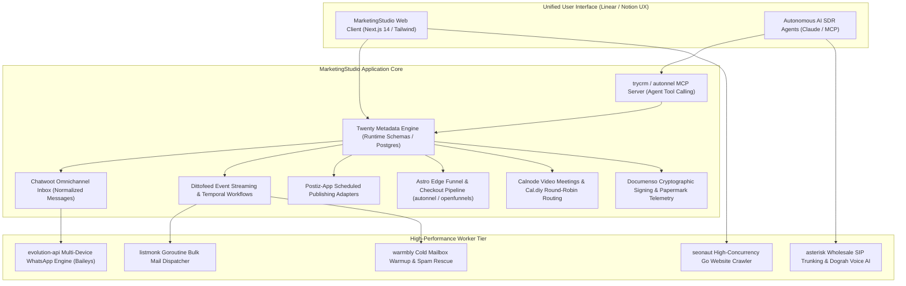

# MarketingStudio Open Source Architectural Comparisons

> **The Definitive Comparative Knowledge Base & Benchmark Reference for MarketingStudio**  
> Analyzing **79 open-source codebases** and **12 commercial benchmark platforms** across **16 functional domains**, featuring **16 Category Master Guides** and **79 In-Depth Solution Comparison Reports**.

---

## 🧭 Master Navigation & Comparison Directory Structure

```
docs/comparisons/
├── README.md                                    # This Master Index & Taxonomy Reference
├── categories/                                  # 16 Category Master Comparison Guides
│   ├── 01-email-infrastructure.md               # Email Delivery, SMTP, Warmup & SMPP
│   ├── 02-customer-lifecycle.md                 # Event Journeys, Workflows & Orchestration
│   ├── 03-crm-contact-management.md             # Custom Objects, Metadata & Agentic CRMs
│   ├── 04-cold-outreach-sdr.md                  # Cold Email, LinkedIn MCP & Power Dialers
│   ├── 05-telephony-voice-pbx.md                # SIP Switching, WebRTC & Real-Time Voice AI
│   ├── 06-omnichannel-helpdesk.md               # Shared Inboxes, Ticketing & Live Chat
│   ├── 07-whatsapp-messaging.md                 # Baileys, WhatsApp Web & Android SMS Gateways
│   ├── 08-social-media-management.md            # Multi-Platform Schedulers & AI Content
│   ├── 09-conversational-ai-bots.md             # Visual Bot Studios, Telegram & Discord
│   ├── 10-forms-surveys-feedback.md             # In-App CX, Conversational & Headless Forms
│   ├── 11-seo-crawlers-rank-tracking.md         # High-Speed Crawlers & SERP Trackers
│   ├── 12-esignature-document-tracking.md       # Cryptographic Signatures & Slide Telemetry
│   ├── 13-content-management-publishing.md      # Headless CMS, Newsletters & Paywalls
│   ├── 14-product-analytics-telemetry.md        # Mobile/Web Analytics & Event Funnels
│   ├── 15-sales-funnels-checkout.md             # Funnel Builders, 1-Click Upsells & Edge Astro
│   └── 16-scheduling-calendar-engines.md        # Appointment Booking, Round-Robin & Video
└── solutions/                                   # 79 Per-Solution Deep Dive Comparison Files
    ├── listmonk-comparison.md                   # listmonk vs Category 01 peers
    ├── twenty-comparison.md                     # twenty vs Category 03 peers
    ├── chatwoot-comparison.md                   # chatwoot vs Category 06 peers
    ├── parcelvoy-comparison.md                  # parcelvoy vs Category 02 peers
    ├── autonnel-comparison.md                   # autonnel vs Category 15 peers
    ├── openfunnels-comparison.md                # openfunnels vs Category 15 peers
    ├── calnode-comparison.md                    # calnode vs Category 16 peers
    ├── cal.diy-comparison.md                    # cal.diy vs Category 16 peers
    └── ... (79 detailed comparative reports)
```

---

## 🏛 The 16 Functional Domains & Solution Comparison Index

### Domain 01: Email Infrastructure & Delivery
- **Category Master Guide**: [Read 01-email-infrastructure.md](categories/01-email-infrastructure.md)
- **Domain Scope**: High-throughput SMTP, newsletter management, transactional mail, deliverability warmup, carrier-grade message dispatching.
- **Commercial Benchmarks**: Instantly.ai, Lemlist.com, SendGrid, Postmark, Amazon SES
- **Solution Comparisons**:
  - [`listmonk`](solutions/listmonk-comparison.md) — vs BillionMail, postal, useSend, warmbly, jasmin
  - [`BillionMail`](solutions/BillionMail-comparison.md) — vs listmonk, postal, useSend, warmbly, jasmin
  - [`postal`](solutions/postal-comparison.md) — vs listmonk, BillionMail, useSend, warmbly, jasmin
  - [`useSend`](solutions/useSend-comparison.md) — vs listmonk, BillionMail, postal, warmbly, jasmin
  - [`warmbly`](solutions/warmbly-comparison.md) — vs listmonk, BillionMail, postal, useSend, jasmin
  - [`jasmin`](solutions/jasmin-comparison.md) — vs listmonk, BillionMail, postal, useSend, warmbly

### Domain 02: Customer Lifecycle & Journeys
- **Category Master Guide**: [Read 02-customer-lifecycle.md](categories/02-customer-lifecycle.md)
- **Domain Scope**: Event-driven customer engagement, multi-channel user journeys, visual workflow automation, notification routing, marketing automation.
- **Commercial Benchmarks**: Customer.io, Braze, Segment, HubSpot Marketing Hub, Zapier, Make.com
- **Solution Comparisons**:
  - [`dittofeed`](solutions/dittofeed-comparison.md) — vs laudspeaker, notifuse, n8n, mautic, parcelvoy
  - [`laudspeaker`](solutions/laudspeaker-comparison.md) — vs dittofeed, notifuse, n8n, mautic, parcelvoy
  - [`notifuse`](solutions/notifuse-comparison.md) — vs dittofeed, laudspeaker, n8n, mautic, parcelvoy
  - [`n8n`](solutions/n8n-comparison.md) — vs dittofeed, laudspeaker, notifuse, mautic, parcelvoy
  - [`mautic`](solutions/mautic-comparison.md) — vs dittofeed, laudspeaker, notifuse, n8n, parcelvoy
  - [`parcelvoy`](solutions/parcelvoy-comparison.md) — vs dittofeed, laudspeaker, notifuse, n8n, mautic

### Domain 03: CRM & Contact Management
- **Category Master Guide**: [Read 03-crm-contact-management.md](categories/03-crm-contact-management.md)
- **Domain Scope**: Custom objects, lead pipelines, deals, accounts, sales activities, CRM metadata engines, AI sales agent orchestration.
- **Commercial Benchmarks**: Salesforce, HubSpot CRM, Attio, Pipedrive, Close.com
- **Solution Comparisons**:
  - [`twenty`](solutions/twenty-comparison.md) — vs trycrm, espocrm, crm, laravel-crm, DeskcommCRM, Quickly, qrev, DenchClaw
  - [`trycrm`](solutions/trycrm-comparison.md) — vs twenty, espocrm, crm, laravel-crm, DeskcommCRM, Quickly, qrev, DenchClaw
  - [`espocrm`](solutions/espocrm-comparison.md) — vs twenty, trycrm, crm, laravel-crm, DeskcommCRM, Quickly, qrev, DenchClaw
  - [`crm` (Frappe)](solutions/crm-comparison.md) — vs twenty, trycrm, espocrm, laravel-crm, DeskcommCRM, Quickly, qrev, DenchClaw
  - [`laravel-crm`](solutions/laravel-crm-comparison.md) — vs twenty, trycrm, espocrm, crm, DeskcommCRM, Quickly, qrev, DenchClaw
  - [`DeskcommCRM`](solutions/DeskcommCRM-comparison.md) — vs twenty, trycrm, espocrm, crm, laravel-crm, Quickly, qrev, DenchClaw
  - [`Quickly`](solutions/Quickly-comparison.md) — vs twenty, trycrm, espocrm, crm, laravel-crm, DeskcommCRM, qrev, DenchClaw
  - [`qrev`](solutions/qrev-comparison.md) — vs twenty, trycrm, espocrm, crm, laravel-crm, DeskcommCRM, Quickly, DenchClaw
  - [`DenchClaw`](solutions/DenchClaw-comparison.md) — vs twenty, trycrm, espocrm, crm, laravel-crm, DeskcommCRM, Quickly, qrev
  - [`relaticle`](solutions/relaticle-comparison.md) — vs twenty, trycrm, espocrm, crm, laravel-crm, DeskcommCRM, Quickly, qrev, DenchClaw

### Domain 04: Cold Outreach & AI SDR
- **Category Master Guide**: [Read 04-cold-outreach-sdr.md](categories/04-cold-outreach-sdr.md)
- **Domain Scope**: Cold email cadences, LinkedIn prospecting, autonomous AI SDR agents, power dialing, multi-channel outbound sequencing.
- **Commercial Benchmarks**: Apollo.io, Clay.com, Instantly.ai, HeyReach.io, Lemlist.com
- **Solution Comparisons**:
  - [`AgentSDR`](solutions/AgentSDR-comparison.md) — vs OpenOutreach, linkedin-outreach-mcp, Open-Cold-Dialer, ringee-app
  - [`OpenOutreach`](solutions/OpenOutreach-comparison.md) — vs AgentSDR, linkedin-outreach-mcp, Open-Cold-Dialer, ringee-app
  - [`linkedin-outreach-mcp`](solutions/linkedin-outreach-mcp-comparison.md) — vs AgentSDR, OpenOutreach, Open-Cold-Dialer, ringee-app
  - [`Open-Cold-Dialer`](solutions/Open-Cold-Dialer-comparison.md) — vs AgentSDR, OpenOutreach, linkedin-outreach-mcp, ringee-app
  - [`ringee-app`](solutions/ringee-app-comparison.md) — vs AgentSDR, OpenOutreach, linkedin-outreach-mcp, Open-Cold-Dialer

### Domain 05: Telephony, Voice & PBX
- **Category Master Guide**: [Read 05-telephony-voice-pbx.md](categories/05-telephony-voice-pbx.md)
- **Domain Scope**: Real-time voice streaming, AI voice agents, SIP trunking, WebRTC audio bridging, IVR trees, telecommunications PBX infrastructure.
- **Commercial Benchmarks**: Twilio Voice, Vapi.ai, Retell AI, Bland.ai, Genesys Cloud
- **Solution Comparisons**:
  - [`asterisk`](solutions/asterisk-comparison.md) — vs VoicEra, dograh
  - [`VoicEra`](solutions/VoicEra-comparison.md) — vs asterisk, dograh
  - [`dograh`](solutions/dograh-comparison.md) — vs asterisk, VoicEra

### Domain 06: Omnichannel Helpdesk & Support
- **Category Master Guide**: [Read 06-omnichannel-helpdesk.md](categories/06-omnichannel-helpdesk.md)
- **Domain Scope**: Omnichannel shared inboxes, customer support ticketing, live chat widgets, conversation state machines, SLA enforcement, agent routing.
- **Commercial Benchmarks**: Intercom, Zendesk, Help Scout, Front, Freshdesk, Respond.io
- **Solution Comparisons**:
  - [`chatwoot`](solutions/chatwoot-comparison.md) — vs zammad, freescout, helpdesk, libredesk, chaskiq, brightbean-chat
  - [`zammad`](solutions/zammad-comparison.md) — vs chatwoot, freescout, helpdesk, libredesk, chaskiq, brightbean-chat
  - [`freescout`](solutions/freescout-comparison.md) — vs chatwoot, zammad, helpdesk, libredesk, chaskiq, brightbean-chat
  - [`helpdesk` (Frappe)](solutions/helpdesk-comparison.md) — vs chatwoot, zammad, freescout, libredesk, chaskiq, brightbean-chat
  - [`libredesk`](solutions/libredesk-comparison.md) — vs chatwoot, zammad, freescout, helpdesk, chaskiq, brightbean-chat
  - [`chaskiq`](solutions/chaskiq-comparison.md) — vs chatwoot, zammad, freescout, helpdesk, libredesk, brightbean-chat
  - [`brightbean-chat`](solutions/brightbean-chat-comparison.md) — vs chatwoot, zammad, freescout, helpdesk, libredesk, chaskiq

### Domain 07: WhatsApp & Messaging Gateways
- **Category Master Guide**: [Read 07-whatsapp-messaging.md](categories/07-whatsapp-messaging.md)
- **Domain Scope**: Multi-device WhatsApp APIs, WhatsApp session managers, Android SMS gateways, mobile push notifications, messaging webhooks.
- **Commercial Benchmarks**: WhatsApp Cloud API, Twilio SMS/WhatsApp, Respond.io, Pushover, Sent.dm
- **Solution Comparisons**:
  - [`evolution-api`](solutions/evolution-api-comparison.md) — vs wppconnect, OpenWA, textbee, playsms, ntfy
  - [`wppconnect`](solutions/wppconnect-comparison.md) — vs evolution-api, OpenWA, textbee, playsms, ntfy
  - [`OpenWA`](solutions/OpenWA-comparison.md) — vs evolution-api, wppconnect, textbee, playsms, ntfy
  - [`textbee`](solutions/textbee-comparison.md) — vs evolution-api, wppconnect, OpenWA, playsms, ntfy
  - [`playsms`](solutions/playsms-comparison.md) — vs evolution-api, wppconnect, OpenWA, textbee, ntfy
  - [`ntfy`](solutions/ntfy-comparison.md) — vs evolution-api, wppconnect, OpenWA, textbee, playsms

### Domain 08: Social Media Management
- **Category Master Guide**: [Read 08-social-media-management.md](categories/08-social-media-management.md)
- **Domain Scope**: Multi-platform social media scheduling, social calendar orchestration, automated OAuth token refresh, post preview rendering, social analytics.
- **Commercial Benchmarks**: Buffer, Hootsuite, Later, Sprout Social, Sent.dm
- **Solution Comparisons**:
  - [`mixpost`](solutions/mixpost-comparison.md) — vs postiz-app, openpost, trypost, postbase
  - [`postiz-app`](solutions/postiz-app-comparison.md) — vs mixpost, openpost, trypost, postbase
  - [`openpost`](solutions/openpost-comparison.md) — vs mixpost, postiz-app, trypost, postbase
  - [`trypost`](solutions/trypost-comparison.md) — vs mixpost, postiz-app, openpost, postbase
  - [`postbase`](solutions/postbase-comparison.md) — vs mixpost, postiz-app, openpost, trypost

### Domain 09: Conversational AI & Bots
- **Category Master Guide**: [Read 09-conversational-ai-bots.md](categories/09-conversational-ai-bots.md)
- **Domain Scope**: Visual bot builders, conversational dialog engines, knowledge-base RAG chatbots, Telegram bot frameworks, Discord community automation.
- **Commercial Benchmarks**: Voiceflow, Botpress Cloud, ManyChat, Drift, Ada Support
- **Solution Comparisons**:
  - [`botpress`](solutions/botpress-comparison.md) — vs ChatbotX, aiogram, grammY, discord.js, Red-DiscordBot, TomoriBot
  - [`ChatbotX`](solutions/ChatbotX-comparison.md) — vs botpress, aiogram, grammY, discord.js, Red-DiscordBot, TomoriBot
  - [`aiogram`](solutions/aiogram-comparison.md) — vs botpress, ChatbotX, grammY, discord.js, Red-DiscordBot, TomoriBot
  - [`grammY`](solutions/grammY-comparison.md) — vs botpress, ChatbotX, aiogram, discord.js, Red-DiscordBot, TomoriBot
  - [`discord.js`](solutions/discord.js-comparison.md) — vs botpress, ChatbotX, aiogram, grammY, Red-DiscordBot, TomoriBot
  - [`Red-DiscordBot`](solutions/Red-DiscordBot-comparison.md) — vs botpress, ChatbotX, aiogram, grammY, discord.js, TomoriBot
  - [`TomoriBot`](solutions/TomoriBot-comparison.md) — vs botpress, ChatbotX, aiogram, grammY, discord.js, Red-DiscordBot

### Domain 10: Forms, Surveys & Feedback
- **Category Master Guide**: [Read 10-forms-surveys-feedback.md](categories/10-forms-surveys-feedback.md)
- **Domain Scope**: In-app micro-surveys, conversational form builders, headless form backends, enterprise statistical research, public customer feedback voting boards.
- **Commercial Benchmarks**: Typeform, Qualtrics, SurveyMonkey, Canny.io, Formspree
- **Solution Comparisons**:
  - [`formbricks`](solutions/formbricks-comparison.md) — vs heyform, OpnForm, formizee, LimeSurvey, survey-library, fider, logchimp, Logiq
  - [`heyform`](solutions/heyform-comparison.md) — vs formbricks, OpnForm, formizee, LimeSurvey, survey-library, fider, logchimp, Logiq
  - [`OpnForm`](solutions/OpnForm-comparison.md) — vs formbricks, heyform, formizee, LimeSurvey, survey-library, fider, logchimp, Logiq
  - [`formizee`](solutions/formizee-comparison.md) — vs formbricks, heyform, OpnForm, LimeSurvey, survey-library, fider, logchimp, Logiq
  - [`LimeSurvey`](solutions/LimeSurvey-comparison.md) — vs formbricks, heyform, OpnForm, formizee, survey-library, fider, logchimp, Logiq
  - [`survey-library`](solutions/survey-library-comparison.md) — vs formbricks, heyform, OpnForm, formizee, LimeSurvey, fider, logchimp, Logiq
  - [`fider`](solutions/fider-comparison.md) — vs formbricks, heyform, OpnForm, formizee, LimeSurvey, survey-library, logchimp, Logiq
  - [`logchimp`](solutions/logchimp-comparison.md) — vs formbricks, heyform, OpnForm, formizee, LimeSurvey, survey-library, fider, Logiq
  - [`Logiq`](solutions/Logiq-comparison.md) — vs formbricks, heyform, OpnForm, formizee, LimeSurvey, survey-library, fider, logchimp
  - [`dsforms`](solutions/dsforms-comparison.md) — vs formbricks, heyform, OpnForm, formizee, LimeSurvey, survey-library, fider, logchimp, Logiq

### Domain 11: SEO, Crawlers & Rank Tracking
- **Category Master Guide**: [Read 11-seo-crawlers-rank-tracking.md](categories/11-seo-crawlers-rank-tracking.md)
- **Domain Scope**: On-page technical SEO audits, high-concurrency website crawling, Google SERP keyword rank tracking, Core Web Vitals telemetry.
- **Commercial Benchmarks**: Ahrefs, Semrush, Screaming Frog SEO Spider, Sitebulb, AccuRanker
- **Solution Comparisons**:
  - [`open-seo`](solutions/open-seo-comparison.md) — vs seonaut, serpbear
  - [`seonaut`](solutions/seonaut-comparison.md) — vs open-seo, serpbear
  - [`serpbear`](solutions/serpbear-comparison.md) — vs open-seo, seonaut

### Domain 12: E-Signature & Document Tracking
- **Category Master Guide**: [Read 12-esignature-document-tracking.md](categories/12-esignature-document-tracking.md)
- **Domain Scope**: Cryptographic electronic signatures, PDF field templating, legally binding audit certificates, page-by-page document viewing analytics.
- **Commercial Benchmarks**: DocuSign, PandaDoc, Dropbox Sign (HelloSign), DocSend
- **Solution Comparisons**:
  - [`documenso`](solutions/documenso-comparison.md) — vs docuseal, OpenSign, papermark
  - [`docuseal`](solutions/docuseal-comparison.md) — vs documenso, OpenSign, papermark
  - [`OpenSign`](solutions/OpenSign-comparison.md) — vs documenso, docuseal, papermark
  - [`papermark`](solutions/papermark-comparison.md) — vs documenso, docuseal, OpenSign

### Domain 13: Content Management & Publishing
- **Category Master Guide**: [Read 13-content-management-publishing.md](categories/13-content-management-publishing.md)
- **Domain Scope**: Modern headless content publishing, publication newsletters, paid membership tiers, SEO content operations, headless CMS architectures.
- **Commercial Benchmarks**: WordPress, Substack, Strapi, Medium, Beehiiv
- **Solution Comparison**:
  - [`Ghost`](solutions/Ghost-comparison.md) — vs Headless CMS & Newsletter Publishing alternatives

### Domain 14: Product Analytics & Telemetry
- **Category Master Guide**: [Read 14-product-analytics-telemetry.md](categories/14-product-analytics-telemetry.md)
- **Domain Scope**: Real-time user journey analytics, mobile app telemetry, web event tracking, user cohort segmentation, privacy-first behavioral analytics.
- **Commercial Benchmarks**: PostHog, Mixpanel, Google Analytics 4, Plausible Analytics, Amplitude
- **Solution Comparison**:
  - [`countly-server`](solutions/countly-server-comparison.md) — vs PostHog, Mixpanel, GA4, Plausible

### Domain 15: Sales Funnels & Checkout Engines
- **Category Master Guide**: [Read 15-sales-funnels-checkout.md](categories/15-sales-funnels-checkout.md)
- **Domain Scope**: Conversion landing pages, multi-step sales funnels, one-click upsells/downsells, order bumps, checkout tokenization, and AI prompt-driven funnel generation.
- **Commercial Benchmarks**: ClickFunnels, Systeme.io, Kartra, GoHighLevel
- **Solution Comparisons**:
  - [`autonnel`](solutions/autonnel-comparison.md) — vs openfunnels, ClickFunnels, Systeme.io, Kartra, GoHighLevel
  - [`openfunnels`](solutions/openfunnels-comparison.md) — vs autonnel, ClickFunnels, Systeme.io, Kartra, GoHighLevel
  - [`spree`](solutions/spree-comparison.md) — vs autonnel, openfunnels, ClickFunnels, Systeme.io, Kartra, GoHighLevel

### Domain 16: Appointment Scheduling & Calendar Engines
- **Category Master Guide**: [Read 16-scheduling-calendar-engines.md](categories/16-scheduling-calendar-engines.md)
- **Domain Scope**: Online appointment scheduling, booking links, calendar availability calculations, multi-host round-robin routing, and embedded video meeting rooms.
- **Commercial Benchmarks**: Calendly, Cal.com Cloud, Acuity Scheduling, Chili Piper
- **Solution Comparisons**:
  - [`calnode`](solutions/calnode-comparison.md) — vs cal.diy, Calendly, Cal.com
  - [`cal.diy`](solutions/cal.diy-comparison.md) — vs calnode, Calendly, Cal.com

---

## 🏗 MarketingStudio Convergence Architectural Blueprint

The ultimate value of these 79 open-source comparisons and 12 commercial benchmarks is informing the unified architecture of **MarketingStudio**:



---

## 📊 Summary Statistics of the Comparative Knowledge Base

- **Total Open-Source Solutions Analyzed**: 79 repositories (in `inspire/`)
- **Commercial SaaS Platforms Benchmarked**: 12 platforms (Instantly, Clay, Apollo, Lemlist, HeyReach, Respond, Sent, GoHighLevel, Zoho Marketing Plus, HubSpot, Systeme.io, Kartra)
- **Functional Domains**: 16 distinct enterprise categories
- **Category Master Comparison Guides**: 16 documents (`docs/comparisons/categories/`)
- **Per-Solution Comparison Guides**: 79 documents (`docs/comparisons/solutions/`)
- **Total Comparison Knowledge Base Documents**: 96 markdown files (`docs/comparisons/` + categories + solutions)
