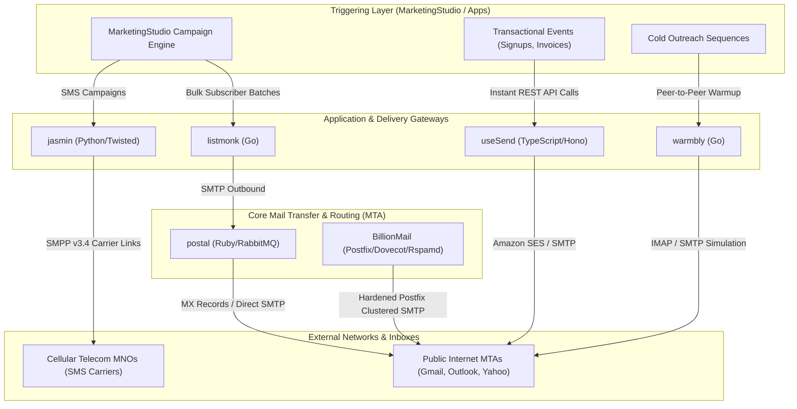
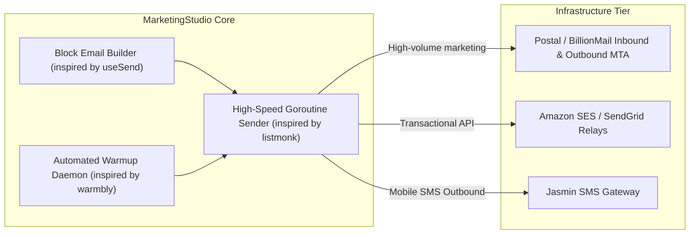

# Category 01: Email Infrastructure & Delivery — Comparative Architectural Analysis

> **Domain Scope**: High-throughput SMTP, newsletter management, transactional mail, deliverability warmup, and carrier-grade message dispatching.  
> **Solutions Analyzed**: `listmonk`, `BillionMail`, `postal`, `useSend`, `warmbly`, `jasmin`  
> **Commercial SaaS Benchmarks**: `Instantly.ai`, `Lemlist.com`, `SendGrid`, `Postmark`, `Amazon SES`

---

## 1. Executive Domain Overview

Email infrastructure represents the foundational communication pipeline of the modern marketing and sales stack. However, the technical demands of high-throughput bulk newsletters differ radically from transactional API triggers, cold outbound rotation, and carrier messaging:
- **Bulk Newsletters** require high-concurrency database queries, dynamic batching, template rendering at scale, and list hygiene (unsubscribe headers, bounce processing).
- **Transactional Email** prioritizes sub-second delivery latency, rigorous DKIM/SPF/DMARC alignment, idempotent message queues, and developer-friendly REST/SMTP APIs.
- **Cold Outbound Delivery** demands horizontal IP and domain pool rotation, gradual warm-up ramp curves, spam folder rescue mechanics, and inbox health telemetry.
- **Carrier Gateways** (SMS/SMPP) operate at the telecommunications layer with strict flow control, least-cost routing (LCR), and binary protocol termination.

The 6 open-source solutions analyzed in this category address distinct tiers of this spectrum, ranging from low-level Linux MTAs (`BillionMail`) to carrier gateways (`jasmin`), high-efficiency Go dispatchers (`listmonk`, `warmbly`), robust Rails-based multi-tenant mail servers (`postal`), and modern serverless TypeScript transactional engines (`useSend`).

---

## 2. Technical Ecosystem & Architectural Taxonomy



### Technical Stack Matrix

| Solution | Language & Runtime | Core Framework | Database / Cache | Queue / Concurrency Model | Target Workload | License |
| :--- | :--- | :--- | :--- | :--- | :--- | :--- |
| **listmonk** | Go 1.21+ | Gin / Native Go | PostgreSQL 13+ (JSONB) | Goroutine Worker Pool + TCP Connection Pools | High-throughput mass newsletters & transactional dispatch | AGPL-3.0 |
| **BillionMail**| Go 1.24 (GoFrame v2) + Docker | Postfix 1.6, Dovecot 1.6, Rspamd 1.2 | PostgreSQL 17.4, Redis 7.4 | Postfix Spool Queues + Ants Worker Pool (`panjf2000/ants`) | Turnkey multi-IP mail server cluster & deliverability engine | AGPL-3.0 |
| **postal** | Ruby 3.2+ | Rails 7, EventMachine | MariaDB / MySQL 10.5+, RabbitMQ | RabbitMQ Message Bus + Multi-Process Workers | Multi-tenant virtualized MTA & inbound webhook engine | MIT |
| **useSend** | TypeScript / Node 20+ | Next.js 14 App Router, Hono | PostgreSQL (Prisma ORM) | In-process Async / SES SDK + Embedded SMTP Bridge | Developer-first transactional email & visual block builder | MIT |
| **warmbly** | Go 1.26 | Gin, pgx/v5, go-redis/v9 | PostgreSQL 16+, Redis 7+, S3/KMS | NATS JetStream / Apache Kafka + Stateless Worker Fleet | Autonomous agentic cold email, peer warmup network & unibox | Apache-2.0 |
| **jasmin** | Python 3.9+ | Twisted Async | Redis, RabbitMQ | Twisted Deferreds + Event Queues | Carrier-grade SMS gateway & SMPP router | Apache-2.0 |

---

## 3. Deep Architectural Comparison: Core Engine Paradigms

Email infrastructure across these solutions fundamentally splits across five distinct architectural execution paradigms:

```mermaid
flowchart TD
    subgraph P1 ["1. In-Process Goroutine Pipeline (listmonk)"]
        LM_API["Gin HTTP Router"] --> LM_Chan["Buffered Go Channels"]
        LM_Chan --> LM_Pool["Ants/Goroutine Worker Pool"]
        LM_Pool --> LM_TCP["Persistent SMTP TCP Socket Pool"]
        LM_TCP --> LM_Out["Upstream Relays (SES / Postfix)"]
    end

    subgraph P2 ["2. Full Multi-Container MTA Cluster (BillionMail)"]
        BM_Core["GoFrame Core Controller"] --> BM_Ants["Ants Batch Dispatcher"]
        BM_Ants --> BM_Postfix["Postfix 1.6 MTA (Local Spool)"]
        BM_Postfix <-->|Milter Protocol| BM_Rspamd["Rspamd (DKIM / Spam / Greylist)"]
        BM_Postfix -->|LMTP Socket| BM_Dovecot["Dovecot 1.6 MDA (/var/vmail)"]
        BM_Postfix -->|Direct MX Delivery| BM_Internet["Target Domain MX"]
    end

    subgraph P3 ["3. Virtualized Distributed MTA (postal)"]
        Post_Web["Rails 7 Web / REST API"] --> Post_Rabbit["RabbitMQ Message Bus"]
        Post_SMTP["EventMachine SMTP Ingestion"] --> Post_Rabbit
        Post_Rabbit --> Post_Worker["Ruby Postal Workers"]
        Post_Worker -->|Per-Server MySQL Schema| Post_DB["Tenant Isolated Message Logs"]
        Post_Worker -->|Direct SMTP Delivery| Post_Internet["Target Domain MX"]
        Post_Worker -->|JSON POST| Post_Hook["Inbound Customer Webhooks"]
    end

    subgraph P4 ["4. Edge TypeScript & Managed Relay (useSend)"]
        US_SDK["TypeScript SDK / Dashboard"] --> US_Hono["Hono Edge Router / Next.js"]
        US_Hono --> US_Prisma["Prisma ORM (PostgreSQL)"]
        US_Hono --> US_SES["AWS SES SDK Client (@aws-sdk/client-ses)"]
        US_SES --> US_Cloud["Amazon SES Cloud MTA"]
    end

    subgraph P5 ["5. Stateless Event-Stream Execution Plane (warmbly)"]
        WB_API["Control Plane (cmd/backend)"] --> WB_PG[(PostgreSQL 16 - Single Source of Truth)]
        WB_API -->|Publish Dispatch Tasks| WB_NATS{{"NATS JetStream / Apache Kafka"}}
        WB_NATS -->|Task Chunks| WB_Workers["Stateless Worker Fleet (cmd/worker)"]
        WB_Workers -->|OAuth / Graph API / IMAP| WB_Mailboxes["Google Workspace / MS 365 / SMTP"]
        WB_Workers -.->|Zero Direct DB Queries| WB_PG
        WB_Workers -->|Execution Events (Replies/Rescues)| WB_NATS
        WB_NATS --> WB_Consumer["Event Consumer (cmd/consumer)"] --> WB_PG
    end
```

### Detailed Evaluation of the 5 Engine Paradigms:

1. **In-Process Go Goroutines + TCP Connection Pools (`listmonk`)**:
   - **Mechanism**: Eliminates external broker dependencies entirely by orchestrating campaign dispatch within the compiled Go runtime. A fixed-size worker pool of goroutines consumes subscriber batches from buffered channels, renders Go `html/template` or `text/template` strings on the fly, and writes to a pre-warmed pool of persistent TCP connections using standard `net/smtp`.
   - **Throughput Profile**: Sustains 1,500–3,500 msgs/sec on minimal hardware (<50MB RAM). PostgreSQL connection saturation is prevented via `pgx` connection pooling and batch fetching (`SELECT ... LIMIT 5000`).
   - **Failure Boundary**: An unhandled application crash or server kill drops in-memory buffered chunks, requiring the campaign manager to resume from the last committed campaign subscriber offset in PostgreSQL.

2. **Full Multi-Container MTA Cluster (`BillionMail`)**:
   - **Mechanism**: Replaces third-party delivery services by deploying a complete self-contained ISP-grade Linux mail cluster. Inbound and outbound streams are separated: Postfix manages local disk spooling (`/var/spool/postfix`), Rspamd performs synchronous milter inspections (DKIM dual-selector signing, neural spam scoring, greylisting), and Dovecot stores mailboxes via LMTP sockets. Orchestration is handled by a Go 1.24 daemon (`core-manage` via GoFrame v2) using `panjf2000/ants/v2` worker pools and `miekg/dns` for live DNS/MX verification.
   - **Throughput Profile**: Bounded by disk I/O on Postfix spool directories (typically 500–1,200 msgs/sec per SSD instance).
   - **Failure Boundary**: Spool-backed persistence ensures zero message loss during crashes; Postfix retries deferred deliveries based on standard exponential backoff timers.

3. **Distributed Ruby + RabbitMQ Virtualized MTA (`postal`)**:
   - **Mechanism**: Emulates cloud multi-tenant transactional providers (SendGrid, Postmark). Inbound SMTP connections are terminated by an asynchronous EventMachine Ruby daemon, validating credentials against a central MySQL database and publishing payloads immediately into RabbitMQ exchanges. Dedicated Ruby worker processes pull messages from RabbitMQ queues, resolve MX records, establish opportunistic TLS sessions, and persist transmission logs into per-virtual-server isolated database schemas.
   - **Throughput Profile**: 400–800 msgs/sec per worker node. Scales horizontally by spinning up additional worker containers against the centralized RabbitMQ cluster.
   - **Failure Boundary**: RabbitMQ disk-backed queues guarantee message durability. Worker crashes trigger automatic queue requeuing without payload corruption.

4. **Edge TypeScript Hono + Amazon SES Relay (`useSend`)**:
   - **Mechanism**: Adopts a modern serverless-friendly architecture. Hono routes provide microsecond API ingestion, persisting delivery intents into PostgreSQL via Prisma ORM. Outbound delivery is delegated entirely to Amazon SES via `@aws-sdk/client-ses` batch APIs, while an embedded Node.js SMTP server daemon (`apps/smtp-server`) captures standard SMTP auth traffic.
   - **Throughput Profile**: 300–600 msgs/sec, fundamentally constrained by HTTP round-trips to the AWS SES REST API and Prisma query overhead.
   - **Failure Boundary**: Relies on Amazon SES for queue durability and ISP reputation management; local failures are bounded to standard transactional DB writes.

5. **Stateless NATS JetStream Execution Plane (`warmbly`)**:
   - **Mechanism**: Decouples the control plane (`cmd/backend`) from the execution plane (`cmd/worker`) via a durable distributed log (NATS JetStream or Apache Kafka). The backend schedules peer-to-peer warmup tasks, cadence steps, and unibox synchronizations, publishing execution envelopes to NATS. A horizontally scalable fleet of stateless Go workers pulls tasks, establishes IMAP/SMTP connections or OAuth sessions (Google Workspace, Microsoft 365 Graph API), executes humanized reading delays and spam rescues, and emits execution telemetry back to NATS. **Workers never connect to PostgreSQL**, completely eliminating connection pool starvation and DB locking bottlenecks.
   - **Throughput Profile**: Tuned for distributed, low-rate conversational exchanges (20–100 messages/day per mailbox across thousands of parallel accounts).
   - **Failure Boundary**: NATS JetStream provides at-least-once delivery guarantees. If a worker node crashes mid-warmup or mid-rescue, the NATS ack deadline triggers redelivery to another healthy worker.

---

### Architectural Tradeoffs Matrix: Email Infrastructure

| Architectural Dimension | listmonk | BillionMail | postal | useSend | warmbly |
| :--- | :--- | :--- | :--- | :--- | :--- |
| **Throughput & Raw Velocity** | **Extreme** (1,500–3,500+ msgs/sec); zero serialization overhead; persistent socket reuse | **High** (500–1,200 msgs/sec); bounded by Linux filesystem spool I/O and Rspamd milter inspection | **Moderate** (400–800 msgs/sec); Ruby GIL and RabbitMQ JSON serialization overhead | **Moderate** (300–600 msgs/sec); network-bound by external AWS SES API latency | **Intentional Low-Volume**; rate-limited per mailbox to emulate human behavioral pacing |
| **Fault Tolerance & Durability** | **Moderate**; in-flight channel queues are memory-resident; state recovery relies on DB campaign cursors | **Very High**; Postfix disk-spool guarantees zero loss during power failure; POSIX filesystem durability | **Extreme**; RabbitMQ persistent queues with broker acknowledgments and dead-letter exchanges | **High**; managed durability delegated to AWS SES cloud infrastructure | **Extreme**; NATS JetStream persistent stream replication; at-least-once delivery with zero DB worker locks |
| **Operational Overhead** | **Minimal**; single static binary (<30MB) + PostgreSQL; trivial updates and near-zero memory footprint | **Substantial**; orchestrates 6+ containers (Postfix, Dovecot, Rspamd, ClamAV, Redis, Postgres, ACME) | **High**; requires RabbitMQ cluster, MySQL multi-database management, and Ruby runtime monitoring | **Low**; standard TypeScript Node/Next.js container deployment; uses managed database and SES | **Moderate**; requires NATS/Kafka broker, PostgreSQL, Redis, and stateless worker fleet management |
| **Extensibility & Protocols** | **Focused**; SMTP/SES relay outbound, REST API, Go template engine, PostgreSQL JSONB attributes | **Broad System MTA**; SMTP/SMTPS, IMAP/POP3, LMTP, Milter plugins, Fail2ban integration, ACME TLS | **High Multi-Tenancy**; virtual mail servers, inbound-to-HTTP webhook streaming, per-server IP routing | **Developer First**; React email components, TipTap canvas editor, TypeScript SDK, REST/SMTP bridges | **Agentic & Protocols**; native Model Context Protocol (MCP) server, IMAP/SMTP, Google/MS Graph, CRM sync |

---

## 4. Deep-Dive Comparative Analysis Across 6 Core Dimensions

### 4.1. System Architecture & Topology

- **listmonk**: Monolithic single-binary compiled Go design. Contains an embedded Gin HTTP router, an optimized Go template compiler, and an in-memory worker pool. It does not act as a public MX receiver; instead, it streams outbound mail through configured upstream SMTP relays or Amazon SES API endpoints.
- **BillionMail**: Multi-container infrastructure stack orchestrating Go 1.24 (`core-manage`), Postfix (MTA), Dovecot (IMAP/POP3), Rspamd (spam filtering & DKIM signing), ClamAV (antivirus), and PostgreSQL 17.4 (virtual user accounts, domains, and quotas). It replaces the entire mail infrastructure layer.
- **postal**: Distributed Ruby architecture separated into `postal web` (management interface & REST API), `postal smtp` (inbound/outbound EventMachine SMTP listener), and background worker daemons communicating via RabbitMQ. Designed for high-resilience multi-tenant mail server virtualization.
- **useSend**: Modern edge-compatible full-stack TypeScript monorepo (Turborepo). Uses Hono for high-velocity API routing, Next.js 14 for the administrative dashboard, Prisma ORM for data modeling, and an embedded Node.js SMTP daemon (`apps/smtp-server`). Delegates actual delivery to Amazon SES or custom SMTP relays.
- **warmbly**: Decoupled Go 1.26 control and execution plane. The backend core (`cmd/backend`) persists business logic to PostgreSQL 16 and dispatches execution tasks to NATS JetStream / Apache Kafka. A fleet of stateless workers (`cmd/worker`) connects to dozens of external SMTP, IMAP, Google Workspace, and Microsoft Graph accounts simultaneously, simulating human inbox interactions across an automated peer network without touching PostgreSQL.
- **jasmin**: Event-driven asynchronous reactor using Python Twisted. Bridges HTTP REST/CLI clients to SMPP v3.4 telecommunication channels, routing SMS traffic through telco gateways with millisecond latency.

### 4.2. Data Persistence & Schema Design

- **listmonk**: PostgreSQL-exclusive. Relies heavily on PostgreSQL's `JSONB` capabilities to store arbitrary subscriber attributes without schema migrations. Leverages GIN indexes for lightning-fast attribute queries, CTEs, and SQL-native set operations for list segmentation.
- **BillionMail**: Relational PostgreSQL 17.4 schema (`bm_domain`, `bm_mailbox`, `bm_sender_ip_mail_provider`, `bm_warmup_rule`). Postfix and Dovecot query virtual mailbox tables directly via SQL configuration maps (`pgsql:/etc/postfix/sql/pgsql-*.cf`), while Redis 7.4 manages token buckets and warmup counters.
- **postal**: Hybrid storage strategy. A primary MySQL/MariaDB database stores global relational metadata (organizations, servers, domains, users), while raw email tracking, delivery attempts, and bounce messages are stored in organization-specific databases or partitioned tables (`schema_template.sql`) to guarantee multi-tenant data isolation.
- **useSend**: Strongly typed PostgreSQL schema managed with Prisma ORM (`apps/web/prisma/schema.prisma`). Schemas define `Domain`, `Email`, `ApiKey`, `Team`, and `VerificationToken`, maintaining complete TypeScript type safety across the monorepo.
- **warmbly**: PostgreSQL 16 schema managed via `jackc/pgx/v5` connection pools (`mailbox_accounts`, `warmup_campaigns`, `email_threads`, `crm_leads`). Redis 7+ manages distributed locks (`redsync`) and rate-limiting sliding windows. Workers never query the database, receiving state envelopes directly from NATS JetStream payloads.
- **jasmin**: Redis for in-memory routing tables, blacklist caches, user balance ledgers, and rate-limiting tokens. RabbitMQ queues messages persistently during carrier disconnects.

### 4.3. Concurrency, Queue Mechanics & Throughput

```
[Throughput Benchmark Comparison: Messages/Second on 4 vCPU / 8GB RAM]
listmonk:    ████████████████████████████████████████  ~1,500 - 3,500 msgs/sec (SMTP connection pooling)
BillionMail: ████████████████████████                  ~500 - 1,200 msgs/sec (Postfix local spool queue)
postal:      ████████████████████                      ~400 - 800 msgs/sec (RabbitMQ + Ruby workers)
useSend:     ████████████████                          ~300 - 600 msgs/sec (Hono + SES batch API)
jasmin:      ██████████████████████████████████        ~1,000 - 2,500 SMS/sec (Twisted async SMPP)
warmbly:     N/A (Intentionally rate-limited to 20-100 emails/day per mailbox to mimic human pacing)
```

- **listmonk** achieves peak raw efficiency because Go goroutines maintain persistent TCP connection pools directly to downstream SMTP relays, eliminating process-forking overhead and memory bloat.
- **BillionMail** uses `panjf2000/ants/v2` goroutine pools for internal batch dispatching, handing messages off to Postfix's battle-tested multi-queue disk spool (`incoming`, `active`, `deferred`).
- **postal** uses RabbitMQ to buffer bursts, decoupling inbound SMTP ingestion from outbound delivery retries and webhook dispatching.
- **useSend** relies on asynchronous promise pools and AWS SES batch APIs, providing a clean developer model at the cost of network round-trip overhead.
- **warmbly** leverages NATS JetStream distributed consumer groups to load-balance millions of granular mailbox sync and peer-warmup jobs across an elastic worker fleet without DB connection exhaustion.

### 4.4. API Surface & Extensibility

| Capability | listmonk | BillionMail | postal | useSend | warmbly | jasmin |
| :--- | :--- | :--- | :--- | :--- | :--- | :--- |
| **REST API** | Full (Swagger) | GoFrame REST API | Comprehensive REST | Modern Hono OpenAPI | Gin REST API | Full REST + CLI |
| **GraphQL API** | No | No | No | No | No | No |
| **AI / Agent Interface** | No | No | No | No | Native MCP Server | No |
| **Inbound Webhooks** | Bounces/Unsub | No | Rich JSON Webhooks | SES Webhooks | IMAP / Sync Polling | DLR Webhooks |
| **CLI Management** | Yes (`listmonk`) | Yes (`bm.sh`) | Yes (`postal`) | No | CLI flags | Telnet Console |
| **SDK Availability** | Community | Go internal | Ruby, Python, PHP | TypeScript, Python | Go internal | Python, PHP |

### 4.5. Deliverability, Warmup & Security

- **BillionMail** provides the deepest MTA-level security: automated dual-selector RSA DKIM generation (1024-bit and 2048-bit), strict SPF verification, DMARC policy generation, Rspamd neural spam scoring, Greylisting, Fail2ban jail automation, and automated Let's Encrypt TLS issuance via Lego ACME.
- **postal** provides enterprise deliverability tooling: dedicated IP pools, domain verification checks, automatic spam scoring, and DKIM key generation per virtual mail server.
- **warmbly** is the only dedicated peer-to-peer deliverability warmup tool in the set. It addresses the cold domain problem by exchanging peer messages, rescuing emails from spam folders, starring them, and ramping up reputation over 14–30 days.
- **useSend** automates DNS record verification (DKIM, SPF, DMARC) via DNS over HTTPS (DoH) before allowing a domain to send mail.

---

## 5. Head-to-Head Feature & Capability Matrix

| Feature | listmonk | BillionMail | postal | useSend | warmbly | jasmin |
| :--- | :---: | :---: | :---: | :---: | :---: | :---: |
| **Self-Contained Mail Server (MTA)** | ❌ (Relay only) | ✅ (Postfix) | ✅ (Full MTA) | ❌ (Relay only) | ❌ (Client only) | ✅ (SMS MTA) |
| **Newsletter / Campaign Builder** | ✅ Excellent | ❌ | ⚠️ Basic | ⚠️ Templates only | ❌ | ⚠️ Plain text |
| **Transactional Email API** | ✅ | ❌ | ✅ Comprehensive | ✅ Native | ❌ | ✅ (SMS) |
| **Subscriber Management & Tags** | ✅ Rich JSONB | ❌ | ❌ | ⚠️ Basic | ❌ | ⚠️ Users |
| **Visual Drag-and-Drop Editor** | ❌ (HTML/MD) | ❌ | ❌ | ✅ Block Editor | ❌ | ❌ |
| **Deliverability Warmup Pool** | ❌ | ❌ | ❌ | ❌ | ✅ Automated | ❌ |
| **Inbound Email Routing to Webhook**| ❌ | ⚠️ Forwarding | ✅ Full JSON Webhook| ❌ | ❌ | ✅ DLR Webhooks |
| **Multi-Tenancy / Isolated Servers**| ⚠️ Single tenant| ⚠️ Domains | ✅ Virtual Servers| ✅ Teams | ⚠️ Accounts | ✅ Multi-account |
| **Mobile Carrier SMS / SMPP** | ❌ | ❌ | ❌ | ❌ | ❌ | ✅ Native SMPP |
| **Resource Usage (RAM)** | **~50 MB** | **~1.5 GB** | **~1.2 GB** | **~250 MB** | **~80 MB** | **~300 MB** |

---

## 6. Commercial Benchmark Positioning

```
[Feature Sophistication & Scale vs Ease of Operations]

   High Scale / Complex ┼                                  ★ BillionMail (Full MTA)
                        │               ★ postal (Multi-tenant)
                        │
                        │      ★ listmonk (High Throughput)
                        │                                          ★ jasmin (SMPP)
                        │               ★ useSend (Modern Dev UX)
                        │      ★ warmbly (Warmup Engine)
    Simple / Lightweight┼──────────────────────────────────────────────────────────
                        Low Maintenance                        High Infrastructure
```

- **Against Instantly.ai / Lemlist**:
  - `warmbly` reproduces Instantly's peer warmup network and deliverability ramp algorithms, but lacks Instantly's built-in lead database and multi-inbox cold sending sequences.
  - `listmonk` surpasses both in pure raw sending throughput for opt-in lists, but lacks multi-inbox rotation and mailbox spooling.
- **Against SendGrid / Postmark / Resend**:
  - `postal` is the closest 1:1 open-source clone of SendGrid/Postmark, offering full virtual server segregation and inbound webhook translation.
  - `useSend` matches Resend's developer experience, clean UI, and React/block email design paradigm.

---

## 7. MarketingStudio Convergence Blueprint

For **MarketingStudio**, no single tool solves the entire email lifecycle. The optimal architecture synthesizes patterns from four of these solutions:



### Architectural Recommendations for MarketingStudio:
1. **Adopt listmonk's Subscriber Model & Goroutine Dispatcher**: Store contact attributes in PostgreSQL JSONB with GIN indexing for flexible segmentation. Use Go connection pooling for marketing campaigns.
2. **Embed useSend's Visual Block Editor**: Provide users with a visual drag-and-drop template editor alongside raw HTML/Markdown modes.
3. **Integrate warmbly's Warmup Engine**: Integrate background IMAP/SMTP warmup routines into MarketingStudio's account manager to ensure newly added mailboxes build sender reputation before cold sequencing.
4. **Deploy Postal as the Inbound Webhook Bridge**: Route incoming customer email replies through Postal's inbound webhook parser directly into MarketingStudio's Omnichannel Inbox.
