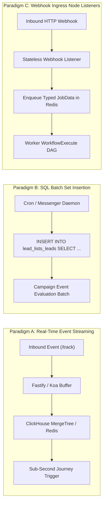
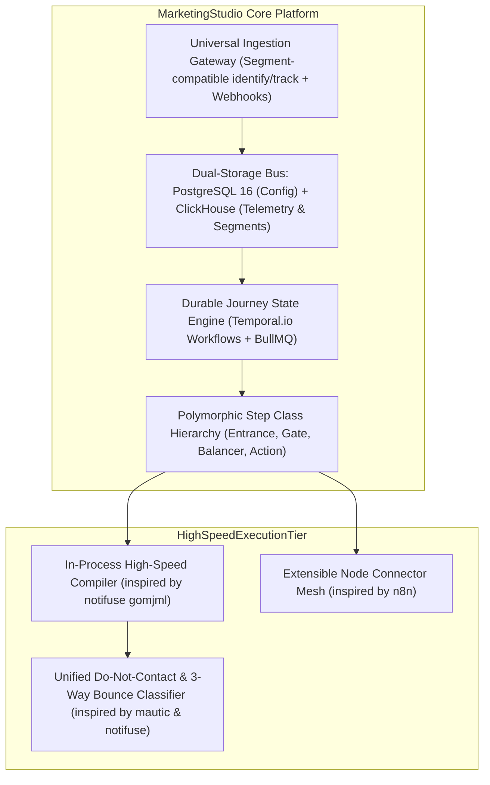

# Category 02: Customer Lifecycle & Journeys — Comparative Architectural Analysis

> **Domain Scope**: Event-driven customer engagement, multi-channel user journeys, visual workflow automation, notification dispatch, and enterprise marketing automation.  
> **Solutions Analyzed**: `dittofeed`, `laudspeaker`, `notifuse`, `parcelvoy`, `mautic`, `n8n`  
> **Commercial SaaS Benchmarks**: `Customer.io`, `Braze`, `Segment`, `HubSpot Marketing Hub`, `Zapier`, `Make.com`, `Courier`, `Novu`

---

## 1. Executive Domain Overview

Customer lifecycle marketing and automation has evolved from primitive batch-and-blast email newsletters into high-frequency, event-driven customer journeys. Modern platforms must continuously ingest real-time product telemetry (pageviews, session heartbeats, feature interactions, transactional webhooks), evaluate complex behavioral segments against streaming and historical datasets, and orchestrate durable, multi-step customer journeys spanning days or months across email, SMS, mobile push (APNs/FCM), in-app modals, Slack, and third-party webhooks.

Building an enterprise-grade customer lifecycle platform presents four fundamental engineering challenges:
1. **High-Velocity Telemetry Ingestion & Real-Time Querying**: Ingesting tens of thousands of raw client events per second without locking transactional database rows or exhausting connection pools, while supporting millisecond segment queries.
2. **Durable Temporal Workflow Orchestration**: Maintaining deterministic execution state across arbitrary delays (e.g., *"Wait 5 days, or until user performs `workspace_activated`"*) that withstands unannounced worker restarts, cluster rollouts, and database failovers without message duplication or lost progress.
3. **High-Performance In-Process Template Compilation**: Personalizing and compiling thousands of responsive HTML/MJML emails per second with dynamic tokens and conditional logic without creating memory leaks or process spawning bottlenecks.
4. **Channel Governance, Deliverability & Compliance**: Normalizing inconsistent provider bounce webhooks, strictly isolating marketing campaigns from transactional sender reputation, enforcing Do-Not-Contact (DNC) lists, and respecting local contact timezones via RFC 5545 recurrence rules.

The 6 open-source solutions analyzed in this category embody fundamentally distinct architectural paradigms:
- **`dittofeed`**: Built for high-throughput cloud-native scale, decoupling analytical event ingestion in **ClickHouse** from transactional metadata in **PostgreSQL**, with long-running journey state managed via **Temporal.io** code-as-workflow event sourcing.
- **`laudspeaker`**: Implements a modular **NestJS** monolith combining a **React Flow** Directed Acyclic Graph (DAG) canvas with **BullMQ** delayed queues and atomic composite state pointers (`JourneyLocation`), paired with a hybrid Postgres-ClickHouse data tier.
- **`notifuse`**: Eliminates Node.js runtime overhead by delivering a compiled **Go 1.25+** notification engine featuring 100% in-process **Liquid (`liquidgo`)** and **MJML (`gomjml`)** compilation, deterministic 3-way bounce classification, and Google Cloud AlloyDB / PostgreSQL persistence.
- **`parcelvoy`**: Delivers a developer-first **Koa 2 / Knex** lifecycle platform utilizing a polymorphic step class hierarchy (`JourneyStep`), timezone-localized scheduling via **RRULE**, traffic smoothing (`JourneyBalancer`), and BullMQ Redis workers.
- **`mautic`**: The industry benchmark for monolithic **PHP 8.2+ / Symfony 7.4** marketing automation, featuring asynchronous set-based segment rebuilding (`INSERT INTO ... SELECT`), an immutable Do-Not-Contact registry, and Symfony Messenger queue workers.
- **`n8n`**: Provides an extensible **TypeScript / Node.js** workflow automation engine with a deterministic DAG traverser (`WorkflowExecute`), paired-item data lineage, sandboxed expression evaluation (`isolated-vm`), and native LangChain AI agent integration.

---

## 2. Technical Ecosystem & Architectural Taxonomy

```mermaid
flowchart TD
    subgraph InboundTelemetry ["1. Inbound Telemetry & Event Ingestion"]
        WebSDK["Web SDK Telemetry (Track / Page)"]
        MobileApp["Mobile App SDK (Events / Push Tokens)"]
        BackendAPI["Backend Application APIs & Webhooks"]
    end

    subgraph IngestionGateways ["2. Ingress & Routing Tier"]
        DF_Ingest["dittofeed API (Fastify / Public Apps API)"]
        LS_Ingest["laudspeaker Controller (NestJS /events)"]
        NF_Ingest["notifuse HTTP API (Go 1.25+ / Internal HTTP)"]
        PV_Ingest["parcelvoy Gateway (Koa 2 / Client Event Job)"]
        Mautic_Ingest["mautic Front Controller (/mtracking.gif & API)"]
        N8N_Ingest["n8n Webhook Fleet (Stateless Express Listeners)"]
    end

    subgraph StateAndOrchestration ["3. Workflow & State Orchestration Engines"]
        DF_Temporal["dittofeed: Temporal.io (Event Sourcing & Replay)"]
        LS_BullMQ["laudspeaker: BullMQ + JourneyLocation Atomic Pointers"]
        NF_Goroutine["notifuse: Goroutine Worker Pools + Channel Dispatch"]
        PV_Knex["parcelvoy: Polymorphic JourneyStep + Knex + BullMQ"]
        Mautic_Symfony["mautic: Symfony Messenger + Cron Daemons"]
        N8N_DAG["n8n: WorkflowExecute DAG + isolated-vm Sandbox"]
    end

    subgraph StorageTier ["4. Multi-Model Persistence Layer"]
        Postgres[(PostgreSQL 16 / AlloyDB - Metadata & State)]
        ClickHouse[(ClickHouse 23+ - Columnar Events & Analytics)]
        MySQL[(MySQL 8.0 - Relational Leads & Campaigns)]
        RedisCache[(Redis 7.x - BullMQ Queues & Locks)]
    end

    subgraph DeliveryTier ["5. Multi-Channel Dispatch Gateways"]
        SES["Amazon SES v2 (Email)"]
        SendGridPostmark["SendGrid / Postmark / Mailgun"]
        TwilioSMS["Twilio / Telnyx (SMS)"]
        PushGateways["Apple APNs & Google FCM (Mobile Push)"]
        OutWebhooks["External Webhooks & CRM Sync"]
    end

    WebSDK --> DF_Ingest & LS_Ingest & PV_Ingest & Mautic_Ingest
    MobileApp --> DF_Ingest & PV_Ingest & LS_Ingest
    BackendAPI --> NF_Ingest & N8N_Ingest & DF_Ingest

    DF_Ingest --> DF_Temporal & ClickHouse & Postgres
    LS_Ingest --> LS_BullMQ & ClickHouse & Postgres & RedisCache
    NF_Ingest --> NF_Goroutine & Postgres
    PV_Ingest --> PV_Knex & MySQL & Postgres & RedisCache
    Mautic_Ingest --> Mautic_Symfony & MySQL & RedisCache
    N8N_Ingest --> N8N_DAG & Postgres & RedisCache

    DF_Temporal --> SES & SendGridPostmark & TwilioSMS
    LS_BullMQ --> SES & SendGridPostmark & TwilioSMS & PushGateways
    NF_Goroutine --> SES & SendGridPostmark
    PV_Knex --> SES & SendGridPostmark & TwilioSMS & PushGateways & OutWebhooks
    Mautic_Symfony --> SES & SendGridPostmark & OutWebhooks
    N8N_DAG --> OutWebhooks & SendGridPostmark & TwilioSMS
```



### Technical Stack Matrix

| Solution | Language & Runtime | Core Framework | Database / Analytical Store | State & Workflow Engine | Primary Focus | License |
| :--- | :--- | :--- | :--- | :--- | :--- | :--- |
| **dittofeed** | TypeScript (Node.js 20+) | Fastify, Next.js | PostgreSQL (Config) + ClickHouse (Events) | **Temporal.io** (Durable event-sourced workflows) | Event-driven customer engagement & streaming CDP | MIT |
| **laudspeaker** | TypeScript (Node.js 18+) | NestJS 10, React 18 | PostgreSQL 16 (TypeORM) + ClickHouse 23+ | **BullMQ** (Redis delayed jobs) + `JourneyLocation` | Visual React Flow journey canvas for growth teams | MIT |
| **notifuse** | Go 1.25+ | Native Go DDD | PostgreSQL 16 / Google Cloud AlloyDB | **Goroutine Worker Pools** + Channel Queues | High-speed in-process MJML/Liquid notification gateway | BSL 1.1 / AGPL-3.0 |
| **parcelvoy** | TypeScript (Node.js 18+) | Koa 2, Knex | MySQL 8.0+ / PostgreSQL 15+ | **BullMQ** + Polymorphic `JourneyStep` classes | Developer-first multi-channel lifecycle journeys | MIT |
| **mautic** | PHP 8.2+ / 8.3 | Symfony 7.4, Twig | MySQL 8.0+ / MariaDB 10.11+ / PostgreSQL 16+ | **Symfony Messenger** + Crontab daemons | Enterprise marketing automation & lead scoring | GPL-3.0 |
| **n8n** | TypeScript Monorepo | Node.js, Vue 3 | PostgreSQL 16 / MySQL / SQLite | **WorkflowExecute DAG Engine** + BullMQ | Multi-system workflow automation & AI agent graphs | Fair-Code (SUEL) |

---

## 3. Deep-Dive Comparative Analysis Across Core Dimensions

### 3.1. System Architecture & Topology

- **dittofeed** implements a modern distributed systems topology separating write-heavy event ingestion from long-running stateful journey evaluation. Inbound HTTP telemetry lands on a lightweight Fastify API cluster, which dispatches raw events directly into ClickHouse (via Kafka or bulk ingest buffers) and signals Temporal.io. Workers written in TypeScript execute deterministic Temporal workflow code. Because workflow execution history is stored centrally in Temporal's cluster, worker nodes are completely stateless and can be scaled, updated, or killed without fear of data corruption.
- **laudspeaker** organizes its backend as a modular NestJS monolith. Workflows are authored via a React Flow visual canvas and validated using `@dagrejs/graphlib`. While organizational data, customer traits, and step entities reside in PostgreSQL, telemetry logs and delivery stats flow into ClickHouse. Step transitions are driven by Redis-backed BullMQ delayed jobs. Progression through the graph is tracked by the `JourneyLocation` entity, which acts as a composite pointer (`journey_id` + `customer_id` + `step_id`).
- **notifuse** rejects distributed journey state complexity in favor of extreme notification delivery throughput. Written in Go 1.25+, Notifuse functions as a high-velocity dispatch pipeline. It compiles Liquid templates (`liquidgo`) and renders MJML to responsive HTML (`gomjml`) entirely within the Go runtime, bypassing external Node.js microservices. Goroutines manage high-concurrency provider dispatches over AWS SES v2, Postmark, and SMTP with zero garbage collection lag.
- **parcelvoy** employs a clean Koa 2 and Knex architecture designed around polymorphic object-oriented design patterns. Every canvas node inherits from a base `JourneyStep` class (`JourneyEntrance`, `JourneyDelay`, `JourneyAction`, `JourneyGate`, `JourneyExperiment`, `JourneyBalancer`, `JourneyExit`). BullMQ queues coordinate audience hydration, step transitions, and multi-channel message compilation via Handlebars. Its relational schema supports both MySQL 8 and PostgreSQL.
- **mautic** follows the classical Symfony bundle architecture (`LeadBundle`, `CampaignBundle`, `EmailBundle`, `ChannelBundle`). Front-end tracking pixels (`/mtracking.gif`) record visitor hits, while heavy computational tasks—such as evaluating segment filters or traversing campaign DAG nodes—are executed asynchronously via CLI console commands orchestrated by Symfony Messenger or cron daemons.
- **n8n** is engineered as a decoupled multi-process architecture. It can deploy as a single monolithic container, in scaling worker mode (where worker pods pull workflow jobs from BullMQ), or with dedicated stateless webhook receiver daemons. Workflows execute as Directed Acyclic Graphs via `WorkflowExecute`, routing item-level JSON arrays with paired-item lineage tracking and executing user code in isolated V8 isolates (`isolated-vm`).

### 3.2. Event Processing & Analytical Engine

| Architectural Dimension | dittofeed | laudspeaker | notifuse | parcelvoy | mautic | n8n |
| :--- | :--- | :--- | :--- | :--- | :--- | :--- |
| **Telemetry Storage** | ClickHouse columnar (MergeTree) | ClickHouse 23+ columnar | PostgreSQL / AlloyDB tables | MySQL / PostgreSQL `events` | MySQL `lead_event_log` | Relational `execution_data` |
| **Event Ingestion Rate** | **25,000+ events/sec** | ~15,000 events/sec | ~5,000 req/sec | ~2,000 events/sec | ~300 events/sec | ~2,500 webhooks/sec |
| **Segmentation Engine** | Real-time ClickHouse SQL | PostgreSQL JSONB + ClickHouse | Masterminds/Squirrel SQL | Knex JSON query builder | Set-based batch SQL (`INSERT ... SELECT`) | Custom Filter / If Nodes |
| **Real-Time Evaluation** | Sub-second streaming | Near real-time (< 2s) | Instantaneous | Near real-time (< 3s) | Polled via Cron (1–5 min) | Event-driven (immediate) |
| **Identity Resolution** | `identify` traits + User ID | `other_ids: text[]` array | `external_id` + unique email | `devices: Device[]` + anonymous ID | Cookie + IP + Email fingerprint | Custom HTTP / Data merge |
| **Data Retention Cost** | Ultra-low (LZ4 compressed) | Low (Columnar compression) | Moderate (Relational) | Moderate (Relational) | High (Uncompressed tables)| High (Requires auto-prune) |

### 3.3. Workflow Durability & Execution Semantics

```
[Workflow Durability & Failure Recovery Paradigms]

dittofeed:   Temporal.io Event Sourcing ──► Deterministic Replay ──► Zero Dropped State on Crash / Pod Eviction
laudspeaker: BullMQ Delayed ZSET ───────► Redis Key Expiry ───────► Job Re-evaluation on Worker Restart
parcelvoy:   BullMQ + JourneyUserStep ──► DB delay_until Ledger ──► Idempotent Step Advance via ended_at Lock
n8n:         PostgreSQL Execution Log ──► Resume on Failed Node ──► Manual / Configured Auto-Retry
mautic:      MySQL Campaign Lead Log ───► Cron Table Re-scan ─────► Risk of Batch Lag or Lock Contention
notifuse:    In-Memory Goroutine Pools ─► DB Transaction Locks ───► Atomic Broadcast Chunking / Provider Retry
```

- **Temporal.io Event Sourcing (dittofeed)**: Provides the highest fault tolerance known in distributed computing. In dittofeed, long-running customer journeys (e.g., waiting 14 days for user activation) are coded as standard async functions. Temporal intercepts every timer, activity, and external signal, committing it to an append-only event log. If a worker process crashes, another worker immediately picks up the execution and reconstructs the local state via deterministic replay. Timers never drift, and side effects (like sending an email) are never duplicated.
- **BullMQ Delayed Queues & Atomic Location Pointers (laudspeaker & parcelvoy)**: Both platforms leverage Redis sorted sets (`ZSET`) where delayed jobs sleep until their target Unix timestamp arrives. Laudspeaker tracks active state in PostgreSQL via `JourneyLocation` (`journey_id`, `customer_id`, `step_id`, `step_entry_at`). If an in-flight journey is paused by a marketer, existing users freeze in their current location. Parcelvoy tracks state in `journey_user_step` with a `delay_until` timestamp, accumulating step context via `getDataMap` so downstream templates can access original trigger payloads.
- **Cron Polling & Messenger Daemons (mautic)**: Mautic evaluates campaign steps in batches using CLI commands (`mautic:campaigns:trigger`). While reliable for standard drip sequences, cron polling introduces latency (1–5 minutes) and can create heavy database read-locks on large contact tables unless MySQL read-replicas and table partitioning are carefully configured.
- **DAG Execution & V8 Sandboxing (n8n)**: Workflows execute as in-memory Directed Acyclic Graphs. The `WorkflowExecute` engine walks the graph node-by-node, passing strongly-typed `INodeExecutionData` envelopes. If a node fails, execution can halt or branch into an error workflow. State is written to `execution_entity` and `execution_data`, enabling one-click replay from failed steps.

### 3.4. API Surface & Developer Experience

- **dittofeed**: Provides a drop-in **Segment-compatible API** (`POST /api/public/apps/identify`, `POST /api/public/apps/track`). Developers can switch customer data pipelines from commercial CDPs to Dittofeed with zero client SDK code changes. Templates are authored using React Email, offering type-safe component-driven email design.
- **laudspeaker**: Exposes an intuitive REST API (`/events`, `/customers`, `/journeys`). The React 18 UI features a sleek React Flow canvas where non-technical marketers can visually build branching trees with A/B testing splits.
- **notifuse**: Designed specifically for backend software engineers. Dispatches notifications via a clean JSON payload (`POST /api/v1/broadcasts` or transactional dispatch APIs). It provides zero-overhead template compilation and extensive OpenCensus distributed tracing spans across Jaeger, Prometheus, and Datadog.
- **parcelvoy**: Offers a modular TypeScript architecture with a Koa 2 REST API. Ingestion endpoints (`/api/v1/client/event`) validate payloads against Ajv JSON Schemas. Journey steps are extensible via TypeScript subclassing, allowing teams to implement proprietary custom actions with minimal glue code.
- **mautic**: Features a battle-tested REST API supporting OAuth2 and HTTP Basic Auth. Extensibility is governed by Symfony bundles and event listeners. While comprehensive, the PHP bundle architecture requires higher operational familiarity than modern containerized Node/Go microservices.
- **n8n**: Features the most versatile integration ecosystem in modern software, with 400+ native nodes covering CRMs, databases, AI models, and cloud infrastructure. Its interactive Vue 3 canvas allows inline expression debugging, live payload inspection, and custom JavaScript/Python execution.

---

## 4. Deep Architectural Comparison: Journey Engines & Orchestration Paradigms

This section provides a rigorous systems-level analysis comparing how each platform addresses the four critical pillars of customer journey engineering.

```mermaid
classDiagram
    class JourneyEngineParadigm {
        <<enumeration>>
        TEMPORAL_EVENT_SOURCING
        BULLMQ_DELAYED_ZSET
        POLYMORPHIC_STEP_LEDGER
        SYMFONY_SET_BATCH
        DAG_SANDBOXED_RUNNER
        GOROUTINE_CHANNEL_POOL
    }

    class DittofeedEngine {
        +TemporalWorkflowClient workflowClient
        +ClickHousePool clickhouse
        +PrismaClient postgres
        +startJourney(userId, journeyId)
        +handleSignal(event)
    }

    class LaudspeakerEngine {
        +Queue journeyQueue
        +GraphLibDAG graphValidator
        +TypeORM postgres
        +ClickHouseClient clickhouse
        +processStep(job)
        +updateLocation(journeyId, customerId, stepId)
    }

    class ParcelvoyEngine {
        +Queue journeyProcessQueue
        +Knex db
        +JourneyStep stepHierarchy
        +RRuleScheduler rrule
        +processUserStep(userStepId)
    }

    class MauticEngine {
        +MessageBusInterface bus
        +EntityManager doctrine
        +CampaignExecutioner executioner
        +updateSegmentsBatch()
        +triggerCampaignEvents()
    }

    class N8nEngine {
        +WorkflowExecute executeEngine
        +BullMQ scalingQueue
        +IsolatedVMSandbox sandboxPool
        +TypeORM db
        +runWorkflow(executionMode)
    }

    class NotifuseEngine {
        +LiquidGoParser liquid
        +GomjmlCompiler mjml
        +GoroutinePool workerPool
        +MultiMTAGateway mtaRouter
        +compileAndDispatch(notification)
    }
```



### 4.1. Workflow Orchestration & State Durability

The core differentiator among lifecycle engines is how they persist and recover workflow execution state over extended time horizons:

#### 1. Temporal.io Event-Sourced Workflows (Dittofeed)
- **Mechanism**: Dittofeed defines journeys as TypeScript code executed on Temporal worker nodes. Instead of storing current state as a mutable row in a database table, Temporal maintains an append-only event history (WorkflowTaskScheduled, WorkflowTaskStarted, TimerStarted, TimerFired, ActivityTaskScheduled).
- **Durability Guarantee**: Exact-once execution semantics with deterministic replay. If a worker pod crashes mid-execution during a 30-day onboarding sequence, Temporal's cluster assigns the workflow to a healthy worker. The worker re-runs the workflow code deterministically from the beginning; Temporal satisfies previously executed side-effects from the event log without re-executing them, resuming live execution at the exact millisecond where it left off.
- **Tradeoff**: Requires running a multi-component Temporal cluster (Temporal Server, Persistence DB, Elasticsearch) alongside application workers.

#### 2. BullMQ Delayed Queues with Composite Location Pointers (Laudspeaker)
- **Mechanism**: Workflows are stored as serialized node/edge JSON structures in PostgreSQL. Step transitions enqueue delayed jobs in Redis using BullMQ's underlying `ZADD` delayed queue structure.
- **State Tracking**: Uses the `JourneyLocation` entity (`journey_id`, `customer_id`, `step_id`, `step_entry_at`, `step_entry`). When a delayed job fires, the worker checks if `customer.location == step_id`. If the marketer paused the journey or the customer advanced via a separate branch, the job is discarded safely.
- **Tradeoff**: High Redis memory footprint when millions of contacts are simultaneously scheduled across multi-day delay steps.

#### 3. Koa/Knex Polymorphic Step Hierarchies with RRULE Timezones (Parcelvoy)
- **Mechanism**: Every journey node is an instance of an object-oriented class inheriting from `JourneyStep.ts`. Nodes encapsulate their own evaluation logic (`JourneyGate` for boolean rules, `JourneyExperiment` for multivariate splits, `JourneyBalancer` for rate smoothing).
- **Timezone Scheduling**: Integrates `rrule` (RFC 5545) with `date-fns-tz`. When a user reaches a delay step configured for *"Send Tuesday at 9:00 AM"*, Parcelvoy calculates the next occurrence relative to the contact's recorded timezone rather than the server's UTC clock.
- **Ledger State**: Persisted in the `journey_user_step` relational table with indexed `delay_until` and `ended_at` timestamps, enabling idempotent retries.

#### 4. Symfony Messenger Batch Set Evaluations (Mautic)
- **Mechanism**: Traditional relational campaign state tracking. Campaigns consist of `campaign_events` (Actions, Decisions, Conditions). Traversal history is recorded in `campaign_lead_event_log`.
- **Execution Model**: Batched background daemon workers (`mautic:campaigns:trigger --batch-limit=500`). Events evaluate across lead batches sequentially. Scheduled actions are flagged with `is_scheduled = 1` and evaluated when their scheduled timestamp elapses.
- **Tradeoff**: Vulnerable to cron backlog if long-running email spools block campaign trigger execution, requiring careful separation of Symfony Messenger queues.

#### 5. Multi-Process DAG Execution Engine with `isolated-vm` Sandboxing (n8n)
- **Mechanism**: Executes Directed Acyclic Graphs via `WorkflowExecute`. Workflows receive arrays of JSON items (`INodeExecutionData[]`) and execute nodes topologically.
- **Sandboxed Evaluation**: Node expressions (`{{ $json.user_email }}`) and custom code nodes execute inside isolated V8 isolates managed by an `IdleScalingPool` via `isolated-vm`. This guarantees memory-bounded, CPU-restricted execution that cannot crash the main worker process.
- **Durability**: In queue mode, workflow runs are tracked via BullMQ. Paused workflows (Wait nodes) write a `waitTill` timestamp to `execution_entity` and re-enqueue in Redis upon expiration.

#### 6. Goroutine Worker Pools & Channel Queues (Notifuse)
- **Mechanism**: High-performance, in-process Go concurrency. Campaign broadcasts are split into transactional database chunks and dispatched across a pool of persistent goroutines connected via Go channels.
- **Durability**: State transitions occur atomically inside PostgreSQL transaction blocks (`squirrel` query builder). If a node fails, uncommitted chunks roll back and are re-claimed by surviving instances.

---

### 4.2. Multi-Model Data Storage Architecture

The storage layer determines how each solution balances high-throughput write ingestion against complex relational campaign querying:

```
[Storage Architecture Comparison]

Dittofeed:   PostgreSQL (Config, Journeys)  +  ClickHouse (Events, Columnar Analytics)
Laudspeaker: PostgreSQL (Workspaces, Users) +  ClickHouse (Telemetry Logs, Open/Clicks)
Notifuse:    PostgreSQL / Google Cloud AlloyDB (Zero External Caches, In-Process Go MJML)
Parcelvoy:   MySQL 8.0 / PostgreSQL (Polymorphic Steps, Active Record Ledger, Redis BullMQ)
Mautic:      MySQL 8.0 / PostgreSQL (Normalized Lead Attributes, Lead Event Logs, DNC Table)
n8n:         PostgreSQL / MySQL / SQLite (TypeORM Entities, Execution Data Blobs, Redis BullMQ)
```

1. **Dual-Store Relational + Columnar Storage (Dittofeed & Laudspeaker)**:
   - Relational metadata (workspaces, user credentials, journey DAG definitions, email templates) is stored in **PostgreSQL**, where strict ACID transactions and relational foreign keys protect configuration integrity.
   - High-velocity product events (pageviews, clicks, purchases, delivery telemetry) bypass PostgreSQL entirely and stream into **ClickHouse**. Using ClickHouse's `MergeTree` engines, millions of events can be written per second with 5x–10x LZ4 compression.
   - Dynamic segmentation is computed via blazing-fast ClickHouse vectorized SQL queries (`SELECT distinct userId FROM events WHERE event = 'Checkout' AND timestamp > now() - INTERVAL 7 DAY`), eliminating full-table scans on transactional databases.

2. **In-Process Go Liquid/MJML Compilation with AlloyDB/PostgreSQL (Notifuse)**:
   - Employs a unified, streamlined persistence model on **PostgreSQL 16 / Google Cloud AlloyDB**.
   - Rather than offloading template rendering to separate Node.js containers or Redis queues, Notifuse embeds `liquidgo` and `gomjml` directly inside the Go runtime.
   - Eliminating inter-process IPC allows Notifuse to achieve sub-millisecond per-email compile times and sustain over 10,000 personalized emails/second on standard 4-core hardware.

3. **Polymorphic Relational Queues & State Ledgers (Parcelvoy & Mautic)**:
   - Both solutions utilize classical relational schemas (MySQL 8.0 or PostgreSQL) with specialized ledger tables.
   - **Parcelvoy** normalizes journey steps into `journey_step`, `journey_step_child` (branches), and `journey_user_step` (execution log with JSON payload caching).
   - **Mautic** maintains `leads`, `lead_lists_leads` (segment membership pivot), `campaign_lead_event_log`, and `lead_donotcontact`. High performance at scale requires tuning MySQL index buffers (`innodb_buffer_pool_size`) and running segment rebuilds via asynchronous console daemons.

---

### 4.3. Trigger Evaluation Paradigms

Lifecycle engines react to user behavior through three distinct technical paradigms:



1. **Real-Time Event Streaming (`identify` / `track`)**:
   - **Implemented by**: `dittofeed`, `laudspeaker`, `parcelvoy`.
   - **Mechanics**: Inbound telemetry is validated immediately via JSON Schema. The ingestion API checks if any active journey has an `event`-type trigger matching the incoming event name and property filters.
   - **Latency**: Sub-second (50ms–500ms). The user enters the journey almost instantaneously, enabling immediate transactional responses (e.g., sending a password reset or cart-abandonment push within seconds).

2. **SQL Batch Set Insertion (`INSERT INTO ... SELECT`)**:
   - **Implemented by**: `mautic`.
   - **Mechanics**: Instead of evaluating contacts one-by-one upon event ingestion, Mautic runs periodic background workers (`mautic:segments:update --batch-limit=1000`). The engine translates segment filter groups into complex SQL subqueries, executing bulk database insertions directly into pivot tables.
   - **Latency**: 1 to 5 minutes (governed by cron frequency). While not suitable for instantaneous transactional alerts, this set-based approach handles multimillion-contact databases with exceptional computational efficiency by offloading set math to the relational query engine.

3. **Webhook Ingress Node Listeners**:
   - **Implemented by**: `n8n`.
   - **Mechanics**: Dedicated, stateless HTTP webhook daemons listen on dynamic routes (`/webhook/:path`). Inbound payloads are validated, wrapped in a typed `JobData` envelope, and pushed into BullMQ Redis queues with zero in-process compute overhead. Worker pods claim the job and execute the full downstream DAG.
   - **Latency**: 100ms–800ms. Perfect for heterogeneous API integrations, Stripe webhooks, and multi-service RevOps workflows.

---

### 4.4. Architectural Tradeoffs Matrix

| Architectural Dimension | dittofeed | laudspeaker | notifuse | parcelvoy | mautic | n8n |
| :--- | :---: | :---: | :---: | :---: | :---: | :---: |
| **Workflow State Durability** | **Exceptional** (Temporal event sourcing) | **High** (BullMQ + Redis ZSET) | **Moderate** (Transactional chunks) | **High** (BullMQ + DB state ledger) | **Moderate** (Cron/DB polled state) | **High** (BullMQ queue mode) |
| **Event Ingestion Throughput**| **25,000+ / sec** (ClickHouse buffer) | **15,000 / sec** (ClickHouse) | **5,000 / sec** (Native Go) | ~2,000 / sec (Koa / Knex) | ~300 / sec (PHP Apache/FPM) | ~2,500 / sec (Stateless webhook) |
| **Execution State Recovery** | **Zero loss** (Deterministic replay) | **Safe** (Location pointer discard) | **Atomic** (Rollback uncommitted chunk) | **Idempotent** (ended_at DB check) | **Moderate** (Re-scan pending logs) | **Interactive** (Resume from failed node) |
| **Visual Canvas Flexibility** | High (React Flow journey canvas) | **Exceptional** (React Flow + DAGlib) | None (API / CLI code first) | High (Modular node hierarchy) | High (GrapesJS + visual DAG) | **Exceptional** (Vue 3 node graph) |
| **Timezone-Aware Scheduling** | Moderate (Custom Temporal delays) | High (JS-Temporal polyfill) | Moderate (Contact timezone field) | **Exceptional** (RFC 5545 RRULE) | High (Contact timezone offset) | High (Cron node with TZ) |
| **Email Compilation Velocity**| Moderate (Node.js React Email) | Moderate (Handlebars / HTML) | **Exceptional** (In-process Go MJML) | High (Handlebars + plaintext) | Moderate (Twig / GrapesJS) | Moderate (HTML / Markdown nodes) |
| **Infrastructure Complexity** | High (Temporal + CH + PG) | Moderate (CH + PG + Redis) | **Ultra-Low** (Single binary + PG) | Moderate (Node + PG/MySQL + Redis) | High (PHP-FPM + Web + Cron + DB) | Moderate (Node + PG + Redis) |

---

## 5. Head-to-Head Capability Comparison Matrix

| Capability / Feature | dittofeed | laudspeaker | notifuse | parcelvoy | mautic | n8n |
| :--- | :---: | :---: | :---: | :---: | :---: | :---: |
| **Visual Journey Canvas** | ✅ React Flow | ✅ React Flow | ❌ (API only) | ✅ Visual Canvas | ✅ Visual DAG | ✅ VueFlow DAG |
| **Temporal Long-Running Durability** | ✅ Native (Temporal) | ⚠️ (BullMQ delays) | ❌ | ⚠️ (BullMQ delays) | ⚠️ (Cron polled) | ⚠️ (BullMQ queue) |
| **ClickHouse Columnar Telemetry** | ✅ Native | ✅ Native | ❌ | ❌ | ❌ | ❌ |
| **Native In-Process MJML Compiler** | ❌ (Node render) | ❌ (Node render) | ✅ Pure Go (`gomjml`) | ❌ (Handlebars) | ❌ (PHP / Twig) | ❌ (Node render) |
| **RRULE Timezone Scheduling** | ⚠️ Custom code | ⚠️ JS-Temporal | ❌ | ✅ RFC 5545 Native | ⚠️ Timezone shifts | ✅ Cron Node |
| **Traffic Smoothing / Rate Balancing** | ⚠️ Worker limits | ⚠️ Queue rate limit| ⚠️ Provider limits | ✅ `JourneyBalancer` | ⚠️ Queue sleep | ⚠️ Wait nodes |
| **Do-Not-Contact (DNC) Registry** | ⚠️ Subscription groups | ⚠️ Attribute flags | ✅ Universal 3-way | ✅ Multi-channel topics | ✅ Dedicated DNC entity | ⚠️ Manual lookup |
| **400+ Third-Party Connectors** | ❌ Core channels | ❌ Core channels | ❌ Core channels | ❌ Core channels | ⚠️ Legacy plugins | ✅ Vast ecosystem |
| **Native AI Agent / LLM Nodes** | ❌ | ❌ | ⚠️ SDK wrapper | ❌ | ❌ | ✅ `@n8n/nodes-langchain` |
| **Segment-Compatible API Ingestion** | ✅ `identify`/`track` | ⚠️ Custom REST | ⚠️ Custom REST | ⚠️ Custom REST | ❌ Tracking pixel | ⚠️ Custom webhooks |
| **License** | MIT | MIT | BSL 1.1 / AGPL-3.0 | MIT | GPL-3.0 | Fair-Code (SUEL) |

---

## 6. Commercial Benchmark Positioning

```
[Architectural Sophistication vs Feature Breadth]

    High Architecture ┼                                   ★ dittofeed (Temporal + ClickHouse)
    Sophistication    │               ★ n8n (DAG + isolated-vm)
                      │      ★ notifuse (Go MJML)
                      │               ★ laudspeaker (NestJS + ClickHouse)
                      │               ★ parcelvoy (Polymorphic Steps + RRULE)
                      │                                          ★ mautic (Full Marketing Suite)
    Low Architecture  ┼──────────────────────────────────────────────────────────
                      Developer-Centric                         Marketer-Centric
```

- **Against Customer.io / Braze**:
  - `dittofeed` matches the enterprise architectural pattern of Customer.io by isolating clickstream telemetry into ClickHouse and driving multi-week workflows via Temporal.io.
  - `parcelvoy` provides the closest developer-friendly alternative with granular mobile push support (APNs/FCM), Handlebars multi-channel templates, and RRULE daylight delivery.
  - `laudspeaker` offers the most intuitive self-hostable canvas for growth marketing teams wanting fast onboarding flows without heavy Temporal operations.
- **Against Courier / Novu**:
  - `notifuse` outperforms traditional Node-based notification systems like Novu and Courier in raw email compilation speed, memory footprint, and deterministic bounce classification by leveraging Go 1.25+ static binary compilation.
- **Against Zapier / Make.com**:
  - `n8n` remains the undisputed self-hosted leader, eliminating per-task SaaS markup while unlocking sovereign AI agent pipelines via native LangChain nodes.
- **Against HubSpot Marketing Hub / ActiveCampaign**:
  - `mautic` delivers unmatched functional depth across landing pages, progressive forms, lead scoring, and Do-Not-Contact governance, though modernizing its deployment requires containerized queue workers.

---

## 7. MarketingStudio Convergence Blueprint

MarketingStudio synthesizes the architectural breakthroughs of all 6 category leaders into a cohesive, enterprise-grade marketing and automation platform:



### Strategic Architectural Recommendations for MarketingStudio:

1. **Adopt dittofeed's Dual-Store Topology for Clickstream Scale**:
   Route high-frequency telemetry events (`identify`, `track`, pageviews, button clicks) directly to ClickHouse via buffered streaming. Maintain workspaces, journeys, user identities, and billing in PostgreSQL. This insulates transactional databases from telemetry write-locks.

2. **Implement laudspeaker's React Flow Visual Canvas & Atomic State Pointers**:
   Provide marketing operators with a fluid React Flow drag-and-drop canvas. Validate all graphs with `@dagrejs/graphlib` prior to activation, and track user traversal with atomic composite pointers (`journey_id`, `customer_id`, `step_id`, `step_entry_at`) to ensure clean pause/resume behavior.

3. **Incorporate parcelvoy's Polymorphic Steps, RRULE Timezones & Traffic Balancers**:
   Structure journey nodes as polymorphic subclasses inheriting from a base `JourneyStep` class. Incorporate `rrule` to guarantee that emails and push notifications arrive during daytime hours in the recipient's timezone. Implement `JourneyBalancer` nodes to prevent outbound marketing spikes from overwhelming sales teams or webhook endpoints.

4. **Embed notifuse's In-Process Go MJML/Liquid Compilation Engine**:
   Eliminate slow, memory-hungry Node.js MJML compilation containers. Use native Go compilation (`gomjml` + `liquidgo`) to render responsive emails in microseconds directly within worker goroutines, enabling 10,000+ personalized emails/sec on budget infrastructure.

5. **Replicate mautic's Set-Based Segmentation & Immutable Do-Not-Contact Governance**:
   For complex demographic lists, run asynchronous background query builders that populate segment pivot tables via bulk SQL `INSERT ... SELECT`. Enforce a centralized Do-Not-Contact registry across email, SMS, and push to ensure absolute GDPR and CAN-SPAM compliance.

6. **Bridge to n8n for Deep SaaS Ecosystem Integration**:
   Rather than custom-building hundreds of fragile third-party SaaS connectors, provide native webhook and API connectors that seamlessly bridge MarketingStudio lifecycle events into n8n workflows for advanced CRM synchronization and AI agent execution.
