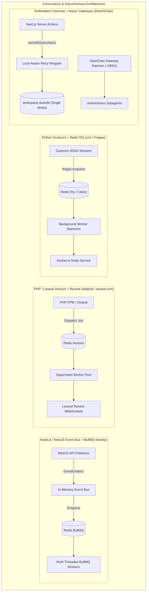
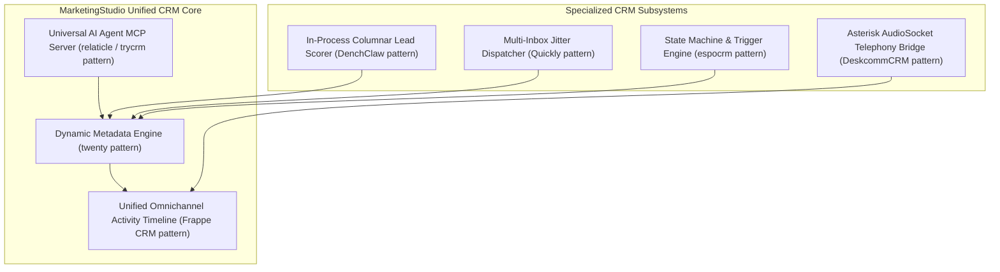

# Category 03: CRM & Contact Management — Comparative Architectural Analysis

> **Domain Scope**: Custom objects, lead pipelines, deals, accounts, sales activities, CRM metadata engines, and AI sales agent orchestration.  
> **Solutions Analyzed**: `twenty`, `trycrm`, `espocrm`, `crm` (Frappe CRM), `laravel-crm` (Krayin), `DeskcommCRM`, `Quickly`, `qrev`, `DenchClaw`, `relaticle`  
> **Commercial SaaS Benchmarks**: `Salesforce`, `HubSpot CRM`, `Attio`, `Pipedrive`, `Close.com`, `Apollo.io`

---

## 1. Executive Domain Overview

Customer Relationship Management (CRM) forms the operational brain and record-of-truth for all go-to-market (GTM) activities. In modern enterprise architecture, the CRM landscape has transitioned beyond static relational databases into four distinct architectural generations:

1. **Metadata-Driven Runtime CRMs** (`twenty`, `crm` / Frappe, `espocrm`): Platforms inspired by Salesforce and Attio where objects, fields, relations, layouts, and validation rules are configured declaratively or via dynamic metadata engines. The runtime dynamically compiles APIs (GraphQL or REST), provisions storage, and enforces access control without requiring hardcoded application logic.
2. **Polymorphic & Encrypted EAV CRMs** (`laravel-crm` / Krayin, `relaticle`): Systems that solve schema rigidity while avoiding DDL migration downtime by employing typed-column Entity-Attribute-Value (EAV) models or per-field encrypted JSONB attributes indexed with partial database indexes.
3. **Agentic-First & Autonomous CRMs** (`trycrm`, `relaticle`, `DeskcommCRM`, `DenchClaw`, `qrev`, `Quickly`): Designed not merely for manual human data entry, but as operational environments where autonomous AI agents act as primary workspace collaborators. They expose native Model Context Protocol (MCP) toolkits, handle asynchronous web research, track conversation facts, and orchestrate automated outreach pipelines.
4. **Embedded Telephony & Local-First Workspaces** (`DeskcommCRM`, `DenchClaw`): Highly specialized architectures tailored for specific execution extremes—ranging from real-time binary TCP telephony streaming directly into LLMs (DeskcommCRM's Asterisk AudioSocket) to sovereign, in-process columnar SQL execution on developer workstations (DenchClaw's DuckDB).

---

## 2. Technical Ecosystem & Architectural Taxonomy

```mermaid
flowchart TD
    subgraph ClientAndAgents ["Client Interfaces & Autonomous AI Agents"]
        WebLinearUI["Linear/Notion-Style Reactive UI (twenty / trycrm)"]
        FilamentAdmin["Filament 5 & Livewire 4 Console (relaticle)"]
        AIAgents["Autonomous AI Agents (MCP / Claude / LangChain)"]
        CallCenterReps["Outbound Call Reps (DeskcommCRM)"]
        TraditionalAdmin["Traditional CRM Admin (espocrm / Krayin / Frappe)"]
    end

    subgraph CRMEngines ["CRM Architectural Paradigms"]
        subgraph DynamicMetadata ["Dynamic Metadata & DocType Engines"]
            TwentyCore["twenty (NestJS Dynamic Metadata Engine)"]
            FrappeCore["crm / Frappe (DocType Meta Engine)"]
            EspoCore["espocrm (JSON entityDefs + Formula AST)"]
        end

        subgraph EAVAndEncrypted ["EAV & Encrypted Field Engines"]
            KrayinCore["laravel-crm (Polymorphic Typed EAV)"]
            RelaticleCore["relaticle (Encrypted CustomField Engine)"]
        end

        subgraph AgenticAndEmbedded ["Agentic, Local-First & CTI Engines"]
            TryCRM["trycrm (Bun/Hono + Eve MCP Server)"]
            Deskcomm["DeskcommCRM (Next.js + Asterisk AudioSocket + MCP)"]
            DenchClaw["DenchClaw (In-Process DuckDB + OpenClaw Gateway)"]
            Quickly["Quickly (FastAPI Async + Multi-Inbox MCP)"]
            QRev["qrev (Express + Python FastAPI / ChromaDB)"]
        end
    end

    subgraph DataStorage ["Persistence & Multi-Tenancy Models"]
        PostgresDynamic[(PostgreSQL Isolated Schemas: twenty)]
        PostgresRLS[(PostgreSQL RLS / ULID: Deskcomm / relaticle / trycrm)]
        MariaDBDocType[(MariaDB InnoDB: Frappe / espocrm / Krayin)]
        EmbeddedDuckDB[(Embedded DuckDB Columnar: DenchClaw)]
        MongoChroma[(MongoDB + ChromaDB: qrev)]
    end

    WebLinearUI --> TwentyCore
    WebLinearUI --> TryCRM
    FilamentAdmin --> RelaticleCore
    AIAgents -->|MCP JSON-RPC| RelaticleCore
    AIAgents -->|MCP Tools| TryCRM
    AIAgents -->|twenty-agent-skills| TwentyCore
    AIAgents -->|Composio MCP| DenchClaw
    AIAgents -->|Streamable MCP| Deskcomm
    AIAgents -->|Streamable MCP| Quickly
    CallCenterReps --> Deskcomm
    TraditionalAdmin --> EspoCore
    TraditionalAdmin --> KrayinCore
    TraditionalAdmin --> FrappeCore

    TwentyCore --> PostgresDynamic
    RelaticleCore --> PostgresRLS
    Deskcomm --> PostgresRLS
    TryCRM --> PostgresRLS
    FrappeCore --> MariaDBDocType
    EspoCore --> MariaDBDocType
    KrayinCore --> MariaDBDocType
    DenchClaw --> EmbeddedDuckDB
    QRev --> MongoChroma
```



### Technical Stack Matrix

| Solution | Language & Runtime | Core Framework | Database & ORM | Queue & Concurrency Engine | Primary Schema Paradigm | Standout Architectural Feature | License |
| :--- | :--- | :--- | :--- | :--- | :--- | :--- | :--- |
| **twenty** | TypeScript 5.4+, Node.js 20+ | NestJS 10+, React 18, Vite | PostgreSQL 15+, TypeORM | BullMQ / Redis + EventEmitter2 | Dynamic Runtime Schemas (Postgres Schemas) | In-memory dynamic Apollo GraphQL compilation + native MCP skills | AGPL-3.0 |
| **trycrm** | TypeScript 5.4+, Bun 1.1+ | Bun, Hono, Next.js 14 | PostgreSQL 15+, Prisma | Bun Async Loop + Eve Framework | Relational + Agentic Event Tables | Native MCP server built from ground up for AI SDRs (`packages/mcp-integrations`) | MIT |
| **espocrm** | PHP 8.3+ | Slim 4, Backbone / Marionette | MySQL 8.0+ / MariaDB 10.6+, Doctrine DBAL 4.4 | Multi-process `daemon.php` + `cron.php` | Declarative JSON Metadata (`entityDefs`) | Visual BPMN 2.0 flow execution engine & AST formula evaluator | AGPL-3.0 |
| **crm** (Frappe) | Python 3.10+, JS | Frappe Framework v15+, Vue 3.5 | MariaDB 10.6+, Redis | Redis Queue (RQ) / Celery + Socket.io | Declarative JSON DocType Engine | Seamless DocType ecosystem, built-in SLA timers & Twilio WebRTC | AGPL-3.0 |
| **laravel-crm** (Krayin) | PHP 8.3+ | Laravel 12.0, Blade / Vue.js | MySQL 8.0, Eloquent ORM | Laravel Queue (Redis/DB) + Reverb | Polymorphic Typed EAV Engine | Clean modular composer packages via Concord, rotting-lead engine | MIT |
| **DeskcommCRM** | TypeScript 5.5+, Node.js 22+ | Next.js 14 (App Router) | Supabase (PostgreSQL 16 + pgvector) | AudioSocket TCP Bridge + Background Workers | Relational with Supabase RLS | Asterisk AudioSocket binary TCP (port 9092) streaming + Streamable MCP | MIT |
| **Quickly** | Python 3.11+ | FastAPI, Next.js 14 | PostgreSQL 15+, SQLAlchemy 2.0 Async | Asyncio reservation engine (`queue_logic.py`) | Relational SQLAlchemy Async | High-velocity multi-inbox rotation, jitter scheduler, streamable MCP | MIT |
| **qrev** | TypeScript (Node) & Python 3.11+ | Express.js, FastAPI, React | MongoDB 5.x+, ChromaDB, SQLite/Postgres | Node-cron + Decoupled FastAPI Workers | Document Store + Vector Embeddings | Autonomous Qai superagent, Playwright scrapers, LangChain RAG | AGPL-3.0 |
| **DenchClaw** | TypeScript 5.6+, Node.js 22+ | Next.js 15, React 19 | In-process DuckDB (`workspace.duckdb`) | In-process Vectorized SQL + OpenClaw Gateway | In-process Dynamic EAV + `.object.yaml` | Sub-millisecond columnar analytical SQL, OpenClaw AI Gateway (:19001) | MIT |
| **relaticle** | PHP 8.5+ | Laravel 13.x, Filament 5, Livewire 4 | PostgreSQL 17+ (ULID & JSONB), Redis | Laravel Horizon / Redis Queue | Encrypted Custom Fields (`CustomFieldValue`) | Native Model Context Protocol (MCP) server, per-field encryption, ULIDs | AGPL-3.0 |

---

## 3. Deep Architectural Comparison: Metadata Engines & Concurrency

### 3.1. Dynamic Object & Schema Provisioning Mechanics

The technical cornerstone separating these CRM platforms is how custom business objects, fields, and relations are declared, stored, and compiled into queryable schemas:

```
[Schema Provisioning Architecture Spectrum]

Zero-Migration EAV/JSONB ───────────────────────── Dynamic DDL Schemas ───────────────────────── Static Hardcoded
(laravel-crm, relaticle, DenchClaw)            (twenty, espocrm, Frappe crm)                  (DeskcommCRM, Quickly)
```

1. **twenty — Dynamic PostgreSQL Schema-Per-Workspace Isolation**:
   Twenty implements an enterprise-grade internal **Metadata Engine** located in `packages/twenty-server/src/engine/`. It maintains core metadata tables (`core.custom_object`, `core.custom_field`, `core.relation_metadata`). When an administrator defines a custom object (e.g., `Listing`, `Policy`, `Subscription`) or adds custom fields:
   - The engine dynamically issues transactional DDL queries (`CREATE TABLE`, `ALTER TABLE ADD COLUMN`) inside a dedicated PostgreSQL schema assigned to that workspace (`workspace_<workspace_id>.<object_name>`).
   - The NestJS GraphQL module intercepts metadata changes and dynamically recompiles Apollo Server's in-memory schema without requiring server reboots.
   - Dynamic TypeORM repositories are instantiated on the fly to query workspace tables while enforcing workspace scoping.
   - **Tradeoff**: Maximizes relational query performance, supports native SQL indexes and foreign keys, but requires higher database privilege levels and carefully orchestrated DDL locks.

2. **espocrm — Declarative JSON Metadata & EntityDefs**:
   EspoCRM utilizes a file-based and database-merged declarative metadata architecture. All core schemas reside as JSON files in `application/Espo/Resources/metadata/entityDefs/`, while tenant extensions are written to `custom/Espo/Custom/Resources/metadata/entityDefs/`:
   - When entities or fields are modified via the visual Entity Manager, JSON definition files are updated on disk and merged into a runtime metadata cache.
   - Espo's internal `EntityManager` and Doctrine DBAL 4.4 evaluate the delta between metadata definitions and the MySQL InnoDB schema, executing alter tables during rebuild phases.
   - Espo's proprietary **Formula Scripting Engine** compiles business logic into Abstract Syntax Trees (ASTs), executing computed field values dynamically during record lifecycle hooks.
   - **Tradeoff**: Exceptional transparency and source-control friendliness for configurations; however, disk-based metadata caching requires file permission management and cache warming after schema alterations.

3. **crm (Frappe CRM) — Frappe DocType Metaprogramming**:
   Frappe CRM leverages Python's dynamic runtime and Frappe Framework's **DocType** engine:
   - Every entity (`crm_lead`, `crm_deal`, `crm_organization`) is declared as a JSON DocType descriptor within `crm/fcrm/doctype/`.
   - Modifying fields via the UI creates custom DocField rows. During schema sync (`bench migrate`), the Frappe ORM automatically alters MariaDB tables directly, adds database indexes, and updates form layout descriptors (`crm_fields_layout`).
   - REST endpoints are automatically synthesized at `/api/resource/{DocType}` alongside whitelisted RPC endpoints in `crm/api/`.
   - **Tradeoff**: Seamless integration across the entire Frappe ERP ecosystem with built-in audit trails, but schema changes require framework migration hooks and can incur lock contention on high-volume tables.

4. **laravel-crm (Krayin) — Polymorphic Typed-Column EAV**:
   Krayin CRM resolves schema flexibility through a typed **Entity-Attribute-Value (EAV)** engine located in `packages/Webkul/Attribute`:
   - Schema definitions are persisted in the `attributes` table (`code`, `type`, `validation`).
   - Rather than storing all values as unstructured text, the polymorphic `attribute_values` table provides dedicated typed storage columns: `text_value`, `boolean_value`, `integer_value`, `float_value`, `datetime_value`, `date_value`, and `json_value`.
   - Eloquent models include the `CustomAttribute` trait, dynamically hydrating and mutating attribute values transparently.
   - **Tradeoff**: Zero DDL table alterations when adding fields (zero migration downtime); however, analytical reporting or filtering across multiple custom attributes requires multi-table self-joins on `attribute_values`, degrading query performance at scale compared to native columns.

5. **DenchClaw — In-Process Columnar DuckDB Dynamic EAV**:
   DenchClaw operates on an embedded **DuckDB** file (`workspace.duckdb`):
   - Rather than maintaining fixed relational tables, workspaces define dynamic `objects` and `fields`. Custom entries are stored in `entries` and field values in `entry_fields`.
   - Because DuckDB is a vectorized columnar analytical database, joining `entries` with `entry_fields` across hundreds of thousands of records executes entirely in-process in sub-millisecond timeframes, bypassing traditional relational EAV join bottlenecks.
   - Metadata definitions are mirrored locally in declarative `.object.yaml` files.
   - **Tradeoff**: Exceptional speed for local analytical filtering and complete data sovereignty; however, concurrency is constrained by DuckDB's single-writer database lock, requiring serialized queue retries.

6. **relaticle — Encrypted Custom Fields & PostgreSQL JSONB**:
   relaticle combines Laravel 13's modern Eloquent architecture with PostgreSQL 17's JSONB capabilities:
   - Dynamic attributes are managed through `CustomField`, `CustomFieldSection`, and `CustomFieldValue` models.
   - Sensitive custom data is encrypted per-field using application-level AES encryption before persistence, while structured custom attributes leverage PostgreSQL JSONB with partial GIN indexing.
   - Eliminates database migration friction while maintaining data security compliance (GDPR/HIPAA).
   - **Tradeoff**: Secure and flexible without DDL execution; complex aggregation queries on encrypted fields must be decrypted in application memory.

---

### 3.2. Concurrency, Process Models & Queuing Architecture

The underlying concurrency architecture determines how each CRM handles background synchronization, email ingestion, automated scoring, and real-time UI updates:



- **NestJS BullMQ & Redis (twenty)**:
  `twenty` separates the HTTP/GraphQL API layer (`twenty-server`) from background workers using BullMQ on Redis. An internal event emitter (`EventEmitter2`) decouples mutation execution from side-effects. Email sync workers, calendar pollers, and webhook dispatchers operate in distinct queues with configurable concurrency, backoff retries, and dead-letter queues. Optimistic UI updates on `twenty-front` ensure instant responsiveness while BullMQ handles heavy persistence asynchronously.
- **Python Redis Queue / Celery (crm / Frappe CRM)**:
  Frappe CRM uses Python RQ (Redis Queue) and Celery to process asynchronous jobs defined in `crm/hooks.py`. Crucially, Frappe CRM runs an automated **SLA Supervisor** worker (`crm_service_level_agreement`) that calculates rolling response times and escalation deadlines every minute. Real-time document updates are broadcast through a separate Node.js Socket.io daemon that listens to Frappe Redis pub/sub channels.
- **Laravel Horizon & Redis (relaticle & laravel-crm)**:
  Both `relaticle` and `laravel-crm` utilize Redis-backed queue workers. `relaticle` deploys Laravel Horizon to monitor queue health, job throughput, and failures. It offloads email participant extraction (`packages/EmailIntegration`) and AI meeting summarization (`AISummaryJob`) to background workers. `laravel-crm` processes automated lead rotting timers and broadcasts live pipeline stage transitions across sales teams via Laravel Reverb WebSockets.
- **DuckDB In-Process Vectorized SQL & Lock Retries (DenchClaw)**:
  DenchClaw completely eliminates external queue brokers (Redis, RabbitMQ) for analytical queries. It queries DuckDB directly in-process. Because DuckDB allows multiple concurrent readers but only a single writer, DenchClaw implements a specialized concurrency wrapper (`duckdbQueryAsync` with exponential backoff retries in `workspace-duckdb-retry.ts`). For long-running agent workflows, the external OpenClaw daemon runs independently on port 19001, executing background scraping and Composio tool calls without blocking the UI thread.
- **Multi-Process CLI & ReactPHP (espocrm)**:
  EspoCRM runs a dedicated background queue daemon (`daemon.php`) utilizing `spatie/async` and `react/child-process` alongside periodic `cron.php` executions. WebSockets are powered by a native Ratchet server (`websocket.php`), delivering real-time notification pushes to the Backbone/Marionette frontend.
- **AsyncIO & Slot Reservation (Quickly)**:
  Quickly leverages Python's native `asyncio` loop with an asynchronous connection pool (`asyncpg`). Its custom `queue_logic.py` implements an in-memory slot reservation algorithm with randomized jitter to balance cold email dispatch across hundreds of Google and Microsoft OAuth accounts simultaneously.
- **Binary AudioSocket Telephony Daemon (DeskcommCRM)**:
  DeskcommCRM handles concurrent voice channels by deploying a standalone Node.js worker (`workers/voice-agent`) that binds directly to Asterisk PBX's AudioSocket over raw TCP (port 9092). Incoming caller PCM audio is streamed directly to LLM speech APIs in real time, bypassing HTTP request-response overhead.

---

### 3.3. AI Agent & MCP (Model Context Protocol) Readiness

In 2026, CRM platforms are judged by their ergonomics as AI agent execution environments. The industry has bifurcated between solutions offering **Native Model Context Protocol (MCP)** toolkits and legacy systems requiring external REST API scraping:

```
[AI Agent Readiness Scorecard]

Native Streamable MCP Server  │ ★ trycrm, twenty, relaticle, DeskcommCRM, DenchClaw, Quickly
Semi-Structured Agent Wrappers │ ★ qrev (LangChain Qai SuperAgent)
Traditional REST / RPC Only    │ ★ espocrm, crm (Frappe), laravel-crm (Krayin)
```

1. **Native MCP Implementations**:
   - **twenty**: Includes `packages/twenty-agent-skills` and `packages/twenty-claude-skills`. The system dynamically introspects whatever custom objects and fields have been provisioned in the workspace and auto-generates corresponding MCP tools (`find_person`, `create_opportunity`, `update_task`), allowing Claude or Cursor agents to manipulate custom business objects with zero custom code.
   - **relaticle**: Features a first-class Model Context Protocol server (`App\Mcp\Servers\RelaticleServer`) configured via `config/mcp.php`. It exposes five granular, workspace-scoped tools: `GetCrmSchemaTool`, `ListPeopleTool`, `ListCompaniesTool`, `ListOpportunitiesTool`, and `AggregateOpportunitiesTool`. Agents authenticate via Bearer tokens with fine-grained abilities.
   - **DeskcommCRM**: Provides an official WebStandard Streamable MCP server at `/api/mcp` using `@modelcontextprotocol/sdk`. AI agents invoke tools such as `leads_update`, `conversations_send`, and `agendamento_criar`. It includes a native **AI-to-Human Handoff** tool (`handoff.ts`), allowing agents to qualify prospects and escalate to human reps with full context.
   - **DenchClaw**: Integrates the OpenClaw AI Gateway with the Composio SDK (`@composio/core`), granting local AI agents access to 150+ authenticated SaaS connectors alongside custom MCP tools. Agents execute in a local sandboxed terminal environment with full file-system and DuckDB access.
   - **trycrm**: Built from the ground up around MCP (`packages/mcp-integrations`). Agents dynamically discover tools from connected MCP servers (LinkedIn, search engines, email providers) and record every thought and tool invocation in structured `AgentAuditEvent` ledgers.
   - **Quickly**: Exposes a dedicated MCP endpoint at `/api/mcp` (`app/mcp_leads.py`) enabling autonomous SDR agents to query sequences, enroll leads, and pause campaigns based on prospect intent.

2. **Traditional REST & RPC Platforms**:
   - **espocrm**: Relies on standard RESTful API controllers authenticated via API keys or HMAC tokens. While comprehensive, integrating an LLM agent requires building an external middleware adapter or custom OpenAI function-calling wrapper.
   - **crm (Frappe CRM)**: Exposes whitelisted Python RPC methods (`/api/method/...`) and generic DocType REST endpoints. Agents can interact via Python scripting or webhooks, but lack typed JSON-RPC 2.0 tool definitions out of the box.
   - **laravel-crm**: Exposes standard Laravel Sanctum-secured REST endpoints. Agentic interaction requires external tooling layers.

---

### 3.4. Architectural Tradeoffs Matrix

| Solution | Extensibility Paradigm | Query Performance at Scale | Schema Migration Friction | Multi-Tenant Isolation Model | Agent & MCP Ergonomics | Resource Footprint |
| :--- | :--- | :--- | :--- | :--- | :--- | :--- |
| **twenty** | Dynamic Postgres Schemas + Metadata Tables | **High** (Native SQL tables & indexes per tenant) | **Low** (Automated dynamic DDL, zero code deploy) | **High** (PostgreSQL schema per workspace) | **Elite** (Auto-generated MCP skills from schema) | ~500 MB RAM |
| **trycrm** | Relational Prisma + Dynamic JSON attributes | **Medium** (Single table with JSON fields) | **Medium** (Static Prisma migrations for core entities) | **Medium** (Row-level `organization_id`) | **Elite** (Native MCP tool registry & Eve runtime) | ~150 MB RAM |
| **espocrm** | Declarative JSON `entityDefs` + Dynamic MySQL | **High** (Native InnoDB tables per entity) | **Low** (Visual Entity Manager alters tables on rebuild) | **Low** (Single database, role/team ACL) | **Low** (Traditional REST / HMAC, no MCP) | **~120 MB RAM** |
| **crm** (Frappe) | Declarative JSON DocTypes + MariaDB | **Medium-High** (MariaDB tables per DocType) | **Medium** (Requires `bench migrate` execution) | **High** (Frappe Sites: separate DB per tenant) | **Low-Medium** (Whitelisted Python RPC, no native MCP) | ~400 MB RAM |
| **laravel-crm** | Polymorphic Typed EAV (`attribute_values`) | **Low-Medium** (Multi-join overhead on EAV) | **Zero** (Attributes added as rows, no DDL changes) | **Low** (Single database, channel segmentation) | **Low** (Standard REST / Sanctum) | ~100 MB RAM |
| **DeskcommCRM** | Relational Supabase + pgvector | **High** (Indexed PostgreSQL with pgvector) | **High** (Requires Supabase SQL migrations) | **High** (PostgreSQL Row-Level Security via RLS) | **High** (Native `/api/mcp` + AudioSocket telephony) | ~200 MB RAM |
| **Quickly** | Relational SQLAlchemy Async | **High** (Optimized asyncpg connection pool) | **High** (Alembic database migrations) | **Low** (Single-tenant agency deployment) | **High** (Native `/api/mcp` + custom n8n nodes) | **~60 MB RAM** |
| **qrev** | Document Store (Mongo) + ChromaDB | **Medium** (NoSQL documents + vector search) | **Zero** (Unstructured MongoDB document fields) | **Low-Medium** (Organization ID in documents) | **Medium-High** (LangChain Qai agent, no formal MCP) | ~250 MB RAM |
| **DenchClaw** | Dynamic Columnar EAV + DuckDB | **Elite** (Sub-millisecond vectorized in-process SQL) | **Zero** (Dynamic `entries` / `entry_fields`, no DDL) | **High** (Local file isolation: sovereign workstation) | **Elite** (OpenClaw Gateway + Composio MCP + CLI) | ~100 MB RAM |
| **relaticle** | Encrypted Dynamic Fields + PostgreSQL JSONB | **High** (Partial GIN indexed JSONB + ULIDs) | **Zero** (Dynamic attributes stored in JSONB/EAV) | **High** (Workspace models + middleware scoping) | **Elite** (Native `RelaticleServer` MCP tools) | ~120 MB RAM |

---

### 3.5. Telephony, Voice & CTI Integration

- **DeskcommCRM** stands in a class of its own for telephony. Instead of relying on client-side WebRTC bridges or third-party wrappers, it establishes direct binary TCP streams with Asterisk PBX using **AudioSocket** (`workers/voice-agent`). Incoming caller PCM audio is captured in real time and piped directly into speech-to-text and streaming LLMs, enabling sub-second voice agent conversations.
- **crm (Frappe CRM)** provides out-of-the-box browser softphone capabilities utilizing the `@twilio/voice-sdk` and Exotel, automatically recording call durations, customer phone numbers, and audio recordings directly into the `crm_call_log` DocType.
- **twenty**, **trycrm**, **relaticle**, and **espocrm** provide activity timeline hooks for call logging, CDR ingestion, and webhook listeners, but delegate actual PBX routing to external telephony bridges.

---

### 3.6. Workflow & Business Process Management (BPM)

- **espocrm** provides the most mature workflow automation engine in open-source CRM. It includes a complete **BPMN 2.0 flow editor**, visual state machines, conditional timers, formula scripts, and multi-stage approval flows.
- **twenty** uses a modern event bus coupled with BullMQ job queues. Actions emit workspace events that trigger webhooks, automated field updates, and external API requests.
- **crm (Frappe)** utilizes Frappe's server scripts and workflow states, allowing Python-based hooks and rule triggers on any record transition.
- **laravel-crm** implements event-driven automation rules via `packages/Webkul/Automation`, triggering actions (emails, stage updates) based on entity lifecycle events.

---

## 4. Head-to-Head Comparison Matrix

| Feature / Dimension | twenty | trycrm | espocrm | crm (Frappe) | laravel-crm | DeskcommCRM | Quickly | qrev | DenchClaw | relaticle |
| :--- | :---: | :---: | :---: | :---: | :---: | :---: | :---: | :---: | :---: | :---: |
| **Dynamic Custom Objects** | ✅ Full DDL | ⚠️ JSON columns | ✅ JSON Meta | ✅ DocType | ⚠️ EAV | ❌ Static | ❌ Static | ⚠️ Mongo | ✅ DuckDB EAV | ✅ Encrypted EAV |
| **Native MCP / AI Tools** | ✅ Full SDK | ✅ Native Core | ❌ REST only | ❌ RPC only | ❌ REST only | ✅ Streamable | ✅ Streamable | ⚠️ LangChain | ✅ Composio MCP | ✅ RelaticleServer |
| **Modern Keyboard-First UI** | ✅ Linear UX | ✅ Linear UX | ❌ Backbone | ⚠️ Vue/Desk | ❌ Blade | ⚠️ Next.js | ⚠️ Tailwind | ⚠️ React | ✅ Next.js 15 | ✅ Filament 5 |
| **Embedded Softphone / CTI** | ❌ | ❌ | ⚠️ Plugin | ✅ Twilio SDK | ❌ | ✅ AudioSocket | ❌ | ❌ | ❌ | ❌ |
| **Visual BPMN / Workflows** | ⚠️ BullMQ flows| ⚠️ Agent Tasks | ✅ Enterprise | ⚠️ Doc Workflow| ⚠️ Event Rules | ❌ | ⚠️ Sequences | ⚠️ Agent Loop | ⚠️ Gateway Crons| ⚠️ Horizon Jobs |
| **GraphQL API** | ✅ Auto-gen | ❌ (REST) | ❌ (REST) | ❌ (REST) | ❌ (REST) | ❌ (REST) | ❌ (REST) | ❌ (REST) | ❌ (In-Process) | ❌ (REST) |
| **Multi-Tenant Isolation** | ✅ Schema/Tenant| ⚠️ Org ID | ⚠️ Role ACL | ✅ Frappe Sites| ⚠️ Channels | ✅ Postgres RLS| ⚠️ Single-team | ⚠️ Org ID | ✅ Local File | ✅ Workspace Model |
| **Field-Level Encryption** | ⚠️ Postgres | ❌ | ⚠️ Sensitive | ⚠️ Password | ❌ | ✅ pgcrypto | ❌ | ❌ | ❌ | ✅ AES Per-Field |
| **Resource Footprint** | ~500 MB RAM | ~150 MB RAM | ~120 MB RAM | ~400 MB RAM | ~100 MB RAM | ~200 MB RAM | **~60 MB RAM** | ~250 MB RAM | ~100 MB RAM | ~120 MB RAM |

---

## 5. Commercial Benchmark Positioning

```
[Extensibility vs AI-Agentic Readiness]

    High AI Readiness   ┼                       ★ trycrm (Agentic Native)
                        │           ★ twenty (Metadata + MCP)
                        │           ★ relaticle (Filament + MCP)       ★ DenchClaw (Local DuckDB MCP)
                        │                                          ★ DeskcommCRM (AudioSocket CTI)
                        │                                          ★ Quickly (Multi-Inbox MCP)
                        │                                          ★ qrev (Qai Superagent)
                        │           ★ crm / Frappe (DocType Meta)
                        │           ★ espocrm (Enterprise BPM)
    Legacy / Static     ┼──────────────────────────────────────────────────────────
                        Low Customization                      Dynamic Extensibility
```

- **Against Salesforce**:
  - `twenty` and `espocrm` match Salesforce's custom object capability. Twenty achieves it with modern TypeScript and isolated PostgreSQL schemas, while EspoCRM achieves it with enterprise BPMN 2.0.
  - `relaticle` provides a modern alternative for developer-first sales teams with instant MCP connectivity.
- **Against HubSpot CRM**:
  - `twenty` and `relaticle` provide significantly faster, keyboard-first user experiences with instant optimistic UI updates and zero contact tier pricing caps.
- **Against Attio**:
  - `twenty` directly targets Attio's custom object and spreadsheet-style CRM database model, while remaining 100% self-hostable under AGPL-3.0.
  - `DenchClaw` offers a local-first Attio alternative powered by DuckDB columnar speed.
- **Against Close.com**:
  - `DeskcommCRM` replicates Close.com's deep focus on outbound calling, power dialing, and automatic call recording in the activity timeline, upgraded with sub-second AI voice pipelines.
- **Against Apollo.io & Instantly**:
  - `Quickly` delivers sovereign multi-inbox rotation and AI reply classification, bypassing third-party email tier pricing and domain burn.

---

## 6. MarketingStudio Convergence Blueprint

The CRM layer in MarketingStudio acts as the unified database of record for leads, contacts, deals, customer interactions, and AI SDR activities.



### Architectural Recommendations for MarketingStudio:
1. **Adopt Twenty's PostgreSQL Schema-Per-Workspace Architecture**: Allow enterprise tenants to define custom fields, custom relations, and custom pipeline stages without affecting global database stability or requiring manual migrations.
2. **Embed relaticle & trycrm's Native MCP Servers**: Expose standardized Model Context Protocol tools (`crm_create_lead`, `crm_update_stage`, `crm_query_pipeline`, `crm_aggregate_opportunities`) so that any autonomous AI agent (Claude, OpenAI, LangChain) can query and manipulate the CRM natively with strict token scoping.
3. **Integrate DeskcommCRM's Asterisk AudioSocket Engine**: Connect inbound and outbound telephone calls via raw TCP binary streaming directly into LLMs, achieving real-time conversational voice responsiveness while automatically threading audio transcripts into the contact activity timeline.
4. **Deploy DenchClaw's Vectorized Columnar Analytics**: Utilize embedded DuckDB in-process workers for relationship strength scoring, pipeline analytics, and fast deduplication across large lead volumes.
5. **Incorporate Quickly's Multi-Inbox Jitter Dispatcher**: Execute cold outreach campaigns through authenticated Google Workspace and Microsoft 365 OAuth 2.0 accounts with automated sender rotation and AI reply classification.
