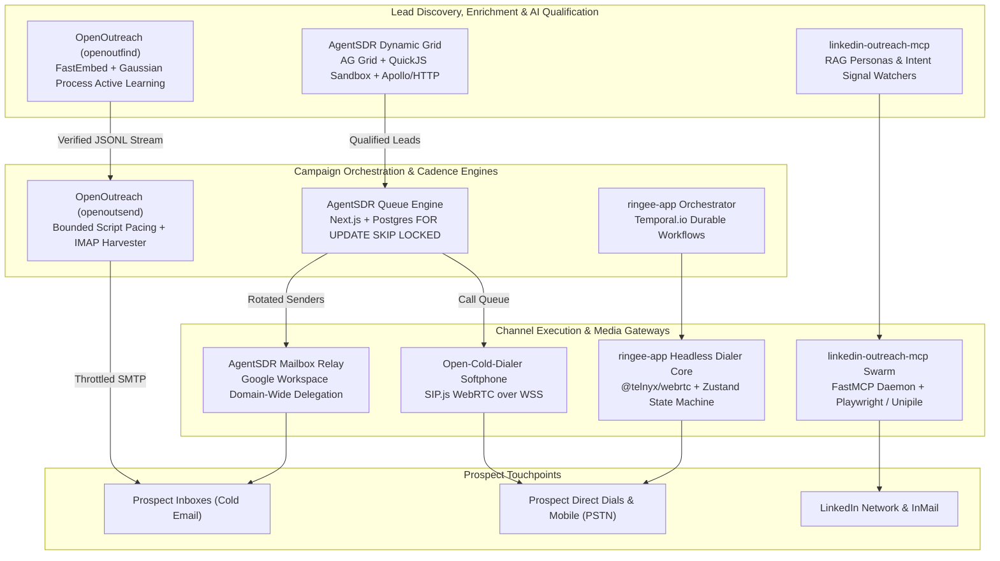
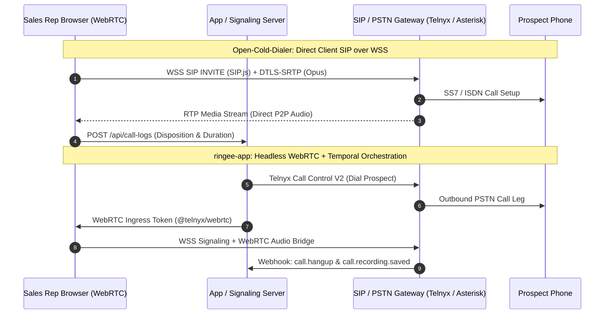
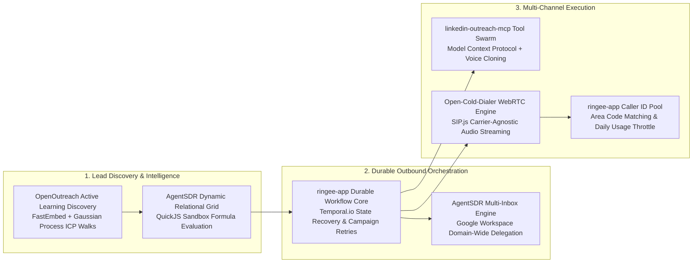

# Category 04: Cold Outreach & AI SDR — Comparative Architectural Analysis

> **Domain Scope**: Cold email deliverability engines, autonomous AI SDR agents, LinkedIn prospecting & MCP automation, browser-based WebRTC power dialing, and enterprise telephony campaign orchestration.  
> **Solutions Analyzed**: `AgentSDR`, `OpenOutreach`, `linkedin-outreach-mcp`, `Open-Cold-Dialer`, `ringee-app`  
> **Commercial SaaS Benchmarks**: `Apollo.io`, `Clay.com`, `Instantly.ai`, `HeyReach.io`, `Lemlist.com`

---

## 1. Executive Domain Overview

Outbound Sales Development (SDR) has shifted from manual list building and deterministic template blasting to **autonomous, multi-channel outbound systems**. High-velocity revenue organizations require platforms that seamlessly coordinate:
1. **Multi-Touch Sequences**: Orchestrated touchpoints combining Cold Email, LinkedIn connections/InMails, Phone calls, and WhatsApp messaging.
2. **AI Personalization & ICP Qualification**: Autonomous agents evaluating candidate profiles against semantic Ideal Customer Profiles (ICPs), synthesizing verifiable fit rationales, and generating dynamic outreach copy.
3. **Deliverability & Reputation Infrastructure**: Mailbox rotation across secondary domains, domain-wide Google Workspace delegation, residential proxy coordination, and strict cadence throttling.
4. **Synchronous Telephony Execution**: Browser-based WebRTC power dialers, carrier-agnostic SIP trunks, local presence caller ID pools, and dual-channel call recording.

The 5 open-source solutions analyzed in this category span distinct architectural tiers of the outbound sales stack:
- **`AgentSDR`**: Multi-tenant full-stack AI SDR platform combining an in-process PostgreSQL relational queue, AG Grid enrichment with a WebAssembly QuickJS sandbox, Google Workspace domain-wide delegation, WebRTC softphone calling, and autonomous reply sentiment classification.
- **`OpenOutreach`**: Headless Python/Django orchestrator integrating `openoutfind` (active-learning candidate discovery via FastEmbed and Gaussian Process classifiers) and `openoutsend` (rate-limited personal mailbox dispatch with IMAP bounce/reply harvesting) over SQLite WAL.
- **`linkedin-outreach-mcp`**: Standardized Model Context Protocol (MCP) server (`heylead`) providing 60+ typed tools for AI agent swarms (Claude Code, Cursor) to execute stealth LinkedIn prospecting, tone-of-voice cloning, and calendar booking.
- **`Open-Cold-Dialer`**: Decoupled browser-based power dialer leveraging `SIP.js` over secure WebSockets (WSS) to connect browser WebRTC directly to VoIP carriers (Telnyx, SignalWire, Twilio, Asterisk), backed by Express and Drizzle ORM.
- **`ringee-app`**: Enterprise-grade multi-tenant telephony and contact center platform built on a NestJS/Next.js monorepo, orchestrating high-concurrency power dialing campaigns via Temporal.io durable workflows and Telnyx WebRTC.

---

## 2. Technical Ecosystem & Architectural Taxonomy



### Technical Stack Matrix

| Solution | Language & Runtime | Core Framework | Database & ORM | Queue & Concurrency Model | Target Channels | License |
| :--- | :--- | :--- | :--- | :--- | :--- | :--- |
| **AgentSDR** | TypeScript / Bun 1.3 | Next.js 16 (App Router), React 19 | PostgreSQL 15+, Drizzle ORM | Postgres Relational Queue (`FOR UPDATE SKIP LOCKED`) | Email, LinkedIn, WhatsApp, WebRTC Voice | MIT |
| **OpenOutreach** | Python 3.11+ | Django 5.2+ (Headless Host & ORM) | SQLite 3 (WAL + IMMEDIATE) | Synchronous Bounded Batches + In-Thread Sleep Pacing | Cold Email (SMTP/IMAP), Licensed B2B APIs | GPL-3.0-or-later |
| **linkedin-outreach-mcp** | Python 3.10+ | FastMCP SDK 1.30+, Playwright | SQLite 3 (WAL, user_version 16) | `asyncio` Coroutines with 12-Stage Jitter Backoff | LinkedIn (Unipile / Playwright), Google Calendar | MIT |
| **Open-Cold-Dialer** | TypeScript / Node 20+ | React 18, Vite, Express 4.21 | SQLite (`better-sqlite3`) / Supabase, Drizzle ORM | Client-side SIP.js UserAgent Event Loop | Outbound WebRTC Browser Calling, SIP Trunks | MIT |
| **ringee-app** | TypeScript / Node 20+ | NestJS 11, Next.js 14, Zustand 5 | PostgreSQL 16, Prisma ORM 6.16, Redis 7 | Temporal.io Durable Workflows (`@temporalio/workflow`) | Inbound/Outbound Telephony, WebRTC Softphone, CRM Sync | AGPL-3.0 |

---

## 3. Deep-Dive Comparative Analysis Across Core Dimensions

### 3.1. Autonomous AI SDR vs. Deterministic Cadences
- **AgentSDR**: Adopts an autonomous agent paradigm backed by dynamic LLM prompts. Inbound replies harvested via Gmail push webhooks or Unipile are routed to an LLM intent classifier (`interested`, `not_interested`, `customer`, `other`). The classifier pauses subsequent cadence steps, executes automated stage transitions across CRM pipelines, and drafts contextual replies referencing internal company knowledge bases.
- **OpenOutreach**: Combines active learning candidate discovery with deterministic delivery. `openoutfind` scores candidate profiles using Pydantic AI against natural language ICP descriptions, generating explicit qualitative fit reasons (`reason`) rather than opaque numeric scores. Delivery through `openoutsend` follows strict, sequential step intervals with automated IMAP reply and bounce monitoring.
- **linkedin-outreach-mcp**: Employs an in-process multi-agent swarm (Coordinator, Reply Classifier, Strategist Replan Agent, and Hot Lead Closer). The swarm inspects prospect response sentiment, autonomously negotiates calendar slots, and persists rationale into an auditable ledger (`agent_decisions`).
- **Open-Cold-Dialer**: Relies on human-in-the-loop intelligence. Rather than autonomous generation, it equips human SDRs with dynamic objection-handling battle cards and contextual pitch scripts with runtime variable interpolation.
- **ringee-app**: Coordinates post-call AI intelligence. Calls recorded at the carrier level are transcribed into timestamped segments, evaluated by Claude/GPT models for sentiment, script adherence, and objections, and synchronized directly into CRM timelines.

### 3.2. Social Automation & Anti-Detection Architecture
- **linkedin-outreach-mcp**: Specifically engineered to mitigate platform detection. Features an LLM voice signature extractor that distills the operator's historic writing style (formality, sentence length, typical vocabulary) to avoid generic bot phrasing. Enforces strict weekly connection caps (maximum 20 invitations/day on free tiers), randomized inter-action delays, prospect timezone restrictions (08:00–22:00), and OS keychain credential encryption (`keyring`).
- **AgentSDR**: Bridges LinkedIn and WhatsApp via the third-party Unipile gateway API (`unipile-node-sdk`), offloading browser fingerprinting, residential proxy rotation, and session maintenance to an external abstraction.
- **OpenOutreach**: Operates completely browserless with zero social scraping surface. Discovers prospects exclusively through licensed B2B data providers (BetterContact Lead Finder), eliminating ToS violation risks and LinkedIn account bans.

### 3.3. Telephony, Voice Dialing & Real-Time Audio Transport
- **Open-Cold-Dialer**: Operates as a lightweight, browser-direct softphone. The React frontend directly instantiates `SIP.js`, establishing secure WebSocket signaling (`wss://`) with SIP proxies (SignalWire, Telnyx, Twilio, or Asterisk). Audio media travels directly between the browser's WebRTC engine and the carrier using the Opus codec, bypassing the Node.js backend entirely.
- **ringee-app**: Implements an enterprise contact center architecture. The dialer core (`@ringee/dialer-core`) is completely headless and decoupled from UI components, using `@telnyx/webrtc` and Zustand. Outbound dialing campaigns are driven by Temporal.io workflows that enforce local presence caller ID rotation, automatic area code matching, and atomic ring group dispatching.
- **AgentSDR**: Provides an integrated calling station backed by WebRTC and an auxiliary microservice (`services/call-worker`), logging call durations, outcomes, and audio recordings to S3.

### 3.4. Deliverability, Domain Pacing & Mailbox Protection
- **AgentSDR**: Features enterprise Google Workspace domain-wide delegation (impersonation via Service Account keys), eliminating individual OAuth token expirations. Mailbox assignment occurs dynamically at send time via round-robin allocation among active mailboxes with remaining daily capacity, strictly enforcing inter-send intervals (minimum 180 seconds).
- **OpenOutreach**: Implements defensive personal mailbox safeguards (`openoutsend`). Features warmup ramps, randomized inter-send jitter (120–300 seconds), global suppression lists, and IMAP bounce monitoring.
- **ringee-app**: Prevents telephony reputation degradation through `CallerIdPoolMember` and `CallerIdDailyUsage` models, cycling outbound phone numbers out of rotation once daily call caps are reached to avoid "Spam Likely" flags.

---

## 4. Architectural Paradigm Taxonomy & Tradeoffs

The five solutions embody fundamentally divergent architectural philosophies across process topology, queue mechanics, persistence engines, and media planes:

```
[Architectural Tradeoff Spectrum: Operational Simplicity vs. Distributed Enterprise Scale]

  Zero-Daemon / Embedded CLI           Relational In-Process               Durable Distributed
  (OpenOutreach, linkedin-outreach-mcp)      (AgentSDR, Open-Cold-Dialer)           (ringee-app)
  ◄──────────────────────────────────┼──────────────────────────────────►
  • SQLite WAL persistence           • PostgreSQL / Drizzle ORM         • NestJS + Temporal.io
  • In-thread synchronous execution  • Relational DB Queues             • Redis presence + locks
  • Local stdio / CLI boundaries     • Next.js App Router / Bun         • Multi-container cluster
```

### 4.1. Process Topology & Execution Boundaries

| Solution | Process Topology | Runtime Environment | Boundary & Inter-Process Communication | Fault Domains |
| :--- | :--- | :--- | :--- | :--- |
| **AgentSDR** | In-Process App Server + Background Microservices | Bun 1.3 / Node.js (Next.js 16 App Router) | HTTP REST, Next.js Server Actions, S3 audio exchange | App crashes affect UI and dispatching; call-worker runs isolated |
| **OpenOutreach** | Bounded CLI Pipeline (Zero Daemons) | Python 3.11+ (Headless Django ORM) | Unix Standard Streams / JSON Lines buffer (`openoutfind \| openoutsend`) | Ephemeral process; crashes terminate run cleanly without zombie tasks |
| **linkedin-outreach-mcp** | Standardized MCP Tool Daemon | Python 3.10+ (FastMCP Server) | JSON-RPC 2.0 over `stdio` or `streamable-http` | FastMCP daemon failure isolates from host LLM agent; SQLite locks recoverable |
| **Open-Cold-Dialer** | Decoupled Client-Heavy Web App + Micro-API | React 18 / Vite + Express 4.21 (Node 20+) | Browser WebSockets to SIP Carrier; REST to Express API | Frontend maintains call session; API crash does not drop active phone calls |
| **ringee-app** | Distributed Multi-Service Monorepo Cluster | Node.js 20+ (NestJS 11 + Next.js 14 + Temporal) | gRPC (Temporal), Redis Pub/Sub, HTTP REST, WebSockets | Fully isolated: API, WebRTC Gateway, CRM Sync, and Orchestrator scale independently |

### 4.2. Queue & Concurrency Mechanics

1. **PostgreSQL Relational Queues with `FOR UPDATE SKIP LOCKED` (`AgentSDR`)**:
   - AgentSDR rejects external broker dependencies (Redis/RabbitMQ). It divides scheduling into a daily queue builder (`/api/outreach/build-queue`) that populates `outreach_mailbox_queue` and a high-frequency tick engine (`/api/outreach/tick`).
   - Concurrency is managed via PostgreSQL row-level locks: `SELECT ... FOR UPDATE SKIP LOCKED` claims pending emails per active mailbox without lock contention.
   - *Limitation*: Under high concurrency (thousands of ticks/minute), database connection pools and write transactions can become bottlenecks.

2. **Synchronous Bounded Step Execution (`OpenOutreach`)**:
   - Runs as a synchronous, deterministic batch script. Does not maintain persistent worker pools.
   - Concurrency is bounded by the CLI invocation argument (e.g. `openoutreach find 10`). Pacing is achieved via randomized in-thread sleeps (`time.sleep(random.uniform(120, 300))`), avoiding message broker overhead.
   - *Limitation*: Not designed for continuous multi-tenant SaaS background scheduling without an external supervisor (e.g. cron or systemd).

3. **`asyncio` Event Loop with 12-Stage Jitter Backoff (`linkedin-outreach-mcp`)**:
   - Python asynchronous event loop handling non-blocking network calls to Unipile and Playwright.
   - Database contention on SQLite is resolved through an exponential backoff retry mechanism with 12 distinct stages and randomized jitter, preventing SQLite `database is locked` operational errors under concurrent tool calls.

4. **Client-Driven Event Loop & React Query (`Open-Cold-Dialer`)**:
   - Concurrency is fundamentally single-threaded per browser tab. The SDR agent manually or semi-automatically triggers next-call events.
   - In-memory state is coordinated by TanStack React Query and the `SIP.js` state machine (`connecting`, `ringing`, `active`, `ended`).

5. **Event-Sourced Durable Workflows via Temporal.io (`ringee-app`)**:
   - Built on Temporal's distributed state machine (`@temporalio/workflow`). Campaign dialing runs are modeled as durable workflows that survive node crashes, worker redeployments, and network partitions.
   - Workflows orchestrate discrete activities (`dialLead`, `checkDnc`, `rotateCallerId`, `recordCall`). Redis provides high-speed distributed locking for agent presence and trunk capacity tracking.
   - *Limitation*: Heavy operational overhead requiring a dedicated Temporal cluster and Redis instance.

### 4.3. State Persistence, Schema Isolation & Migrations

```
AgentSDR (PostgreSQL + Drizzle)       OpenOutreach (SQLite WAL)        ringee-app (PostgreSQL + Prisma)
┌───────────────────────────────┐     ┌───────────────────────┐        ┌───────────────────────────────┐
│ • organization_id on all rows │     │ • SiteConfig (Single) │        │ • 50+ Models in schema.prisma │
│ • Dynamic SQL for Grid tables │     │ • OutfindLead         │        │ • Multi-tenant Org boundaries │
│ • QuickJS Sandbox execution   │     │ • OutfindVerdict      │        │ • Temporal workflow history   │
│ • OutreachMailboxQueue table  │     │ • OutsendMessage      │        │ • CallTranscriptionSegments  │
└───────────────────────────────┘     └───────────────────────┘        └───────────────────────────────┘
```

- **AgentSDR**: Employs PostgreSQL with Drizzle ORM. Enforces fail-closed multi-tenancy where every query is scoped by `organization_id`. Features a dynamic relational grid system (`grid_workbooks`, `grid_tables`, `grid_columns`, `grid_rows`) that performs runtime SQL schema mutations while executing custom formula columns in a WebAssembly QuickJS sandbox (`quickjs-emscripten`).
- **OpenOutreach**: Uses SQLite 3 configured with `PRAGMA journal_mode=WAL` and `transaction_mode=IMMEDIATE`. Enables concurrent reads while a batch search or waterfall enrichment write is active.
- **linkedin-outreach-mcp**: Embedded SQLite with strict internal schema versioning (`PRAGMA user_version = 16`). Normalized tables for campaigns, contacts, and outreaches are paired with structured JSON columns for decision rationale and vector embeddings for semantic persona matching.
- **Open-Cold-Dialer**: Dual persistence via Drizzle ORM. Operates locally with `better-sqlite3` for zero-configuration local dialing, or connects to PostgreSQL/Supabase for cloud deployments with Row-Level Security (RLS).
- **ringee-app**: Enterprise PostgreSQL schema maintained via Prisma ORM (`schema.prisma` exceeding 5,000 lines). Models complex telephony entities including `CallerIdDailyUsage`, `RingGroup` attempts, `SipDevice`, and carrier rate cards.

### 4.4. Real-Time Audio Transport & Telephony Media Plane



1. **Client-Direct SIP over Secure WebSockets (`Open-Cold-Dialer`)**:
   - The application server is completely removed from the media path. The browser uses `SIP.js` to establish TLS-encrypted WebSocket connections directly to carrier edge gateways.
   - Audio is encoded using Opus, negotiated via SDP offer/answer, and encrypted with DTLS-SRTP.
   - *Advantages*: Negligible backend CPU overhead; zero server bandwidth cost for audio streaming.
   - *Disadvantages*: Telephony SIP credentials or carrier tokens must be exposed to the browser client; firewall NAT traversal relies heavily on client STUN/TURN reachability.

2. **Headless Telnyx WebRTC Client + Server-Side Call Control (`ringee-app`)**:
   - Decoupled media plane using Telnyx Call Control V2 REST API for server-side call leg orchestration (`dial`, `bridge`, `transfer`), while agent audio streams through `@telnyx/webrtc`.
   - Temporary WebRTC authentication tokens are generated dynamically by `apps/backend/src/api/routes/webrtc.controller.ts`, preventing credential leakage.
   - Dual-channel call recordings are captured carrier-side, eliminating client-side upload latency.

3. **In-Browser WebRTC Softphone with Dedicated Background Processor (`AgentSDR`)**:
   - In-app softphone communicating with an isolated background worker (`services/call-worker`), offloading audio recording processing and S3 archival from the main Next.js web application.

---

### 4.5. Architectural Tradeoffs Matrix

| Architectural Dimension | AgentSDR | OpenOutreach | linkedin-outreach-mcp | Open-Cold-Dialer | ringee-app |
| :--- | :--- | :--- | :--- | :--- | :--- |
| **Process Topology** | In-Process Next.js + Bun | Bounded CLI Pipeline | FastMCP Daemon | Client WebRTC + Express | Multi-Service Cluster |
| **Concurrency Engine** | Postgres Relational Queue | Synchronous Batch / Sleep | Asyncio Coroutines | Browser UI Event Loop | Temporal.io Workflows |
| **Persistence Engine** | PostgreSQL + Drizzle ORM | SQLite WAL (IMMEDIATE) | SQLite WAL (v16 schema) | SQLite (better-sqlite3) | PostgreSQL + Prisma ORM |
| **Media Transport** | WebRTC + Call Worker | N/A (Email only) | N/A (Social text only) | Browser SIP.js over WSS | Telnyx WebRTC SDK |
| **Primary Bottleneck** | DB connection pool under high tick rates | Single-thread sleep latency during batch sends | LinkedIn rate limits & DOM mutation changes | Rep manual dial speed & carrier SIP limits | Temporal cluster overhead & worker latency |
| **Fault Isolation** | Moderate (Microservices isolate calling) | High (CLI process terminates cleanly) | High (MCP daemon isolated from client LLM) | High (Browser call survives backend crash) | Maximum (Microservice domains with restart policies) |
| **AI / Agent Readiness** | High (Native LLM intent & reply classifier) | High (Pydantic AI + Active Learning) | Exceptional (60+ Native MCP Tools for LLMs) | Low (Pure human interface with battle cards) | Moderate (Post-call AI summary & transcription) |
| **Deployment Complexity** | Low-Medium (Bun + Postgres + S3) | Minimal (Single `uv tool` CLI command) | Minimal (Local stdio or single Python process) | Minimal (Static Vite UI + lightweight Express) | High (Docker Compose, Temporal, Postgres, Redis, S3) |

---

## 5. Head-to-Head Feature Comparison Matrix

| Feature / Dimension | AgentSDR | OpenOutreach | linkedin-outreach-mcp | Open-Cold-Dialer | ringee-app |
| :--- | :---: | :---: | :---: | :---: | :---: |
| **Autonomous AI ICP Qualification** | ✅ LLM Loop & Formulas | ✅ FastEmbed + GP Active Learning | ✅ Semantic ICP RAG | ❌ | ❌ |
| **Fit Rationale Generation** | ⚠️ Dynamic Prompts | ✅ Explicit Reason Text | ✅ JSON Decision Journal | ❌ | ❌ |
| **Multi-Step Email Cadence** | ✅ Multi-inbox rotation | ✅ Deterministic steps | ❌ | ❌ | ❌ |
| **LinkedIn Automation (MCP / Stealth)** | ⚠️ Unipile API Gateway | ❌ (Zero ToS surface) | ✅ 60+ Native MCP Tools | ❌ | ❌ |
| **Tone-of-Voice Cloning** | ❌ | ❌ | ✅ LLM Style Distiller | ❌ | ❌ |
| **Browser WebRTC Power Dialer** | ✅ Built-in Softphone | ❌ | ❌ | ✅ SIP.js WebRTC | ✅ Headless Core |
| **Carrier Independence (BYOC)** | ⚠️ Google/SMTP only | ⚠️ Personal SMTP/IMAP | ⚠️ Unipile proxy | ✅ Any SIP WSS Trunk | ⚠️ Telnyx-centric |
| **Local Presence Caller ID Rotation** | ❌ | ❌ | ❌ | ❌ | ✅ Area Code Pools |
| **Durable Workflow Recovery** | ⚠️ Database Queue retry | ❌ (CLI rerun) | ⚠️ 12-stage retry | ❌ | ✅ Temporal.io State |
| **Inbound Reply Intent Analysis** | ✅ AI Classifier | ⚠️ IMAP Regex/Bounce | ✅ Reply Classifier Swarm | ❌ | ⚠️ Post-call LLM |
| **Multi-Tenant Account Isolation** | ✅ Fail-Closed Org ID | ❌ (Single-tenant CLI) | ❌ (Single-user daemon) | ⚠️ Supabase RLS mode | ✅ Complete Org Scoping |
| **Memory Footprint (Baseline)** | ~250 MB (Bun/Next.js) | **~60 MB (Python CLI)** | ~90 MB (Python MCP) | ~120 MB (Node/Vite) | ~750 MB (Cluster) |

---

## 6. Commercial Benchmark Positioning

```
[Channel Breadth vs Autonomous AI Intelligence]

    High Autonomous AI  ┼                                  ★ AgentSDR (Multi-channel AI SDR)
                        │               ★ Clay.com (Waterfall Enrichment)
                        │      ★ linkedin-outreach-mcp (Social MCP)
                        │      ★ OpenOutreach (Active Learning Discovery)
                        │               ★ Apollo.io (Database + Sequences)
                        │                                          ★ HeyReach.io (LinkedIn Clusters)
                        │      ★ Open-Cold-Dialer
                        │                                          ★ ringee-app (Enterprise Telephony)
    Deterministic Rules ┼──────────────────────────────────────────────────────────
                        Single Channel                         Multi-Channel Cadence
```

- **Against Apollo.io**:
  - Apollo integrates a 275M+ contact database with email sequences and a basic dialer. MarketingStudio pairs `OpenOutreach` (discovery and verification) with `AgentSDR` (cadences and mailbox rotation) and `Open-Cold-Dialer` (browser calling) to replicate Apollo's complete pipeline without per-seat subscription overhead.
- **Against Clay.com**:
  - Clay relies on 75+ waterfall enrichment providers and "Claygent" autonomous web scrapers. `AgentSDR` reproduces Clay's spreadsheet-style table mechanics (`grid_workbooks`) with safe client formula evaluation via QuickJS, while `OpenOutreach` provides budget-rationed waterfall enrichment through BetterContact and Apollo.
- **Against HeyReach.io**:
  - HeyReach provides multi-account LinkedIn sending clusters. `linkedin-outreach-mcp` exposes the underlying primitives as a standardized Model Context Protocol server, enabling external AI agents to drive LinkedIn prospecting while enforcing strict human-like jitter.
- **Against Instantly.ai / Lemlist**:
  - `AgentSDR` provides advanced multi-inbox rotation and Google Workspace domain-wide delegation, matching Instantly's delivery infrastructure while pairing with `warmbly` for automated domain warming.

---

## 7. MarketingStudio Convergence Blueprint

To construct a unified, state-of-the-art Outbound Revenue Engine, MarketingStudio should synthesize the optimal architectural layers from each evaluated solution:



### Architectural Action Items for MarketingStudio:
1. **Adopt OpenOutreach's Active Learning Discovery Engine**: Integrate `openoutfind`'s FastEmbed vectorization and Gaussian Process classifier into MarketingStudio's prospect research tool, guiding automated search walks toward high-density ICP profiles with zero scraping risk.
2. **Standardize Social Selling on linkedin-outreach-mcp**: Embed the 60+ tool MCP server into MarketingStudio's agent environment, enabling Claude Code or custom agents to conduct humanized LinkedIn outreach and calendar scheduling.
3. **Incorporate AgentSDR's Relational Queue & Intent Classifier**: Implement `SELECT ... FOR UPDATE SKIP LOCKED` for reliable, database-backed cold email dispatching, paired with LLM sentiment analysis on inbound responses to trigger automatic stage transitions.
4. **Deploy ringee-app's Headless Dialer & Caller ID Pools**: Integrate `@ringee/dialer-core` into MarketingStudio's CRM interface, coupling it with automated area-code matching and daily DID usage caps to eliminate spam flagging.
5. **Enforce Open-Cold-Dialer's Carrier-Agnostic SIP Architecture**: Support direct WebRTC SIP over WSS connections, giving revenue teams the freedom to terminate calls via Telnyx, Twilio, SignalWire, or internal Asterisk PBX clusters.
