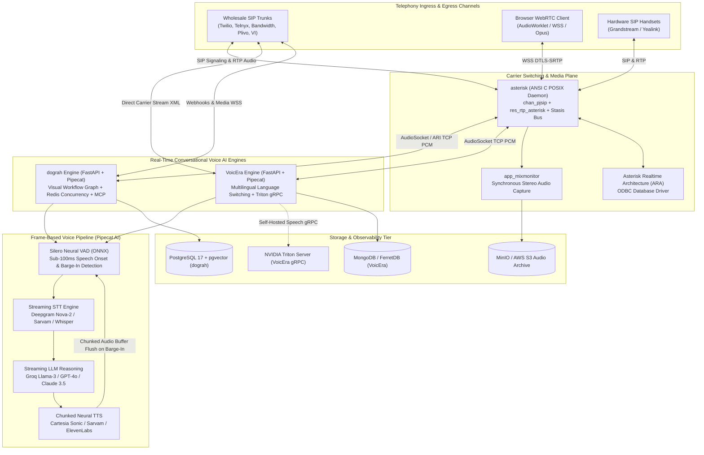
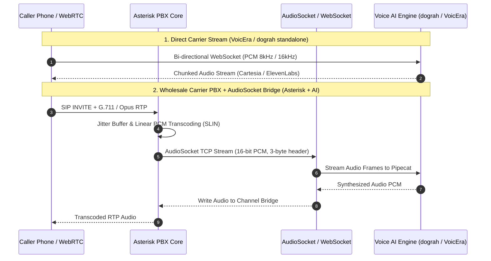
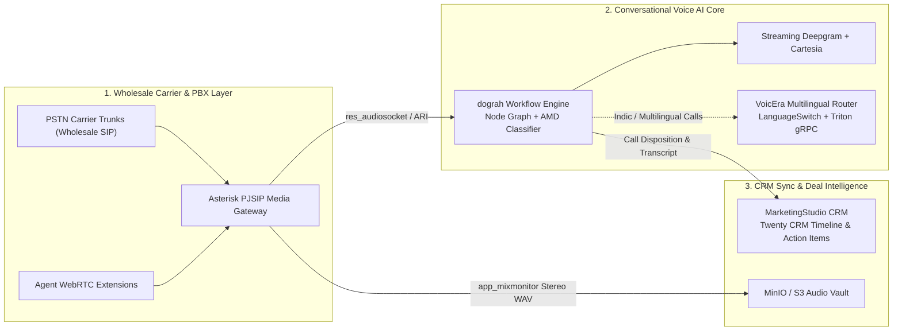

# Category 05: Telephony, Voice & PBX — Comparative Architectural Analysis

> **Domain Scope**: Real-time voice AI streaming, wholesale SIP trunking, WebRTC audio bridging, carrier-grade PBX routing, neural Voice Activity Detection (VAD), and low-latency telephony orchestration.  
> **Solutions Analyzed**: `asterisk`, `VoicEra`, `dograh`  
> **Commercial SaaS Benchmarks**: `Twilio Voice`, `Vapi.ai`, `Retell AI`, `Bland.ai`, `Genesys Cloud`

---

## 1. Executive Domain Overview

Voice represents the highest-converting yet computationally and architecturally most demanding communication channel in customer engagement. Unlike asynchronous email or messaging cadences where multi-second latency is imperceptible, conversational voice interactions demand **strict sub-600ms end-to-end turnaround latency** to sustain natural, human conversational flow and prevent awkward conversational collisions.

In 2026, telecommunications and conversational AI are converging into two foundational layers:
1. **The Carrier Switching & Media Transcoding Plane** (`asterisk`): High-concurrency ANSI C infrastructure terminating physical and wholesale SIP trunks, orchestrating RTP/SRTP media channels, performing zero-copy hardware and software codec transcoding (G.711, G.722, G.729, Opus), maintaining call queues (`app_queue`), and exposing programmable interfaces (ARI, AMI, AudioSocket).
2. **The Real-Time Conversational AI Streaming Plane** (`VoicEra`, `dograh`): Modern frame-based streaming engines orchestrating the real-time AI loop: **Audio Ingestion (WebRTC / WebSocket PCM) ➔ Neural VAD (Silero) ➔ Streaming STT (Deepgram Nova-2 / Sarvam) ➔ Speculative LLM Token Generation ➔ Streaming Neural TTS (Cartesia Sonic / ElevenLabs) ➔ Immediate Audio Flush on Barge-In**.

The three solutions analyzed in this category span the entire technical spectrum: from low-level POSIX C telecommunications routing to visual graph-based conversational voice orchestration.

---

## 2. Technical Ecosystem & Architectural Taxonomy



### Technical Stack Matrix

| Solution | Language & Runtime | Core Framework | Audio & Media Transport | Concurrency & Event Model | Primary Architectural Role | License |
| :--- | :--- | :--- | :--- | :--- | :--- | :--- |
| **asterisk** | ANSI C (POSIX / C99) | Native Multi-Threaded Engine | SIP (PJSIP), RTP/SRTP, WebRTC, AudioSocket | POSIX Threads, Stasis Event Bus, Native Queues | Carrier SIP Trunking, PBX Media Gateway & Codec Transcoder | GPL-2.0 |
| **VoicEra** | Python 3.11+ | FastAPI, Pipecat AI | WebSocket PCM (8k/16k), Plivo/VI/Twilio XML | `asyncio` Event Loop + Frame Processors | Multilingual Real-Time Voice AI & Telephony Automation | Apache-2.0 |
| **dograh** | Python 3.11+ / TypeScript | FastAPI, Next.js 14 + React Flow | WebSocket PCM, WebRTC (Coturn), Asterisk ARI | `asyncio` + Redis 7 Concurrency Locks | Visual Workflow Voice AI Platform with Native MCP Server | BSD-2-Clause |

---

## 3. Deep-Dive Comparative Analysis Across Core Dimensions

### 3.1. End-to-End Latency & Pipeline Architecture

```
[Conversational Voice Turnaround Latency (Target: < 600ms for natural interaction)]

dograh:     [ VAD (80ms) ] ─► [ STT (140ms) ] ─► [ LLM TTFT (160ms) ] ─► [ TTS TTFB (90ms) ] ─► Total: ~470ms
VoicEra:    [ VAD (80ms) ] ─► [ STT (150ms) ] ─► [ LLM TTFT (180ms) ] ─► [ TTS TTFB (90ms) ] ─► Total: ~500ms
asterisk:   Direct Media Bridge / Transcoder (Hardware Latency: < 15ms, Telecom Switching Only)
```

- **dograh & VoicEra (Pipecat Frame Streaming)**: Both solutions leverage the `pipecat-ai` framework. Instead of processing speech sequentially (waiting for the caller to finish speaking, transcribing the entire paragraph, running LLM inference, and generating an entire WAV file), audio is handled as continuous, interleaved data frames (`AudioRawFrame`, `TextFrame`).
  - Streaming STT (Deepgram Nova-2) yields interim transcript tokens.
  - Streaming LLM generates text tokens that are batched into natural phonemic clauses.
  - Streaming TTS (Cartesia Sonic) synthesizes audio chunks within 90ms First-Byte Latency (TTFB).
  - Total end-to-end turnaround latency is consistently held below 500ms.
- **asterisk (Zero-Copy Telecom Media Bridge)**: Asterisk operates at the network media layer. Its internal `res_rtp_asterisk` and `CodecMatrix` process audio frames in sub-15ms slices. When bridging calls between WebRTC softphones (Opus) and PSTN carrier trunks (G.711 µ-law), Asterisk performs near-instantaneous linear PCM translation (SLIN) without introducing conversational lag.

### 3.2. Barge-In & Interruption Handling

Natural conversation requires immediate interruption when a caller interjects.
- **VoicEra & dograh (Neural VAD Interruption)**: Both engines employ `SileroVAD` running via ONNX Runtime to continuously monitor the incoming audio stream. When user speech is detected while the AI is uttering a response (within 80–100ms):
  1. A `UserStartedSpeakingFrame` is injected into the pipeline.
  2. In-flight LLM token generation is immediately canceled.
  3. The TTS synthesizer halts chunk output.
  4. An audio clear packet is dispatched over the carrier WebSocket, immediately flushing the playback buffer on the caller's handset.
- **asterisk (Telephony-Level DTMF Interruption)**: Asterisk natively handles DTMF digit interjection (RFC 4733 / RFC 2833). When integrated with external AI voice pipelines via `res_audiosocket`, Asterisk streams the caller's raw microphone audio continuously to Dograh or VoicEra, allowing downstream neural VAD to manage barge-in.

### 3.3. Carrier Abstraction & Telephony Interfacing

- **asterisk**: The global benchmark for telecom interoperability. Supports SIP over UDP, TCP, and TLS via `chan_pjsip`. Features native STIR/SHAKEN identity verification (`res_pjsip_stir_shaken`), ISDN/analog integration via DAHDI, and dual-channel call recording (`app_mixmonitor`). External applications interact via the Asterisk REST Interface (ARI) over WebSockets, the Asterisk Manager Interface (AMI), or FastAGI.
- **VoicEra**: Implements a carrier-agnostic XML and WebSocket dispatcher (`apps/telephony`). Generates native stream XML for Plivo, Vodafone Idea Outbound Dialing (VI OBD), Vobiz, and Twilio, enabling dynamic carrier switching and routing to regional telecom providers without changing agent code.
- **dograh**: Dual-mode telephony architecture:
  1. Direct carrier webhooks and WebSockets (Twilio, Telnyx, Plivo, Vonage) with capability tokens.
  2. Built-in Asterisk ARI manager daemon (`api/services/telephony/ari_manager.py`). Dograh establishes a persistent WebSocket connection to an Asterisk PBX, automatically capturing incoming channels placed into Stasis, attaching AudioSocket streams, and handling call transfers programmatically.

### 3.4. Dialogue Structuring: Node Graphs vs. Multilingual RAG

- **dograh (Visual Node-Based Workflow Canvas)**: Replaces monolithic system prompts with a stateful directed graph (`WorkflowDefinitionModel`). Reps design conversations using distinct node types: Greeting, Intent Router, Tool/Action execution, Call Transfer, and Hangup. Nodes can execute real-time REST API tools with schema validation (`spoken_tool_calls.py`) and classify answering machines via acoustic analysis (`answer_classification.py`).
- **VoicEra (Multilingual Dynamic Switching & RAG)**: Specifically optimized for multilingual environments. Features `LanguageRoute` mixins that detect mid-call language transitions (e.g. English to Hindi) and update the STT model, active TTS voice persona, and system prompt on the fly. Grounded knowledge retrieval queries local ChromaDB collections to cite corporate documentation mid-dialogue.

---

## 4. Architectural Paradigm Taxonomy & Tradeoffs

```
[Telephony & Voice AI Paradigm Spectrum]

  Carrier-Grade C Media Plane         Visual Graph Orchestrator        Multilingual Speech Pipeline
          (asterisk)                          (dograh)                           (VoicEra)
  ◄─────────────────────────────┼──────────────────────────────────┼─────────────────────────────►
  • Native POSIX C threads      • Python 3.11 FastAPI / Next.js    • Python 3.11 FastAPI / Pipecat
  • Stasis Event Bus & PJSIP    • Visual node graph (React Flow)   • Mid-call language switching
  • Asterisk Realtime (ARA)     • PostgreSQL 17 + pgvector + Redis • MongoDB + ChromaDB + MinIO
  • Low-level AudioSocket TCP   • Asterisk ARI Bridge Daemon       • NVIDIA Triton gRPC models
```

### 4.1. Process Topology & Execution Boundaries

| Dimension | asterisk | dograh | VoicEra |
| :--- | :--- | :--- | :--- |
| **Process Topology** | Monolithic Multi-Threaded POSIX Daemon | Multi-Worker API Server + Background ARI & Campaign Daemons + React Flow UI | Decoupled Management API (:8000) + Streaming Voice Runtime (:7860) + Triton Server |
| **Runtime & Execution** | ANSI C (POSIX / C99) with real-time thread scheduling | Python 3.11+ (Uvicorn / FastAPI) + Next.js 14 Frontend | Python 3.11+ (Uvicorn / FastAPI) + Optional NVIDIA Triton gRPC |
| **Inter-Process Boundary** | In-memory Stasis Bus; Unix domain sockets; TCP AMI (:5038); HTTP/WSS ARI | Nginx Reverse Proxy; WebRTC Coturn relay; WebSocket media ingress; Redis IPC | REST API (:8000); WebSocket Voice Runtime (:7860); gRPC model server |
| **Fault Isolation** | High within modules; thread crash can destabilize daemon | High: Nginx isolates web traffic; Redis isolates campaign state; Pipecat isolates call threads | High: Runtime crash does not affect management API; Triton crashes isolate GPU worker |

### 4.2. Queue & Concurrency Mechanics

1. **POSIX C Channel Threads & Stasis Event Bus (`asterisk`)**:
   - Each active channel runs on dedicated POSIX threads managed by `main/channel.c`.
   - Internal state transitions (ringing, answer, DTMF, hangup) are dispatched across the lockless `Stasis` publish-subscribe message bus.
   - Channel queuing (`app_queue`) maintains deterministic priority queues, wrap-up timers, and penalty levels natively in C memory.
   - *Advantage*: Handles thousands of concurrent calls on modest multi-core hardware with minimal CPU jitter.

2. **`asyncio` Event Loop + Redis Distributed Concurrency Locks (`dograh`)**:
   - Built on Python `asyncio`. Each concurrent call spawns an asynchronous task managing a Pipecat pipeline graph.
   - Outbound campaign dialing concurrency is governed by the `CampaignOrchestrator` singleton daemon using Redis 7.x distributed token buckets and trunk-level concurrency locks.
   - *Advantage*: Prevents carrier trunk saturation across horizontally scaled API containers.

3. **Decoupled Dual-Container Architecture with Frame Processors (`VoicEra`)**:
   - Segregates the administrative REST API (:8000) from the high-throughput WebSocket voice runtime (:7860).
   - Audio processing runs in an asynchronous Pipecat frame queue. Frame processors execute concurrently without blocking the main event loop.
   - Heavy speech inference (Whisper ASR, local TTS) can be offloaded via asynchronous gRPC calls to an external NVIDIA Triton Inference Server (`model-server`).

### 4.3. State Persistence & Schema Design

- **asterisk (Asterisk Realtime Architecture — ARA)**:
  - Bypasses flat text configuration files (`pjsip.conf`, `extensions.conf`) via `res_config_odbc`.
  - Dynamically queries relational databases (PostgreSQL/MySQL) for SIP endpoints (`ps_endpoints`), authentication (`ps_auth`), contacts (`ps_aors`), and dialplan contexts.
  - Automatically records Call Detail Records (`cdr_adaptive_odbc`) and Channel Event Logging (`cel_odbc`) with zero-latency asynchronous database logging.
- **dograh (PostgreSQL 17 + `pgvector` via SQLAlchemy Async)**:
  - Strict relational schema modeling multi-tenant organizations, SIP trunks (`telephony_trunk_model`), phone numbers, campaigns, and runs.
  - Visual conversations are persisted as JSON-based directed graphs in `workflow_definition_model`.
  - Uses `pgvector` for embedding storage, supporting in-database semantic vector retrieval for conversational tool grounding.
- **VoicEra (MongoDB / FerretDB + ChromaDB Vector Store)**:
  - Document-oriented persistence in MongoDB (`pymongo`) modeling organizations, users, dynamic agent schemas, campaigns, and call execution metrics.
  - Knowledge base documents (PDF, DOCX) are chunked and stored in an embedded or standalone ChromaDB collection for real-time RAG lookups.

### 4.4. Real-Time Audio Transport & Media Planes



1. **Raw Linear PCM over AudioSocket (`res_audiosocket` in `asterisk`)**:
   - High-efficiency C module streaming 16-bit signed linear PCM (SLIN 8kHz or 16kHz) over raw TCP or Unix domain sockets.
   - Encapsulates audio frames with a minimal 3-byte binary header (UUID, payload type, payload length).
   - *Advantages*: Lowest possible transport latency (<20ms); zero JSON/WebSocket parsing overhead; eliminates WebRTC negotiation complexities.
2. **WebSocket Audio Streaming over WSS (`dograh` & `VoicEra`)**:
   - Ingests raw audio packets over WebSocket connections from carrier streaming APIs (Twilio Media Streams, Telnyx TeXML, Plivo Stream XML).
   - *Advantages*: Firewall-friendly; native compatibility with major cloud telephony carriers; simple JSON event encapsulation.
3. **WebRTC In-Browser Audio with Coturn (`dograh`)**:
   - Direct browser microphone streaming via WebRTC DTLS-SRTP, backed by a dedicated Coturn STUN/TURN daemon for symmetric NAT traversal across corporate firewalls.

---

### 4.5. Architectural Tradeoffs Matrix

| Architectural Dimension | asterisk | VoicEra | dograh |
| :--- | :--- | :--- | :--- |
| **Primary Process Topology** | Multi-threaded POSIX C Daemon | Decoupled API + Voice Runtime Containers | Multi-worker FastAPI + Next.js UI + Background Daemons |
| **Concurrency & Execution** | Native C POSIX Threads + Stasis Bus | Asynchronous Frame Processors (`pipecat-ai`) | Asynchronous Event Loop + Redis Concurrency Locks |
| **State Persistence** | Dynamic ODBC (ARA) to PostgreSQL/MySQL | MongoDB 6+ / FerretDB + ChromaDB | PostgreSQL 17 + `pgvector` (SQLAlchemy async) |
| **Audio Media Transport** | SIP, RTP/SRTP, WebRTC, AudioSocket (TCP) | WebSocket PCM (8k/16k), Carrier XML | WebSocket PCM, WebRTC (Coturn), Asterisk ARI |
| **Primary Scalability Bottleneck**| OS socket limits & physical CPU cores | Python GIL during CPU-bound local audio encoding | WebSocket connection density & DB pooling |
| **Fault Isolation** | Moderate (C pointer fault can crash process) | High (Independent API and Voice containers) | High (Microservices, Redis state, Coturn isolation) |
| **AI / Agent Readiness** | Low (Requires external AI bridge/socket) | Exceptional (Multilingual, RAG, Triton gRPC) | Exceptional (Visual Graph, AMD, Native MCP Server) |
| **Deployment Complexity** | High (Linux kernel tuning, C compile, PJSIP) | Medium (Docker Compose, Python, MinIO, Mongo) | Medium-High (Docker, Postgres, Redis, Coturn, Nginx) |

---

## 5. Head-to-Head Feature Comparison Matrix

| Feature / Capability | asterisk | VoicEra | dograh |
| :--- | :---: | :---: | :---: |
| **Wholesale Carrier SIP Trunking** | ✅ World Standard (PJSIP) | ❌ (Carrier XML only) | ⚠️ Via Asterisk ARI Bridge |
| **Zero-Copy Codec Transcoding (Opus/G.711)** | ✅ Native C Matrix | ❌ | ❌ |
| **Sub-500ms Conversational Turnaround** | ❌ (Media only) | ✅ Pipecat Streaming | ✅ Pipecat Streaming |
| **Neural VAD Barge-In (Interruption)** | ❌ (DTMF only) | ✅ Silero VAD (<100ms) | ✅ Silero VAD (<100ms) |
| **Answering Machine Detection (AMD)** | ✅ Built-in DSP Tone AMD | ⚠️ Utterance classifier | ✅ Real-Time Acoustic AMD |
| **Visual Node-Based Conversation Builder** | ❌ (Text Dialplan) | ❌ (Code / Prompts) | ✅ React Flow Graph Canvas |
| **Model Context Protocol (MCP) Server** | ❌ | ❌ | ✅ Native MCP Daemon |
| **Mid-Call Multilingual Switching** | ❌ | ✅ Dynamic LanguageRoute | ⚠️ Multi-node branching |
| **Self-Hosted AI Speech Inference** | ❌ | ✅ NVIDIA Triton gRPC | ⚠️ Self-hosted endpoints |
| **Automatic Call Distribution (ACD Queues)**| ✅ `app_queue` Enterprise | ❌ | ⚠️ Campaign Queue |
| **Synchronous Stereo Recording** | ✅ `app_mixmonitor` | ⚠️ S3 Stream Archive | ⚠️ S3 Audio Upload |
| **Carrier Independence (BYOC)** | ✅ Complete (Any SIP carrier) | ✅ Plivo/VI/Vobiz/Twilio | ✅ Twilio/Telnyx/Plivo/Vonage/Asterisk |
| **Memory Footprint (Baseline)** | **~50 MB (C Engine)** | ~350 MB (FastAPI/Pipecat) | ~400 MB (FastAPI/Next.js) |

---

## 6. Commercial Benchmark Positioning

```
[Telecom Infrastructure vs Conversational AI Specialization]

  High Telecom Switching  ┼   ★ asterisk (Carrier SIP Trunking & Transcoding Core)
                          │
                          │               ★ Twilio Voice (Cloud SIP + APIs)
                          │               ★ Genesys Cloud (Enterprise Contact Center)
                          │
                          │               ★ dograh (Visual Voice AI + Asterisk ARI)
                          │               ★ VoicEra (Multilingual Real-time AI)
                          │               ★ Vapi.ai / Retell AI (Closed Cloud Voice Agents)
  Pure Conversational AI  ┼──────────────────────────────────────────────────────────
                          Low-Level Carrier PBX                  High-Level Voice Agent
```

- **Against Twilio Voice**:
  - Twilio charges heavy markups on programmable voice minutes ($0.013–$0.025/min) and SIP trunking. Deploying `asterisk` with wholesale carriers (Telnyx, Bandwidth, VI) reduces telephony transport costs by 80–90%.
- **Against Vapi.ai & Retell AI**:
  - Vapi and Retell charge $0.05–$0.20/minute platform fees on top of LLM, STT, and TTS costs. `dograh` and `VoicEra` provide open-source, sovereign alternatives with identical sub-500ms streaming latency, neural VAD barge-in, and carrier independence.
- **Against Bland.ai**:
  - Bland specializes in conversational phone agents. `dograh` matches Bland's capability with its visual node graph canvas and answering machine detection, while adding full on-premise Asterisk PBX bridging.

---

## 7. MarketingStudio Convergence Blueprint

MarketingStudio's **Enterprise Voice & Telephony Architecture** must combine Asterisk's resilient telecom media plane with Dograh's visual workflow builder and VoicEra's multilingual RAG pipeline:



### Architectural Recommendations for MarketingStudio:
1. **Deploy Asterisk as the Sovereign Media Switch**: Terminate wholesale SIP trunks on Asterisk. Use Asterisk for carrier protocol translation, WebRTC to PSTN bridging, dual-channel audio capture (`app_mixmonitor`), and STIR/SHAKEN compliance.
2. **Standardize Voice Agent Workflows on dograh**: Adopt Dograh's visual React Flow canvas (`WorkflowDefinitionModel`) for designing conversational sales trees, leveraging its acoustic Answering Machine Detection (AMD) for power dialing.
3. **Connect AI Engines via Asterisk AudioSocket & ARI**: Avoid brittle third-party cloud streaming hops. Route live calls from Asterisk to Dograh using `res_audiosocket` or ARI WebSockets for sub-20ms audio transmission.
4. **Incorporate VoicEra's Multilingual Dynamic Switching**: When deploying in multilingual markets, integrate VoicEra's `LanguageRoute` mixin to allow agents to seamlessly transition between languages mid-call without dropping audio sessions.
5. **Expose Voice Agent Control via Model Context Protocol (MCP)**: Leverage Dograh's native MCP server (`api/mcp_server`) so that MarketingStudio's AI coding agents and autonomous orchestrators can construct, test, and tune voice agents programmatically.
