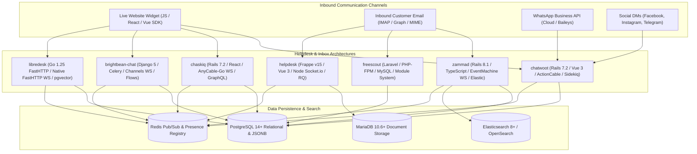
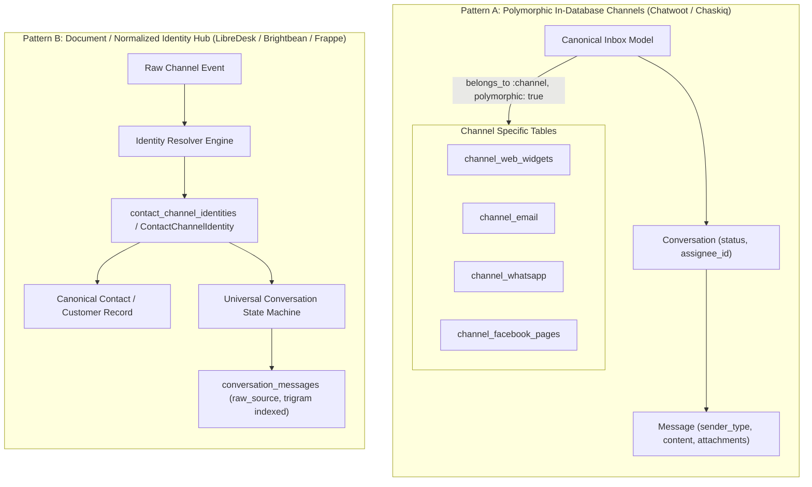
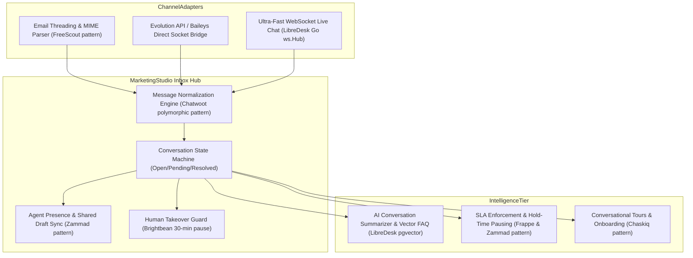

# Category 06: Omnichannel Helpdesk & Support — Comparative Architectural Analysis

> **Domain Scope**: Omnichannel shared inboxes, customer support ticketing, live chat widgets, conversation state machines, SLA enforcement, agent routing, and real-time collaboration.  
> **Solutions Analyzed**: `chatwoot`, `zammad`, `freescout`, `helpdesk` (Frappe Helpdesk), `libredesk`, `chaskiq`, `brightbean-chat`  
> **Commercial SaaS Benchmarks**: `Intercom`, `Zendesk`, `Help Scout`, `Front`, `Freshdesk`, `Respond.io`

---

## 1. Executive Domain Overview

Customer support and conversational sales have unified into a single operational interface: the **Omnichannel Shared Inbox**. Modern revenue teams cannot afford siloed tools where email tickets live in Zendesk, website live chats live in Intercom, WhatsApp messages live on personal phones, and Instagram DMs are answered manually.

An enterprise omnichannel communication platform must solve five technical requirements:
1. **Universal Message Normalization**: Translating diverse channel payloads (MIME emails, WhatsApp cloud JSON, Facebook graph webhooks, Telegram updates, WebRTC chat sockets) into a standardized `Message` and `Conversation` data model.
2. **Real-Time Agent Collaboration**: Real-time typing indicators, presence detection, private internal notes, and instant WebSocket synchronization across dozens of concurrent agents.
3. **Conversation State & Lifecycle Management**: Finite state machines tracking statuses (`open`, `pending`, `snoozed`, `resolved`), automated SLA timers, and escalation rules.
4. **Autonomous AI Co-Pilots & Triage**: Summarizing customer history, drafting suggested replies, and autonomously resolving Level-1 inquiries.
5. **Multi-Tenancy & Channel Partitioning**: Inboxes segmented by brand, department, language, or tier with role-based access control (RBAC).

---

## 2. Technical Ecosystem & Architectural Taxonomy



### Technical Stack Matrix

| Solution | Language & Runtime | Core Framework | Database & Search | Real-Time Sync Engine | Architectural Paradigm | License |
| :--- | :--- | :--- | :--- | :--- | :--- | :--- |
| **chatwoot** | Ruby 3.4+ | Rails 7.2, Vue 3 | PostgreSQL 14+ (`pg_trgm`), Redis 7+ | ActionCable WebSockets (`RoomChannel`) | Polymorphic channel inbox & conversational customer engagement | AGPL-3.0 / MIT |
| **zammad** | Ruby 3.4+ | Rails 8.1, TypeScript | PostgreSQL/MySQL + Elasticsearch 8+ | EventMachine WebSocket (`em-websocket`, port 6042) | Enterprise ITIL ticketing, dynamic schema (Object Manager) & audit trails | AGPL-3.0 |
| **freescout** | PHP 8.1-8.3 | Laravel 5.5 LTS base, Blade | MySQL 8+ / MariaDB / PostgreSQL | HTTP Polling / Pusher WebSockets | Lightweight shared email mailbox with pluggable modules | AGPL-3.0 |
| **helpdesk** (Frappe) | Python 3.10+, Node 20+ | Frappe v15, Vue 3, Frappe UI | MariaDB 10.6+ / PostgreSQL, Redis, SQLite | Node.js Socket.io microservice (`realtime/index.js`) | Metadata DocType helpdesk deeply integrated with ERPNext commercial ledgers | AGPL-3.0 |
| **libredesk** | Go 1.25+ | FastHTTP, Fastglue | PostgreSQL 15+ (`pg_trgm`, `pgvector`), Redis | Native Go FastHTTP WebSockets (`ws.Hub`) | Compiled high-concurrency binary with sub-60MB RAM footprint | AGPL-3.0 |
| **chaskiq** | Ruby 3.3.5+, Node 20+ | Rails 7.2, React 18, GraphQL | PostgreSQL 14+ (JSONB), Redis, Nightfury | AnyCable-Go WebSocket daemon (port 8080) | Intercom-style conversational marketing, bot tours & outbound campaigns | AGPL-3.0 |
| **brightbean-chat** | Python 3.11+, Node 20+ | Django 5, Django Ninja | PostgreSQL 15+, Redis 7+ | Django Channels WebSockets (ASGI) | Multi-tenant visual flow automation with deterministic human-takeover contract | AGPL-3.0 |

---

## 3. Deep Architectural Comparison

### 3.1. Inbox Multiplexing & Channel Abstraction Patterns

The core challenge of omnichannel systems is abstracting disparate ingress protocols—MIME email strings, Meta Graph webhook JSON, binary WhatsApp streams, and WebSocket packets—into a coherent, queryable conversation schema. Two distinct patterns dominate: **Polymorphic In-Database Channels** versus **Dedicated Micro-Gateways & Specialized Channel Models**.



#### 1. Polymorphic Channel Delegator (`chatwoot`)
Chatwoot isolates each communication medium into its own relational table (`channel_web_widgets`, `channel_email`, `channel_facebook_pages`, `channel_instagram`, `channel_line`, `channel_sms`, `channel_telegram`, `channel_twilio_sms`, `channel_whatsapp`, `channel_api`). A single `Inbox` record references these tables via an Active Record polymorphic relationship:
```ruby
# app/models/inbox.rb
belongs_to :channel, polymorphic: true, dependent: :destroy
has_many :conversations, dependent: :destroy_async
has_many :contact_inboxes, dependent: :destroy_async
```
When an incoming webhook arrives at `Webhooks::WhatsappController`, the system resolves the specific `Channel::Whatsapp` row via phone number or token, retrieves the associated `Inbox`, and binds the message to a `ContactInbox`. This decouples external channel-specific tokens, secrets, and configurations from the core `Conversation` and `Message` tables, making it straightforward to add new channels by provisioning a new `Channel::*` model and table.

#### 2. ITIL Ticket & Article Multi-Channel Model (`zammad`)
Zammad avoids polymorphic channel models, instead modeling all communications as an enterprise `Ticket` holding multiple `Ticket::Article` rows. An article represents a single communication event across any transport: `email`, `chat`, `phone`, `web`, `twitter`, or `sms`. 
Inbound emails pass through a modular `Channel::Filter::Postmaster` pipeline that parses raw RFC-822 headers, verifies SPF/DKIM flags, matches regex dispatch rules, and translates email threads into articles. CTI phone integrations inject call records as audio articles directly into the ticket timeline.

#### 3. Mailbox Container & RFC-822 Header Threading (`freescout`)
FreeScout implements an email-centric architecture where customer communication is grouped into `Mailbox` containers. Each mailbox defines independent IMAP/POP3 ingress credentials, SMTP egress settings, signatures, and user access permissions (`mailbox_user`).
Incoming emails polled via `artisan freescout:fetch-emails` are parsed using `webklex/laravel-imap` and sanitized with `mews/purifier`. FreeScout parses `Message-ID`, `In-Reply-To`, and `References` headers, indexing them against `threads.message_id`. If matching headers exist, the email is appended as a customer `Thread` (`TYPE_CUSTOMER`) to an existing `Conversation`; otherwise, it spawns a new conversation in the target mailbox. Additional channels (WhatsApp, Telegram) are grafted onto this architecture as external modular add-ons in `Modules/`.

#### 4. Metadata-Driven DocTypes & ERP Integration (`helpdesk` - Frappe)
Frappe Helpdesk leverages Frappe's Python/MariaDB metadata-driven engine:
- Every support ticket is an `HD Ticket` DocType, with comments, customer replies, and system events stored as child DocTypes: `HD Ticket Comment` and `HD Ticket Activity`.
- Multiplexing is achieved through Frappe's global email queue and whitelisted REST RPCs (`api/ticket.py`).
- Crucially, `HD Ticket` natively links to ERPNext commercial DocTypes (`Customer`, `Sales Order`, `Delivery Note`, `Subscription`). Agents view complete commercial contexts directly alongside support conversations without third-party webhooks.

#### 5. Normalized Channel Identity Ledger (`libredesk`)
LibreDesk decouples customer records from transport addresses using a normalized relational ledger:
```sql
CREATE TABLE contact_channel_identities (
    id BIGSERIAL PRIMARY KEY,
    contact_id BIGINT NOT NULL REFERENCES users(id) ON DELETE CASCADE,
    channel VARCHAR(32) NOT NULL, -- 'email', 'whatsapp', 'webchat'
    identifier VARCHAR(255) NOT NULL, -- email addr, phone E.164, visitor UUID
    metadata JSONB DEFAULT '{}',
    created_at TIMESTAMPTZ NOT NULL DEFAULT NOW(),
    CONSTRAINT uq_channel_identifier UNIQUE(channel, identifier)
);
```
Inbound messages from native Go IMAP IDLE push listeners (`go-imap/v2`) or WhatsApp Cloud webhooks match `(channel, identifier)` in microsecond indexed lookups. Messages are inserted into `conversation_messages` with status `sent` and immediately indexed for fuzzy querying via PostgreSQL GIN trigrams (`pg_trgm`).

#### 6. Decoupled Parts & Behavioral Marketing Engine (`chaskiq`)
Chaskiq implements an Intercom-style composite message architecture:
- Communications are structured as `ConversationPart` records (`authorable_type: "Agent" | "AppUser"`, `messageable: Conversation`).
- Multiplexing is handled via modular `AppPackage` integrations (Slack, WhatsApp, Twitter, Email).
- Unlike pure support desks, Chaskiq bridges inbound parts with outbound marketing entities: `Campaign` (drip sequences), `Banner` (in-app alerts), and `Tour` (interactive product onboarding guides), dynamically triggered by user activity matching `Segment` conditions.

#### 7. Workspace-Scoped Idempotency & Cumulative Rules (`brightbean-chat`)
Brightbean-Chat uses Django 5 multi-tenant workspace models (`WorkspaceScopedModel`):
- Connectors (`ChannelConnection`) ingest Meta WhatsApp Cloud, Telegram, and SMS payloads.
- Inbound webhooks compute an SHA-256 digest of `(connection_id, provider_event_id)` stored in `InboxRuleApplication.event_ref`. If the digest exists, duplicate webhooks are discarded.
- Inbound messages pass through a cumulative, priority-ordered `InboxRule` engine that tags, labels, and routes conversations before evaluating visual drag-and-drop conversational bot trees (`Flow`).

---

### 3.2. Real-Time Event Streaming & Concurrency Architecture

Real-time synchronization across dozens of concurrent support agents is the technical litmus test of an omnichannel helpdesk. The solutions analyzed implement fundamentally divergent concurrency models:

```mermaid
flowchart LR
    subgraph ChatwootRT ["Chatwoot: ActionCable + Redis"]
        CW_Rails["Rails Web Process"] -->|Publish| CW_Redis[(Redis Pub/Sub)]
        CW_Redis --> CW_AC["ActionCable Server (Ruby)"]
        CW_AC -->|WebSockets| CW_Browser["Agent Browser"]
    end

    subgraph ZammadRT ["Zammad: EventMachine Daemon"]
        ZM_Rails["Rails App (Puma)"] -->|Event Bus| ZM_Redis[(Redis)]
        ZM_Redis --> ZM_EM["EventMachine Server (em-websocket :6042)"]
        ZM_EM -->|WebSockets| ZM_Browser["Agent Browser"]
    end

    subgraph FrappeRT ["Frappe Helpdesk: Node.js Socket.io"]
        FP_Py["Python WSGI (Gunicorn)"] -->|Doc Events| FP_Redis[(Redis Pub/Sub)]
        FP_Redis --> FP_Node["Node.js Socket.io Service (:9000)"]
        FP_Node -->|WebSockets| FP_Browser["Vue 3 SPA"]
    end

    subgraph ChaskiqRT ["Chaskiq: AnyCable-Go"]
        CQ_Rails["Rails GraphQL API"] -->|gRPC / Redis| CQ_AnyCable["AnyCable-Go Binary (:8080)"]
        CQ_AnyCable -->|WebSockets 100k+ Conns| CQ_Browser["Visitor / Agent UI"]
    end

    subgraph LibreDeskRT ["LibreDesk: Native Go ws.Hub"]
        LD_FastHTTP["Go FastHTTP Process"] --> LD_Hub["In-Memory ws.Hub (sync.RWMutex)"]
        LD_Hub -->|FastHTTP WebSockets| LD_Browser["React / Vite UI"]
    end
```



#### Detailed Streaming Architecture Analysis

1. **Rails ActionCable (Chatwoot)**:
   - Uses Rails' built-in `ActionCable` running over Redis Pub/Sub. Agents subscribe to `RoomChannel` streaming from `account_<account_id>`.
   - Dispatches typing indicators, presence changes, and message creations.
   - *Limitation*: Heavy memory footprint per Ruby connection thread (~20-40 MB RAM per process group); scaling to thousands of concurrent visitor webchat sessions requires dedicated ActionCable standalone clusters or AnyCable.
2. **EventMachine WebSocket Daemon (Zammad)**:
   - Zammad offloads real-time streams from Puma to a standalone `em-websocket` daemon (running on TCP port 6042) paired with Redis Pub/Sub.
   - Powers **Shared Draft Synchronization** (`Ticket::SharedDraftZoom`): as an agent types in a ticket editor, their draft text synchronizes across the WebSocket to other agents viewing the ticket, with live avatar badges indicating active viewers.
   - *Advantage*: Bypasses Rails request cycles for WebSocket transport, delivering sub-50ms collision warnings.
3. **Dedicated Node.js Socket.io Microservice (Frappe Helpdesk)**:
   - Python WSGI (Gunicorn) is notoriously ill-suited for persistent WebSocket connections. Frappe solves this by running an independent Node.js service (`realtime/index.js`).
   - When a Python worker mutates an `HD Ticket`, it pushes a document change event into Redis. The Node.js Socket.io daemon consumes the Redis event and broadcasts it over WebSockets to subscribed Vue 3 clients.
   - *Advantage*: Isolates long-lived WebSocket connections from Python worker threads.
4. **AnyCable-Go High-Concurrency Daemon (Chaskiq)**:
   - Chaskiq decouples the WebSocket connection tier from Rails using **AnyCable-Go** (a compiled Go WebSocket server listening on port 8080).
   - AnyCable-Go manages over 100,000 simultaneous persistent visitor socket connections with minimal CPU/RAM. When socket events arrive, AnyCable-Go executes gRPC calls back to Rails `ActionCableRPC` controllers to run authorization and business logic.
   - *Advantage*: High-scale conversational marketing capability where hundreds of thousands of website visitors maintain live chat widgets without crashing the Rails application backend.
5. **Native In-Memory Go FastHTTP WebSocket Hub (LibreDesk)**:
   - LibreDesk avoids external Node.js or AnyCable processes entirely, embedding a thread-safe WebSocket hub (`ws.Hub`) written in pure Go:
     ```go
     type Hub struct {
         convSubsList map[int64]map[*Client]bool // List view subscribers
         convSubsOpen map[int64]map[*Client]bool // Open ticket subscribers
         mu           sync.RWMutex
     }
     ```
   - Employs `valyala/fasthttp` and `fasthttp/websocket`. Broadcasts JSON-RPC payloads directly to memory-mapped client channels with zero JSON serialization overhead and sub-millisecond dispatch times, consuming less than 60MB total base RSS.

---

### 3.3. Database Schema, State Machine & Identity Merging

| Solution | State Machine Architecture | Contact Identity Model | Merge Mechanics (`ContactMerge`) | Search Engine & Indexing |
| :--- | :--- | :--- | :--- | :--- |
| **chatwoot** | `Conversation` states: `open`, `resolved`, `pending`, `snoozed`. Transitions emit ActiveSupport notifications. | Normalized `Contact` decoupled from channel `ContactInbox`. | `ContactMergeAction` runs in an atomic DB transaction; remaps conversations, messages (`sender`), and `ContactInbox` rows, then deep-merges JSONB attributes. | PostgreSQL with `pg_trgm` (GIN trigram index) on message content. |
| **zammad** | AASM (Acts As State Machine) on `Ticket`: `new`, `open`, `pending reminder`, `pending close`, `closed`, `merged`. | Canonical `User` (Customer) linked to `Organization`. Object Manager injects runtime custom fields. | Built-in ticket merge: articles from child tickets are repointed to master ticket, creating an immutable `Ticket::MergeHistory` audit record. | **Mandatory Elasticsearch 8+ / OpenSearch**. Sub-millisecond full-text queries across tickets, articles, and attachments. |
| **freescout** | Numeric constants on `Conversation`: `STATUS_ACTIVE` (1), `STATUS_PENDING` (2), `STATUS_CLOSED` (3), `STATUS_SPAM` (4). | `Customer` record with multiple `CustomerEmail` aliases. | `Customer::mergeWith` re-points all `conversations`, `threads`, and email records, transfers fillable attributes, and deletes duplicate. | MySQL full-text or standard B-tree indexes; optional search module. |
| **helpdesk** | Frappe DocType workflow engine on `HD Ticket`: `Open`, `Replied`, `On Hold`, `Resolved`, `Closed`. | `HD Customer` bound to Frappe `Contact` and ERPNext `Customer` master. | Custom ERPNext contact deduplication routines linking CRM lead/customer ledgers. | Relational SQL queries; high-speed SQLite local full-text cache (`search_sqlite.py`). |
| **libredesk** | `conversation.status`: `open`, `pending`, `closed`, `snoozed`. Go state mutation service. | Unified `users` table linked to `contact_channel_identities` `(channel, identifier)`. | Relational foreign key reassignment in PostgreSQL transaction across `conversation_messages` and identities. | PostgreSQL GIN trigrams on `conversation_messages.text_content` + `pgvector` for semantic embeddings. |
| **chaskiq** | `Conversation` state machine: `open`, `snoozed`, `closed`. Bot tasks govern early state. | `AppUser` capturing visitor sessions, IP geolocation, and JSONB `properties`. | Matches session cookies and email tokens, merging `AppUser` records and consolidating `ConversationPart` histories. | PostgreSQL JSONB querying; `nightfury` time-series engine for Redis response metrics. |
| **brightbean-chat** | `Conversation` states: `open`, `waiting`, `closed`, `snoozed`. Governed by `automation_paused_until`. | `Contact` with `ContactChannelIdentity` mapping phone numbers and JIDs. | Workspace-scoped deduplication service merging contact tags, custom fields, and conversation threads. | PostgreSQL index on `Message` text; Redis cache for active conversation routing. |

---

### 3.4. Architectural Tradeoffs Matrix

| Architectural Dimension | chatwoot | zammad | freescout | helpdesk (Frappe) | libredesk | chaskiq | brightbean-chat |
| :--- | :---: | :---: | :---: | :---: | :---: | :---: | :---: |
| **Ingress Polymorphism** | High (Tables per channel) | Medium (ITIL Articles) | Low (IMAP Mailboxes) | Medium (DocTypes) | High (Channel Identities)| High (AppPackages) | High (Channel Connections)|
| **Real-Time Concurrency**| Moderate (ActionCable) | High (EventMachine) | Low (Polling/Pusher) | High (Node Socket.io) | **Ultra-High (Native Go)**| **Ultra-High (AnyCable)** | Moderate (Django Channels)|
| **Memory Footprint (Base)**| ~2.5 GB RAM | ~3.5 GB RAM | **~150 MB RAM** | ~500 MB RAM | **< 60 MB RAM** | ~2.0 GB RAM | ~350 MB RAM |
| **Search Engine Scalability**| Medium (Postgres Trigram)| **Maximum (Elasticsearch)**| Low (MySQL Indexes) | Medium (MariaDB/SQLite) | Medium (PG Trigram/Vector)| Medium (Postgres) | Medium (Postgres) |
| **SLA & Calendar Complexity**| Basic / Business Hours | **Enterprise Multi-Calendar**| Basic (Module-based) | **Advanced (Hold Pausing)**| Basic / Business Hours | Basic | Basic (Celery Beat) |
| **Conversational Marketing**| Basic Bot Integrations | None (ITIL Ticketing) | None (Support Inbox) | None (ERP Support) | AI Knowledge Bot | **Native (Tours/Campaigns)**| **Native (Visual Flows)** |
| **Human-Takeover Contract**| Manual status toggle | Manual agent lock | Manual assignment | Status change | Manual lock | Bot handover rule | **Deterministic (30-min pause)**|

---

## 4. Head-to-Head Capability Comparison Matrix

| Feature / Dimension | chatwoot | zammad | freescout | helpdesk | libredesk | chaskiq | brightbean-chat |
| :--- | :---: | :---: | :---: | :---: | :---: | :---: | :---: |
| **Native Omnichannel (WA/FB/IG)** | ✅ Complete | ⚠️ Basic | ⚠️ Via Modules | ⚠️ Email/Web | ⚠️ Email/WA/Web | ⚠️ Via Packages | ✅ WA/TG/SMS |
| **Embeddable Web Live Chat Widget** | ✅ Highly Polished| ⚠️ Basic | ⚠️ Module | ⚠️ Web Form | ⚠️ Clean React | ✅ Intercom style| ✅ Clean React |
| **Elasticsearch Full-Text Search** | ❌ (PostgreSQL) | ✅ Mandatory | ❌ (MySQL) | ❌ (SQLite FTS) | ❌ (PostgreSQL) | ❌ (PostgreSQL) | ❌ (PostgreSQL) |
| **Formal SLA Rules & Escalations** | ⚠️ Basic | ✅ Enterprise Multi-Cal| ⚠️ Module | ✅ Dynamic Hold-Time| ⚠️ Basic | ❌ | ⚠️ Basic |
| **Outbound Tours & Onboarding** | ❌ | ❌ | ❌ | ❌ | ❌ | ✅ Native Tours| ❌ |
| **Collision Detection (Active Agent)**| ✅ Built-in | ✅ Live Shared Drafts | ✅ Built-in | ⚠️ Basic | ✅ WebSocket Hub | ⚠️ Basic | ⚠️ Basic |
| **Custom Module Marketplace** | ❌ (Core code) | ❌ | ✅ 50+ Modules | ✅ Frappe Apps | ❌ | ❌ | ❌ |
| **AI Reply Drafting / Vector Search** | ✅ OpenAI/Claude| ⚠️ Plugin | ⚠️ Module | ❌ | ✅ Native pgvector| ⚠️ Basic | ⚠️ Basic |
| **Production RAM Requirement** | **~2.5 GB** | **~3.5 GB** | **~150 MB** | **~500 MB** | **~60 MB** | **~2.0 GB** | **~350 MB** |

---

## 5. Commercial Benchmark Positioning

```
[Channel Modernity vs Enterprise SLA Complexity]

    Modern Conversational ┼                       ★ chatwoot (Intercom alternative)
                          │           ★ chaskiq (Conversational Marketing)
                          │      ★ brightbean-chat (Flow Automation)
                          │               ★ freescout (Help Scout clone)
                          │           ★ helpdesk / Frappe (ERP Context)
                          │                                          ★ zammad (Zendesk alternative)
    Formal ITIL Ticketing ┼──────────────────────────────────────────────────────────
                          Lightweight / Agile                    Heavy Enterprise
```

- **Against Intercom**:
  - `chatwoot` matches Intercom's live web messenger, multi-channel social inbox, and team triage workflows.
  - `chaskiq` captures Intercom's outbound marketing tours, in-app product onboarding banners, and behavioral visitor segmentation.
- **Against Zendesk**:
  - `zammad` directly replicates Zendesk's ITIL enterprise ticketing, audit trails, multi-calendar SLA breach escalations, CTI phone popups, and Elasticsearch cluster query speeds.
- **Against Help Scout**:
  - `freescout` is an exact open-source clone of Help Scout's minimalist interface, shared mailbox workflows, and collision warnings on a low-cost PHP-FPM footprint.
- **Against Respond.io**:
  - `chatwoot` and `brightbean-chat` provide multi-channel social inboxes with visual bot automation and WhatsApp Cloud API connectivity.

---

## 6. MarketingStudio Convergence Blueprint

MarketingStudio's **Omnichannel Shared Inbox** must bridge marketing, outbound sales replies, and customer support into a single collaborative workspace.



### Architectural Recommendations for MarketingStudio:
1. **Adopt Chatwoot's Universal Polymorphic Channel Data Model**: Structure conversations around canonical `Inbox`, `Conversation`, `Message`, and `Contact` entities, supporting polymorphic `channel_type` bindings to isolate third-party channel credentials.
2. **Borrow FreeScout's RFC-822 Threading Logic**: Guarantee that customer email replies accurately thread into existing conversations using indexed `Message-ID`, `In-Reply-To`, and `References` headers rather than creating fragmented duplicate tickets.
3. **Implement Zammad's Live Shared Drafts & Collision Detection**: Transmit active agent viewing and typing states over WebSockets, preventing conflicting responses and enabling seamless agent ticket handoffs.
4. **Enforce Brightbean-Chat's Human-Takeover Contract**: When an agent sends a manual message from the inbox, automatically set `automation_paused_until = now() + 30m` to suppress bot triggers and visual flows.
5. **Leverage Frappe Helpdesk's Hold-Time SLA Pausing**: Calculate real-world SLA compliance by pausing response and resolution clocks while a ticket is in `On Hold` or `Waiting on Customer` status, factoring in multi-timezone business calendars.
