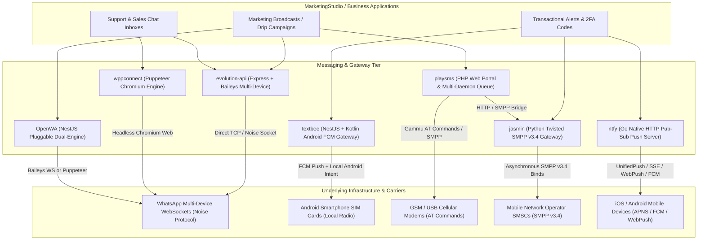
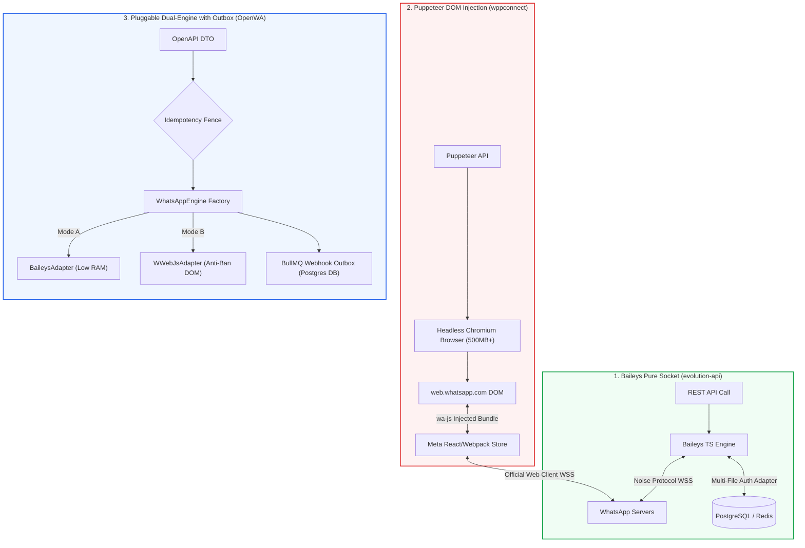
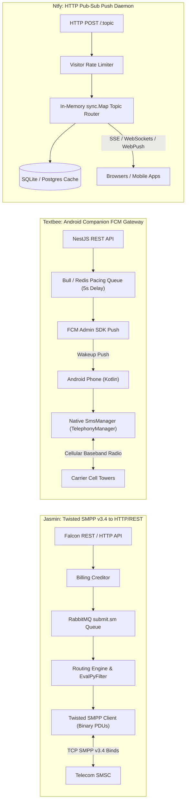
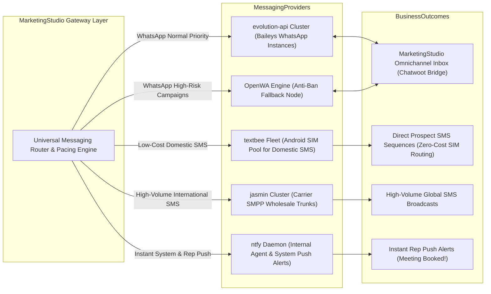

# Category 07: WhatsApp & Messaging Gateways — Comparative Architectural Analysis

> **Domain Scope**: Multi-device WhatsApp APIs, WhatsApp session managers, Android SMS gateways, carrier SMPP gateways, mobile push notifications, and messaging webhooks.  
> **Solutions Analyzed**: `evolution-api`, `wppconnect`, `OpenWA`, `textbee`, `playsms`, `ntfy`, `jasmin`  
> **Commercial SaaS Benchmarks**: `WhatsApp Cloud API (Meta)`, `Twilio WhatsApp / SMS`, `Respond.io`, `Pushover`, `Sent.dm`, `Sinch / Infobip`

---

## 1. Executive Domain Overview

With over 2.7 billion active users and open rates exceeding 95%, WhatsApp, direct cellular SMS, and mobile push notifications represent the highest-converting communication channels in digital marketing and customer engagement. However, integrating mobile messaging introduces severe architectural bottlenecks, protocol divergences, and cost structures:
1. **Official WhatsApp Business Platform (Cloud API)**: Charges variable per-conversation fees (\$0.03 - \$0.15 depending on destination country and category: Marketing, Utility, Authentication), mandates strict 24-hour customer service session windows, enforces pre-approved message templates, and bans cold outreach outright.
2. **Unofficial Web & Socket WhatsApp Gateways**: Reverse-engineer WhatsApp's multi-device protocol to allow businesses to send messages, media, and interactive buttons from existing phone numbers at zero per-message cost, with instant onboarding via QR code or pairing code authentication.
3. **Android SMS Harvesters**: Leverage physical Android devices and local SIM cards with unlimited carrier SMS plans, exposing a local REST API or WebSocket to convert consumer mobile devices into zero-cost SMS gateways.
4. **Carrier-Grade Telecom SMPP Gateways**: Bridge high-level HTTP/REST applications directly to mobile network operator (MNO) Short Message Service Centers (SMSCs) via stateful SMPP v3.4 TCP binds.
5. **Push Notification Daemons**: Lightweight pub-sub relays that stream instant alerts to phones and desktops via WebPush, SSE, WebSockets, and UnifiedPush.

---

## 2. Technical Ecosystem & Architectural Taxonomy

### Technical Stack Matrix

| Solution | Language & Runtime | Core Technology | Underlying Messaging Engine | Storage & State | Standout Architectural Feature | License |
| :--- | :--- | :--- | :--- | :--- | :--- | :--- |
| **evolution-api** | TypeScript / Node 20+ | Express, Prisma ORM | **Baileys** (Direct WebSockets) | PostgreSQL / MySQL / MongoDB, Redis | High-concurrency multi-instance WhatsApp API with database-backed multi-file auth | Apache-2.0 |
| **wppconnect** | TypeScript / Node 20+ | Express, Puppeteer | **WhatsApp Web** (Headless Chromium) | Local Disk / Memory / SQLite | In-browser DOM module hooking (`@wppconnect/wa-js`) with stealth bot evasion | LGPL-3.0 |
| **OpenWA** | TypeScript / Node 22+ | NestJS 11+, TypeORM | **Pluggable Dual-Engine** (Baileys & WWebJS) | PostgreSQL / SQLite, Redis, BullMQ | Pluggable dual-engine abstraction with transactional webhook outbox pattern | MIT |
| **textbee** | TypeScript & Kotlin | NestJS 11+, Android SDK | **Android native SmsManager** | MongoDB 7+, Redis, FCM | Decentralized SMS gateway converting Android phones into zero-cost SIM dispatchers | MIT |
| **playsms** | PHP 8.1+ | Native PHP, Linux CLI Daemons | **GSM Modems / SMPP Gateways** | MySQL 8.0+ / MariaDB | Classical carrier-grade SMS portal with prefix-based rating, credit billing, and daemons | GPL-3.0+ |
| **ntfy** | Go 1.26+ | Native Go (`net/http`) | **HTTP Pub-Sub** (SSE, WS, WebPush) | SQLite / PostgreSQL, Local Disk / S3 | Ultra-lightweight push server (<30MB RAM) with UnifiedPush and actionable buttons | Apache-2.0 / GPL-2.0 |
| **jasmin** | Python 3.10+ | Twisted Async, Falcon REST | **SMPP v3.4** (smpp.twisted3, txAMQP) | Redis, RabbitMQ (AMQP) | Carrier-grade SMPP to HTTP/REST protocol bridge with real-time billing and Python interceptors | Apache-2.0 |

---

## 3. Deep Architectural Comparison

### 3.1. WhatsApp Session Persistence & Engine Architecture: Baileys vs Puppeteer vs Dual-Engine

The technical architecture of WhatsApp integration dictates server resource consumption, session durability, and anti-ban survivability.

#### 1. Baileys Multi-File Auth in Relational/In-Memory Stores (`evolution-api`)
Evolution API implements the binary WhatsApp multi-device protocol over secure WebSockets using the **Noise Protocol Framework** and **Protocol Buffers (protobuf)**.
- **Persistence Mechanism**: Unlike standard Baileys scripts that dump authentication credentials into flat local directories (`multi-file-auth-state`), Evolution API implements custom auth state handlers:
  - `use-multi-file-auth-state-prisma.ts`: Stores keys, pre-keys, and credentials directly in PostgreSQL/MySQL relational tables.
  - `use-multi-file-auth-state-redis-db.ts`: Stores credentials in Redis hashes.
- **Resilience**: When a Docker container restarts or migrates across Kubernetes nodes, sessions reconnect automatically without requiring QR code rescans or risking container disk loss.
- **Resource Footprint**: Consumes only **40 MB - 80 MB of RAM** per active session. A single 4 GB VPS can comfortably orchestrate 40 to 60 concurrent WhatsApp numbers.
- **Vulnerability**: Because it reconstructs WhatsApp's undocumented binary stanzas, server-side protobuf changes by Meta require rapid upstream patches to prevent protocol disconnects.

#### 2. Headless Chromium DOM Hooks & Token Stores (`wppconnect`)
WPPConnect operates inside a full headless Google Chromium runtime managed by Puppeteer Extra with stealth evasion plugins (`puppeteer-extra-plugin-stealth`).
- **DOM Injection**: Rather than reverse-engineering network packets, it injects `@wppconnect/wa-js` directly into `web.whatsapp.com`. This bundle searches the browser's `window.require` registry for WhatsApp Web internal modules (`Store.Msg`, `Store.Chat`, `Store.Conn`) and invokes private functions via `page.evaluate`.
- **Token Persistence**: WPPConnect caches session credentials, browser cookies, and IndexedDB state through `FileTokenStore` or memory adapters.
- **Anti-Ban Resilience**: Outbound network traffic is 100% indistinguishable from official browser activity because it uses Meta's actual web client.
- **Resource Footprint**: Each Chromium session demands **400 MB to 750 MB of RAM** and significant CPU cycles. Running 10 sessions requires 6–8 GB of RAM and frequent process recycling to combat Chromium memory leaks.

#### 3. Pluggable Dual-Engine with Transactional Outbox (`OpenWA`)
OpenWA introduces an architectural abstraction that resolves the binary tradeoff between Baileys and Puppeteer:
- **`WhatsAppEngine` Interface**: Encapsulates both `@whiskeysockets/baileys` and `whatsapp-web.js` behind a unified contract. Administrators configure engine types per session (`config.engine = "BAILEYS" | "WEBJS"`). Low-risk transactional notifications run on lightweight Baileys sockets; high-risk marketing campaigns run on stealthed Chromium instances.
- **Transactional Webhook Outbox Pattern**: Inbound messages and status receipts are atomically written to `webhook_outbox_events` in PostgreSQL before being picked up by BullMQ worker queues for external delivery with exponential backoff.
- **Send Idempotency Fence**: Includes a `send_idempotency_keys` table. Outbound API requests passing an `Idempotency-Key` header prevent duplicate message dispatch during network timeouts.

---

### 3.2. Protocol Conversion & Messaging Transport

Beyond WhatsApp, mobile marketing infrastructure requires protocol conversion between high-level REST/HTTP APIs and disparate carrier transport layers:

#### Detailed Protocol Conversion Analysis

1. **Jasmin: Twisted SMPP v3.4 to HTTP/REST**:
   - Direct carrier connections require stateful, persistent TCP connections utilizing the **SMPP v3.4** binary protocol.
   - Jasmin runs an asynchronous Python **Twisted reactor** (`smpp.twisted3`, `smpp.pdu3`) maintaining persistent Transceiver (TRX), Transmitter (TX), and Receiver (RX) binds to carrier SMSCs.
   - Exposes a high-speed **Falcon REST API** and HTTP endpoints. Inbound HTTP requests are billed via an internal credit engine (`Bills.py`), enqueued onto RabbitMQ AMQP queues (`submit.sm`), and transformed into binary `submit_sm` PDUs.
   - Inbound carrier delivery receipts (`deliver_sm` DLR) are matched against Redis lookup tables and forwarded via asynchronous HTTP callbacks to MarketingStudio.
   - Operators can inject programmable Python interceptor scripts (`EvalPyFilter`) to rewrite sender IDs, clean numbers, or enforce regex filters at wire speed.
2. **Textbee: Decentralized Android Companion FCM Gateway**:
   - Eliminates commercial SMS aggregator fees (\$0.01 - \$0.05/SMS) by utilizing physical Android handsets equipped with unlimited carrier SIM cards.
   - Cloud backend (NestJS/MongoDB) receives REST requests (`/gateway/devices/:id/sendSMS`) and queues them into Bull/Redis.
   - A hardware pacing limiter enforces a mandatory 5-second interval between sends to prevent cellular carrier SIM fraud triggers.
   - Awakes the target Android phone by dispatching high-priority data payloads via **Firebase Cloud Messaging (FCM)**.
   - The native Kotlin companion app intercepts the FCM payload via a foreground service, checks Dual-SIM slot availability (`SubscriptionManager`), and fires the message over the cellular radio via `SmsManager.sendTextMessage()`.
   - Native Android `BroadcastReceiver` hooks listen for inbound SMS and post them back to Textbee's webhook pipeline.
3. **Ntfy: Zero-Dependency HTTP Pub-Sub Push Server**:
   - Engineered in pure Go, `ntfy` provides high-concurrency event broadcasting without heavy brokers.
   - Publishers publish via plain HTTP: `POST /:topic` with text, attachments, priority headers, and interactive action buttons.
   - Subscribers consume events via **Server-Sent Events (SSE)**, **WebSockets**, raw newline-delimited streams, or **UnifiedPush** (eliminating Google Play Services dependencies on mobile devices).
   - In-memory topic routing via `sync.Map` backed by SQLite/PostgreSQL allows a single 30 MB process to sustain hundreds of thousands of concurrent client connections with sub-millisecond dispatch.
4. **PlaySMS: Classical Multi-Process Linux Daemons**:
   - Relies on PHP CLI daemons (`playsmsd.php`: `sendsmsd`, `schdqueue`, `ratesmsd`, `dlrssmsd`, `recvsmsd`) polling MySQL queue tables (`playsms_tblSMSOutgoing_queue`).
   - Acts as a protocol multiplexer: dispatches messages to Jasmin/Kannel over SMPP, commercial aggregators over HTTP (Twilio), or direct USB GSM modems via Gammu AT commands.

---

### 3.3. Architectural Tradeoffs Matrix

| Architectural Dimension | evolution-api | wppconnect | OpenWA | textbee | playsms | ntfy | jasmin |
| :--- | :---: | :---: | :---: | :---: | :---: | :---: | :---: |
| **Primary Protocol** | WhatsApp Noise Socket | WhatsApp Web DOM | WhatsApp Dual (Socket/DOM)| Android Native SMS | GSM AT / SMPP | HTTP Pub-Sub (SSE/WS)| SMPP v3.4 Binary |
| **Runtime Engine** | TypeScript / Node Express | TypeScript / Puppeteer | TypeScript / NestJS 11+ | Kotlin + TypeScript | PHP 8 CLI Daemons | Pure Go Binary | Python 3 / Twisted |
| **RAM Footprint (per session/instance)**| **~50 MB** | ~500 MB | ~80 MB (Baileys) / ~350 MB (WebJS)| ~30 MB (Mobile App) | ~25 MB | **< 30 MB (Total)** | ~120 MB |
| **Delivery Latency** | < 200 ms | ~800 ms - 2 s | < 200 ms (Baileys) | ~3 - 8 s (FCM + Radio) | ~1 - 5 s (Cron Poll)| **< 15 ms (In-memory)**| **< 10 ms (Wire-speed)**|
| **Multi-Tenancy** | Instance Tokens | Process Spawning | Role-based Session Scopes | Multi-Device API Keys | User / Sub-user portal| Topic ACLs & Tiers | User & Group Creditor|
| **Session Persistence** | **Postgres / Redis DB** | Local Disk / Memory | Postgres DB (BullMQ Outbox)| MongoDB Documents | MySQL Queue Tables | SQLite / Postgres Cache| Redis State & DLR Maps |
| **Carrier Cost per Msg** | **$0.00** | **$0.00** | **$0.00** | **$0.00 (Carrier SIM)**| Carrier trunk rates | **$0.00** | MNO Wholesale Rates |
| **Anti-Ban Resilience** | Moderate (Protobuf updates)| **High (Official Web Client)**| Pluggable Engine Switch | Carrier Pacing (5s delay)| MNO Whitelisted Trunks| N/A | Carrier Authorized Binds|

---

## 4. Head-to-Head Capability Comparison Matrix

| Feature / Dimension | evolution-api | wppconnect | OpenWA | textbee | playsms | ntfy | jasmin |
| :--- | :---: | :---: | :---: | :---: | :---: | :---: | :---: |
| **Primary Channel** | WhatsApp | WhatsApp | WhatsApp | Android SMS | Telecom SMS | Push Alerts | Carrier SMPP SMS |
| **Connection Mechanism**| Baileys Socket | Chromium Web | Dual Engine | Android Intent / FCM | Modem / SMPP | HTTP / WebPush | SMPP v3.4 Sockets |
| **QR Code / Pairing Code**| ✅ QR + 8-Digit Code | ✅ QR Scraper | ✅ QR + Pairing Code | ❌ (Device Pairing)| ❌ | ❌ | ❌ |
| **Media, Audio & Buttons**| ✅ Native Opus PTT | ✅ Full DOM Media | ✅ Transcoding Sharp | ⚠️ MMS only | ❌ SMS only | ✅ S3 Attachments | ⚠️ UDH Concatenation |
| **Session DB Storage** | ✅ Postgres/Mongo/Redis| ❌ Disk only | ✅ Postgres / BullMQ | ✅ MongoDB | ✅ MySQL | ✅ SQLite/Postgres | ✅ Redis State |
| **Message Queue / Outbox**| ✅ RabbitMQ/Kafka/SQS | ❌ Internal Events | ✅ BullMQ Outbox | ✅ BullMQ Pacing | ⚠️ DB Polling Daemon| ❌ Memory Channels | ✅ RabbitMQ AMQP |
| **Programmable Scripting**| ⚠️ Webhook callbacks | ⚠️ Page evaluate | ⚠️ Automation rules | ❌ | ⚠️ PHP Plugins | ✅ Action Buttons | ✅ Python EvalPyFilter |
| **Base Hardware Footprint**| **Lightweight** | **Heavy (Chromium)**| **Configurable** | **Mobile Edge** | **Lightweight** | **Ultra-Lightweight**| **Medium Enterprise** |

---

## 5. Commercial Benchmark Positioning

- **Against Meta WhatsApp Business Cloud API**:
  - `evolution-api` and `OpenWA` eliminate per-message conversation fees, bypass 24-hour customer service window lockouts, and enable instant connection of existing business phone numbers.
- **Against Twilio SMS**:
  - `textbee` eliminates Twilio's \$0.01 - \$0.05 per SMS fee and 10DLC registration delays by routing messages through consumer Android phones with unlimited carrier plans.
  - `jasmin` provides the backend infrastructure to build a self-hosted Twilio competitor, terminating SMPP directly into wholesale carriers.
- **Against Pushover / OneSignal**:
  - `ntfy` offers a 100% self-hosted, privacy-first push notification engine that eliminates third-party telemetry, licensing fees, and vendor lock-in.

---

## 6. MarketingStudio Convergence Blueprint

MarketingStudio's messaging infrastructure must coordinate bulk outbound broadcasts, two-way conversational support, and instant mobile alerts.

### Architectural Recommendations for MarketingStudio:
1. **Standardize on evolution-api for Primary WhatsApp Operations**: Utilize Evolution API's Baileys engine with PostgreSQL session storage (`use-multi-file-auth-state-prisma.ts`) to achieve high session density (~50 MB RAM per instance) and container-restart persistence.
2. **Deploy OpenWA as an Anti-Ban Strategy Node**: Maintain an OpenWA instance configured with the `WEBJS` Puppeteer engine for sensitive campaigns where official WhatsApp Web DOM emulation is required to avoid protocol-level fraud flags.
3. **Incorporate textbee for Zero-Cost Domestic SMS**: Provision office Android smartphones with unlimited domestic SIM plans to handle high-frequency local SMS sequences, 2FA alerts, and lead confirmations at \$0.00 carrier cost.
4. **Deploy jasmin for Wholesale Global SMS**: When volume exceeds local Android SIM limits (>10,000 SMS/day), route traffic through Jasmin via SMPP v3.4 trunks, enforcing real-time billing quotas and scriptable Python interceptors.
5. **Standardize on ntfy for Real-Time Internal Alerts**: Route all high-priority system events (lead replies, campaign completions, server health alerts) through an internal ntfy daemon, delivering instant push notifications to mobile devices via WebPush and UnifiedPush.
