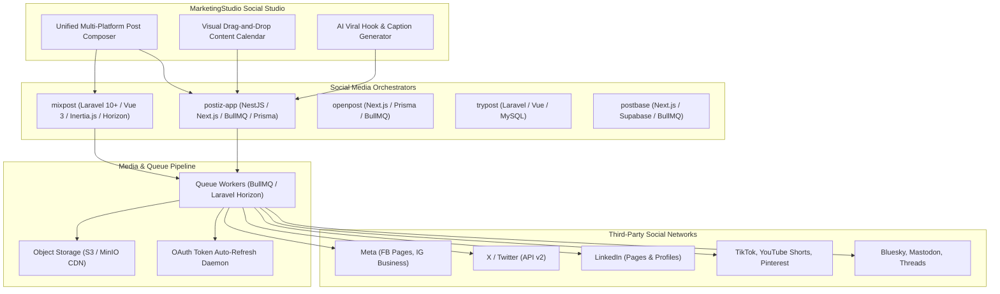
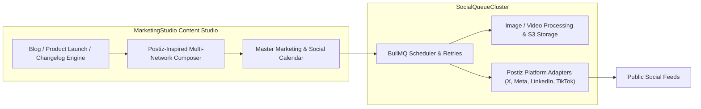

# Category 08: Social Media Management — Comparative Architectural Analysis

> **Domain Scope**: Multi-platform social media scheduling, social calendar orchestration, automated OAuth token refresh, post preview rendering, and social analytics.  
> **Solutions Analyzed**: `mixpost`, `postiz-app`, `openpost`, `trypost`, `postbase`  
> **Commercial SaaS Benchmarks**: `Buffer`, `Hootsuite`, `Later`, `Sprout Social`, `Sent.dm`

---

## 1. Executive Domain Overview

Organic social media distribution has become a mandatory pillar of multi-channel marketing. However, building and maintaining a social media scheduling engine is notoriously difficult due to the fragility and constant divergence of third-party social APIs:
- **X (formerly Twitter)**: Aggressive rate limits, strict paywalled API tiers ($100-$5,000/mo for enterprise v2 endpoints), short-lived OAuth 2.0 tokens, and character length variations.
- **Meta (Facebook & Instagram)**: Complex Graph API permissions (`pages_manage_posts`, `instagram_content_publish`), mandatory Business Manager verification, aspect ratio restrictions for Reels/Carousels, and token expiration lifecycles.
- **LinkedIn**: UGC Post API vs Share API, PDF carousel document publishing, organization page vs personal profile authorization scopes.
- **TikTok & YouTube Shorts**: Video container transcoding, bit rate compliance, thumbnail generation, and asynchronous video upload chunking.
- **Pinterest, Mastodon, Bluesky, Threads**: Emerging decentralized or niche protocols requiring specialized payload formatting.

The 5 open-source solutions analyzed in this category provide production-tested architectures for scheduling posts, queuing media uploads, and synchronizing analytics across these platforms.

---

## 2. Technical Ecosystem & Architectural Taxonomy

### Technical Stack Matrix

| Solution | Language & Runtime | Core Framework | Database & ORM | Queue & Scheduler | Supported Platforms | License |
| :--- | :--- | :--- | :--- | :--- | :--- | :--- |
| **mixpost** | PHP 8.2+ / TS | Laravel 10/11/12, Inertia.js, Vue 3 | MySQL / PostgreSQL (Eloquent) | Laravel Queue + Horizon (`Bus::batch()`) | 8+ Networks (X, FB, IG, LinkedIn, Pinterest, Mastodon, YouTube) | MIT |
| **postiz-app** | TypeScript / Node 22+ | NestJS 10, Next.js 14, Mantine UI | PostgreSQL (Prisma 6.5) | Temporal.io Durable Workflows + BullMQ/Redis | 30+ Networks (inc. TikTok, Bluesky, Threads, Farcaster, Reddit) | AGPL-3.0 |
| **openpost** | Go 1.26+ | Echo v4, Huma v2 OpenAPI, SvelteKit 2 | SQLite / PostgreSQL (Uptrace Bun ORM) | Transactional DB Queue (`SKIP LOCKED`) + 15m Stale Watcher | X, Meta, LinkedIn, YouTube, Bluesky, Mastodon + Native MCP Server | AGPL-3.0 |
| **trypost** | PHP 8.2+ / JS | Laravel 13, Vue 3, Inertia 3.5, Reka UI | PostgreSQL 16 / MySQL (Eloquent) | Laravel Horizon + Laravel Reverb WebSockets | 13+ Networks (inc. TikTok, Bluesky, Google Business, Telegram) | AGPL-3.0-only |
| **postbase** | TypeScript / Node 20+ | Next.js 14 App Router, Shadcn UI | PostgreSQL (Supabase with RLS & Realtime) | Next.js Server Actions + Supabase Realtime | X, LinkedIn, Instagram (Agency Kanban Approval Workflows) | MIT |

---

## 3. Deep Architectural Comparison: Publishing Engine Paradigms

Social publishing engines must resolve the core tension between network API volatility, multi-tenant credential isolation, video transcoding latencies, and long-horizon scheduling durability. The 5 solutions implement radically distinct architectural paradigms:

```mermaid
flowchart TD
    subgraph P1 ["1. Modular Package & Variant Inheritance (mixpost)"]
        MP_UI["Vue 3 / Inertia SPA"] --> MP_Post["Post (Original)"]
        MP_Post --> MP_Var["mixpost_post_versions (Variants per Net)"]
        MP_Var --> MP_Sched["Laravel Scheduler (Cron)"]
        MP_Sched --> MP_Batch["Bus::batch(AccountPublishPostJob)"]
        MP_Batch --> MP_Prov["SocialProviderManager (TwitterOAuth / Graph)"]
        MP_Prov --> MP_Out["Social API Endpoints"]
    end

    subgraph P2 ["2. Durable Workflow Microservices (postiz-app)"]
        PZ_UI["Next.js 14 + CopilotKit UI"] --> PZ_API["NestJS API Gateway (apps/backend)"]
        PZ_API --> PZ_Temporal["Temporal Server (gRPC Workflow Engine)"]
        PZ_Temporal --> PZ_WF["PostWorkflows / RefreshTokenWorkflow"]
        PZ_WF --> PZ_Worker["NestJS Orchestrator (apps/orchestrator)"]
        PZ_Worker --> PZ_Act["PostActivities (Execute Social API)"]
        PZ_Act --> PZ_Adapters["30+ Social Adapters (Bluesky, TikTok, YouTube)"]
    end

    subgraph P3 ["3. Single-Binary Go + SKIP LOCKED DB Queue + MCP (openpost)"]
        OP_Agent["AI Agents (Claude/Cursor via MCP)"] --> OP_MCP["Native MCP JSON-RPC Server"]
        OP_UI["Embedded SvelteKit 2 SPA"] --> OP_Echo["Echo v4 + Huma OpenAPI"]
        OP_MCP --> OP_Core["Go Core Engine"]
        OP_Echo --> OP_Core
        OP_Core --> OP_Bun["Uptrace Bun ORM (SQLite / PostgreSQL)"]
        OP_Core --> OP_Q["FOR UPDATE SKIP LOCKED Transactional Queue"]
        OP_Q --> OP_Worker["In-Process Queue Supervisor (Heartbeat 15m)"]
        OP_Worker --> OP_Plat["Platform Adapter Registry"]
    end

    subgraph P4 ["4. Real-Time WebSockets + Pre-Flight Verifiers (trypost)"]
        TP_UI["Vue 3 + Reka UI"] <-->|Reverb WebSockets| TP_Reverb["Laravel Reverb WS Server"]
        TP_UI --> TP_Laravel["Laravel 13 Monolith"]
        TP_Pre["VerifyUpcomingPostConnections (15m Worker)"] -->|Pre-flight Test & Rotate| TP_Token["OAuth Token Rotator"]
        TP_Laravel --> TP_Horizon["Laravel Horizon (Queue Cluster)"]
        TP_Horizon --> TP_Check["PublishToSocialPlatform with Thread Checkpoints"]
        TP_Check --> TP_Reverb
    end

    subgraph P5 ["5. Serverless Next.js + Supabase RLS (postbase)"]
        PB_UI["Next.js 14 App Router"] --> PB_Actions["Next.js Server Actions"]
        PB_Actions --> PB_Supa[(Supabase PostgreSQL + RLS Policies)]
        PB_Supa <-->|Realtime PubSub| PB_UI
        PB_Actions --> PB_Gate["Direct API Dispatchers"]
    end
```

### Detailed Evaluation of the 5 Engine Paradigms:

1. **Modular Laravel Package with Variant Inheritance (`mixpost`)**:
   - **Mechanism**: Engineered either as a standalone application or as an embeddable composer package (`inovector/mixpost`). Adopts a clean "Original vs. Variant" entity relationship model (`mixpost_post_versions`). Marketers author a single root post, then override text, hashtags, or media for individual networks (e.g., shortening a caption for X while expanding it for LinkedIn).
   - **Queue & Concurrency**: Offloads execution to Laravel Horizon. Posts due for publication are gathered via `mixpost:run-scheduled-posts` and dispatched using `Bus::batch()` with `allowFailures()`. This guarantees that an API failure or expired credential on one network (e.g., Instagram) never blocks execution on other targeted platforms. Media transformations (image resizing via Intervention Image, video poster generation via PHP-FFmpeg) run in dedicated queue workers.
   - **Tradeoffs**: Highly ergonomic for PHP/Laravel developers, but incurs standard PHP-FPM process overhead and requires maintaining a separate Redis/Horizon queue cluster.

2. **Temporal.io Durable Workflows + NestJS Microservices (`postiz-app`)**:
   - **Mechanism**: Completely abandons fragile cron polling and volatile Redis-only queues in favor of **Temporal.io durable workflow execution**. Every scheduled post is initiated as a stateful `PostWorkflow`. If a worker process dies mid-upload, or an external API returns a 429 rate limit or 5xx outage, Temporal maintains execution state across days, executing exponential backoff without losing timer precision.
   - **Failure Primitives**: Implements specialized error primitives: `PublishedWithError` (for two-phase operations where video upload succeeds but thumbnail tagging fails, preventing duplicate video uploads on retry), `RefreshToken` (pauses the publish workflow, triggers an out-of-band OAuth refresh, and resumes publish), and `Disconnect` (flags revoked accounts).
   - **Tradeoffs**: Unmatched fault tolerance and multi-platform reach (30+ networks), but requires running a dedicated Temporal cluster (Temporal Server + Elasticsearch/PostgreSQL) alongside the NestJS backend and Next.js frontend, leading to high operational overhead.

3. **Single Go Binary + Bun ORM `SKIP LOCKED` Queues + Native MCP Server (`openpost`)**:
   - **Mechanism**: Collapses the entire social media studio into a single compiled Go binary containing the Echo v4 HTTP engine, Huma v2 typed OpenAPI router, embedded SvelteKit 2 SPA, and an in-process queue supervisor. Replaces external brokers (Redis/RabbitMQ) with a transactional database queue using `FOR UPDATE SKIP LOCKED` on PostgreSQL (or serialized advisory locks on SQLite). A built-in stale job watcher recovers orphaned jobs every 15 minutes.
   - **AI Agent Native**: Uniquely embeds a first-party **Model Context Protocol (MCP)** server over stdio/SSE, exposing publication creation, scheduling, image editing, and asset search directly to AI agents (Claude Code, Cursor, Windsurf) without custom API wrappers.
   - **Tradeoffs**: Minimal operational footprint (can run on a \$5 VPS with zero external services), but lacks Temporal's multi-day stateful workflow durability and has a narrower platform footprint than Postiz.

4. **Laravel Reverb WebSockets + Pre-Flight OAuth Verifiers (`trypost`)**:
   - **Mechanism**: Built on modern Laravel 13 with **Laravel Reverb** for low-latency, first-party WebSocket broadcasting. Solves the "silent runtime failure" epidemic where scheduled posts fail at the moment of execution due to expired OAuth credentials.
   - **Pre-Flight Verification**: An automated daemon (`VerifyUpcomingPostConnections`) scans all posts entering a 1-hour risk window, validates access tokens against live upstream APIs, executes refresh token rotations, and alerts workspace admins via `PostAtRisk` email notifications if an account requires re-authorization.
   - **Thread Checkpointing**: Implements stateful thread checkpoints (`PublishCheckpoint`, `ThreadProgress`), allowing multi-tweet thread posts that hit midway rate limits to resume from the exact failed tweet rather than duplicating initial posts.
   - **Tradeoffs**: Superb creator UX and proactive error prevention, but tied to the PHP/Laravel ecosystem and requires running Redis + Reverb + Horizon daemons.

5. **Serverless Next.js + Supabase RLS & Realtime (`postbase`)**:
   - **Mechanism**: Serverless-first social workspace utilizing Next.js 14 App Router and Supabase. Relies on PostgreSQL Row Level Security (RLS) policies to enforce multi-tenant agency boundaries. Realtime synchronization between copywriters, designers, and approving clients is handled directly by Supabase Realtime (PostgreSQL replication stream).
   - **Tradeoffs**: Fast initial deployment and excellent for collaborative client approval workflows, but lacks dedicated queuing pipelines for video transcoding or multi-platform rate-limit retries.

---

### Architectural Tradeoffs Matrix: Social Publishing

| Architectural Dimension | mixpost | postiz-app | openpost | trypost | postbase |
| :--- | :--- | :--- | :--- | :--- | :--- |
| **Publishing Throughput & Scale** | **High**; Laravel Horizon distributed workers; `Bus::batch()` parallel account delivery | **High**; NestJS worker pools with Temporal activity task queues; asynchronous video chunking | **High**; Go compiled goroutines + `SKIP LOCKED` DB queues; low memory overhead (<60MB) | **High**; Horizon multi-queue workers with Redis concurrency rate-limit locks | **Moderate**; Next.js Server Actions constrained by serverless execution timeouts |
| **Fault Tolerance & Durability** | **High**; isolated batch failures (`allowFailures()`); failed jobs tracked in Horizon DB tables | **Extreme**; Temporal durable execution; workflows survive server crashes, redeploys, and long outages | **High**; transactional database locks with automatic 15-minute heartbeat stale-job recovery | **Very High**; pre-flight connection verification (1hr buffer) + stateful thread checkpoints | **Moderate**; relies on Supabase transactional state; lacks resilient retry backoff queues |
| **Operational Overhead** | **Moderate**; requires PHP-FPM, Nginx, Redis, and Laravel Horizon daemon management | **High**; requires Node.js runtime, Redis, PostgreSQL, and a running Temporal.io cluster | **Minimal**; single self-contained Go binary; embedded SQLite or PostgreSQL; zero broker dependencies | **Moderate**; requires PHP 8.2+, Redis, Laravel Horizon, and Laravel Reverb WebSocket server | **Minimal**; serverless Next.js deployment to Vercel + managed Supabase project |
| **Platform Breadth & Extensibility** | **Moderate (8+ Networks)**; clean `SocialProviderManager`; video FFmpeg processing | **Broadest (30+ Networks)**; unified `SocialProvider` interface; ATProto, Nostr, Farcaster, TikTok | **Moderate (6+ Networks)**; modular Go adapters; native Model Context Protocol (MCP) server | **Broad (13+ Networks)**; unified publisher classes; AI repurposing and RSS ingestion | **Focused (3 Networks)**; standard social APIs; focused on client review and approval states |

---

## 4. Deep-Dive Comparative Analysis Across 6 Core Dimensions

### 4.1. Platform Breadth & API Adapter Architecture

- **postiz-app** provides the most expansive platform breadth in the ecosystem (30+ networks). Its NestJS `SocialProvider` contract standardizes publishing across legacy social networks (X, Facebook, Instagram, LinkedIn, TikTok, YouTube, Pinterest, Reddit) as well as emerging decentralized and web3 networks (Bluesky AT Protocol, Nostr, Farcaster, Mastodon, Threads).
- **mixpost** maintains an industrial PHP provider architecture (`SocialProviderManager`, `TwitterProvider`, `MetaProvider`, `MastodonProvider`). Every network is cleanly isolated with platform-specific OAuth controllers, video chunking services, and metric synchronizers.
- **openpost** defines a clean Go `PlatformAdapter` interface in `internal/platform/`, providing native media chunking, thread splitting, and cross-platform segment builders in compiled Go, alongside a native Model Context Protocol (MCP) server for agentic interaction.
- **trypost** structures publishers under `app/Services/Social/`, featuring dedicated X v1.1 chunked media uploaders, YouTube resumable video pipelines, and Bluesky ATProto integration.
- **postbase** provides core integrations for X, LinkedIn, and Instagram, focusing on team draft approval rather than platform breadth.

### 4.2. OAuth 2.0 Token Lifecycle & Proactive Refresh

- **trypost** leads the category in proactive token defense with its `VerifyUpcomingPostConnections` daemon. Scanning a rolling 1-hour pre-flight window, it performs active token verification against upstream APIs, refreshes tokens with expiring TTLs, and dispatches `PostAtRisk` warnings before jobs fail.
- **postiz-app** models token rotation as a dedicated Temporal workflow (`RefreshTokenWorkflow`). When a publish activity encounters an expired token or 401 response, it catches the error with a `RefreshToken` signal, triggers the token exchange activity, updates PostgreSQL via Prisma, and immediately retries the publish activity.
- **mixpost** stores OAuth client tokens in encrypted database columns (`EncryptArrayObject`) and runs daily scheduled commands to verify and refresh short-lived Meta and LinkedIn tokens.
- **openpost** executes a scheduled `RefreshToken` job via its internal queue supervisor, validating token expiries against PostgreSQL/SQLite and updating credentials atomically.

### 4.3. Visual Post Preview & Platform Emulation

- **mixpost** and **trypost** feature Vue 3 + TipTap canvas editors with pixel-perfect, platform-accurate live preview cards that dynamically recalculate character limits, thread counters, and image aspect ratio warnings as users type.
- **postiz-app** provides real-time preview mockups within Next.js 14 and Mantine UI, supporting multi-platform side-by-side comparison and CopilotKit in-canvas AI text adjustments.
- **openpost** includes an integrated image layout editor and segment builder within SvelteKit 2, previewing multi-part threads across Twitter, Bluesky, and Mastodon.
- **postbase** prioritizes client presentation with authentic Twitter, LinkedIn, and Instagram preview mockups designed for client sign-off.

### 4.4. AI Copywriting & Agentic Automation

- **openpost** uniquely features a native Model Context Protocol (MCP) server (`apps/server/internal/mcp/`), enabling AI developer agents (Claude Code, Cursor, Windsurf) to inspect draft schedules, generate platform variants, and trigger publishing programmatically.
- **postiz-app** embeds the Mastra AI agent framework and LangGraph integrations to draft viral hooks, rewrite captions per platform tone, and slice long-form video clips into social reels.
- **trypost** incorporates **Laravel AI** to poll RSS feeds, YouTube channels, and blogs via `PollRepurposeSource`, automatically transforming articles into tailored social posts.
- **mixpost** provides optional OpenAI integration for caption rephrasing and hashtag discovery.

---

## 5. Head-to-Head Feature & Capability Matrix

| Feature / Dimension | mixpost | postiz-app | openpost | trypost | postbase |
| :--- | :---: | :---: | :---: | :---: | :---: |
| **Supported Platforms (Count)** | **8+ Networks** | **30+ Networks** | 6+ Networks | 13+ Networks | 3 Networks |
| **Durable Execution Engine** | ⚠️ Horizon Retries | ✅ Temporal.io Workflows | ⚠️ SKIP LOCKED DB Queue | ⚠️ Horizon Retries | ❌ Serverless |
| **Pre-Flight Connection Verifier**| ⚠️ Scheduled check | ⚠️ Activity catch | ⚠️ Cron check | ✅ Proactive 1hr Buffer | ❌ |
| **Stateful Thread Checkpoints** | ❌ | ⚠️ Activity retry | ⚠️ Segment queue | ✅ Native Checkpoints | ❌ |
| **Visual Calendar View** | ✅ Drag-and-drop | ✅ Drag-and-drop | ✅ Svelte Calendar | ✅ Pragmatic DnD | ✅ Kanban / Calendar |
| **Real-Time WebSockets** | ❌ (Polling) | ⚠️ BullMQ Events | ⚠️ SSE / Polling | ✅ Laravel Reverb | ✅ Supabase Realtime |
| **Video Chunked Resumable Uploads**| ✅ Resilient | ✅ Resilient | ✅ Go Chunker | ✅ Resilient | ❌ |
| **Decentralized (Bluesky/Mastodon)**| ⚠️ Mastodon only | ✅ ATProto, Nostr, Masto | ✅ Bluesky & Masto | ✅ Bluesky & Masto | ❌ |
| **Native MCP Server for AI Agents**| ❌ | ⚠️ Tool wrapper | ✅ First-Party MCP | ❌ | ❌ |
| **Deployment Model** | Laravel / PHP-FPM | Docker / Temporal | Single Go Binary | Laravel Monolith | Next.js + Supabase |

---

## 6. Commercial Benchmark Positioning

- **Against Buffer / Later**:
  - `postiz-app` matches Buffer's modern clean UI, multi-platform scheduling calendar, and content queue management without monthly subscription fees.
- **Against Hootsuite / Sprout Social**:
  - `mixpost` and `postiz-app` replicate core scheduling and analytics, but Hootsuite retains an edge in deep social listening and competitor keyword stream monitoring.
- **Against Sent.dm**:
  - Sent.dm focuses on automated social direct messaging outreach (DM funnels on Instagram/X), whereas Postiz and Mixpost focus on public feed publishing.

---

## 7. MarketingStudio Convergence Blueprint

### Architectural Recommendations for MarketingStudio:
1. **Adopt Postiz-App's TypeScript Architecture**: Leverage Postiz's NestJS/Prisma provider architecture to avoid maintaining separate PHP services for social publishing.
2. **Reuse Postiz's Platform Adapter Interfaces**: Implement a single unified `SocialProvider` interface (`publish()`, `delete()`, `validateMedia()`, `getMetrics()`) for every connected social channel.
3. **Embed Live Post Previews in the Composer**: Replicate Mixpost's and Postiz's live preview widgets to show users the exact rendering of their content before scheduling.
4. **Automate OAuth Token Renewal via BullMQ Cron**: Schedule a daily background job to inspect all connected social accounts and refresh OAuth tokens with 7+ days of buffer to eliminate failed post disruptions.
