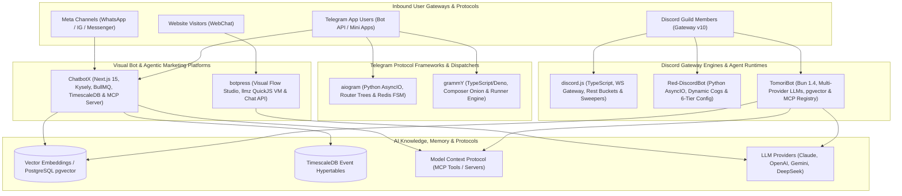
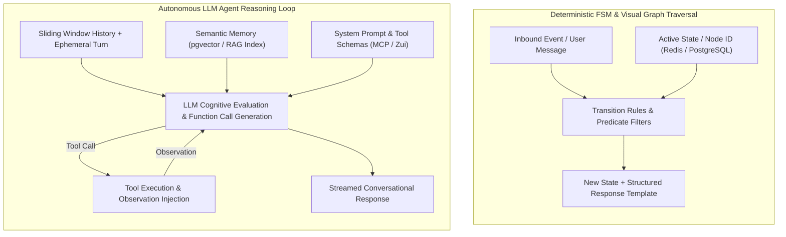
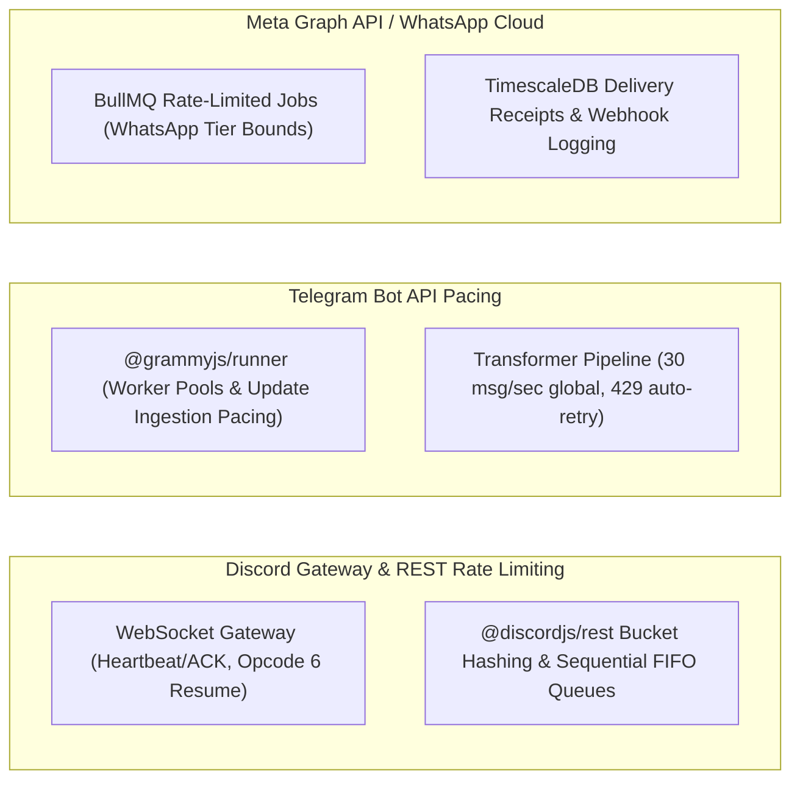
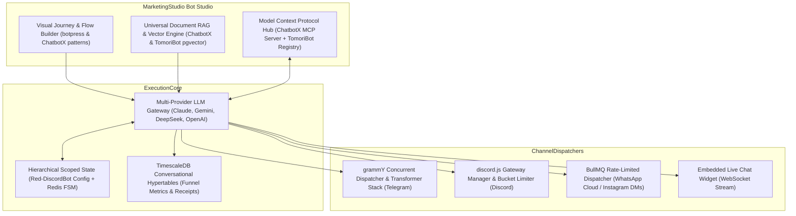

# Category 09: Conversational AI & Bots — Comparative Architectural Analysis

> **Domain Scope**: Visual bot builders, conversational dialog engines, knowledge-base RAG chatbots, Telegram bot frameworks, and Discord community automation.  
> **Solutions Analyzed**: `botpress`, `ChatbotX`, `aiogram`, `grammY`, `discord.js`, `Red-DiscordBot`, `TomoriBot`  
> **Commercial SaaS Benchmarks**: `Voiceflow`, `Botpress Cloud`, `ManyChat`, `Drift`, `Ada Support`

---

## 1. Executive Domain Overview

Conversational AI has evolved from rigid, keyword-matching decision trees into dynamic, LLM-powered agentic systems. In marketing and sales operations, conversational bots serve three mission-critical objectives:
1. **Inbound Lead Qualification & Booking**: Engaging website visitors or messaging app users 24/7, answering product questions from knowledge bases (RAG), qualifying budget and authority, and booking meetings directly on sales calendars.
2. **Channel-Specific Conversational Automation**: Executing marketing and community engagement across Telegram (crypto/web3, trading communities, Mini Apps) and Discord (developer tools, gamers, SaaS communities).
3. **Hybrid Deterministic + Generative Dialog**: Balancing unpredictable LLM hallucination risks with deterministic compliance steps (payment links, terms of service agreements, authentication flows, CRM data capture).

The 7 solutions in this category span full visual conversational studios (`botpress`), enterprise agentic chat marketing platforms (`ChatbotX`), carrier-grade Telegram frameworks (`aiogram`, `grammY`), and Discord bot infrastructures (`discord.js`, `Red-DiscordBot`, `TomoriBot`).

---

## 2. Technical Ecosystem & Architectural Taxonomy

### Technical Stack Matrix

| Solution | Language & Runtime | Core Architecture | State & Session Storage | Concurrency & Worker Model | Target Ecosystem | Primary Architectural Niche | License |
| :--- | :--- | :--- | :--- | :--- | :--- | :--- | :--- |
| **botpress** | TypeScript / Node 22+ | Monorepo Studio + QuickJS VM (`llmz`) + Chat API | PostgreSQL 15+, DynamoDB, Vector DB | Node Event Loop + In-Process Sandboxing | Multi-channel Web, WhatsApp, Slack, Teams, Telegram | Hybrid visual FSM & sandboxed LLM agent runtime | AGPL-3.0 |
| **ChatbotX** | TypeScript / Node 24+ | Turborepo, Next.js 15, Kysely ORM, MCP Server | PostgreSQL 16+, TimescaleDB, Redis 7+ | BullMQ Redis Cluster + QuickJS Sandbox | WhatsApp Cloud, IG, Messenger, Telegram, Socials | Agentic chat marketing, social comment automation & MCP funnels | MIT |
| **aiogram** | Python 3.10-3.14 | AsyncIO, uvloop, aiohttp, Pydantic v2 | Redis (hiredis), Motor (MongoDB), Memory | Native AsyncIO Event Loop | Telegram Bot API | High-throughput asynchronous Telegram dispatching with hierarchical routers | MIT |
| **grammY** | TypeScript / Deno / Node / Bun / Workers | Composer Onion Middleware, Native Web APIs | Redis, PostgreSQL, Keyv, In-Memory | Concurrency Runner (`@grammyjs/runner`) | Telegram Bot API | Cross-runtime type-safe Telegram framework with transformer pipelines | MIT |
| **discord.js** | TypeScript / Node 18-22+ | Modular Monorepo (`@discordjs/ws`, `rest`, `builders`) | In-Memory `Collection` with Sweepers | REST Bucket Queues + Sharding Manager | Discord Gateway v10 & REST API | Low-level object-oriented Discord WebSocket client & REST bucket manager | Apache-2.0 |
| **Red-DiscordBot** | Python 3.9-3.12+ | discord.py 2.x, Dynamic Cogs Lifecycle, JSON-RPC | Red Config (JSON flat-file, MongoDB, PostgreSQL) | AsyncIO Tasks + Dynamic Cog Manager | Discord Gateway API | Hot-reloadable modular Discord bot platform with 6-tier scoped Config | GPL-3.0 |
| **TomoriBot** | TypeScript / Bun 1.4+ | Bun Native Runtime, discord.js 14.25, MCP Client | PostgreSQL 16+, pgvector, pg_cron | Bun Event Loop + Multi-Provider Streaming | Discord Gateway API & Matrix Bridge | Multi-provider LLM assistant with pgvector RAG, MCP tool registry, and SillyTavern presets | ISC |

---

## 3. Deep Architectural Comparison: Bot Runtimes & Dialogue Paradigms

### 3.1. Execution Paradigms & Runtime Topologies

The seven solutions embody fundamentally divergent execution philosophies across the spectrum of conversational engineering:

1. **Hybrid Deterministic FSM + QuickJS Sandboxed VM (`botpress`)**:
   - Botpress decouples visual node graph traversal from cognitive reasoning. Nodes execute deterministic instructions (form inputs, condition branches), but can yield control to `packages/llmz`—an isolated WebAssembly QuickJS virtual machine.
   - User actions and tool calls execute inside the QuickJS sandbox, ensuring zero-trust multi-tenant isolation and preventing remote code execution (RCE).
   - The `@botpress/chat-api` handles canonical ingress/egress, isolating channel-specific protocol translation (`integrations/*`) from core dialogue state machines.

2. **Agentic Marketing with TimescaleDB & Dedicated MCP Server (`ChatbotX`)**:
   - ChatbotX organizes conversational automation around asynchronous message queues (`BullMQ`) and the Model Context Protocol (`@modelcontextprotocol/sdk`).
   - Rather than executing dialogue synchronously inside the webhook loop, incoming events from Meta Graph API or Telegram are normalized via `packages/channel-registry` and pushed to Redis. BullMQ workers process node traversals, invoke sandboxed scripts via `apps/javascript-executor` (QuickJS), and commit telemetry into TimescaleDB hypertables.
   - External autonomous agents (Claude Desktop, OpenClaw, Hermes) connect directly to `apps/mcp-server` to inspect lead records, update bot variables, and dynamically steer or pause marketing funnels.

3. **Python AsyncIO Router Trees & Distributed Redis FSM (`aiogram`)**:
   - aiogram v3 constructs a non-blocking, high-velocity event pipeline powered by Python's `asyncio` (optionally accelerated by C-based `uvloop` and `aiodns`).
   - Replaces flat handler registries with hierarchical `Router` trees. Updates traverse an outer middleware ring (pre-filtering), execute declarative `magic-filter` predicates, enter matched routers, pass through inner middlewares (transaction scoping), and execute the handler.
   - Dialogue state is decoupled into `aiogram.fsm.storage.redis.RedisStorage`, allowing stateless worker nodes to share session state across horizontal deployments without sticky sessions.

4. **Universal Edge Execution with Context Flavoring & Transformer Pipelines (`grammY`)**:
   - grammY leverages standard Web APIs (`fetch`, `AbortController`, `Streams`) and platform shims to execute seamlessly across Node.js, Deno, Bun, and serverless V8 isolates (Cloudflare Workers).
   - Implements an onion-layer middleware engine (`Composer`). Context objects are extensible at compile time via TypeScript type intersections (*Context Flavoring*), providing zero-cost compile-time type safety.
   - Employs an outbound *Transformer Pipeline* (`bot.api.config.use`), intercepting outbound API calls to apply automated backoff retries, pacing, and logging before payloads reach the network.

5. **Low-Level WebSocket Gateway & Collection Cache Sweepers (`discord.js`)**:
   - Built to manage Discord's bidirectional WebSocket Gateway v10. `@discordjs/ws` manages connection handshakes, sequence tracking, zlib compression, and resume cycles.
   - Maintains an in-memory cache using `@discordjs/collection` (extended ES6 Map). To prevent memory exhaustion in multi-thousand-guild environments, automated `Sweepers` periodically prune inactive message caches, idle threads, and offline members.
   - Outbound REST requests are dispatched through `@discordjs/rest`, which manages route-specific bucket hashes and sequential sub-queues to avoid Discord's stringent 429 rate limit bans.

6. **Hot-Reloadable Cog Micro-Kernel with 6-Tier Scoped Config (`Red-DiscordBot`)**:
   - Built on `discord.py` 2.x and Python `asyncio`, Red functions as an extensible micro-kernel. Features are packaged into dynamic "Cogs" that can be loaded, unloaded, or upgraded from remote Git repositories at runtime without restarting the bot or dropping WebSocket connections.
   - Persistent data is abstracted through `redbot.core.config.Config`, offering a 6-tier scoped hierarchy (`GLOBAL`, `GUILD`, `CHANNEL`, `ROLE`, `USER`, `MEMBER`) backed transparently by flat JSON, MongoDB (Motor), or PostgreSQL (asyncpg).

7. **Multi-Provider LLM Gateway with `pgvector` Semantic RAG & MCP Tool Registry (`TomoriBot`)**:
   - Native Bun 1.4+ execution provides sub-millisecond startup and low-overhead HTTP/WebSocket streaming.
   - Orchestrates multi-model routing across Claude, OpenAI, Gemini, DeepSeek, and OpenRouter with automatic 429/503 failover.
   - Implements persistent episodic memory using PostgreSQL `pgvector` cosine similarity (`<=>`), an extensible Model Context Protocol client for local/remote tool execution, and in-database scheduled tasks powered by `pg_cron`.

---

### 3.2. Dialogue State Machines & FSM vs. Conversational LLM Loops

Conversational engines manage conversation flow via two distinct architectural philosophies:

#### Deterministic Finite State Machines (aiogram, grammY, botpress visual nodes, Red-DiscordBot)
- **State Representation**: State is an explicit pointer (e.g., `SDRQualify:company_name` in aiogram, or Node ID in Botpress). State is stored in Redis key-value hashes or PostgreSQL rows keyed by `(bot_id, chat_id, user_id)`.
- **Predictability & Compliance**: Guarantees that users cannot bypass required validation steps (e.g., email format, credit card entry, legal disclaimers). Branching logic is deterministic and auditable.
- **Limitation**: Brittle when users ask tangential questions, deviate from expected input formats, or express complex unstructured intents.

#### Stochastic Conversational LLM Loops (TomoriBot, ChatbotX AI Agents, Botpress llmz)
- **State Representation**: State is implicit, captured within conversation memory buffers, dynamic system prompts, and vector similarity contexts.
- **Flexibility & Tool Calling**: The model autonomously determines whether to answer directly, ask clarifying questions, or invoke structured external tools (via MCP or OpenAI function calling schemas).
- **Failure Recovery & Grounding**: Mitigates hallucinations through strict RAG retrieval (pgvector cosine searches in TomoriBot/ChatbotX) and schema validation (Zui in Botpress, Zod/Pydantic in ChatbotX/aiogram).

#### Memory Architecture Comparison

| Memory Tier | botpress | ChatbotX | aiogram | grammY | discord.js | Red-DiscordBot | TomoriBot |
| :--- | :--- | :--- | :--- | :--- | :--- | :--- | :--- |
| **Ephemeral Turn State** | QuickJS VM Context | BullMQ Job Context | Handler kwargs / Event Context | `ctx` Object | Event Parameter | Command `Context` | Bun Request Scope |
| **Active Session State** | PostgreSQL / DynamoDB (`conversation` scope) | PostgreSQL / Redis Session | Redis Key / `FSMContext` | `ctx.session` (Redis/Postgres) | In-Memory `Collection` Cache | In-Memory Cog State | In-Memory Active Session |
| **User Profile Memory** | `user` scope (PostgreSQL) | `contacts` table (Kysely / Postgres) | User-scoped FSM Data | User-scoped Session Adapter | GuildMember In-Memory Cache | `Config.user()` / `Config.member()` | PostgreSQL User Record |
| **Semantic / Long-Term RAG** | `plugins/knowledge` Vector Store | pgvector embeddings | External (custom integration) | External (custom integration) | External (custom integration) | Community RAG Cogs | PostgreSQL `pgvector` (`schema_rag.sql`) |

---

### 3.3. Rate Limiting, Backpressure & Gateway Connection Management

Operating chatbots at enterprise scale requires distinct strategies for handling protocol rate limits, socket heartbeats, and message backpressure:

1. **Discord Gateway & REST Bucket Limits (`discord.js`, `Red-DiscordBot`, `TomoriBot`)**:
   - **Gateway Management**: Discord requires continuous heartbeating (`Opcode 1`). If a socket drops, `@discordjs/ws` and `discord.py` avoid re-identifying by caching the session ID and sequence number, executing a fast `Resume` (`Opcode 6`) that avoids re-streaming entire guild state.
   - **Sharding**: Large bots are sharded across worker processes (`ShardingManager` in discord.js, `AutoShardedBot` in Red), with each shard serving ~1,000 guilds.
   - **REST Bucket Hashing**: Discord assigns endpoints dynamic bucket hashes via `X-RateLimit-Bucket`. Both `discord.js` and `discord.py` maintain per-bucket FIFO queues. Outbound requests wait until `X-RateLimit-Reset-After` expires, preventing IP-wide bans.

2. **Telegram Bot API Limits (`aiogram`, `grammY`)**:
   - Telegram enforces a global limit of 30 messages per second and 1 message per second per individual chat.
   - **grammY Runner & Transformers**: `@grammyjs/runner` manages update ingestion concurrency via worker pools with built-in backpressure. Outbound pacing is enforced by the *Transformer Pipeline* (`@grammyjs/auto-retry` and `@grammyjs/ratelimiter`), which queues messages and automatically retries upon HTTP 429 errors.
   - **aiogram Dispatcher**: Leverages asynchronous `AiohttpSession` connection pooling with configurable client timeouts and backoff strategies in polling loops.

3. **Meta Graph API & Omnichannel Pacing (`ChatbotX`, `botpress`)**:
   - WhatsApp Cloud API limits outbound marketing broadcasts based on phone number tiers (Tier 1: 1K contacts/24h, Tier 2: 10K, Tier 3: 100K, Unlimited).
   - `ChatbotX` enforces this via BullMQ delayed jobs and batch rate limiters. Delivery status receipts (`sent`, `delivered`, `read`, `failed`) are ingested via webhooks and tracked in TimescaleDB.

---

### 3.4. Architectural Tradeoffs Matrix

| Evaluation Dimension | botpress | ChatbotX | aiogram | grammY | discord.js | Red-DiscordBot | TomoriBot |
| :--- | :---: | :---: | :---: | :---: | :---: | :---: | :---: |
| **Event Throughput** | Moderate (Web/Chat API) | High (BullMQ + Redis) | Very High (AsyncIO + uvloop) | Extremely High (Runner Engine) | High (WS + Sharding) | Moderate (AsyncIO single bot) | High (Bun native I/O) |
| **Memory Footprint** | Heavy (Node + Studio + QuickJS) | Moderate-Heavy (Next.js + Workers) | Low-Moderate (Python async) | Ultra-Low (Deno/Node/Workers) | Moderate (In-memory caches) | Moderate (Python cogs) | Low-Moderate (Bun runtime) |
| **State Isolation** | High (Multi-scope DB) | High (PostgreSQL + Tenants) | High (Redis key namespaces) | High (Session adapters) | Low (In-memory collections) | High (6-tier Config engine) | High (PostgreSQL schemas) |
| **Code Execution Sandbox** | QuickJS Emscripten (`llmz`) | QuickJS WebAssembly sandbox | ❌ (Direct Python runtime) | ❌ (Direct JS runtime) | ❌ (Direct Node runtime) | ❌ (Direct Python runtime) | ❌ (Direct Bun runtime) |
| **AI Agent / MCP Readiness** | High (Zui schemas + LLMz) | Native Master (Dedicated MCP Server) | Low (Manual integration) | Low (Manual integration) | Low (Manual integration) | Low (Community cogs) | Native Master (MCP SDK & Registry) |
| **Runtime Portability** | Node.js / Docker | Node.js / Docker | Python 3.10+ / Linux | Universal (Node, Deno, Bun, Edge) | Node.js 18+ | Python 3.9+ | Bun 1.4+ / Docker |
| **Extensibility Model** | Plugins & Integrations SDK | Microservices & Modules | Routers & Middlewares | Composers & Plugins | Modular `@discordjs/*` packages | Dynamic Hot-Reloadable Cogs | Tool Registry & Providers |
| **Non-Developer Usability** | Visual Studio GUI | Visual Flow Builder GUI | None (Code-first) | None (Code-first) | None (Code-first) | Discord Chat Commands | Discord Chat Commands |

---

## 4. Head-to-Head Comparison Matrix

| Feature / Dimension | botpress | ChatbotX | aiogram | grammY | discord.js | Red-DiscordBot | TomoriBot |
| :--- | :---: | :---: | :---: | :---: | :---: | :---: | :---: |
| **Visual Flow Canvas** | ✅ Advanced | ✅ Visual Builder | ❌ | ❌ | ❌ | ❌ | ❌ |
| **Native MCP Server / Client** | ⚠️ Zui Tools | ✅ Native Server | ❌ | ❌ | ❌ | ❌ | ✅ Native Client |
| **Vector RAG Ingestion** | ✅ Native Plugin | ✅ pgvector Core | ❌ | ❌ | ❌ | ⚠️ Community Cog | ✅ Native pgvector |
| **Telegram Protocol Support** | ⚠️ Channel Plugin | ✅ Via Registry | ✅ Native Master | ✅ Native Master | ❌ | ❌ | ❌ |
| **Discord Gateway Support** | ⚠️ Channel Plugin | ❌ | ❌ | ❌ | ✅ Native Master | ✅ Native Master | ✅ Native Master |
| **Meta (WhatsApp / IG) Support** | ✅ Integrations | ✅ Native Core | ❌ | ❌ | ❌ | ❌ | ❌ |
| **Hot-Reloading Architecture** | ❌ | ❌ | ❌ | ❌ | ❌ | ✅ Native Cogs | ❌ |
| **Persistent FSM Engine** | ✅ Internal Graph | ✅ Node Checkpoints | ✅ Redis FSM | ⚠️ Conversations Plugin | ❌ | ⚠️ State Cogs | ❌ |
| **Edge / Serverless Ready** | ❌ | ❌ | ❌ | ✅ Cloudflare / Deno | ⚠️ Headless Core | ❌ | ❌ |
| **Outbound Pacing / Rate Limit** | ✅ Internal | ✅ BullMQ Limiter | ⚠️ Client Session | ✅ Transformer Stack | ✅ Rest Bucket Queue | ✅ Discord.py Queue | ⚠️ Provider Retries |

---

## 5. Commercial Benchmark Positioning

- **Against Voiceflow / Botpress Cloud**:
  - `botpress` (open-source) matches the visual canvas, slot filling, and dialogue management of Voiceflow and Botpress Cloud, eliminating per-message fees and hosted limits.
- **Against ManyChat / Chatfuel / Respond.io**:
  - `ChatbotX` provides an open, self-hostable alternative with automated social comment-to-DM triggers, broadcast sequences, and direct Model Context Protocol integration that proprietary SaaS vendors cannot match.
- **Against Custom Python Telegram Wrappers (python-telegram-bot)**:
  - `aiogram` v3 offers superior asynchronous scaling, Pydantic v2 type safety, and battle-tested distributed Redis FSM storage for high-load conversational pipelines.
- **Against Legacy Node Telegram Libraries (Telegraf)**:
  - `grammY` provides true cross-runtime portability (Deno, Bun, Cloudflare Workers), compile-time filter queries, and the concurrency runner engine.
- **Against Commercial Discord Community Bots (Carl-bot, MEE6, Dyno)**:
  - `Red-DiscordBot` provides 100% self-hosted community governance without paywalled features, backed by a dynamic cog manager and 6-tier scoped Config data engine.
  - `TomoriBot` introduces multi-provider LLM intelligence, pgvector semantic memory, and MCP tool orchestration into Discord servers.

---

## 6. MarketingStudio Convergence Blueprint

### Architectural Recommendations for MarketingStudio:
1. **Adopt ChatbotX & TomoriBot's Unified `pgvector` RAG Engine**: Standardize document, website, and chat history embeddings on PostgreSQL using `pgvector`, eliminating dedicated external vector database dependencies while ensuring multi-tenant row-level security.
2. **Standardize on `grammY` for Telegram Marketing Operations**: Leverage grammY in TypeScript for Telegram bot funnels, webhooks, and Mini App integrations. Its cross-runtime architecture and transformer rate limiting align cleanly with MarketingStudio's TypeScript services.
3. **Incorporate `discord.js` with Sharding & Sweepers for Community Engagement**: Deploy discord.js with strict intent filtering and automated cache sweepers for community support, role onboarding, and lead escalation into MarketingStudio CRM.
4. **Implement Red-DiscordBot's Scoped Configuration Hierarchy**: Adopt the 6-tier scoping pattern (`GLOBAL`, `TENANT/WORKSPACE`, `CHANNEL`, `ROLE`, `USER`, `MEMBER`) for all conversational bot settings across all channels.
5. **Expose MarketingStudio via Model Context Protocol (MCP)**: Follow ChatbotX's `apps/mcp-server` pattern to expose lead qualification tools, CRM variables, and broadcast funnels to autonomous AI SDR agents.
