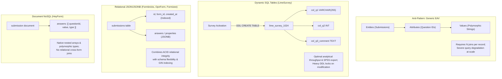
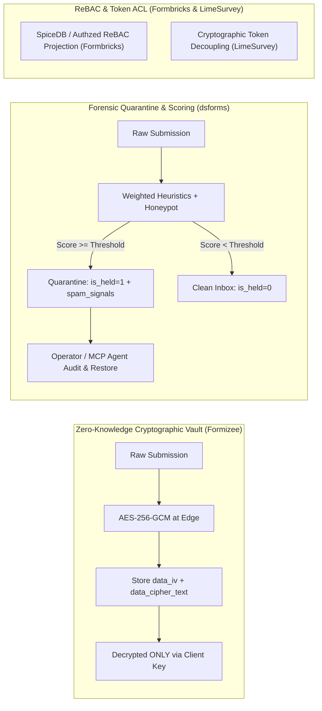
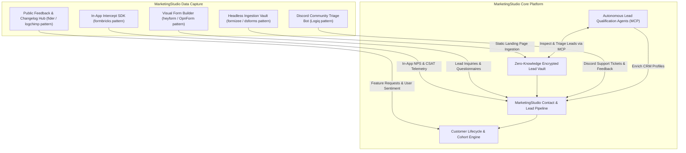

# Category 10: Forms, Surveys & Feedback — Comparative Architectural Analysis

> **Domain Scope**: In-app micro-surveys, conversational form builders, headless form backends, enterprise statistical research, client-side declarative survey engines, public customer feedback voting boards, and community triage bots.  
> **Solutions Analyzed**: `formbricks`, `heyform`, `OpnForm`, `formizee`, `LimeSurvey`, `survey-library` (SurveyJS), `fider`, `logchimp`, `Logiq`, `dsforms`  
> **Commercial SaaS Benchmarks**: `Typeform`, `Qualtrics`, `SurveyMonkey`, `Canny.io`, `Formspree`, `Basin`, `Ticket Tool`

---

## 1. Executive Domain Overview

Feedback collection and form ingestion sit at the critical intersection of product analytics, growth marketing, customer success, and data privacy. Modern applications require data intake across distinct, highly specialized architectural patterns:

1. **Targeted In-App Micro-Surveys & CX Telemetry** (`formbricks`): Zero-dependency client SDKs embedding non-intrusive micro-surveys directly inside web and mobile applications, triggered by real-time client-side user telemetry, behavioral events, and cohort attributes without server roundtrips.
2. **Conversational Multi-Step Form Engines** (`heyform`, `OpnForm`): One-question-at-a-time, keyboard-ergonomic interactive flows modeled on Typeform. Built for high conversion in customer intake, quizzes, and lead qualification with dynamic logic jumps.
3. **Headless Form Backends & Edge Submission Vaults** (`formizee`, `dsforms`): Decoupled backend APIs accepting standard HTML `<form action="...">` submissions from static sites (Next.js, Astro, Hugo, Webflow). They handle spam mitigation, webhooks, and notifications without requiring frontend dependencies or backend server maintenance.
4. **Enterprise Statistical & Scientific Research** (`LimeSurvey`): Methodologically rigorous survey engines supporting complex branching logic, randomized question sequences, quota controls, dynamic per-survey database tables, and native export to statistical software (SPSS, R).
5. **Client-Side Survey Rendering Engines** (`survey-library` / SurveyJS): Framework-agnostic MVVM rendering engines driven entirely by standardized JSON schemas, decoupling survey orchestration and dynamic UI logic from backend persistence.
6. **Public Feedback Boards & Collaborative Roadmaps** (`fider`, `logchimp`): Customer-facing suggestion portals featuring democratic upvoting, duplicate merge detection, threaded discussions, and status transitions (Planned, In Progress, Completed) tied to public roadmaps and changelogs.
7. **Chat-Native Community Engagement & Triage** (`Logiq`): Discord-native conversational interfaces leveraging interactive UI buttons and native modal forms to capture support tickets and feedback directly inside community channels.

---

## 2. Technical Ecosystem & Architectural Taxonomy

```mermaid
flowchart TD
    subgraph CaptureTier ["User Touchpoints & Frontends"]
        InAppWidget["In-App Micro-Survey Widget (@formbricks/js-core)"]
        ConversationalCanvas["Conversational Step Forms (React / Nuxt)"]
        HeadlessHTML["Static Site Forms (HTML5 / Next.js / Webflow)"]
        SurveyJSCanvas["Framework-Agnostic JSON Canvas (React / Vue / Angular)"]
        FeedbackPortal["Public Feature Request & Roadmap Board"]
        DiscordChat["Discord Guild Channels (Slash Commands / Modals)"]
    end

    subgraph FormEngines ["Survey & Ingestion Architectures"]
        Formbricks["formbricks\n(Next.js / Prisma / SpiceDB / PostgreSQL)"]
        HeyForm["heyform\n(NestJS / GraphQL / MongoDB / Redis Bull)"]
        OpnForm["OpnForm\n(Laravel 11 / Nuxt 3 / MySQL / Horizon)"]
        Formizee["formizee\n(Hono / Cloudflare Workers / Drizzle / LibSQL)"]
        LimeSurvey["LimeSurvey\n(PHP Yii / Dynamic SQL Tables / ExpressionScript)"]
        SurveyJS["survey-library\n(Pure TypeScript Core / MVVM / Client-Side)"]
        Fider["fider\n(Go 1.22+ / CQRS / React / PostgreSQL)"]
        Logchimp["logchimp\n(Express / Knex / PostgreSQL / Vue 3)"]
        Logiq["Logiq\n(Python asyncio / discord.py / FastAPI)"]
        Dsforms["dsforms\n(Pure Go / SQLite / MCP / Quarantine Screener)"]
    end

    subgraph PersistenceAndEgress ["Storage, Encryption & Destinations"]
        PostgresDB[(PostgreSQL Relational DB)]
        MongoDB[(MongoDB Document Store)]
        DynamicTables[(LimeSurvey Dynamic Tables: lime_survey_X)]
        EncryptedVault[(Formizee Zero-Knowledge Vault: AES-GCM)]
        EmbeddedSQLite[(dsforms Embedded SQLite / LibSQL)]
        MarketingStudioCore["MarketingStudio Core CDP & Lead Pipeline"]
        ExternalWebhooks["Webhooks / Slack / Notion / Zapier"]
    end

    InAppWidget --> Formbricks
    ConversationalCanvas --> HeyForm
    ConversationalCanvas --> OpnForm
    HeadlessHTML --> Formizee
    HeadlessHTML --> Dsforms
    SurveyJSCanvas --> SurveyJS
    FeedbackPortal --> Fider
    FeedbackPortal --> Logchimp
    DiscordChat --> Logiq

    Formbricks --> PostgresDB
    HeyForm --> MongoDB
    OpnForm --> PostgresDB
    Formizee --> EncryptedVault
    LimeSurvey --> DynamicTables
    SurveyJS -.->|Emits JSON survey.data| MarketingStudioCore
    Fider --> PostgresDB
    Logchimp --> PostgresDB
    Logiq --> EmbeddedSQLite
    Dsforms --> EmbeddedSQLite

    Formbricks --> MarketingStudioCore
    HeyForm --> ExternalWebhooks
    OpnForm --> ExternalWebhooks
    Formizee --> MarketingStudioCore
    Dsforms --> MarketingStudioCore
    Fider --> MarketingStudioCore
```



### Technical Stack Matrix

| Solution | Language & Runtime | Core Framework | Database & ORM | Queue & Concurrency | Architectural Paradigm | License |
| :--- | :--- | :--- | :--- | :--- | :--- | :--- |
| **formbricks** | TypeScript / Node 20+ | Next.js 15/16 App Router | PostgreSQL 15+, Prisma ORM | Redis 7+, BullMQ | In-app targeted micro-surveys, ReBAC access, telemetry | AGPL-3.0 |
| **heyform** | TypeScript / Node 20+ | NestJS 10+, React 18, Vite | MongoDB 6.0+, Mongoose ODM | Redis 7+, Bull Queue | Conversational form builder with polymorphic document answers | AGPL-3.0 |
| **OpnForm** | PHP 8.2+ / TypeScript | Laravel 10/11, Nuxt 3 | MySQL 8.0+ / PostgreSQL, Eloquent | Redis, Laravel Horizon | No-code dynamic form builder with nested versioning & MCP drafts | AGPL-3.0 |
| **formizee** | TypeScript / Edge workerd | Hono, Turborepo | LibSQL / Turso, Drizzle ORM | Edge Async / Cloudflare KV | Zero-knowledge encrypted headless form vault at global edge | Apache-2.0 |
| **LimeSurvey** | PHP 8.1+ | Yii Framework | MySQL / MariaDB / PostgreSQL | Native PHP CLI Workers | Academic statistical survey engine with dynamic per-survey SQL tables | GPL-2.0 |
| **survey-library** | TypeScript 5.3+ | Framework-agnostic MVVM | Pure Client-Side (BYO Backend) | Synchronous / Web Workers | Declarative JSON schema engine with AST expression runner | MIT |
| **fider** | Go 1.22+ | Go HTTP Monolith, React 18 | PostgreSQL 14+, pgx driver | Goroutines, Channel Worker | High-performance CQRS public feature voting portal | AGPL-3.0 |
| **logchimp** | TypeScript / Node 20+ | Express.js, Vue 3, Vite | PostgreSQL 14+, Knex.js | Redis 7+, BullMQ | Multi-board customer feedback roadmap with RBAC and audit trail | Apache-2.0 |
| **Logiq** | Python 3.10+ | FastAPI, discord.py / Pycord | SQLite / PostgreSQL / MongoDB | Python asyncio event loop | Discord-native community ticketing bot & FastAPI REST management | MIT |
| **dsforms** | Go 1.22+ | Pure Go HTTP Monolith | SQLite / LibSQL (pure Go) | Go Worker Channels | Zero-dependency headless form backend, quarantine spam scoring, MCP | AGPL-3.0 |

---

## 3. Deep Architectural Comparison: Form Engines & Response Ingestion

### 3.1. Ingestion Architecture & Pipeline Topologies

The 10 solutions implement fundamentally different ingestion pipelines optimized for distinct latency, throughput, and operational profiles:

```mermaid
sequenceDiagram
    autonumber
    participant Client as Client / Browser / Bot
    participant Edge as Edge / Gateway Layer
    participant Engine as Ingestion Engine
    participant Pipeline as Logic & Security Guards
    participant DB as Persistence Engine
    participant Async as Async Queue / Workers

    alt Formbricks In-App Telemetry Pipeline
        Client->>Client: Evaluate local action triggers & recontact rules
        Client->>Engine: POST /api/v1/client/{envId}/responses (Partial Response)
        Engine->>DB: Upsert Response (PostgreSQL JSONB)
        Client->>Engine: PUT /api/v1/client/{envId}/responses/{id} (Incremental steps)
        Engine->>Async: Publish 'response.created' to Redis BullMQ
    else Formizee Edge Zero-Knowledge Vault
        Client->>Edge: POST /v1/f/{slug} (Raw HTML / JSON)
        Edge->>Pipeline: Honeypot check & Akismet IP score
        Pipeline->>Pipeline: AES-256-GCM Encrypt payload (data_iv + data_cipher_text)
        Pipeline->>DB: Atomic write to SubmissionsDB (LibSQL / Turso)
        Pipeline-->>Client: 201 Created or 302 Redirect (Sub-50ms)
    else dsforms Forensic Quarantine Pipeline
        Client->>Engine: POST /f/{id} (HTML Multipart / JSON)
        Engine->>Pipeline: internal/screen evaluates weighted heuristics & honeypots
        alt Spam Score >= Threshold
            Pipeline->>DB: Insert with is_held=1 + spam_signals JSON
            Note over Pipeline,DB: Alert suppressed; held in Quarantine
        else Clean Lead
            Pipeline->>DB: Insert with is_held=0
            Pipeline->>Async: Dispatch Webhook & Email Notification
        end
    else LimeSurvey Dynamic Relational Table Pipeline
        Client->>Engine: POST /index.php/{surveyId}
        Engine->>Pipeline: ExpressionScript AST evaluates relevance & quota
        Pipeline->>DB: INSERT into lime_survey_{surveyId} (Dedicated typed columns)
        Pipeline->>DB: UPDATE lime_tokens_{surveyId} (Expunge token link if anonymous)
    end
```

#### Detailed Ingestion Topologies:
- **Formbricks (Client-Side Targeting + Keyset Pagination)**: Formbricks shifts the targeting burden to the client. Upon initialization, `@formbricks/js-core` downloads environment configuration, survey schemas, and compiled trigger criteria. When users interact with the host app, `formbricks.track("action")` executes locally with zero network latency. Ingestion is optimistic and partial: step 1 creates an in-progress response in PostgreSQL, and subsequent steps execute incremental `PUT` requests to capture drop-off rates. Responses are queried via high-throughput keyset cursor pagination `(created_at, id) < ($1, $2)`, completely bypassing relational `OFFSET` degradation.
- **HeyForm (GraphQL Resolver + MongoDB Document Arrays)**: HeyForm exposes a unified GraphQL gateway (`createSubmission` mutation). Incoming submissions are validated against declared `fields` and written directly as nested document structures inside MongoDB. Because surveys have fluid, arbitrary question hierarchies, MongoDB document arrays allow HeyForm to persist polymorphic answer schemas (ratings, file URLs, text, multi-select arrays) without relational joins. Asynchronous notification and webhook fan-out are offloaded to Redis Bull queues.
- **OpnForm (Laravel Dynamic JSON Properties + Revisioning)**: OpnForm utilizes Laravel 11 REST controllers. Form structures, layout configurations, and validation rules are encapsulated in Eloquent dynamic JSON properties (`properties`). It features an automated debounced auto-save pipeline (`/api/open/forms/{slug}/partial-submissions`), allowing teams to recover abandoned leads. Form schema updates trigger `VersionableNestedDiff` to snapshot the previous 5 revisions, preventing accidental schema corruption.
- **Formizee (Edge Hono + LibSQL Zero-Knowledge Vault)**: Built on the ultra-lightweight Hono framework running on Cloudflare Workers / workerd, Formizee achieves sub-50ms ingestion latency globally. Submissions bypass central servers: the edge worker verifies honeypot fields, generates a 256-bit AES-GCM initialization vector (`data_iv`), encrypts the entire submission payload into `data_cipher_text`, and persists the encrypted record into LibSQL / Turso SQLite. The host platform cannot read submission contents without client-held keys.
- **LimeSurvey (Dynamic Per-Survey SQL Tables + ExpressionScript AST)**: When an administrator activates a survey, LimeSurvey executes runtime DDL creating two dedicated relational tables: `lime_survey_{surveyId}` and `lime_tokens_{surveyId}`. Every survey question and matrix sub-item becomes a dedicated typed SQL column (e.g. `1234X5X6SQ001`). Its **ExpressionScript** engine (`em_manager_helper.php`) evaluates micro-syntax equations (`relevance: "((Q1.NAOK == 'Y') and (Q2_SQ1.NAOK >= 4))"`) in real time, validating quota limits before committing raw rows.
- **SurveyJS (Framework-Agnostic MVVM JSON Schema Engine)**: SurveyJS operates entirely in the browser memory space. The `@surveyjs/survey-core` state machine parses a declarative JSON survey definition and binds to native React, Vue 3, or Angular DOM nodes. The built-in `ExpressionRunner` evaluates conditional visibility (`visibleIf`), calculated variables, dynamic matrix rows, and cascading REST API lookups (`choicesRestful`) purely in client JavaScript. When finished, it emits a clean JSON payload (`survey.data`) to any arbitrary host backend.
- **Fider (Go CQRS Event-Voted Roadmap Boards)**: Engineered in Go 1.22+, Fider utilizes a strict Command Query Responsibility Segregation (CQRS) architecture (`app/models/cmd` for state mutations, `app/models/query` for reads). Submissions pass through tenant resolution middleware, execute duplicate detection queries, and run through PostgreSQL transactional commands with sub-20ms execution times. Status mutations (e.g., transitioning an idea from `Planned` to `Completed`) trigger internal domain events that dispatch batch emails to voters.
- **Logchimp (Express + Knex Multi-Board Roadmap Engine)**: Logchimp implements a modular Node.js REST API with Knex.js query building. User submissions are categorized across distinct `Boards`. Knex handles optimized joins across `posts`, `users`, and `votes`, while Redis caches hot board listings. Every moderation event or roadmap transition writes an immutable audit record to `posts_activity` before asynchronous BullMQ workers fan out email alerts.
- **Logiq (Python asyncio Discord Modal Forms)**: Logiq bridges chat communities and structured ticketing by co-locating a WebSocket Discord Gateway client and a FastAPI web server within a single Python `asyncio` event loop. Users trigger interactive Discord UI buttons that open native modal text inputs (`discord.ui.Modal`). Upon modal submission, Logiq dynamically provisions a private, isolated Discord text channel (`ticket-{username}`), configures atomic permission overwrites restricting access to the user and support staff, and synchronizes ticket metadata to SQLite/PostgreSQL.
- **dsforms (Pure Go Honeypot Screener + Viral Waitlists + MCP)**: Compiled into a single static binary with zero external dependencies, dsforms provides headless ingestion via pure Go HTTP handlers and embedded SQLite (`modernc.org/sqlite`). Submissions pass through a weighted heuristic screener (`internal/screen`). Bot submissions are quarantined into an auditable holding queue (`is_held: 1`) alongside exact diagnostic signals (`spam_signals`). In parallel, its viral waitlist module calculates referral queue positions, while an embedded Model Context Protocol (`internal/mcpserver`) allows AI agents to inspect, triage, and manage leads with automated PII redaction.

---

### 3.2. Schema Storage Models: EAV vs JSON Documents vs Dynamic Tables vs Client-Side Schemas

Storing survey and form structures presents a classic database engineering dilemma: form fields are dynamic, polymorphic, and frequently modified by non-technical operators. The solutions implement four distinct storage paradigms:



#### Detailed Breakdown of Storage Models:

1. **Dynamic Per-Survey Relational Tables (LimeSurvey)**:
   - *How it works*: Rather than adopting the notorious Entity-Attribute-Value (EAV) anti-pattern—which requires multiple relational joins per question and cripples SQL query planners—LimeSurvey dynamically executes `CREATE TABLE lime_survey_{id}` upon activation. Every question maps to a typed SQL column.
   - *Tradeoffs*: Maximizes read throughput for statistical aggregations and allows direct streaming into R, Stata, and SPSS formats. However, altering questions on active surveys requires runtime DDL (`ALTER TABLE`), risking table locks and schema desynchronization.
2. **Relational PostgreSQL / MySQL JSONB Columns (Formbricks, OpnForm, Formizee)**:
   - *How it works*: Core survey metadata (IDs, user references, timestamps, completion status) are stored in standard relational columns, while dynamic form structures, validation trees, and submitted answers are stored in `JSONB` (PostgreSQL) or `JSON` (MySQL/SQLite) columns.
   - *Tradeoffs*: Strikes the optimal balance between ACID transaction guarantees and no-code field agility. PostgreSQL GIN indexes on JSONB fields allow fast path querying (e.g. `WHERE answers @> '{"nps_score": 10}'`) without requiring relational table alterations.
3. **Document NoSQL Collections & Arrays (HeyForm)**:
   - *How it works*: Forms, themes, logic rules, and respondent answers are stored as native MongoDB documents using Mongoose schemas. Answers are modeled as nested subdocument arrays containing polymorphic answer structures.
   - *Tradeoffs*: Unmatched agility during form construction; arbitrary field types, nested matrices, and complex logic blocks serialize naturally without ORM impedance mismatch. However, cross-collection aggregations and enterprise relational joins across customer accounts require expensive MongoDB aggregation pipelines.
4. **Client-Rendered Declarative JSON Schemas (SurveyJS)**:
   - *How it works*: SurveyJS eliminates database opinions entirely. The entire survey—including multiple pages, panel containers, conditional rules, validation logic, and calculated expressions—is defined as a portable, standardized JSON schema.
   - *Tradeoffs*: The host application is completely decoupled from SurveyJS runtime code. The host can store the schema and incoming `survey.data` in MongoDB, PostgreSQL, SQLite, or object storage (S3) with zero framework constraints.
5. **Normalized Relational CQRS (Fider, Logchimp)**:
   - *How it works*: Feedback portals require structured community interactions (posts, comments, upvotes, tags, roadmap stages). Fider and Logchimp use strictly normalized relational schemas with foreign keys and unique constraints (`user_id`, `post_id` on votes to prevent ballot stuffing).

---

### 3.3. Spam Mitigation & Security Architecture

Form endpoints and public feedback boards represent prime targets for malicious scraping, credential stuffing, bot flooding, and sensitive data breaches. The 10 solutions deploy radically different security models:



#### In-Depth Security Comparison:

- **Zero-Knowledge Encryption Vaults (`formizee`)**: Formizee treats all submission data as toxic until encrypted. Operating at the edge, Formizee encrypts incoming payloads using AES-GCM 256-bit encryption before writing to LibSQL. Server administrators, database hosting providers, and compromised infrastructure cannot read stored contact inquiries or lead records. Plaintext is only restored within the client browser session using the workspace private key.
- **Forensic Spam Quarantine Architecture (`dsforms`)**: Traditional spam filters silently discard suspicious submissions, causing catastrophic lead loss when false positives occur. `dsforms` replaces silent drops with an auditable quarantine pipeline: `internal/screen` evaluates submissions against invisible honeypot traps (`_gotcha`, `hp_field`), timing heuristics, and domain reputation. Submissions scoring above the threshold are committed with `is_held: 1` alongside an immutable JSON array of exact triggering heuristics (`spam_signals`). Notifications are withheld, but operators or autonomous AI agents (via the embedded MCP server) can review, inspect with automated PII redaction, and restore quarantined leads.
- **Enterprise ReBAC & Multi-Tenant Access Control (`formbricks`)**: Formbricks implements relationship-based access control (ReBAC) projected into SpiceDB / Authzed alongside PostgreSQL row-level checks. Permissions across organizations, environments, and survey campaigns are evaluated via Zanzibar-style relationship graphs, preventing unauthorized cross-workspace data leakage in multi-tenant enterprise deployments.
- **Cryptographic Token Decoupling & Anonymity (`LimeSurvey`)**: In academic and clinical research, survey integrity demands that participants cannot submit multiple responses, yet respondents must be guaranteed total anonymity. LimeSurvey solves this via token decoupling: participant invite tokens (`lime_tokens_{id}`) track whether an invited subject has completed the questionnaire (`completed: Y`), but upon submission, all relational foreign keys connecting the participant's identity to the response row in `lime_survey_{id}` are permanently erased.
- **Discord Role Clamping & Channel Isolation (`Logiq`)**: Logiq isolates support inquiries by generating ephemeral, private Discord text channels with atomic permission overwrites (`@everyone` denied `VIEW_CHANNEL`, while the ticket creator and staff roles are explicitly granted view and send rights). Transcripts are sanitized and exported with role verification.
- **Ballot Stuffing Mitigation (`fider`, `logchimp`)**: Public voting boards require democratic integrity. Fider enforces verified email magic links or OAuth2 authentication (Google, GitHub), recording unique database constraints on `(user_id, post_id)` to mathematically eliminate duplicate voting.

---

### 3.4. Architectural Tradeoffs Matrix

| Architectural Dimension | formbricks | heyform | OpnForm | formizee | LimeSurvey | survey-library | fider | logchimp | Logiq | dsforms |
| :--- | :---: | :---: | :---: | :---: | :---: | :---: | :---: | :---: | :---: | :---: |
| **Submission Throughput** | 🟢 High (Keyset cursor) | 🟡 Moderate (GQL / Mongo) | 🟡 Moderate (PHP Worker) | 🟢 Extreme (Global Edge) | 🟢 High (Dedicated SQL table) | 🟢 Pure Client (BYO Host) | 🟢 High (Go HTTP) | 🟡 Moderate (Express / Knex) | 🟡 Moderate (Discord API) | 🟢 Extreme (Pure Go SQLite) |
| **Schema Flexibility** | 🟢 High (Prisma JSONB) | 🟢 High (Mongo Documents) | 🟢 High (Laravel JSON) | 🟢 High (Schemaless Payload) | 🔴 Low (Runtime DDL Alter) | 🟢 High (JSON Schema) | 🔴 Low (Fixed CQRS Domain) | 🔴 Low (Normalized RBAC) | 🔴 Low (Modal Inputs) | 🟢 High (Dynamic Form JSON) |
| **Storage Security & Encryption** | 🟡 Standard (DB Row Auth) | 🟡 Standard (Mongoose Hash) | 🟡 Standard (DB Encrypt) | 🟢 Zero-Knowledge (AES-GCM) | 🟢 Scientific (Token Decoupling) | 🟢 BYO Backend Security | 🟡 Standard (Postgres Auth) | 🟡 Standard (RBAC Matrix) | 🟡 Standard (Channel Overwrite) | 🟢 Forensic Quarantine & Redact |
| **CX In-App Targeting** | 🟢 Native (@formbricks/js) | 🔴 Embed Only | 🔴 Embed Only | ❌ Headless API | ❌ Dedicated Link | 🟡 Embed Component | ❌ Public Portal | ❌ Public Portal | 🟡 Discord In-Chat | ❌ Headless API |
| **Operational Simplicity** | 🟡 Monorepo (Node/Postgres) | 🟡 Node/Mongo/Redis | 🟡 PHP/Nuxt/Redis | 🟢 Edge Worker / LibSQL | 🔴 Heavy PHP Monolith | 🟢 Zero Server Footprint | 🟢 Single Binary + Postgres | 🟡 Node/Knex/Redis | 🟢 Python asyncio Monolith | 🟢 Single Zero-Dep Binary |

---

## 4. Head-to-Head Comparison Matrix

| Feature / Dimension | formbricks | heyform | OpnForm | formizee | LimeSurvey | survey-library | fider | logchimp | Logiq | dsforms |
| :--- | :---: | :---: | :---: | :---: | :---: | :---: | :---: | :---: | :---: | :---: |
| **Targeted In-App Popups** | ✅ Native SDK | ⚠️ Iframe | ⚠️ Iframe | ❌ | ❌ | ⚠️ UI Component| ❌ | ❌ | ❌ | ❌ |
| **Conversational Typeform UI**| ⚠️ Compact modal | ✅ Full Screen | ✅ Full Screen | ❌ (Headless) | ❌ | ✅ Supported | ❌ | ❌ | ❌ | ❌ |
| **Headless Form API Endpoint** | ⚠️ API Routes | ❌ | ❌ | ✅ Edge Native | ❌ | ❌ | ❌ | ❌ | ❌ | ✅ Single Binary |
| **Public Feature Voting** | ❌ | ❌ | ❌ | ❌ | ❌ | ❌ | ✅ Pure CQRS | ✅ Multi-Board | ❌ | ❌ |
| **Changelog & Public Roadmap** | ❌ | ❌ | ❌ | ❌ | ❌ | ❌ | ⚠️ Basic | ✅ Integrated | ❌ | ❌ |
| **Discord Chat Ticket Modals** | ❌ | ❌ | ❌ | ❌ | ❌ | ❌ | ❌ | ❌ | ✅ Native UI | ❌ |
| **Viral Waitlist & Referrals** | ❌ | ❌ | ❌ | ❌ | ❌ | ❌ | ❌ | ❌ | ❌ | ✅ Integrated |
| **AI Agent MCP Integration** | ⚠️ REST API | ❌ | ✅ Agent Drafts| ⚠️ API Keys | ❌ | ❌ | ❌ | ❌ | ⚠️ LLM Cog | ✅ Native MCP |
| **Statistical Analysis (SPSS/R)**| ❌ | ❌ | ❌ | ❌ | ✅ Native | ⚠️ Analytics Pack| ❌ | ❌ | ❌ | ❌ |
| **Logic Jumps & Math AST** | ✅ Visual Rules | ✅ Visual Logic | ✅ Dynamic Logic| ❌ | ✅ ExpressionScript| ✅ ExpressionRunner| ❌ | ❌ | ❌ | ❌ |
| **Zero-Knowledge Encryption** | ❌ | ❌ | ❌ | ✅ AES-256-GCM | ❌ | ❌ | ❌ | ❌ | ❌ | ❌ |
| **Spam Quarantine Forensics** | ⚠️ ReCaptcha | ⚠️ Turnstile | ⚠️ Turnstile | ⚠️ Honeypot | ⚠️ Token Auth | ❌ (Client Only)| ⚠️ OAuth Check| ⚠️ Rate Limits | ⚠️ Captcha Cog | ✅ Weighted Scoring |
| **Runtime Memory Footprint** | ~250 MB | ~300 MB | ~150 MB | **~35 MB (Edge)** | ~180 MB | **0 MB (Client)** | **~40 MB** | ~120 MB | ~90 MB | **~25 MB** |

---

## 5. Commercial Benchmark Positioning

- **Against Typeform**:
  - `heyform` and `OpnForm` provide 100% self-hosted, unmetered conversational alternatives, eliminating Typeform's aggressive tiered pricing and response caps while ensuring complete GDPR/HIPAA compliance.
- **Against Qualtrics & SurveyMonkey**:
  - `formbricks` matches Qualtrics' digital customer experience (CX) intercept surveys, capturing in-app NPS and CSAT scores with zero respondent friction.
  - `LimeSurvey` matches Qualtrics' academic and clinical research rigor, offering randomized condition piping, quota management, and SPSS/R export.
- **Against Formspree & Basin**:
  - `formizee` delivers an edge-native headless form backend with zero-knowledge AES-GCM encrypted submission vaults.
  - `dsforms` provides a zero-dependency, single-binary headless endpoint featuring forensic spam quarantine scoring, viral waitlists, and autonomous AI agent operations via MCP.
- **Against Canny.io & Upvoty**:
  - `fider` provides an ultra-fast, minimalist Go CQRS feedback voting board.
  - `logchimp` matches Canny's multi-board feature tracking, public roadmap stages, and user-facing changelogs.
- **Against Discord Ticket Bots (Ticket Tool / Carl-bot)**:
  - `Logiq` provides an open-source, self-hosted Discord customer engagement and triage bot featuring persistent UI views, native modal forms, and an integrated FastAPI administration portal.

---

## 6. MarketingStudio Convergence Blueprint



### Architectural Recommendations for MarketingStudio:
1. **Embed Formbricks' Telemetry SDK**: Deploy `@formbricks/js-core` inside MarketingStudio's client applications to trigger contextual CSAT, NPS, and onboarding surveys based on real-time user behavior without code redeployment.
2. **Incorporate Formizee & dsforms Headless Ingestion Patterns**: Provide marketing landing pages, Webflow sites, and static promotional portals with instant webhook endpoints backed by zero-knowledge encryption and forensic spam quarantine holding queues.
3. **Deploy Fider & Logchimp for Public Product Roadmaps**: Bridge customer feedback with product delivery by hosting transparent community feedback boards, letting users upvote feature requests and receive automated email updates when features ship.
4. **Leverage Native MCP Form Generation & Lead Triage**: Integrate dsforms and OpnForm MCP interfaces to enable autonomous AI agents to review quarantined leads, draft campaign forms, and sync intake responses into the core CRM.
5. **Implement Discord Native Triage via Logiq**: Connect brand Discord communities to the central support pipeline using interactive modals and automated channel provisioning.
