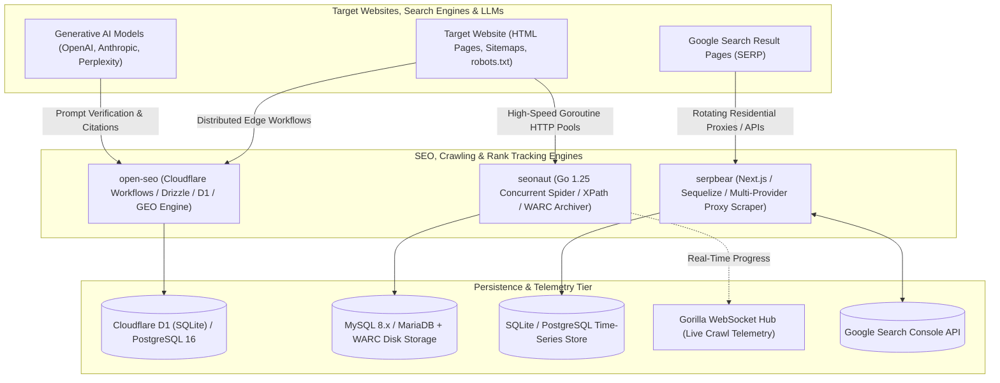
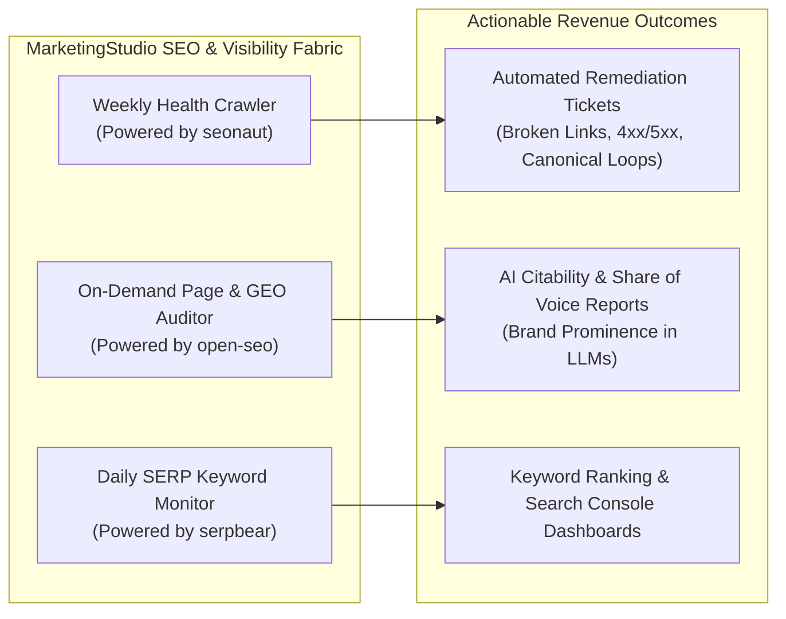

# Category 11: SEO, Crawlers & Rank Tracking — Comparative Architectural Analysis

> **Domain Scope**: On-page technical SEO audits, high-concurrency website crawling, Google SERP keyword rank tracking, Generative Engine Optimization (GEO) AI citation tracking, and Web ARChive (WARC) compliance.  
> **Solutions Analyzed**: `open-seo`, `seonaut`, `serpbear`  
> **Commercial SaaS Benchmarks**: `Ahrefs`, `Semrush`, `Screaming Frog SEO Spider`, `Sitebulb`, `AccuRanker`

---

## 1. Executive Domain Overview

Organic search engine visibility and AI answer engine citability represent high-leverage inbound marketing channels. However, managing search visibility requires three fundamentally different technical engines:
1. **Serverless Durable Workflow Auditing & Generative Engine Optimization (GEO)** (`open-seo`): Orchestrating distributed, edge-native technical audits across Cloudflare Workflows, parsing DOM metadata, and auditing brand citation visibility across generative AI models (ChatGPT, Claude, Perplexity, Gemini).
2. **High-Speed Concurrent Website Crawlers & ISO Web Archiving** (`seonaut`): Spidering entire domain architectures, traversing internal link graphs, executing XPath queries, detecting multi-page issues (orphan pages, canonical loops, duplicate content), and preserving snapshots in ISO-standard WARC format.
3. **Search Engine Result Page (SERP) Rank Trackers & Scraper Gateways** (`serpbear`): Scraping Google search results across countries and devices (desktop vs. mobile) via rotating residential proxies or commercial SERP APIs, tracking historical keyword positions, and reconciling with Google Search Console (GSC) APIs.

The 3 open-source solutions analyzed in this category solve the core technical pillars of technical SEO auditing, high-throughput site spidering, and keyword rank monitoring.

---

## 2. Technical Ecosystem & Architectural Taxonomy



### Technical Stack Matrix

| Solution | Language & Runtime | Core Framework | Database / Storage | Scraping & Execution Method | Primary Workload | License |
| :--- | :--- | :--- | :--- | :--- | :--- | :--- |
| **open-seo** | TypeScript 5.x / Cloudflare Workers | TanStack Router, Better Auth, Hono | Cloudflare D1 (SQLite) / PostgreSQL 16, Cloudflare R2 | Cloudflare Workflows + Cheerio / HTML regex parser | Serverless edge technical SEO audits & GEO AI citation tracking | MIT |
| **seonaut** | Go 1.25 | Go Native, `internal/crawler` | MySQL 8.x / MariaDB, Compressed WARC files | Concurrent Goroutine Worker Pools + `antchfx/htmlquery` (XPath) | High-speed multi-thousand page site crawling & ISO web archiving | MIT |
| **serpbear** | TypeScript / Node.js LTS | Next.js (Pages Router), Tailwind | SQLite (`data/serpbear.db`) / PostgreSQL (Sequelize) | Node.js Cron + Axios / Cheerio + Rotating Proxies & Commercial APIs | Automated Google keyword rank tracking & GSC reconciliation | MIT |

---

## 3. Deep Architectural Comparison: Core Engine Paradigms

SEO and crawling infrastructure fundamentally splits across three distinct architectural execution paradigms:

```mermaid
flowchart TD
    subgraph P1 ["1. Serverless Durable Workflow Engine (open-seo)"]
        OS_API["Client / Hono Gateway"] --> OS_Audit["AuditService"]
        OS_Audit --> OS_WF["SiteAuditWorkflowCrawl (Cloudflare Workflows)"]
        OS_WF --> OS_Throttle["CrawlThrottle (Token Bucket)"]
        OS_Throttle --> OS_Fetch["Distributed Worker HTTP Fetchers"]
        OS_Fetch --> OS_Parse["Cheerio / Regex DOM Parser"]
        OS_Parse --> OS_Drizzle["Drizzle ORM (D1 / PostgreSQL)"]
        OS_Audit --> OS_GEO["AI Visibility Service (LLM Citation Prompts)"]
    end

    subgraph P2 ["2. Native Go Goroutine Pipeline & WARC Archiving (seonaut)"]
        SN_Coord["Crawl Coordinator (crawler.go)"] --> SN_Queue["Thread-Safe UrlQueue"]
        SN_Queue --> SN_Pool["Goroutine Worker Pool (Persistent Transport)"]
        SN_Pool --> SN_HTTP["BasicClient (HTTP/TLS)"]
        SN_HTTP --> SN_XPath["antchfx/htmlquery (XPath Tree)"]
        SN_XPath --> SN_Stage1["Stage 1: Per-Page Issues"]
        SN_Stage1 --> SN_MySQL[("MySQL 8.x Database")]
        SN_Stage1 -.->|Live Frame Telemetry| SN_WS["Gorilla WebSocket Hub"]
        SN_HTTP --> SN_WARC["slyrz/warc (ISO-Standard Compressed Archive)"]
        SN_Coord --> SN_Stage2["Stage 2: Multipage Graph Cross-Analysis"]
        SN_Stage2 --> SN_MySQL
    end

    subgraph P3 ["3. Swappable Multi-Provider Scraper Gateway (serpbear)"]
        SB_Cron["Node.js Cron Daemon (cron.js)"] --> SB_Queue["Keyword Queue Selector"]
        SB_Queue --> SB_Resolver["Scraper Resolver (scrapers/index.ts)"]
        SB_Resolver -->|Direct Proxy Route| SB_Direct["Direct Proxy Scraper (Axios + Cheerio)"]
        SB_Resolver -->|API Route| SB_APIs["Commercial SERP Drivers (Serper, SerpApi, SearchApi)"]
        SB_Direct --> SB_Jitter["Random Delay Jitter & User-Agent Rotation"]
        SB_Jitter --> SB_Parse["Google SERP DOM Parser (div.g, cite)"]
        SB_Parse --> SB_History["Sequelize ORM (JSON History Append)"]
        SB_Cron --> SB_GSC["Google Search Console API Sync"]
    end
```



### Detailed Evaluation of the 3 Engine Paradigms:

1. **Serverless Durable Cloudflare Workflows & GEO Engine (`open-seo`)**:
   - **Mechanism**: Eliminates standard server runtime constraints and CPU memory limits by executing audits across Cloudflare Workflows. `SiteAuditWorkflowCrawl` breaks domain crawling into discrete, durable workflow steps that automatically checkpoint execution progress. Page fetches are governed by an internal `CrawlThrottle` token-bucket rate limiter. Extracted DOM metrics (canonical links, schema JSON-LD, OpenGraph, title/meta tags) are written to Cloudflare D1 or PostgreSQL via Drizzle ORM. Uniquely, `open-seo` introduces Generative Engine Optimization (GEO), programmatically querying LLMs (OpenAI, Anthropic, Perplexity) with industry prompt matrices to measure whether the brand is cited in AI-generated answers.
   - **Throughput Profile**: Sustains 60–180 pages/min bounded by Cloudflare Workers subrequest budgets and edge database write latency.
   - **Failure Boundary**: Workflow state is preserved across network partitions or edge worker reboots; if an origin site temporarily rate-limits the crawler, the workflow sleeps durable state without consuming compute billing.

2. **Concurrent Go Goroutines, Two-Stage Pipeline & WARC Archiving (`seonaut`)**:
   - **Mechanism**: Built as a pure Go system daemon optimized for maximum raw crawling velocity. A master `CrawlCoordinator` initializes a thread-safe `UrlQueue`, parses `robots.txt` (`temoto/robotstxt`) and XML sitemaps (`gopher-parse-sitemap`), and dispatches dozens of concurrent goroutine workers reusing persistent TCP sockets (`http.Transport`). HTML streams are parsed with `antchfx/htmlquery` using precompiled XPath selectors. 
   - **Two-Stage Analysis**: Stage 1 inspects instant per-page metrics (status codes, H1-H6 tags, hreflang, image alt texts) and streams live event frames over WebSockets. Once the URL frontier empties, Stage 2 executes graph-level multi-page analysis—detecting duplicate titles, orphan URLs with zero incoming links, and circular canonical chains. Simultaneously, `slyrz/warc` writes exact raw HTTP request/response payloads to compressed ISO-standard Web ARChive (WARC) files for legal compliance and historical diffing.
   - **Throughput Profile**: Sustains 2,500–5,000 pages/min on minimal server hardware (<80MB RAM).
   - **Failure Boundary**: In-flight memory queues require database synchronization checkpoints; unexpected target host blocking triggers exponential backoff on the worker pool.

3. **Multi-Provider SERP Scraping & Historical Time-Series (`serpbear`)**:
   - **Mechanism**: Dedicated search result position tracker rather than a site crawler. A background cron runner (`cron.js`) evaluates keywords due for evaluation. The scraper resolver (`scrapers/index.ts`) decouples scraping strategy into swappable adapters: direct residential HTTP/SOCKS proxies (incorporating request jitter and randomized browser headers) or 10+ commercial SERP APIs (Serper.dev, SerpApi, SearchApi, ValueSerp, ScrapingAnt). Parsed organic positions (`div.g`) are appended to JSON history arrays in SQLite or PostgreSQL, generating ranking delta alerts and synchronizing real impression metrics with Google Search Console.
   - **Throughput Profile**: 10–50 SERP queries/min, deliberately paced to evade Google bot detection heuristics and CAPTCHA challenges.
   - **Failure Boundary**: Direct scraping risks immediate IP blacklisting and CAPTCHA challenges; failover to commercial API drivers provides high operational resilience.

---

### Architectural Tradeoffs Matrix: SEO, Crawlers & Rank Tracking

| Architectural Dimension | open-seo | seonaut | serpbear |
| :--- | :--- | :--- | :--- |
| **Primary Execution Plane** | **Serverless Edge & Workflows**; Cloudflare Workers + Workflows | **Compiled Native Daemon**; Go 1.25 concurrent goroutines | **Node.js Monolith**; Next.js Pages Router + background cron daemon |
| **Crawling Throughput** | **Moderate** (60–180 pages/min); throttled by edge subrequests & D1 limits | **Extreme** (2,500–5,000 pages/min); native compiled Go TCP connection pooling | **Low / Deliberate** (10–50 SERPs/min); throttled to prevent anti-bot IP bans |
| **Parsing Technology** | **Cheerio & Regex**; lightweight DOM tree traversal | **`antchfx/htmlquery`**; compiled XPath selectors over HTML token tree | **Cheerio**; targeted CSS selectors on Google SERP HTML containers |
| **State & Persistence** | **Dual Parity (Drizzle ORM)**; Cloudflare D1 (SQLite) or PostgreSQL 16 | **Relational & Archive**; MySQL 8.x / MariaDB + disk-backed compressed WARC | **Embedded Relational**; SQLite (`serpbear.db`) or PostgreSQL via Sequelize ORM |
| **State Machine Durability** | **Durable Step Checkpoints**; Cloudflare Workflows survive worker reboots | **Two-Stage Queue**; Stage 1 per-page -> Stage 2 multi-page graph analysis | **Cron Polling Loop**; sequential keyword iteration with JSON history array |
| **Unique Domain Feature** | **Generative Engine Optimization (GEO)**; LLM citation monitoring | **ISO-Standard WARC Archiving**; complete historical site diff snapshots | **Multi-Provider Proxy & API Failover**; direct proxies + 10 commercial SERP APIs |
| **Memory & Resource Footprint**| **Near-Zero Local Overhead**; runs entirely in edge serverless runtimes | **Ultra-Low** (~40–80 MB RAM for 100k+ page audits) | **Moderate** (~150–250 MB RAM for Node.js runtime) |

---

## 4. Deep-Dive Comparative Analysis Across 6 Core Dimensions

### 4.1. System Architecture & Topology
- **open-seo**: Deployed on Cloudflare's serverless edge infrastructure (`src/server.ts`). Integrates TanStack Router for type-safe frontend navigation, Better Auth for multi-tenant identity, and Cloudflare Workflows for background audit durability. Dual database compatibility allows zero-config edge deployment on D1 or enterprise clustering on PostgreSQL.
- **seonaut**: Monolithic compiled Go executable. The internal routing multiplexer serves web assets and manages Gorilla WebSocket connections (`internal/routes/ws.go`), while the crawler coordinator (`internal/crawler/crawler.go`) orchestrates worker goroutines against MySQL.
- **serpbear**: Fullstack Next.js application. Houses API routes (`pages/api/*`), React UI views, and a dedicated background cron daemon (`cron.js`). Connects to SQLite or PostgreSQL via Sequelize ORM.

### 4.2. Concurrency, Queue Mechanics & Throughput
```
[Crawling / Auditing Throughput: Target Units per Minute]
seonaut (Go Goroutines):      ████████████████████████████████████████  ~2,500 - 5,000 pages/min (Raw HTML)
open-seo (Cloudflare WF):     ██                                        ~60 - 180 pages/min (Edge Workflows)
serpbear (SERP Proxy Scraper): █                                        ~10 - 50 SERP pages/min (Anti-Bot Jitter)
```
- **seonaut** delivers massive throughput by avoiding JavaScript runtime overhead and utilizing Go's lightweight channel-based worker scheduling. Persistent HTTP connections prevent TCP socket exhaustion during multi-thousand page crawls.
- **open-seo** delegates concurrency to Cloudflare Workflows, distributing URL requests across edge worker instances while enforcing token-bucket rate limits (`CrawlThrottle`) to protect origin hosts.
- **serpbear** intentionally restricts concurrency, inserting randomized jitter delays between Google search queries to prevent triggering CAPTCHAs.

### 4.3. Data Modeling & Storage Strategy
- **open-seo**: Managed via Drizzle ORM across dual schemas (`src/db/`). Stores projects, crawls, discovered URLs, technical audit issues (`ERROR`, `WARNING`, `INFO`), and AI search engine visibility telemetry (`ai-visibility.schema.ts`).
- **seonaut**: Normalizes crawl data in MySQL (`crawl`, `pagereport`, `issues`, `links`). It builds an internal directed graph of all internal hyperlinks to identify broken links, redirect loops, and orphan pages. Historical web captures are serialized into WARC files.
- **serpbear**: Uses Sequelize ORM with `Domain` and `Keyword` models. Keyword rankings over time are stored as serialized JSON arrays within the keyword record, tracking position, URL, date, and search volume.

### 4.4. Anti-Bot Avoidance & Provider Resilience
- **serpbear** is the undisputed leader in anti-bot navigation. Its swappable driver architecture allows operators to use direct residential proxies with automatic header rotation, or instantly route through 10 commercial scraping APIs (SerpApi, Serper, SearchApi, ScrapingAnt, ValueSerp) without altering downstream ranking analytics.
- **open-seo** and **seonaut** operate as standard web crawlers, identifying themselves via configurable User-Agent strings and respecting `robots.txt` crawl delays.

### 4.5. AI & Generative Search Readiness (GEO)
- **open-seo** is the only solution equipped for Generative Engine Optimization. It tests brand visibility across conversational AI answer engines (OpenAI ChatGPT, Anthropic Claude, Perplexity), scoring brand mention sentiment and citations.
- **seonaut** and **serpbear** remain focused on traditional search engine crawling and SERP ranking algorithms.

---

## 5. Head-to-Head Capability Matrix

| Feature / Dimension | open-seo | seonaut | serpbear |
| :--- | :---: | :---: | :---: |
| **Site-Wide Technical Crawler** | ✅ (Edge Workflows) | ✅ (High-Speed Go) | ❌ |
| **Google SERP Keyword Rank Tracker** | ❌ | ❌ | ✅ (Daily / Hourly) |
| **Generative Engine Optimization (GEO)** | ✅ (LLM Citations) | ❌ | ❌ |
| **ISO-Standard WARC Archiving** | ❌ | ✅ (`slyrz/warc`) | ❌ |
| **WebSocket Real-Time Progress** | ❌ (Polling / Hooks) | ✅ (Gorilla WS) | ❌ |
| **Orphan Page & Canonical Loop Detection** | ⚠️ Basic | ✅ (Stage 2 Graph) | ❌ |
| **Google Search Console (GSC) Sync** | ✅ (Native) | ❌ | ✅ (Native) |
| **Swappable Commercial Scraper APIs** | ❌ | ❌ | ✅ (10+ Providers) |
| **Primary Database** | Cloudflare D1 / PostgreSQL | MySQL / MariaDB | SQLite / PostgreSQL |
| **Runtime Resource Footprint** | **Serverless Edge** | **~40–80 MB RAM** | **~150–250 MB RAM** |

---

## 6. Commercial Benchmark Positioning & MarketingStudio Convergence



### Architectural Deployment Blueprint:
1. **Domain-Wide Crawling via seonaut**: Deploy `seonaut` as a lightweight background service in MarketingStudio's cluster. Run automated weekly technical audits on customer sites to uncover dead links, redirect loops, and orphan pages at thousands of URLs per minute.
2. **On-Demand Audits & AI GEO via open-seo**: Leverage `open-seo`'s serverless edge workflows for real-time landing page audits prior to publication, while running scheduled GEO analysis to benchmark brand citations across OpenAI, Claude, and Perplexity.
3. **Keyword Rank Intelligence via serpbear**: Integrate `serpbear`'s proxy-rotated scraping daemon to track strategic keyword movements on Google, synchronizing scraped positions with verified GSC impression telemetry.
