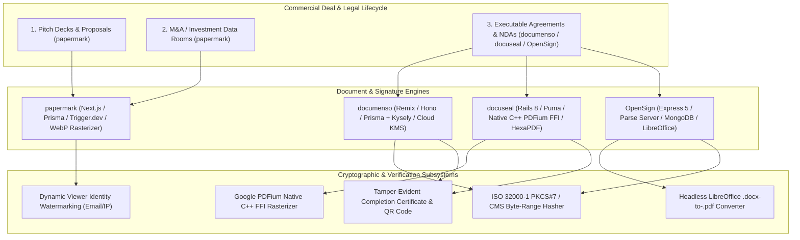
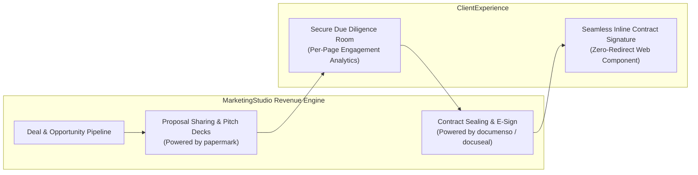

# Category 12: E-Signature & Document Tracking — Comparative Architectural Analysis

> **Domain Scope**: Cryptographic electronic signatures, ISO 32000-1 PKCS#7 byte-range hashing, native PDFium C++ rasterization, office document conversion, Virtual Data Rooms (VDR), and per-page dwell time document telemetry.  
> **Solutions Analyzed**: `documenso`, `docuseal`, `OpenSign`, `papermark`  
> **Commercial SaaS Benchmarks**: `DocuSign`, `PandaDoc`, `Dropbox Sign (HelloSign)`, `DocSend`, `Carta`

---

## 1. Executive Domain Overview

Closing revenue deals, executing enterprise sales, and formalizing legal agreements requires moving prospects through the final stages of the commercial pipeline: **confidential presentation sharing, stakeholder document review, and legally binding cryptographic signing**.

This category is governed by two complementary architectural disciplines:
1. **Document Tracking, Viewer Intelligence & Virtual Data Rooms (VDR)** (`papermark`): Sharing pitch decks, commercial proposals, and due-diligence data rooms via instrumented web viewers. Tracking exact dwell time per page, drop-off heatmaps, email gate verifications, and dynamic leak-prevention watermarks.
2. **Cryptographically Secure Electronic Signatures** (`documenso`, `docuseal`, `OpenSign`): Ingesting documents, dragging and dropping signature/initial/date fields, enforcing multi-signer execution sequences, appending X.509 digital certificates, and generating tamper-evident completion certificates complying with eIDAS, UETA, and the US ESIGN Act.

The 4 open-source solutions analyzed in this category provide comprehensive coverage from pre-signature proposal telemetry to enterprise digital contract execution.

---

## 2. Technical Ecosystem & Architectural Taxonomy

### Technical Stack Matrix

| Solution | Language & Runtime | Core Framework | Database & ORM | PDF Processing & Crypto Engine | Primary Specialization | License |
| :--- | :--- | :--- | :--- | :--- | :--- | :--- |
| **documenso** | TypeScript 5.x / Node.js 20+ | React Router v7 (Remix), Hono, tRPC | PostgreSQL 15 (Prisma ORM + Kysely) | `@libpdf/core`, ISO 32000-1 PKCS#7, Local P12 / Google Cloud KMS | Enterprise cryptographic e-signature infrastructure & developer SDK | AGPL-3.0 |
| **docuseal** | Ruby 3.3+ / C++ | Rails 7.2/8.0, Vue.js, Hotwire | PostgreSQL / SQLite3 / Trilogy | Google PDFium (C++ FFI), HexaPDF, ruby-vips, X.509 certs | High-performance embeddable `<docuseal-form>` web components & mobile signing | AGPL-3.0 |
| **OpenSign** | JavaScript / Node.js | Express 5, Parse Server, React + Vite | MongoDB 7.x, Local / S3 | `@signpdf/signpdf`, `pdf-lib`, LibreOffice headless, `node-forge` | Turnkey Parse Server e-signature platform & native Office doc conversion | MIT |
| **papermark** | TypeScript 5.x / Node.js | Next.js (App Router), React | PostgreSQL (Prisma Multi-File) | WebP Page Rasterizer, Dynamic Canvas Watermark, Trigger.dev | Open-source DocSend & Virtual Data Room (VDR) viewing telemetry | AGPL-3.0 |

---

## 3. Deep Architectural Comparison: Core Engine Paradigms

Electronic signature and document tracking systems split across four fundamentally distinct architectural execution paradigms:

```mermaid
flowchart TD
    subgraph P1 ["1. ISO 32000-1 Cryptographic Byte-Range Sealing (Documenso)"]
        DM_Req["Remix / Hono Gateway"] --> DM_Coord["Field Layout & Coordinate Engine"]
        DM_Coord --> DM_Parser["@libpdf/core Document Parser"]
        DM_Parser --> DM_Hash["SHA-256 Byte-Range Hasher (/ByteRange)"]
        DM_Hash --> DM_KMS["Signer Engine (Local P12 or Google Cloud KMS)"]
        DM_KMS --> DM_Inject["PKCS#7 / CMS Signature Block Injection"]
        DM_Inject --> DM_TSA["RFC 3161 Trusted Timestamp (TSA)"]
        DM_TSA --> DM_Cert["Tamper-Evident Certificate Appender"]
    end

    subgraph P2 ["2. Native C++ PDFium FFI & HexaPDF Pipeline (Docuseal)"]
        DS_Web["<docuseal-form> Web Component / Hotwire"] --> DS_Puma["Rails Puma Server"]
        DS_Puma --> DS_Sidekiq["Sidekiq Redis Queue"]
        DS_Sidekiq --> DS_FFI["PDFium C++ FFI Engine (lib/pdfium.rb)"]
        DS_FFI --> DS_Vips["ruby-vips / Leptonica Signature Normalization"]
        DS_Vips --> DS_Hexa["HexaPDF Form Flattening & Incremental Save"]
        DS_Hexa --> DS_Seal["GenerateCertificate (X.509 Cryptographic Seal)"]
    end

    subgraph P3 ["3. Parse Server & LibreOffice Conversion Engine (OpenSign)"]
        OS_App["React + Vite Client"] --> OS_Express["Express 5 / Parse Server"]
        OS_Express --> OS_Libre["Headless LibreOffice (.docx -> .pdf)"]
        OS_Libre --> OS_PdfLib["pdf-lib Visual Widget Stamping"]
        OS_PdfLib --> OS_SignPdf["@signpdf/signpdf (PKCS#12 Container)"]
        OS_SignPdf --> OS_QR["Audit Trail with Public QR Verification"]
        OS_QR --> OS_Mongo[("MongoDB 7.x Database")]
    end

    subgraph P4 ["4. Per-Page Dwell Telemetry & Virtual Data Rooms (Papermark)"]
        PM_Viewer["Interactive Web Viewer (/view/[id])"] --> PM_Gate["Access Gatekeeper (Email / Password / NDA)"]
        PM_Gate --> PM_Watermark["Dynamic Stamped Watermark (Viewer Email & IP)"]
        PM_Viewer -->|Page Change Beacon| PM_Beacon["Telemetry Ingress (/api/view/track)"]
        PM_Beacon --> PM_Postgres[("PostgreSQL Dwell Time Timeseries")]
        PM_Trigger["Trigger.dev Worker"] --> PM_Raster["WebP Page Splitter & OCR"]
    end
```

### Detailed Evaluation of the 4 Engine Paradigms:

1. **Remix + Hono + ISO 32000-1 PKCS#7 Byte-Range Hashing (`Documenso`)**:
   - **Mechanism**: Implements the international digital signature standard (ISO 32000-1 Section 12.8) directly within TypeScript. When a document is finalized, Documenso calculates a cryptographic byte-range array (`/ByteRange [0, offset1, offset2, length2]`), hashing all bytes of the PDF except the signature container itself. A DER-encoded PKCS#7/CMS digital signature is generated using a local PKCS#12 private key or Google Cloud KMS Hardware Security Module (HSM), paired with an RFC 3161 trusted timestamp authority (TSA). The document is sealed such that opening it in Adobe Acrobat or Apple Preview displays the green "Signed and all signatures are valid" security badge.
   - **Throughput Profile**: Sustains 15–35 document sealing operations/sec per worker node.
   - **Failure Boundary**: Cryptographic operations are strictly transactional; if TSA timestamping fails or KMS network calls timeout, the envelope transitions to an error queue without outputting a corrupted, unsealed PDF.

2. **Ruby on Rails + Google PDFium Native C++ FFI Bindings (`Docuseal`)**:
   - **Mechanism**: Eliminates the performance overhead of headless browsers and interpreted PDF parsers by integrating Google's native Chromium PDFium rendering engine via direct C++ FFI bindings (`lib/pdfium.rb`). Page rasterization, coordinate resolution, and form field extraction execute at native compiled speed. Image normalizations (signatures and initial marks) are processed via `ruby-vips` and `leptonica.rb`. Document assembly, incremental updates, and field flattening are performed via HexaPDF, concluding with cryptographic X.509 digital certificate injection via OpenSSL.
   - **Throughput Profile**: Sustains 50–120 document operations/sec; rasterizes a 50-page PDF to crisp web previews in <250ms.
   - **Failure Boundary**: Sidekiq Redis workers isolate PDF rendering crashes; C++ memory allocations are guarded by Ruby FFI memory cleanups.

3. **Parse Server + LibreOffice Conversion + PKCS#12 (`OpenSign`)**:
   - **Mechanism**: Architected around Express 5, Parse Server, and MongoDB. In addition to PDF signing, OpenSign natively integrates headless LibreOffice (`libreoffice-convert`), enabling users to upload raw Microsoft Word (`.docx`), `.odt`, or `.rtf` documents and automatically convert them into high-fidelity PDFs before placing fields. Cryptographic digital signatures are injected via `@signpdf/signpdf` using local `.p12` certificates. The completion certificate embeds a cryptographic QR code that allows any third party with a smartphone camera to verify the document's authenticity against OpenSign's public verification ledger.
   - **Throughput Profile**: 10–25 operations/sec, bounded by headless LibreOffice process spawning during `.docx` conversions.
   - **Failure Boundary**: LibreOffice worker child processes are isolated with execution timeouts to prevent hung conversion tasks from exhausting server memory.

4. **Per-Page Dwell Time Beacons + Virtual Data Rooms (`Papermark`)**:
   - **Mechanism**: Focuses on top-of-funnel pitch deck and due diligence document intelligence. When a PDF is uploaded, a background Trigger.dev worker splits the document into optimized WebP page images. When a recipient opens the link, the viewer evaluates access gates (email verification, password, domain whitelist, clickwrap NDA). An active dynamic watermark overlays the viewer's email and IP address across each canvas page. As the user reads, the viewer sends periodic heartbeat beacons (`/api/view/track`), recording exact dwell time per page in PostgreSQL. In addition to single links, Papermark provides enterprise Virtual Data Rooms (VDR) with folder hierarchies, role permissions, and integrated Q&A threads.
   - **Throughput Profile**: High-throughput telemetry ingestion; handles 1,000+ simultaneous page dwell beacon pings per second.
   - **Failure Boundary**: Asynchronous beacon buffering ensures viewer interactions are never blocked if the telemetry database experiences transient write latency.

---

### Architectural Tradeoffs Matrix: E-Signature & Document Tracking

| Architectural Dimension | documenso | docuseal | OpenSign | papermark |
| :--- | :--- | :--- | :--- | :--- |
| **Core Domain Purpose** | **Cryptographic E-Signature**; enterprise legal contracts | **High-Throughput E-Sign**; embedded web forms | **E-Signature & Office Convert**; turnkey Parse Server | **Document Telemetry & VDR**; pitch decks & data rooms |
| **PDF Manipulation Engine** | **`@libpdf/core` + PDF.js**; TypeScript byte manipulation | **Google PDFium C++ FFI** + HexaPDF; native speed | **`pdf-lib` + LibreOffice**; native Office conversion | **WebP Page Rasterizer**; canvas slide viewer |
| **Digital Signature Standard** | **ISO 32000-1 PKCS#7 / CMS**; Adobe Acrobat verified | **X.509 OpenSSL Seal**; Certificate of Completion | **PKCS#12 via `@signpdf`**; Adobe Acrobat verified | **None (Access Logs Only)**; not an e-signature tool |
| **Key Management (KMS)** | **Local P12 or Google Cloud KMS**; HSM hardware keys | **Local X.509 Certificate**; environment keys | **Local PKCS#12 (.p12)**; on-premise keys | **N/A**; uses access token / session auth |
| **Embedding Mechanism** | **`@documenso/embed` SDK**; React component library | **`<docuseal-form>`**; zero-dependency Web Component | **iFrame / REST API**; Parse REST endpoints | **Interactive Web Viewer**; custom domains & iframes |
| **Document Conversion** | **Pre-Rendered PDF Only** | **HTML/CSS to PDF & Fillable** | **Native `.docx`/`.odt` via LibreOffice** | **PDF / PPTX to WebP Pages** |
| **Unique Domain Feature** | **eIDAS AES/QES & Cloud KMS**; developer tRPC/REST | **C++ FFI Rasterization**; sub-second mobile forms | **Public QR Code Verification**; instant camera check | **Per-Page Heatmaps & VDR**; slide dwell analytics |
| **Runtime Resource Profile** | **~250–400 MB RAM** | **~300–600 MB RAM** (Puma + Sidekiq) | **~350–700 MB RAM** (LibreOffice) | **~200–350 MB RAM** (Next.js) |

---

## 4. Deep-Dive Comparative Analysis Across 6 Core Dimensions

### 4.1. System Architecture & Topology
- **documenso**: Monorepo using Turborepo and npm workspaces. Deploys Remix (React Router v7) for the application frontend and Hono for the API server. Core business logic is packaged into `@documenso/lib`, `@documenso/trpc`, and `@documenso/signing`.
- **docuseal**: Monolithic Ruby on Rails application running Puma web servers and Sidekiq worker processes. UI components are built using Hotwire (Turbo/Stimulus) for admin views and Vue.js for custom client elements. Integrates native C libraries (`pdfium.rb`, `leptonica.rb`) via Ruby FFI.
- **OpenSign**: Decoupled React + Vite client communicating with an Express 5 backend hosting Parse Server. Uses Parse Cloud Code functions (`cloud/`) to orchestrate document models, ACL access controls, and PDF sealing routines against MongoDB.
- **papermark**: Fullstack Next.js application utilizing the App Router. Coordinates background rendering, AI deck analysis, and webhook dispatching via Trigger.dev workers, backed by PostgreSQL.

### 4.2. Cryptographic Assurance & Legal Admissibility
- **documenso** achieves the highest level of cryptographic assurance. Its support for ISO 32000-1 compliant byte-range signatures, RFC 3161 Time-Stamp Authorities (TSA), and Google Cloud KMS HSM hardware keys satisfies eIDAS requirements for Advanced Electronic Signatures (AES) and Qualified Electronic Signatures (QES).
- **OpenSign** provides authentic PKCS#12 digital signatures through `@signpdf/signpdf`, generating verifiable Adobe Acrobat signatures alongside public QR code verification certificates.
- **docuseal** applies X.509 digital certificates and appends a tamper-evident Certificate of Completion with signer IP, user-agent, timestamp, and signature hashes.
- **papermark** does not provide e-signature capabilities; its security architecture focuses on access control, email verification, domain whitelisting, and dynamic viewer watermarking.

### 4.3. Document Viewer & Embedding UX
- **docuseal** provides the most frictionless embedding experience: a native HTML custom element (`<docuseal-form src="...">`) that developers drop into any frontend framework with zero dependencies. It offers a mobile-first signature canvas with touch optimization.
- **documenso** provides a modern React component library (`@documenso/embed`) and comprehensive tRPC/REST endpoints, allowing developers to embed signing canvases into React/Next.js portals natively.
- **papermark** delivers a slide-deck viewer inspired by DocSend, supporting smooth page transitions, zoom controls, and dynamic watermark overlays.

---

## 5. Head-to-Head Capability Matrix

| Feature / Dimension | documenso | docuseal | OpenSign | papermark |
| :--- | :---: | :---: | :---: | :---: |
| **Cryptographic Digital Signatures** | ✅ (ISO 32000-1 PKCS#7)| ✅ (X.509 OpenSSL) | ✅ (PKCS#12 @signpdf) | ❌ |
| **Hardware KMS / HSM Support** | ✅ (Google Cloud KMS) | ❌ | ❌ | ❌ |
| **Native C++ PDFium Acceleration** | ❌ (`@libpdf/core`) | ✅ (Google PDFium FFI)| ❌ (`pdf-lib`) | ❌ (PDF.js / WebP) |
| **Native Word (.docx) Conversion** | ❌ (PDF only) | ⚠️ (HTML to PDF) | ✅ (Headless LibreOffice)| ⚠️ (PPTX conversion) |
| **Embeddable Web Component** | ⚠️ React SDK | ✅ `<docuseal-form>` | ⚠️ iFrame | ⚠️ iFrame |
| **Public QR Code Verification** | ❌ | ❌ | ✅ (Native QR Stamp) | ❌ |
| **Per-Page Dwell Time Telemetry** | ❌ | ❌ | ❌ | ✅ (Dwell Heatmaps) |
| **Virtual Data Rooms (VDR)** | ❌ | ❌ | ❌ | ✅ (Multi-Folder VDR) |
| **Dynamic Identity Watermarking** | ❌ | ❌ | ❌ | ✅ (Email & IP Stamp)|
| **Primary Database** | PostgreSQL 15 | PostgreSQL / SQLite | MongoDB 7.x | PostgreSQL |
| **License** | AGPL-3.0 | AGPL-3.0 | MIT | AGPL-3.0 |

---

## 6. Commercial Benchmark Positioning & MarketingStudio Convergence

### Architectural Deployment Blueprint:
1. **Pre-Signature Proposal Telemetry via papermark**: Use `papermark` to share pitch decks, price quotes, and investment memorandums. Track prospect engagement down to the second per page, identifying sales objections before the follow-up call.
2. **Enterprise Contract Execution via documenso**: Deploy `documenso` for high-stakes legal contracts, NDAs, and Master Services Agreements (MSAs). Leverage its ISO 32000-1 PKCS#7 byte-range hashing and Cloud KMS HSM integration to guarantee legal enforceability under eIDAS and ESIGN.
3. **High-Velocity Embedded Forms via docuseal**: Embed `docuseal`'s `<docuseal-form>` web component directly into checkout flows and client onboarding portals for frictionless mobile-responsive signing.
4. **Office Document Workflows via OpenSign**: Leverage `OpenSign` when customers need to upload Microsoft Word documents directly for automatic conversion into signable PDFs with public QR verification.
