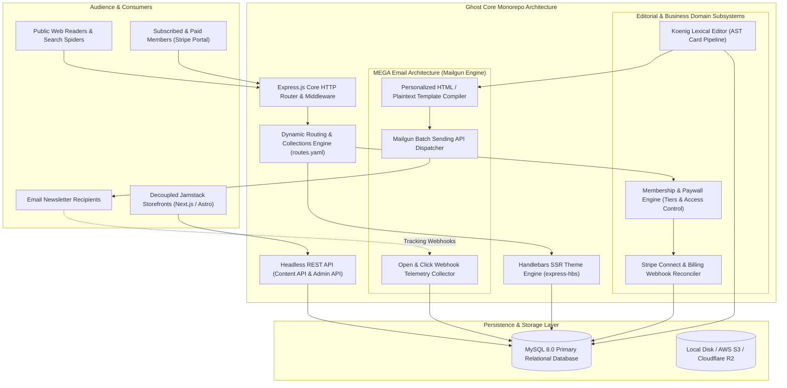

# Category 13: Content Management & Publishing — Comparative Architectural Analysis

> **Domain Scope**: Headless content management, Koenig Lexical AST content pipelines, Mailgun Email Generation Architecture (MEGA), paid membership paywalls, and high-velocity publishing engines.  
> **Solution Analyzed**: `Ghost`  
> **Industry & Open-Source Benchmarks**: `WordPress`, `Substack`, `Beehiiv`, `Strapi`, `Medium`

---

## 1. Executive Domain Overview

Content marketing, corporate publications, and newsletter distribution remain foundational to organic customer acquisition, brand authority, and recurring membership monetization. However, publishing architecture has evolved across three major technological generations:
1. **Monolithic PHP/SQL CMS Engines (e.g., WordPress)**: Synchronous request-response lifecycles, heavy plugin dependencies (WooCommerce, MemberPress, MailPoet), complex database schemas, and significant time-to-first-byte (TTFB) latency requiring multi-tiered caching (Varnish, Redis, Nginx fastcgi cache).
2. **Closed-Source Creator SaaS Platforms (Substack, Beehiiv, Medium)**: Proprietary walled gardens that bundle blogging with newsletter delivery and Stripe billing, but extract steep platform taxes (**10% of gross creator revenue on Substack**), restrict custom domain configurations, and lack headless API programmatic integrations.
3. **Modern Modular Node.js Publishing Platforms (`Ghost`)**: Built with asynchronous JavaScript/TypeScript runtimes, clean structured document ASTs (Koenig Lexical), native database-level Stripe subscription tiers, high-throughput batch email generation (MEGA Mailgun), and dual-mode delivery (native Handlebars SSR or decoupled headless Content/Admin APIs).

Ghost represents the definitive open-source standard for professional digital publishing, independent journalism, and corporate content hubs.

---

## 2. Technical Ecosystem & Architectural Taxonomy

### Technical Stack Matrix

| Dimension | Ghost Technical Specification | WordPress Benchmark | Substack Benchmark |
| :--- | :--- | :--- | :--- |
| **Language & Runtime** | JavaScript / TypeScript, Node.js 20+ / 22+ LTS | PHP 8.1+ (Synchronous Request) | Proprietary Closed Cloud |
| **Core Framework** | Express.js, Bookshelf.js / Knex.js query builder | WordPress Core, WP_Query, Action Hooks | Closed Proprietary Microservices |
| **Document Representation** | **Koenig Lexical AST** (Structured JSON card tree) | HTML Blobs + Gutenberg HTML comments | Proprietary Rich Text JSON |
| **Database & Cache** | MySQL 8.0 (Production) / SQLite3 (Development) | MySQL / MariaDB (Heavy postmeta joins) | Cloud Database (Multi-Tenant Managed) |
| **Editorial Frontend** | Ember.js Single Page Application (`@tryghost/admin`)| Gutenberg React Block Editor | React Web Editor |
| **Newsletter Dispatch** | **MEGA Architecture** (Direct Mailgun Batch API) | Third-Party Plugins (MailPoet, SendGrid) | Proprietary Internal Dispatcher |
| **Monetization Engine** | Native Stripe Billing (0% platform transaction fee)| Plugin sprawl (WooCommerce + MemberPress) | Native Stripe (Mandatory 10% cut) |
| **Headless Extensibility** | Native Content API (Read) & Admin API (Write) | WP REST API / WPGraphQL | No public write API |
| **License** | **MIT License** | GPLv2 | Proprietary SaaS |

---

## 3. Deep Architectural Comparison: Core Engine Paradigms

```mermaid
flowchart TD
    subgraph P1 ["1. Koenig Lexical AST & MEGA Mailgun Pipeline (Ghost)"]
        G_Admin["Koenig Editor"] --> G_AST["Structured Lexical AST (JSON Card Tree)"]
        G_AST --> G_RenderWeb["Handlebars / Headless JSON Render"]
        G_AST --> G_RenderEmail["MEGA Email Compiler (Email-Only Cards, Paywall Cutoffs)"]
        G_RenderEmail --> G_Batch["Personalized Batch Chunker (Recipient Variables)"]
        G_Batch --> G_Mailgun["Mailgun Batch API (/messages.mime)"]
        G_Mailgun --> G_Inboxes["Subscriber Inboxes"]
    end

    subgraph P2 ["2. Monolithic PHP Plugin Cascade (WordPress)"]
        WP_Admin["Gutenberg Editor"] --> WP_HTML["HTML Blob with Comment Delimiters"]
        WP_HTML --> WP_DB["wp_posts + wp_postmeta (Relational Sprawl)"]
        WP_DB --> WP_Theme["PHP Template Loops (WP_Query)"]
        WP_DB --> WP_Plugin["MailPoet / Newsletter Plugin (PHP Cron Dispatch)"]
        WP_Plugin --> WP_SMTP["Third-Party SMTP Relays"]
    end

    subgraph P3 ["3. Closed Creator Monolith (Substack / Beehiiv)"]
        SS_Admin["Cloud Editor"] --> SS_Cloud["Closed Cloud Microservices"]
        SS_Cloud --> SS_Stripe["Stripe Connect (10% Cut Deducted)"]
        SS_Cloud --> SS_MTA["Proprietary Cloud MTA"]
        SS_Cloud --> SS_Walled["Walled Garden Web Surface"]
    end
```

### Detailed Evaluation of Ghost's Architectural Paradigms:

1. **Koenig Lexical AST Content Modeling**:
   - **Mechanism**: Rather than saving unstructured HTML strings mixed with custom shortcodes, Ghost treats articles as a clean, versioned Abstract Syntax Tree (AST) powered by Meta's **Lexical** framework. Content blocks are stored as structured JSON nodes representing markdown snippets, images, embedded video, callout boxes, bookmark cards, and member-only paywall dividers (`<!--members-only-->`). 
   - **Dual-Target Compilation**: Because the content exists as an AST, Ghost compiles it into two distinct targets upon publication:
     - **Web Target**: Clean, semantic HTML rendered by Express Handlebars themes or consumed as pure JSON by headless Next.js frontends via the Content API.
     - **Email Target**: Strict, responsive, tables-based HTML with inlined CSS, customized for 50+ email clients (Outlook, Gmail, Apple Mail), automatically stripping web-only interactive scripts and rendering email-specific cards.
   - **Advantage**: Zero content corruption, complete styling isolation, and programmatic re-rendering across any future client interface.

2. **MEGA (Mailgun Email Generation Architecture)**:
   - **Mechanism**: High-volume newsletters require generating personalized emails (with unique unsubscribe links, recipient names, and dynamic access tokens) across tens of thousands of subscribers simultaneously. Legacy CMS engines spawn slow PHP loops that saturate SMTP sockets. Ghost solves this through its **MEGA** subsystem:
     - Ghost aggregates subscribers into recipient chunks.
     - It compiles personalized payload variables (using Mailgun's `recipient-variables` JSON dictionary).
     - It sends single multi-recipient HTTP POST requests to Mailgun's batch API (`/v3/{domain}/messages`).
     - Mailgun personalizes and dispatches thousands of unique messages per batch call in milliseconds.
     - Webhook callbacks (`/ghost/api/admin/emails/{id}/analytics`) stream email open, click, and bounce telemetry back into Ghost's MySQL database.
   - **Throughput Profile**: Dispatches 50,000+ member newsletters in under 3 minutes without degrading public web server response times.

3. **Native Database-Level Membership & Stripe Billing**:
   - **Mechanism**: Ghost models memberships directly into its core schema (`members`, `products`, `stripe_prices`, `stripe_customers`, `stripe_subscriptions`). When an anonymous reader accesses a paywalled article, the dynamic routing engine checks the post's `visibility` attribute (`public`, `members`, `paid`, `tiers`). If access is restricted, Ghost automatically truncates the content at the paywall card, injecting a customizable signup or upgrade CTA.
   - **Zero Platform Tax**: Substack extracts a mandatory 10% platform tax from every subscription dollar. Ghost connects directly to the creator's Stripe account via Stripe Connect webhooks, charging **0% transaction fees**.

---

### Architectural Tradeoffs Matrix: Publishing & Content Management

| Architectural Dimension | Ghost | WordPress | Substack / Beehiiv |
| :--- | :--- | :--- | :--- |
| **Content Modeling** | **Koenig Lexical AST (JSON)**; clean separation of presentation and content | **HTML String Sprawl**; Gutenberg comment delimiters stored in database | **Proprietary Cloud JSON**; locked within vendor cloud database |
| **Email Dispatch Architecture**| **MEGA Mailgun Batch API**; thousands of personalized emails per HTTP call | **Local PHP Cron / Plugins**; heavy SMTP socket looping | **Managed Cloud Dispatcher**; hands-off but zero infrastructure control |
| **Monetization Economics** | **0% Platform Fees**; direct creator Stripe account ownership | **0% Platform Fees**; requires complex WooCommerce plugin stacks | **10% Platform Cut (Substack)**; substantial recurring revenue penalty |
| **Delivery & Decoupling** | **Dual Mode**; Native Handlebars SSR or Decoupled Headless Content API | **Monolithic PHP**; headless possible via WP-GraphQL with plugin friction | **Closed Walled Garden**; no programmatic API or custom backend integration |
| **Security & Maintenance** | **Minimal Attack Surface**; compiled TypeScript core, zero arbitrary plugins | **High Vulnerability Risk**; third-party plugin vulnerabilities dominate CVEs | **Zero Operational Maintenance**; fully managed proprietary cloud |
| **Memory & Performance** | **Asynchronous Node.js** (~150–300 MB RAM); sub-50ms TTFB | **Synchronous PHP-FPM** (~500 MB–2 GB RAM with MySQL); high TTFB | **Managed Cloud**; CDN edge cached |

---

## 4. Deep-Dive Comparative Analysis Across 6 Core Dimensions

### 4.1. Runtime Performance & Serverless Readiness
- **Ghost**: Built on Node.js and Express. It uses non-blocking asynchronous I/O to handle thousands of concurrent read requests with minimal CPU utilization. Its native caching layer delivers sub-50ms time-to-first-byte (TTFB).
- **WordPress**: Synchronous PHP architecture requires extensive caching infrastructure (Varnish, Redis object cache, Nginx microcaching) to survive traffic spikes, making modern edge deployments cumbersome.

### 4.2. Editor UX & Content Portability
- **Ghost**: The Koenig editor provides an uncluttered, distraction-free writing environment. The Lexical AST guarantees that posts can be exported cleanly to markdown, converted to mobile apps, or syndicated across decentralized protocols (ActivityPub).
- **WordPress**: The Gutenberg block editor is functionally powerful but suffers from UI complexity, slow loading on long documents, and produces messy database HTML contaminated with block comment syntax (`<!-- wp:paragraph -->`).

### 4.3. Native Member Authentication & Access Tiers
- **Ghost**: Features a native `@tryghost/portal` subscriber script that handles passwordless magic-link authentication, account management, and Stripe checkout modals with zero third-party dependencies.
- **Substack**: Provides frictionless one-click subscribing within its network, but retains ownership over the underlying subscriber relationships and limits exportable data.

---

## 5. Commercial Benchmark Positioning & MarketingStudio Fit

- **Against WordPress**: Ghost delivers a modern, secure, maintenance-free publishing hub without plugin maintenance fatigue, database bloat, or security vulnerabilities.
- **Against Substack & Beehiiv**: Ghost saves fast-growing publications tens of thousands of dollars annually by eliminating the 10% platform tax while offering complete data ownership and custom theme control.
- **MarketingStudio Synergy**: Ghost acts as the authoritative publication and content marketing engine for MarketingStudio. Marketing campaigns can auto-publish blog posts via the Admin API, distribute instant email broadcasts to subscribed segments, and gate premium whitepapers behind paid membership tiers.
