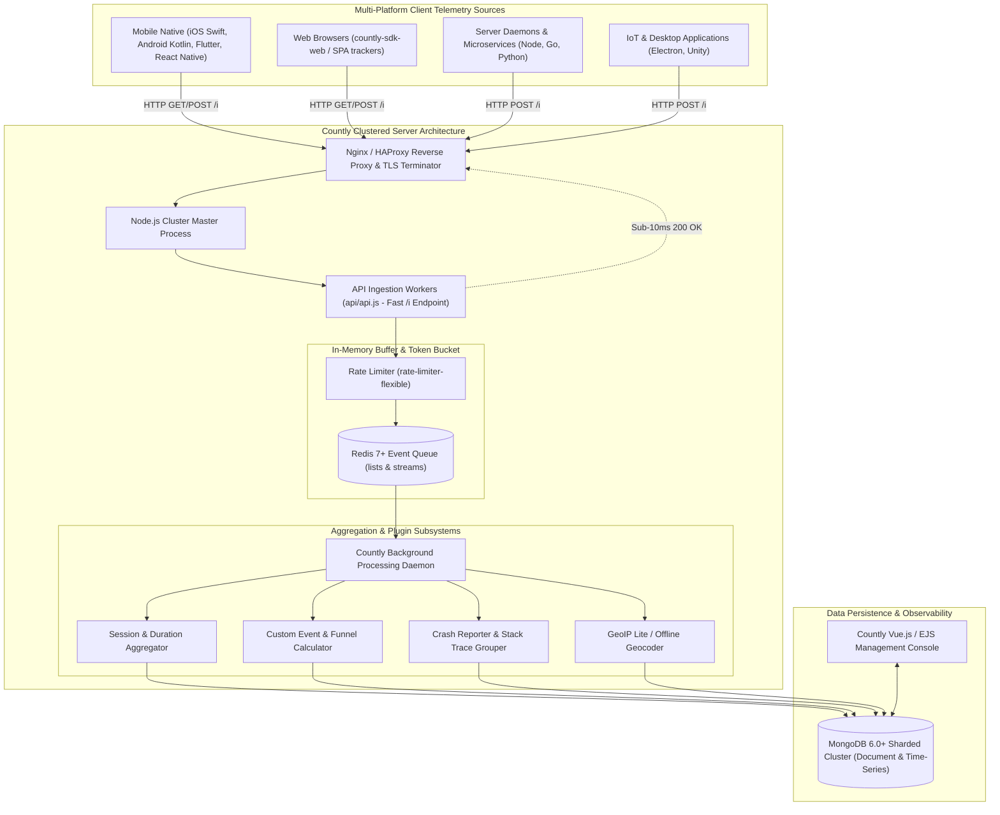
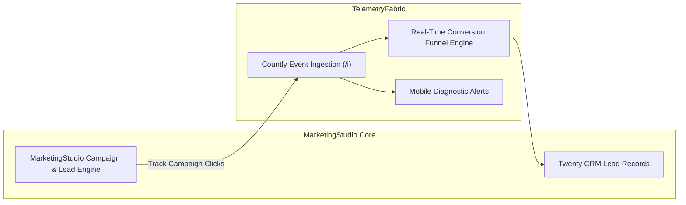

# Category 14: Product Analytics & Telemetry — Comparative Architectural Analysis

> **Domain Scope**: Real-time user journey analytics, mobile & web telemetry ingestion, sub-second `/i` buffering, pre-aggregated time-series document stores, crash diagnostics, and GDPR data sovereignty.  
> **Solution Analyzed**: `countly-server`  
> **Industry & Open-Source Benchmarks**: `PostHog`, `Mixpanel`, `Google Analytics 4 (GA4)`, `Plausible Analytics`, `Amplitude`

---

## 1. Executive Domain Overview

Understanding how users navigate applications, interact with features, experience software crashes, and convert through multi-step funnels is essential for optimizing marketing acquisition and maximizing product retention. However, product analytics architecture faces three demanding engineering challenges:
1. **Ultra-High Ingestion Velocity**: Ingesting tens of thousands of telemetry events per second across mobile devices (iOS, Android, Flutter), web storefronts, and backend microservices without exhausting connection pools or degrading write latency.
2. **Read-Time Aggregation vs. Write-Time Pre-Aggregation**: Querying billions of raw events at read time (using columnar OLAP engines like ClickHouse) versus atomically pre-aggregating metrics at write time (using time-bucketed document stores like MongoDB).
3. **Data Sovereignty & Legal Compliance**: Retaining complete ownership over sensitive user interaction records under GDPR, HIPAA, and CCPA by eliminating third-party tracking networks (e.g., Google or Meta).

Countly Server represents the battle-tested enterprise standard for self-hosted product telemetry, mobile analytics, and real-time behavioral cohort tracking.

---

## 2. Technical Ecosystem & Architectural Taxonomy



### Technical Stack Matrix

| Dimension | Countly Server Specification | PostHog Benchmark | Plausible Benchmark | Google Analytics 4 (GA4) |
| :--- | :--- | :--- | :--- | :--- |
| **Language & Runtime** | JavaScript / Node.js 20+ LTS | Python / Django + Rust / TypeScript | Elixir / Erlang OTP | Closed Google Cloud Infrastructure |
| **Ingestion Pipeline** | **Node.js Cluster + Fast `/i` + Redis** | Rust Capture API + Apache Kafka | Elixir Cowboy HTTP Ingestion | Google Global Edge Network |
| **Storage Architecture** | **MongoDB (Atomic Time-Bucket Documents)** | **ClickHouse (Columnar OLAP SQL)** | ClickHouse (Lightweight Columnar) | BigQuery (Proprietary Columnar) |
| **Aggregation Strategy**| **Write-Time Pre-Aggregation** (Atomic `$inc`)| **Read-Time Columnar Querying** | Read-Time Columnar Scanning | Machine Learning Modeling & Sampling |
| **Mobile SDK Ecosystem**| Official iOS, Android, Flutter, RN, Unity, IoT| Web-first, expanding mobile SDKs | Minimal Web JS Only | Firebase SDKs (iOS/Android/Web) |
| **Crash & Error Reporting**| **Native Crash Symbolication & Breadcrumbs**| Error Tracking via Session Replay | None | Crashlytics (External Firebase service)|
| **Data Sovereignty** | **100% Self-Hosted & Air-Gapped** | Self-Hosted or Cloud | Self-Hosted or Cloud | Closed US Cloud (GDPR Non-Compliant)|
| **License** | Community (AGPL-3.0) / Enterprise | Open Source (PostHog Public) | AGPL-3.0 | Closed Proprietary SaaS |

---

## 3. Deep Architectural Comparison: Core Engine Paradigms

```mermaid
flowchart TD
    subgraph P1 ["1. Fast /i Ingestion & Write-Time Pre-Aggregation (Countly)"]
        C_SDK["Client SDK Telemetry"] --> C_Ingest["Node.js Cluster Fast /i Endpoint"]
        C_Ingest -->|Sub-10ms Ack| C_SDK
        C_Ingest --> C_Redis[("Redis In-Memory Write Buffer")]
        C_Redis --> C_Daemon["Background Aggregation Workers"]
        C_Daemon --> C_Atomic["Atomic Document Pre-Aggregation ($inc, $set)"]
        C_Atomic --> C_Mongo[("MongoDB Time-Bucket Collections (Year/Month/Day/Hour)")]
        C_Mongo --> C_UI["Instant Dashboard Render (Zero Query Calculation)"]
    end

    subgraph P2 ["2. Distributed Stream & Columnar OLAP Querying (PostHog)"]
        PH_SDK["Web / Mobile Events"] --> PH_Rust["Rust Capture Gateway"]
        PH_Rust --> PH_Kafka{{"Apache Kafka Event Stream"}}
        PH_Kafka --> PH_ClickHouse[("ClickHouse Columnar Storage")]
        PH_UI["PostHog Web App"] -->|Read-Time SQL Aggregations| PH_ClickHouse
    end

    subgraph P3 ["3. Lightweight Cookie-Free Beacon Ingestion (Plausible)"]
        PL_JS["1KB Web Tracker (plausible.js)"] --> PL_Cowboy["Elixir Cowboy Ingestion"]
        PL_Cowboy --> PL_ClickHouse[("ClickHouse Aggregated Events")]
    end
```



### Detailed Evaluation of Countly's Architectural Paradigms:

1. **Ultra-High-Throughput `/i` Ingestion with Redis Write Buffering**:
   - **Mechanism**: Client SDKs transmit batches of events, session heartbeats, and device diagnostics to Countly's specialized `/i` endpoint. Under high load, database write locks directly cause request timeouts. Countly solves this by decoupling network ingestion from database persistence:
     - The Node.js cluster processes validate app keys, evaluate rate limits via `rate-limiter-flexible`, and immediately push event payloads into an in-memory Redis queue.
     - The server returns an instant `{"result":"Success"}` HTTP response to the client device in **under 10 milliseconds**.
     - SDK clients never experience network backpressure, even on spotty cellular connections.
   - **Throughput Profile**: Sustains 25,000–50,000 requests/sec per server cluster.

2. **Atomic Write-Time Pre-Aggregation Pattern in MongoDB**:
   - **Mechanism**: Rather than storing raw event rows and executing expensive `COUNT(DISTINCT user_id)` and `GROUP BY` operations across billions of records at dashboard query time, Countly pre-aggregates metrics as events are processed from Redis. Metrics are stored in structured, hierarchical time-bucketed documents:
     ```json
     {
       "_id": "app_id_event_key_2026",
       "d": {
         "10": {
           "24": {
             "12": { "c": 450, "dur": 1240 },
             "total": 450
           }
         }
       }
     }
     ```
     Background workers execute atomic MongoDB `$inc` and `$set` operators directly against year/month/day/hour document arrays.
   - **Advantage**: Executive dashboards, retention matrices, and event counts render instantaneously because data is pre-computed at ingestion time.

3. **Native Crash Analytics & Diagnostic Breadcrumbs**:
   - **Mechanism**: Mobile applications experience memory leaks, unhandled exceptions, and OS-level terminations. Countly incorporates a dedicated crash reporting engine. When an app crashes, the SDK captures the exact stack trace, device state (battery level, free RAM, disk storage, cellular connection type), and chronological user breadcrumbs (the exact screens and buttons tapped preceding the crash). Countly groups identical stack traces, maps them against uploaded ProGuard/dSYM symbolication files, and alerts developers to new release regressions.

---

### Architectural Tradeoffs Matrix: Product Analytics & Telemetry

| Architectural Dimension | Countly Server | PostHog | Plausible Analytics | Google Analytics 4 (GA4) |
| :--- | :--- | :--- | :--- | :--- |
| **Ingestion Pipeline** | **Node.js Cluster + Redis Buffer**; sub-10ms HTTP response | **Rust Capture + Apache Kafka**; enterprise distributed streaming | **Elixir Cowboy HTTP**; lightweight functional concurrency | **Closed Google Edge**; global cloud routing |
| **Data Engine & Storage** | **MongoDB Time-Bucket Collections**; document pre-aggregation | **ClickHouse Columnar OLAP**; compressed columnar vectors | **ClickHouse Columnar**; simple aggregated event tables | **Proprietary BigQuery**; cloud data warehouse |
| **Query Performance** | **Instantaneous** (Pre-aggregated reads); minimal CPU on query | **Sub-Second SQL**; highly optimized for raw ad-hoc filtering | **Instantaneous**; simple dimension queries | **Slow / Sampled**; heavy query processing latency |
| **Mobile & Crash Observability**| **Deep Native Mobile SDKs + Crash Stack Symbolication** | Session Replay + Expanding Mobile SDKs | None (Web Only) | Firebase Crashlytics (Separate product) |
| **Operational Complexity** | **Moderate**; Node.js, Redis, MongoDB | **High**; ClickHouse, Kafka, Postgres, Redis, Python | **Low**; Elixir, ClickHouse, PostgreSQL | **Zero**; managed SaaS cloud |
| **Data Privacy & Compliance** | **100% On-Premise / Air-Gapped Sovereign** | Self-Hosted or Cloud | Privacy-First Cookie-Free | Severe GDPR / EU Regulatory Violations |

---

## 4. Deep-Dive Comparative Analysis Across 6 Core Dimensions

### 4.1. Storage Architecture: MongoDB Time-Buckets vs ClickHouse Columnar
- **Countly Server**: Relies on MongoDB's document model with hierarchical date structures. Pre-aggregating at ingestion time eliminates database CPU spikes when hundreds of dashboard users view reports simultaneously. However, querying arbitrary retrospective ad-hoc correlations outside predefined schema definitions can require map-reduce aggregations.
- **PostHog**: Uses ClickHouse, an open-source columnar database designed for ad-hoc analytical queries across billions of raw events. ClickHouse excels at answering arbitrary questions retrospectively (e.g., "Show users who visited pricing, clicked button X, and churned 14 days later"). However, managing ClickHouse, ZooKeeper, and Kafka clusters requires dedicated DevOps overhead.

### 4.2. Mobile App Observability & IoT Telemetry
- **Countly**: Engineered from day one for mobile-first environments. Official SDKs capture carrier names, screen resolutions, battery drainage, orientation changes, network changes, and unhandled native crashes.
- **Plausible**: Exclusively targets web analytics. It lacks mobile SDKs, crash logging, user profile tracking, and event properties.

### 4.3. Data Ownership & Regulatory Compliance (GDPR/HIPAA)
- **Countly**: Fully compliant with air-gapped, on-premise government and healthcare environments. Raw telemetry never leaves the customer's VPC, and built-in user consent management allows granular opt-outs per telemetry type.
- **GA4**: Transmits telemetry to US servers, resulting in multiple European data protection authority rulings declaring standard GA4 implementations non-compliant with GDPR Chapter V.

---

## 5. Commercial Benchmark Positioning & MarketingStudio Convergence



### Architectural Deployment Blueprint:
1. **High-Throughput Web & Mobile Telemetry**: Deploy `countly-server` alongside MarketingStudio to ingest user session activity, feature adoption, and checkout funnels across web storefronts and mobile apps with sub-10ms API response times.
2. **Crash & Quality Monitoring**: Utilize Countly's mobile crash diagnostics to alert engineering teams when marketing checkout funnels experience client-side JavaScript or native app crashes.
3. **Behavioral Cohort Synchronization**: Feed Countly's pre-aggregated behavioral cohorts into MarketingStudio's CRM pipelines to trigger automated email re-engagement cadences.
