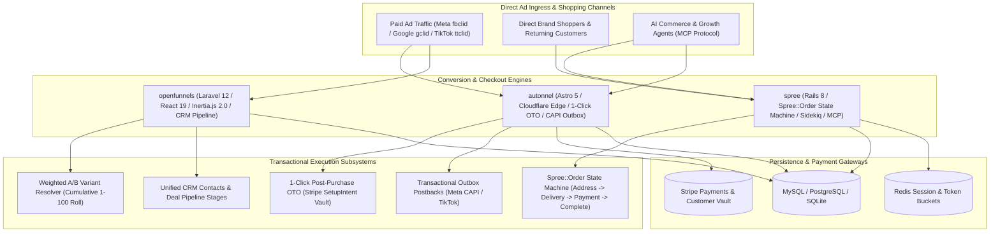
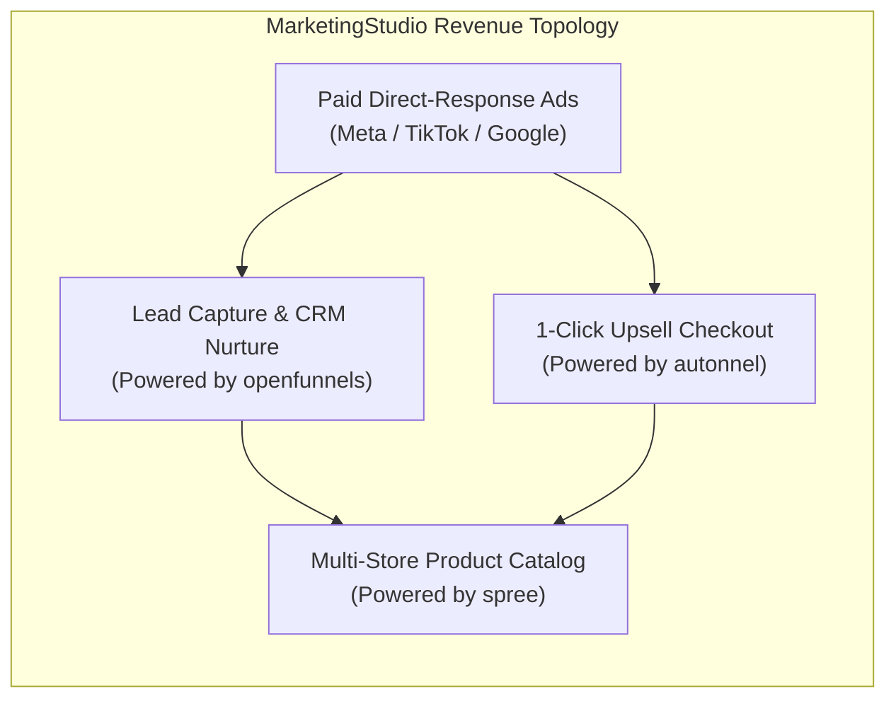

# Category 15: Sales Funnels & Checkout Engines — Comparative Architectural Analysis

> **Domain Scope**: Conversion landing pages, multi-step checkout funnels, deterministic order state machines, 1-click post-purchase upsells (OTO), weighted A/B split testing, server-side ad attribution postbacks, and Model Context Protocol (MCP) commerce agents.  
> **Solutions Analyzed**: `openfunnels`, `spree`, `autonnel`  
> **Commercial SaaS Benchmarks**: `ClickFunnels`, `Shopify Plus`, `Systeme.io`, `Kartra`, `BigCommerce`

---

## 1. Executive Domain Overview

Converting paid advertising traffic into captured revenue requires high-velocity, psychologically focused money paths. Traditional content-driven e-commerce catalogs (with navigation menus, search bars, and multi-item shopping carts) generate high cart abandonment rates when subjected to direct-response advertising traffic. In contrast, modern sales funnels and checkout engines enforce disciplined, linear buyer journeys designed for maximum conversion velocity and high Average Order Value (AOV).

This domain is defined by three competing architectural paradigms:
1. **Unified Funnel-to-CRM Monoliths & Weighted A/B Resolvers** (`openfunnels`): Ingesting landing page traffic through Laravel 12 and React 19 (Inertia.js), executing mathematical variant rolls, and immediately hydrating first-party CRM contacts and pipeline opportunities without brittle third-party webhooks.
2. **Deterministic Order State Machines & Agent-Native Headless Commerce** (`spree`): Managing multi-store and multi-currency transactions via Rails 8's battle-tested `Spree::Order` state machine with independent payment/fulfillment lifecycles, composable promotion engines, and native Model Context Protocol (MCP) server endpoints.
3. **Edge-Native 1-Click Upsell & Server-Side Ad Attribution Engines** (`autonnel`): Compiling Astro 5 zero-JS static funnels to Cloudflare Workers, tokenizing credit cards on initial checkout for instant post-purchase 1-click upsells, and dispatching server-to-server attribution postbacks (Meta CAPI, TikTok, Google Ads) to circumvent ad blockers.

The 3 open-source solutions analyzed in this category provide a complete architectural spectrum from rapid landing page funnels to enterprise multi-warehouse commerce.

---

## 2. Technical Ecosystem & Architectural Taxonomy

### Technical Stack Matrix

| Solution | Language & Runtime | Core Framework | Database & ORM | Checkout & State Model | Primary Specialization | License |
| :--- | :--- | :--- | :--- | :--- | :--- | :--- |
| **openfunnels** | PHP 8.3+ | Laravel 12+, Inertia.js 2.0, React 19 | MySQL 8.0 / PostgreSQL / SQLite (Eloquent) | Funnel step forms with native A/B weight resolver | Unified self-hosted funnel builder, CRM pipeline & visual automation studio | MIT |
| **spree** | Ruby 3.3+ / Rails 8.0 | Rails 7.2/8.0 Core, Next.js / React Admin | PostgreSQL 16+ (ActiveRecord), Redis 7+ | Deterministic `Spree::Order` multi-axis state machine | Enterprise headless e-commerce, multi-store/multi-currency & native MCP server | BSD 3-Clause |
| **autonnel** | TypeScript 5.x / Edge | Astro 5, React, Cloudflare Workers | PostgreSQL (Prisma ORM via Hyperdrive) | 1-Click Post-Purchase OTO (Stripe SetupIntents) | Edge-deployable funnels, server-side ad postbacks (CAPI) & prompt-to-funnel MCP | Apache-2.0 |

---

## 3. Deep Architectural Comparison: Core Engine Paradigms

### Detailed Evaluation of the 3 Engine Paradigms:

1. **Laravel 12 + Inertia.js 2.0 + Weighted A/B Variant Resolvers (`openfunnels`)**:
   - **Mechanism**: Eliminates the operational boundary between front-of-funnel lead capture and middle-of-funnel sales CRM. When a visitor lands on a custom domain, `FunnelVariantResolver` evaluates active variants, calculates cumulative weights across integer intervals (1–100), and rolls a pseudo-random integer. It issues a 30-day persistent cookie (`funnel_variant_{id}`) to guarantee identical variant affinity across repeat visits.
   - **Unified CRM Continuity**: Submitting a funnel form does not fire fragile webhooks to Zapier. Instead, the `LeadCaptureController` immediately upserts the `Contact`, generates an `Opportunity` in the active sales pipeline, and dispatches an asynchronous DAG automation job (`AutomationRun`) to execute nurture cadences.
   - **Throughput Profile**: Sustains 300–600 requests/sec per PHP-FPM container.

2. **Rails 8 `Spree::Order` State Machine with Independent Axes (`spree`)**:
   - **Mechanism**: Built to eliminate transactional race conditions, double-allocations, and payment desynchronizations in high-volume e-commerce. `Spree::Order` manages checkout transitions through a formal, auditable state machine (`cart` -> `address` -> `delivery` -> `payment` -> `confirm` -> `complete`).
   - **Multi-Axis State Decoupling**: Crucially, Spree separates the primary checkout state from independent sub-states:
     - `payment_state`: `balance_due`, `processing`, `pending`, `paid`, `void`, `failed`
     - `shipment_state`: `backorder`, `pending`, `ready`, `shipped`, `partial`
   - **Granular Inventory Allocation**: Physical inventory is tracked down to the individual SKU item (`Spree::InventoryUnit`) across distributed regional warehouses (`Spree::StockLocation`). Composable promotion rules evaluate whole-order, line-item, and shipping discounts without conflicting math.
   - **Agent-Ready MCP Server**: Spree incorporates a native Model Context Protocol (MCP) server (`/mcp`), enabling autonomous coding and shopping agents to manage carts, apply coupon codes, and execute checkouts programmatically.
   - **Throughput Profile**: Sustains 400–1,000 orders/min backed by Sidekiq and Redis caching.

3. **Astro 5 Edge 1-Click Upsells & Server-Side Ad Attribution Postbacks (`autonnel`)**:
   - **Mechanism**: Engineered for direct-response performance marketing where load latency destroys paid ad return-on-ad-spend (ROAS). Autonnel uses Astro 5 to compile landing pages into static HTML with zero client JavaScript by default, deployable directly to Cloudflare Workers edge nodes.
   - **1-Click Post-Purchase Upsells (OTO)**: On initial checkout, Autonnel tokenizes the buyer's credit card using Stripe SetupIntents or Customer Vault. When the customer confirms the initial purchase, they are redirected to a high-converting Upsell page. Clicking "Yes, Add to My Order" charges the stored vault token with a single HTTP request—**zero card re-entry required**.
   - **Server-Side Ad Attribution Postbacks**: Browser privacy protections (Apple iOS ITP, ad-blockers) strip client-side tracking pixels. Autonnel captures ad click IDs (`fbclid`, `gclid`, `ttclid`) upon arrival and commits them alongside the order. It uses a **Transactional Outbox Pattern** (`JobOutbox`) to asynchronously fire server-to-server postbacks to Meta Conversions API (CAPI), TikTok Events API, and Google Ads, ensuring 100% conversion signal recovery for ad optimization algorithms.
   - **Throughput Profile**: Near-instant edge response (<30ms TTFB); handles sudden traffic bursts from viral ad campaigns without server scaling latency.

---

### Architectural Tradeoffs Matrix: Funnels & Checkout Engines

| Architectural Dimension | openfunnels | spree | autonnel |
| :--- | :--- | :--- | :--- |
| **Architectural Model** | **Inertia.js Full-Stack Monolith**; Laravel 12 + React 19 | **Headless E-Commerce Monorepo**; Rails 8 + decoupled React/Next | **Edge-Native Static / Hybrid**; Astro 5 + Cloudflare Workers |
| **Primary Domain Mission** | **Lead Capture Funnels & CRM Pipelines** | **Multi-Store Catalog & Enterprise Checkout** | **Direct-Response Funnels & 1-Click Upsells** |
| **State Machine Topology** | **Linear Funnel Steps + A/B Variant Resolver** | **Multi-Axis `Spree::Order` State Machine** | **Checkout State Machine + 1-Click OTO Orchestrator** |
| **Ad Attribution Mechanics** | **Standard UTM Tracking & Contact Attribution**| **Order Metadata & Platform API** | **Transactional Outbox CAPI Postbacks (Meta/TikTok)** |
| **AI / Agent Readiness** | **Human Visual Canvas Studio** | **Native Built-In MCP Server (`/mcp`)** | **Native Built-In MCP Server (`src/skills`)** |
| **Checkout Flow** | **Embedded Multi-Step Form Fields** | **Multi-Stage Cart -> Address -> Delivery -> Pay** | **High-Converting 1-Click Post-Purchase Upsells** |
| **Catalog & Inventory Depth** | **Flat Products (Digital / Course / Service)** | **Multi-Warehouse (`InventoryUnit`, `StockLocation`)** | **Catalog Agnostic (Picocart / Shopify / WooCommerce)**|
| **Deployment Footprint** | **Standard PHP-FPM / LAMP** (~200–400 MB RAM) | **Rails + Redis + Sidekiq** (~600 MB–1.2 GB RAM) | **Serverless Edge (Workers)** or Node Container |

---

## 4. Deep-Dive Comparative Analysis Across 6 Core Dimensions

### 4.1. Checkout & State Machine Rigor
- **spree**: The industry gold standard for state safety. `Spree::Order` prevents catastrophic e-commerce edge cases: split payments across credit card and gift card, partial fulfillment across three regional warehouses, and concurrent promotion recalculations. State transitions are strictly validated and wrapped in database transactions.
- **openfunnels**: Treats checkouts as step transitions within a sales funnel. Form inputs are validated via Laravel Request classes and committed as payment records. Ideal for digital courses, subscriptions, and single-item services.
- **autonnel**: Specializes in post-purchase upsell state mechanics. It models the checkout journey as a state transition from `InitialCheckout` -> `Upsell_1` -> `Downsell_1` -> `OrderConfirmation`, updating the final composite order total atomically.

### 4.2. Attribution Recovery & Paid Ad Performance
- **autonnel** is the undisputed leader in advertising attribution durability. By shifting conversion firing from vulnerable browser JavaScript tags to reliable server-side API calls (Meta CAPI, TikTok Events), Autonnel recovers 15–30% of ad conversions that standard client pixels lose to iOS tracking blocks and uBlock Origin.
- **openfunnels** records first-party UTM parameters directly into CRM contact and deal profiles, allowing sales reps to see which Facebook ad or Google campaign generated the lead.
- **spree** records attribution tags as order metadata properties, delegating ad postback mechanics to external webhook subscribers or customer data platforms (Segment, RudderStack).

### 4.3. AI Agent Extensibility via Model Context Protocol (MCP)
- **spree** and **autonnel** both feature native Model Context Protocol (MCP) servers. Spree's MCP server allows LLM commerce agents to search product catalogs, calculate complex shipping rates, and complete purchases programmatically. Autonnel's MCP server allows AI growth agents to generate complete funnel pages from text prompts, tweak headlines, and evaluate variant analytics.
- **openfunnels** focuses primarily on visual human drag-and-drop workflow canvases (`@dnd-kit`).

---

## 5. Head-to-Head Capability Matrix

| Feature / Dimension | openfunnels | spree | autonnel |
| :--- | :---: | :---: | :---: |
| **1-Click Post-Purchase Upsells (OTO)** | ⚠️ Via Stripe API | ⚠️ Via Custom Gateway | ✅ Native Core Feature |
| **Deterministic Order State Machine** | ⚠️ Basic Steps | ✅ Strict `Spree::Order` | ⚠️ Checkout State |
| **Server-Side Ad Postbacks (Meta CAPI)** | ❌ | ⚠️ Via Webhooks | ✅ Native Outbox CAPI |
| **Weighted A/B Split Testing** | ✅ Native Cumulative | ❌ | ⚠️ Basic Variants |
| **Unified CRM & Deal Pipelines** | ✅ Full CRM | ❌ | ⚠️ Orders Only |
| **Native Model Context Protocol (MCP)** | ❌ | ✅ Built-in (`/mcp`) | ✅ Built-in (`src/skills`) |
| **Multi-Store & Multi-Currency** | ⚠️ Domains only | ✅ Full Multi-Store | ⚠️ Multi-tenant |
| **Multi-Warehouse Inventory Tracking** | ❌ | ✅ `StockLocation` | ❌ |
| **Edge Deployment (Cloudflare Workers)** | ❌ | ❌ | ✅ Native (`@astrojs/cloudflare`)|
| **License** | **MIT** | **BSD 3-Clause** | **Apache-2.0** |

---

## 6. Commercial Benchmark Positioning & MarketingStudio Convergence

### Architectural Deployment Blueprint:
1. **Direct-Response Paid Ad Funnels via autonnel**: Deploy `autonnel` on Cloudflare Workers for paid advertising landing pages. Use its sub-50ms TTFB, 1-Click post-purchase upsells, and server-side Meta CAPI postbacks to maximize return on ad spend.
2. **Inbound Lead Generation & CRM Pipelines via openfunnels**: Use `openfunnels` for high-touch agency funnels, consultation bookings, and B2B lead generation where form submissions must instantly hydrate sales CRM pipelines and trigger visual email nurturing sequences.
3. **Enterprise Commerce & AI Agents via spree**: Deploy `spree` as the core transactional e-commerce engine for physical merchandise catalogs, multi-warehouse shipping, complex tiered promotion rules, and programmatic AI agent purchases via MCP.
