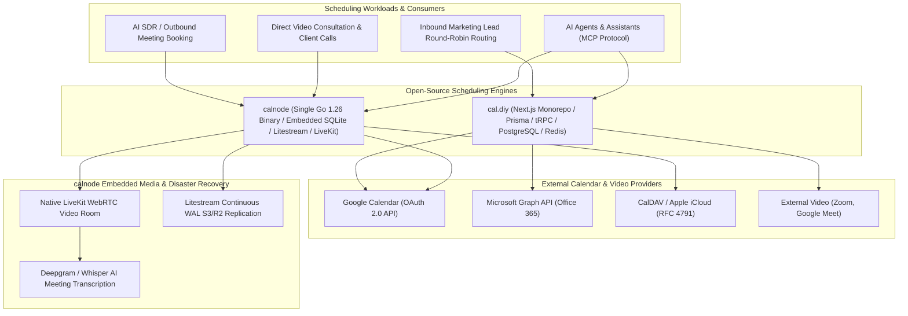
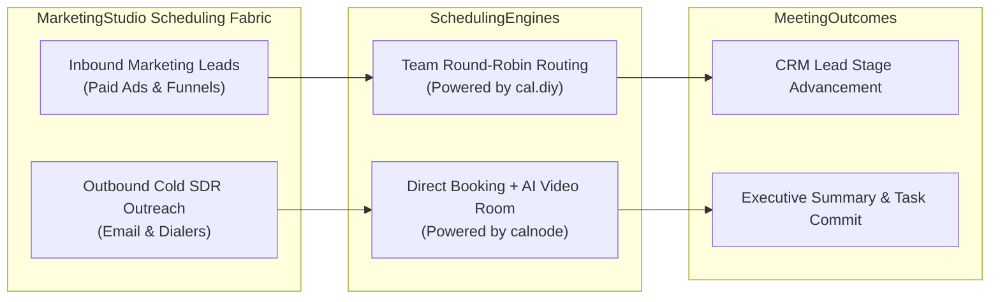

# Category 16: Appointment Scheduling & Calendar Engines — Comparative Architectural Analysis

> **Domain Scope**: Online appointment scheduling, availability calculations, multi-host round-robin routing, DST boundary normalization, embedded WebRTC video meeting rooms, Litestream SQLite continuous replication, and Model Context Protocol (MCP) calendar agents.  
> **Solutions Analyzed**: `cal.diy`, `calnode`  
> **Commercial SaaS Benchmarks**: `Calendly`, `Cal.com Cloud`, `Acuity Scheduling`, `Chili Piper`

---

## 1. Executive Domain Overview

Appointment scheduling represents the critical conversion link between outbound prospecting (cold email, phone calls, LinkedIn) and closed commercial revenue. When an interested prospect agrees to meet, sending a scheduling link that displays conflicting availability, calculates timezones incorrectly, requires slow external redirects, or relies on complex third-party video conferencing friction introduces catastrophic drop-off rates.

A production-grade scheduling engine must solve three difficult technical challenges:
1. **High-Speed Temporal Arithmetic & DST Boundary Resolution**: Intersecting multiple host schedules, external calendar busy/free blocks, buffer intervals, and working hours across arbitrary global timezones while preventing Daylight Saving Time (DST) corruption.
2. **Multi-Host Routing Topologies**: Distributing incoming meeting requests across sales teams via round-robin allocation (balanced or weighted) or finding mutual collective availability across multiple busy executives.
3. **Meeting Execution & Agentic Interaction**: Bridging the gap between booking a time slot and conducting the meeting—either by orchestrating third-party video links (Zoom, Meet) or embedding native WebRTC media rooms with integrated AI transcription, while exposing scheduling primitives to autonomous AI agents via Model Context Protocol (MCP).

The 2 open-source solutions analyzed in this category contrast an **enterprise TypeScript monorepo with multi-host round-robin routing** (`cal.diy`) against a **zero-dependency, single-binary Go engine with embedded SQLite, Litestream S3 replication, and native LiveKit video** (`calnode`).

---

## 2. Technical Ecosystem & Architectural Taxonomy



### Technical Stack Matrix

| Solution | Language & Runtime | Core Framework | Database & ORM | Video Mechanism | Concurrency & Queue | License |
| :--- | :--- | :--- | :--- | :--- | :--- | :--- |
| **cal.diy** | TypeScript 5+ / Node.js 20+ | Next.js (App Router), tRPC, Tailwind | PostgreSQL 16+ (Prisma ORM + Kysely) + Redis | App Store Plugins (Zoom, Meet, Cal Video) | Redis-backed BullMQ / Asynchronous tRPC | AGPL-3.0 |
| **calnode** | Go 1.26 (Compiled Static Binary)| SvelteKit 5 (Embedded in Go FS), Chi router | Embedded Pure-Go SQLite (WAL mode, sqlc, goose) | Native Embedded LiveKit WebRTC | In-Process Persistent SQLite Task Queue | Apache-2.0 |

---

## 3. Deep Architectural Comparison: Core Engine Paradigms

```mermaid
flowchart TD
    subgraph P1 ["1. Multi-Host Round-Robin & Monorepo Architecture (cal.diy)"]
        CD_Public["Public Booker / Embed Widget"] --> CD_Gateway["Next.js / tRPC Gateway (@calcom/trpc)"]
        CD_Gateway --> CD_Busy["BusyTimeAggregator (Google, Outlook, CalDAV)"]
        CD_Gateway --> CD_Calc["Slot Calculation Engine (packages/features/availability)"]
        CD_Calc --> CD_RoundRobin["Round-Robin Arbiter (Weighted / Balanced Sales Teams)"]
        CD_RoundRobin --> CD_Postgres[(PostgreSQL 16 via Prisma & Kysely)]
        CD_RoundRobin --> CD_Apps["packages/app-store (Zoom, Stripe, HubSpot)"]
    end

    subgraph P2 ["2. Single-Binary Go Engine with Litestream & LiveKit (calnode)"]
        CN_Client["Public Booker / Embedded SvelteKit Admin"] --> CN_Daemon["Calnode Go 1.26 Static Binary"]
        CN_Agents["AI Agents (MCP Go SDK)"] --> CN_MCP["Native Built-in MCP Server (/mcp)"]
        CN_Daemon --> CN_Slot["Slot Availability Engine (UTC Instants + IANA)"]
        CN_Daemon --> CN_LiveKit["LiveKit WebRTC Gateway (Native In-Browser Video)"]
        CN_LiveKit --> CN_Whisper["AI Notetaker (Deepgram / Whisper Transcription)"]
        CN_Slot --> CN_SQLite[("Embedded Pure-Go SQLite 3 (WAL Mode)")]
        CN_SQLite --> CN_Litestream["Litestream Continuous Streaming WAL Replication"]
        CN_Litestream --> CN_S3[("Cloudflare R2 / AWS S3 Bucket")]
    end
```



### Detailed Evaluation of the 2 Engine Paradigms:

1. **Next.js + tRPC Multi-Host Round-Robin Booking (`cal.diy`)**:
   - **Mechanism**: Engineered as an enterprise scheduling monorepo (Turborepo) using TypeScript, Next.js, and tRPC. The availability calculation pipeline (`@calcom/features/availability`) aggregates free/busy intervals across heterogeneous external calendars (Google Calendar, Microsoft Outlook, Apple iCloud, CalDAV) and intersects them with host availability schedules, minimum notice buffers, and timezone offsets.
   - **Enterprise Routing Topologies**: Cal.diy leads the industry in multi-host team scheduling:
     - `ROUND_ROBIN`: Distributes incoming prospect bookings across sales team members equally or based on assigned individual conversion weights.
     - `COLLECTIVE`: Finds mutual availability across multiple required team members (e.g., Account Executive + Solutions Engineer).
     - `MANAGED`: Enforces standardized corporate event templates across global organizational hierarchies.
   - **App Store Ecosystem**: Its modular `packages/app-store` supports 50+ integrations, allowing hosts to charge for bookings via Stripe, provision Zoom/Meet video links, and synchronize meeting attendees into Salesforce or HubSpot.
   - **Throughput & Resource Profile**: Multi-container architecture requiring PostgreSQL, Redis, and Node.js. Consumes **1.5 GB to 2.5 GB of RAM** in production.

2. **Single Go Binary + Embedded SQLite + Litestream S3 Replication + LiveKit (`calnode`)**:
   - **Mechanism**: Calnode represents the radical simplification of scheduling infrastructure. Compiling into a **single static Go executable**, it embeds its administrative SvelteKit 5 frontend directly via Go's native `embed.FS` and executes all persistence against an embedded pure-Go SQLite database operating in Write-Ahead Log (WAL) mode.
   - **Continuous Disaster Recovery via Litestream**: Solves SQLite high-availability and backup concerns through continuous, streaming WAL replication directly to S3-compatible object storage (Cloudflare R2, AWS S3, MinIO). If the host server suffers hardware failure, Calnode restores the complete database from S3 in seconds with sub-second Recovery Point Objective (RPO).
   - **Native WebRTC Video & AI Transcription**: Unlike tools that redirect users to third-party Zoom or Google Meet URLs, Calnode includes built-in in-browser video meeting rooms powered by LiveKit. When a meeting ends, an integrated AI notetaker transcribes the call audio and generates structured summaries and action items without third-party bot intrusions.
   - **Native Model Context Protocol (MCP)**: Implements a built-in MCP server (using the official Go SDK), allowing autonomous AI agents (Claude, ChatGPT, MarketingStudio bots) to inspect slots, schedule appointments, and retrieve transcripts programmatically over stdio or Streamable HTTP.
   - **Throughput & Resource Profile**: Boots in under 50 milliseconds and runs in **< 60 MB of RAM** on a 512MB VPS.

---

### Architectural Tradeoffs Matrix: Scheduling & Calendar Engines

| Architectural Dimension | cal.diy | calnode |
| :--- | :--- | :--- |
| **System Architecture** | **Modular TypeScript Monorepo**; Turborepo, Next.js, tRPC | **Single Static Go Binary**; embedded SvelteKit 5 & embedded SQLite |
| **Enterprise Team Routing** | **Advanced Round-Robin & Collective**; weighted sales team lead distribution | **Basic Round-Robin**; optimized for individual and small team booking |
| **Video Meeting Mechanism** | **External Providers via App Store**; Zoom, Google Meet, Cal Video | **Native Embedded LiveKit WebRTC**; zero third-party video software needed |
| **Meeting Intelligence & AI** | **None**; relies on external recording bots | **Integrated AI Notetaker**; Deepgram/Whisper transcription + LLM summaries |
| **AI / Agent Interface** | **REST API v2 / Webhooks** | **Native Built-In MCP Server**; official Go MCP SDK (stdio / HTTP) |
| **Disaster Recovery & Storage** | **Managed PostgreSQL Clustering** + Redis cache cluster | **Litestream Continuous WAL Streaming**; continuous S3/R2 replication |
| **App Store & Integrations** | **50+ Apps**; Stripe, PayPal, Salesforce, HubSpot, Zoom | **Focused Core**; Google Calendar, CalDAV, LiveKit, S3 |
| **Operational Resource Footprint**| **Heavy** (~1.5–2.5 GB RAM, Node.js + Postgres + Redis) | **Ultra-Lightweight** (<60 MB RAM, runs on 512MB VPS) |

---

## 4. Deep-Dive Comparative Analysis Across 6 Core Dimensions

### 4.1. Deployment Topology & Operational Overhead
- **calnode**: The gold standard for operational simplicity. A single compiled binary contains the web server, SvelteKit frontend, database driver, WebRTC bridge, and MCP server. It requires no Docker daemon, no database migrations, and no reverse proxy configuration. Updating is as simple as replacing the binary.
- **cal.diy**: An enterprise web application requiring Node.js 20+, yarn workspaces, a PostgreSQL 14+ database cluster, and Redis for session and rate-limiting queues. It requires container orchestration (Docker Compose, Kubernetes) and regular dependency maintenance across multiple packages.

```
[RAM Memory Consumption Comparison: Production Idle]
calnode:   ███                                   ~60 MB RAM (Single Go Binary)
cal.diy:   ████████████████████████████████████  ~2,000 MB RAM (Next.js + Postgres + Redis)
```

### 4.2. Temporal Arithmetic & Daylight Saving Time (DST) Handling
- Both engines store timestamps strictly as **UTC instants** paired with canonical **IANA timezone database identifiers** (e.g., `America/New_York`, `Europe/Berlin`).
- **cal.diy** resolves temporal arithmetic in TypeScript using Day.js and custom math.
- **calnode** relies on Go's standard `time.Location` package, providing microsecond-level timezone calculations and guaranteeing immunity to DST leap-forward and fall-back scheduling desynchronizations.

### 4.3. Video Conferencing & Call Transcription
- **calnode**: Provisions an in-browser WebRTC video room via LiveKit immediately upon booking confirmation. Both host and attendee join directly from their browser without downloading desktop software. Post-call audio is transcribed automatically using Whisper/Deepgram, generating executive summaries and task lists committed directly to SQLite.
- **cal.diy**: Generates dynamic meeting links via configured App Store plugins (creating Google Meet or Zoom meetings via their respective OAuth APIs). Meeting transcription requires third-party meeting bots (e.g., Otter.ai, Fireflies).

---

## 5. Head-to-Head Capability Matrix

| Feature / Dimension | cal.diy | calnode | Calendly |
| :--- | :---: | :---: | :---: |
| **Single Static Binary Deployment** | ❌ (Multi-container) | ✅ Go Executable (<60MB) | ❌ (Closed SaaS) |
| **Native Embedded WebRTC Video** | ⚠️ Cal Video / Apps | ✅ Built-in LiveKit | ❌ (Redirects to Zoom/Meet) |
| **Integrated AI Call Transcription**| ❌ | ✅ Deepgram / Whisper | ❌ |
| **Native Model Context Protocol (MCP)**| ⚠️ Via API | ✅ Built-in Go SDK | ❌ |
| **Team Round-Robin Lead Distribution**| ✅ Advanced Weighted | ⚠️ Basic | ✅ Native |
| **Collective Multi-Host Availability** | ✅ Native | ⚠️ Basic | ✅ Native |
| **Continuous Disaster Recovery** | Managed Postgres Backups | ✅ Litestream S3/R2 WAL | Cloud Managed |
| **App Store Ecosystem (50+ Apps)** | ✅ Comprehensive | ❌ Focused Core | ✅ Broad Ecosystem |
| **Primary Database** | PostgreSQL 16+ & Redis | Embedded SQLite 3 (WAL) | Cloud Managed |
| **License** | AGPL-3.0 | **Apache-2.0** | Closed SaaS |

---

## 6. Commercial Benchmark Positioning & MarketingStudio Convergence



### Architectural Deployment Blueprint:
1. **Inbound Team Lead Routing via cal.diy**: Deploy `cal.diy` for inbound marketing lead generation funnels where incoming enterprise prospect bookings must be automatically distributed across sales reps using weighted round-robin algorithms and synchronized with CRM calendars.
2. **AI SDR Outreach & Video Consultations via calnode**: Deploy `calnode` for outbound SDR cadences, client consulting, and AI agent workflows. Take advantage of its zero-overhead single binary footprint, built-in LiveKit video rooms, and integrated AI call transcription to record customer interactions without bot interruptions.
3. **Autonomous Agent Scheduling via calnode MCP**: Allow MarketingStudio's AI agents (Claude, GPT, OpenCode) to inspect calendar availability, book candidate interviews, and retrieve meeting notes programmatically via Calnode's native MCP server.
