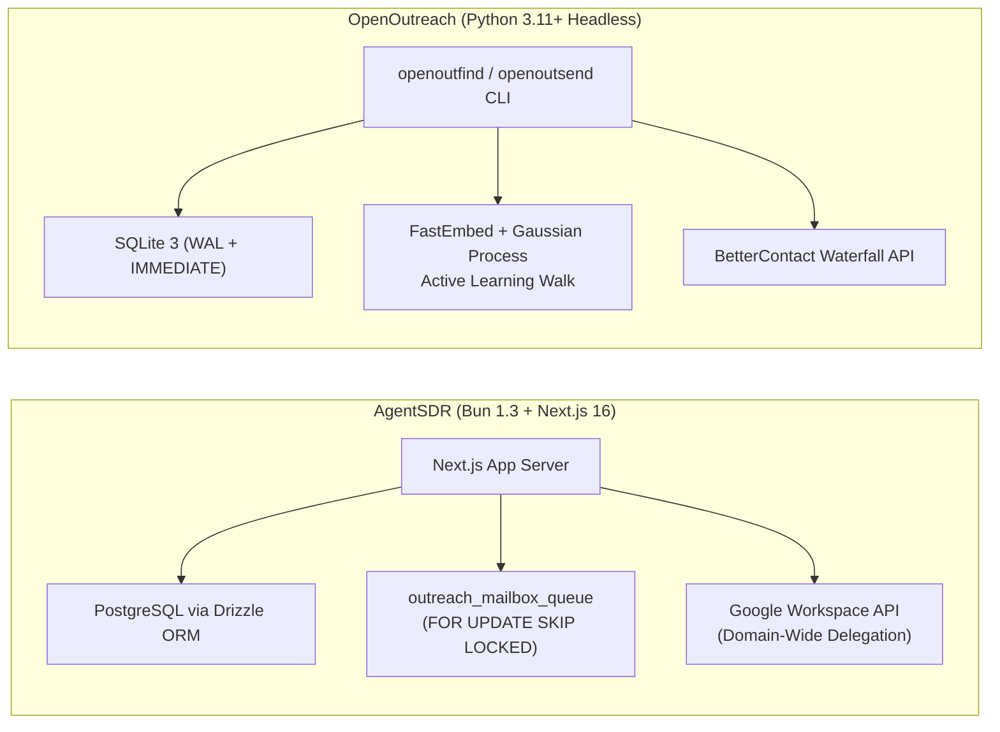
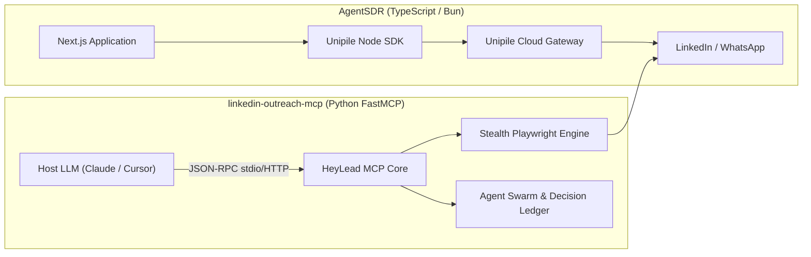
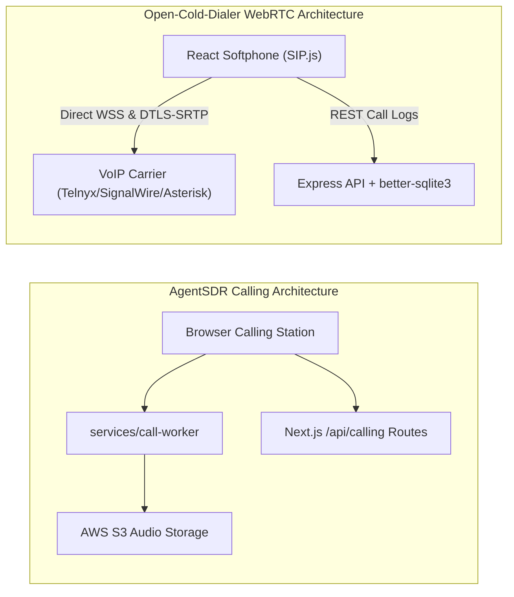
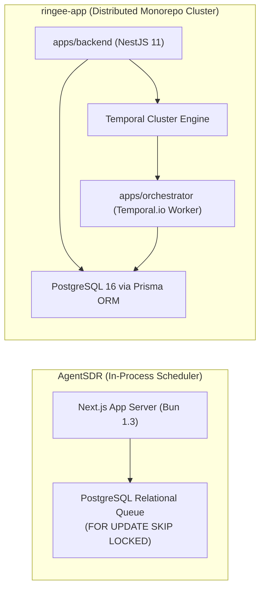

# AgentSDR — Comparative Analysis & Category Evaluation

> **Category**: Cold Outreach & AI SDR  
> **Architectural Role**: Autonomous AI SDR pipeline, multi-inbox rotation & CRM orchestrator  
> **Primary Stack**: TypeScript, Bun 1.3, Next.js 16, React 19 | PostgreSQL 15+, Drizzle ORM | In-Process Postgres Relational Queue (`FOR UPDATE SKIP LOCKED`)  
> **Peer Solutions Compared**: `OpenOutreach`, `linkedin-outreach-mcp`, `Open-Cold-Dialer`, `ringee-app`  
> **Commercial SaaS Benchmarks**: Apollo.io, Clay.com, Instantly.ai, HeyReach.io, Lemlist.com  

---

## 1. Executive Overview & Technical Identity: AgentSDR

**AgentSDR** is an open-source, multi-tenant AI Sales Development Representative (SDR) platform engineered to automate multi-channel outbound prospecting. Executed on the high-performance Bun runtime using Next.js 16 (App Router) and React 19, AgentSDR combines cold email deliverability engines, Google Workspace domain-wide delegation, LinkedIn/WhatsApp bridging, WebRTC calling, and dynamic CRM deal progression into a unified self-hosted platform.

### Core Architectural Profile
- **Runtime & Language**: `TypeScript 5.4+` executed on `Bun 1.3.14`
- **Core Framework**: `Next.js 16.2.9` (App Router, Server Actions, Server Components), `React 19.2.4`
- **Persistence Layer**: `PostgreSQL 15+` via `Drizzle ORM` (`drizzle-orm` 0.45.2, `postgres` 3.4.9)
- **Concurrency & Queue Model**: Two-Tier PostgreSQL Relational Queue (`outreach_mailbox_queue`, `scheduled_job_runs`) using `SELECT ... FOR UPDATE SKIP LOCKED`
- **Security & Tenancy**: `Better Auth 1.7.7` with fail-closed `organization_id` scoping and WebAssembly `QuickJS` sandboxed formula evaluation
- **Domain Specialization**: Autonomous AI lead enrichment, multi-inbox rotation, and inbound reply intent classification

---

## 2. Peer Solution Landscape (Cold Outreach & AI SDR)

Within this category, `AgentSDR` operates alongside four specialized peer solutions:

| Solution | Language & Runtime | Core Framework | Database & ORM | Queue & Concurrency Model | Primary Architectural Niche |
| :--- | :--- | :--- | :--- | :--- | :--- |
| **AgentSDR** (Current) | `TypeScript / Bun 1.3` | `Next.js 16, React 19` | `PostgreSQL 15+, Drizzle` | `Postgres FOR UPDATE SKIP LOCKED` | Autonomous multi-channel AI SDR & inbox rotator |
| **OpenOutreach** | `Python 3.11+` | `Django 5.2+ (Headless)` | `SQLite 3 (WAL + IMMEDIATE)` | `Synchronous Bounded Batches` | Active-learning lead discovery & waterfall resolution |
| **linkedin-outreach-mcp** | `Python 3.10+` | `FastMCP SDK 1.30+` | `SQLite 3 (WAL, v16)` | `Asyncio Coroutines + Jitter Backoff` | Stealth LinkedIn automation for LLM agent swarms |
| **Open-Cold-Dialer** | `TypeScript / Node 20+` | `React 18, Vite, Express` | `SQLite / Supabase, Drizzle` | `SIP.js Client Event Loop over WSS` | Carrier-agnostic browser WebRTC power dialer |
| **ringee-app** | `TypeScript / Node 20+` | `NestJS 11, Next.js 14` | `PostgreSQL 16, Prisma` | `Temporal.io Durable Workflows` | Enterprise contact center & power dialer cluster |

---

## 3. Deep Head-to-Head Comparative Breakdown: AgentSDR vs Peers

### 3.1. AgentSDR vs. OpenOutreach

**Comparative Focus**: Autonomous multi-channel outbound orchestrator vs. bounded active-learning discovery & delivery pipeline.

#### Architectural & Stack Differences
- **Runtime & Process Models**: `AgentSDR` runs as a persistent multi-tenant web application and background scheduler executed on the `Bun 1.3` runtime, serving React 19 interfaces, handling incoming webhooks, and running slot scheduling loops. In contrast, `OpenOutreach` is a stateless, zero-daemon CLI application built on headless `Django 5.2+` and `Python 3.11+`. It executes bounded batch jobs (e.g., `openoutreach find 10 emails` piped into `openoutsend`) that terminate upon completion.
- **Queue & Concurrency Mechanics**: `AgentSDR` manages asynchronous outbound scheduling via a two-tier PostgreSQL queue. The daily builder (`/api/outreach/build-queue`) populates `outreach_mailbox_queue`, while the tick engine (`/api/outreach/tick`) locks rows using `SELECT ... FOR UPDATE SKIP LOCKED` to guarantee transactional, non-conflicting dispatch across mailboxes. `OpenOutreach` bypasses message brokers entirely, executing synchronous bounded loops with in-thread randomized sleeps (`time.sleep(random.uniform(120, 300))`) to throttle sends across personal SMTP connections.
- **Database & Schema Structures**: `AgentSDR` enforces strict multi-tenancy using PostgreSQL and Drizzle ORM with foreign-keyed `organization_id` scopes. It incorporates a dynamic spreadsheet grid engine (`grid_tables`, `grid_columns`) with runtime DDL mutations and WebAssembly-sandboxed QuickJS formula execution. `OpenOutreach` relies on an embedded SQLite database in WAL mode with `IMMEDIATE` transaction locking, storing unified models for configuration (`SiteConfig`), candidate leads (`OutfindLead`), and delivery logs (`OutsendMessage`).
- **Failure Modes & Crash Recovery**: If AgentSDR crashes during an outreach tick, the open PostgreSQL transaction rolls back immediately, releasing the row lock for the next tick cycle. In OpenOutreach, if a discovery or send run terminates prematurely, the pipeline resumes using SQLite state and JSON Lines inter-process streams, preventing duplicate email dispatch via database unique constraints on recipient addresses.

#### Architectural Comparison Matrix: AgentSDR vs. OpenOutreach

| Dimension | AgentSDR | OpenOutreach |
| :--- | :--- | :--- |
| **Runtime & Framework** | TypeScript / Bun 1.3, Next.js 16, React 19 | Python 3.11+, Django 5.2+ (Headless ORM) |
| **Execution Architecture** | In-process daemon & slot scheduler | Bounded CLI batch pipeline (ephemeral process) |
| **Queue / Concurrency** | PostgreSQL `FOR UPDATE SKIP LOCKED` | Synchronous batch loops + in-thread sleep |
| **Persistence Layer** | PostgreSQL 15+ via Drizzle ORM | SQLite 3 (WAL mode, IMMEDIATE locking) |
| **AI Strategy** | LLM prompt loops + WebAssembly QuickJS formulas | FastEmbed + Gaussian Process active learning |
| **Mailbox Integration** | Google Workspace Domain-Wide Delegation (impersonation) | Direct personal mailbox SMTP / IMAP |
| **Primary Failure Mode** | Database pool exhaustion under high tick rates | Script termination midway through batch sleep |
| **Recovery Mechanism** | Relational transaction rollback and re-tick | Idempotent SQLite state resume on restart |

---

### 3.2. AgentSDR vs. linkedin-outreach-mcp

**Comparative Focus**: Full-stack multi-channel SDR platform vs. standardized Model Context Protocol (MCP) LinkedIn tool daemon.

#### Architectural & Stack Differences
- **Runtime & Process Models**: `AgentSDR` is a comprehensive SaaS platform designed for human sales teams and autonomous cron loops. `linkedin-outreach-mcp` (HeyLead) is a specialized tool provider implementing the Anthropic Model Context Protocol (`mcp>=1.30.0`). It exposes 60+ typed tools over `stdio` or `streamable-http`, enabling external AI coding agents (Claude Code, Cursor) to directly control LinkedIn social selling.
- **Queue & Concurrency Mechanics**: `AgentSDR` relies on its PostgreSQL relational queue and Unipile API webhooks to track outbound touches. `linkedin-outreach-mcp` runs inside a Python `asyncio` event loop. To resolve database contention across concurrent MCP tool calls, it implements an exponential backoff retry mechanism with 12 distinct stages and randomized jitter against an embedded SQLite WAL database.
- **Database & Schema Structures**: `AgentSDR` uses Drizzle ORM with structured schemas for people, campaigns, pipelines, and conversations. `linkedin-outreach-mcp` maintains an embedded SQLite database (`PRAGMA user_version = 16`) storing contact profiles, campaign metadata, and an auditable agent decision ledger (`agent_decisions`, `agent_decision_outcomes`) that tracks the rationale of specialized sub-agents (Reply Classifier, Strategist Replan Agent, Hot Lead Closer).
- **Failure Modes & Crash Recovery**: AgentSDR delegates anti-detection and proxy rotation to Unipile; if Unipile experiences downtime, external LinkedIn tasks fail with API errors. `linkedin-outreach-mcp` runs local Playwright instances or connects to Unipile directly, storing sensitive credentials inside the OS Keychain via `keyring`. If an action encounters a rate limit or DOM selector mutation, the Coordinator Agent halts the campaign and logs an emergency hold in the decision journal.

#### Architectural Comparison Matrix: AgentSDR vs. linkedin-outreach-mcp

| Dimension | AgentSDR | linkedin-outreach-mcp |
| :--- | :--- | :--- |
| **Primary Interface** | Next.js Web UI, AG Grid & REST APIs | 60+ Model Context Protocol (MCP) Tools |
| **Process Model** | Multi-tenant web app + Bun cron scheduler | Lightweight MCP daemon (`stdio` / HTTP) |
| **Social Automation** | Third-party Unipile API Gateway | Native Playwright stealth automation + Unipile |
| **Anti-Detection Mechanics** | Externalized to API provider | Local human jitter, voice cloning, weekly caps |
| **Concurrency Control** | PostgreSQL row-level locks | Asyncio coroutines + 12-stage backoff |
| **State Persistence** | PostgreSQL via Drizzle ORM | SQLite 3 (WAL, v16) + OS Keychain |
| **Agent Autonomy** | Built-in sentiment classifier & prompt loop | 4-agent in-process swarm with auditable ledger |
| **Primary Failure Mode** | Third-party Unipile gateway rate limits | LinkedIn DOM changes or account checkpoint flags |

---

### 3.3. AgentSDR vs. Open-Cold-Dialer

**Comparative Focus**: Multi-channel autonomous SDR suite vs. focused browser WebRTC power dialer.

#### Architectural & Stack Differences
- **Runtime & Process Models**: `AgentSDR` manages cold email cadences, LinkedIn messages, and voice calls within a monolithic Next.js/Bun application assisted by an external `call-worker` service (`services/call-worker`). `Open-Cold-Dialer` is a decoupled, client-centric dialing application: a React 18 / Vite frontend communicates directly with telecom SIP carriers over secure WebSockets, backed by a lightweight Express 4.21 API for metadata persistence.
- **Audio Media Transport & Signaling**: `AgentSDR` provides a WebRTC softphone interface that routes audio capture through its auxiliary call worker, archiving recordings to S3. `Open-Cold-Dialer` uses `SIP.js 0.21.0` directly inside the browser. The browser negotiates SDP offer/answer, performs DTLS cryptographic handshakes, and streams Opus audio peer-to-peer with carrier PSTN gateways (SignalWire, Telnyx, Twilio, or Asterisk), completely bypassing the Node.js backend for audio traffic.
- **Database & Schema Structures**: `AgentSDR` stores call records within its comprehensive PostgreSQL relational schema (`call_sessions`). `Open-Cold-Dialer` uses Drizzle ORM over `better-sqlite3` for local deployments or Supabase PostgreSQL for cloud deployments, maintaining focused tables for `leads`, `campaigns`, `call_logs`, `call_scripts`, and `dnc_list`.
- **Failure Modes & Crash Recovery**: In AgentSDR, if the `call-worker` microservice drops, ongoing browser audio recording upload fails while the call session remains active in the UI. In Open-Cold-Dialer, if the Express backend restarts or crashes, the sales rep's active phone call remains entirely uninterrupted because the WebRTC media stream is anchored directly between the browser and the telecom carrier.

#### Architectural Comparison Matrix: AgentSDR vs. Open-Cold-Dialer

| Dimension | AgentSDR | Open-Cold-Dialer |
| :--- | :--- | :--- |
| **Primary Focus** | Multi-channel autonomous SDR (Email, LinkedIn, Voice) | High-velocity browser outbound cold calling |
| **Frontend Architecture** | Next.js 16 App Router, React 19, AG Grid | React 18, Vite, Tailwind CSS 3.4 |
| **Telephony Transport** | WebRTC Softphone + auxiliary call worker | SIP.js over WSS directly to VoIP carriers |
| **Carrier Coupling** | Custom WebRTC bridge | Carrier-agnostic BYOC (Telnyx, Twilio, Asterisk) |
| **Call Guidance** | Knowledge base RAG citations | Dynamic objection-handling battle cards |
| **Persistence Engine** | PostgreSQL 15+ via Drizzle ORM | SQLite (`better-sqlite3`) / Supabase via Drizzle |
| **Backend Dependency on Audio**| Moderate (Call worker handles S3 archiving) | Zero (Backend handles only REST metadata) |
| **Primary Failure Mode** | Microservice audio upload timeout to S3 | Browser NAT traversal failure (STUN/TURN required) |

---

### 3.4. AgentSDR vs. ringee-app

**Comparative Focus**: In-process relational AI SDR orchestrator vs. distributed enterprise telephony platform with Temporal.io workflows.

#### Architectural & Stack Differences
- **Runtime & Process Models**: `AgentSDR` is structured as a compact fullstack web application on Bun 1.3, unifying CRM, email cadences, and calling into one primary service. `ringee-app` is an enterprise monorepo (pnpm workspaces) comprising distinct micro-applications: `apps/backend` (NestJS 11 REST API), `apps/frontend` (Next.js 14 dashboard), `apps/orchestrator` (Temporal.io worker), `apps/browser-extension` (Manifest V3), and CRM sync workers (`apps/hubspot`, `apps/attio`).
- **Queue & Concurrency Mechanics**: `AgentSDR` executes scheduled jobs via internal PostgreSQL row locks (`FOR UPDATE SKIP LOCKED`). In contrast, `ringee-app` relies on **Temporal.io** (`@temporalio/workflow`). Campaign dialing runs are modeled as distributed, event-sourced workflows that survive server reboots, network partitions, and worker crashes. Redis 7.x manages distributed locks and live agent presence.
- **Telephony & Media Engineering**: `AgentSDR` features a basic browser softphone for manual dialing. `ringee-app` features a complete contact center media plane: a headless dialer core (`@ringee/dialer-core`) driven by Zustand, automated local presence caller ID rotation (`CallerIdPoolMember`), atomic multi-agent ring groups (`RingGroup`), carrier-side dual-channel recording, and automated CRM timeline synchronization.
- **Database & Schema Structures**: `AgentSDR` uses Drizzle ORM over PostgreSQL. `ringee-app` utilizes Prisma ORM 6.16 over PostgreSQL 16 with a master schema (`schema.prisma`) exceeding 5,000 lines and 50+ relational models covering carrier billing, disposition trees, and audio segment transcripts.
- **Failure Modes & Crash Recovery**: An AgentSDR node restart interrupts active in-flight tick executions, requiring the next cron tick to re-evaluate pending queue items. In ringee-app, Temporal's event history guarantees that any interrupted dialer campaign activity is automatically retried or reassigned to another worker without losing campaign progression state.

#### Architectural Comparison Matrix: AgentSDR vs. ringee-app

| Dimension | AgentSDR | ringee-app |
| :--- | :--- | :--- |
| **System Architecture** | In-process App Server + Bun scheduler | Distributed Monorepo Microservices (NestJS + Next.js) |
| **Orchestration Model** | PostgreSQL Relational Queue | Temporal.io Durable Event-Sourced Workflows |
| **Database & ORM** | PostgreSQL 15+ via Drizzle ORM | PostgreSQL 16 via Prisma ORM 6.16 |
| **Telephony Engine** | Built-in WebRTC calling station | Headless `@ringee/dialer-core` + Telnyx Call Control V2 |
| **Caller ID Reputation** | Basic daily send counters | Dynamic local presence pool & area code matching |
| **Inbound Routing** | Direct extension ringing | Atomic multi-agent ring groups & hunt queues |
| **CRM Integration** | Internal Native CRM + Unipile sync | Bi-directional sync workers (HubSpot & Attio) |
| **Operational Overhead**| Low (Single container + PostgreSQL) | High (NestJS, Next.js, Temporal, Redis, Postgres, S3) |

---

## 4. Capability & Feature Comparison Matrix

| Dimension / Capability | AgentSDR | OpenOutreach | linkedin-outreach-mcp | Open-Cold-Dialer | ringee-app |
| :--- | :---: | :---: | :---: | :---: | :---: |
| **Autonomous AI Lead Qualification** | ✅ LLM Loop & Formulas | ✅ FastEmbed + GP Active Learning | ✅ Semantic ICP RAG | ❌ | ❌ |
| **Multi-Touch Sequence Cadences** | ✅ Email, LinkedIn, WhatsApp | ✅ Deterministic Email | ⚠️ LinkedIn Cadences | ❌ | ⚠️ Telephony campaigns |
| **Domain-Wide Inbox Delegation** | ✅ Google Service Accounts | ❌ Personal SMTP | ❌ | ❌ | ❌ |
| **LinkedIn Automation (MCP / Stealth)** | ⚠️ Unipile API Gateway | ❌ (Zero ToS surface) | ✅ 60+ Native MCP Tools | ❌ | ❌ |
| **Tone-of-Voice Cloning** | ❌ | ❌ | ✅ LLM Style Distiller | ❌ | ❌ |
| **Browser WebRTC Power Dialer** | ✅ Built-in Softphone | ❌ | ❌ | ✅ SIP.js WebRTC | ✅ Headless Core |
| **Durable Workflow State Recovery** | ⚠️ Relational DB retries | ❌ (CLI rerun) | ⚠️ 12-stage backoff | ❌ | ✅ Temporal.io State |
| **Dynamic Spreadsheet Grid & Formulas**| ✅ AG Grid + QuickJS WASM | ❌ | ❌ | ❌ | ❌ |
| **Inbound Reply Intent Analysis** | ✅ AI Intent Classifier | ⚠️ IMAP Regex/Bounce | ✅ Reply Classifier Swarm | ❌ | ⚠️ Post-call LLM |
| **Multi-Tenant Account Isolation** | ✅ Fail-Closed Org Scopes | ❌ Single-tenant CLI | ❌ Single-user daemon | ⚠️ Supabase RLS mode | ✅ Complete Org Scoping |
| **Memory Footprint (Baseline)** | ~250 MB (Bun/Next.js) | **~60 MB (Python CLI)** | ~90 MB (Python MCP) | ~120 MB (Node/Vite) | ~750 MB (Cluster) |

---

## 5. Commercial Benchmark Positioning

When benchmarked against commercial outbound sales leaders (**Apollo.io, Clay.com, Instantly.ai, HeyReach.io, Lemlist.com**):
- **Against Apollo.io**: AgentSDR combines multi-inbox cold email cadences, contact management, and softphone calling into a single self-hosted codebase, eliminating Apollo's $99+/user/month licensing fees.
- **Against Clay.com**: AgentSDR's dynamic spreadsheet module (`grid_workbooks`, `grid_tables`) mirrors Clay's core data-table UX, allowing dynamic column creation and client-authored formula execution in a safe WebAssembly QuickJS sandbox (`quickjs-emscripten`).
- **Against Instantly.ai / Lemlist**: AgentSDR's Google Workspace domain-wide delegation allows organizations to provision dozens of secondary mailboxes under service accounts, automatically rotating outbound volume while enforcing strict send intervals (180s+) to protect domain reputation.

---

## 6. Strategic Takeaways & Role for MarketingStudio

In MarketingStudio's outbound architecture:
1. **Primary Component to Adopt**: Adopt AgentSDR's **multi-inbox rotation and Google Workspace domain-wide delegation** architecture, combined with its two-tier PostgreSQL relational queue (`outreach_mailbox_queue` with `FOR UPDATE SKIP LOCKED`).
2. **Incorporate QuickJS Sandboxed Formulas**: Emulate AgentSDR's AG Grid and QuickJS WebAssembly sandbox for safe, user-authored data enrichment and dynamic prompt synthesis.
3. **Integrate Peer Capabilities**:
   - Pair AgentSDR's sequence engine with `OpenOutreach` for zero-cost active learning candidate discovery and verified email waterfall lookups.
   - Offload LinkedIn actions to `linkedin-outreach-mcp` for stealth anti-detection and tone-of-voice cloning.
   - Leverage `ringee-app`'s local presence caller ID rotation algorithms to protect outbound telephony numbers from carrier spam tagging.
