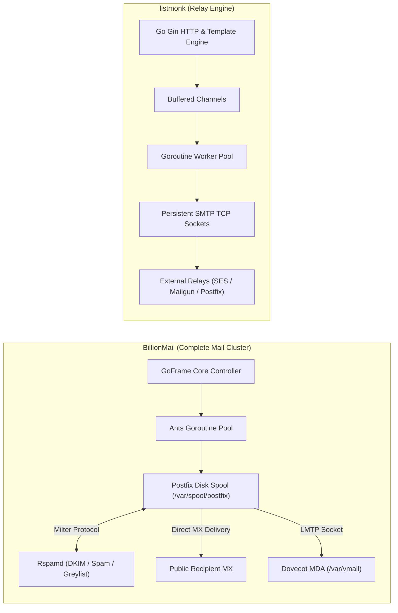
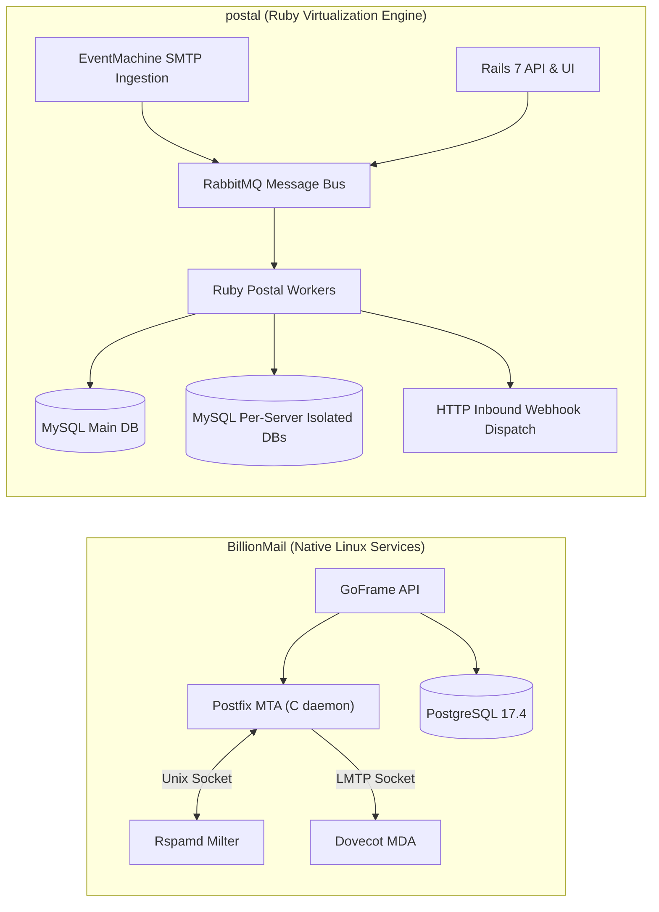
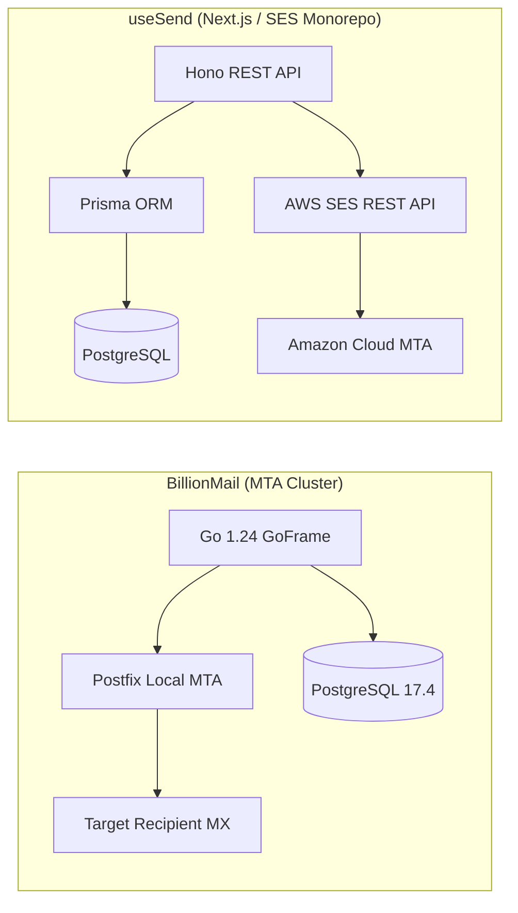
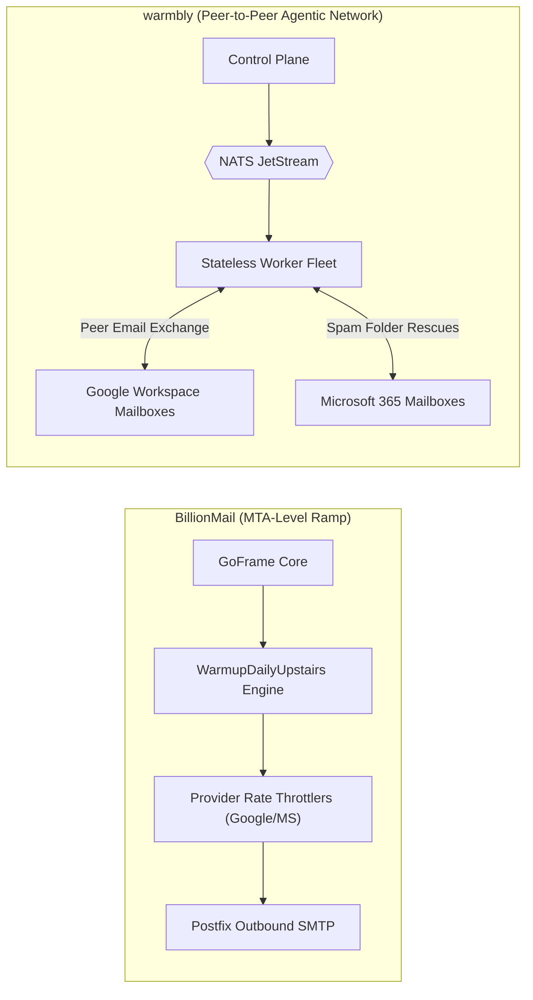
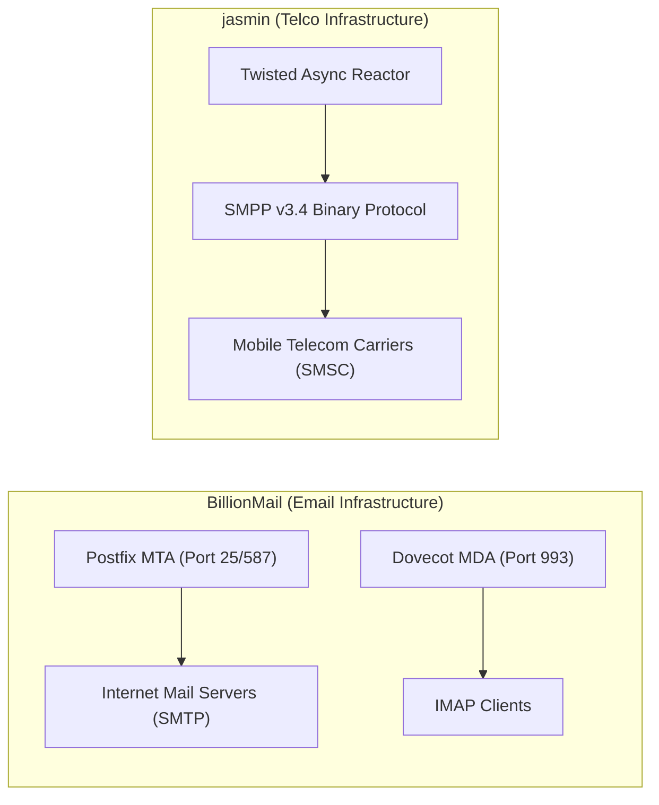

# BillionMail — Comparative Analysis & Category Evaluation

> **Category**: Email Infrastructure & Delivery  
> **Architectural Role**: Turnkey self-hosted mail server cluster, MTA/MDA orchestration & automated deliverability engine  
> **Primary Stack**: Go 1.24 (GoFrame v2) | Postfix 1.6 | Dovecot 1.6 | Rspamd 1.2 | PostgreSQL 17.4, Redis 7.4 | Postfix Spool Queues + Ants Worker Pool  
> **Peer Solutions Compared**: `listmonk`, `postal`, `useSend`, `warmbly`, `jasmin`  
> **Commercial SaaS Benchmarks**: SendGrid, Mailgun, Amazon SES, Google Workspace, Microsoft 365  

---

## 1. Executive Overview & Technical Identity: BillionMail

**BillionMail** represents the enterprise-grade infrastructure tier within the **Email Infrastructure & Delivery** domain. Designed to grant complete data and reputation sovereignty, BillionMail eliminates recurring third-party transactional email SaaS costs (SendGrid, Mailgun, SES) by packaging a carrier-grade Linux mail server stack into an orchestrated Docker topology. Managed by an autonomous Go 1.24 daemon (`core-manage` via GoFrame v2), BillionMail tightly integrates Postfix (MTA), Dovecot (MDA), and Rspamd (milter-based anti-spam and DKIM signing), providing turnkey TLS via Lego ACME, live DNS/MX verification, and automated multi-IP warmup schedules.

### Core Architectural Profile
- **Runtime & Language**: `Go 1.24` (control plane daemon) + C/POSIX Linux daemons (Postfix, Dovecot, Rspamd)
- **Core Framework**: `GoFrame v2` (`github.com/gogf/gf/v2`) orchestrating container subsystems via Unix sockets and bridge networks
- **Persistence Layer**: `PostgreSQL 17.4` (virtual mailboxes, domains, warmup quotas) + `Redis 7.4` (rate-limiting token buckets)
- **Concurrency & Queue Model**: Postfix multi-queue disk spool (`incoming`, `active`, `deferred`) + `panjf2000/ants/v2` goroutine pool
- **Domain Specialization**: Turnkey self-hosted ISP-grade mail infrastructure, automated IP warmup ramp, and inbound/outbound mailbox hosting

---

## 2. Peer Solution Landscape (Email Infrastructure & Delivery)

Within this category, `BillionMail` operates alongside the following peer solutions:

| Solution | Language & Runtime | Core Framework | Database / Cache | Queue / Concurrency | Primary Architectural Niche |
| :--- | :--- | :--- | :--- | :--- | :--- |
| **BillionMail** (Current) | `Go 1.24 / Docker` | `GoFrame v2, Postfix, Dovecot` | `PostgreSQL 17.4, Redis 7.4` | `Postfix Spool + Ants Pool` | **Turnkey ISP-grade mail cluster & IP warmup** |
| **listmonk** | `Go 1.21+` | `Gin / Native Go` | `PostgreSQL 13+ (JSONB)` | `Goroutine Pool + TCP Sockets` | Raw bulk throughput on minimal RAM |
| **postal** | `Ruby 3.2+` | `Rails 7, EventMachine` | `MariaDB / MySQL, RabbitMQ` | `RabbitMQ Queues + Ruby Workers` | Virtualized multi-tenant MTA & inbound webhooks |
| **useSend** | `TypeScript / Node` | `Next.js 14, Hono` | `PostgreSQL (Prisma ORM)` | `SES SDK Async + Node SMTP` | Modern developer experience & visual block canvas |
| **warmbly** | `Go 1.26` | `Gin, pgx/v5, go-redis` | `PostgreSQL 16+, Redis 7+` | `NATS JetStream + Stateless Fleet` | Agentic cold email, peer warmup & unibox |
| **jasmin** | `Python 3.9+` | `Twisted Async` | `Redis, RabbitMQ` | `Twisted Deferreds + AMQP` | Carrier-grade SMS gateway & SMPP v3.4 router |

---

## 3. Deep Head-to-Head Comparative Breakdown: BillionMail vs Peers

### 3.1. BillionMail vs. listmonk

**Comparative Focus**: `Full Turnkey Linux Mail Transfer Cluster` vs. `In-Process Lightweight Relay Engine`

#### Detailed Architectural Contrast
- **Delivery Pipeline Topology**: `BillionMail` terminates MX records directly on the public internet, acting as an authoritative mail server with inbound IMAP/POP3 mailboxes (Dovecot) and outbound SMTP routing (Postfix). Outbound emails are synchronously passed through Rspamd via Milter protocol for DKIM signing (dual selectors `default` and `short`) and rate-limit enforcement. `listmonk` is strictly an outbound campaign dispatcher that lacks MX receiving capability, mailbox storage, or milter filtering, relying on upstream relays like BillionMail or Amazon SES.
- **Queue Mechanics & Concurrency**: `BillionMail` offloads delivery durability to Postfix's three-tier disk-backed spool directories (`incoming`, `active`, `deferred`), guaranteeing zero message loss across process crashes or host reboots. `listmonk` buffers subscriber queues in Go memory channels, prioritizing raw delivery velocity (1,500–3,500 msgs/sec) over local disk durability.
- **Database Model & Queries**: `BillionMail` uses PostgreSQL 17.4 relational schema (`bm_domain`, `bm_mailbox`, `bm_sender_ip_mail_provider`, `bm_warmup_rule`) which Postfix and Dovecot query dynamically via `.cf` configuration lookup files. `listmonk` utilizes PostgreSQL with arbitrary subscriber attributes stored in `JSONB` columns, leveraging GIN indexes and SQL CTEs for dynamic list segmentation.
- **Warmup Automation**: `BillionMail` contains a built-in algorithmic warmup engine (`WarmupDailyUpstairs` with 30% daily volume ramp-ups) that throttles outbound delivery per destination provider (Google, Microsoft, Yahoo). `listmonk` has no awareness of domain warmup, requiring pre-warmed IPs.

#### Architectural Tradeoffs Matrix: BillionMail vs. listmonk

| Dimension | BillionMail | listmonk | Architectural Implication |
| :--- | :--- | :--- | :--- |
| **Throughput** | **500–1,200 msgs/sec** | **1,500–3,500 msgs/sec** | Postfix disk I/O and Rspamd milter inspection throttle BillionMail; listmonk streams persistent TCP sockets in memory. |
| **Fault Tolerance** | **Extreme** (POSIX disk spool) | **Moderate** (In-memory buffer) | BillionMail guarantees zero data loss on crash; listmonk relies on PostgreSQL campaign cursor checkpoints. |
| **Operational Overhead** | **Substantial** (6+ containers) | **Minimal** (Single static binary) | BillionMail requires Linux mail administration (Postfix, Dovecot, ACME); listmonk is trivial to operate. |
| **Functional Breadth** | **Complete Mail Server** | **Campaign Dispatcher** | BillionMail hosts inboxes, webmail (Roundcube), and receives mail; listmonk only broadcasts campaigns. |

---

### 3.2. BillionMail vs. postal

**Comparative Focus**: `Native Linux Postfix/Dovecot Stack` vs. `Virtualized Ruby/RabbitMQ Multi-Tenant MTA`

#### Detailed Architectural Contrast
- **Delivery Pipeline Topology**: `BillionMail` leverages battle-tested Linux system daemons (Postfix, Dovecot, Rspamd) communicating via local Unix domain sockets and Docker bridge networks. `postal` bypasses traditional Unix MTAs, implementing its own SMTP listening daemon using Ruby EventMachine and routing messages through a central RabbitMQ broker to worker daemons.
- **Queue Mechanics & Concurrency**: `BillionMail` relies on Postfix's internal queue manager (`qmgr`) and `ants` goroutine pools in Go, utilizing OS-level process management. `postal` uses RabbitMQ queues, offering advanced pub/sub routing, dead-letter exchanges, and dynamic worker scaling across separate physical nodes.
- **Multi-Tenancy Architecture**: `BillionMail` enforces multi-tenancy at the domain and mailbox level within a single PostgreSQL database. `postal` provides hard multi-tenant virtualization modeled after SendGrid: each virtual "Mail Server" operates with isolated credentials, separate IP pools, and completely independent MySQL databases (`schema_template.sql`) for message logs.
- **Inbound Integration Model**: `BillionMail` stores incoming messages in `/var/vmail` maildirs accessible via IMAP/POP3 or Roundcube webmail. `postal` is built specifically to transform incoming emails into structured JSON HTTP POST webhooks for consumption by customer applications.

#### Architectural Tradeoffs Matrix: BillionMail vs. postal

| Dimension | BillionMail | postal | Architectural Implication |
| :--- | :--- | :--- | :--- |
| **Inbound Handling** | **Maildir / IMAP / Webmail** | **HTTP Webhook JSON Stream** | BillionMail functions as an employee/user mailbox server; Postal acts as a developer API webhook bridge. |
| **Multi-Tenancy** | **Domain / Mailbox Rows** | **Isolated Virtual Mail Servers** | Postal allows provisioning segregated sub-servers with dedicated databases; BillionMail shares a single DB. |
| **Queue Architecture** | **Postfix File Spool** | **RabbitMQ Message Broker** | Postal workers can be scaled across multiple machines via AMQP; Postfix spool is bound to local disk. |
| **Deliverability Tools**| **Automated Warmup & Rspamd** | **IP Pool Assignment & Domain DKIM** | BillionMail automates daily volume ramp-ups; Postal provides manual IP pool allocation. |

---

### 3.3. BillionMail vs. useSend

**Comparative Focus**: `Autonomous Turnkey MTA Stack` vs. `Developer-First Next.js/Hono & SES Client`

#### Detailed Architectural Contrast
- **Delivery Pipeline Topology**: `BillionMail` is the actual MTA, directly negotiating SMTP handshakes with destination MX servers (Gmail, Outlook) over port 25. `useSend` is an application-tier API that offloads the entire delivery, IP management, and bounce handling burden to Amazon SES via `@aws-sdk/client-ses`.
- **Ecosystem & Runtime**: `BillionMail` combines Go 1.24 and compiled C Linux daemons for maximum systems efficiency and server administration. `useSend` is a fullstack TypeScript Turborepo with Next.js 14 App Router, Hono, and Prisma, prioritizing frontend developer velocity and UI polish.
- **Template & Authoring UX**: `BillionMail` focuses strictly on infrastructure; it includes Roundcube webmail for basic reading/writing but offers no campaign or template builder. `useSend` features a visual drag-and-drop email canvas (`@usesend/email-editor`) built on TipTap.
- **Unit Economics**: `BillionMail` offers zero variable delivery costs (sending 1,000,000 emails costs \$0 beyond the host VPS). `useSend` incurs Amazon SES usage fees (\$0.10 per 1,000 emails).

#### Architectural Tradeoffs Matrix: BillionMail vs. useSend

| Dimension | BillionMail | useSend | Architectural Implication |
| :--- | :--- | :--- | :--- |
| **Delivery Cost** | **\$0 (Pure Fixed VPS Cost)** | **Variable AWS SES Metered Billing** | BillionMail scales to millions of sends without billing spikes; useSend scales with cloud provider costs. |
| **Setup Complexity** | **High** (DNS, rDNS, Ports, ACME) | **Very Low** (Managed AWS SES integration) | BillionMail requires configuring PTR records and IP reputation; useSend delegates deliverability to AWS. |
| **Template UX** | **None** (Basic Roundcube Webmail) | **Rich Drag-and-Drop Visual Canvas** | useSend provides modern React-based block email composition; BillionMail is pure backend infrastructure. |
| **Data Sovereignty** | **100% Private On-Premise** | **Cloud-Dependent (Amazon SES)** | BillionMail retains all message payloads on private disks; useSend routes messages through Amazon's network. |

---

### 3.4. BillionMail vs. warmbly

**Comparative Focus**: `ISP-Level Multi-IP Warmup Engine` vs. `Agentic Peer-to-Peer Warmup Network & Unibox`

#### Detailed Architectural Contrast
- **Warmup Mechanism**: `BillionMail` implements an outbound throttling ramp (`WarmupDailyUpstairs`), programmatically increasing the daily sending limit of new domain IPs by 30% each day while respecting destination ISP threshold maps (`bm_sender_ip_mail_provider`). `warmbly` operates an active **collaborative peer network**: connected business mailboxes exchange real AI-generated conversational emails, automatically opening messages, starring them, and rescuing them from spam folders to trick ISP reputation algorithms into upgrading sender trust.
- **Architecture & Queues**: `BillionMail` relies on Postfix queues and local Redis rate limiters. `warmbly` implements a distributed event bus (**NATS JetStream** / Apache Kafka) feeding a fleet of stateless Go workers that interface with Google Workspace and Microsoft 365 Graph APIs without touching the database.
- **Target Workload**: `BillionMail` prepares raw infrastructure IPs for transactional and marketing broadcasts. `warmbly` manages cold outreach deliverability for outbound sales teams, featuring a unified inbox (`unibox`) and native Model Context Protocol (MCP) server for AI agent supervision.

#### Architectural Tradeoffs Matrix: BillionMail vs. warmbly

| Dimension | BillionMail | warmbly | Architectural Implication |
| :--- | :--- | :--- | :--- |
| **Warmup Strategy** | **Passive Volume Throttling** | **Active Peer-to-Peer Spam Rescue** | warmbly programmatically trains ISP filters with positive signals; BillionMail prevents IP burning via rate caps. |
| **Execution Layer** | **Local Postfix MTA Daemons** | **Stateless Distributed Worker Fleet** | warmbly workers scale horizontally across clouds via NATS JetStream; BillionMail runs locally on the MTA host. |
| **Inbox Capabilities** | **Standard IMAP / Dovecot** | **AI-Powered Multi-Mailbox Unibox** | warmbly unifies threads across Google/Outlook with AI classification; BillionMail provides standard POP3/IMAP. |
| **AI / Agentic Scope** | **None** | **Native Model Context Protocol (MCP)** | warmbly exposes tools directly to LLMs for automated cold email triage; BillionMail is infrastructure-focused. |

---

### 3.5. BillionMail vs. jasmin

**Comparative Focus**: `Self-Hosted Linux Mail Server (SMTP)` vs. `Carrier-Grade SMS / SMPP Router`

#### Detailed Architectural Contrast
- **Protocol Ecosystem**: `BillionMail` operates entirely within the internet email protocol suite (SMTP, SMTPS, Submission, LMTP, IMAP, POP3) handling multi-part MIME messages, attachments, and DKIM cryptographic headers. `jasmin` operates in the cellular telecommunications domain, routing 140-byte binary/text Protocol Data Units (PDUs) over SMPP v3.4 to Short Message Service Centers (SMSCs).
- **Core Engine Mechanics**: `BillionMail` coordinates compiled POSIX system daemons with disk spooling. `jasmin` runs an event-driven Python Twisted reactor with Redis in-memory routing tables and RabbitMQ queues for telecommunication least-cost routing (LCR).

#### Architectural Tradeoffs Matrix: BillionMail vs. jasmin

| Dimension | BillionMail | jasmin | Architectural Implication |
| :--- | :--- | :--- | :--- |
| **Communication Medium** | **Email (SMTP / IMAP / Webmail)** | **SMS (SMPP v3.4 / HTTP to SMS)** | BillionMail handles rich email documents; Jasmin handles cellular SMS text dispatch. |
| **Throughput Target** | **500–1,200 msgs/sec** | **1,000–2,500 SMS/sec** | Jasmin is tuned for microsecond routing across cellular carrier connections. |
| **Security & Hardening** | **Rspamd, DKIM, SPF, Fail2ban, ACME** | **SMPP System ID, Credential ACLs, Redis Quotas** | BillionMail hardens public internet ports; Jasmin secures carrier interconnect binds. |

---

## 4. Capability & Feature Comparison Matrix

| Dimension / Capability | BillionMail | listmonk | postal | useSend | warmbly | jasmin |
| :--- | :---: | :---: | :---: | :---: | :---: | :---: |
| **Primary Architectural Niche** | **Turnkey ISP-grade mail cluster & IP warmup** | Raw bulk throughput on minimal RAM | Virtualized multi-tenant MTA & inbound webhooks | Modern developer experience & visual block canvas | Agentic cold email, peer warmup & unibox | Carrier-grade SMS gateway & SMPP v3.4 router |
| **Runtime Language** | `Go 1.24 / Docker` | `Go 1.21+` | `Ruby 3.2+` | `TypeScript / Node` | `Go 1.26` | `Python 3.9+` |
| **Database Persistence** | `PostgreSQL 17.4, Redis` | `PostgreSQL (JSONB)` | `MariaDB / MySQL` | `PostgreSQL (Prisma)` | `PostgreSQL 16, Redis` | `Redis, RabbitMQ` |
| **Async Execution Model** | `Postfix Spool + Ants Pool` | `Goroutine Pool + TCP Sockets` | `RabbitMQ + Ruby Workers` | `SES SDK Async + Node SMTP`| `NATS JetStream + Stateless Fleet` | `Twisted Deferreds + AMQP` |
| **Public MX Receiver (Inbound)**| ✅ Postfix + Dovecot | ❌ Relay only | ✅ EventMachine SMTP | ❌ Relay only | ❌ Client polling only | ✅ Carrier SMS Gateway |
| **Dual DKIM Key Selectors** | ✅ Automatic (`default` & `short`) | ❌ External relay | ⚠️ Single selector | ⚠️ AWS SES managed | ❌ External provider | ❌ |
| **Automated IP Warmup** | ✅ Destination Throttle Ramp | ❌ | ❌ | ❌ | ✅ Peer Network + Spam Rescue| ❌ |
| **Webmail Interface** | ✅ Roundcube 1.6 (PHP-FPM) | ❌ | ❌ | ❌ | ⚠️ Unibox SPA | ❌ |
| **Resource Footprint (RAM)** | **~1.5 GB** | **<50 MB** | **~1.2 GB** | **~250 MB** | **~80 MB** | **~300 MB** |

---

## 5. Commercial Benchmark Positioning

When benchmarked against commercial infrastructure providers (**SendGrid, Mailgun, Amazon SES, Google Workspace**):
- **Complete Cost Independence**: Eliminates exponential billing curves. A company sending 5,000,000 monthly marketing or transactional emails pays ~\$500/mo on SendGrid or ~\$500/mo on SES; on BillionMail, the cost is strictly the VPS server compute (~\$30–\$60/mo).
- **Reputation Autonomy**: SaaS vendors enforce shared IP pool degradation and arbitrary account suspensions. BillionMail provides direct control over private dedicated IP pools, reverse DNS (PTR) alignment, and custom warmup schedules.
- **Operational Responsibility**: Operating BillionMail requires strict sysadmin discipline regarding IP warming, bounce rate thresholds, and DNS authentication records to avoid blacklisting by Spamhaus or ISP spam filters.

---

## 6. Strategic Takeaways & Role for MarketingStudio

In the unified **MarketingStudio** architecture:
1. **Primary Component to Adopt**: Deploy BillionMail as the self-hosted, private mail infrastructure cluster for organizations demanding zero third-party cloud email dependencies.
2. **Interoperability Seam**: Configure listmonk and MarketingStudio transactional dispatchers to route outbound mail through BillionMail's Postfix submission port (587) with authenticated SMTP credentials.
3. **Peer Coexistence**:
   - Utilize `BillionMail` for hardened SMTP transmission and inbound mailbox hosting.
   - Front `BillionMail` with `listmonk` for high-throughput campaign segmentation and subscriber list tracking.
   - Use `warmbly` to actively accelerate inbox reputation across recipient ISPs via peer email exchanges.
