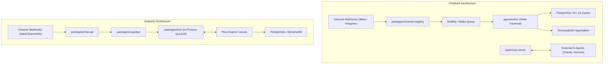
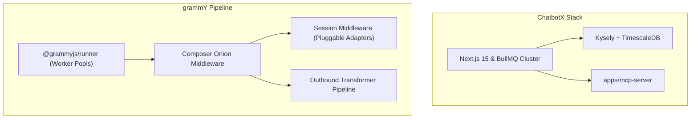
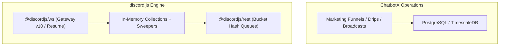
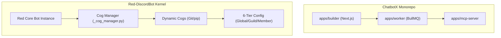
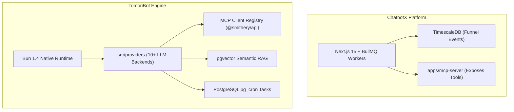

# ChatbotX — Comparative Analysis & Category Evaluation

> **Category**: Conversational AI & Bots  
> **Architectural Role**: Agentic Chat Marketing Platform & Omnichannel Conversational Automation Hub  
> **Primary Stack**: TypeScript, Node.js 24+, Turborepo, Next.js 15, Kysely ORM, PostgreSQL 16+, TimescaleDB, BullMQ, MCP Server  
> **Peer Solutions Compared**: `botpress`, `aiogram`, `grammY`, `discord.js`, `Red-DiscordBot`, `TomoriBot`  
> **Commercial SaaS Benchmarks**: ManyChat, Chatfuel, Wati, Respond.io, Drift  

---

## 1. Executive Overview & Technical Identity: ChatbotX

**ChatbotX** is an enterprise-grade, open-source agentic chat marketing and automation platform designed as a modern alternative to proprietary tools like ManyChat and Respond.io. Specifically architected for autonomous AI agents (including Claude, OpenClaw, and Hermes), ChatbotX unifies visual conversational funnels, multi-channel broadcast sequences, and agentic tool invocation via the Model Context Protocol (MCP).

### Core Architectural Profile
- **Runtime & Language**: `TypeScript 5.8+ / Node.js 24+ (Turborepo 2.11+, pnpm workspaces)`
- **Core Framework**: `Next.js 15+ (App Router), Kysely ORM, BullMQ Worker Cluster`
- **Agent Protocol**: `Dedicated Model Context Protocol Server (apps/mcp-server)`
- **Persistence Layer**: `PostgreSQL 16+ via Kysely (80+ schemas), TimescaleDB (Time-series events), Redis 7+`
- **Execution Sandbox**: `QuickJS WebAssembly (quickjs-emscripten) in apps/javascript-executor`
- **Channel Gateway**: `Meta Graph API (WhatsApp Cloud, Instagram, Messenger), Telegram, TikTok, Threads, Zalo`
- **Primary Architectural Niche**: `Agentic chat marketing, social comment-to-DM automation & MCP-driven funnels`
- **License**: `MIT`

---

## 2. Peer Solution Landscape (Conversational AI & Bots)

| Solution | Language & Runtime | Core Architecture | Database / Cache | Queue / Concurrency | Primary Architectural Niche |
| :--- | :--- | :--- | :--- | :--- | :--- |
| **ChatbotX** (Current) | `TypeScript / Node 24+` | Turborepo, Next.js 15, MCP Server | `PostgreSQL 16+, TimescaleDB, Redis 7+` | `BullMQ / Redis Cluster` | Agentic chat marketing, social comment automation & MCP funnels |
| **botpress** | `TypeScript / Node 22+` | Monorepo Studio + QuickJS VM (`llmz`) | `PostgreSQL, DynamoDB, Vector DB` | In-Process Event Loop & Sandboxing | Hybrid visual FSM & sandboxed LLM agent runtime |
| **aiogram** | `Python 3.10-3.14` | AsyncIO, uvloop, aiohttp, Pydantic v2 | `Redis (hiredis), Motor (MongoDB)` | `AsyncIO Event Loop` | High-throughput asynchronous Telegram dispatching with hierarchical routers |
| **grammY** | `TypeScript / Deno / Node` | Composer Onion Middleware, Web APIs | `Redis, PostgreSQL, Keyv, Memory` | `Runner Engine (@grammyjs/runner)` | Cross-runtime type-safe Telegram framework with transformer pipelines |
| **discord.js** | `TypeScript / Node 18-22+` | Modular Monorepo (`@discordjs/ws`, `rest`) | `In-Memory Collection Cache + Sweepers` | `REST Bucket Queues + Sharding` | Low-level object-oriented Discord WebSocket client & REST bucket manager |
| **Red-DiscordBot** | `Python 3.9-3.12+` | discord.py 2.x, Dynamic Cogs Lifecycle | `Red Config (JSON flat, Mongo, Postgres)` | `AsyncIO Task Loop + Cog Manager` | Hot-reloadable modular Discord bot platform with 6-tier scoped Config |
| **TomoriBot** | `TypeScript / Bun 1.4+` | Bun Native Runtime, discord.js 14.25 | `PostgreSQL 16+, pgvector, pg_cron` | `Bun Event Loop + Provider Streaming` | Multi-provider LLM assistant with pgvector RAG, MCP tool registry & presets |

---

## 3. Deep Head-to-Head Comparative Breakdown: ChatbotX vs Peers

### 3.1. ChatbotX vs. botpress

**Comparative Focus**: `Agentic Chat Marketing with TimescaleDB & Dedicated MCP Server` vs. `Hybrid Visual FSM + QuickJS Sandboxed Engine`

#### Runtime Topology, Event Loops & Concurrency Models
- **ChatbotX** isolates event ingestion from execution via an asynchronous message bus. Inbound webhooks immediately resolve after enqueuing jobs into Redis. The heavy lifting—flow graph traversal (`packages/flow-config`), conditional branching (`packages/decision-config`), and comment monitoring (`packages/automated-response`)—is handled across distributed BullMQ worker pools (`apps/worker`). Custom user code runs in a separate microservice (`apps/javascript-executor`).
- **botpress** processes conversation turns synchronously within the Node.js event loop of `@botpress/chat-api`. It uses in-process WebAssembly QuickJS instances (`packages/llmz`) for LLM tool calling and code execution. This provides tight latency for single conversations, but requires vertical scaling under sudden broadcast spikes.

#### Dialogue State Management & Session Persistence
- **ChatbotX** stores conversations, contacts, and custom attributes (`bot_field`) in PostgreSQL using Kysely ORM. Real-time operator dashboards connect via WebSockets (`apps/realtime`), synced via Redis Pub/Sub. Crucially, in-flight conversion events and delivery receipts are logged to TimescaleDB hypertables, enabling real-time marketing attribution without locking operational tables.
- **botpress** structures persistence across four well-defined scopes (`conversation`, `user`, `bot`, `workflow`), leveraging DynamoDB for fast distributed session caches and PostgreSQL for long-term relational history.

#### LLM Orchestration, Tool Calling & Sandbox Execution
- **ChatbotX** provides a standalone Model Context Protocol server (`apps/mcp-server`), exposing tools like `get_contact_profile`, `update_bot_variable`, and `trigger_flow` over standard RPC. Autonomous AI agents can navigate customer funnels and update CRM variables externally.
- **botpress** integrates cognitive LLM reasoning directly into its visual canvas nodes via `@botpress/llmz`, validating arguments with Zui schemas.

#### Architectural Comparison Matrix: ChatbotX vs. botpress

| Architectural Dimension | ChatbotX | botpress |
| :--- | :--- | :--- |
| **Primary Focus** | Omni-channel chat marketing & automated DM funnels | General conversational bot OS & Visual Studio |
| **Queue Architecture** | Distributed BullMQ on Redis 7+ cluster | In-process event bus with synchronous turns |
| **Analytics Engine** | TimescaleDB hypertables & continuous aggregates | Relational SQL + plugin telemetry |
| **AI Agent Interface** | Native Model Context Protocol (MCP) server | In-engine Zui schema tool dispatcher |
| **Code Sandbox** | Standalone QuickJS executor microservice | In-process WebAssembly QuickJS VM (`llmz`) |
| **Social Automation** | Native comment-to-DM triggers (IG/FB) | Webhook triggers via generic integrations |

#### Distinct Strengths & Tradeoffs
- **Where ChatbotX Excels**: Viral social marketing (Instagram comment auto-replies), broadcast sequence scheduling with time-zone pacing, TimescaleDB analytics, and first-class MCP server support.
- **Where botpress Holds an Advantage**: Advanced visual canvas ergonomics, multi-language localization, integrated slot filling, and turnkey human escalation (HITL) to Zendesk/Chatwoot.

---

### 3.2. ChatbotX vs. aiogram

**Comparative Focus**: `Agentic Chat Marketing & Multi-Channel Queue Hub` vs. `High-Concurrency Python AsyncIO Telegram Framework`

```mermaid
flowchart TD
    subgraph ChatbotXHub ["ChatbotX Multi-Channel Hub"]
        CBX_Channel["Channel Registry (Meta / TG)"] --> CBX_Redis["Redis Queue & BullMQ"]
        CBX_Redis --> CBX_Flow["Flow Engine / Decision Config"]
        CBX_Flow --> CBX_PG["PostgreSQL / TimescaleDB"]
    end

    subgraph AiogramLoop ["aiogram AsyncIO Core"]
        AIO_Updates["getUpdates / Webhook Ingress"] --> AIO_Outer["Outer Middlewares (Throttling)"]
        AIO_Outer --> AIO_Filter["MagicFilter Expressions"]
        AIO_Filter --> AIO_Router["Hierarchical Router Tree"]
        AIO_Router --> AIO_FSM["Redis FSM Storage"]
    end
```

#### Runtime Topology, Event Loops & Concurrency Models
- **ChatbotX** is a TypeScript/Node 24 microservices monorepo. It coordinates multiple channels (WhatsApp, Instagram, Telegram) through BullMQ worker queues, optimizing for business marketing workflows and delayed drip sequences.
- **aiogram** is a dedicated Python 3.10-3.14 framework built around `asyncio` and `aiohttp`. With C-accelerated `uvloop`, aiogram processes thousands of raw Telegram updates per second with microsecond latency, operating as a lean, low-overhead event processor.

#### Dialogue State Management & Session Persistence
- **ChatbotX** manages state through contact custom fields, flow checkpoints, and database-backed sequences, designed for multi-day nurture campaigns.
- **aiogram** implements a pure Finite State Machine (`aiogram.fsm`). Dialogue state is saved as atomic keys in Redis (`RedisStorage`), allowing instant state transitions (e.g., multi-step wizard forms) without heavy database ORM overhead.

#### LLM Orchestration & Tool Calling
- **ChatbotX** exposes conversational context to AI agents via its dedicated MCP server and executes user scripts inside isolated QuickJS sandboxes.
- **aiogram** has no built-in LLM runtime. Developers integrate Python AI libraries (OpenAI, LangChain, LlamaIndex) directly inside handler functions.

#### Architectural Comparison Matrix: ChatbotX vs. aiogram

| Architectural Dimension | ChatbotX | aiogram |
| :--- | :--- | :--- |
| **Language & Stack** | TypeScript / Node.js 24+ / Next.js 15 | Python 3.10-3.14 / AsyncIO / Pydantic v2 |
| **Channel Scope** | Meta (WhatsApp, IG, Messenger), TG, Socials | Dedicated Telegram Bot API |
| **State Machine** | Visual flow AST + PostgreSQL checkpoints | Code `StatesGroup` FSM + RedisStorage |
| **Agent Protocol** | Native Model Context Protocol (MCP) server | Custom Python integrations |
| **Throughput on Telegram** | Moderate (Abstracted queue pipeline) | Extreme (Pure async Python with uvloop) |
| **Workflow Authoring** | Drag-and-drop web builder (`apps/builder`) | Pure Python code with hierarchical routers |

#### Distinct Strengths & Tradeoffs
- **Where ChatbotX Excels**: Full visual UI for non-engineers, omnichannel reach across Meta and social platforms, broadcast drip sequences, and TimescaleDB funnel metrics.
- **Where aiogram Holds an Advantage**: Native Telegram Bot API fidelity, ultra-high event throughput, fine-grained control over Telegram Web Apps (Mini Apps), and seamless fit with Python AI/ML microservices.

---

### 3.3. ChatbotX vs. grammY

**Comparative Focus**: `Omnichannel Marketing Platform with BullMQ & MCP` vs. `Universal Type-Safe Edge Telegram Engine`

#### Runtime Topology, Event Loops & Concurrency Models
- **ChatbotX** runs a comprehensive enterprise suite: Next.js 15 App Router web admin, WebSocket server (`apps/realtime`), BullMQ background workers, and QuickJS sandboxes. Deployment requires multi-container orchestration.
- **grammY** is an ultra-lightweight library built on standard Web APIs. It can run as a single file, a containerized Node/Deno process, or a serverless function on Cloudflare Workers. Its `@grammyjs/runner` manages update concurrency and backpressure automatically.

#### Dialogue State Management & Outbound Pacing
- **ChatbotX** tracks subscriber custom fields and drip step timers via PostgreSQL and BullMQ delayed jobs. Rate limiting is enforced at the worker queue level to obey Meta's phone tier bounds.
- **grammY** uses an onion-layer middleware architecture with type-safe `Context Flavoring`. Outbound requests pass through a *Transformer Pipeline* (`@grammyjs/auto-retry` and `@grammyjs/ratelimiter`), ensuring compliance with Telegram's 30 msg/sec limit without external queue infrastructure.

#### Architectural Comparison Matrix: ChatbotX vs. grammY

| Architectural Dimension | ChatbotX | grammY |
| :--- | :--- | :--- |
| **Target Runtime** | Node.js 24+ (Multi-service Docker cluster) | Universal (Node, Deno, Bun, Cloudflare Workers) |
| **Target Ecosystem** | Meta Graph, Telegram, Web, TikTok | Telegram Bot API |
| **Middleware Model** | Express/Next.js route handlers + BullMQ jobs | Koa-style Onion Middleware (`Composer`) |
| **Outbound Pacing** | BullMQ job delay and rate limiters | Composable Transformer Pipeline |
| **State Persistence** | PostgreSQL (Kysely) + TimescaleDB | Pluggable Session Adapters (Redis, Postgres, Keyv) |
| **Type Safety** | Zod 4.3+ validation schemas | Context Flavoring & Filter Query Type Narrowing |

#### Distinct Strengths & Tradeoffs
- **Where ChatbotX Excels**: Full visual campaign manager, cross-channel marketing automation, social comment triggers, and MCP server endpoints for external agents.
- **Where grammY Holds an Advantage**: Extreme runtime portability, zero infrastructure overhead, compile-time type safety, and edge-native serverless execution.

---

### 3.4. ChatbotX vs. discord.js

**Comparative Focus**: `Agentic Marketing & Broadcast Funnel Hub` vs. `Low-Level Discord WebSocket Gateway & Cache Engine`

#### Runtime Topology, Event Loops & Concurrency Models
- **ChatbotX** operates as a webhook-driven asynchronous marketing engine. It interacts with messaging platforms via standard HTTPS webhooks and outbound REST APIs.
- **discord.js** is an object-oriented protocol client designed around Discord's continuous WebSocket Gateway v10. It maintains persistent TCP sockets, tracks sequence numbers, handles heartbeats, and distributes load across worker processes via `ShardingManager`.

#### State Management & Caching Strategies
- **ChatbotX** persists all lead attributes, conversation states, and delivery events to disk (PostgreSQL/TimescaleDB).
- **discord.js** stores live guild hierarchies, channel permissions, and member lists in in-memory `Collection` maps, utilizing automated `Sweepers` to prune idle entities and prevent heap exhaustion.

#### Architectural Comparison Matrix: ChatbotX vs. discord.js

| Architectural Dimension | ChatbotX | discord.js |
| :--- | :--- | :--- |
| **Primary Domain** | Marketing automation, lead capture, and drip sequences | Low-level Discord community bot engineering |
| **Network Protocol** | Asynchronous HTTPS Webhooks & REST | Bidirectional WebSocket (WSS v10) & HTTPS REST |
| **State Storage** | PostgreSQL 16+ via Kysely + TimescaleDB | In-Memory `Collection` caches with Sweepers |
| **Rate Limiting** | BullMQ batch pacing | Dynamic Bucket Hash FIFO sub-queues |
| **UI Paradigm** | Visual drag-and-drop flow builder | Code builders for Slash Commands, Modals, Buttons |

#### Distinct Strengths & Tradeoffs
- **Where ChatbotX Excels**: Omnichannel marketing funnels, automated comment-to-DM conversions, long-term drip scheduling, and native MCP agent tooling.
- **Where discord.js Holds an Advantage**: Unmatched depth for Discord community management, voice channel integration, real-time presence tracking, and complex server permission governance.

---

### 3.5. ChatbotX vs. Red-DiscordBot

**Comparative Focus**: `Enterprise Chat Marketing & MCP Server` vs. `Hot-Reloadable Discord Micro-Kernel with 6-Tier Config`

#### Runtime Topology, Event Loops & Concurrency Models
- **ChatbotX** is structured as modular TypeScript microservices governed by Turborepo. Updates require standard CI/CD deployment or container restarts.
- **Red-DiscordBot** is a Python micro-kernel operating on `discord.py` and `asyncio`. It features dynamic runtime modularity: operators can load, reload, or upgrade plugins ("Cogs") from remote Git repositories without restarting the bot process or dropping gateway connections.

#### Dialogue & Configuration State Management
- **ChatbotX** uses a relational PostgreSQL schema with workspace tenancy and custom contact fields (`bot_field`).
- **Red-DiscordBot** features the 6-tier hierarchical `Config` engine (`redbot.core.config`), providing clean async abstractions across `GLOBAL`, `GUILD`, `CHANNEL`, `ROLE`, `USER`, and `MEMBER` scopes backed by JSON flat-files, MongoDB, or PostgreSQL.

#### External Control & Headless Operations
- **ChatbotX** exposes a dedicated Model Context Protocol (MCP) server for external AI agents and WebSockets for human live chat dashboards.
- **Red-DiscordBot** embeds a headless JSON-RPC 2.0 daemon (`_rpc.py`) over TCP or Unix sockets for external management.

#### Architectural Comparison Matrix: ChatbotX vs. Red-DiscordBot

| Architectural Dimension | ChatbotX | Red-DiscordBot |
| :--- | :--- | :--- |
| **Language & Stack** | TypeScript / Node.js 24+ / Next.js 15 | Python 3.9-3.12+ / discord.py 2.x |
| **Plugin Model** | Static Turborepo packages & microservices | Dynamic runtime hot-reloadable Cogs via Git |
| **Configuration Engine** | Relational Kysely schema + Redis | 6-Tier Scoped Config (JSON, Mongo, Postgres) |
| **AI Integration** | Native MCP server for autonomous agents | Community AI cogs |
| **Target Platforms** | Meta (WhatsApp/IG), Telegram, Web, Socials | Dedicated Discord Communities |
| **License** | MIT | GNU GPLv3 |

#### Distinct Strengths & Tradeoffs
- **Where ChatbotX Excels**: Automated lead funnels, social media comment capture, cross-channel messaging, and standardized MCP tools for AI agents.
- **Where Red-DiscordBot Holds an Advantage**: Runtime hot-reloading without downtime, rich out-of-the-box community moderation, virtual economy (`bank`), and audio streaming cogs.

---

### 3.6. ChatbotX vs. TomoriBot

**Comparative Focus**: `Agentic Marketing Automation & TimescaleDB Hub` vs. `Bun-Native Multi-Provider AI Assistant with pgvector`

#### Runtime Topology, Event Loops & Concurrency Models
- **ChatbotX** executes on Node.js 24 across Next.js and BullMQ worker processes. It is designed to orchestrate complex marketing workflows, webhook retries, and high-volume broadcast pacing across Meta channels.
- **TomoriBot** executes on Bun 1.4+, taking advantage of Bun's ultra-fast startup and native I/O to deliver streaming LLM responses to Discord with minimal latency.

#### AI Protocols: MCP Server vs. MCP Client
- **ChatbotX acts as an MCP Server (`apps/mcp-server`)**: It exposes tools to external AI agents so they can introspect marketing leads and trigger funnels.
- **TomoriBot acts as an MCP Client (`src/tools/toolInitializer.ts`)**: It connects to local and remote MCP servers (discovered via `@smithery/api`), making external tools available to its internal conversational reasoning loop.

#### Memory & Persistence Architectures
- **ChatbotX** emphasizes time-series marketing analytics via TimescaleDB and structured contact schemas via Kysely.
- **TomoriBot** emphasizes deep semantic memory via `pgvector` (`schema_rag.sql`), indexing chat history and documents for contextual retrieval, alongside SillyTavern character presets (`schema_stpreset.sql`).

#### Architectural Comparison Matrix: ChatbotX vs. TomoriBot

| Architectural Dimension | ChatbotX | TomoriBot |
| :--- | :--- | :--- |
| **JavaScript Runtime** | Node.js 24+ | Bun 1.4+ |
| **MCP Role** | **MCP Server** (Exposes bot tools to external agents) | **MCP Client** (Consumes tools for internal LLM) |
| **LLM Gateway** | External agents connect to ChatbotX | Integrated Multi-Provider (Claude, Gemini, DeepSeek) |
| **Database Specialization** | TimescaleDB (Time-series event analytics) | PostgreSQL `pgvector` (Semantic episodic RAG) |
| **Background Scheduling** | BullMQ Redis delayed queues | In-database PostgreSQL `pg_cron` jobs |
| **Primary Platform** | Meta (WhatsApp/IG), Telegram, Web Chat | Discord Communities & Matrix Appservice Bridge |

#### Distinct Strengths & Tradeoffs
- **Where ChatbotX Excels**: Full visual funnel designer, multi-channel broadcast marketing, social comment capture, and TimescaleDB conversion tracking.
- **Where TomoriBot Holds an Advantage**: Bun-native performance, multi-provider model resilience with automatic failover, episodic memory with pgvector, and rich persona modeling.

---

## 4. Capability & Feature Comparison Matrix

| Dimension / Capability | ChatbotX | botpress | aiogram | grammY | discord.js | Red-DiscordBot | TomoriBot |
| :--- | :---: | :---: | :---: | :---: | :---: | :---: | :---: |
| **Visual Flow Canvas** | ✅ Visual Builder | ✅ Advanced | ❌ | ❌ | ❌ | ❌ | ❌ |
| **Native MCP Server / Client** | ✅ Native Server | ⚠️ Zui Tools | ❌ | ❌ | ❌ | ❌ | ✅ Native Client |
| **Time-Series Analytics** | ✅ TimescaleDB | ⚠️ Plugin | ❌ | ❌ | ❌ | ❌ | ❌ |
| **Sandboxed Code Execution** | ✅ QuickJS Service | ✅ QuickJS Wasm | ❌ | ❌ | ❌ | ❌ | ❌ |
| **Social Comment Automation** | ✅ Native IG/FB | ❌ | ❌ | ❌ | ❌ | ❌ | ❌ |
| **Vector RAG Ingestion** | ✅ Native Core | ✅ Native Plugin | ❌ | ❌ | ❌ | ⚠️ Community Cog | ✅ Native pgvector |
| **Telegram Protocol Support** | ✅ Via Registry | ⚠️ Channel Plugin | ✅ Native Master | ✅ Native Master | ❌ | ❌ | ❌ |
| **Discord Gateway Support** | ❌ | ⚠️ Channel Plugin | ❌ | ❌ | ✅ Native Master | ✅ Native Master | ✅ Native Master |
| **Meta Channels (WhatsApp/IG)**| ✅ Native Core | ✅ Integrations | ❌ | ❌ | ❌ | ❌ | ❌ |
| **Hot-Reloading Architecture** | ❌ | ❌ | ❌ | ❌ | ❌ | ✅ Native Cogs | ❌ |

---

## 5. Commercial Benchmark Positioning

When benchmarked against commercial SaaS leaders (**ManyChat, Chatfuel, Wati, Respond.io, Drift**):
- **Cost & Contact Licensing**: `ChatbotX` replaces predatory per-contact pricing tiers with an open, self-hosted MIT architecture backed by PostgreSQL and TimescaleDB.
- **Agentic Standard**: While proprietary tools rely on closed, brittle webhook integrations, ChatbotX implements native Model Context Protocol (MCP) server endpoints, positioning it for next-generation AI agent workflows.
- **Multi-Channel Ownership**: Provides full data sovereignty across WhatsApp Cloud API, Instagram DMs, and Telegram without intermediate SaaS proxy risks.

---

## 6. Strategic Takeaways & Role for MarketingStudio

In the unified **MarketingStudio** architecture:
1. **Primary Component to Adopt**: Adopt ChatbotX's social comment-to-DM capture engine and `apps/mcp-server` pattern to expose MarketingStudio's CRM variables and funnels to autonomous AI SDR agents.
2. **Analytics Blueprint**: Adopt ChatbotX's TimescaleDB hypertable schema for tracking high-velocity chat events, delivery receipts, and conversion milestones.
3. **Peer Coexistence**: Rely on `ChatbotX` for outbound marketing sequences and social lead capture, while integrating `botpress` for complex customer support trees and `grammY` for high-throughput Telegram community dispatching.
