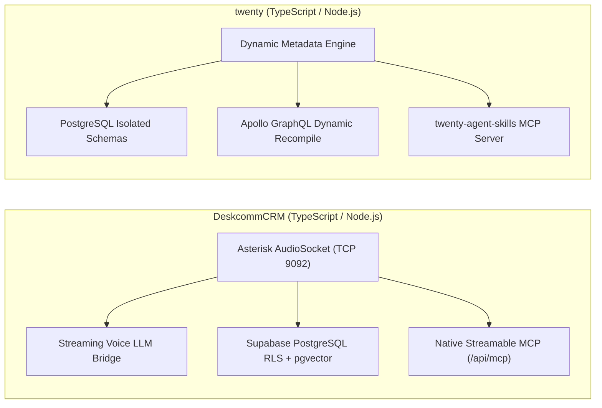
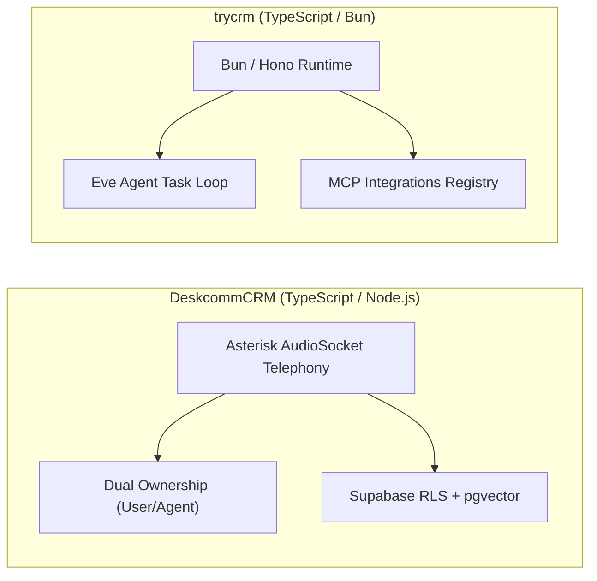
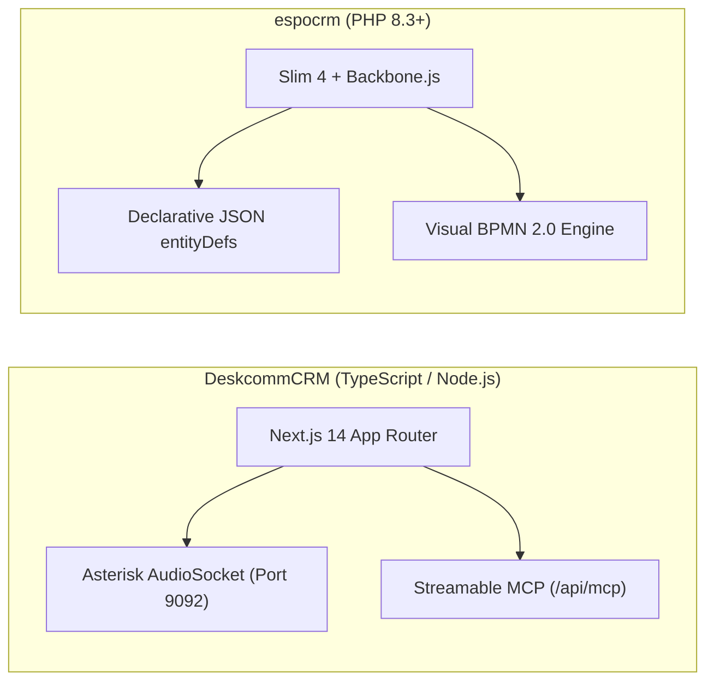
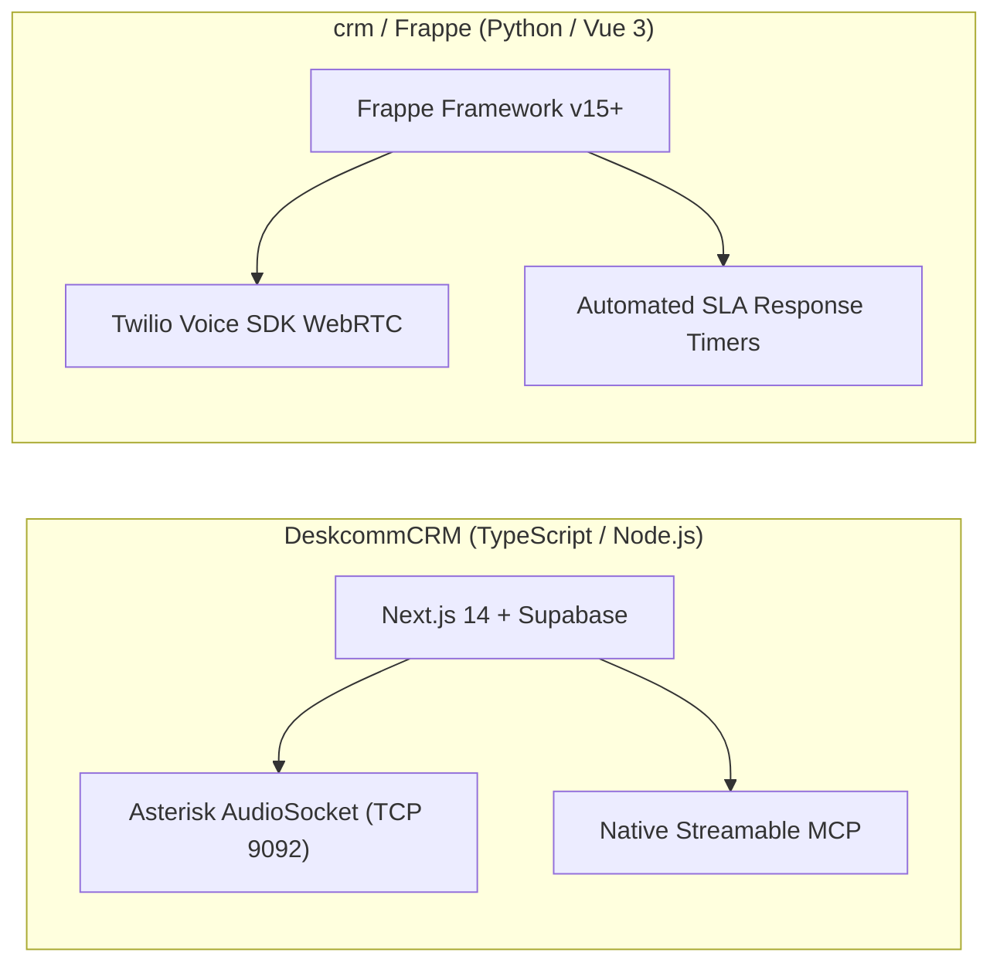
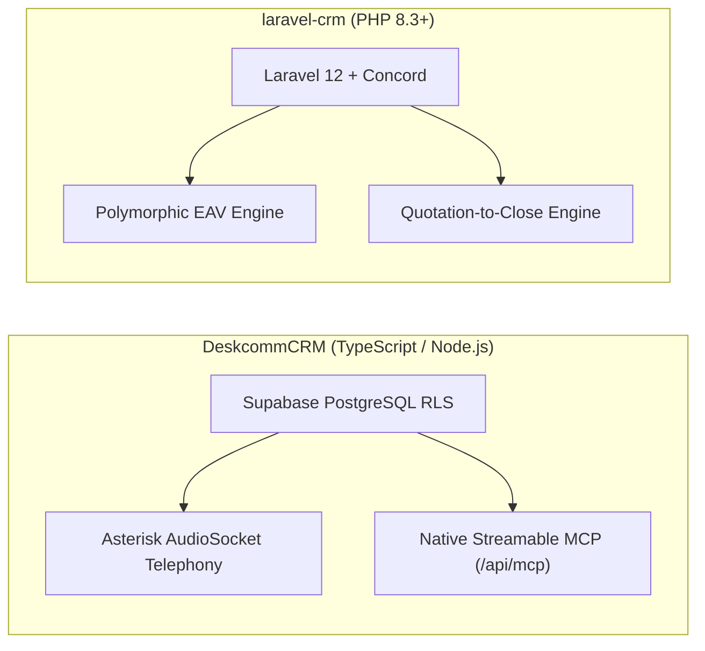
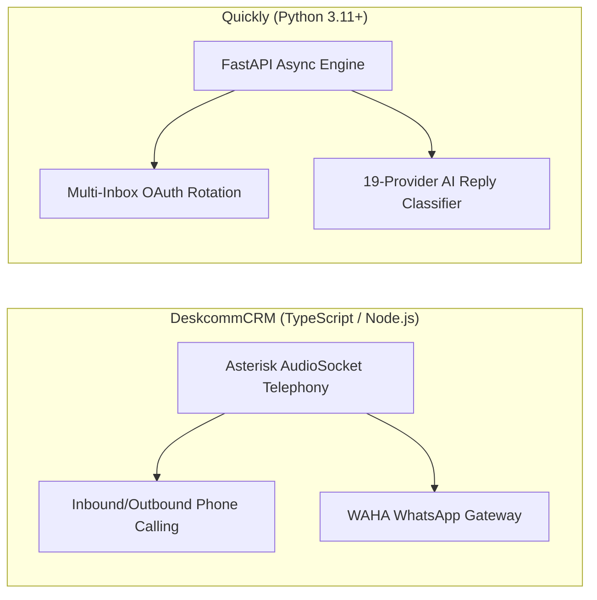
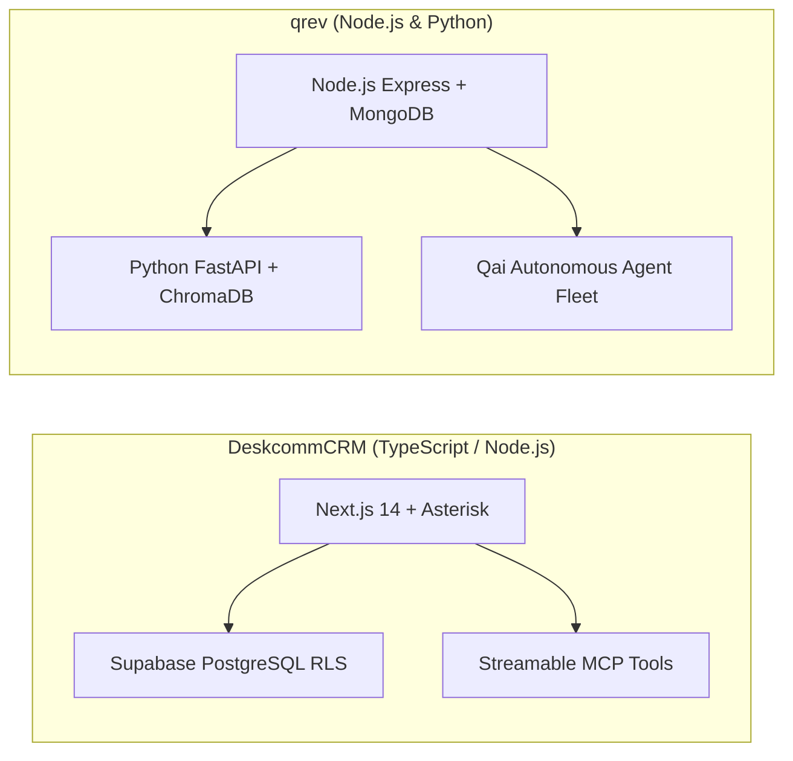
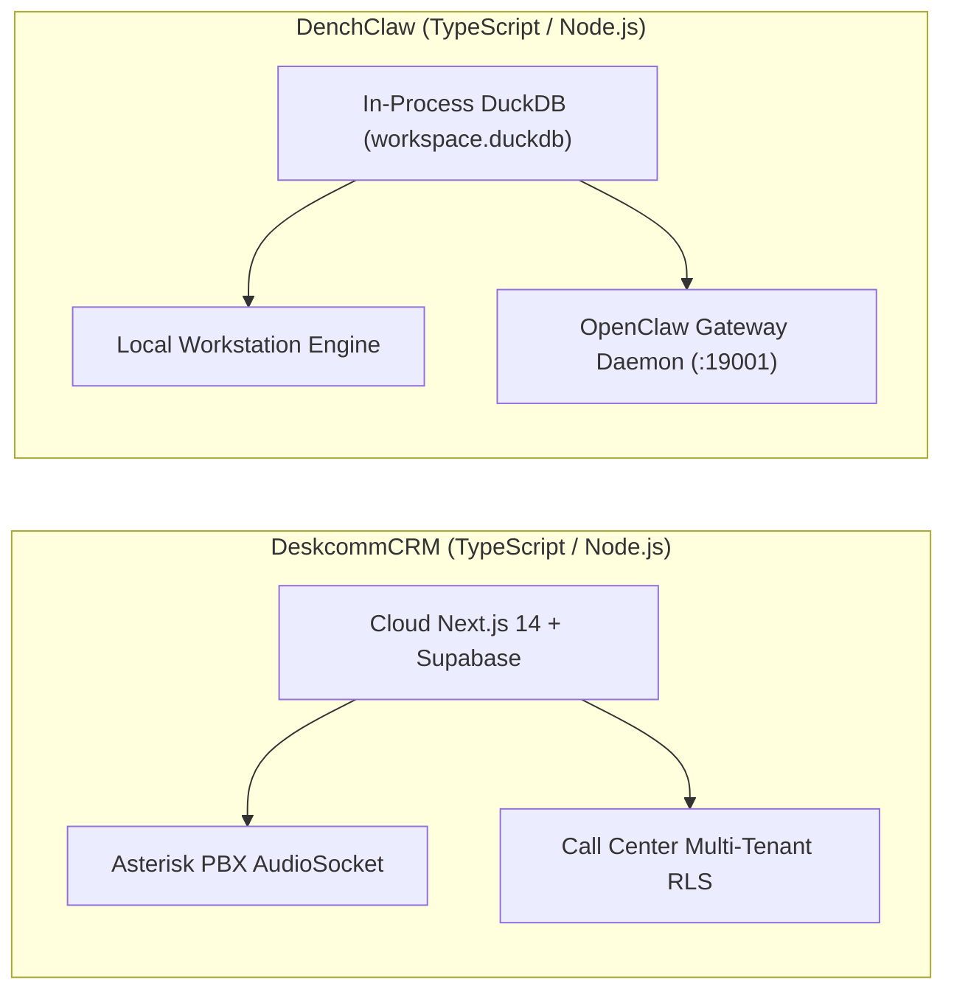
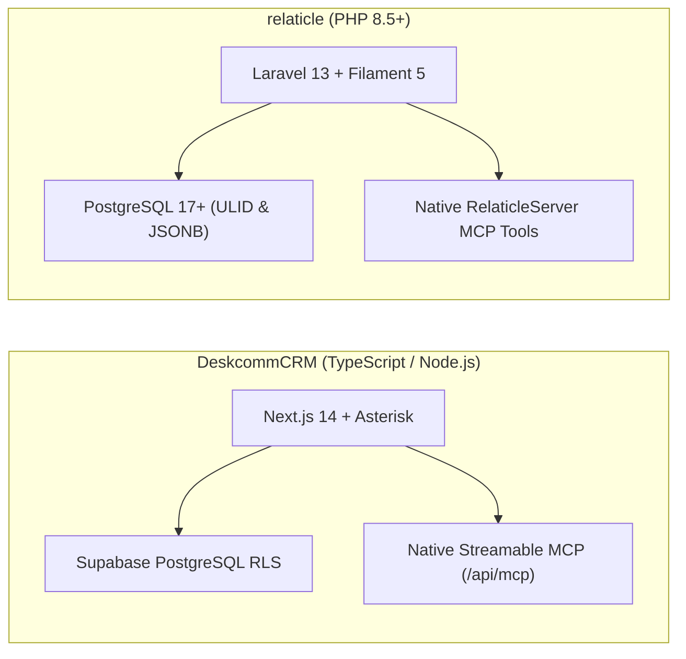

# DeskcommCRM — Comparative Analysis & Category Evaluation

> **Category**: CRM & Contact Management  
> **Architectural Role**: Autonomous sales operating system with native AI agents & Asterisk AudioSocket telephony  
> **Primary Stack**: TypeScript 5.5+ / Node.js 22+ | Next.js 14 (App Router) | Supabase (PostgreSQL 16 + pgvector) | Asterisk PBX 20+ (AudioSocket TCP 9092) & Caddy 2  
> **Peer Solutions Compared**: `twenty`, `trycrm`, `espocrm`, `crm`, `laravel-crm`, `Quickly`, `qrev`, `DenchClaw`, `relaticle`  
> **Commercial SaaS Benchmarks**: Salesforce, HubSpot CRM, Attio, Pipedrive, Close.com  

---

## 1. Executive Overview & Technical Identity: DeskcommCRM

**DeskcommCRM** is an open-source, AI-native sales operating system and customer relationship management engine engineered in TypeScript, Next.js 14, and Supabase (`melgarafael/DeskcommCRM`). Designed for high-velocity outbound dialers, inbound call centers, and automated WhatsApp sales channels, DeskcommCRM treats **AI agents as first-class team members** alongside human sales representatives.

The system's core architectural breakthrough is its direct integration with **Asterisk PBX 20+ via AudioSocket over raw TCP (port 9092)** (`workers/voice-agent`). By bypassing traditional, lossy WebRTC browser bridges, DeskcommCRM captures raw binary PCM audio bidirectionally and pipes it into streaming speech-to-text and LLM inference pipelines with sub-second latency. Concurrently, it exposes an official Model Context Protocol server at `/api/mcp` with native AI-to-human escalation tooling (`handoff.ts`) and enforces kernel-level PostgreSQL Row-Level Security (RLS) with deterministic `pgcrypto` column encryption.

### Core Architectural Profile
- **Runtime & Language**: `TypeScript 5.5+ / Node.js 22+` (ESM native, strict mode)
- **Application Framework**: `Next.js 14+` (App Router, Server Actions, Route Handlers, React Server Components)
- **Telephony & VoIP Engine**: `Asterisk PBX 20+` with Asterisk REST Interface (ARI) and raw binary TCP `AudioSocket` on port 9092
- **Persistence & Vector Layer**: `PostgreSQL 16+ via Supabase` with `pgvector` (1536-dimensional embeddings), `pgcrypto` deterministic encryption, and strict Row-Level Security (RLS)
- **Agent Protocols & AI Runtime**: Official Model Context Protocol (MCP) server at `/api/mcp` (`@modelcontextprotocol/sdk`), Vercel AI SDK, Zod schema validation
- **Messaging & Channels**: WAHA Plus (WhatsApp HTTP API), Meta Cloud API webhooks
- **Edge Reverse Proxy**: Caddy 2 with automated Let's Encrypt TLS termination
- **Domain Specialization**: AI-native sales operating system with sub-second telephony streaming, dual human/agent ownership pipelines, and native MCP tools

---

## 2. Peer Solution Landscape (CRM & Contact Management)

| Solution | Language & Runtime | Core Framework | Database / Persistence | Queue & Concurrency | Primary Architectural Niche |
| :--- | :--- | :--- | :--- | :--- | :--- |
| **DeskcommCRM** (Current) | `TypeScript / Node.js`| `Next.js 14, Supabase` | `PostgreSQL 16, pgvector` | `AudioSocket TCP / Workers`| **Asterisk AudioSocket binary TCP telephony & streamable MCP** |
| **twenty** | `TypeScript / Node.js` | `NestJS, React, Vite` | `PostgreSQL 15+, TypeORM` | `BullMQ / Redis` | Dynamic runtime schemas & in-memory GraphQL compilation |
| **trycrm** | `TypeScript / Bun` | `Bun, Hono, Next.js` | `PostgreSQL, Prisma` | `Bun Async Loop / Eve` | Agentic-first CRM with native MCP tool registry & Eve runtime |
| **espocrm** | `PHP 8.3+` | `Slim 4, Backbone.js` | `MySQL 8.0+ / MariaDB` | `Multi-Process daemon.php` | Visual BPMN 2.0 flow execution engine & JSON entityDefs |
| **crm** (Frappe) | `Python 3.10+, JS` | `Frappe, Vue 3.5` | `MariaDB 10.6+, Redis` | `Redis Queue (RQ) / Celery` | Declarative DocType metadata, built-in SLAs & Twilio WebRTC |
| **laravel-crm** (Krayin) | `PHP 8.3+` | `Laravel 12.0, Vue.js` | `MySQL 8.0, Eloquent` | `Laravel Queue / Reverb` | Modular composer packages via Concord & polymorphic typed EAV |
| **Quickly** | `Python 3.11+` | `FastAPI, Next.js 14` | `PostgreSQL, SQLAlchemy` | `Asyncio Slot Reservation` | High-velocity multi-inbox rotation, jitter scheduler & MCP |
| **qrev** | `Node.js & Python` | `Express & FastAPI` | `MongoDB & ChromaDB` | `Node-cron & FastTasks` | Dual-runtime Qai superagent orchestrator & LangChain RAG |
| **DenchClaw** | `TypeScript / Node.js`| `Next.js 15, DuckDB` | `In-Process DuckDB` | `In-Process SQL / OpenClaw`| Embedded columnar SQL, OpenClaw AI Gateway & Composio MCP |
| **relaticle** | `PHP 8.5+` | `Laravel 13, Filament 5`| `PostgreSQL 17+ (ULID)` | `Laravel Horizon / Redis` | Native `RelaticleServer` MCP tools, per-field encryption & ULIDs |

---

## 3. Deep Head-to-Head Comparative Breakdown: DeskcommCRM vs Peers

### 3.1. DeskcommCRM vs. twenty

#### Telephony Architecture vs. Custom Schema Engine
- **DeskcommCRM**: Purpose-engineered for telephony environments. Bypasses browser WebRTC bridges in favor of direct Asterisk PBX **AudioSocket** connections over pure TCP (port 9092). Captures raw binary PCM audio bidirectionally and pipes it into streaming speech-to-text and LLM inference pipelines with sub-second latency.
- **twenty**: Focuses on runtime schema customization. Maintains an internal metadata engine that executes transactional DDL queries (`CREATE TABLE`, `ALTER TABLE`) inside dedicated PostgreSQL schemas (`workspace_<id>`), dynamically recompiling Apollo GraphQL schemas in memory. Telephony is delegated to external integrations.

#### Multi-Tenancy & Data Security
- **DeskcommCRM**: Enforces multi-tenancy at the database kernel level using PostgreSQL **Row-Level Security (RLS)** policies scoped to `organization_id`. Encrypts sensitive customer data (CPF/CNPJ) deterministically using `pgcrypto` and indexes knowledge embeddings using `pgvector`.
- **twenty**: Enforces multi-tenancy by provisioning dedicated PostgreSQL schemas per workspace (`workspace_<workspace_id>`).

#### AI Agent Ergonomics
- **DeskcommCRM**: Official Model Context Protocol (MCP) server at `/api/mcp` with built-in **AI-to-Human Handoff** tool (`handoff.ts`), allowing agents to qualify prospects and cleanly escalate to human reps (`force_human: true`).
- **twenty**: Auto-generates MCP tools reflecting whatever custom business entities have been declared in the workspace.

#### Architectural Tradeoffs Matrix: DeskcommCRM vs. twenty

| Dimension | DeskcommCRM | twenty | Architectural Evaluation |
| :--- | :--- | :--- | :--- |
| **Voice & Telephony** | Direct Asterisk AudioSocket binary TCP | Third-party webhook logging | **DeskcommCRM** is engineered for sub-second AI voice dialers |
| **Schema Flexibility** | Static Supabase / Prisma schema | Dynamic PostgreSQL schemas + DDL | **twenty** provides superior custom business modeling |
| **Tenant Isolation** | PostgreSQL Row-Level Security (RLS) | Dedicated PostgreSQL schemas | Both achieve enterprise isolation via different mechanisms |
| **Agent Handoff** | Native tool-level escalation (`handoff.ts`)| Manual task creation | **DeskcommCRM** has built-in agent-to-human workflows |

---

### 3.2. DeskcommCRM vs. trycrm

#### Communication Modality: Voice/Phone vs. Text/Research
- **DeskcommCRM**: Specializes in synchronized voice calls and WhatsApp messaging. Connects directly to PSTN SIP trunks and WAHA Plus, routing live caller audio directly into conversational LLMs.
- **trycrm**: Specializes in autonomous asynchronous text research and outreach. Coordinates web scrapers, LinkedIn MCP tools, and email drafts, logging agent thoughts into structured audit ledgers.

#### Concurrency & Runtime
- **DeskcommCRM**: Node.js 22+ with standalone daemon workers (`workers/voice-agent`, `workers/agent-worker`) handling continuous TCP audio streaming and background triage.
- **trycrm**: Bun 1.1+ runtime with Hono API microservices, executing lightweight agent loops via the Eve framework.

#### Architectural Tradeoffs Matrix: DeskcommCRM vs. trycrm

| Dimension | DeskcommCRM | trycrm | Architectural Evaluation |
| :--- | :--- | :--- | :--- |
| **Primary Channel** | Real-time voice telephony + WhatsApp | Asynchronous email, Slack & web search | Complementary channels for sales GTM |
| **Telephony Engine** | Native Asterisk AudioSocket binary stream| External MCP tool required | **DeskcommCRM** is built for call center operations |
| **Agent Auditing** | Call audio recording & transcript logs | Detailed `AgentAuditEvent` ledgers | **trycrm** provides deeper step-by-step agent tracking |
| **Database Engine** | Supabase Postgres with RLS & pgvector | Standard Postgres with Prisma | **DeskcommCRM** provides built-in RAG vector search |

---

### 3.3. DeskcommCRM vs. espocrm

#### Telephony Architecture: Binary AudioSocket vs. Webhooks
- **DeskcommCRM**: Native AudioSocket streaming over pure TCP (port 9092), capturing live caller audio for speech recognition and streaming voice generation.
- **espocrm**: Relies on asynchronous CDR webhooks or Asterisk AMI polling to match incoming caller IDs and log call durations.

#### Workflow Automation & Process Modeling
- **DeskcommCRM**: Event-driven background workers for lead triage and AI handoff. Lacks visual flowchart modeling.
- **espocrm**: Enterprise-grade **BPMN 2.0 visual flow editor** (`application/Espo/Core/BPM/`) supporting complex conditional gateways, approval loops, timed delays, and automated service execution.

#### Schema Customizability
- **DeskcommCRM**: Static database schema managed via Supabase migrations.
- **espocrm**: Dynamic Entity Manager allowing administrators to declare custom entities and fields via JSON metadata files (`entityDefs`), executing alter tables on MySQL automatically.

#### Architectural Tradeoffs Matrix: DeskcommCRM vs. espocrm

| Dimension | DeskcommCRM | espocrm | Architectural Evaluation |
| :--- | :--- | :--- | :--- |
| **VoIP & AI Voice** | Direct Asterisk AudioSocket binary TCP | Basic CDR webhook logging | **DeskcommCRM** is vastly superior for voice calling |
| **Workflow Capabilities** | Basic background worker triage | Enterprise visual BPMN 2.0 engine | **espocrm** handles complex multi-step approvals |
| **Custom Schemas** | Static Supabase migrations | Visual Entity Manager (JSON) | **espocrm** allows non-developers to extend schemas |
| **AI Protocol** | Native Streamable MCP server | Traditional REST API | **DeskcommCRM** connects natively with AI agents |

---

### 3.4. DeskcommCRM vs. crm (Frappe CRM)

#### Telephony Stack: Direct PBX AudioSocket vs. Twilio WebRTC
- **DeskcommCRM**: Self-hosted Asterisk PBX connection using **AudioSocket** over raw TCP. Discards lossy WebRTC bridges, allowing caller audio to feed directly into streaming LLMs with minimal latency.
- **crm (Frappe CRM)**: Embedded browser softphone using `@twilio/voice-sdk` and Exotel over WebRTC. Initiated directly from contact cards by human reps, saving audio recordings into private file attachments.

#### SLA Tracking & Omnichannel Timeline
- **DeskcommCRM**: Focuses on phone calls and WhatsApp, with deterministic customer identity resolution via E.164 phone normalization and CPF hashing.
- **crm (Frappe CRM)**: Features a unified omnichannel timeline (`activities.py`) covering emails, WhatsApp, phone calls, and collaborative TipTap notes, governed by an automated **SLA Supervisor** tracking response targets.

#### Architectural Tradeoffs Matrix: DeskcommCRM vs. crm (Frappe)

| Dimension | DeskcommCRM | crm (Frappe CRM) | Architectural Evaluation |
| :--- | :--- | :--- | :--- |
| **Telephony Latency** | Direct AudioSocket TCP (sub-second) | Twilio Voice SDK WebRTC | **DeskcommCRM** is optimized for conversational AI voice |
| **Telephony Infrastructure** | Self-hosted Asterisk PBX cluster | Managed Twilio / Exotel cloud | **crm** requires less telecom server administration |
| **Lead SLA Tracking** | Background triage worker | Active minute-level SLA timers | **crm** actively prevents lead response breaches |
| **AI Protocol** | Native Streamable MCP server | Whitelisted Python RPC endpoints | **DeskcommCRM** connects natively with AI agents |

---

### 3.5. DeskcommCRM vs. laravel-crm (Krayin CRM)

#### Core Capabilities
- **DeskcommCRM**: Outbound call center and WhatsApp operating system with AI agent ownership and MCP tool execution.
- **laravel-crm**: Modular Laravel CRM with native product inventory catalogs, tax calculations, and automated PDF quotation generation.

#### Data Modeling & Custom Fields
- **DeskcommCRM**: Static relational schema with PostgreSQL Row-Level Security (RLS) and pgvector embeddings.
- **laravel-crm**: Polymorphic typed-column EAV (`attribute_values`), allowing administrators to add dynamic custom attributes without DDL migrations.

#### Architectural Tradeoffs Matrix: DeskcommCRM vs. laravel-crm

| Dimension | DeskcommCRM | laravel-crm | Architectural Evaluation |
| :--- | :--- | :--- | :--- |
| **Telephony Support** | Native Asterisk AudioSocket binary TCP | Not supported natively | **DeskcommCRM** is built for call center operations |
| **Quotation Engine** | Deals and stages only | Built-in PDF quotation generator | **laravel-crm** handles formal proposals & billing |
| **AI Protocol** | Native Streamable MCP server | Traditional REST endpoints | **DeskcommCRM** connects natively with AI agents |
| **Tenant Isolation** | Database-level Row-Level Security (RLS) | Application-level sales channels | **DeskcommCRM** provides stronger tenant isolation |

---

### 3.6. DeskcommCRM vs. Quickly

#### Outreach Channels: Voice/WhatsApp vs. Cold Email
- **DeskcommCRM**: Focuses on synchronous phone calls and conversational WhatsApp messaging.
- **Quickly**: Focuses on asynchronous cold email outreach. Dispatches automated multi-step sequences across Google Workspace and Microsoft 365 OAuth inboxes with automated sender rotation and jitter.

#### Agent Integration & Protocol
- **DeskcommCRM**: Exposes an official streamable MCP server at `/api/mcp` for voice call updates, customer lookups, and human escalation.
- **Quickly**: Exposes a streamable MCP server at `/api/mcp` for campaign enrollment, sequence pausing, and lead tagging, plus custom n8n nodes.

#### Architectural Tradeoffs Matrix: DeskcommCRM vs. Quickly

| Dimension | DeskcommCRM | Quickly | Architectural Evaluation |
| :--- | :--- | :--- | :--- |
| **Primary Channel** | Voice calls & WhatsApp | Cold outbound email sequences | Complementary communication channels |
| **Deliverability Engine** | Telecom SIP trunk registration | Multi-inbox OAuth rotation with jitter | **Quickly** safeguards sender domain reputation |
| **AI Reply Analysis** | Real-time speech-to-text & LLM voice | 19-provider LLM intent classifier | Both deploy AI for channel-specific triage |
| **Telephony** | Native Asterisk AudioSocket TCP stream | None | **DeskcommCRM** handles voice calling |

---

### 3.7. DeskcommCRM vs. qrev

#### Communication Channel vs. Autonomous Research
- **DeskcommCRM**: Synchronous telecom and messaging engine. Connects live phone callers to AI voice agents.
- **qrev**: Asynchronous research and prospecting platform. Deploys background Playwright scrapers to crawl target company domains and generate personalized multi-touch email copy via RAG.

#### Persistence Layer
- **DeskcommCRM**: PostgreSQL 16 on Supabase with `pgvector` for semantic search and `pgcrypto` for sensitive field encryption.
- **qrev**: MongoDB for core document storage and ChromaDB for vector retrieval.

#### Architectural Tradeoffs Matrix: DeskcommCRM vs. qrev

| Dimension | DeskcommCRM | qrev | Architectural Evaluation |
| :--- | :--- | :--- | :--- |
| **Telephony & Voice** | Native Asterisk AudioSocket binary TCP | Zoom API recording sync only | **DeskcommCRM** supports live conversational voice |
| **Autonomous Scraping**| Inbound webhook ingestion | Playwright web crawling & enrichment | **qrev** actively gathers prospect intelligence |
| **Data Security** | Deterministic `pgcrypto` encryption | Unencrypted MongoDB documents | **DeskcommCRM** provides superior customer data security |
| **AI Protocol** | Official Streamable MCP server | LangChain tool execution engine | **DeskcommCRM** adheres to standard MCP protocols |

---

### 3.8. DeskcommCRM vs. DenchClaw

#### Deployment & Execution Context
- **DeskcommCRM**: Cloud-hosted call center platform designed for multi-tenant teams, integrating with enterprise SIP trunks and remote sales reps.
- **DenchClaw**: Local-first sovereign workspace engine designed to run directly on an individual operator's workstation with embedded DuckDB storage.

#### Analytical Query Speed: PostgreSQL vs. Columnar DuckDB
- **DeskcommCRM**: Relies on PostgreSQL indexing and network queries. Suitable for transactional call logging and pipeline updates.
- **DenchClaw**: Operates in-process on DuckDB. Complex analytical filtering, contact deduplication, and relationship scoring execute in sub-millisecond timeframes.

#### Architectural Tradeoffs Matrix: DeskcommCRM vs. DenchClaw

| Dimension | DeskcommCRM | DenchClaw | Architectural Evaluation |
| :--- | :--- | :--- | :--- |
| **Telephony Integration** | Native Asterisk AudioSocket binary TCP | None (delegates to external SaaS) | **DeskcommCRM** handles live telephone calls |
| **Data Sovereignty** | Stored on managed cloud Supabase | 100% sovereign local DuckDB file | **DenchClaw** guarantees total local custody |
| **Analytical Query Speed** | Postgres network queries (5-20ms) | In-process vectorized DuckDB (<1ms) | **DenchClaw** is dramatically faster for analytics |
| **Multi-Tenant Security** | PostgreSQL Row-Level Security (RLS) | Single-user local workspace file | **DeskcommCRM** supports distributed teams |

---

### 3.9. DeskcommCRM vs. relaticle

#### Specialization: Telephony Operating System vs. General-Purpose CRM
- **DeskcommCRM**: Engineered around call center dialing, Asterisk AudioSocket binary audio streaming, and WAHA WhatsApp messaging.
- **relaticle**: Engineered as a general-purpose developer-first CRM with deep email participant extraction, meeting summarization (`AISummaryJob`), and an administrative console powered by Filament 5 and Livewire 4.

#### Security & Custom Field Storage
- **DeskcommCRM**: Static relational tables enforcing PostgreSQL Row-Level Security (RLS) scoped to `organization_id`, with `pgcrypto` column encryption on sensitive identifiers (CPF/CNPJ).
- **relaticle**: Extensible dynamic custom fields stored in PostgreSQL 17+ with native JSONB and per-field AES application encryption (`CustomFieldValue`), indexed via chronological ULIDs.

#### Model Context Protocol (MCP) Comparison
- Both platforms feature native Model Context Protocol (MCP) servers. DeskcommCRM provides `/api/mcp` with voice and lead handoff tools, while relaticle provides `RelaticleServer` with schema introspection, company deduplication, and pipeline aggregation tools.

#### Architectural Tradeoffs Matrix: DeskcommCRM vs. relaticle

| Dimension | DeskcommCRM | relaticle | Architectural Evaluation |
| :--- | :--- | :--- | :--- |
| **Telephony Engine** | Native Asterisk AudioSocket binary TCP | Activity timeline logging only | **DeskcommCRM** supports sub-second AI voice calling |
| **Admin UI Framework** | TailwindCSS + Radix UI Primitives | Filament 5 + Livewire 4 | **relaticle** provides a richer reactive admin console |
| **Custom Field Engine** | Static Supabase schema | Encrypted JSONB dynamic custom fields | **relaticle** provides zero-DDL field customization |
| **Data Identifiers** | Standard UUID v4 | Chronological ULIDs | **relaticle** optimizes B-tree database index locality |

---

## 4. Capability & Feature Comparison Matrix

| Dimension / Capability | DeskcommCRM | twenty | trycrm | espocrm | crm (Frappe) | laravel-crm | Quickly | qrev | DenchClaw | relaticle |
| :--- | :---: | :---: | :---: | :---: | :---: | :---: | :---: | :---: | :---: | :---: |
| **Embedded Softphone / CTI** | ✅ AudioSocket | ❌ | ❌ | ⚠️ Plugin | ✅ Twilio SDK | ❌ | ❌ | ❌ | ❌ | ❌ |
| **Native MCP / AI Skills** | ✅ Streamable | ✅ Full SDK | ✅ Native Core | ❌ REST only | ❌ RPC only | ❌ REST only | ✅ Streamable | ⚠️ LangChain | ✅ Composio MCP | ✅ RelaticleServer |
| **AI-to-Human Handoff** | ✅ Native Tool | ⚠️ Custom flow | ⚠️ Custom flow | ❌ | ❌ | ❌ | ❌ | ❌ | ❌ | ⚠️ Task flow |
| **Dynamic Custom Objects** | ❌ Static | ✅ Full DDL | ⚠️ JSON facts | ✅ JSON Meta | ✅ DocType | ⚠️ EAV | ❌ Static | ⚠️ Mongo | ✅ DuckDB EAV | ✅ Encrypted EAV |
| **Vector RAG Embeddings** | ✅ pgvector | ❌ | ❌ | ❌ | ❌ | ❌ | ❌ | ✅ ChromaDB | ❌ | ❌ |
| **Multi-Tenant Schemas** | ✅ Postgres RLS| ✅ Schema/Tenant| ⚠️ Org ID | ⚠️ Role ACL | ✅ Frappe Sites| ⚠️ Channels | ⚠️ Single-team | ⚠️ Org ID | ✅ Local File | ✅ Workspace Model |
| **Resource Footprint** | ~200 MB RAM | ~500 MB RAM | ~150 MB RAM | ~120 MB RAM | ~400 MB RAM | ~100 MB RAM | **~60 MB RAM** | ~250 MB RAM | ~100 MB RAM | ~120 MB RAM |

---

## 5. Commercial Benchmark Positioning

When benchmarked against commercial SaaS leaders (**Salesforce, HubSpot CRM, Attio, Pipedrive, Close.com**):
- **Against Close.com**: DeskcommCRM matches Close's core focus on outbound calling, power dialing, and automatic call recording in the activity timeline, but advances beyond Close by connecting calls directly to streaming LLM voice agents over raw binary TCP.
- **Against Salesforce**: DeskcommCRM provides telephony-first responsiveness without exorbitant multi-tier licensing fees or complex CTI middleware setup.
- **Against HubSpot CRM**: DeskcommCRM eliminates contact-tier pricing escalations and supports native WhatsApp integration alongside VoIP phone dialing.
- **Data Sovereignty**: Self-hosted on private Asterisk and Supabase infrastructure, ensuring customer call recordings and conversational transcripts remain 100% confidential.

---

## 6. Strategic Takeaways & Role for MarketingStudio

In the unified **MarketingStudio** architecture:
1. **Primary Component to Adopt**: Harness DeskcommCRM's **Asterisk AudioSocket Telephony Bridge** (`workers/voice-agent`), streaming binary PCM audio over TCP port 9092 directly into conversational LLMs for real-time AI voice agents.
2. **AI-to-Human Handoff Pattern**: Standardize on DeskcommCRM's `handoff.ts` tool pattern, enabling AI agents to qualify prospects and smoothly transfer live calls and records to human sales reps with complete conversation summaries.
3. **Database RLS & pgcrypto Reference**: Adopt DeskcommCRM's deterministic encryption patterns for sensitive customer identifiers (CPF/CNPJ, SSN, Tax IDs).
