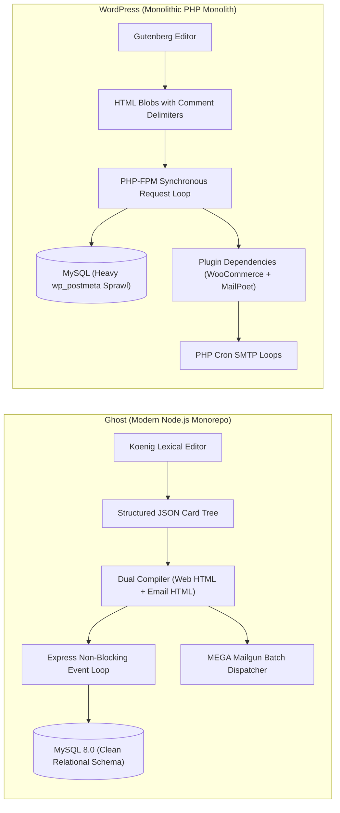
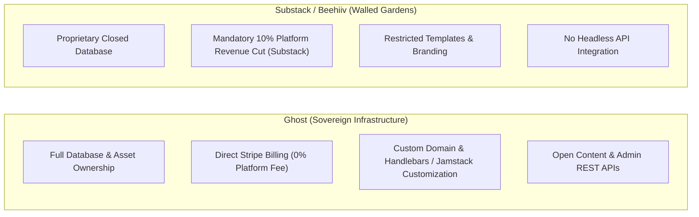

# Ghost — Comparative Analysis & Category Evaluation

> **Category**: Content Management & Publishing  
> **Architectural Role**: Professional digital publishing platform, Koenig Lexical AST content engine & MEGA Mailgun newsletter ecosystem  
> **Primary Stack**: JavaScript / TypeScript | Node.js 20+/22+ LTS & Express | MySQL 8.0 / SQLite3 | Bookshelf / Knex ORM | Mailgun API | Stripe Billing  
> **Peer Solutions Compared**: WordPress (Self-Hosted), Substack (SaaS Benchmark), Beehiiv (Creator Benchmark)  
> **Commercial SaaS Benchmarks**: Substack, Beehiiv, Medium, WordPress VIP, Webflow  

---

## 1. Executive Overview & Technical Identity: Ghost

**Ghost** is the premier open-source professional digital publishing platform, membership monetization engine, and headless content management system engineered in **Node.js**, **Express**, and **Bookshelf.js / Knex.js**, backed by **MySQL 8.0** and **SQLite3**. Trusted by leading independent publications, technology companies, and global media outlets, Ghost provides a unified, production-ready alternative to fragmented WordPress installations and predatory creator SaaS platforms like Substack.

Ghost integrates three traditionally disconnected systems into an atomic publishing pipeline:
1. **Koenig Lexical Editor & AST Architecture**: A block-based document editor built on Meta's Lexical framework that stores articles as structured JSON card trees, enabling dual-compilation into clean semantic web HTML and responsive, client-safe email HTML.
2. **Mailgun Email Generation Architecture (MEGA)**: A high-throughput batch email dispatch pipeline that personalizes tens of thousands of newsletters using Mailgun's batch recipient variables, tracking open and click telemetry directly back into member engagement records.
3. **Database-Level Membership & Stripe Billing**: A multi-tier member access engine with zero platform transaction fees, supporting monthly/annual recurring revenue, trials, and custom tier paywalls.

### Core Architectural Profile
- **Runtime & Language**: `Node.js 20+ / 22+ LTS (JavaScript / TypeScript)`
- **Core Framework**: `Express.js HTTP core + Bookshelf.js / Knex.js query builder`
- **Persistence Layer**: `MySQL 8.0 (production relational store) / SQLite3 (local testing)`
- **Concurrency & Queue Model**: `In-process asynchronous job queues + MEGA Mailgun batch HTTP dispatch`
- **Domain Specialization**: Distraction-free publishing, Koenig Lexical AST modeling, high-volume newsletter broadcasts & 0% platform fee paid memberships

---

## 2. Peer Solution Landscape (Content Management & Publishing)

Within the publishing domain, `Ghost` is evaluated against the following primary open-source and commercial benchmarks:

| Solution | Language & Runtime | Core Framework | Database / Cache | Newsletter Dispatch | Monetization Model |
| :--- | :--- | :--- | :--- | :--- | :--- |
| **Ghost** (Current) | `Node.js 20+ LTS` | `Express, Knex ORM` | `MySQL 8.0 / SQLite` | `MEGA Mailgun Batch API` | **Native Stripe (0% platform fee)** |
| **WordPress** | `PHP 8.1+` | `WordPress Core, WP_Query`| `MySQL / MariaDB` | Plugin Sprawl (MailPoet/SMTP) | Plugin Dependent (WooCommerce) |
| **Substack** | `Proprietary Cloud` | `Closed Microservices` | `Managed Cloud DB` | Proprietary Cloud Dispatcher | **Stripe (Mandatory 10% platform tax)** |
| **Beehiiv** | `Proprietary Cloud` | `Closed SaaS Monolith` | `Managed Cloud DB` | Proprietary Cloud Dispatcher | SaaS Subscription Tiers |

---

## 3. Deep Head-to-Head Comparative Breakdown: Ghost vs Peers

### 3.1. Ghost vs. WordPress

**Comparative Focus**: `Modern Node.js Koenig Lexical AST Pipeline` vs. `Monolithic PHP/SQL Plugin Sprawl`

#### Detailed Architectural Contrast
- **Content Modeling & Storage Pipeline**: `Ghost` stores posts as a structured Abstract Syntax Tree (AST) using Meta's Lexical framework. Content blocks (markdown, images, bookmarks, email-only paywall cards) are serialized as clean JSON nodes in the database. `WordPress` stores content as raw HTML strings peppered with HTML block comments (`<!-- wp:paragraph -->`), mixing content with layout markup and polluting the database.
- **Email & Newsletter Integration**: `Ghost` natively incorporates the Mailgun Email Generation Architecture (MEGA). It compiles post ASTs directly into email-optimized HTML, divides subscribers into chunks, and dispatches them via Mailgun's batch API using `recipient-variables`. `WordPress` possesses zero native newsletter capability, requiring heavy third-party plugins (MailPoet, NewsletterGlue) that rely on fragile PHP cron jobs and external SMTP relays.
- **Runtime Performance & Concurrency**: `Ghost` operates on Node.js's non-blocking asynchronous event loop, easily serving hundreds of concurrent web requests with sub-50ms TTFB. `WordPress` relies on synchronous PHP processes that consume 30–80MB RAM per worker thread, requiring multi-layered caching layers (Varnish, Redis, Nginx fastcgi cache) to survive traffic spikes.
- **Failure Modes & Bottlenecks**:
  - `Ghost`: High email volumes depend on Mailgun API availability; custom themes require Handlebars or Jamstack developers.
  - `WordPress`: Vulnerable to third-party plugin exploits (the leading cause of web CMS security breaches); database queries degrade rapidly as `wp_postmeta` exceeds millions of rows.

#### Architectural Comparison Matrix: Ghost vs. WordPress

| Dimension | Ghost | WordPress | Architectural Implication |
| :--- | :--- | :--- | :--- |
| **Content Model** | **Koenig Lexical AST (JSON)** | **HTML String with Comments** | Ghost separates data from presentation; WordPress entangles markup in database records. |
| **Newsletter Dispatch** | **MEGA Mailgun Batch API** | **PHP Cron / SMTP Plugins** | Ghost broadcasts 50,000 emails in minutes; WordPress cron jobs frequently timeout. |
| **Paid Memberships** | **Native Stripe Connect (0% Fee)** | **Plugin Sprawl (WooCommerce)** | Ghost requires no plugins for paid subscriptions; WordPress requires multiple complex add-ons. |
| **Headless Extensibility** | **Native Content & Admin APIs** | **WP REST API / WPGraphQL** | Ghost exposes clean, modern JSON endpoints designed from day one for headless frontends. |
| **Security Surface** | **Minimal (Zero Plugins)** | **Severe (Plugin Vulnerabilities)** | Ghost eliminates 95% of CMS attack vectors by avoiding arbitrary PHP plugin execution. |

---

### 3.2. Ghost vs. Substack & Beehiiv

**Comparative Focus**: `Self-Hosted Sovereign Publishing & 0% Platform Fees` vs. `Proprietary Creator Walled Gardens`

#### Detailed Architectural Contrast
- **Monetization Economics**: Substack takes a mandatory **10% cut of gross subscription revenue** in addition to Stripe processing fees. A creator earning \$100,000/year pays \$10,000 annually to Substack. `Ghost` charges **0% platform fees**, meaning creators keep 100% of their subscription income (after standard Stripe credit card fees).
- **Data Sovereignty & Portability**: Substack and Beehiiv retain control over the underlying user database and limit technical customization. `Ghost` provides complete sovereignty: full MySQL database access, unmetered subscriber lists, custom CSS/Handlebars themes, and custom domain routing via declarative `routes.yaml`.
- **Headless & Programmatic Publishing**: Substack is a closed walled garden with no public write API. `Ghost` provides both a read-only **Content API** and a read/write **Admin API**, allowing MarketingStudio and external systems to auto-publish articles, update member tiers, and synchronize analytics programmatically.

#### Architectural Comparison Matrix: Ghost vs. Substack / Beehiiv

| Dimension | Ghost | Substack | Beehiiv | Architectural Implication |
| :--- | :--- | :--- | :--- | :--- |
| **Platform Revenue Tax** | **0% Platform Fee** | **10% Gross Revenue Cut** | Subscription Fee Tiers | Ghost saves high-earning publications tens of thousands of dollars annually. |
| **Data & Infrastructure Ownership**| **100% Self-Hosted & Sovereign**| **Closed SaaS Cloud** | **Closed SaaS Cloud** | Ghost guarantees complete protection against vendor deplatforming or lock-in. |
| **Programmatic REST APIs** | **Full Admin & Content APIs** | **None** | Limited API | Ghost enables automated publishing pipelines from MarketingStudio bots. |
| **Frontend Customization** | **Unlimited (Themes / Headless)**| **Strictly Limited** | Standard Templates | Ghost supports completely custom branding, layouts, and headless Jamstack sites. |

---

## 4. Capability & Feature Comparison Matrix

| Dimension / Capability | Ghost | WordPress | Substack | Beehiiv |
| :--- | :---: | :---: | :---: | :---: |
| **Koenig Lexical AST Editor** | ✅ Native | ❌ (Gutenberg) | ❌ | ❌ |
| **Integrated Newsletter Dispatch** | ✅ (MEGA Mailgun) | ⚠️ Via Plugins | ✅ Native | ✅ Native |
| **Native Paid Memberships** | ✅ Built-in | ⚠️ Via Plugins | ✅ Native | ✅ Native |
| **Platform Transaction Fee** | **0%** | **0%** | **10%** | **0%** (Monthly SaaS) |
| **Decoupled Headless API** | ✅ Native | ⚠️ Via Plugins | ❌ | ⚠️ Basic |
| **Declarative Dynamic Routing** | ✅ (`routes.yaml`)| ❌ | ❌ | ❌ |
| **Self-Hostable Deployment** | ✅ (Docker / Node) | ✅ (LAMP / Docker)| ❌ | ❌ |
| **Sub-50ms TTFB Response** | ✅ High | ❌ Low (Without Cache)| ✅ High (Cloud) | ✅ High (Cloud) |

---

## 5. Commercial Benchmark Positioning & MarketingStudio Fit

- **Against WordPress**: Ghost eliminates plugin fatigue, security vulnerabilities, and database query sprawl, delivering a high-performance publishing engine with native newsletters and paid memberships.
- **Against Substack**: Ghost eliminates the 10% platform tax, preserves total subscriber and content sovereignty, and unlocks headless API integrations.
- **MarketingStudio Synergy**: Ghost serves as the corporate publication and content hub for MarketingStudio. Automated agents can publish SEO-optimized articles via the Admin API, send targeted email newsletters, and gate lead-generation collaterals behind membership tiers.
