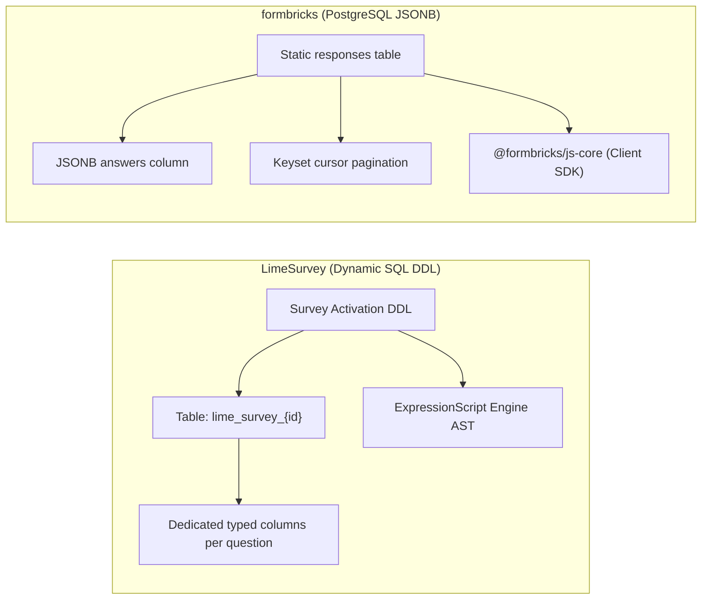
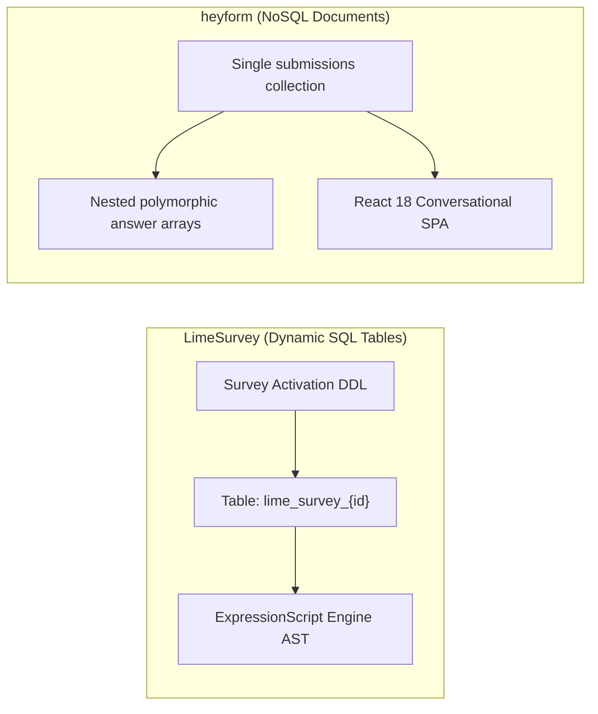
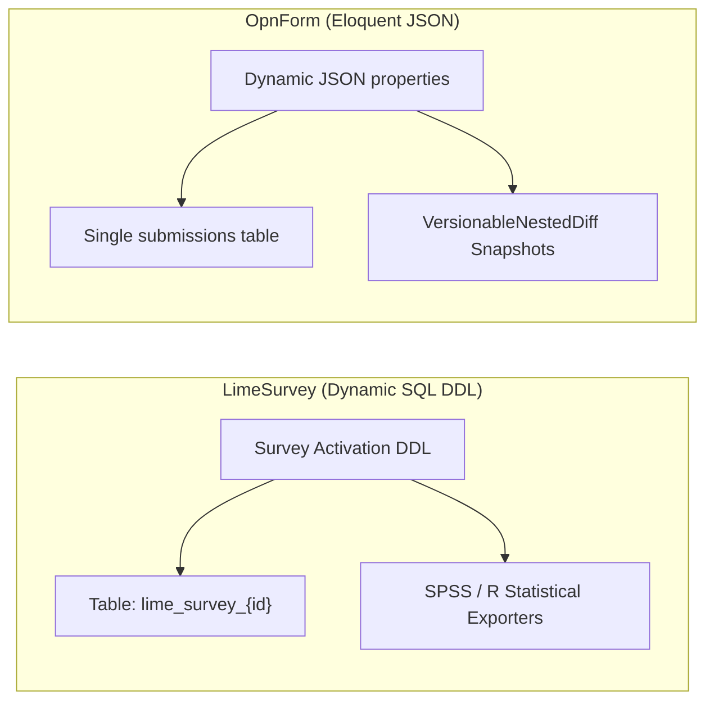
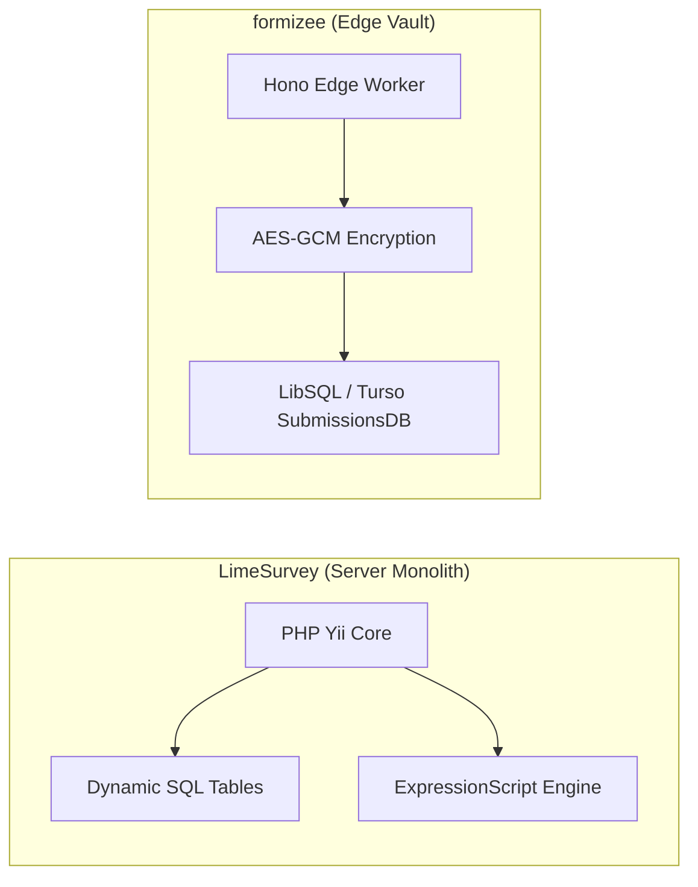
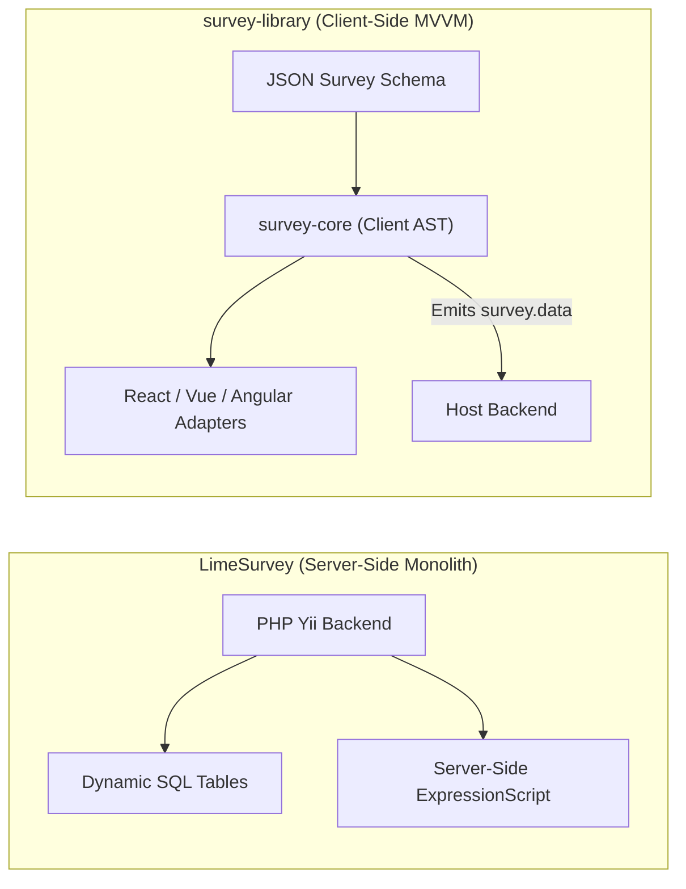
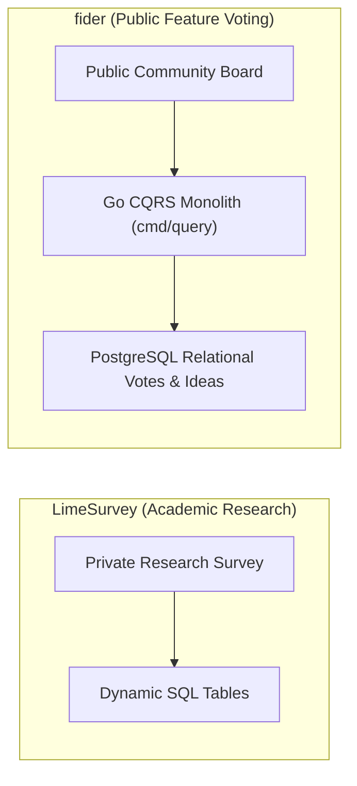
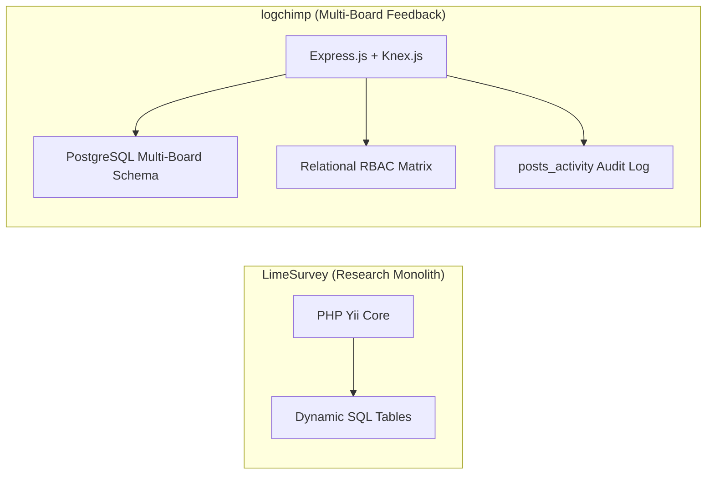
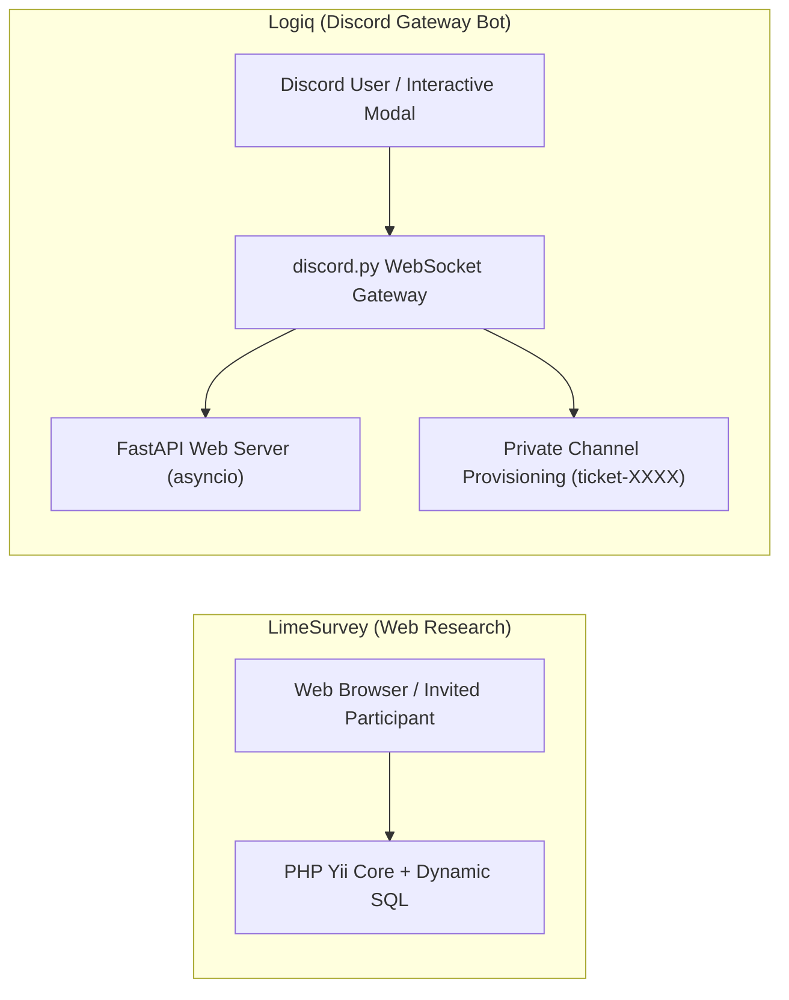

# LimeSurvey — Comparative Analysis & Category Evaluation

> **Category**: Forms, Surveys & Feedback  
> **Architectural Role**: Enterprise statistical research, dynamic per-survey SQL tables & ExpressionScript AST runtime  
> **Primary Stack**: PHP 8.1+ | Yii Framework, Twig Templating | MySQL / MariaDB / PostgreSQL | RemoteControl 2 JSON-RPC / REST API  
> **Peer Solutions Compared**: `formbricks`, `heyform`, `OpnForm`, `formizee`, `survey-library`, `fider`, `logchimp`, `Logiq`, `dsforms`  
> **Commercial SaaS Benchmarks**: Qualtrics, Confirmit, SurveyMonkey, Alchemer  

---

## 1. Executive Overview & Technical Identity: LimeSurvey

**LimeSurvey** is the gold-standard open-source enterprise statistical survey and scientific research platform, deployed across thousands of academic institutions, government statistical bureaus, and enterprise market research organizations. Engineered as a self-hosted alternative to Qualtrics, Confirmit, and SurveyMonkey, LimeSurvey provides complete sovereignty over sensitive questionnaire data, complex statistical sampling designs, and multi-lingual global deployments.

### Core Architectural Profile
- **Runtime & Language**: `PHP 8.1+` monolith built upon the **Yii Framework** (ActiveRecord pattern).
- **Database Architecture**: Dynamically generates dedicated relational database tables (`lime_survey_{surveyId}` and `lime_tokens_{surveyId}`) via DDL upon survey activation, avoiding generic EAV (Entity-Attribute-Value) anti-patterns and optimizing execution plans for massive cohorts.
- **Logic & Calculation Engine**: **ExpressionScript Engine** (`em_manager_helper.php`), an advanced in-memory Abstract Syntax Tree (AST) evaluator supporting micro-syntax relevance equations (`relevance: "((Q1.NAOK == 'Y') and (Q2_SQ1.NAOK >= 4))"`), dynamic mathematical scoring, quota screening, and cross-question piping.
- **Participant Governance & Anonymity**: Closed-access participant token system with cryptographic anonymization: token tables guarantee single-use access while permanently expunging foreign keys connecting participant identities to response rows.
- **Statistical Export Pipelines**: Direct export pipelines into statistical packages including SPSS syntax files (`.sps`, `.dat`), R dataframes, Stata, and CSV.
- **Integration API**: **RemoteControl 2** API providing JSON-RPC and REST gateways for headless survey orchestration.

---

## 2. Peer Solution Landscape (Forms, Surveys & Feedback)

Within this category, `LimeSurvey` operates alongside the following peer solutions:

| Solution | Language & Runtime | Core Framework | Database / Cache | Queue / Concurrency | Primary Architectural Niche |
| :--- | :--- | :--- | :--- | :--- | :--- |
| **LimeSurvey** (Current) | `PHP 8.1+` | `Yii Framework` | `MySQL / PostgreSQL` | `PHP CLI Workers` | Enterprise statistical surveys with dynamic runtime SQL tables |
| **formbricks** | `TypeScript / Node` | `Next.js Monorepo` | `PostgreSQL, Prisma` | `BullMQ / Redis` | In-app micro-surveys, ReBAC access, telemetry |
| **heyform** | `TypeScript / Node` | `NestJS 10+, React 18` | `MongoDB, Redis` | `Bull Queue / Redis` | Conversational multi-step forms with polymorphic document answers |
| **OpnForm** | `PHP 8.2+ / TypeScript` | `Laravel 11, Nuxt 3` | `MySQL / PostgreSQL` | `Laravel Horizon / Redis` | No-code dynamic forms with versioned revisions & MCP agent drafts |
| **formizee** | `TypeScript / Edge` | `Hono, Turborepo` | `LibSQL / Turso, Drizzle` | `Cloudflare KV / Async` | Zero-knowledge AES-256-GCM encrypted headless form vault |
| **survey-library** | `TypeScript 5.3+` | `Framework-Agnostic MVVM` | `Pure Client-Side (BYO)`| `Synchronous / Web Workers`| Declarative JSON survey engine with AST expression evaluator |
| **fider** | `Go 1.22+` | `Go HTTP Monolith` | `PostgreSQL 14+` | `Goroutines, Channels` | Compiled CQRS public feature voting portal with sub-20ms latency |
| **logchimp** | `TypeScript / Node` | `Express.js, Vue 3` | `PostgreSQL, Knex.js` | `BullMQ / Redis` | Multi-board customer feedback roadmap with RBAC and audit trail |
| **Logiq** | `Python 3.10+` | `FastAPI, discord.py` | `SQLite / PostgreSQL` | `asyncio Event Loop` | Discord-native community ticketing bot & FastAPI REST management |
| **dsforms** | `Go 1.22+` | `Pure Go HTTP` | `SQLite / LibSQL (pure Go)`| `Go Worker Channels` | Zero-dependency headless form backend with forensic spam quarantine |

---

## 3. Deep Head-to-Head Comparative Breakdown: LimeSurvey vs Peers

### 3.1. LimeSurvey vs. formbricks

**Comparative Focus**: `Enterprise scientific research & dynamic SQL tables` vs. `Modern in-app micro-survey telemetry & ReBAC`

#### Architectural Differences:
- **Database Schema Architecture**: LimeSurvey dynamically executes runtime DDL (`CREATE TABLE lime_survey_{surveyId}`) when a survey is activated. Every question and sub-question receives a strongly typed relational column (e.g. `1234X5X6SQ001`), optimizing execution plans and avoiding EAV degradation. Formbricks persists all responses in a static PostgreSQL table utilizing GIN-indexed JSONB columns and keyset cursor pagination `(created_at, id) < ($1, $2)`.
- **Targeting vs Methodological Rigor**: Formbricks specializes in in-app customer experience (CX) intercepts, triggering micro-surveys via client-side behavioral events (`trackAction`). LimeSurvey specializes in academic and market research methodology: multi-page question groups, random question rotation, quota controls, dynamic piping, and micro-syntax relevance equations via ExpressionScript.
- **Statistical Export**: LimeSurvey generates native syntax files for SPSS (`.sps`, `.dat`), R dataframes, and Stata. Formbricks streams response JSON payloads to webhooks, Segment, and Google Sheets.
- **Participant Governance**: LimeSurvey provides closed-cohort participant token management (`lime_tokens_{id}`) with cryptographic anonymization. Formbricks associates responses with customer contact profiles.

#### Architectural Comparison Matrix:

| Dimension | LimeSurvey | formbricks |
| :--- | :--- | :--- |
| **Database Architecture** | Dynamic DDL: dedicated SQL table per survey | Fixed PostgreSQL schema with JSONB columns |
| **Logic Engine Complexity** | ExpressionScript AST with micro-syntax equations | Visual step jumping & user attribute matching |
| **Statistical Analysis** | Native SPSS syntax files, R dataframes, and quota monitoring | Basic descriptive charts & NPS summaries |
| **Participant Governance** | Closed-cohort token management with cryptographic anonymization | In-app user tracking & public links |
| **Runtime Stack** | Traditional PHP 8.1+ monolith with Yii Framework | Modern TypeScript, React Server Components, Next.js |

---

### 3.2. LimeSurvey vs. heyform

**Comparative Focus**: `Scientific research & dynamic SQL tables` vs. `Conversational Typeform-style multi-step forms`

#### Architectural Differences:
- **Presentation Model**: HeyForm delivers conversational, full-screen, one-question-at-a-time flows with animated transitions. LimeSurvey renders classical research layouts (question groups, multi-column matrix grids, semantic differential scales) using Twig templates.
- **Persistence Architecture**: HeyForm stores submissions as polymorphic document arrays in MongoDB. LimeSurvey provisions dedicated relational tables per survey, ensuring strict SQL column types and index efficiency for millions of respondents.
- **Logic & Branching**: HeyForm uses visual logic jumps and basic runtime variables. LimeSurvey uses ExpressionScript, enabling complex boolean equations (`relevance: "((Q1.NAOK == 'Y') and (Q2_SQ1.NAOK >= 4))"`), mathematical calculations, and quota screening across 80+ localized languages.

#### Architectural Comparison Matrix:

| Dimension | LimeSurvey | heyform |
| :--- | :--- | :--- |
| **Data Architecture** | Dynamic DDL: dedicated SQL table per survey | Document-oriented NoSQL collection |
| **Presentation Style** | Academic research layouts & question groups | Conversational full-screen Typeform clone |
| **Logic Engine Complexity** | ExpressionScript AST with micro-syntax equations | Visual jump rules with basic variables |
| **Statistical Export** | Native SPSS syntax files, R dataframes, and Stata packages | CSV and JSON exports |
| **Participant Control** | Closed-cohort token management with cryptographic anonymization | Open public links and IP rate limiting |

---

### 3.3. LimeSurvey vs. OpnForm

**Comparative Focus**: `Academic research & dynamic SQL tables` vs. `No-code dynamic forms & Notion sync`

#### Architectural Differences:
- **Schema Management**: OpnForm stores form structures in Eloquent dynamic JSON properties and features `VersionableNestedDiff` to track the last 5 revisions. LimeSurvey creates dedicated SQL tables via DDL, requiring database alterations to modify active survey structures.
- **Research Rigor vs Operational Agility**: LimeSurvey is built for formal scientific surveys (quota screening, randomized questions, multi-lingual synchronization). OpnForm is built for rapid marketing lead intake, bi-directional Notion database synchronization, and AI agent drafts via MCP.
- **Runtime Stack**: OpnForm is built on modern PHP 8.2+ with Laravel 11 and a Nuxt 3 frontend. LimeSurvey is a traditional PHP Yii monolith utilizing Twig templating and jQuery/Vanilla JS.

#### Architectural Comparison Matrix:

| Dimension | LimeSurvey | OpnForm |
| :--- | :--- | :--- |
| **Data Architecture** | Dynamic DDL: dedicated SQL table per survey | Relational table with Eloquent JSON properties |
| **Logic Engine Complexity** | ExpressionScript AST with micro-syntax equations | Visual jump rules with basic conditions |
| **Integration Focus** | SPSS, R, Stata statistical packages | Notion databases, Slack, Discord, webhooks |
| **Schema Evolution** | Runtime SQL DDL on activation | Dynamic JSON properties with `VersionableNestedDiff` snapshots |
| **AI Agent Support** | None (RemoteControl 2 RPC API) | Native Model Context Protocol (MCP) draft endpoints |

---

### 3.4. LimeSurvey vs. formizee

**Comparative Focus**: `Enterprise research engine & dynamic SQL tables` vs. `Edge-native zero-knowledge encrypted headless form vault`

#### Architectural Differences:
- **Presentation Strategy**: LimeSurvey provides full survey rendering with rich question themes and multi-lingual UI. Formizee is 100% headless: it provides zero client UI, ingesting submissions from static HTML `<form>` tags.
- **Security & Cryptography**: Formizee operates a **Zero-Knowledge Encrypted Vault**: all submissions are encrypted at the edge with AES-256-GCM (`data_iv` and `data_cipher_text`) before persisting into LibSQL. LimeSurvey protects data via token decoupling (cryptographic anonymization) and standard database permissions.
- **Execution Tier**: Formizee executes across distributed Cloudflare Workers with sub-50ms latency globally (~35MB RAM). LimeSurvey runs on a traditional LAMP/LEMP server stack (~180MB RAM).

#### Architectural Comparison Matrix:

| Dimension | LimeSurvey | formizee |
| :--- | :--- | :--- |
| **User Interface** | Complete server-rendered research layouts | 100% headless (BYO HTML/React UI) |
| **Security Innovation** | Token-based cryptographic anonymity decoupling | Zero-knowledge client-side AES-256-GCM encryption |
| **Database Architecture** | Dynamic DDL: dedicated SQL table per survey | Schemaless encrypted vault (LibSQL / Turso) |
| **Logic Engine** | ExpressionScript AST engine | None (pure headless ingestion) |
| **Runtime Footprint** | Traditional PHP monolith (~180 MB RAM) | Global Edge Workers (~35 MB RAM, <50ms latency) |

---

### 3.5. LimeSurvey vs. survey-library (SurveyJS)

**Comparative Focus**: `Full-stack server-rendered research engine` vs. `Framework-agnostic client-side MVVM JSON engine`

#### Architectural Differences:
- **System Scope**: LimeSurvey is a complete, self-contained research platform with server-rendered UI, database persistence, and admin consoles. SurveyJS (`survey-library`) is a pure client-side library. It has zero backend opinions: it accepts a standardized JSON survey schema, handles user interaction and validation inside browser memory, and emits `survey.data` on completion.
- **Logic Execution**: LimeSurvey evaluates ExpressionScript primarily on the server via PHP (with accompanying JavaScript validation). SurveyJS executes its `ExpressionRunner` AST entirely inside the browser's JavaScript runtime, supporting dynamic matrix grids (`matrixdynamic`), panel iterators, and cascading asynchronous REST lookups (`choicesRestful`).
- **Framework Support**: LimeSurvey's frontend relies on server-rendered Twig templates and jQuery/Vanilla JS. SurveyJS provides native bindings for React, Vue 3, Angular, and Vanilla Web Components.

#### Architectural Comparison Matrix:

| Dimension | LimeSurvey | survey-library (SurveyJS) |
| :--- | :--- | :--- |
| **Architecture Boundary** | Full-stack platform (API, DB, UI, Admin Console) | Pure client-side component engine (BYO Backend) |
| **UI Framework Binding** | Twig templating / jQuery / Vanilla JS | Framework-agnostic: React, Vue 3, Angular, Knockout |
| **Logic Execution** | Server-side ExpressionScript evaluation | In-browser `ExpressionRunner` AST engine |
| **Server Requirements** | PHP 8.1+, MySQL/PostgreSQL, Web server | Zero server infrastructure; 100% browser runtime |
| **Statistical Export** | Native SPSS, R, Stata formats | Raw JSON (requires downstream transformation) |

---

### 3.6. LimeSurvey vs. fider

**Comparative Focus**: `Statistical research engine` vs. `Compiled Go CQRS public feature voting portal`

#### Architectural Differences:
- **Domain Purpose**: LimeSurvey conducts private, rigorous research studies across sampled populations. Fider is an open community suggestion portal where users publicly submit feature ideas, upvote proposals, and track official roadmap progress.
- **Runtime Performance & Stack**: LimeSurvey runs on PHP 8.1+ and the Yii Framework (~180MB RAM). Fider is a compiled Go 1.22+ binary with PostgreSQL (~40MB RAM) that uses strict Command Query Responsibility Segregation (CQRS) (`app/models/cmd` and `app/models/query`), delivering sub-20ms response times.
- **Community Governance**: Fider includes real-time duplicate idea detection, duplicate post merging (`OriginalPost`), and automated email notifications to all voters when an idea changes status.

#### Architectural Comparison Matrix:

| Dimension | LimeSurvey | fider |
| :--- | :--- | :--- |
| **Core Interaction** | Private multi-page research questionnaires | Public collaborative idea suggestion and upvoting |
| **Runtime & Language** | PHP 8.1+ / Yii Framework (~180 MB RAM) | Compiled Go 1.22+ binary (~40 MB RAM, <20ms latency) |
| **Architectural Model** | Dynamic SQL DDL per survey | Go HTTP Monolith with strict CQRS command/query separation |
| **Roadmap & Notification** | Plugin event dispatcher (`afterSurveyComplete`) | Public roadmap stages with automatic voter email updates |
| **Database Storage** | Dedicated relational tables per survey | Normalized relational PostgreSQL |

---

### 3.7. LimeSurvey vs. logchimp

**Comparative Focus**: `Academic survey engine` vs. `Multi-board feedback tracking with RBAC and changelogs`

#### Architectural Differences:
- **Product Scope**: LimeSurvey is designed for scientific questionnaires and multi-lingual statistical research. Logchimp provides a multi-board feedback portal (`Boards`), interactive roadmap stages (`Roadmaps`), and product release changelogs.
- **Database Modeling**: LimeSurvey provisions dedicated relational tables for each survey. Logchimp uses **Express.js** and **Knex.js** with PostgreSQL, maintaining relational integrity across users, boards, posts, votes, and an immutable audit timeline (`posts_activity`).
- **Access Control**: LimeSurvey manages survey-level permissions and participant tokens. Logchimp implements a complete relational RBAC model (`roles`, `permissions`, `roles_users`, `permissions_roles`) for fine-grained board governance.

#### Architectural Comparison Matrix:

| Dimension | LimeSurvey | logchimp |
| :--- | :--- | :--- |
| **Primary Domain** | Scientific research & statistical surveys | Multi-board feedback management and public roadmaps |
| **Database Layer** | Dynamic SQL tables per survey | PostgreSQL with Knex.js SQL query builder |
| **Audit Trails** | Survey event logs | Immutable activity stream (`posts_activity`) |
| **Access Control** | Survey permission tables & token ACL | Granular relational RBAC matrix |
| **Public Transparency** | Private or public research surveys | Public feedback boards, roadmaps, and release changelogs |

---

### 3.8. LimeSurvey vs. Logiq

**Comparative Focus**: `Web research surveys` vs. `Discord-native modal ticketing & channel triage`

#### Architectural Differences:
- **Delivery Surface**: LimeSurvey delivers complex web questionnaires via desktop and mobile browsers. Logiq executes inside Discord chat servers, interacting with users through persistent UI buttons and native modal dialogs (`discord.ui.Modal`).
- **Submission Output**: LimeSurvey records answers into dedicated SQL tables for statistical analysis. Logiq converts modal submissions into interactive, private Discord text channels (`ticket-{username}`) with role-based permission overwrites (`@everyone` denied access; ticket creator and staff roles granted access).
- **Concurrency & Runtime**: LimeSurvey runs on a traditional PHP-FPM web server. Logiq runs a single-process concurrent Python 3.10+ application, running a Discord gateway bot and a FastAPI server within an `asyncio` event loop.

#### Architectural Comparison Matrix:

| Dimension | LimeSurvey | Logiq |
| :--- | :--- | :--- |
| **Platform Ingress** | Web browsers via Twig templates | Discord client via native interaction modals |
| **Submission Output** | Dedicated relational SQL table row | Isolated private support text channel in Discord |
| **Runtime & Language** | PHP 8.1+ (Yii Framework) | Python 3.10+ (discord.py + FastAPI via asyncio) |
| **Persistence** | Dynamic SQL tables (`lime_survey_X`) | SQLite / PostgreSQL / MongoDB |
| **Archival Format** | SPSS, R, Stata, CSV | Searchable HTML/JSON ticket transcripts |

---

### 3.9. LimeSurvey vs. dsforms

**Comparative Focus**: `Dynamic SQL table research engine` vs. `Zero-dependency pure Go headless backend with quarantine scoring`

```mermaid
flowchart LR
    subgraph LimeSurveyArch ["LimeSurvey (Heavy Monolith)"]
        A1["PHP Yii Server"] --> A2["Dynamic SQL Tables"]
        A1 --> A3["ExpressionScript Engine"]
    end
    subgraph DsformsArch ["dsforms (Zero-Dep Go Monolith)"]
        B1["Static HTML (<form>)"] --> B2["Pure Go HTTP Server"]
        B2 --> B3["Weighted Spam Screener"]
        B3 -->|Score >= Threshold| B4["Quarantine: is_held=1 + signals"]
        B3 -->|Clean| B5["Embedded SQLite / LibSQL"]
        B2 --> B6["Model Context Protocol (MCP) Server"]
    end
```

#### Architectural Differences:
- **Deployment Footprint**: LimeSurvey requires an Apache/Nginx web server, PHP-FPM runtime with multiple extensions, and a MySQL/PostgreSQL server (~180MB RAM). dsforms compiles into a single statically linked binary with an embedded SQLite / LibSQL database (`modernc.org/sqlite`), running with zero external dependencies and consuming ~25MB of RAM.
- **Frontend vs Headless**: LimeSurvey provides a complete server-rendered research UI with themes, multi-lingual support, and question hierarchies. dsforms is 100% headless, providing endpoints for standard HTML `<form action="/f/{id}">` tags without bundling frontend JavaScript.
- **Spam Defenses & Security**: LimeSurvey relies on participant token access control and optional CAPTCHA plugins. dsforms implements an auditable **Quarantine Architecture**: `internal/screen` evaluates weighted honeypot traps (`_gotcha`, `hp_field`), timing heuristics, and domain analysis. Flagged submissions are quarantined (`is_held: 1`) alongside exact diagnostic signals (`spam_signals`) for operator or AI agent review.
- **AI Agent Automation**: dsforms embeds a native Model Context Protocol (MCP) server for autonomous agent operations and an integrated viral waitlist engine with referral queue-jumping. LimeSurvey provides the RemoteControl 2 JSON-RPC API.

#### Architectural Comparison Matrix:

| Dimension | LimeSurvey | dsforms |
| :--- | :--- | :--- |
| **Operational Model** | Traditional PHP-FPM + MySQL/PostgreSQL stack | Single compiled Go binary with embedded SQLite |
| **Frontend Strategy** | Complete server-rendered research layouts | 100% headless: static HTML form endpoints |
| **Spam Defense Strategy** | Closed-cohort token ACL, optional CAPTCHA | Weighted heuristic scoring with auditable quarantine holding queue |
| **AI Agent Interface** | RemoteControl 2 JSON-RPC / REST API | Native embedded Model Context Protocol (MCP) server with PII redaction |
| **Statistical Export** | Native SPSS syntax files, R dataframes, Stata | CSV and JSON exports |
| **Memory Footprint** | ~180 MB RAM | ~25 MB RAM |

---

## 4. Capability & Feature Comparison Matrix

| Dimension / Capability | LimeSurvey | formbricks | heyform | OpnForm | formizee | survey-library | fider | logchimp | Logiq | dsforms |
| :--- | :---: | :---: | :---: | :---: | :---: | :---: | :---: | :---: | :---: | :---: |
| **Statistical Analysis (SPSS/R)**| ✅ Native | ❌ | ❌ | ❌ | ❌ | ⚠️ Analytics Pack| ❌ | ❌ | ❌ | ❌ |
| **Logic Jumps & Math AST** | ✅ ExpressionScript| ✅ Visual Rules | ✅ Visual Logic | ✅ Dynamic Logic| ❌ | ✅ ExpressionRunner| ❌ | ❌ | ❌ | ❌ |
| **Dynamic SQL Table per Form** | ✅ Native DDL | ❌ | ❌ | ❌ | ❌ | ❌ | ❌ | ❌ | ❌ | ❌ |
| **Conversational Typeform UI**| ❌ | ⚠️ Compact modal | ✅ Full Screen | ✅ Full Screen | ❌ (Headless) | ✅ Supported | ❌ | ❌ | ❌ | ❌ |
| **Targeted In-App Popups** | ❌ | ✅ Native SDK | ⚠️ Iframe | ⚠️ Iframe | ❌ | ⚠️ UI Embed | ❌ | ❌ | ❌ | ❌ |
| **Headless Form API Endpoint** | ❌ | ⚠️ API Routes | ❌ | ❌ | ✅ Edge Native | ❌ | ❌ | ❌ | ❌ | ✅ Single Binary |
| **Public Feature Voting** | ❌ | ❌ | ❌ | ❌ | ❌ | ❌ | ✅ Pure CQRS | ✅ Multi-Board | ❌ | ❌ |
| **Changelog & Public Roadmap** | ❌ | ❌ | ❌ | ❌ | ❌ | ❌ | ⚠️ Basic | ✅ Integrated | ❌ | ❌ |
| **Discord Chat Ticket Modals** | ❌ | ❌ | ❌ | ❌ | ❌ | ❌ | ❌ | ❌ | ✅ Native UI | ❌ |
| **Viral Waitlist & Referrals** | ❌ | ❌ | ❌ | ❌ | ❌ | ❌ | ❌ | ❌ | ❌ | ✅ Integrated |
| **AI Agent MCP Integration** | ❌ | ⚠️ REST API | ❌ | ✅ Agent Drafts| ⚠️ API Keys | ❌ | ❌ | ❌ | ⚠️ LLM Cog | ✅ Native MCP |
| **Zero-Knowledge Encryption** | ❌ | ❌ | ❌ | ❌ | ✅ AES-256-GCM | ❌ | ❌ | ❌ | ❌ | ❌ |
| **Runtime Memory Footprint** | ~180 MB | ~250 MB | ~300 MB | ~150 MB | **~35 MB (Edge)** | **0 MB (Client)** | **~40 MB** | ~120 MB | ~90 MB | **~25 MB** |

---

## 5. Commercial Benchmark Positioning

When benchmarked against commercial SaaS leaders (**Qualtrics, Confirmit, SurveyMonkey, Alchemer**):
- **Against Qualtrics & Confirmit**: `LimeSurvey` provides the only open-source equivalent capable of matching their complex survey methodology, quota screening, dynamic randomization, and direct statistical software pipelines (SPSS, R, Stata).
- **Data Sovereignty for Academic & Clinical Research**: Allows research institutions and healthcare providers to maintain 100% on-premises data isolation, meeting stringent IRB, HIPAA, and GDPR standards.
- **Dynamic Relational Scaling**: Provisions dedicated SQL tables per survey, avoiding EAV join degradation when querying millions of responses.

---

## 6. Strategic Takeaways & Role for MarketingStudio

In the unified **MarketingStudio** architecture:
1. **Primary Component to Adopt**: Harness `LimeSurvey` for deep statistical market research, customer cohort segmentation surveys, and academic-grade data collection.
2. **Interoperability Seam**: Utilize LimeSurvey's `afterSurveyComplete` plugin hooks and RemoteControl 2 API to pull structured response data into MarketingStudio's analytical data lake.
3. **Complementary Ecosystem Delegation**: Where LimeSurvey excels at complex statistical studies, delegate quick in-app micro-surveys to `formbricks`, conversational landing forms to `heyform` / `OpnForm`, and headless static site forms to `formizee` / `dsforms`.
