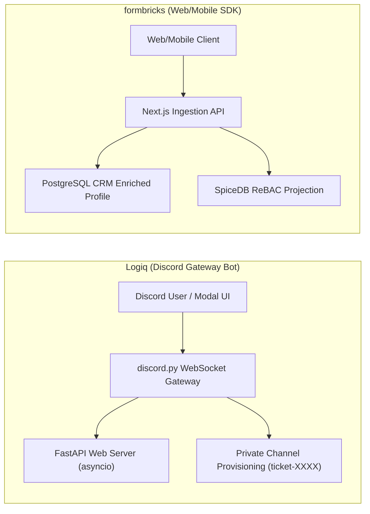
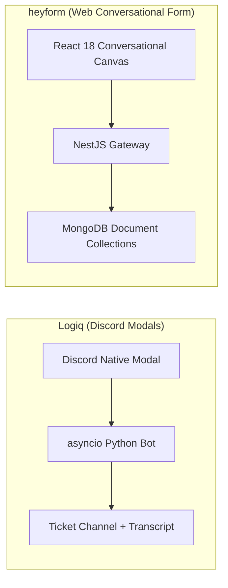
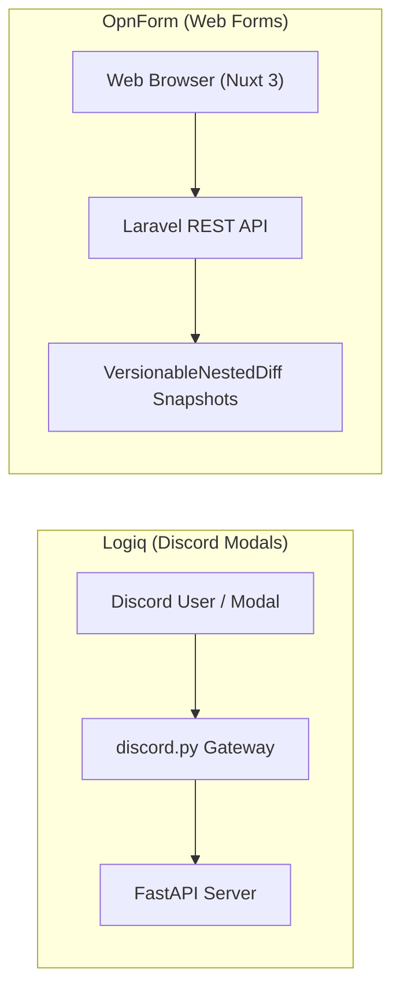
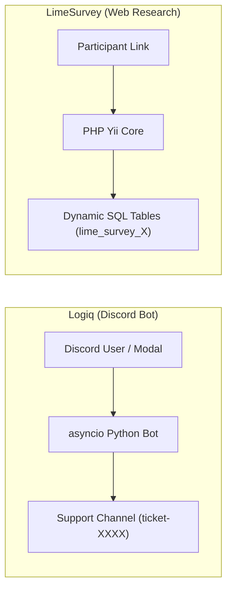
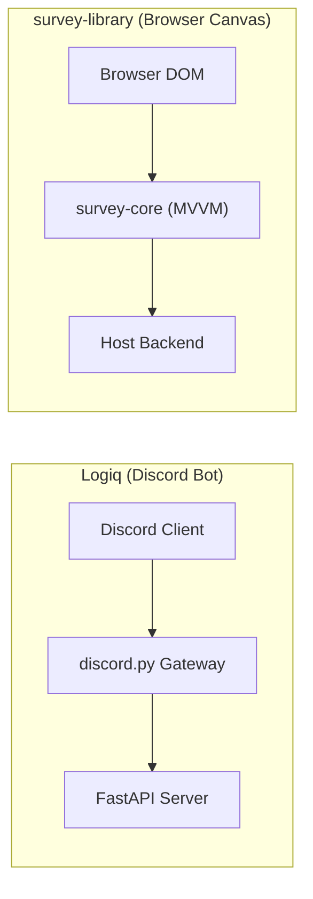
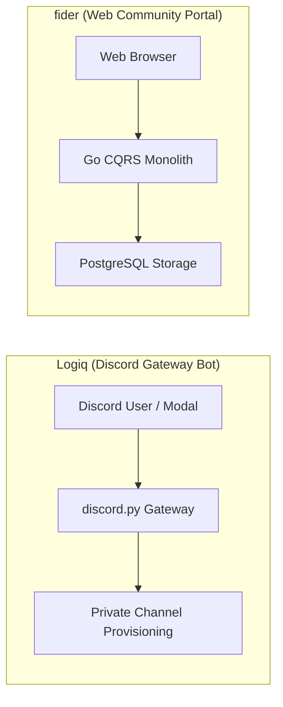
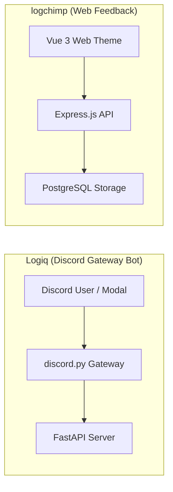

# Logiq — Comparative Analysis & Category Evaluation

> **Category**: Forms, Surveys & Feedback  
> **Architectural Role**: Discord-native interactive ticket modals, community triage & FastAPI management hub  
> **Primary Stack**: Python 3.10+ | discord.py / Pycord, FastAPI | asyncio Event Loop | SQLite / PostgreSQL / MongoDB  
> **Peer Solutions Compared**: `formbricks`, `heyform`, `OpnForm`, `formizee`, `LimeSurvey`, `survey-library`, `fider`, `logchimp`, `dsforms`  
> **Commercial SaaS Benchmarks**: Ticket Tool, Carl-bot, MEE6, Discord Tickets  

---

## 1. Executive Overview & Technical Identity: Logiq

**Logiq** is an enterprise-ready asynchronous Python customer engagement engine and community support orchestration framework designed for Discord. Engineered as an extensible alternative to Ticket Tool, Carl-bot, and MEE6, Logiq bridges the gap between conversational chat interfaces and formal customer support workflows by offering interactive in-chat modal forms, ephemeral triage buttons, automated ticket channel provisioning, and an integrated FastAPI administration dashboard.

### Core Architectural Profile
- **Runtime & Language**: `Python 3.10+` running as a concurrent single-process application within Python's native **`asyncio`** event loop.
- **Discord Gateway Client**: Built on `discord.py 2.3+` / `Pycord`, maintaining persistent WebSocket connections to Discord's Gateway and rendering native interactive components (`discord.ui.View`, `discord.ui.Modal`, `discord.ui.Button`).
- **Web & Management API**: Co-located **FastAPI** web server running concurrently via Uvicorn within the same event loop, exposing REST endpoints for guild configurations, ticket queries, and external integrations.
- **Submission Workflow & Channel Provisioning**: Submitting a modal form dynamically provisions an isolated text channel (`ticket-{username}`) with atomic Discord role permission overwrites (`@everyone` denied access; ticket creator and staff roles explicitly granted view and send rights).
- **Persistence Layer**: Flexible `DatabaseManager` abstraction supporting SQLite, PostgreSQL, and MongoDB.
- **Transcript Archival**: Generates searchable, self-contained HTML and JSON transcripts of closed ticket channels, archiving full conversation histories before channel deletion.

---

## 2. Peer Solution Landscape (Forms, Surveys & Feedback)

Within this category, `Logiq` operates alongside the following peer solutions:

| Solution | Language & Runtime | Core Framework | Database / Cache | Queue / Concurrency | Primary Architectural Niche |
| :--- | :--- | :--- | :--- | :--- | :--- |
| **Logiq** (Current) | `Python 3.10+` | `FastAPI, discord.py` | `SQLite / PostgreSQL` | `asyncio Event Loop` | Discord-native community ticketing bot & FastAPI REST management |
| **formbricks** | `TypeScript / Node` | `Next.js Monorepo` | `PostgreSQL, Prisma` | `BullMQ / Redis` | In-app micro-surveys, ReBAC access, telemetry |
| **heyform** | `TypeScript / Node` | `NestJS 10+, React 18` | `MongoDB, Redis` | `Bull Queue / Redis` | Conversational multi-step forms with polymorphic document answers |
| **OpnForm** | `PHP 8.2+ / TypeScript` | `Laravel 11, Nuxt 3` | `MySQL / PostgreSQL` | `Laravel Horizon / Redis` | No-code dynamic forms with versioned revisions & MCP agent drafts |
| **formizee** | `TypeScript / Edge` | `Hono, Turborepo` | `LibSQL / Turso, Drizzle` | `Cloudflare KV / Async` | Zero-knowledge AES-256-GCM encrypted headless form vault |
| **LimeSurvey** | `PHP 8.1+` | `Yii Framework` | `MySQL / PostgreSQL` | `PHP CLI Workers` | Enterprise statistical surveys with dynamic runtime SQL tables |
| **survey-library** | `TypeScript 5.3+` | `Framework-Agnostic MVVM` | `Pure Client-Side (BYO)`| `Synchronous / Web Workers`| Declarative JSON survey engine with AST expression evaluator |
| **fider** | `Go 1.22+` | `Go HTTP Monolith` | `PostgreSQL 14+` | `Goroutines, Channels` | Compiled CQRS public feature voting portal with sub-20ms latency |
| **logchimp** | `TypeScript / Node` | `Express.js, Vue 3` | `PostgreSQL, Knex.js` | `BullMQ / Redis` | Multi-board customer feedback roadmap with RBAC and audit trail |
| **dsforms** | `Go 1.22+` | `Pure Go HTTP` | `SQLite / LibSQL (pure Go)`| `Go Worker Channels` | Zero-dependency headless form backend with forensic spam quarantine |

---

## 3. Deep Head-to-Head Comparative Breakdown: Logiq vs Peers

### 3.1. Logiq vs. formbricks

**Comparative Focus**: `Discord-native modal ticketing & channel triage` vs. `Web/mobile in-app micro-survey telemetry & ReBAC`

#### Architectural Differences:
- **Touchpoint Environment**: Logiq operates entirely within Discord's communication ecosystem, utilizing Discord's WebSocket Gateway to render interactive buttons and native modal dialogs (`discord.ui.Modal`). Formbricks operates within web browsers and mobile apps via JavaScript SDKs and iframes.
- **Submission Workflow & Channel Provisioning**: Logiq transforms form submissions into interactive support channels: submitting a modal dynamically provisions an isolated text channel (`ticket-{username}`) with atomic Discord role permission overwrites (`@everyone` denied access; ticket creator and staff roles granted access). Formbricks records answers to database tables and maps them to customer CRM profiles.
- **Concurrency & Runtime**: Logiq runs as a single-process asynchronous Python 3.10+ application, running a Discord gateway bot and a FastAPI ASGI server concurrently inside a single `asyncio` event loop. Formbricks uses multi-process Node.js with Next.js and BullMQ.

#### Architectural Comparison Matrix:

| Dimension | Logiq | formbricks |
| :--- | :--- | :--- |
| **Ingress Touchpoint** | Discord servers via native interaction buttons and modals | Web and mobile apps via `@formbricks/js-core` SDK |
| **Intake Mechanism** | Native Discord modal dialogs (`discord.ui.Modal`) | Sandboxed modal cards / slide-ins |
| **Workflow Output** | Isolated private support channel with role permission clamping | Database response record & webhook dispatch |
| **Runtime & Language** | Python 3.10+ with `asyncio` (discord.py + FastAPI) | TypeScript / Node.js 20+ (Next.js) |
| **Archival & Export** | Searchable HTML/JSON ticket transcript generation | CSV/JSON exports and CRM webhooks |

---

### 3.2. Logiq vs. heyform

**Comparative Focus**: `Discord chat modal forms` vs. `Conversational Typeform-style multi-step forms`

#### Architectural Differences:
- **Delivery Surface**: Logiq serves forms natively inside Discord chat servers. HeyForm serves forms via desktop and mobile web browsers using a React 18 SPA.
- **Submission Output**: Logiq converts modal submissions into interactive, private Discord text channels (`ticket-{username}`). HeyForm saves responses as database records in MongoDB and forwards webhooks.
- **Concurrency & Architecture**: Logiq runs a single-process concurrent Python 3.10+ application inside an `asyncio` event loop. HeyForm runs on Node.js/NestJS with multi-process workers.

#### Architectural Comparison Matrix:

| Dimension | Logiq | heyform |
| :--- | :--- | :--- |
| **Platform Ingress** | Discord client via native interaction modals | Web browsers (React 18 SPA) |
| **Submission Output** | Isolated private support text channel in Discord | Database document & webhook dispatches |
| **Runtime & Language** | Python 3.10+ (discord.py + FastAPI via asyncio) | TypeScript / Node.js 20+ (NestJS) |
| **Persistence** | SQLite / PostgreSQL / MongoDB | MongoDB document cluster |
| **Archival Format** | Searchable HTML/JSON ticket transcripts | CSV, JSON, webhook payloads |

---

### 3.3. Logiq vs. OpnForm

**Comparative Focus**: `Discord modal forms` vs. `No-code dynamic forms with versioning & MCP drafts`

#### Architectural Differences:
- **Delivery Surface**: Logiq executes inside Discord chat servers, interacting with users through persistent UI buttons and native modal dialogs (`discord.ui.Modal`). OpnForm serves forms via desktop and mobile web browsers.
- **Submission Output**: Logiq converts modal submissions into interactive, private Discord text channels (`ticket-{username}`). OpnForm saves responses as database records and syncs with Notion databases.
- **Concurrency & Runtime**: Logiq runs a single-process concurrent Python 3.10+ application inside an `asyncio` event loop. OpnForm runs on PHP 8.2+ with Laravel Horizon.

#### Architectural Comparison Matrix:

| Dimension | Logiq | OpnForm |
| :--- | :--- | :--- |
| **Platform Ingress** | Discord client via native interaction modals | Web browsers (Nuxt 3 SPA) |
| **Submission Output** | Isolated private support text channel in Discord | Database row & webhook dispatches |
| **Runtime & Language** | Python 3.10+ (discord.py + FastAPI via asyncio) | PHP 8.2+ (Laravel 11) |
| **Persistence** | SQLite / PostgreSQL / MongoDB | MySQL / PostgreSQL with Eloquent JSON |
| **Archival Format** | Searchable HTML/JSON ticket transcripts | CSV, Notion sync, webhook payloads |

---

### 3.4. Logiq vs. formizee

**Comparative Focus**: `Discord native chat tickets` vs. `Edge-native zero-knowledge encrypted headless form vault`

```mermaid
flowchart LR
    subgraph LogiqArch ["Logiq (Discord Chat Modals)"]
        A1["Discord Client"] --> A2["discord.py Gateway"]
        A2 --> A3["Private Channel Provisioning"]
    end
    subgraph FormizeeArch ["formizee (Web Headless Vault)"]
        B1["Static Site (<form>)"] --> B2["Hono Edge API"]
        B2 --> B3["AES-GCM Encrypted Vault"]
    end
```

#### Architectural Differences:
- **Ingress Platform**: Logiq operates inside Discord chat servers. Formizee accepts HTTP requests from static websites, Jamstack applications, and mobile apps.
- **Workflow Pipeline**: Logiq provisions isolated private Discord text channels with role-based permission overwrites. Formizee encrypts submissions with AES-256-GCM and fires outbound webhooks or email alerts.
- **Runtime Environment**: Logiq runs a single-process concurrent Python 3.10+ application inside an `asyncio` event loop. Formizee runs on TypeScript/Hono across Cloudflare Workers (~35MB RAM).

#### Architectural Comparison Matrix:

| Dimension | Logiq | formizee |
| :--- | :--- | :--- |
| **Platform Ingress** | Discord client via native interaction modals | Web browsers & static sites (`<form>`) |
| **Submission Output** | Isolated private support text channel in Discord | Encrypted database record & webhook dispatches |
| **Encryption Model** | Standard database access permissions | Zero-knowledge client-side AES-256-GCM |
| **Runtime & Language** | Python 3.10+ (discord.py + FastAPI via asyncio) | TypeScript / Edge workerd (Hono) |
| **Persistence** | SQLite / PostgreSQL / MongoDB | LibSQL / Turso SQLite (Drizzle ORM) |

---

### 3.5. Logiq vs. LimeSurvey

**Comparative Focus**: `Discord chat modal forms` vs. `Enterprise statistical research & dynamic SQL tables`

#### Architectural Differences:
- **Delivery Surface**: Logiq executes inside Discord chat servers, interacting with users through persistent UI buttons and native modal dialogs (`discord.ui.Modal`). LimeSurvey delivers complex web questionnaires via desktop and mobile browsers.
- **Submission Output**: Logiq converts modal submissions into interactive, private Discord text channels (`ticket-{username}`). LimeSurvey records answers into dedicated SQL tables for statistical analysis (SPSS, R).
- **Concurrency & Runtime**: Logiq runs a single-process concurrent Python 3.10+ application inside an `asyncio` event loop. LimeSurvey runs on a traditional PHP-FPM web server.

#### Architectural Comparison Matrix:

| Dimension | Logiq | LimeSurvey |
| :--- | :--- | :--- |
| **Platform Ingress** | Discord client via native interaction modals | Web browsers via Twig templates |
| **Submission Output** | Isolated private support text channel in Discord | Dedicated relational SQL table row |
| **Runtime & Language** | Python 3.10+ (discord.py + FastAPI via asyncio) | PHP 8.1+ (Yii Framework) |
| **Persistence** | SQLite / PostgreSQL / MongoDB | Dynamic SQL tables (`lime_survey_X`) |
| **Archival Format** | Searchable HTML/JSON ticket transcripts | SPSS, R, Stata, CSV |

---

### 3.6. Logiq vs. survey-library (SurveyJS)

**Comparative Focus**: `Discord interaction modals` vs. `Framework-agnostic client-side MVVM JSON engine`

#### Architectural Differences:
- **Target Surface**: Logiq executes inside Discord chat servers, interacting with users via persistent buttons and native modal dialogs (`discord.ui.Modal`). SurveyJS executes inside standard web browsers via React, Vue 3, or Angular.
- **Workflow Pipeline**: Logiq provisions isolated private Discord text channels (`ticket-{username}`) with role-based permission overwrites. SurveyJS emits JSON data on form completion.
- **Runtime Environment**: Logiq runs a single-process concurrent Python 3.10+ application inside an `asyncio` event loop. SurveyJS runs in client JavaScript.

#### Architectural Comparison Matrix:

| Dimension | Logiq | survey-library (SurveyJS) |
| :--- | :--- | :--- |
| **Platform Ingress** | Discord client via native interaction modals | Web browsers (React/Vue/Angular) |
| **Submission Output** | Isolated private support text channel in Discord | Structured JSON object (`survey.data`) |
| **Runtime & Language** | Python 3.10+ (discord.py + FastAPI via asyncio) | TypeScript / Browser JS |
| **Persistence** | SQLite / PostgreSQL / MongoDB | Decoupled (host responsibility) |
| **Best Architectural Fit** | Community customer support within Discord | Enterprise web applications and intake portals |

---

### 3.7. Logiq vs. fider

**Comparative Focus**: `Discord-native modal ticketing & channel triage` vs. `Web public voting portal`

#### Architectural Differences:
- **Ingress Platform**: Logiq operates inside Discord chat servers, interacting with users via persistent buttons and native modal dialogs (`discord.ui.Modal`). Fider provides a web-based community portal accessible via any web browser.
- **Workflow Pipeline**: Logiq provisions isolated private Discord text channels (`ticket-{username}`) with role-based permission overwrites. Fider publishes submitted suggestions to an open community voting board.
- **Concurrency & Runtime**: Logiq runs a single-process concurrent Python 3.10+ application inside an `asyncio` event loop. Fider is a compiled Go binary utilizing Goroutines.

#### Architectural Comparison Matrix:

| Dimension | Logiq | fider |
| :--- | :--- | :--- |
| **Platform Ingress** | Discord client via native interaction modals | Web browsers (React 18 SPA) |
| **Submission Output** | Isolated private support text channel in Discord | Public community suggestion card on voting board |
| **Runtime & Language** | Python 3.10+ (discord.py + FastAPI via asyncio) | Compiled Go 1.22+ (~40 MB RAM) |
| **Persistence** | SQLite / PostgreSQL / MongoDB | Relational PostgreSQL |
| **Best Architectural Fit** | Community customer support within Discord | Public feature discovery and transparent roadmaps |

---

### 3.8. Logiq vs. logchimp

**Comparative Focus**: `Discord in-chat support tickets` vs. `Web multi-board feedback portal & changelog`

#### Architectural Differences:
- **Ingress Platform**: Logiq operates inside Discord chat servers, interacting with users via persistent buttons and native modal dialogs (`discord.ui.Modal`). Logchimp provides a web-based community portal accessible via any web browser.
- **Workflow Pipeline**: Logiq provisions isolated private Discord text channels (`ticket-{username}`) with role-based permission overwrites. Logchimp organizes feedback onto categorized boards and public roadmap columns.
- **Concurrency & Runtime**: Logiq runs a single-process concurrent Python 3.10+ application inside an `asyncio` event loop. Logchimp runs on Node.js/Express with BullMQ workers.

#### Architectural Comparison Matrix:

| Dimension | Logiq | logchimp |
| :--- | :--- | :--- |
| **Platform Ingress** | Discord client via native interaction modals | Web browsers (Vue 3 SPA) |
| **Submission Output** | Isolated private support text channel in Discord | Post categorized on board / roadmap stage |
| **Runtime & Language** | Python 3.10+ (discord.py + FastAPI via asyncio) | TypeScript / Node.js 20+ (~120 MB RAM) |
| **Persistence** | SQLite / PostgreSQL / MongoDB | PostgreSQL with Knex.js |
| **Best Architectural Fit** | Community customer support within Discord | Multi-board product discovery and changelogs |

---

### 3.9. Logiq vs. dsforms

**Comparative Focus**: `Discord native modal engine` vs. `Pure Go single-binary headless backend with quarantine scoring`

```mermaid
flowchart LR
    subgraph LogiqArch ["Logiq (Discord Bot & Gateway)"]
        A1["Discord Interaction Modals"] --> A2["asyncio Python Bot"]
        A2 --> A3["FastAPI REST Server"]
        A2 --> A4["Private Support Channel"]
    end
    subgraph DsformsArch ["dsforms (Headless Go Server)"]
        B1["Static Form (<form>)"] --> B2["Pure Go HTTP Server"]
        B2 --> B3["Weighted Spam Screener"]
        B2 --> B4["Quarantine: is_held=1 + signals"]
        B2 --> B5["Model Context Protocol (MCP) Server"]
    end
```

#### Architectural Differences:
- **Ingress Channel**: Logiq operates inside Discord chat servers, collecting structured inputs via native modals and provisioning private triage channels. dsforms is a headless HTTP endpoint for static HTML forms, Webflow landing pages, and Jamstack apps.
- **Spam Mitigation**: Logiq mitigates spam using Discord's native account verification and CAPTCHA cog checks. dsforms implements an auditable **Quarantine Architecture**: `internal/screen` evaluates weighted honeypot traps (`_gotcha`, `hp_field`), timing heuristics, and domain analysis, holding suspicious leads in an isolated quarantine queue (`is_held: 1`).
- **AI Agent Automation**: dsforms embeds a native Model Context Protocol (MCP) server (`internal/mcpserver`) enabling AI agents to triage leads and review quarantined submissions with automated PII redaction (`internal/redact`). Logiq includes modular AI chat cogs for automated ticket replies.

#### Architectural Comparison Matrix:

| Dimension | Logiq | dsforms |
| :--- | :--- | :--- |
| **Primary Platform** | Discord servers and community chat channels | Web static sites and landing pages (`<form>`) |
| **Intake Mechanism** | Discord native interactive modal dialogs | HTTP POST to headless form API |
| **Workflow Outcome** | Isolated private text channel in Discord | Lead stored in SQLite with webhook/email fan-out |
| **Spam Defense Strategy** | Discord user verification & CAPTCHA cogs | Weighted heuristic scoring with auditable quarantine queue |
| **AI Agent Support** | AI Chat cog (LLM sentiment & response) | Native Model Context Protocol (MCP) server with PII redaction |
| **Runtime & Language** | Python 3.10+ (`asyncio` event loop) | Pure Go 1.22+ compiled binary (~25 MB RAM) |

---

## 4. Capability & Feature Comparison Matrix

| Dimension / Capability | Logiq | formbricks | heyform | OpnForm | formizee | LimeSurvey | survey-library | fider | logchimp | dsforms |
| :--- | :---: | :---: | :---: | :---: | :---: | :---: | :---: | :---: | :---: | :---: |
| **Discord Chat Ticket Modals** | ✅ Native UI | ❌ | ❌ | ❌ | ❌ | ❌ | ❌ | ❌ | ❌ | ❌ |
| **Channel Permission Clamping** | ✅ Atomic Overwrite| ❌ | ❌ | ❌ | ❌ | ❌ | ❌ | ❌ | ❌ | ❌ |
| **Searchable HTML Transcripts** | ✅ Native Export | ❌ | ❌ | ❌ | ❌ | ❌ | ❌ | ❌ | ❌ | ❌ |
| **Co-located REST API (FastAPI)**| ✅ Built-in | ❌ | ❌ | ❌ | ❌ | ❌ | ❌ | ❌ | ❌ | ❌ |
| **Conversational Typeform UI**| ❌ | ⚠️ Compact modal | ✅ Full Screen | ✅ Full Screen | ❌ (Headless) | ❌ | ✅ Supported | ❌ | ❌ | ❌ |
| **Targeted In-App Popups** | ❌ | ✅ Native SDK | ⚠️ Iframe | ⚠️ Iframe | ❌ | ❌ | ⚠️ UI Embed | ❌ | ❌ | ❌ |
| **Headless Form API Endpoint** | ❌ | ⚠️ API Routes | ❌ | ❌ | ✅ Edge Native | ❌ | ❌ | ❌ | ❌ | ✅ Single Binary |
| **Public Feature Voting** | ❌ | ❌ | ❌ | ❌ | ❌ | ❌ | ❌ | ✅ Pure CQRS | ✅ Multi-Board | ❌ |
| **Viral Waitlist & Referrals** | ❌ | ❌ | ❌ | ❌ | ❌ | ❌ | ❌ | ❌ | ❌ | ✅ Integrated |
| **AI Agent MCP Integration** | ⚠️ LLM Cog | ⚠️ REST API | ❌ | ✅ Agent Drafts| ⚠️ API Keys | ❌ | ❌ | ❌ | ❌ | ✅ Native MCP |
| **Runtime Memory Footprint** | ~90 MB | ~250 MB | ~300 MB | ~150 MB | **~35 MB (Edge)** | ~180 MB | **0 MB (Client)** | **~40 MB** | ~120 MB | **~25 MB** |

---

## 5. Commercial Benchmark Positioning

When benchmarked against commercial SaaS leaders (**Ticket Tool, Carl-bot, MEE6, Discord Tickets**):
- **Against Ticket Tool & Carl-bot**: `Logiq` provides a completely open-source, self-hosted Discord customer engagement and triage bot without monthly subscription limits or locked premium features.
- **Dual-Plane Architecture**: Uniquely pairs Discord's real-time WebSocket Gateway with a concurrent FastAPI web server running in the same Python process, providing seamless administrative REST endpoints for external CRMs.
- **Data Sovereignty & Archival**: Keeps all member discussions, ticket metadata, and HTML transcripts on private infrastructure rather than proprietary third-party bot servers.

---

## 6. Strategic Takeaways & Role for MarketingStudio

In the unified **MarketingStudio** architecture:
1. **Primary Component to Adopt**: Harness `Logiq` to bridge brand Discord communities with MarketingStudio's central customer support and feedback triage pipeline.
2. **Interoperability Seam**: Utilize Logiq's FastAPI REST endpoints and transcript export webhooks to sync community inquiries, member verification telemetry, and bug reports directly into customer CRM records.
3. **Complementary Ecosystem Delegation**: Where Logiq handles Discord community interactions, delegate web-based in-app surveys to `formbricks`, static landing page forms to `formizee` / `dsforms`, and public roadmaps to `fider` / `logchimp`.
