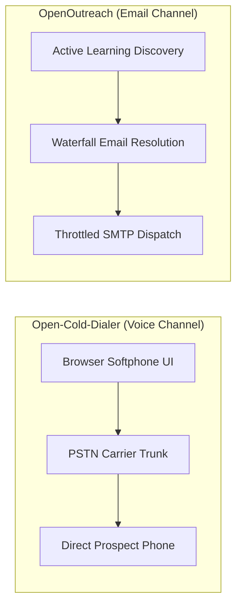
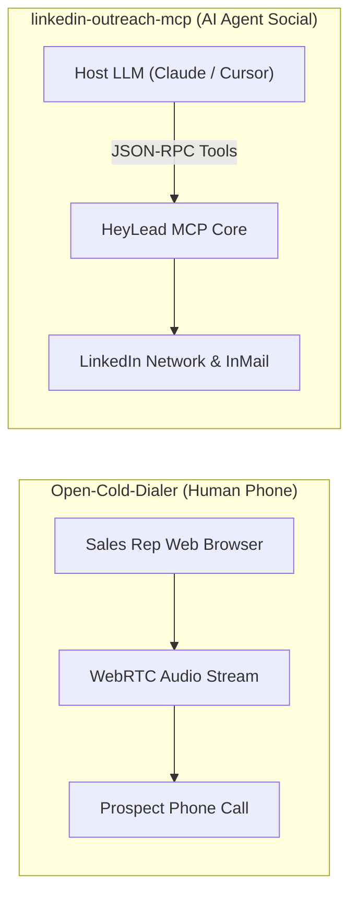
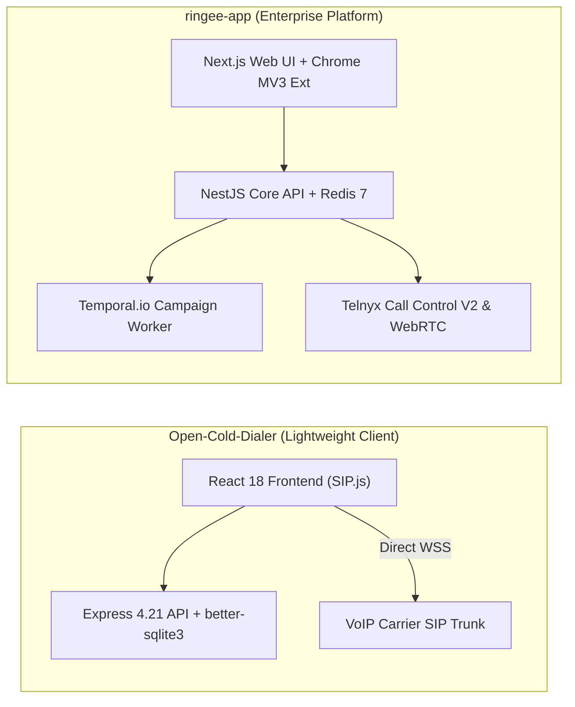

# Open-Cold-Dialer — Comparative Analysis & Category Evaluation

> **Category**: Cold Outreach & AI SDR  
> **Architectural Role**: Browser-based WebRTC softphone & high-velocity power dialer  
> **Primary Stack**: TypeScript, React 18, Vite, SIP.js 0.21 | Node.js, Express 4.21, Drizzle ORM | SQLite (`better-sqlite3`) / Supabase | MIT  
> **Peer Solutions Compared**: `AgentSDR`, `OpenOutreach`, `linkedin-outreach-mcp`, `ringee-app`  
> **Commercial SaaS Benchmarks**: RingCentral, Dialpad, PhoneBurner, Orum, Five9  

---

## 1. Executive Overview & Technical Identity: Open-Cold-Dialer

**Open-Cold-Dialer** is an open-source, browser-based cold calling and outbound dialing workbench engineered for high-velocity sales and business development representatives (SDRs). Designed as an open alternative to proprietary per-seat dialers like RingCentral and Dialpad, Open-Cold-Dialer runs directly inside any modern web browser without desktop software installations or vendor telephony lock-in.

Leveraging standard SIP over Secure WebSockets (`wss://`) via `SIP.js 0.21.0`, the platform connects to any VoIP carrier or private PBX (SignalWire, Telnyx, Twilio SIP, Asterisk, FreeSWITCH). It provides reps with interactive DTMF keypads, dynamic objection-handling battle cards, automated Do-Not-Call (DNC) compliance checks, and one-click disposition logging.

### Core Architectural Profile
- **Runtime & Language**: `TypeScript 5.6+` across frontend and backend
- **Frontend Framework & Build**: `React 18.3.1`, `Vite 6.0.5`, `TanStack React Query 5.101`, `Tailwind CSS 3.4`
- **Telephony & Audio Signaling**: `SIP.js 0.21.0` UserAgent managing SIP over WSS; direct WebRTC DTLS-SRTP media using the Opus codec
- **Backend Framework**: `Node.js 20+`, `Express 4.21` with `tsx` execution
- **Persistence Layer**: `Drizzle ORM 0.38` with `better-sqlite3 11.7.0` for local persistence; optional `@supabase/supabase-js` for PostgreSQL cloud hosting
- **Carrier Independence**: Bring-Your-Own-Carrier (BYOC) supporting SignalWire, Telnyx, Twilio, and Asterisk PBX

---

## 2. Peer Solution Landscape (Cold Outreach & AI SDR)

Within this category, `Open-Cold-Dialer` operates alongside four specialized peer solutions:

| Solution | Language & Runtime | Core Framework | Database & ORM | Queue & Concurrency Model | Primary Architectural Niche |
| :--- | :--- | :--- | :--- | :--- | :--- |
| **Open-Cold-Dialer** (Current) | `TypeScript / Node 20+` | `React 18, Vite, Express` | `SQLite / Supabase, Drizzle` | `SIP.js Client Event Loop over WSS` | Carrier-agnostic browser WebRTC power dialer |
| **AgentSDR** | `TypeScript / Bun 1.3` | `Next.js 16, React 19` | `PostgreSQL 15+, Drizzle` | `Postgres FOR UPDATE SKIP LOCKED` | Autonomous multi-channel AI SDR & inbox rotator |
| **OpenOutreach** | `Python 3.11+` | `Django 5.2+ (Headless)` | `SQLite 3 (WAL + IMMEDIATE)` | `Synchronous Bounded Batches` | Active-learning lead discovery & waterfall resolution |
| **linkedin-outreach-mcp** | `Python 3.10+` | `FastMCP SDK 1.30+` | `SQLite 3 (WAL, v16)` | `Asyncio Coroutines + Jitter Backoff` | Stealth LinkedIn automation for LLM agent swarms |
| **ringee-app** | `TypeScript / Node 20+` | `NestJS 11, Next.js 14` | `PostgreSQL 16, Prisma` | `Temporal.io Durable Workflows` | Enterprise contact center & power dialer cluster |

---

## 3. Deep Head-to-Head Comparative Breakdown: Open-Cold-Dialer vs Peers

### 3.1. Open-Cold-Dialer vs. AgentSDR

**Comparative Focus**: Browser-direct WebRTC cold calling workbench vs. autonomous multi-channel AI SDR suite.

```mermaid
flowchart LR
    subgraph SolA ["Open-Cold-Dialer (Client-Direct Media)"]
        A1["Browser React App (SIP.js)"] -->|WSS SIP Signaling| A2["Carrier SIP Proxy (Telnyx/Twilio/Asterisk)"]
        A1 <-->|Direct WebRTC RTP (Opus)| A2
        A1 -->|REST Dispositions| A3["Express Backend + better-sqlite3"]
    end
    subgraph SolB ["AgentSDR (Server-Assisted Calling)"]
        B1["Next.js Web UI"] --> B2["PostgreSQL via Drizzle"]
        B1 --> B3["services/call-worker"]
        B3 --> B4["AWS S3 Audio Storage"]
    end
```

#### Architectural & Stack Differences
- **Media Plane & Carrier Architecture**: In `Open-Cold-Dialer`, the media plane is completely decoupled from the application backend. The browser runs `SIP.js 0.21.0` to negotiate WebRTC media directly with the telephony carrier's edge gateway over secure WebSockets. In `AgentSDR`, the calling station operates as an auxiliary service alongside email and LinkedIn modules, routing audio capture and session states through an auxiliary background worker (`services/call-worker`).
- **Carrier Independence & BYOC**: `Open-Cold-Dialer` is carrier-agnostic by design. Its `src/sip/config.ts` ships with pre-configured presets for SignalWire, Telnyx, Twilio, and on-premise Asterisk PBX, allowing sales operations to switch telecom providers dynamically to optimize per-minute costs. `AgentSDR` is structured primarily around its cold email infrastructure and Unipile API gateways.
- **In-Call Sales Enablement**: `Open-Cold-Dialer` incorporates live objection-handling battle cards directly into the softphone interface. When a prospect raises an objection (*"No budget"*, *"Send an email"*), reps click dynamic accordion cards to view instant talking points and qualification pivots. `AgentSDR` focuses on autonomous AI draft generation and post-touch sentiment analysis.
- **Failure Modes & Fault Isolation**: In Open-Cold-Dialer, if the Node/Express backend server crashes or restarts, the sales rep's active phone call is completely unaffected because the SIP/WebRTC audio stream is anchored directly between the browser and the carrier. In AgentSDR, server restarts interrupt the fullstack Next.js runtime, requiring page reloads and socket re-establishment.

#### Architectural Comparison Matrix: Open-Cold-Dialer vs. AgentSDR

| Dimension | Open-Cold-Dialer | AgentSDR |
| :--- | :--- | :--- |
| **Primary Domain** | Outbound WebRTC phone dialing & battle cards | Multi-channel AI SDR (Email, LinkedIn, Voice) |
| **Media Architecture** | Client-direct WebRTC via SIP.js over WSS | Browser Softphone + auxiliary call worker |
| **Carrier Flexibility** | Bring-Your-Own-Carrier (Telnyx, Twilio, Asterisk) | Pre-wired custom WebRTC bridge |
| **Live Rep Enablement** | Dynamic objection-handling battle cards | Pre-call AI RAG context & dynamic formulas |
| **Backend Coupling** | Zero audio traffic passes through backend | Server microservice archives audio to S3 |
| **Persistence Engine** | SQLite (`better-sqlite3`) / Supabase via Drizzle | PostgreSQL 15+ via Drizzle ORM |
| **Primary Bottleneck** | Browser WebRTC STUN/TURN traversal | DB connection pool under high cron tick rates |

---

### 3.2. Open-Cold-Dialer vs. OpenOutreach

**Comparative Focus**: Real-time synchronous voice dialing vs. autonomous browserless email discovery & delivery.



#### Architectural & Stack Differences
- **Channel Dynamics & Latency**: `Open-Cold-Dialer` operates in a synchronous, real-time audio domain. Communication requires sub-200ms audio latency to avoid conversational lag over PSTN networks. `OpenOutreach` operates asynchronously: discovery runs across external B2B APIs, and cold emails are dispatched across hours with randomized sleep intervals (120–300 seconds).
- **Human In-The-Loop vs. Autonomy**: `Open-Cold-Dialer` is a human productivity amplifier; it optimizes the sales rep's time while on the phone with instant dialpads and one-click disposition tagging. `OpenOutreach` is fully autonomous: it discovers, evaluates, and messages prospects without human intervention.
- **Architectural Complementarity**: In a modern outbound workflow, `OpenOutreach` serves as the top-of-funnel discovery engine, finding mobile and direct phone numbers through BetterContact waterfall enrichment. These verified numbers are exported directly into `Open-Cold-Dialer`'s campaign lists for immediate power dialing.

#### Architectural Comparison Matrix: Open-Cold-Dialer vs. OpenOutreach

| Dimension | Open-Cold-Dialer | OpenOutreach |
| :--- | :--- | :--- |
| **Communication Channel**| Synchronous Voice Telephony (PSTN / Mobile) | Asynchronous B2B Cold Email |
| **Operational Model** | Interactive sales rep calling station | Autonomous background CLI pipeline |
| **Network Protocols** | SIP over WSS, DTLS-SRTP, WebRTC Opus | SMTP, IMAP, HTTPS REST |
| **Frontend UI** | React 18, Vite, TanStack Query, Tailwind | Zero-view headless CLI (`uv tool`) |
| **Data Ingestion** | High-speed CSV parsing (`papaparse`) | Licensed B2B APIs (BetterContact Lead Finder) |
| **Compliance Layer** | Internal `dnc_list` phone number blocking | IMAP bounce monitor & global suppression list |
| **Deployment Footprint** | ~120 MB RAM (Node API + Vite client) | ~60 MB RAM (Single Python process) |

---

### 3.3. Open-Cold-Dialer vs. linkedin-outreach-mcp

**Comparative Focus**: Web-based human power dialer vs. headless Model Context Protocol (MCP) LinkedIn tool daemon.



#### Architectural & Stack Differences
- **Execution Interface**: `Open-Cold-Dialer` presents a rich browser GUI designed for human sales reps. `linkedin-outreach-mcp` has no graphical UI; it is an MCP server providing 60+ typed JSON-RPC tools designed exclusively for programmatic consumption by AI coding assistants.
- **Channel & Media Protocols**: `Open-Cold-Dialer` manages real-time voice media over WebRTC and SIP. `linkedin-outreach-mcp` manages social messaging, connection requests, and profile scraping via Playwright headless Chromium automation.
- **Persistence & Architecture**: `Open-Cold-Dialer` uses Drizzle ORM over `better-sqlite3`. `linkedin-outreach-mcp` uses native SQLite 3 in WAL mode with a 12-stage exponential jitter backoff and OS Keychain secret storage (`keyring`).

#### Architectural Comparison Matrix: Open-Cold-Dialer vs. linkedin-outreach-mcp

| Dimension | Open-Cold-Dialer | linkedin-outreach-mcp |
| :--- | :--- | :--- |
| **Primary Channel** | Outbound Phone Telephony | LinkedIn InMail & Connection Requests |
| **Target Operator** | Human Sales Development Rep (SDR) | Autonomous LLM Agent (Claude Code / Cursor) |
| **Primary Interface** | React 18 Softphone & Script Accordion | 60+ Model Context Protocol (MCP) Tools |
| **Protocol Transport** | WebRTC DTLS-SRTP over WSS | JSON-RPC 2.0 over `stdio` / HTTP |
| **Automation Level** | Semi-automated power dialing & click-to-call | Fully autonomous multi-agent swarm |
| **Scripting Guidance** | Interactive objection battle cards | Voice cloning & dynamic tone matching |
| **Credential Storage** | Environment variables / Supabase | Encrypted OS Keychain (`keyring`) |

---

### 3.4. Open-Cold-Dialer vs. ringee-app

**Comparative Focus**: Lightweight client-direct WebRTC softphone vs. enterprise multi-tenant contact center platform with Temporal.io workflows.



#### Architectural & Stack Differences
- **Architecture Scale & Complexity**: `Open-Cold-Dialer` is designed for rapid self-hosting: a single Node/Express server and a static React frontend using `better-sqlite3`, deployable in minutes with minimal resource overhead. `ringee-app` is a distributed monorepo comprising NestJS, Next.js, Redis, PostgreSQL 16, and Temporal.io worker clusters.
- **Telephony Control & Infrastructure**: `Open-Cold-Dialer` lets the browser establish direct SIP over WSS connections to any carrier. `ringee-app` implements a headless dialer core (`@ringee/dialer-core`) driven by Zustand, backed by server-side Telnyx Call Control V2.
- **Campaign Orchestration**: `Open-Cold-Dialer` relies on client-driven power dialing where the rep advances through the lead queue manually. `ringee-app` uses **Temporal.io** durable workflows to power-dial thousands of contacts concurrently, automatically enforcing local-presence area code matching and caller ID pool daily caps to avoid spam flagging.
- **Inbound Distribution & CTI**: `Open-Cold-Dialer` is an outbound-only calling tool. `ringee-app` supports atomic inbound ring groups (simultaneous or round-robin ringing), desk phone BYOD SIP provisioning, dual-channel call recording, and automated bi-directional CRM syncing (HubSpot, Attio).

#### Architectural Comparison Matrix: Open-Cold-Dialer vs. ringee-app

| Dimension | Open-Cold-Dialer | ringee-app |
| :--- | :--- | :--- |
| **System Scale** | Lightweight single-server softphone | Distributed multi-tenant contact center cluster |
| **Media Plane** | Direct client-to-carrier WebRTC via SIP.js | Headless `@ringee/dialer-core` + Telnyx SDK |
| **Carrier Compatibility**| Carrier-agnostic BYOC (SignalWire, Twilio, Asterisk)| Telnyx-centric infrastructure |
| **Campaign Engine** | Client-driven sequential queue | Temporal.io durable distributed workflows |
| **Caller ID Reputation** | Rep selects static caller ID | Dynamic local presence pool & area code matching |
| **Call Recording** | Optional client audio capture | Carrier-side dual-channel recording to S3 |
| **Inbound Handling** | None (Outbound focused) | Atomic multi-agent ring groups & hunt queues |
| **CRM Integration** | Exportable call logs | Bi-directional sync microservices (HubSpot, Attio) |

---

## 4. Capability & Feature Comparison Matrix

| Dimension / Capability | Open-Cold-Dialer | AgentSDR | OpenOutreach | linkedin-outreach-mcp | ringee-app |
| :--- | :---: | :---: | :---: | :---: | :---: |
| **Browser WebRTC Softphone** | ✅ Native SIP.js | ✅ Built-in Softphone | ❌ | ❌ | ✅ Headless Core |
| **Carrier-Agnostic BYOC** | ✅ Any SIP WSS Trunk | ⚠️ Custom bridge | ❌ | ❌ | ⚠️ Telnyx-centric |
| **Objection Battle Cards** | ✅ Interactive UI | ❌ | ❌ | ❌ | ❌ |
| **Do-Not-Call (DNC) List** | ✅ Internal `dnc_list`| ❌ | ⚠️ Suppression list | ⚠️ Tombstones | ✅ Full DNC Table |
| **One-Click Dispositions** | ✅ Call logs modal | ⚠️ Basic outcome | ❌ | ❌ | ✅ Structured tags |
| **Local Presence Area Codes** | ❌ | ❌ | ❌ | ❌ | ✅ Caller ID Pools |
| **Durable Workflow State** | ❌ (Client state) | ⚠️ DB queue retries | ❌ | ⚠️ 12-stage backoff | ✅ Temporal.io |
| **Dual-Channel Recording** | ⚠️ Client capture | ✅ Microservice S3 | ❌ | ❌ | ✅ Carrier mixing |
| **CRM Bi-Directional Sync** | ❌ (Export only) | ✅ Internal CRM | ⚠️ CSV Export | ⚠️ Webhook bridge | ✅ HubSpot & Attio |
| **Memory Footprint** | **~120 MB RAM** | ~250 MB RAM | ~60 MB RAM | ~90 MB RAM | ~750 MB RAM |

---

## 5. Commercial Benchmark Positioning

When benchmarked against commercial outbound telephony leaders (**RingCentral, Dialpad, PhoneBurner, Orum, Five9**):
- **Against RingCentral & Dialpad**: Proprietary softphones charge $30–$75/user/month on top of calling minutes. Open-Cold-Dialer eliminates all per-seat licensing fees; users pay only raw carrier wholesale rates (typically $0.004–$0.007/min on Telnyx or SignalWire).
- **Against PhoneBurner & Orum**: While Orum uses expensive multi-line AI dialing algorithms, Open-Cold-Dialer provides the core power-dialing workflow: high-speed sequential dialing, dynamic objection battle cards, and instant disposition logging with zero software costs.
- **Against Five9**: Five9 requires heavy enterprise contracts and proprietary hardware setups. Open-Cold-Dialer runs inside any standard web browser over secure WebSockets, bypassing firewall NAT traversal headaches.

---

## 6. Strategic Takeaways & Role for MarketingStudio

In MarketingStudio's telephony architecture:
1. **Primary Component to Adopt**: Embed Open-Cold-Dialer's **carrier-agnostic `SIP.js` WebRTC softphone component** (`Softphone.tsx`) directly into MarketingStudio's CRM lead detail views, enabling reps to place outbound calls with a single click.
2. **Incorporate Dynamic Battle Cards**: Implement Open-Cold-Dialer's contextual script and objection-handling drawer to equip reps with live battle cards during active calls.
3. **Synergistic Integration**:
   - Ingest verified lead phone numbers discovered by `OpenOutreach` directly into Open-Cold-Dialer campaign queues.
   - Leverage `ringee-app`'s local presence caller ID algorithms to feed optimal outbound caller IDs to Open-Cold-Dialer's SIP registration sessions.
