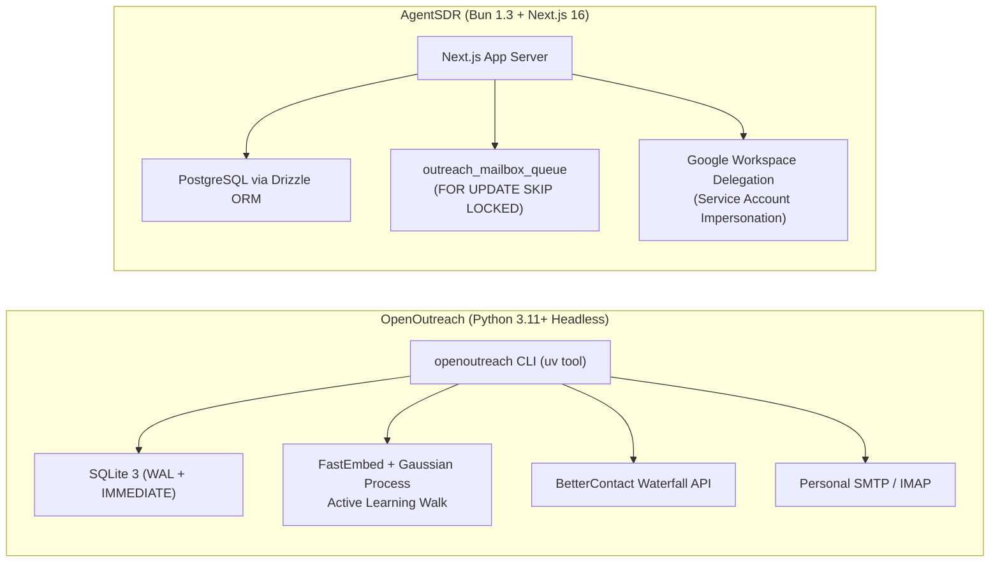
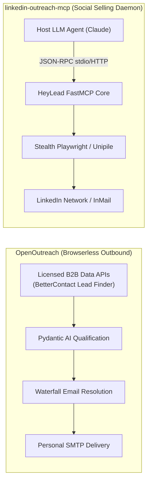
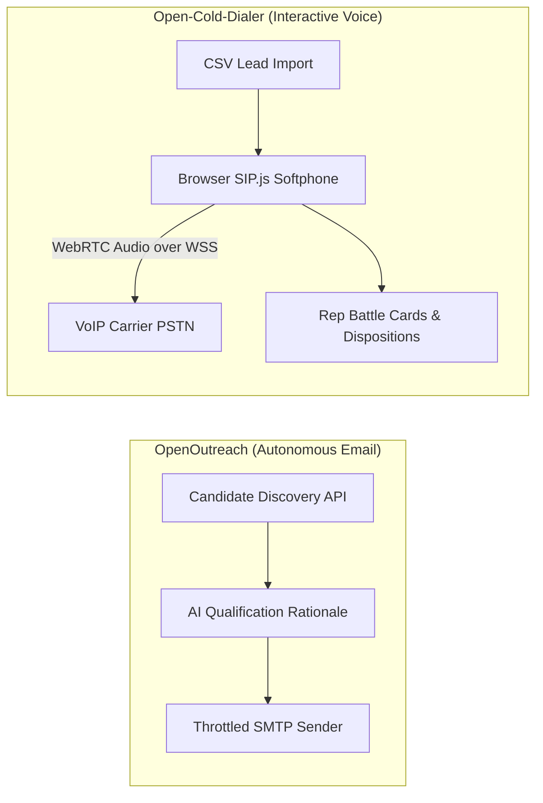
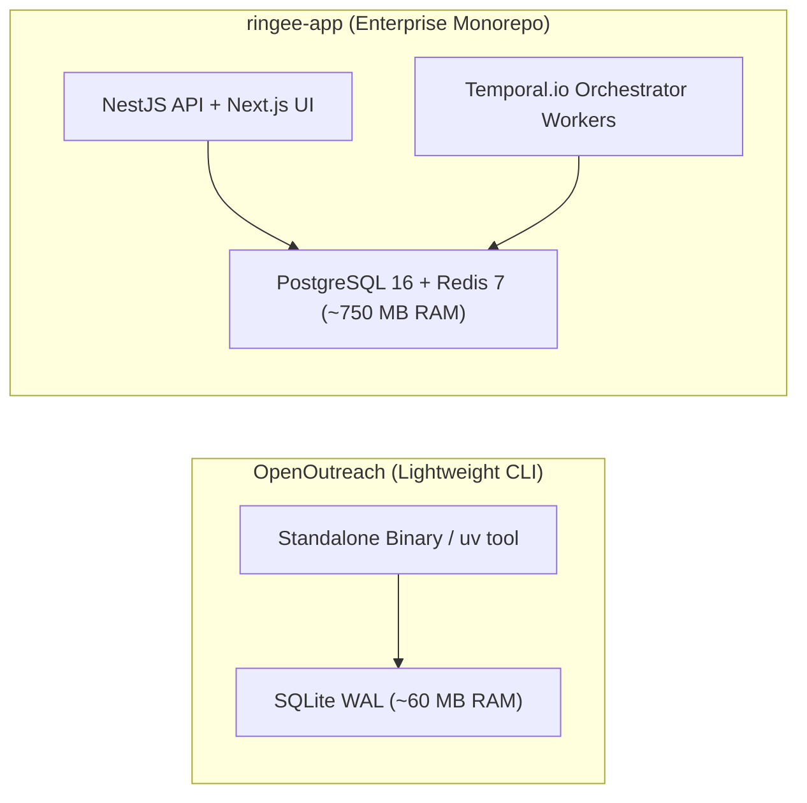

# OpenOutreach — Comparative Analysis & Category Evaluation

> **Category**: Cold Outreach & AI SDR  
> **Architectural Role**: Autonomous B2B lead discovery, active-learning ICP qualification & personal cold email delivery  
> **Primary Stack**: Python 3.11+, Django 5.2+ (Headless ORM) | SQLite 3 (WAL + IMMEDIATE) | FastEmbed + Gaussian Process Classifiers | Bounded CLI Pipeline  
> **Peer Solutions Compared**: `AgentSDR`, `linkedin-outreach-mcp`, `Open-Cold-Dialer`, `ringee-app`  
> **Commercial SaaS Benchmarks**: Apollo.io, Clay.com, Instantly.ai, HeyReach.io, Lemlist.com  

---

## 1. Executive Overview & Technical Identity: OpenOutreach

**OpenOutreach** is an open-source, bounded outbound prospecting orchestrator designed to transform plain-text product documentation and buyer personas into qualified, verified, and personalized cold email outreach. Engineered in Python 3.11+ using a headless Django 5.2+ architecture over SQLite WAL, OpenOutreach integrates two standalone engines—`openoutfind` (active-learning discovery and semantic ICP qualification) and `openoutsend` (deliverability-guarded personal mailbox dispatch)—into a zero-daemon CLI.

### Core Architectural Profile
- **Runtime & Language**: `Python >= 3.11` managed via `uv` or `pip`
- **Core Framework**: `Django 5.2+` utilized headlessly as an application registry, ORM, and migration coordinator (zero web views, admin, or session overhead)
- **Persistence Layer**: `SQLite 3` with `PRAGMA journal_mode=WAL` and `transaction_mode=IMMEDIATE`
- **Concurrency & Execution Model**: Synchronous bounded batch execution with in-thread randomized sleep pacing (no Celery, Redis, or background daemons)
- **AI & Embedding Infrastructure**: `Pydantic AI` structured agents, `FastEmbed` local vectorization, and `scikit-learn` Gaussian Process active-learning classifiers
- **Data & Deliverability**: BetterContact Lead Finder & Waterfall Email API; Python `smtplib` / `imaplib` with TLS/SSL
- **Domain Specialization**: Zero-scraping explainable lead discovery, active-learning search walks, and budget-gated waterfall email resolution

---

## 2. Peer Solution Landscape (Cold Outreach & AI SDR)

Within this category, `OpenOutreach` operates alongside four specialized peer solutions:

| Solution | Language & Runtime | Core Framework | Database & ORM | Queue & Concurrency Model | Primary Architectural Niche |
| :--- | :--- | :--- | :--- | :--- | :--- |
| **OpenOutreach** (Current) | `Python 3.11+` | `Django 5.2+ (Headless)` | `SQLite 3 (WAL + IMMEDIATE)` | `Synchronous Bounded Batches` | Active-learning lead discovery & waterfall resolution |
| **AgentSDR** | `TypeScript / Bun 1.3` | `Next.js 16, React 19` | `PostgreSQL 15+, Drizzle` | `Postgres FOR UPDATE SKIP LOCKED` | Autonomous multi-channel AI SDR & inbox rotator |
| **linkedin-outreach-mcp** | `Python 3.10+` | `FastMCP SDK 1.30+` | `SQLite 3 (WAL, v16)` | `Asyncio Coroutines + Jitter Backoff` | Stealth LinkedIn automation for LLM agent swarms |
| **Open-Cold-Dialer** | `TypeScript / Node 20+` | `React 18, Vite, Express` | `SQLite / Supabase, Drizzle` | `SIP.js Client Event Loop over WSS` | Carrier-agnostic browser WebRTC power dialer |
| **ringee-app** | `TypeScript / Node 20+` | `NestJS 11, Next.js 14` | `PostgreSQL 16, Prisma` | `Temporal.io Durable Workflows` | Enterprise contact center & power dialer cluster |

---

## 3. Deep Head-to-Head Comparative Breakdown: OpenOutreach vs Peers

### 3.1. OpenOutreach vs. AgentSDR

**Comparative Focus**: Bounded active-learning discovery CLI vs. persistent multi-channel web application & inbox rotator.

#### Architectural & Stack Differences
- **Runtime & Process Models**: `OpenOutreach` is designed as a self-contained, zero-daemon CLI tool. When invoked (e.g., `openoutreach find 10`), it loads headless Django ORM models, queries external B2B APIs, updates local SQLite tables, and exits. `AgentSDR` runs as a long-lived Web and API server on Bun 1.3, continuously serving Next.js App Router interfaces, executing cron slot schedulers, and listening for webhook ingress.
- **Queue & Concurrency Mechanics**: `OpenOutreach` executes jobs sequentially in synchronous batches, pacing email dispatches through explicit in-thread randomized sleeps (120–300 seconds). It eliminates message brokers (no Redis, RabbitMQ, or Celery). `AgentSDR` uses an in-process, two-tier PostgreSQL queue where tick workers lock individual candidate rows using `SELECT ... FOR UPDATE SKIP LOCKED`, supporting concurrent multi-inbox dispatching across multiple organizations.
- **Lead Discovery & Qualification Engine**: `OpenOutreach` treats lead discovery as an active-learning search problem. Discovered candidate profiles are vectorized using `fastembed` without GPU requirements; a Gaussian Process classifier dynamically learns from positive and negative fit verdicts to steer subsequent keyword queries toward denser ICP segments. Every accepted lead receives an explicit qualitative `reason` string. `AgentSDR` relies on static user imports or manual AG Grid rows, using WebAssembly QuickJS formulas and LLM prompt loops for enrichment.
- **Email Delivery & Mailbox Management**: `OpenOutreach` sends cold emails directly through the operator's personal mailbox via Python's standard `smtplib` and monitors replies/bounces via `imaplib`. `AgentSDR` manages large-scale domain-wide delegation via Google Workspace Service Accounts, rotating cold emails across dozens of provisioned mailboxes to distribute sending volume.

#### Architectural Comparison Matrix: OpenOutreach vs. AgentSDR

| Dimension | OpenOutreach | AgentSDR |
| :--- | :--- | :--- |
| **Execution Architecture** | Ephemeral, bounded CLI utility (`uv tool run`) | Long-running multi-tenant SaaS application (Bun) |
| **Framework Model** | Headless Django 5.2+ (ORM & app registry only) | Next.js 16 (App Router, Server Actions, React 19) |
| **Lead Discovery Strategy** | FastEmbed + Gaussian Process active-learning walks | Manual CSV upload / AG Grid HTTP/Apollo enrichment |
| **Fit Explainability** | Explicit human-readable `reason` string generated | Dynamic prompt context injection |
| **Email Infrastructure** | Personal mailbox via standard SMTP / IMAP | Google Workspace Domain-Wide Delegation pool |
| **Queue / Scheduling** | Synchronous thread execution + sleep intervals | PostgreSQL relational queue (`FOR UPDATE SKIP LOCKED`) |
| **Database Engine** | Embedded SQLite 3 (WAL + IMMEDIATE) | PostgreSQL 15+ via Drizzle ORM |
| **Primary Failure Mode** | CLI process kill during batch sleep interval | Database connection saturation during tick spikes |

---

### 3.2. OpenOutreach vs. linkedin-outreach-mcp

**Comparative Focus**: Browserless B2B email prospecting vs. Model Context Protocol (MCP) LinkedIn social selling daemon.

#### Architectural & Stack Differences
- **Channel Execution & Anti-Detection**: `OpenOutreach` is completely browserless. It avoids scraping social networks or web pages, sourcing candidate profiles through licensed B2B data providers (BetterContact). This eliminates account ban risks, proxy rotation overhead, and CAPTCHA circumvention. `linkedin-outreach-mcp` operates directly on LinkedIn via stealth Playwright browser automation or Unipile gateways, utilizing voice cloning and humanized cursor jitter to evade platform bot detection.
- **Runtime & Interfacing**: `OpenOutreach` provides a standard CLI command suite and an agent skill (`skills/find-leads/SKILL.md`). In contrast, `linkedin-outreach-mcp` is an active Model Context Protocol (`mcp>=1.30.0`) server exposing 60+ structured JSON-RPC tools, purpose-built for direct control by AI assistants (Claude Code, Cursor).
- **Concurrency & Backoff**: `OpenOutreach` relies on synchronous execution and SQLite `IMMEDIATE` transaction locking. `linkedin-outreach-mcp` utilizes asynchronous coroutines (`asyncio`) and implements an explicit 12-stage exponential backoff with random jitter to handle concurrent tool calls and prevent SQLite database lock contention.
- **Budget & Waterfall Logic**: `OpenOutreach` enforces strict economic gating: discovery and semantic ICP qualification are 100% free; paid waterfall address lookups are triggered only for leads exceeding confidence thresholds (e.g. `openoutreach find 10 emails` caps paid lookups at 10). `linkedin-outreach-mcp` focuses on social relationship building, InMail cadences, and automated calendar scheduling via Google Calendar.

#### Architectural Comparison Matrix: OpenOutreach vs. linkedin-outreach-mcp

| Dimension | OpenOutreach | linkedin-outreach-mcp |
| :--- | :--- | :--- |
| **Target Channel** | Verified Business Cold Email | LinkedIn Connection Requests, InMail & Messaging |
| **Platform Risk** | Zero (100% browserless via licensed B2B APIs) | Moderate (Evades LinkedIn anti-bot algorithms) |
| **Integration Protocol** | CLI verbs (`find`, `send`, `run`) & JSONL buffers | Model Context Protocol (MCP) over `stdio` / HTTP |
| **AI Tool Suite** | Pydantic AI ICP evaluator & copywriter | 60+ typed MCP tools (campaigns, tone, schedule) |
| **Search Mechanics** | Active-learning Gaussian Process search walks | Semantic RAG persona search & intent watchlists |
| **Database Structure** | SQLite WAL (IMMEDIATE) hosting Django models | SQLite WAL (`user_version = 16`) + OS Keychain |
| **Meeting Booking** | Plaintext booking link injection in copy | Automated calendar negotiation via Google Calendar API |
| **Primary Failure Mode** | Third-party BetterContact API credit exhaustion | LinkedIn security checkpoint or account session invalidation |

---

### 3.3. OpenOutreach vs. Open-Cold-Dialer

**Comparative Focus**: Autonomous text-based lead discovery and email pipeline vs. browser-based WebRTC outbound calling softphone.

#### Architectural & Stack Differences
- **Interaction Model & Human Latency**: `OpenOutreach` operates fully autonomously without human intervention. It discovers leads, filters non-fits, verifies email addresses, and dispatches sequences in the background. `Open-Cold-Dialer` is an interactive sales rep workbench; a human SDR sits at the browser, dials numbers sequentially, navigates objection-handling battle cards, and selects call outcome dispositions (`answered`, `voicemail`, `dnc`).
- **Media Plane & Protocol Layer**: `OpenOutreach` uses standard text-based protocols (SMTP/IMAP and HTTPS REST). `Open-Cold-Dialer` operates a real-time WebRTC media engine using `SIP.js 0.21.0`. The browser handles SDP negotiation, ICE candidate gathering, and DTLS-SRTP encryption to stream Opus audio directly to carrier PSTN gateways.
- **Persistence & Architecture**: `OpenOutreach` runs a headless Django/Python backend over SQLite WAL. `Open-Cold-Dialer` features a Vite/React 18 frontend communicating with an Express 4.21 backend using Drizzle ORM over `better-sqlite3`.
- **Synergy Opportunity**: OpenOutreach can discover verified contact phone numbers through its BetterContact waterfall enrichment and export them via CSV/API directly into Open-Cold-Dialer's campaign queues for high-velocity phone prospecting.

#### Architectural Comparison Matrix: OpenOutreach vs. Open-Cold-Dialer

| Dimension | OpenOutreach | Open-Cold-Dialer |
| :--- | :--- | :--- |
| **Primary Channel** | B2B Cold Email & Lead Qualification | Outbound Phone Telephony (PSTN / Mobile) |
| **Operational Model** | Fully autonomous background CLI execution | Human-in-the-loop sales rep softphone workbench |
| **Media Requirements** | None (Text payloads only) | Direct WebRTC audio streaming (Opus codec) |
| **Protocol Stack** | SMTP, IMAP, HTTPS REST | SIP over WSS, DTLS-SRTP, WebRTC |
| **Backend Framework** | Headless Django 5.2+ (Python) | Express 4.21 (Node.js) + Vite/React 18 |
| **Lead Ingestion** | Autonomous API search via licensed B2B providers | Bulk CSV upload via `papaparse` or REST API |
| **Compliance Guards** | IMAP bounce harvesting & global suppression list | Internal Do-Not-Call (`dnc_list`) enforcement |
| **Primary Bottleneck** | Personal mailbox daily sending limits (30–50/day)| Rep manual dialing stamina and connection rates |

---

### 3.4. OpenOutreach vs. ringee-app

**Comparative Focus**: Lightweight single-user discovery & email tool vs. distributed enterprise telephony & campaign orchestrator.

#### Architectural & Stack Differences
- **System Scale & Footprint**: `OpenOutreach` is engineered for extreme simplicity: a single Python package installable via `uv tool install openoutreach`, requiring ~60 MB RAM and zero background daemons. `ringee-app` is an enterprise-scale monorepo requiring multiple Docker containers (NestJS backend, Next.js frontend, Temporal.io worker, PostgreSQL 16, Redis 7, MinIO), consuming ~750 MB+ RAM at baseline.
- **Orchestration & Workflow Durability**: `OpenOutreach` runs synchronous batch loops that exit upon completion; if interrupted, it restarts idempotently from local SQLite state. `ringee-app` uses **Temporal.io** (`@temporalio/workflow`) to execute distributed, fault-tolerant state machines. Temporal records every state transition in an event log, allowing dialing workflows to pause, resume, and recover across node failures without data loss.
- **Telephony & Integration Ecosystem**: `OpenOutreach` focuses exclusively on email and licensed B2B data APIs. `ringee-app` provides an entire telephony contact center: dynamic local presence caller ID rotation, automatic area code matching, atomic ring group assignment, stereo call recording, and native bi-directional sync workers for HubSpot and Attio.

#### Architectural Comparison Matrix: OpenOutreach vs. ringee-app

| Dimension | OpenOutreach | ringee-app |
| :--- | :--- | :--- |
| **Architecture Topology** | Single-user CLI application | Multi-service enterprise monorepo |
| **Workflow Engine** | Bounded sequential batch execution | Temporal.io event-sourced durable workflows |
| **Target Scope** | B2B lead discovery & cold email dispatch | High-volume outbound calling & call center CTI |
| **Data Storage** | SQLite 3 (WAL mode) | PostgreSQL 16 via Prisma ORM (50+ models) |
| **Distributed Caching** | None (In-memory Python structures) | Redis 7.x (presence & distributed rate limiting) |
| **Telephony Support** | None | Full Telnyx Call Control V2 & WebRTC core |
| **CRM Connectivity** | Standard CSV export compatible with CRMs | Bi-directional sync microservices (HubSpot, Attio) |
| **Deployment Effort** | 10 seconds (`uv tool install openoutreach`) | Multi-container Docker Compose cluster |

---

## 4. Capability & Feature Comparison Matrix

| Dimension / Capability | OpenOutreach | AgentSDR | linkedin-outreach-mcp | Open-Cold-Dialer | ringee-app |
| :--- | :---: | :---: | :---: | :---: | :---: |
| **Autonomous Lead Discovery** | ✅ Active Learning GP | ⚠️ Manual / Grid API | ⚠️ Watchlists only | ❌ | ❌ |
| **Explainable Fit Rationales** | ✅ Explicit `reason` Text | ⚠️ Dynamic prompts | ✅ Decision Journal | ❌ | ❌ |
| **Waterfall Email Resolution** | ✅ BetterContact / Apollo | ❌ | ❌ | ❌ | ❌ |
| **Zero ToS / Browserless Operation** | ✅ 100% Licensed APIs | ⚠️ Unipile dependent | ❌ Browser automation | ❌ | ❌ |
| **Multi-Step Email Cadences** | ✅ Deterministic steps | ✅ Multi-inbox rotation | ❌ | ❌ | ❌ |
| **LinkedIn Prospecting** | ❌ | ⚠️ Unipile Gateway | ✅ 60+ MCP Tools | ❌ | ❌ |
| **Voice / Softphone Calling** | ❌ | ✅ Built-in Softphone | ❌ | ✅ SIP.js WebRTC | ✅ Headless Core |
| **Durable Workflow Engine** | ❌ | ⚠️ Relational DB queue | ⚠️ 12-stage retry | ❌ | ✅ Temporal.io |
| **Local Presence Caller ID Rotation**| ❌ | ❌ | ❌ | ❌ | ✅ Area Code Pools |
| **Deployment Footprint** | **~60 MB RAM** | ~250 MB RAM | ~90 MB RAM | ~120 MB RAM | ~750 MB RAM |

---

## 5. Commercial Benchmark Positioning

When benchmarked against commercial outbound sales leaders (**Apollo.io, Clay.com, Instantly.ai, HeyReach.io, Lemlist.com**):
- **Against Apollo.io**: OpenOutreach eliminates Apollo's search credit paywalls. It discovers leads via licensed B2B endpoints and executes semantic qualification locally for free, spending credits only on verified email waterfall lookups.
- **Against Clay.com**: OpenOutreach matches Clay's waterfall email enrichment strategy (BetterContact, Apollo cascades) while introducing active-learning Gaussian Process search walks that autonomously optimize keyword selection without manual spreadsheet configuration.
- **Against Instantly.ai / Smartlead**: OpenOutreach's generated CSV output includes explicit `reason` fields that map directly into Instantly and Smartlead personalization variables (`{{reason}}`), providing human-readable icebreakers without generic AI hallucinations.

---

## 6. Strategic Takeaways & Role for MarketingStudio

In MarketingStudio's outbound architecture:
1. **Primary Component to Adopt**: Embed `openoutfind`'s **active-learning discovery and Gaussian Process search walker** as MarketingStudio's core prospect discovery engine.
2. **Adopt Bounded Waterfall Verification**: Replicate OpenOutreach's economic gating pattern: discover and semantically qualify leads at zero marginal cost, triggering paid waterfall verification only for candidates passing empirical confidence thresholds.
3. **Synergistic Integration**:
   - Pipe OpenOutreach's qualified, verified leads into `AgentSDR` for multi-inbox cadence dispatch and autonomous reply sentiment classification.
   - Route phone numbers discovered during waterfall lookups into `Open-Cold-Dialer` or `ringee-app` for instant power dialing.
