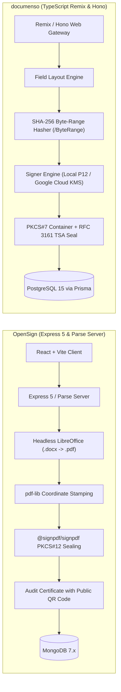
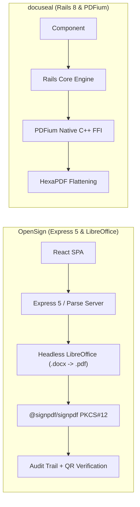
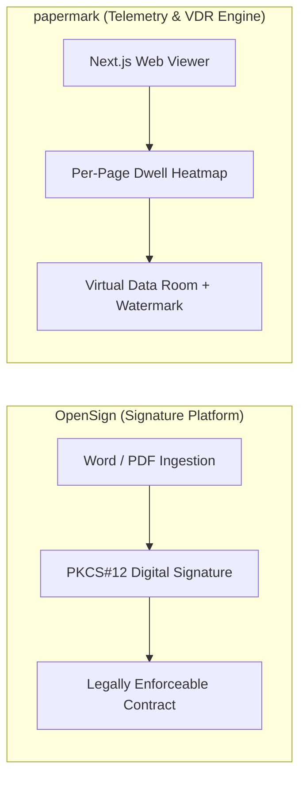

# OpenSign — Comparative Analysis & Category Evaluation

> **Category**: E-Signature & Document Tracking  
> **Architectural Role**: Turnkey e-signature platform, Parse Server backend, LibreOffice document conversion & PKCS#12 sealing engine  
> **Primary Stack**: JavaScript / Node.js | Express 5 & Parse Server | MongoDB 7.x | React + Vite | LibreOffice Headless | @signpdf/signpdf  
> **Peer Solutions Compared**: `documenso`, `docuseal`, `papermark`  
> **Commercial SaaS Benchmarks**: DocuSign, PandaDoc, Adobe Sign, HelloSign  

---

## 1. Executive Overview & Technical Identity: OpenSign

**OpenSign** represents the turnkey BaaS (Backend-as-a-Service) e-signature platform within the **E-Signature & Document Tracking** domain. Operating on an Express 5 backend powered by Parse Server and MongoDB, OpenSign provides a developer-friendly, unencumbered open-source alternative to commercial e-sign giants like DocuSign and PandaDoc.

OpenSign addresses two major operational hurdles in document management:
1. **Direct Microsoft Office Ingestion**: Unlike competitors that mandate pre-rendered PDF uploads, OpenSign integrates a native headless LibreOffice conversion pipeline (`libreoffice-convert`), allowing users to upload `.docx`, `.odt`, and `.rtf` documents and automatically convert them into high-fidelity PDFs prior to placing signature fields.
2. **Authentic Cryptographic Sealing with Public QR Verification**: Using `@signpdf/signpdf` and `node-forge`, OpenSign injects PKCS#12 (`.p12`) digital signatures into PDF byte-range containers, ensuring full validation in standard PDF readers (Adobe Acrobat). Completed documents feature an automated Certificate of Completion with an embedded cryptographic QR code, enabling instant public verification via mobile devices.

### Core Architectural Profile
- **Runtime & Language**: `JavaScript / Node.js LTS`
- **Core Framework**: `Express 5, Parse Server middleware, React + Vite frontend (apps/OpenSign)`
- **Persistence Layer**: `MongoDB 7.x (Parse Collections, BSON Documents) + GridFS / S3 file storage`
- **Concurrency & Queue Model**: `Parse Cloud Code background execution, Node child process worker queues`
- **Domain Specialization**: Turnkey Parse Server e-signature, headless LibreOffice `.docx` conversion, PKCS#12 digital signatures & public QR code verification

---

## 2. Peer Solution Landscape (E-Signature & Document Tracking)

Within this category, `OpenSign` operates alongside the following peer solutions:

| Solution | Language & Runtime | Core Framework | Database / Cache | Queue / Concurrency | Primary Architectural Niche |
| :--- | :--- | :--- | :--- | :--- | :--- |
| **OpenSign** (Current) | `JavaScript / Node.js` | `Express 5, Parse Server`| `MongoDB 7.x, Local/S3` | `Parse Cloud Code` | **Turnkey Parse Server e-signature & LibreOffice `.docx` conversion** |
| **documenso** | `TypeScript / Node.js` | `Remix, Hono, tRPC` | `PostgreSQL 15 (Prisma+Kysely)`| `Inngest / DB Queue` | ISO 32000-1 PKCS#7 cryptographic sealing & Cloud KMS |
| **docuseal** | `Ruby 3.3+ / C++` | `Rails 7.2/8.0, Vue.js` | `PostgreSQL / SQLite3` | `Sidekiq / Redis` | High-throughput native C++ PDFium FFI & `<docuseal-form>` component |
| **papermark** | `TypeScript / Node.js` | `Next.js, Tailwind` | `PostgreSQL (Prisma)` | `Trigger.dev Workers` | Open-source DocSend alternative for per-page dwell heatmaps & VDR |

---

## 3. Deep Head-to-Head Comparative Breakdown: OpenSign vs Peers

### 3.1. OpenSign vs. documenso

**Comparative Focus**: `Parse Server Architecture & LibreOffice Office Document Conversion` vs. `Modern Remix/Hono Monorepo & Cloud KMS`

#### Detailed Architectural Contrast
- **Backend Paradigm & Data Layer**: `OpenSign` builds on Parse Server and MongoDB, utilizing Parse's Object-Level Access Control Lists (ACLs) to manage user permissions and multi-tenancy. `documenso` uses modern TypeScript fullstack tooling (Remix, Hono, tRPC, Prisma, Kysely) backed by relational PostgreSQL 15, prioritizing strict type safety across the monorepo.
- **Document Ingestion Capabilities**: `OpenSign` features a native headless LibreOffice conversion pipeline (`libreoffice-convert`), enabling users to upload Microsoft Word files (`.docx`), `.odt`, or `.rtf` and automatically convert them into vector-perfect PDFs on the server. `documenso` strictly requires upstream pre-rendered PDF files.
- **Cryptographic Key Management**: `documenso` supports enterprise Hardware Security Modules (Google Cloud KMS HSM) and RFC 3161 Time-Stamp Authorities (TSA), satisfying strict eIDAS Qualified Electronic Signature (QES) standards. `OpenSign` signs via local PKCS#12 private certificates (`.p12`) using `@signpdf/signpdf` and `node-forge`.
- **Public Verification**: `OpenSign` embeds a public QR code on every Certificate of Completion, enabling instant third-party authenticity checks with a smartphone camera. `documenso` verifies document authenticity through native PDF reader signature panes and REST APIs.

#### Architectural Comparison Matrix: OpenSign vs. documenso

| Dimension | OpenSign | documenso | Architectural Implication |
| :--- | :--- | :--- | :--- |
| **Document Ingestion** | **Native `.docx`/`.odt` via LibreOffice** | **Pre-Rendered PDF Only** | OpenSign eliminates external Word-to-PDF conversion steps for business users. |
| **Backend Architecture** | **Express 5 + Parse Server** | **Remix + Hono + tRPC** | Documenso offers a modern, fully-typed TypeScript stack; OpenSign relies on Parse BaaS. |
| **Hardware Key Protection** | **Local Certificate Files (.p12)** | **Google Cloud KMS HSM** | Documenso protects private keys in certified cloud hardware security modules. |
| **Verification Method** | **Public QR Code + PDF Signature** | **PDF Cryptographic Container** | OpenSign simplifies human verification via smartphone QR scanning. |
| **Database Storage** | **Document Store (MongoDB 7.x)** | **Relational (PostgreSQL 15)** | Documenso enforces relational integrity; OpenSign uses flexible BSON document collections. |

---

### 3.2. OpenSign vs. docuseal

**Comparative Focus**: `Parse Server Architecture & LibreOffice Office Document Conversion` vs. `Native C++ PDF Engine & Embeddable Web Component`

#### Detailed Architectural Contrast
- **PDF Manipulation Speed**: `docuseal` uses native Google PDFium C++ FFI bindings and HexaPDF to execute instant page previews and field flattening. `OpenSign` uses JavaScript-based `pdf-lib` and `@signpdf/signpdf` within Node.js.
- **Office Document Handling**: `OpenSign` is equipped to handle raw Microsoft Office documents (`.docx`), running headless LibreOffice in the background to convert them to PDFs automatically. `docuseal` accepts PDFs or converts HTML/CSS templates, but lacks native `.docx` conversion out of the box.
- **Client Embedding**: `docuseal` delivers a zero-dependency HTML custom element (`<docuseal-form>`) that can be embedded into any web framework in one line of code. `OpenSign` requires standard iFrame embedding or direct REST API integration.

#### Architectural Comparison Matrix: OpenSign vs. docuseal

| Dimension | OpenSign | docuseal | Architectural Implication |
| :--- | :--- | :--- | :--- |
| **Office Doc Conversion** | **Native `.docx`/`.odt` via LibreOffice** | **HTML/CSS to PDF Templates** | OpenSign converts Word files on the fly; Docuseal focuses on web-native HTML forms. |
| **Rendering Performance** | **Node.js `pdf-lib`** | **Google PDFium (C++ FFI)** | Docuseal renders and rasterizes pages significantly faster with lower latency. |
| **Embedding Model** | **iFrame / REST API** | **Native `<docuseal-form>` Web Component**| Docuseal provides a smoother inline embedding experience for customer applications. |
| **Verification Method** | **Public QR Code Scanning** | **URL Audit Trail + Hash** | OpenSign enables instant mobile camera verification via QR codes. |

---

### 3.3. OpenSign vs. papermark

**Comparative Focus**: `Turnkey E-Signature Platform & Document Conversion` vs. `Per-Page Slide Telemetry & Virtual Data Rooms`

#### Detailed Architectural Contrast
- **Functional Alignment**: `OpenSign` is built to execute legally binding contracts with signature fields and digital certificates. `papermark` tracks reading behavior on proposals, presentations, and due diligence data rooms.
- **Security & Integrity**: `OpenSign` guarantees document integrity using PKCS#12 cryptographic signatures. `papermark` enforces access controls (email gates, passwords, NDAs) and dynamic watermarking (stamping the viewer's IP and email across pages) to deter leaks.

#### Architectural Comparison Matrix: OpenSign vs. papermark

| Dimension | OpenSign | papermark | Architectural Implication |
| :--- | :--- | :--- | :--- |
| **Primary Objective** | **Document Execution & Legal Signature** | **Proposal Telemetry & VDR Distribution** | OpenSign executes contracts; Papermark qualifies interest and protects confidentiality. |
| **Document Ingestion** | **Native `.docx`, `.odt`, `.pdf`** | **PDF & PPTX Decks** | OpenSign supports diverse contract formats; Papermark focuses on visual presentations. |
| **Analytics Captured** | **Signer Audit Trail & Timestamps** | **Per-Page Dwell Duration Heatmaps** | Papermark provides slide-by-slide reading analytics. |

---

## 4. Capability & Feature Comparison Matrix

| Dimension / Capability | OpenSign | documenso | docuseal | papermark |
| :--- | :---: | :---: | :---: | :---: |
| **Office (.docx) Auto-Conversion** | ✅ (Headless LibreOffice)| ❌ | ⚠️ (HTML to PDF) | ⚠️ (PPTX) |
| **Public QR Verification Code** | ✅ (Native QR Stamp) | ❌ | ❌ | ❌ |
| **PKCS#12 / PKCS#7 Digital Signatures**| ✅ @signpdf | ✅ Full PKCS#7 | ⚠️ X.509 Seal | ❌ |
| **Google Cloud KMS HSM Key Protection** | ❌ | ✅ | ❌ | ❌ |
| **Native C++ PDFium Acceleration** | ❌ | ❌ | ✅ (lib/pdfium.rb) | ❌ |
| **Embeddable Web Component** | ⚠️ iFrame | ⚠️ React SDK | ✅ `<docuseal-form>` | ⚠️ iFrame |
| **Per-Page Dwell Time Telemetry** | ❌ | ❌ | ❌ | ✅ |
| **Virtual Data Rooms (VDR)** | ❌ | ❌ | ❌ | ✅ |
| **Primary Database** | MongoDB 7.x | PostgreSQL 15 | PostgreSQL / SQLite | PostgreSQL |
| **License** | **MIT** | AGPL-3.0 | AGPL-3.0 | AGPL-3.0 |

---

## 5. Commercial Benchmark Positioning & MarketingStudio Fit

- **Against PandaDoc & Adobe Sign**: `OpenSign` offers a completely permissive MIT license with turnkey Parse Server deployment and native Microsoft Word ingestion, removing all per-document and per-user SaaS subscription costs.
- **MarketingStudio Synergy**: `OpenSign` provides the ideal document conversion and signing bridge when non-technical corporate clients need to upload `.docx` proposals and contracts directly for signing without external PDF export tools.
