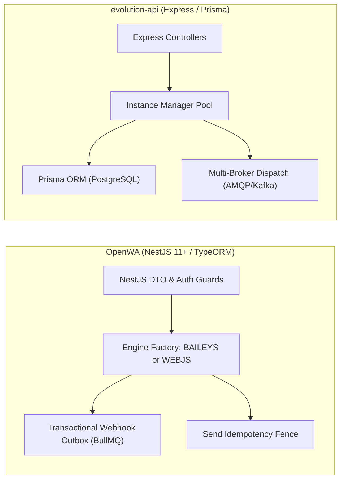
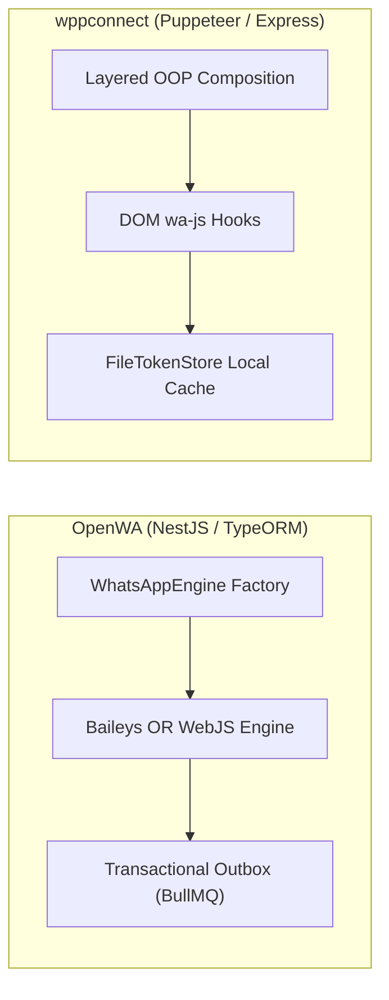
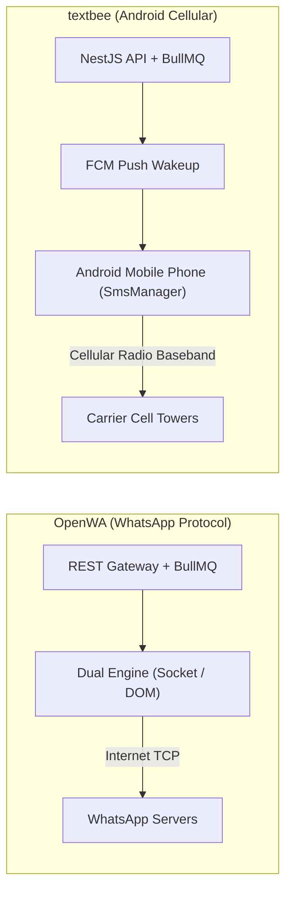
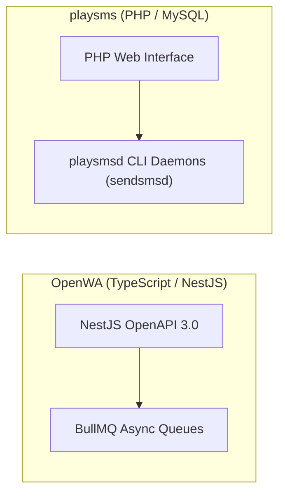
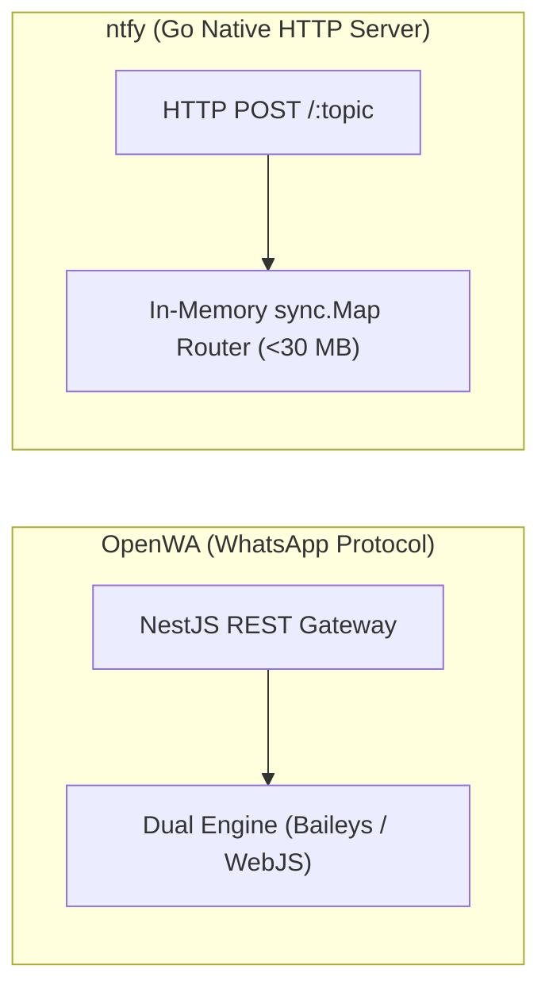

# OpenWA — Comparative Analysis & Category Evaluation

> **Category**: WhatsApp & Messaging Gateways  
> **Architectural Role**: Enterprise multi-engine WhatsApp HTTP API gateway & outbox manager  
> **Primary Stack**: TypeScript 5.7+, Node.js 22+ | NestJS 11+, TypeORM | PostgreSQL 15+ / SQLite, Redis 7+ | BullMQ Distributed Queues  
> **Peer Solutions Compared**: `evolution-api`, `wppconnect`, `textbee`, `playsms`, `ntfy`  
> **Commercial SaaS Benchmarks**: WhatsApp Cloud API (Meta), Twilio WhatsApp, Respond.io, MessageBird, BirdEye  

---

## 1. Executive Overview & Technical Identity: OpenWA

**OpenWA** represents the enterprise reliability and architectural flexibility standard within the **WhatsApp & Messaging Gateways** domain, distinguished by its core focus on **A pluggable dual-engine abstraction (Baileys vs. WWebJS Puppeteer), transactional webhook outbox delivery via BullMQ, send idempotency key enforcement, and NestJS modular multi-tenancy**.

### Core Architectural Profile
- **Runtime & Language**: `TypeScript 5.7+`, `Node.js 22 LTS` (ES2022)
- **Core Framework**: `NestJS 11+`, `TypeORM 0.3+`, `@nestjs/swagger` (OpenAPI 3.0), `class-validator`
- **Persistence Layer**: `PostgreSQL 15+` (production) or `SQLite 3` (embedded), `Redis 7+` (`ioredis`)
- **Concurrency & Queue Model**: `BullMQ` (v5.x) transactional webhook outbox worker & bulk campaign processor
- **Domain Specialization**: `Pluggable dual-engine WhatsApp gateway, transactional webhook outbox & API key RBAC`

---

## 2. Peer Solution Landscape (WhatsApp & Messaging Gateways)

Within this category, `OpenWA` operates alongside the following peer solutions:

| Solution | Language & Runtime | Core Framework | Database / Cache | Queue / Concurrency | Primary Architectural Niche |
| :--- | :--- | :--- | :--- | :--- | :--- |
| **OpenWA** (Current) | `TypeScript / Node 22+`| `NestJS 11+, TypeORM` | `PostgreSQL, Redis` | `BullMQ Transactional Outbox`| **Pluggable dual-engine (Baileys & WWebJS) with send idempotency** |
| **evolution-api** | `TypeScript / Node 20+`| `Express, Baileys, Prisma` | `PostgreSQL / MySQL, Redis`| `RabbitMQ / Kafka / SQS` | Direct binary socket WhatsApp with minimal RAM & DB auth |
| **wppconnect** | `TypeScript / Node 20+`| `Express, Puppeteer` | `Local Disk / SQLite` | `Node Event Emitters` | Complete browser-level WhatsApp Web emulation via Chromium DOM |
| **textbee** | `TypeScript & Kotlin` | `NestJS 11+, Android SDK` | `MongoDB 7+, Redis` | `BullMQ Pacing Engine` | Decentralized carrier SMS using physical Android handsets |
| **playsms** | `PHP 8.1+` | `Native PHP, CLI Daemons` | `MySQL 8.0+` | `playsmsd Background Daemons`| Classical carrier-grade SMS portal with prefix rating & SMPP |
| **ntfy** | `Go 1.26+` | `Native Go net/http` | `SQLite / PostgreSQL` | `Go Channels / sync.Map` | Ultra-fast zero-dependency push notification daemon (<30MB) |

---

## 3. Deep Head-to-Head Comparative Breakdown: OpenWA vs Peers

### 3.1. OpenWA vs. evolution-api

**Comparative Focus**: `NestJS dual-engine with transactional outbox` vs. `High-density Express Baileys gateway`

#### Architectural & Stack Differences
- **Pluggable Dual-Engine Abstraction**: Evolution API is coupled to the Baileys binary socket protocol. OpenWA abstracts driver implementations behind a `WhatsAppEngine` interface. Operators can configure individual sessions to run via **Baileys** (socket, ~80MB RAM) or **WWebJS** (Puppeteer Chromium, ~350MB RAM). This allows switching engines per session without altering upstream API calls or webhook consumers.
- **Transactional Webhook Outbox Pattern**: OpenWA solves event loss during downstream receiver downtime by persisting events in a database outbox table (`webhook_outbox_events`) before asynchronous dispatch via BullMQ with exponential backoff. Evolution API dispatches events asynchronously via EventEmitter2 directly to webhooks or external brokers; unhandled webhook receiver downtime can lead to lost notifications unless an external RabbitMQ/Kafka broker is maintained.
- **Send Idempotency**: OpenWA includes a dedicated `send_idempotency_keys` table. Outbound API requests passing an `Idempotency-Key` header prevent duplicate message dispatches during network timeouts. Evolution API handles deduplication at the application level.

#### Where OpenWA Excels over evolution-api
- **Dual-Engine Flexibility**: Toggle between pure-socket Baileys and stealthed Chromium Puppeteer per session.
- **Zero-Event-Loss Webhook Outbox**: Built-in transactional outbox guarantees webhook delivery even during receiver outages.
- **Send Idempotency Protection**: Eliminates duplicate message dispatch during network timeouts or client retries.

#### Where evolution-api Holds an Advantage over OpenWA
- **Cloud-Native Auth State in DB**: Evolution API's custom Prisma auth handlers for Baileys are more mature and proven in high-concurrency clusters.
- **Turnkey Third-Party Connectors**: Native, zero-code integrations for Chatwoot, Typebot, Dify, Flowise, and OpenAI Assistants.
- **Enterprise Event Mesh**: First-class support for Kafka, AWS SQS, and NATS.

#### Architectural Tradeoffs Matrix

| Architectural Dimension | OpenWA | evolution-api |
| :--- | :--- | :--- |
| **Core Framework** | NestJS 11+ with TypeORM | Express 4.x with Prisma ORM |
| **WhatsApp Drivers Supported**| **Dual-Engine (Baileys + WhatsApp-Web.js)** | Baileys only |
| **Webhook Delivery Guarantee**| **Transactional Outbox Pattern (BullMQ + PostgreSQL)**| Real-time HTTP push or AMQP/Kafka brokers |
| **Duplicate Prevention** | **Send Idempotency Key Fence (`send_idempotency_keys`)**| Application-level deduplication |
| **Turnkey CRM Integrations** | Custom Webhooks & REST API | Chatwoot, Typebot, Dify, Flowise, OpenAI |
| **API Architecture** | NestJS Swagger OpenAPI 3.0 + DTO Validation | Express REST Endpoints |
| **Best-Fit Deployment** | Enterprise marketing platforms requiring strict delivery SLAs| Multi-instance CRM & SaaS communication hubs |

---

### 3.2. OpenWA vs. wppconnect

**Comparative Focus**: `NestJS pluggable dual-engine with transactional outbox` vs. `Puppeteer DOM injection framework`

#### Architectural & Stack Differences
- **Engine Diversity**: WPPConnect only supports headless Chromium browser automation via Puppeteer. OpenWA allows operators to choose between lightweight binary WebSockets (Baileys) and headless Chromium (WWebJS) dynamically per session.
- **Reliability & Job Queues**: OpenWA includes BullMQ queues backed by Redis to manage bulk marketing campaigns with randomized human-like jitter delays, and transactional outboxes to handle webhook retries. WPPConnect relies on in-memory Node.js EventEmitters.
- **Data Persistence**: OpenWA uses TypeORM with PostgreSQL or SQLite to persist session states, message history, and security audit logs. WPPConnect stores tokens in local JSON files on disk.

#### Where OpenWA Excels over wppconnect
- **Dual-Engine Flexibility**: Run low-risk sessions on lightweight Baileys sockets and high-risk numbers on Chromium.
- **Transactional Webhook Outbox**: Guaranteed event delivery during downstream server downtime.
- **Send Idempotency Engine**: Dedicated idempotency keys prevent duplicate sends during network timeouts.

#### Where wppconnect Holds an Advantage over OpenWA
- **Deep DOM Injection Framework**: `@wppconnect/wa-js` provides deep hooks into private WhatsApp Web React internals, exposing fine-grained features like Newsletter management and Communities.
- **Stealth Evasion Suite**: Built-in evasions for canvas fingerprinting, WebGL vendor strings, and navigator properties.
- **Clean Layered OOP Library**: Can be imported directly as a clean TypeScript library into custom Node.js applications.

#### Architectural Tradeoffs Matrix

| Architectural Dimension | OpenWA | wppconnect |
| :--- | :--- | :--- |
| **Engine Strategy** | **Pluggable Dual-Engine (Baileys & WWebJS)** | Headless Chromium Puppeteer only |
| **Architecture Pattern** | NestJS 11+ Modular Monolith with TypeORM | Layered OOP Class Inheritance |
| **Webhook Delivery Guarantee**| **Transactional Outbox Pattern with BullMQ** | Best-effort EventEmitter callbacks |
| **Send Deduplication** | **Send Idempotency Key Table** | None (Caller responsibility) |
| **DOM Hooking Precision** | `whatsapp-web.js` injection bundle | `@wppconnect/wa-js` (High-fidelity hooks) |
| **Best-Fit Deployment** | Enterprise marketing platforms requiring strict SLAs | Custom standalone bots, newsletter managers |

---

### 3.3. OpenWA vs. textbee

**Comparative Focus**: `Multi-engine WhatsApp gateway` vs. `Decentralized Android SMS gateway`

#### Architectural & Stack Differences
- **Channel Medium & Carrier Network**: OpenWA transmits messages over internet WebSockets directly to WhatsApp's multi-device infrastructure. Textbee dispatches cellular SMS over mobile network operator baseband radios by commanding physical Android devices via FCM push notifications.
- **Operating Frameworks**: Both solutions leverage NestJS for their API layer. However, Textbee couples NestJS with MongoDB and a native Kotlin mobile client, while OpenWA pairs NestJS with TypeORM, PostgreSQL, and BullMQ.
- **Delivery Mechanics**: OpenWA transmits rich media and interactive buttons in <200ms. Textbee sends standard SMS with a mandatory 5-second pacing delay between sends to prevent cellular SIM fraud blocks.

#### Where OpenWA Excels over textbee
- **Sub-Second Transmission Latency**: Instantaneous delivery over WhatsApp WebSockets.
- **Rich Media & Interactive UI**: Native support for Opus PTT audio, documents, location pins, and clickable buttons.
- **No Physical Hardware Dependency**: Runs entirely in cloud Docker containers without requiring physical mobile phones.

#### Where textbee Holds an Advantage over OpenWA
- **Universal Mobile Reach**: Sends standard cellular SMS to any mobile phone globally without requiring WhatsApp.
- **Zero Third-Party Aggregator Fees**: Replaces expensive Twilio SMS fees with zero-cost carrier SIM bundles.
- **Dual-SIM Slot Selection**: Dynamically routes outbound SMS through SIM 1 or SIM 2 based on destination network prefix.

#### Architectural Tradeoffs Matrix

| Architectural Dimension | OpenWA | textbee |
| :--- | :--- | :--- |
| **Messaging Channel** | WhatsApp Multi-Device | Cellular Carrier SMS |
| **Hardware Requirement** | Zero (Cloud VPS / Docker container) | Physical Android smartphone(s) with SIM cards |
| **Engine Architecture** | Pluggable Dual-Engine (Baileys / WebJS) | Android native `SmsManager` via FCM Push |
| **Delivery Latency** | < 200 ms (Baileys) | ~3 - 8 seconds (FCM Push + Radio handoff) |
| **Rich Media Capabilities** | Audio PTT, Video, Documents, Polls | Plaintext SMS (160 chars) |
| **Best-Fit Deployment** | Rich customer engagement, chat support, D2C sales| 2FA verification codes, local SMS alerts, notifications|

---

### 3.4. OpenWA vs. playsms

**Comparative Focus**: `Modern WhatsApp gateway & outbox manager` vs. `Classical telecom SMS portal & daemon engine`

#### Architectural & Stack Differences
- **Architectural Generation**: OpenWA is a modern TypeScript/NestJS 11+ microservice utilizing BullMQ and TypeORM. playSMS is a classical PHP web portal driven by multi-process Linux CLI daemons (`playsmsd.php`) polling relational MySQL database tables.
- **Messaging Scope**: OpenWA targets WhatsApp Web and Multi-Device protocols. playSMS targets telecom SMSCs via SMPP v3.4 (via Jasmin or Kannel) and physical GSM modems via Gammu.
- **Billing Architecture**: playSMS includes a prefix-based rating engine (`playsms_featureSimplerate`) that deducts user credit balances. OpenWA delegates billing to upstream applications, focusing on send idempotency and outbox reliability.

#### Where OpenWA Excels over playsms
- **Modern WhatsApp Protocol Support**: Two-way interactive messaging with media, buttons, and catalogs.
- **High-Throughput Asynchronous Architecture**: BullMQ queues handle bulk message dispatching with configurable human-like jitter delays.
- **Developer Experience**: Modern OpenAPI 3.0 / Swagger documentation with strongly-typed DTOs.

#### Where playsms Holds an Advantage over playsms
- **Telecom Carrier SMPP & Modem Routing**: Interfaces directly with telecom trunks and hardware GSM modems.
- **Prefix Rating & Prepaid Credit Billing**: Complete multi-tier credit management for commercial SMS resellers.
- **SMS Keyword Automation**: Built-in interactive SMS autoreplies, voting polls, and SMS-to-email routing.

#### Architectural Tradeoffs Matrix

| Architectural Dimension | OpenWA | playsms |
| :--- | :--- | :--- |
| **Primary Channel** | WhatsApp Multi-Device | Telecom Carrier SMS |
| **Runtime Architecture** | NestJS 11+ / TypeORM / BullMQ | PHP Web Portal + Linux CLI Daemons (`playsmsd`) |
| **Queue Subsystem** | Redis / BullMQ | MySQL Database Queue Tables |
| **Billing & Credits** | None | Prefix rate billing & user balance tracking |
| **Best-Fit Deployment** | Enterprise WhatsApp messaging, marketing CRM inboxes| Commercial SMS gateways, wholesale telecom portals |

---

### 3.5. OpenWA vs. ntfy

**Comparative Focus**: `Two-way conversational WhatsApp gateway` vs. `Lightweight HTTP pub-sub push server`

#### Architectural & Stack Differences
- **Domain Specialization**: OpenWA is a bi-directional WhatsApp conversational gateway enabling two-way customer communication. `ntfy` is a high-speed, one-way HTTP publish-subscribe notification server designed to broadcast real-time system alerts to browsers and mobile devices.
- **Operational Complexity**: OpenWA requires managing WhatsApp multi-device authentication states, QR scanning, session persistence, and BullMQ queues. `ntfy` is a zero-dependency compiled Go binary that sends push alerts via simple curl commands: `curl -d "Lead qualified!" ntfy.sh/alerts`.
- **Client Requirements**: OpenWA delivers messages to standard WhatsApp mobile applications. `ntfy` delivers notifications to desktop browsers (via SSE/WebPush), iOS/Android mobile apps, and UnifiedPush-compatible clients.

#### Where OpenWA Excels over ntfy
- **Bi-Directional Customer Conversations**: Ingest customer replies, manage chat threads, and route conversations to human agents.
- **Universal Consumer Reach**: Over 2.7 billion active WhatsApp users already have the app installed.
- **Rich Media & Interactive UI**: Voice notes, PDF documents, location pins, and clickable buttons.

#### Where ntfy Holds an Advantage over OpenWA
- **Negligible Footprint & Zero Dependencies**: Single Go binary consuming under 30 MB of RAM with zero databases required.
- **Zero Account Ban Risk**: Plain HTTP pub-sub completely free from Meta terms of service or carrier spam detection.
- **Instant Implementation**: Fire alerts from any script, cron job, or microservice using standard HTTP POST requests.

#### Architectural Tradeoffs Matrix

| Architectural Dimension | OpenWA | ntfy |
| :--- | :--- | :--- |
| **Primary Domain Focus** | Bi-directional conversational WhatsApp API | One-way HTTP pub-sub push notification server |
| **Runtime & Language** | TypeScript / NestJS 11+ | Compiled Go 1.26+ (Zero dependencies) |
| **Client Requirement** | WhatsApp consumer mobile application | Desktop browser / ntfy mobile app / UnifiedPush |
| **Delivery Model** | End-to-end encrypted messaging via Meta servers| Direct HTTP streaming (SSE, WebSockets, WebPush) |
| **Memory Footprint** | ~80 MB (Baileys) / ~350 MB (WebJS) | **< 30 MB RAM total** |
| **Best-Fit Deployment** | Customer support, conversational sales, lead nurture| Internal DevOps alerts, transactional push notifications|

---

## 4. Capability & Feature Comparison Matrix

| Dimension / Capability | OpenWA | evolution-api | wppconnect | textbee | playsms | ntfy |
| :--- | :---: | :---: | :---: | :---: | :---: | :---: |
| **Primary Channel** | WhatsApp | WhatsApp | WhatsApp | Android SMS | Telecom SMS | Push Alerts |
| **Underlying Engine** | **Pluggable Dual Engine** | Baileys Socket | Chromium Web | Android Intent / FCM | Modem / SMPP | HTTP / WebPush |
| **RAM per Active Session**| ~80 MB / ~350 MB | **~50 MB** | ~500 MB | ~30 MB (Mobile App) | ~25 MB | **< 30 MB (Total)** |
| **Session DB Storage** | **Postgres / BullMQ** | **Postgres / Redis DB** | Local Disk Only | MongoDB Documents | MySQL Queue Tables | SQLite / Postgres |
| **Delivery Guarantee** | **Transactional Outbox** | Async Brokers | Best-Effort Emitter | BullMQ Queue | DB Polling Daemons | In-Memory Channels |
| **Send Idempotency** | **✅ send_idempotency_keys**| ⚠️ App Level | ❌ | ⚠️ Job ID | ❌ | ❌ |
| **Anti-Ban Resilience** | **Pluggable Switch** | Moderate | **Maximum (DOM)** | Carrier Pacing | MNO Authorized | N/A |

---

## 5. Commercial Benchmark Positioning

When benchmarked against commercial SaaS leaders (**WhatsApp Cloud API (Meta), Twilio WhatsApp / SMS, Respond.io, MessageBird, BirdEye**):
- **Against Meta WhatsApp Cloud API**: `OpenWA` eliminates per-message conversation fees, removes the 24-hour service window lockout, and provides dual-engine flexibility for maximum uptime.
- **Against Twilio WhatsApp**: OpenWA eliminates per-message markup costs and provides a transactional webhook outbox that prevents lost delivery notifications.
- **Against Respond.io / BirdEye**: OpenWA provides an open-source, self-hosted messaging gateway that can be integrated with any CRM backend.

---

## 6. Strategic Takeaways & Role for MarketingStudio

In the unified **MarketingStudio** architecture:
1. **Primary Component to Adopt**: Deploy `OpenWA` as an **Anti-Ban Strategy Node** that allows switching sessions to Puppeteer Chromium when sending cold outreach or bulk marketing campaigns.
2. **Adopt the Transactional Webhook Outbox Pattern**: Replicate OpenWA's `webhook_outbox_events` and BullMQ architecture across MarketingStudio's webhook ingestion tier to guarantee zero event loss during downtime.
3. **Enforce Send Idempotency**: Utilize OpenWA's `send_idempotency_keys` pattern to prevent duplicate outbound messages during network retries.
