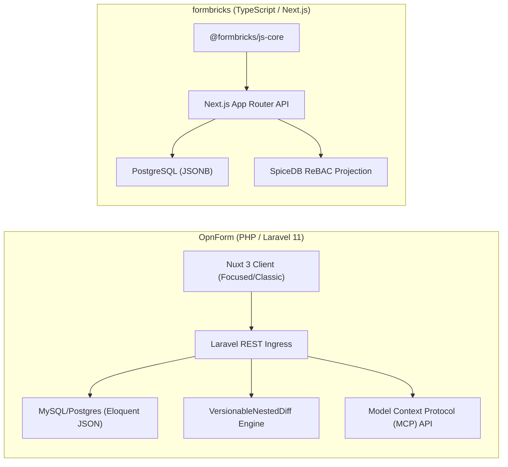
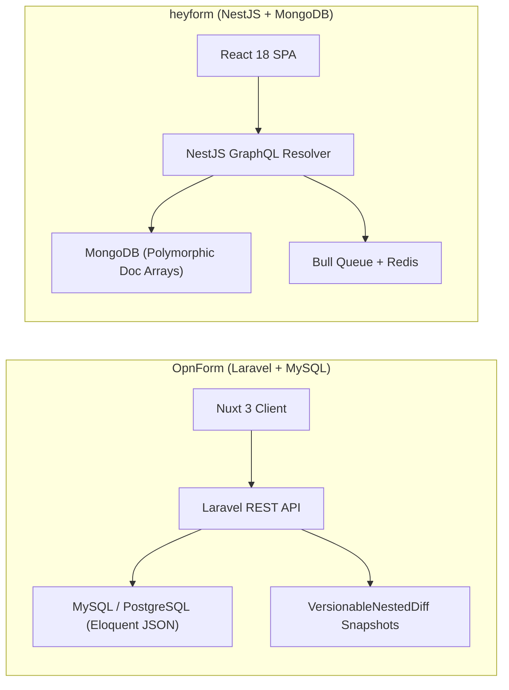
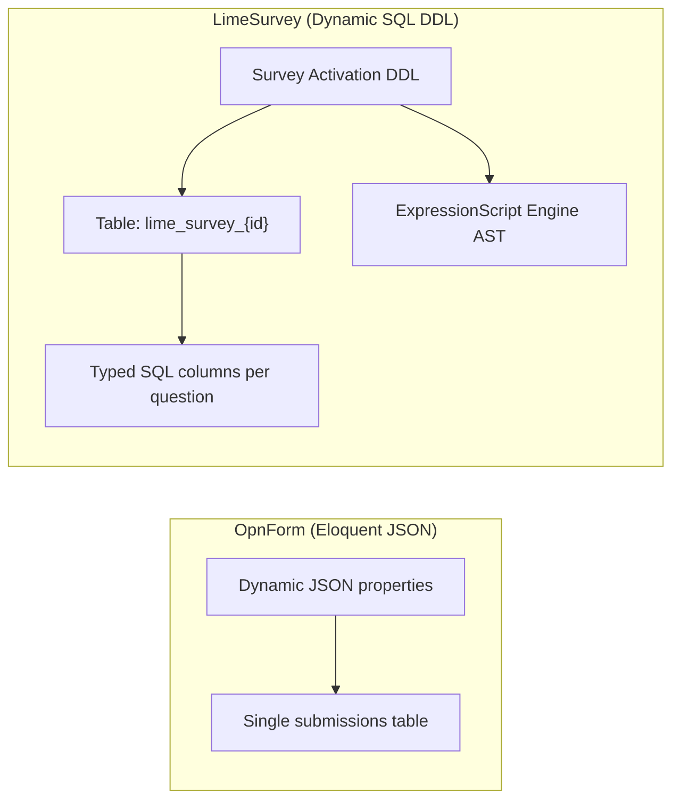
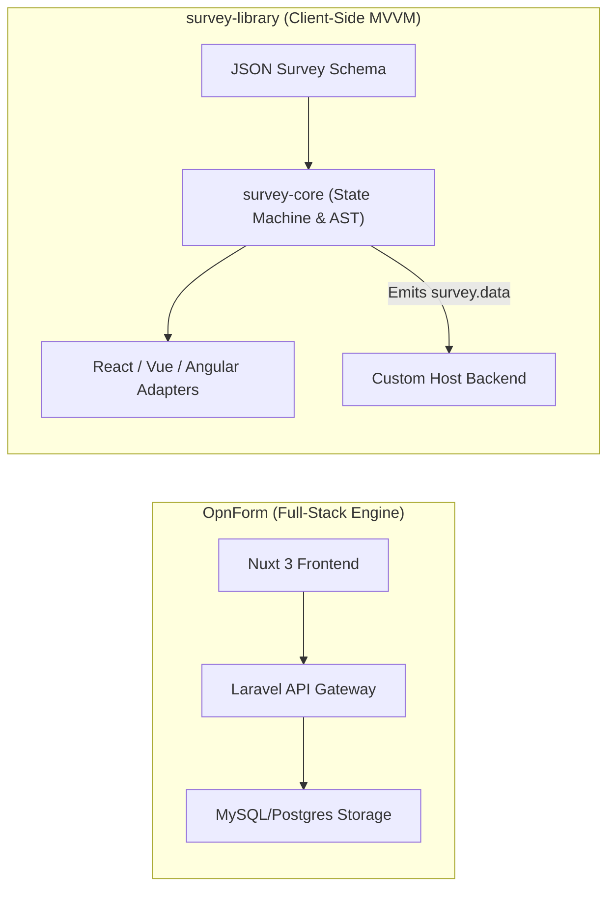
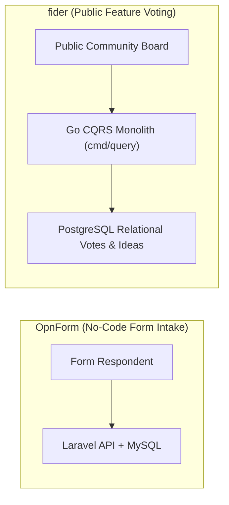
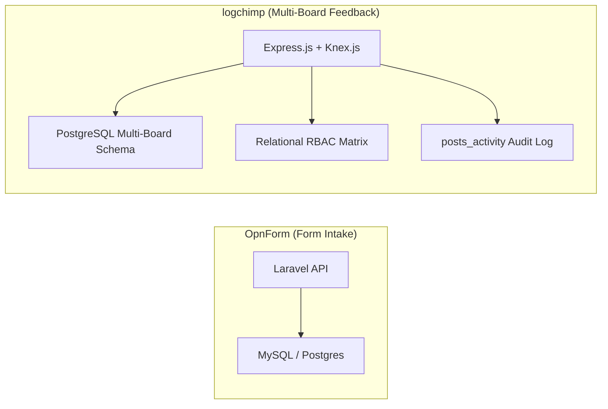
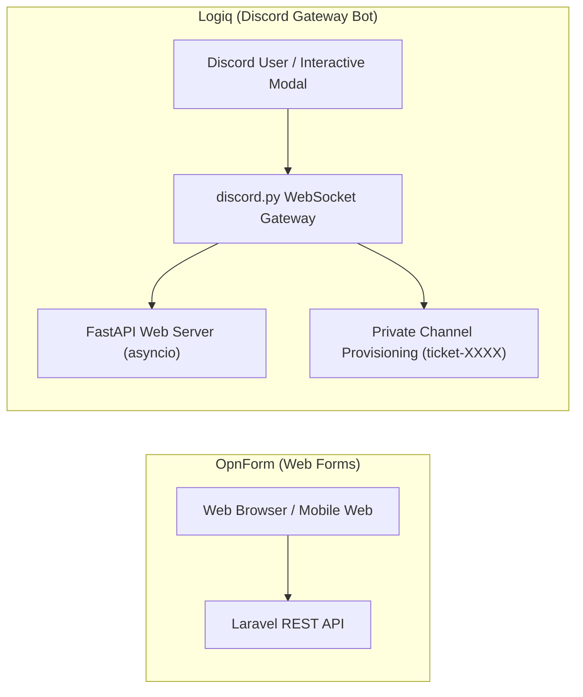
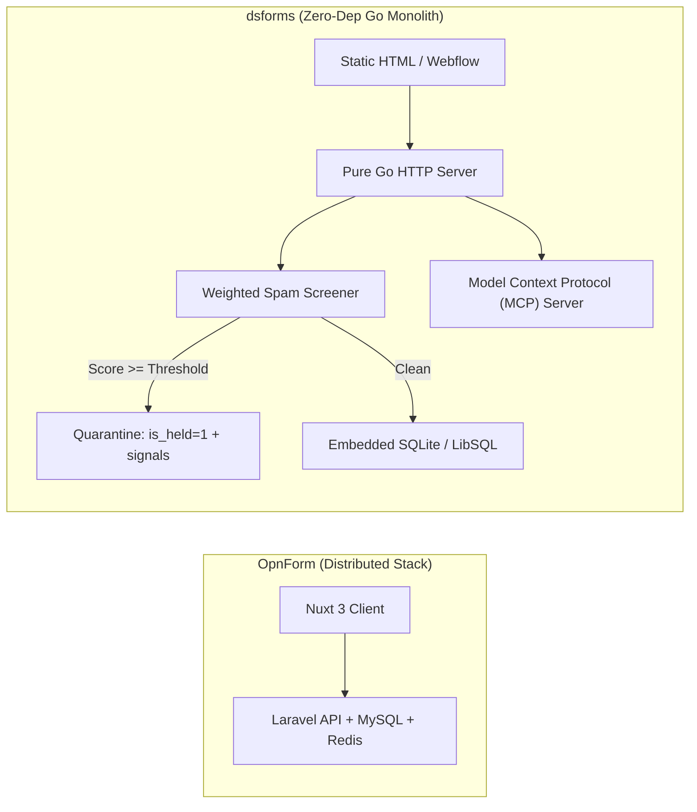

# OpnForm — Comparative Analysis & Category Evaluation

> **Category**: Forms, Surveys & Feedback  
> **Architectural Role**: No-code dynamic forms, schema revisioning diffs & AI agent MCP integration  
> **Primary Stack**: PHP 8.2+ / TypeScript | Laravel 10/11, Nuxt 3, Vue 3 | MySQL 8.0+ / PostgreSQL 15+, Eloquent ORM | Redis, Laravel Horizon  
> **Peer Solutions Compared**: `formbricks`, `heyform`, `formizee`, `LimeSurvey`, `survey-library`, `fider`, `logchimp`, `Logiq`, `dsforms`  
> **Commercial SaaS Benchmarks**: Typeform, Tally, Google Forms, Formstack, Notion Forms  

---

## 1. Executive Overview & Technical Identity: OpnForm

**OpnForm** is an open-source no-code dynamic form builder, data ingestion platform, and AI-assisted form authoring engine. Engineered as an extensible alternative to Typeform, Tally, and Google Forms, OpnForm allows marketing, growth, and operations teams to construct customizable forms in minutes with native support for dual presentation styles (`classic` full-page layouts and `focused` conversational flows).

### Core Architectural Profile
- **Runtime & Language**: `PHP 8.2+` backend coupled with a `TypeScript / Vue 3` reactive frontend.
- **Backend Framework**: `Laravel 10/11` exposing REST APIs, Eloquent ORM models, and queue management via Laravel Horizon.
- **Frontend Architecture**: `Nuxt 3` Single-Page Application (`client/`) delivering rapid hydration, responsive canvas editing, and dynamic field rendering.
- **Persistence & Schema Evolution**: `MySQL 8.0+` or `PostgreSQL 15+`. Encapsulates form properties, input blocks, and logic rules in Eloquent JSON attributes (`properties`), completely bypassing relational migrations for user-defined forms.
- **Document Versioning**: Integrates `VersionableNestedDiff` snapshot versioning, preserving the last 5 revisions of form definitions to enable one-click rollback on accidental modifications.
- **Partial Submission Recovery**: Implements debounced auto-save endpoints (`/api/open/forms/{slug}/partial-submissions`), capturing abandoned lead entries in real time.
- **AI Agent Automation**: Built-in Model Context Protocol (MCP) and AI Agent endpoints (`/api/agent-drafts/*`), allowing autonomous agents to generate, preview, and hand off complete form drafts programmatically.

---

## 2. Peer Solution Landscape (Forms, Surveys & Feedback)

Within this category, `OpnForm` operates alongside the following peer solutions:

| Solution | Language & Runtime | Core Framework | Database / Cache | Queue / Concurrency | Primary Architectural Niche |
| :--- | :--- | :--- | :--- | :--- | :--- |
| **OpnForm** (Current) | `PHP 8.2+ / TypeScript` | `Laravel 11, Nuxt 3` | `MySQL / PostgreSQL` | `Laravel Horizon / Redis` | No-code dynamic forms with versioned revisions & MCP agent drafts |
| **formbricks** | `TypeScript / Node` | `Next.js Monorepo` | `PostgreSQL, Prisma` | `BullMQ / Redis` | In-app micro-surveys, ReBAC access, telemetry |
| **heyform** | `TypeScript / Node` | `NestJS 10+, React 18` | `MongoDB, Redis` | `Bull Queue / Redis` | Conversational multi-step forms with polymorphic document answers |
| **formizee** | `TypeScript / Edge` | `Hono, Turborepo` | `LibSQL / Turso, Drizzle` | `Cloudflare KV / Async` | Zero-knowledge AES-256-GCM encrypted headless form vault |
| **LimeSurvey** | `PHP 8.1+` | `Yii Framework` | `MySQL / PostgreSQL` | `PHP CLI Workers` | Enterprise statistical surveys with dynamic runtime SQL tables |
| **survey-library** | `TypeScript 5.3+` | `Framework-Agnostic MVVM` | `Pure Client-Side (BYO)`| `Synchronous / Web Workers`| Declarative JSON survey engine with AST expression evaluator |
| **fider** | `Go 1.22+` | `Go HTTP Monolith` | `PostgreSQL 14+` | `Goroutines, Channels` | Compiled CQRS public feature voting portal with sub-20ms latency |
| **logchimp** | `TypeScript / Node` | `Express.js, Vue 3` | `PostgreSQL, Knex.js` | `BullMQ / Redis` | Multi-board customer feedback roadmap with RBAC and audit trail |
| **Logiq** | `Python 3.10+` | `FastAPI, discord.py` | `SQLite / PostgreSQL` | `asyncio Event Loop` | Discord-native community ticketing bot & FastAPI REST management |
| **dsforms** | `Go 1.22+` | `Pure Go HTTP` | `SQLite / LibSQL (pure Go)`| `Go Worker Channels` | Zero-dependency headless form backend with forensic spam quarantine |

---

## 3. Deep Head-to-Head Comparative Breakdown: OpnForm vs Peers

### 3.1. OpnForm vs. formbricks

**Comparative Focus**: `No-code dynamic forms with nested versioning & MCP drafts` vs. `Targeted in-app telemetry & ReBAC`

#### Architectural Differences:
- **Form Delivery & UX Paradigm**: OpnForm provides full-page forms with dual presentation styles: `classic` (multi-input block document) and `focused` (conversational step-by-step). Formbricks focuses on non-intrusive in-app micro-surveys embedded directly into web apps via `@formbricks/js-core` SDK, triggering popups and slide-ins based on telemetry rules.
- **Schema Management & Versioning**: OpnForm manages form fields dynamically in Eloquent JSON attributes and integrates `VersionableNestedDiff` to track the last 5 revisions with visual diffing and instant rollbacks. Formbricks persists surveys using Prisma ORM with PostgreSQL JSONB columns, without built-in automated nested revision diffing.
- **AI Agent Integration**: OpnForm provides native MCP tools and endpoints (`/api/agent-drafts/*`), allowing autonomous agents to draft and deploy complete forms programmatically. Formbricks interacts with agents via standard REST API tokens.
- **Access Control**: Formbricks features fine-grained ReBAC access control projected into SpiceDB. OpnForm utilizes standard Laravel workspace role permissions.

#### Architectural Comparison Matrix:

| Dimension | OpnForm | formbricks |
| :--- | :--- | :--- |
| **Core Architecture** | Laravel 10/11 REST backend + Nuxt 3 SPA | Next.js 15/16 App Router full-stack monorepo |
| **Schema Evolution** | Eloquent JSON properties with `VersionableNestedDiff` snapshots | PostgreSQL JSONB with Prisma migrations |
| **Presentation Styles** | Dual: `classic` full document & `focused` conversational | In-app modal popups, slide-ins, and standalone links |
| **Partial Submissions** | Debounced auto-save (`status: partial`) to recover drop-offs | Client SDK optimistic step-by-step updates |
| **AI Agent Readiness** | Native Model Context Protocol (MCP) draft endpoints | Standard REST API tokens |

---

### 3.2. OpnForm vs. heyform

**Comparative Focus**: `Laravel 11 Eloquent JSON + revision diffing` vs. `NestJS + MongoDB document arrays`

#### Architectural Differences:
- **Database Engine & Persistence**: OpnForm runs on relational databases (MySQL/PostgreSQL) with Eloquent JSON columns, offering strong relational foreign keys for workspaces, users, and submissions. HeyForm runs on MongoDB, persisting forms and polymorphic answers as nested document arrays in BSON.
- **API Architecture**: OpnForm exposes clean RESTful endpoints (`/api/open/forms/{slug}`). HeyForm relies heavily on a GraphQL gateway (`createSubmission` mutation) alongside REST endpoints for uploads.
- **Schema Recovery & Versioning**: OpnForm maintains an automated snapshot history of the last 5 form configurations via `VersionableNestedDiff`, protecting against accidental schema changes. HeyForm overwrites form documents on save.
- **Partial Submission Recovery**: OpnForm features debounced partial auto-save (`POST /api/open/forms/{slug}/partial-submissions`), whereas HeyForm saves state in the client browser until final completion.

#### Architectural Comparison Matrix:

| Dimension | OpnForm | heyform |
| :--- | :--- | :--- |
| **Backend Runtime** | PHP 8.2+ / Laravel 10/11 | TypeScript / Node.js 20+ (NestJS 10+) |
| **Data Storage Model** | Relational MySQL/PostgreSQL with Eloquent JSON | Document-oriented MongoDB with polymorphic arrays |
| **API Protocol** | RESTful HTTP controllers | GraphQL Resolvers + REST endpoints |
| **Revision History** | Automated `VersionableNestedDiff` diff snapshots | Single active document state |
| **Partial Auto-Save** | Debounced server-side auto-save (`status: partial`) | Client memory state; single final submission |

---

### 3.3. OpnForm vs. formizee

**Comparative Focus**: `No-code visual dynamic forms` vs. `Edge-native zero-knowledge encrypted headless form vault`

```mermaid
flowchart LR
    subgraph OpnFormArch ["OpnForm (No-Code Builder)"]
        A1["Nuxt 3 Visual Canvas"] --> A2["Laravel API"]
        A2 --> A3["MySQL/Postgres DB (Plaintext)"]
    end
    subgraph FormizeeArch ["formizee (Edge Headless Vault)"]
        B1["Static HTML Form (<form>)"] --> B2["Hono Edge Worker (workerd)"]
        B2 --> B3["AES-256-GCM Vault"]
        B2 --> B4["LibSQL / Turso SubmissionsDB"]
    end
```

#### Architectural Differences:
- **Presentation Strategy**: OpnForm is a complete visual form builder with full UI rendering, pre-built themes, and drag-and-drop input blocks. Formizee is 100% headless: it provides no frontend UI, ingesting submissions directly from static HTML `<form action="...">` tags.
- **Data Security & Cryptography**: OpnForm stores submissions in plaintext in MySQL/PostgreSQL. Formizee deploys a **Zero-Knowledge Vault**: all submissions are encrypted at the edge with AES-256-GCM (`data_iv` and `data_cipher_text`) before persisting into LibSQL / Turso SQLite.
- **Runtime Footprint**: OpnForm runs on a standard PHP-FPM / Laravel Horizon stack (~150MB RAM). Formizee executes in lightweight edge V8 isolates via Hono on Cloudflare Workers (~35MB RAM), delivering sub-50ms ingestion latency globally.

#### Architectural Comparison Matrix:

| Dimension | OpnForm | formizee |
| :--- | :--- | :--- |
| **UI Rendering** | Full no-code canvas, classic and focused layouts | 100% headless (BYO HTML/React UI) |
| **Data Security** | Relational row permissions (plaintext storage) | Zero-knowledge client-side AES-256-GCM encryption |
| **Ingestion Runtime** | PHP 8.2+ / Laravel Horizon (~150 MB RAM) | Global edge V8 workers (~35 MB RAM, <50ms latency) |
| **Database Engine** | MySQL 8.0+ / PostgreSQL (Eloquent ORM) | LibSQL / Turso SQLite (Drizzle ORM) |
| **Target Use Case** | Visual lead generation, intake forms, Notion sync | Static marketing sites & privacy-critical contact forms |

---

### 3.4. OpnForm vs. LimeSurvey

**Comparative Focus**: `No-code marketing forms & Notion sync` vs. `Enterprise scientific research & dynamic SQL tables`

#### Architectural Differences:
- **Database Architecture**: OpnForm stores dynamic form inputs inside Eloquent JSON columns in a unified submissions table. LimeSurvey executes runtime DDL on survey activation, dynamically generating dedicated relational SQL tables (`lime_survey_{surveyId}` and `lime_tokens_{surveyId}`) where every question maps to a typed SQL column.
- **Logic & Mathematical AST**: OpnForm provides visual conditional logic jumps. LimeSurvey includes the **ExpressionScript Engine** (`em_manager_helper.php`), allowing complex micro-syntax boolean equations (`relevance: "((Q1.NAOK == 'Y') and (Q2_SQ1.NAOK >= 4))"`), dynamic mathematical modeling, and quota screening across 80+ localized languages.
- **Statistical Export**: OpnForm exports to CSV and synchronizes with Notion. LimeSurvey generates native syntax and data export files for SPSS (`.sps`, `.dat`), R dataframes, and Stata.

#### Architectural Comparison Matrix:

| Dimension | OpnForm | LimeSurvey |
| :--- | :--- | :--- |
| **Data Architecture** | Relational table with Eloquent JSON properties | Dynamic DDL: dedicated SQL table per survey |
| **Logic Engine Complexity** | Visual jump rules with basic conditions | ExpressionScript AST with micro-syntax equations |
| **Statistical Analysis** | Basic summary charts & Notion sync | Native SPSS syntax files, R dataframes, and Stata packages |
| **Participant Control** | Open public links with Turnstile/reCAPTCHA | Closed-cohort token management with cryptographic anonymization |
| **Target Domain** | Modern marketing intake & operations | Academic research, clinical trials & government surveys |

---

### 3.5. OpnForm vs. survey-library (SurveyJS)

**Comparative Focus**: `Full-stack Laravel/Nuxt application` vs. `Framework-agnostic client-side MVVM JSON engine`

#### Architectural Differences:
- **System Scope**: OpnForm is a complete full-stack web application with a visual drag-and-drop form builder, Laravel backend, database storage, email notifications, and integrations. SurveyJS is a pure client-side library. It has zero backend opinions: it accepts a standardized JSON schema and emits structured `survey.data` for any backend to store.
- **UI Framework Support**: OpnForm's frontend is strictly built with Vue 3 and Nuxt 3. SurveyJS provides a framework-agnostic MVVM core (`@surveyjs/survey-core`) with native rendering adapters for React, Vue 3, Angular, and Vanilla Web Components.
- **Complex Form Models**: SurveyJS natively supports nested panels, dynamic matrix grids (`matrixdynamic`), panel iterators, and cascading asynchronous REST lookups (`choicesRestful`). OpnForm focuses on linear block-based forms.

#### Architectural Comparison Matrix:

| Dimension | OpnForm | survey-library (SurveyJS) |
| :--- | :--- | :--- |
| **Architecture Boundary** | Full-stack platform (API, DB, UI, Horizon Queues) | Pure client-side component engine (BYO Backend) |
| **UI Framework Binding** | Vue 3 / Nuxt 3 | Framework-agnostic: React, Vue 3, Angular, Knockout |
| **Complex Form Hierarchies** | Standard input blocks and visual logic | Dynamic matrices, panel iterators, cascading REST lookups |
| **Server Requirements** | PHP 8.2+, MySQL, Redis | Zero server infrastructure; 100% browser runtime |
| **License** | AGPLv3 / Commercial | MIT (Core Engine) |

---

### 3.6. OpnForm vs. fider

**Comparative Focus**: `No-code form builder` vs. `Compiled Go CQRS public feature voting portal`

#### Architectural Differences:
- **Functional Paradigm**: OpnForm is an intake engine for capturing structured data, lead inquiries, and customer feedback. Fider is an open community suggestion portal where users publicly submit ideas, upvote proposals, and track official roadmap progress.
- **Runtime Performance & Stack**: OpnForm runs on PHP 8.2+ and Laravel with Horizon (~150MB RAM). Fider is a compiled Go 1.22+ binary with PostgreSQL (~40MB RAM) that uses Command Query Responsibility Segregation (CQRS) (`app/models/cmd` and `app/models/query`), delivering sub-20ms response times.
- **Community Governance**: Fider includes real-time duplicate idea detection, duplicate post merging (`OriginalPost`), and automated email notifications to all voters when an idea changes status.

#### Architectural Comparison Matrix:

| Dimension | OpnForm | fider |
| :--- | :--- | :--- |
| **Core Interaction** | Private or public structured data intake | Public collaborative idea suggestion and upvoting |
| **Runtime & Language** | PHP 8.2+ / TypeScript (~150 MB RAM) | Compiled Go 1.22+ binary (~40 MB RAM, <20ms latency) |
| **Architectural Model** | Laravel REST API + Horizon queues | Go HTTP Monolith with strict CQRS command/query separation |
| **Roadmap & Notification** | Webhooks / Notion / Slack integration | Public roadmap stages with automatic voter email updates |
| **Database Storage** | MySQL / PostgreSQL with Eloquent JSON | Normalized relational PostgreSQL |

---

### 3.7. OpnForm vs. logchimp

**Comparative Focus**: `Form builder & Notion sync` vs. `Multi-board feedback tracking with RBAC and changelogs`

#### Architectural Differences:
- **Product Scope**: OpnForm handles structured form intake and lead capture. Logchimp provides a multi-board feedback portal (`Boards`), interactive roadmap stages (`Roadmaps`), and product release changelogs.
- **Database & Query Layer**: OpnForm uses Eloquent ORM with dynamic JSON columns. Logchimp uses **Express.js** and **Knex.js** with PostgreSQL, maintaining relational integrity across users, boards, posts, votes, and an immutable audit timeline (`posts_activity`).
- **Access Control**: OpnForm uses standard Laravel workspace roles. Logchimp implements a complete relational RBAC model (`roles`, `permissions`, `roles_users`, `permissions_roles`) for fine-grained board governance.

#### Architectural Comparison Matrix:

| Dimension | OpnForm | logchimp |
| :--- | :--- | :--- |
| **Primary Domain** | Form building, lead intake & Notion sync | Multi-board feedback management and public roadmaps |
| **Database Layer** | MySQL / PostgreSQL with Eloquent ORM | PostgreSQL with Knex.js SQL query builder |
| **Audit Trails** | Revision snapshots (`VersionableNestedDiff`) | Immutable activity stream (`posts_activity`) |
| **Access Control** | Workspace roles | Granular relational RBAC matrix |
| **Public Transparency** | Public or private forms | Public feedback boards, roadmaps, and release changelogs |

---

### 3.8. OpnForm vs. Logiq

**Comparative Focus**: `Web full-page/focused forms` vs. `Discord-native modal ticketing & community triage`

#### Architectural Differences:
- **Delivery Surface**: OpnForm serves forms via desktop and mobile web browsers. Logiq executes inside Discord chat servers, interacting with users through persistent UI buttons and native modal dialogs (`discord.ui.Modal`).
- **Submission Output**: OpnForm saves responses as database records and forwards webhooks. Logiq converts modal submissions into interactive, private Discord text channels (`ticket-{username}`) with role-based permission overwrites (`@everyone` denied access; ticket creator and staff roles granted access).
- **Concurrency & Runtime**: OpnForm runs on PHP 8.2+ with Laravel Horizon. Logiq runs a single-process concurrent Python 3.10+ application, running a Discord gateway bot and a FastAPI server within an `asyncio` event loop.

#### Architectural Comparison Matrix:

| Dimension | OpnForm | Logiq |
| :--- | :--- | :--- |
| **Platform Ingress** | Web browsers (Nuxt 3 SPA) | Discord client via native interaction modals |
| **Submission Output** | Database row & webhook dispatches | Isolated private support text channel in Discord |
| **Runtime & Language** | PHP 8.2+ (Laravel 11) | Python 3.10+ (discord.py + FastAPI via asyncio) |
| **Persistence** | MySQL / PostgreSQL with Eloquent JSON | SQLite / PostgreSQL / MongoDB |
| **Archival Format** | CSV, Notion sync, webhook payloads | Searchable HTML/JSON ticket transcripts |

---

### 3.9. OpnForm vs. dsforms

**Comparative Focus**: `Full-stack no-code form builder` vs. `Zero-dependency pure Go headless backend with quarantine scoring`

#### Architectural Differences:
- **Deployment Footprint**: OpnForm requires a full PHP/Laravel environment, MySQL/PostgreSQL database, and Redis with Laravel Horizon workers (~150MB RAM). dsforms compiles into a single statically linked binary with an embedded SQLite / LibSQL database (`modernc.org/sqlite`), running with zero external dependencies and consuming ~25MB of RAM.
- **Frontend vs Headless**: OpnForm is centered around its visual no-code builder and animated frontend canvas. dsforms is 100% headless, providing endpoints for standard HTML `<form action="/f/{id}">` tags without bundling frontend JavaScript.
- **Spam Defenses & Forensic Quarantine**: OpnForm mitigates spam via honeypot fields (`_hp`) and Google reCAPTCHA / Cloudflare Turnstile. dsforms implements an auditable **Quarantine Architecture**: `internal/screen` evaluates weighted honeypot traps (`_gotcha`, `hp_field`), timing heuristics, and domain analysis. Flagged submissions are quarantined (`is_held: 1`) alongside exact diagnostic signals (`spam_signals`) for operator or AI agent review.
- **AI Agent Automation**: Both solutions support AI agents, but in different capacities: OpnForm provides MCP endpoints to draft and preview forms (`/api/agent-drafts/*`). dsforms embeds a native MCP server (`internal/mcpserver`) allowing AI agents to triage leads, review quarantined entries with automated PII redaction (`internal/redact`), and query conversion analytics.

#### Architectural Comparison Matrix:

| Dimension | OpnForm | dsforms |
| :--- | :--- | :--- |
| **Operational Model** | Distributed PHP 8.2+ / Laravel Horizon stack | Single compiled Go binary with embedded SQLite |
| **Frontend Strategy** | No-code visual form builder & Nuxt 3 canvas | 100% headless: static HTML form endpoints |
| **Spam Defense Strategy** | Honeypots (`_hp`), reCAPTCHA, Turnstile | Weighted heuristic scoring with auditable quarantine holding queue |
| **AI Agent Interface** | Native MCP draft endpoints (`agent-drafts`) | Native embedded Model Context Protocol (MCP) server with PII redaction |
| **Viral Growth Features** | None | Integrated viral waitlist engine with dynamic referral queue jumping |
| **Memory Footprint** | ~150 MB RAM | ~25 MB RAM |

---

## 4. Capability & Feature Comparison Matrix

| Dimension / Capability | OpnForm | formbricks | heyform | formizee | LimeSurvey | survey-library | fider | logchimp | Logiq | dsforms |
| :--- | :---: | :---: | :---: | :---: | :---: | :---: | :---: | :---: | :---: | :---: |
| **Conversational Typeform UI**| ✅ Full Screen | ⚠️ Compact modal | ✅ Full Screen | ❌ (Headless) | ❌ | ✅ Supported | ❌ | ❌ | ❌ | ❌ |
| **Targeted In-App Popups** | ⚠️ Iframe | ✅ Native SDK | ⚠️ Iframe | ❌ | ❌ | ⚠️ UI Embed | ❌ | ❌ | ❌ | ❌ |
| **Headless Form API Endpoint** | ❌ | ⚠️ API Routes | ❌ | ✅ Edge Native | ❌ | ❌ | ❌ | ❌ | ❌ | ✅ Single Binary |
| **Public Feature Voting** | ❌ | ❌ | ❌ | ❌ | ❌ | ❌ | ✅ Pure CQRS | ✅ Multi-Board | ❌ | ❌ |
| **Changelog & Public Roadmap** | ❌ | ❌ | ❌ | ❌ | ❌ | ❌ | ⚠️ Basic | ✅ Integrated | ❌ | ❌ |
| **Discord Chat Ticket Modals** | ❌ | ❌ | ❌ | ❌ | ❌ | ❌ | ❌ | ❌ | ✅ Native UI | ❌ |
| **Viral Waitlist & Referrals** | ❌ | ❌ | ❌ | ❌ | ❌ | ❌ | ❌ | ❌ | ❌ | ✅ Integrated |
| **AI Agent MCP Integration** | ✅ Agent Drafts| ⚠️ REST API | ❌ | ⚠️ API Keys | ❌ | ❌ | ❌ | ❌ | ⚠️ LLM Cog | ✅ Native MCP |
| **Statistical Analysis (SPSS/R)**| ❌ | ❌ | ❌ | ❌ | ✅ Native | ⚠️ Analytics Pack| ❌ | ❌ | ❌ | ❌ |
| **Logic Jumps & Math AST** | ✅ Dynamic Logic| ✅ Visual Rules | ✅ Visual Logic | ❌ | ✅ ExpressionScript| ✅ ExpressionRunner| ❌ | ❌ | ❌ | ❌ |
| **Zero-Knowledge Encryption** | ❌ | ❌ | ❌ | ✅ AES-256-GCM | ❌ | ❌ | ❌ | ❌ | ❌ | ❌ |
| **Spam Quarantine Forensics** | ⚠️ Turnstile | ⚠️ ReCaptcha | ⚠️ Turnstile | ⚠️ Honeypot | ⚠️ Token Auth | ❌ (Client Only)| ⚠️ OAuth Check| ⚠️ Rate Limits | ⚠️ Captcha Cog | ✅ Weighted Scoring |
| **Runtime Memory Footprint** | ~150 MB | ~250 MB | ~300 MB | **~35 MB (Edge)** | ~180 MB | **0 MB (Client)** | **~40 MB** | ~120 MB | ~90 MB | **~25 MB** |

---

## 5. Commercial Benchmark Positioning

When benchmarked against commercial SaaS leaders (**Typeform, Tally, Google Forms, Notion Forms**):
- **Against Typeform & Tally**: `OpnForm` provides an unmetered, self-hosted no-code builder supporting both classic document layouts and focused conversational steps without per-submission fees.
- **Notion Integration & Revisioning**: Features native Notion database mapping and automated `VersionableNestedDiff` snapshot versioning, providing enterprise safety and seamless CRM workflows.
- **AI Agent Automation**: Built-in Model Context Protocol (MCP) endpoints allow modern AI-driven agent swarms to generate and manage marketing intake forms autonomously.

---

## 6. Strategic Takeaways & Role for MarketingStudio

In the unified **MarketingStudio** architecture:
1. **Primary Component to Adopt**: Harness `OpnForm`'s no-code form builder and MCP draft endpoints for campaign intake forms, event signups, and automated form generation by AI agents.
2. **Interoperability Seam**: Utilize OpnForm's webhook events (`FormSubmissionSaved`) and Notion synchronization to stream structured leads directly into MarketingStudio's core pipeline.
3. **Complementary Ecosystem Delegation**: Where OpnForm handles no-code web forms, delegate in-app micro-surveys to `formbricks`, high-security headless ingestion to `formizee`, and community roadmaps to `fider` / `logchimp`.
