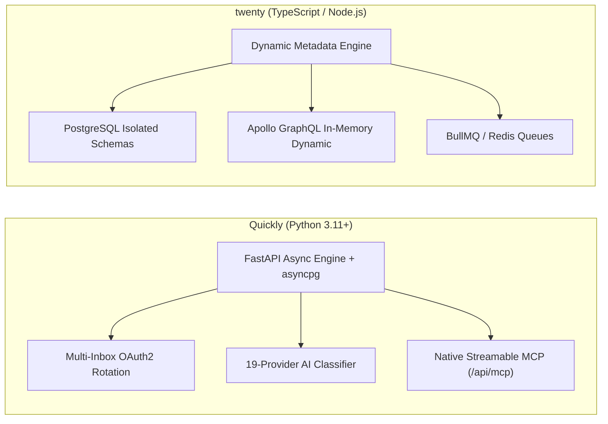
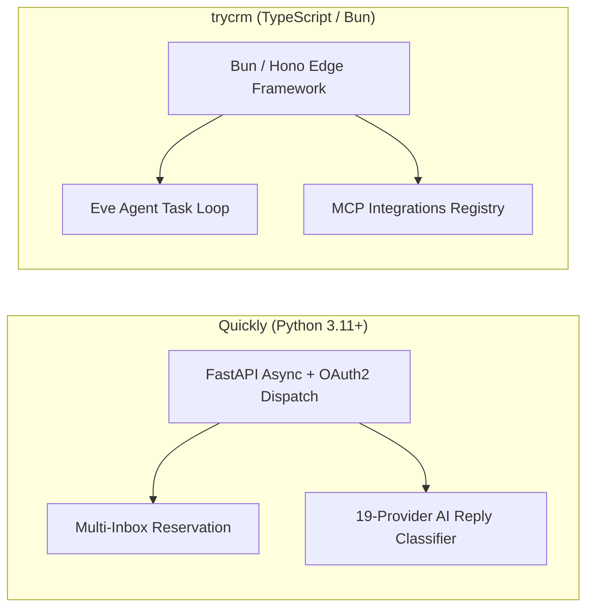
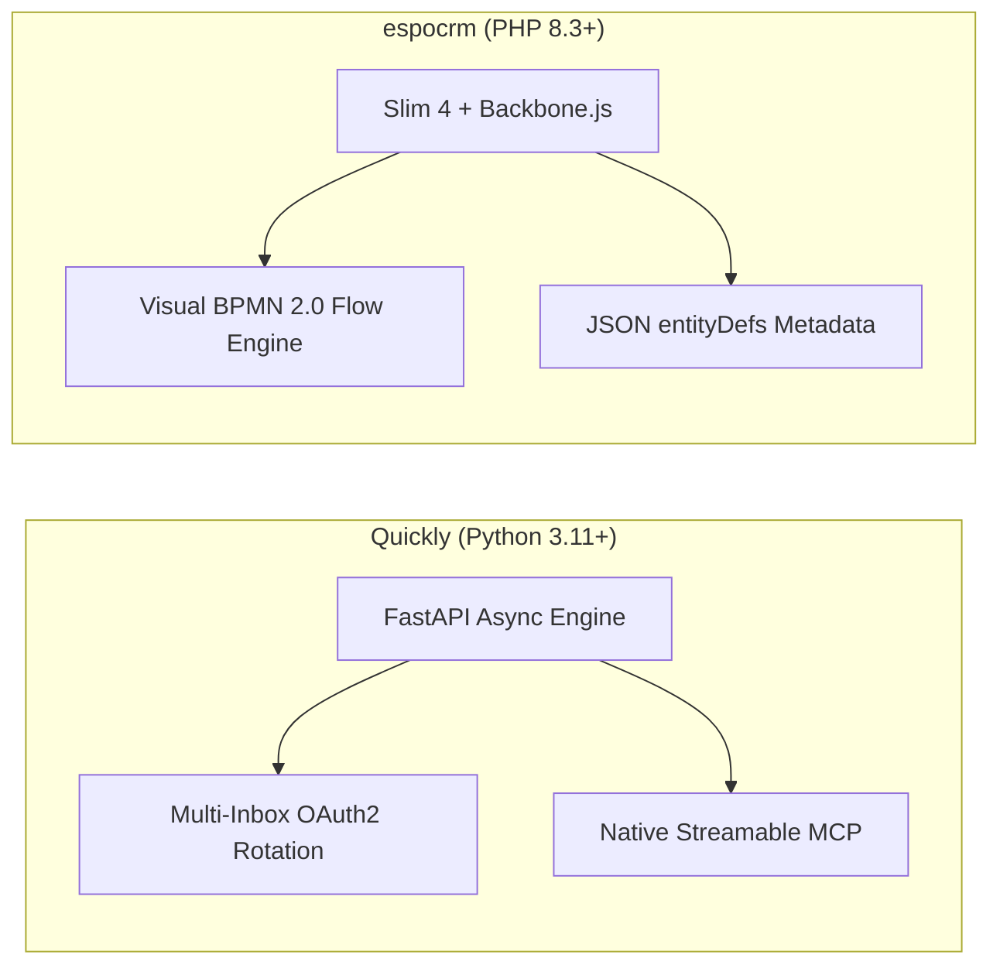
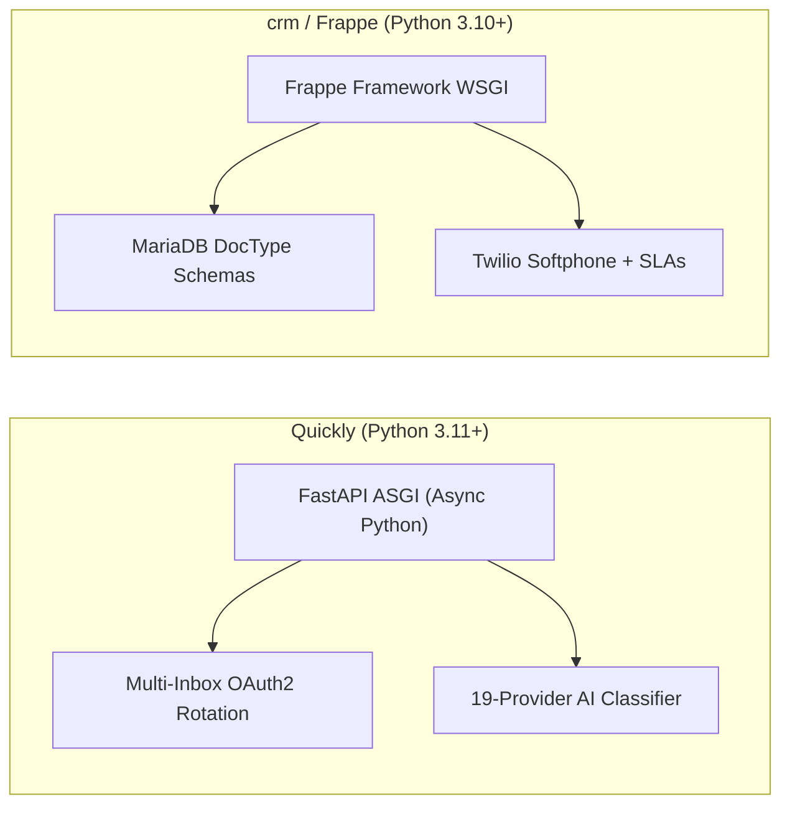
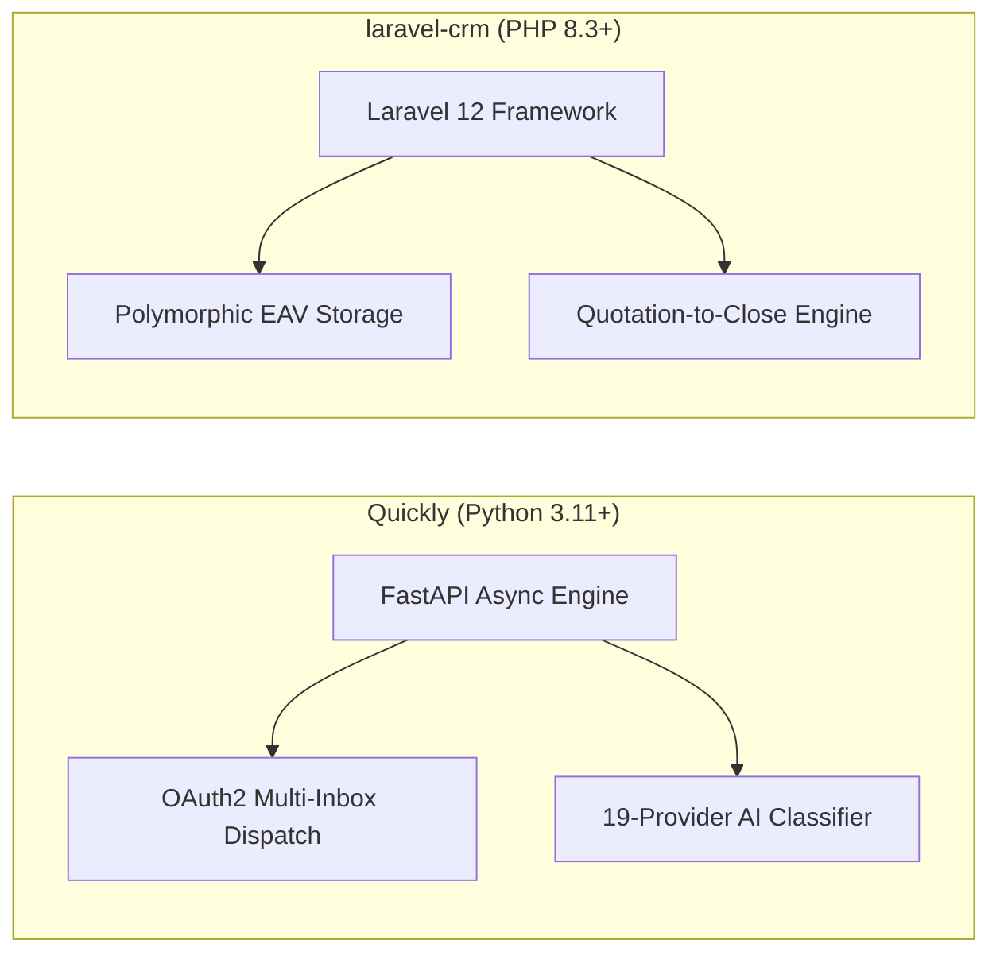
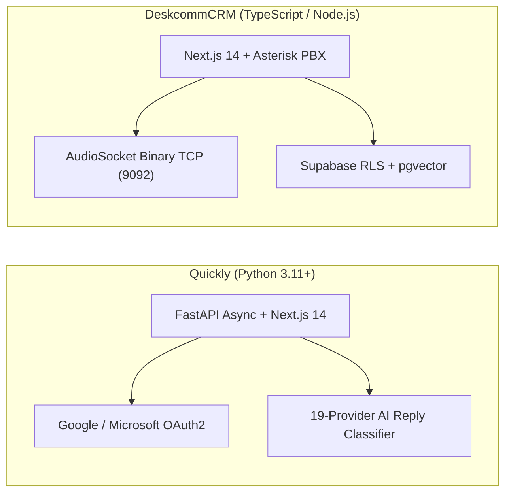
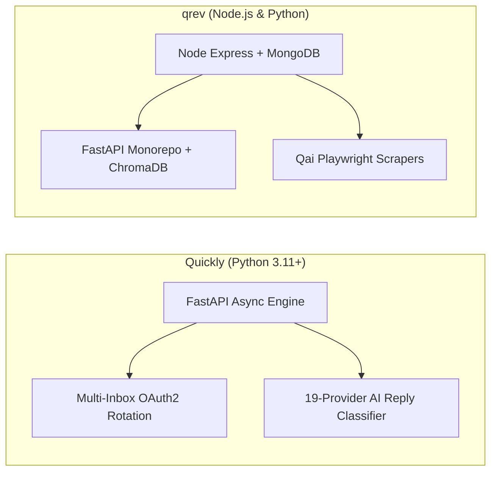
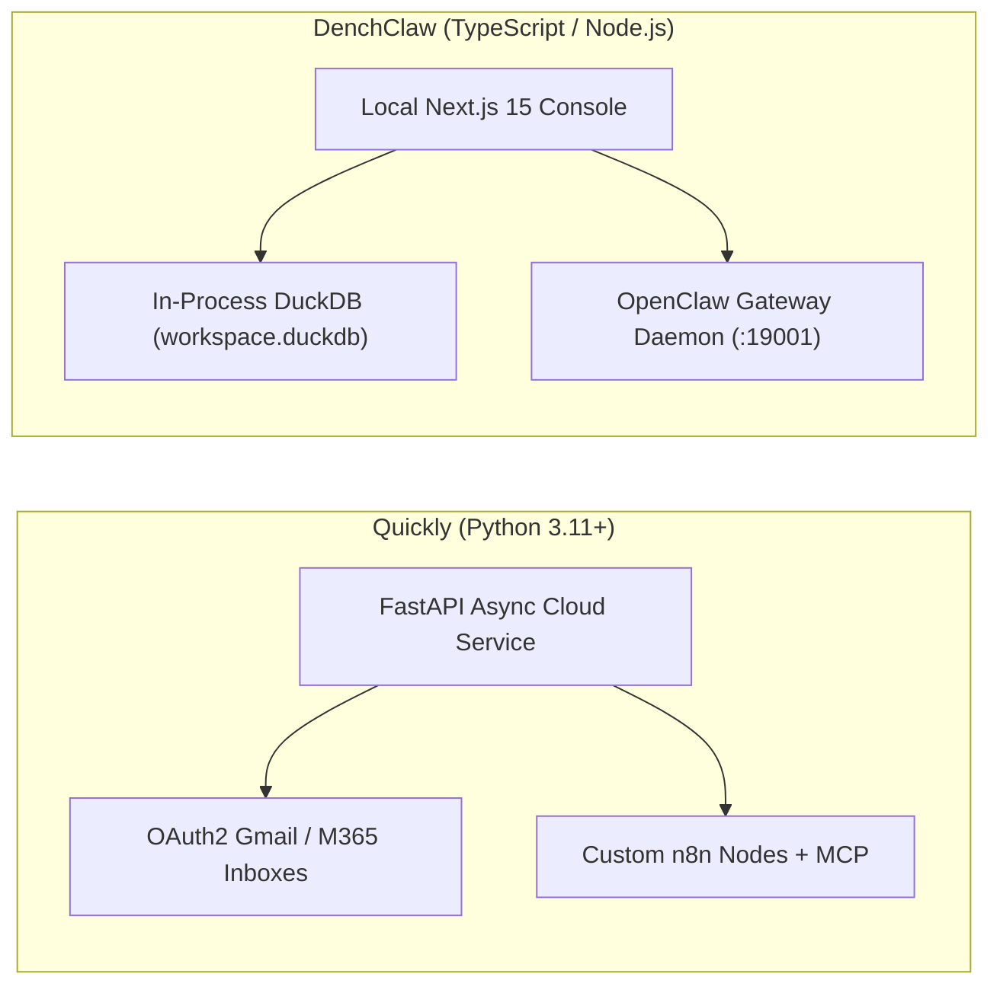
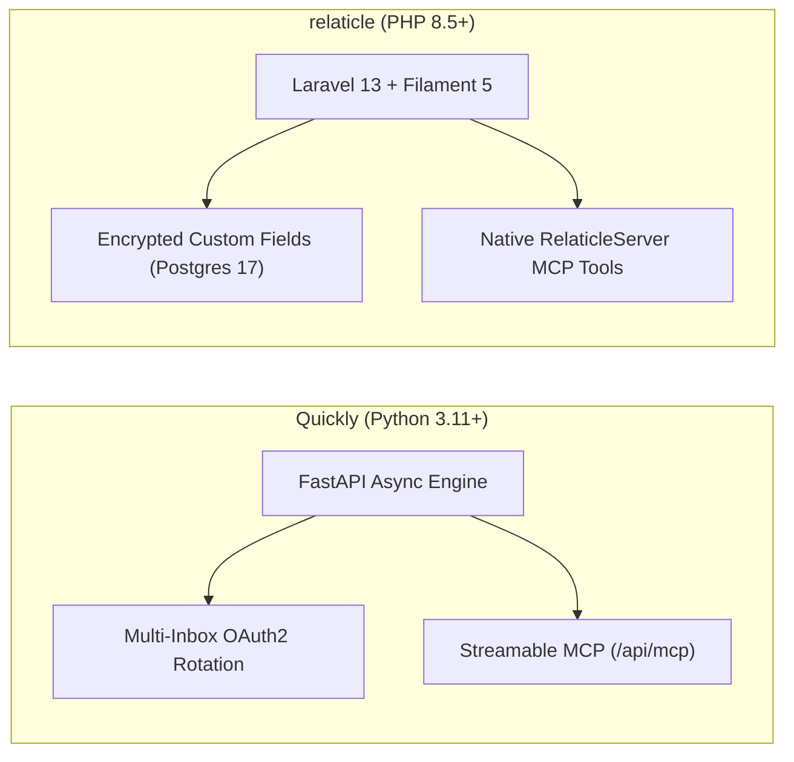

# Quickly — Comparative Analysis & Category Evaluation

> **Category**: CRM & Contact Management  
> **Architectural Role**: High-velocity cold email & multi-inbox sequencing engine with native MCP  
> **Primary Stack**: Python 3.11+ | FastAPI, SQLAlchemy 2.0 Async (`asyncpg`), Next.js 14 | PostgreSQL 15+ | Asyncio Slot Reservation & Caddy 2  
> **Peer Solutions Compared**: `twenty`, `trycrm`, `espocrm`, `crm`, `laravel-crm`, `DeskcommCRM`, `qrev`, `DenchClaw`, `relaticle`  
> **Commercial SaaS Benchmarks**: Instantly, Smartlead, Lemlist, Apollo.io, Close.com  

---

## 1. Executive Overview & Technical Identity: Quickly

**Quickly** is an open-source, self-hosted cold outbound sales platform and sequencing engine engineered in Python 3.11+, FastAPI, and SQLAlchemy 2.0 Async (`abdelftahzowail/Quickly`). Built as a sovereign alternative to enterprise SaaS outreach platforms such as Instantly and Smartlead, Quickly eliminates monthly per-seat licensing fees, arbitrary contact limits, and domain burn risks.

Quickly's defining architectural design is its **Direct OAuth 2.0 Multi-Inbox Dispatch Engine**. Rather than routing emails through low-reputation shared SMTP relays that trigger spam heuristics, Quickly executes outreach directly through Google Workspace (Gmail API) and Microsoft 365 (Microsoft Graph API) via OAuth 2.0. A custom slot reservation algorithm (`queue_logic.py`) distributes email dispatch across hundreds of inboxes with randomized send-time jitter, while an automated **19-provider AI reply classifier** (`ai_classifier.py`) categorizes prospect responses into actionable sales intents.

### Core Architectural Profile
- **Runtime & Language**: `Python 3.11+` (pure async architecture) & `TypeScript / Node.js 18+` (Next.js 14 frontend)
- **API Framework**: `FastAPI` (ASGI via Uvicorn), Pydantic v2 validation
- **Persistence & ORM**: `PostgreSQL 15+` with `SQLAlchemy 2.0 Async Engine` and `asyncpg` binary driver, Alembic migrations
- **Concurrency & Dispatch**: Custom asyncio slot reservation engine (`queue_logic.py`) with randomized send-time jitter and scheduled background workers (`jobs.py`)
- **Agent Protocols & Integrations**: Native Model Context Protocol (MCP) streamable server at `/api/mcp` (`app/mcp_leads.py`) and dedicated first-party n8n community node package (`n8n-node/`)
- **AI Classification Engine**: Pluggable HTTP inference client supporting 19 LLM providers (Ollama local, OpenAI, Claude, Groq, DeepSeek, Mistral) for real-time sentiment parsing
- **Domain Specialization**: Sovereign cold email sequencing, multi-inbox domain rotation, AI reply intent triage, and MCP agent readiness with a minimal memory footprint (~60 MB RAM)

---

## 2. Peer Solution Landscape (CRM & Contact Management)

| Solution | Language & Runtime | Core Framework | Database / Persistence | Queue & Concurrency | Primary Architectural Niche |
| :--- | :--- | :--- | :--- | :--- | :--- |
| **Quickly** (Current) | `Python 3.11+` | `FastAPI, Next.js 14` | `PostgreSQL, SQLAlchemy` | `Asyncio Slot Reservation` | **Multi-inbox OAuth rotation, jitter scheduler & MCP** |
| **twenty** | `TypeScript / Node.js` | `NestJS, React, Vite` | `PostgreSQL 15+, TypeORM` | `BullMQ / Redis` | Dynamic runtime schemas & in-memory GraphQL compilation |
| **trycrm** | `TypeScript / Bun` | `Bun, Hono, Next.js` | `PostgreSQL, Prisma` | `Bun Async Loop / Eve` | Agentic-first CRM with native MCP tool registry & Eve runtime |
| **espocrm** | `PHP 8.3+` | `Slim 4, Backbone.js` | `MySQL 8.0+ / MariaDB` | `Multi-Process daemon.php` | Visual BPMN 2.0 flow execution engine & JSON entityDefs |
| **crm** (Frappe) | `Python 3.10+, JS` | `Frappe, Vue 3.5` | `MariaDB 10.6+, Redis` | `Redis Queue (RQ) / Celery` | Declarative DocType metadata, built-in SLAs & Twilio WebRTC |
| **laravel-crm** (Krayin) | `PHP 8.3+` | `Laravel 12.0, Vue.js` | `MySQL 8.0, Eloquent` | `Laravel Queue / Reverb` | Modular composer packages via Concord & polymorphic typed EAV |
| **DeskcommCRM** | `TypeScript / Node.js`| `Next.js 14, Supabase` | `PostgreSQL 16, pgvector` | `AudioSocket TCP / Workers`| Asterisk AudioSocket binary TCP telephony & streamable MCP |
| **qrev** | `Node.js & Python` | `Express & FastAPI` | `MongoDB & ChromaDB` | `Node-cron & FastTasks` | Dual-runtime Qai superagent orchestrator & LangChain RAG |
| **DenchClaw** | `TypeScript / Node.js`| `Next.js 15, DuckDB` | `In-Process DuckDB` | `In-Process SQL / OpenClaw`| Embedded columnar SQL, OpenClaw AI Gateway & Composio MCP |
| **relaticle** | `PHP 8.5+` | `Laravel 13, Filament 5`| `PostgreSQL 17+ (ULID)` | `Laravel Horizon / Redis` | Native `RelaticleServer` MCP tools, per-field encryption & ULIDs |

---

## 3. Deep Head-to-Head Comparative Breakdown: Quickly vs Peers

### 3.1. Quickly vs. twenty

#### Functional Specialization & Funnel Stage
- **Quickly**: Top-of-funnel outbound sales automation. Engineered to solve cold email deliverability, sender domain rotation, sequence timing, and automatic reply sentiment triage across hundreds of mailboxes.
- **twenty**: Full-lifecycle enterprise CRM record-of-truth. Manages accounts, contacts, pipeline stages, custom business objects, and team collaboration.

#### Schema Provisioning & Persistence
- **Quickly**: Static relational schema using SQLAlchemy 2.0 async models and Alembic migrations. Custom lead variables are interpolated dynamically at runtime into email templates.
- **twenty**: Dynamic metadata engine executing transactional DDL in PostgreSQL schemas (`workspace_<id>`). Tables, columns, and Apollo GraphQL schemas are synthesized dynamically at runtime.

#### Concurrency & Memory Footprint
- **Quickly**: Built on Python `asyncio` and `asyncpg` connection pools. Operates at an ultra-low memory footprint (**~60 MB RAM**) while processing high concurrent network I/O.
- **twenty**: Node.js/NestJS application cluster requiring Redis and BullMQ, with a typical memory footprint of ~500 MB RAM.

#### Architectural Tradeoffs Matrix: Quickly vs. twenty

| Dimension | Quickly | twenty | Architectural Evaluation |
| :--- | :--- | :--- | :--- |
| **Primary Domain** | Cold email sequencing & inbox rotation | Enterprise CRM database of record | Highly complementary systems |
| **Deliverability Safeguards**| Multi-inbox OAuth rotation with jitter | Standard SMTP/IMAP syncing | **Quickly** protects domains from spam filters |
| **Schema Customizability** | Static SQLAlchemy models | Dynamic PostgreSQL schemas + DDL | **twenty** provides superior custom object modeling |
| **Resource Footprint** | ~60 MB RAM | ~500 MB RAM | **Quickly** is substantially lighter |

---

### 3.2. Quickly vs. trycrm

#### Outreach Architecture: Programmatic Sequences vs. Agentic Research
- **Quickly**: Focuses on structured, scheduled multi-step sequences. Rotates mailboxes deterministically and analyzes replies via pluggable LLMs to trigger webhooks or pause campaigns.
- **trycrm**: Focuses on autonomous research and fact extraction. Deploys AI sales agents that research prospects, extract bulleted facts (`ContactFact`), and coordinate outreach actions.

#### Model Context Protocol (MCP) Ergonomics
- Both platforms feature native MCP server implementations. Quickly exposes campaign controls and lead enrollment at `/api/mcp` for automation pipelines, while trycrm's MCP subsystem (`packages/mcp-integrations`) connects external tool servers to an internal agent loop.

#### Architectural Tradeoffs Matrix: Quickly vs. trycrm

| Dimension | Quickly | trycrm | Architectural Evaluation |
| :--- | :--- | :--- | :--- |
| **Mass Cold Outreach** | Multi-inbox rotation across 100+ accounts | Single-mailbox agent outreach | **Quickly** scales outbound volume safely |
| **Prospect Context** | Static custom template variables | Continuous dynamic fact extraction | **trycrm** builds deeper contextual prospect briefs |
| **AI Reply Analysis** | Native 19-provider LLM intent classifier | LLM prompt within agent run | **Quickly** provides structured intent classification |
| **Runtime Efficiency** | ~60 MB RAM (FastAPI Async) | ~150 MB RAM (Bun / Hono) | Both are exceptionally efficient |

---

### 3.3. Quickly vs. espocrm

#### Scope & Architecture
- **Quickly**: Focused microservice engine for cold email dispatch, OAuth mailbox rotation, and AI intent tagging.
- **espocrm**: Comprehensive enterprise CRM system tracking accounts, deals, contact hierarchies, meetings, and support cases, powered by a visual BPMN 2.0 workflow engine.

#### Queuing & Concurrency
- **Quickly**: Single-process asynchronous event loop managing concurrent API calls to Google and Microsoft with slot reservations.
- **espocrm**: Multi-process CLI daemon (`daemon.php`) using `spatie/async` and `react/child-process`, alongside `cron.php` executions.

#### Architectural Tradeoffs Matrix: Quickly vs. espocrm

| Dimension | Quickly | espocrm | Architectural Evaluation |
| :--- | :--- | :--- | :--- |
| **Outbound Emailing** | Multi-inbox OAuth rotation with jitter | Traditional single SMTP account | **Quickly** avoids domain blacklisting |
| **BPM & Workflow** | Fixed sequence step delays | Full visual BPMN 2.0 flowcharts | **espocrm** handles complex enterprise routing |
| **AI Reply Triage** | Automated 19-provider LLM classification | Manual review | **Quickly** auto-categorizes inbound replies |
| **Schema Depth** | Minimalist lead & campaign tables | Deep custom entity modeling | **espocrm** supports full enterprise CRM entities |

---

### 3.4. Quickly vs. crm (Frappe CRM)

#### Python Paradigms: Async ASGI vs. Synchronous WSGI
- **Quickly**: Built on Python 3.11+ ASGI (FastAPI, Uvicorn, `asyncpg`). All network calls to Google APIs, Microsoft Graph, and LLMs are non-blocking coroutines, achieving massive concurrent throughput with minimal RAM (~60 MB).
- **crm (Frappe CRM)**: Built on Python WSGI (Gunicorn) with Frappe Framework v15+. Background concurrency requires Redis Queue (RQ) and Celery workers, resulting in higher operational overhead (~400 MB RAM).

#### Communication Modality
- **Quickly**: Asynchronous cold email sequencing across distributed inboxes.
- **crm (Frappe CRM)**: Omnichannel inbound communication: embedded Twilio Voice SDK softphone, bi-directional WhatsApp, and customer service SLA timers.

#### Architectural Tradeoffs Matrix: Quickly vs. crm (Frappe)

| Dimension | Quickly | crm (Frappe CRM) | Architectural Evaluation |
| :--- | :--- | :--- | :--- |
| **Python Architecture** | Pure async ASGI (`asyncpg`) | Synchronous WSGI + Redis RQ | **Quickly** handles higher concurrent I/O per MB RAM |
| **Telephony** | None | Native Twilio Voice SDK in browser | **crm** supports direct phone dialing |
| **Lead Sourcing** | High-velocity cold outbound | Inbound qualification & support | Complementary ends of the sales funnel |
| **SLA Response Tracking** | Lead paused on reply | Active minute-level SLA timers | **crm** actively enforces response targets |

---

### 3.5. Quickly vs. laravel-crm (Krayin CRM)

#### Functional Position in Sales Funnel
- **Quickly**: Top-of-funnel prospecting. Ingests cold lead lists, dispatches personalized sequences across rotated inboxes, and filters out non-interested leads automatically.
- **laravel-crm**: Mid-funnel and bottom-funnel deal closing. Manages qualified leads, pipeline rotting days, product inventories, and multi-currency PDF quotations.

#### Architectural Tradeoffs Matrix: Quickly vs. laravel-crm

| Dimension | Quickly | laravel-crm | Architectural Evaluation |
| :--- | :--- | :--- | :--- |
| **Outbound Emailing** | Multi-inbox OAuth rotation with jitter | Single SMTP account mailer | **Quickly** prevents email domain burn |
| **Quotation Engine** | None | Native PDF quotation generator | **laravel-crm** handles formal sales proposals |
| **AI Reply Analysis** | 19-provider LLM intent classifier | Manual email reading | **Quickly** auto-triages inbound responses |
| **Memory Footprint** | ~60 MB RAM | ~100 MB RAM | **Quickly** is exceptionally lightweight |

---

### 3.6. Quickly vs. DeskcommCRM

#### Communication Channel: Cold Email vs. Telephony / WhatsApp
- **Quickly**: Specialized cold email outreach platform rotating Google and Microsoft OAuth accounts.
- **DeskcommCRM**: Telephony and WhatsApp operating system connecting Asterisk PBX AudioSocket streams directly to conversational LLMs.

#### MCP Implementation
- **Quickly**: Model Context Protocol endpoint at `/api/mcp` (`mcp_leads.py`) for managing email sequence enrollments.
- **DeskcommCRM**: Model Context Protocol endpoint at `/api/mcp` for updating lead stages, sending WhatsApp messages, and escalating calls to humans (`handoff.ts`).

#### Architectural Tradeoffs Matrix: Quickly vs. DeskcommCRM

| Dimension | Quickly | DeskcommCRM | Architectural Evaluation |
| :--- | :--- | :--- | :--- |
| **Channel Focus** | Scaled cold email outreach | Inbound/outbound phone calls & WhatsApp | Complementary communication channels |
| **Telephony Support** | None | Native Asterisk AudioSocket binary TCP | **DeskcommCRM** handles voice dialing |
| **Deliverability Safeguards**| Multi-inbox OAuth rotation with jitter | SIP trunk registration | **Quickly** protects domain deliverability |
| **Vector Search** | Relational queries | pgvector semantic embeddings | **DeskcommCRM** supports vector RAG search |

---

### 3.7. Quickly vs. qrev

#### Execution Paradigm: Predictable Sequences vs. Autonomous Agents
- **Quickly**: Executes deterministic, user-authored email sequences with scheduled delays, template variable interpolation, and automated AI reply categorization.
- **qrev**: Deploys autonomous digital workers (**Qai**) that scrape target company domains using Playwright, generate customized sales copy via LlamaIndex RAG, and manage pipeline progression dynamically.

#### Architectural Tradeoffs Matrix: Quickly vs. qrev

| Dimension | Quickly | qrev | Architectural Evaluation |
| :--- | :--- | :--- | :--- |
| **Cold Sending Scaling** | Multi-inbox OAuth rotation across 100+ accounts | Single AWS SES / Gmail integration | **Quickly** scales outbound volume safely |
| **Lead Intelligence** | Ingests pre-scraped CSV/API lead lists | Autonomous Playwright web scrapers | **qrev** discovers and enriches leads automatically |
| **Deployment Complexity** | Single FastAPI container (~60 MB RAM) | Multi-service Node.js + Python monorepo | **Quickly** is substantially easier to host |
| **Copy Generation** | Jinja-style template variables | Deep RAG personalized copy synthesis | **qrev** writes fully dynamic custom emails |

---

### 3.8. Quickly vs. DenchClaw

#### Cloud Infrastructure vs. Local-First Workstation
- **Quickly**: Cloud-hosted asynchronous daemon running 24/7 on private servers to dispatch scheduled emails within strict time windows and process incoming webhooks.
- **DenchClaw**: Local-first workstation engine running on an operator's local machine, storing customer records in an embedded DuckDB file (`workspace.duckdb`).

#### Analytical Performance vs. Outbound Dispatch
- **Quickly**: Optimized for outbound I/O concurrency and slot reservations.
- **DenchClaw**: Optimized for in-process analytical SQL speed, executing relationship scoring and contact deduplication in sub-millisecond timeframes.

#### Architectural Tradeoffs Matrix: Quickly vs. DenchClaw

| Dimension | Quickly | DenchClaw | Architectural Evaluation |
| :--- | :--- | :--- | :--- |
| **Execution Topology** | 24/7 background cloud daemon | Local-first workstation software | **Quickly** ensures sequences send on schedule |
| **Analytical Query Speed** | Standard PostgreSQL queries | In-process vectorized DuckDB (<1ms) | **DenchClaw** executes analytics instantaneously |
| **Outreach Capabilities** | Multi-inbox OAuth rotation with jitter | Composio SaaS integrations | **Quickly** is purpose-built for cold outreach |
| **Data Custody** | Cloud PostgreSQL server | 100% sovereign local DuckDB file | **DenchClaw** guarantees total local custody |

---

### 3.9. Quickly vs. relaticle

#### Architectural Focus
- **Quickly**: Cold outreach sequencing, automated inbox load balancing, and AI reply classification.
- **relaticle**: Enterprise CRM database of record with Filament 5 admin UI, email participant resolution, meeting summarization, and per-field AES encryption.

#### Agent Protocols & MCP Tooling
- Both platforms expose native Model Context Protocol (MCP) servers. Quickly enables AI SDRs to enroll prospects and control outreach sequences, while relaticle enables AI agents to query the entire CRM schema, deduplicate companies, and aggregate pipeline revenues.

#### Architectural Tradeoffs Matrix: Quickly vs. relaticle

| Dimension | Quickly | relaticle | Architectural Evaluation |
| :--- | :--- | :--- | :--- |
| **Outbound Emailing** | Multi-inbox OAuth rotation with jitter | Standard IMAP/SMTP mail sync | **Quickly** prevents email sender domain burn |
| **CRM Data Governance**| Minimalist lead and sequence tables | Deep contact/account models + ULIDs | **relaticle** acts as the core database of record |
| **Admin Console** | Minimalist Next.js 14 dashboard | Rich Filament 5 / Livewire 4 console | **relaticle** provides a comprehensive CRM UI |
| **AI Reply Analysis** | Native 19-provider LLM intent classifier | Background AI summarization job | **Quickly** auto-categorizes prospect intent |

---

## 4. Capability & Feature Comparison Matrix

| Dimension / Capability | Quickly | twenty | trycrm | espocrm | crm (Frappe) | laravel-crm | DeskcommCRM | qrev | DenchClaw | relaticle |
| :--- | :---: | :---: | :---: | :---: | :---: | :---: | :---: | :---: | :---: | :---: |
| **Multi-Inbox Rotation** | ✅ OAuth2 Jitter| ❌ | ❌ | ❌ | ❌ | ❌ | ❌ | ❌ | ❌ | ❌ |
| **AI Reply Intent Triage** | ✅ 19 Providers | ❌ | ⚠️ Agent Task | ❌ | ❌ | ❌ | ❌ | ⚠️ Qai | ❌ | ⚠️ Summary |
| **Native MCP / AI Skills** | ✅ Streamable | ✅ Full SDK | ✅ Native Core | ❌ REST only | ❌ RPC only | ❌ REST only | ✅ Streamable | ⚠️ LangChain | ✅ Composio MCP | ✅ RelaticleServer |
| **Custom n8n Nodes** | ✅ First-Party | ❌ | ❌ | ❌ | ❌ | ❌ | ❌ | ❌ | ❌ | ❌ |
| **Dynamic Custom Objects** | ❌ Static | ✅ Full DDL | ⚠️ JSON facts | ✅ JSON Meta | ✅ DocType | ⚠️ EAV | ❌ Static | ⚠️ Mongo | ✅ DuckDB EAV | ✅ Encrypted EAV |
| **Embedded Softphone / CTI** | ❌ | ❌ | ❌ | ⚠️ Plugin | ✅ Twilio SDK | ❌ | ✅ AudioSocket | ❌ | ❌ | ❌ |
| **Resource Footprint** | **~60 MB RAM** | ~500 MB RAM | ~150 MB RAM | ~120 MB RAM | ~400 MB RAM | ~100 MB RAM | ~200 MB RAM | ~250 MB RAM | ~100 MB RAM | ~120 MB RAM |

---

## 5. Commercial Benchmark Positioning

When benchmarked against commercial SaaS leaders (**Instantly, Smartlead, Lemlist, Apollo.io, Close.com**):
- **Against Instantly & Smartlead**: Quickly provides identical multi-inbox OAuth rotation, randomized jitter, and AI reply classification while remaining 100% open-source under MIT, eliminating recurring monthly subscription fees that escalate as inbox counts grow.
- **Against Apollo.io**: Quickly focuses on sovereign email execution, ensuring contact lists and sending schedules remain private.
- **Data Sovereignty**: Direct OAuth 2.0 integration with Google Workspace and Microsoft 365 guarantees that sensitive email credentials and recipient data never transit third-party cloud infrastructure.

---

## 6. Strategic Takeaways & Role for MarketingStudio

In the unified **MarketingStudio** architecture:
1. **Primary Component to Adopt**: Harness Quickly's **Multi-Inbox Jitter Dispatcher & OAuth Engine** (`app/queue_logic.py`, `app/jobs.py`) as MarketingStudio's native cold outreach execution worker.
2. **AI Reply Classification**: Adopt Quickly's 19-provider AI intent classification pipeline (`app/ai_classifier.py`) to automatically categorize inbound customer emails across all marketing channels.
3. **Workflow Integration**: Leverage Quickly's native Model Context Protocol server (`/api/mcp`) and custom n8n nodes for automated sequence enrollment from MarketingStudio's CRM pipeline.
