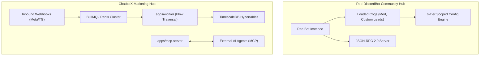
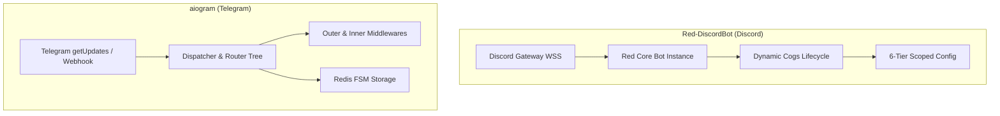
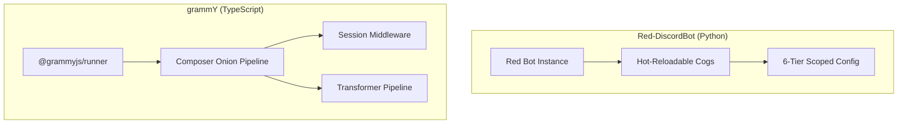
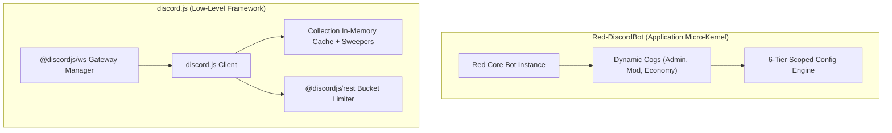
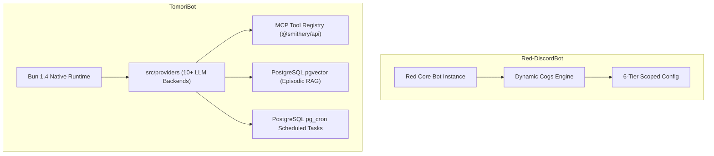

# Red-DiscordBot — Comparative Analysis & Category Evaluation

> **Category**: Conversational AI & Bots  
> **Architectural Role**: Modular Discord Bot Framework with Pluggable Cogs & 6-Tier Scoped Config  
> **Primary Stack**: Python 3.9-3.12+, discord.py 2.x, AsyncIO, Red Config Engine, Dynamic Cog Lifecycle, JSON-RPC  
> **Peer Solutions Compared**: `botpress`, `ChatbotX`, `aiogram`, `grammY`, `discord.js`, `TomoriBot`  
> **Commercial SaaS Benchmarks**: Carl-bot, MEE6, Dyno, ManyChat, Drift  

---

## 1. Executive Overview & Technical Identity: Red-DiscordBot

**Red-DiscordBot** (commonly known as Red) is the industry benchmark for modular, multi-server, self-hosted Discord bot architectures in Python. Developed and refined over a decade, Red bridges Discord's low-level Gateway protocol and high-level community management by providing a fully asynchronous plugin engine ("Cogs"), a multi-driver hierarchical persistence engine (`Config`), an integrated virtual economy system (`bank`), and a headless JSON-RPC interface.

### Core Architectural Profile
- **Runtime & Language**: `Python 3.9-3.12+ (Full type-annotated modern asyncio patterns)`
- **Core Framework**: `discord.py 2.x (Fork maintaining latest Discord API v10 slash commands & UI)`
- **Modularity Engine**: `Dynamic Cog Manager (_cog_manager.py) & Downloader (Git/pip lifecycle)`
- **Configuration & State Engine**: `redbot.core.config.Config with 6-tier scoping (GLOBAL/GUILD/CHANNEL/ROLE/USER/MEMBER)`
- **Persistence Drivers**: `Pluggable drivers: Flat JSON (with atomic buffers), MongoDB (Motor), PostgreSQL (asyncpg)`
- **Headless Management**: `Built-in JSON-RPC 2.0 daemon (_rpc.py) over TCP or Unix Domain Sockets`
- **Primary Architectural Niche**: `Hot-reloadable modular Discord bot platform with 6-tier scoped Config`
- **License**: `GNU GPLv3`

---

## 2. Peer Solution Landscape (Conversational AI & Bots)

| Solution | Language & Runtime | Core Architecture | Database / Cache | Queue / Concurrency | Primary Architectural Niche |
| :--- | :--- | :--- | :--- | :--- | :--- |
| **Red-DiscordBot** (Current) | `Python 3.9-3.12+` | discord.py 2.x, Dynamic Cogs Lifecycle | `Red Config (JSON flat, Mongo, Postgres)` | `AsyncIO Task Loop + Cog Manager` | Hot-reloadable modular Discord bot platform with 6-tier scoped Config |
| **botpress** | `TypeScript / Node 22+` | Monorepo Studio + QuickJS VM (`llmz`) | `PostgreSQL, DynamoDB, Vector DB` | In-Process Event Loop & Sandboxing | Hybrid visual FSM & sandboxed LLM agent runtime |
| **ChatbotX** | `TypeScript / Node 24+` | Turborepo, Next.js 15, MCP Server | `PostgreSQL 16+, TimescaleDB, Redis 7+` | `BullMQ / Redis Cluster` | Agentic chat marketing, social comment automation & MCP funnels |
| **aiogram** | `Python 3.10-3.14` | AsyncIO, uvloop, aiohttp, Pydantic v2 | `Redis (hiredis), Motor (MongoDB)` | `AsyncIO Event Loop` | High-throughput asynchronous Telegram dispatching with hierarchical routers |
| **grammY** | `TypeScript / Deno / Node` | Composer Onion Middleware, Web APIs | `Redis, PostgreSQL, Keyv, Memory` | `Runner Engine (@grammyjs/runner)` | Cross-runtime type-safe Telegram framework with transformer pipelines |
| **discord.js** | `TypeScript / Node 18-22+` | Modular Monorepo (`@discordjs/ws`, `rest`) | `In-Memory Collection Cache + Sweepers` | `REST Bucket Queues + Sharding` | Low-level object-oriented Discord WebSocket client & REST bucket manager |
| **TomoriBot** | `TypeScript / Bun 1.4+` | Bun Native Runtime, discord.js 14.25 | `PostgreSQL 16+, pgvector, pg_cron` | `Bun Event Loop + Provider Streaming` | Multi-provider LLM assistant with pgvector RAG, MCP tool registry & presets |

---

## 3. Deep Head-to-Head Comparative Breakdown: Red-DiscordBot vs Peers

### 3.1. Red-DiscordBot vs. botpress

**Comparative Focus**: `Hot-Reloadable Python Cog Micro-Kernel` vs. `Visual Flow Studio & Sandboxed QuickJS VM`

```mermaid
flowchart TD
    subgraph RedKernelArch ["Red-DiscordBot Micro-Kernel"]
        Red_Core["Red Core Bot Instance (discord.py)"] --> Red_CogMgr["Cog Manager (_cog_manager.py)"]
        Red_CogMgr --> Red_Cogs["Dynamic Cogs (Admin, Mod, Custom)"]
        Red_Cogs --> Red_Config["6-Tier Scoped Config (Global/Guild/Member)"]
        Red_Config --> Red_Drivers["Storage Drivers (JSON, Mongo, Postgres)"]
    end

    subgraph BotpressStudio ["botpress Studio & Engine"]
        BP_Ingress["Webhook Router (HTTP)"] --> BP_API["packages/chat-api"]
        BP_API --> BP_Cognitive["packages/cognitive"]
        BP_Cognitive --> BP_LLMz["packages/llmz (QuickJS Wasm)"]
        BP_LLMz <--> BP_Flow["Flow Engine Visual Canvas"]
        BP_Flow --> BP_DB["PostgreSQL / DynamoDB"]
    end
```

#### Runtime Topology, Event Loops & Dynamic Lifecycle
- **Red-DiscordBot** operates as an asynchronous Python micro-kernel centered around `discord.ext.commands.AutoShardedBot`. Its core innovation is dynamic runtime modularity: operators can load, reload, or upgrade plugins ("Cogs") from remote Git repositories at runtime (`[p]cog load <name>`) without dropping active WebSocket connections or restarting the bot process.
- **botpress** is an omnichannel TypeScript platform. Modifying bot logic or extensions requires compilation or studio deployments, while user scripting is executed in-process inside WebAssembly QuickJS sandboxes (`packages/llmz`).

#### State Management: 6-Tier Config vs. Multi-Scope Relational DB
- **Red-DiscordBot** provides the 6-tier `Config` engine (`redbot.core.config`). Developers access scoped variables (`await conf.guild(ctx.guild).welcome_channel.set(id)`) across `GLOBAL`, `GUILD`, `CHANNEL`, `ROLE`, `USER`, and `MEMBER` dimensions without writing SQL queries. The underlying driver can be switched from flat JSON to MongoDB or PostgreSQL without altering cog code.
- **botpress** structures persistence across four scopes (`conversation`, `user`, `bot`, `workflow`) in PostgreSQL and DynamoDB, tied directly to conversational dialogue turns.

#### Architectural Comparison Matrix: Red-DiscordBot vs. botpress

| Architectural Dimension | Red-DiscordBot | botpress |
| :--- | :--- | :--- |
| **Language & Core** | Python 3.9-3.12+ / discord.py 2.x | TypeScript / Node.js 22+ |
| **Modularity Model** | Runtime hot-reloadable Cogs via Git/pip | Build-time plugins & integrations |
| **State Persistence** | 6-Tier Scoped Config (JSON, Mongo, Postgres) | PostgreSQL 15+ & DynamoDB cache |
| **Admin Control** | Discord Chat Commands & Headless JSON-RPC | Web-based Visual Studio & Chat API |
| **Multi-Channel Scope** | Dedicated Discord Communities | Omnichannel (Web, WhatsApp, Slack, Teams, TG) |
| **License** | GNU GPLv3 | AGPL-3.0 / Commercial |

#### Distinct Strengths & Tradeoffs
- **Where Red-DiscordBot Excels**: Zero-downtime hot-reloading of features, mature community ecosystem of thousands of cogs, and built-in moderation, economy, and audio streaming.
- **Where botpress Holds an Advantage**: Visual drag-and-drop conversational authoring, omnichannel deployment across web and mobile messaging, and native RAG document indexing.

---

### 3.2. Red-DiscordBot vs. ChatbotX

**Comparative Focus**: `Modular Discord Bot Platform & 6-Tier Config` vs. `Omnichannel Agentic Marketing Hub with MCP Server`

#### Runtime Topology, Event Loops & Concurrency Models
- **Red-DiscordBot** manages persistent Discord WebSocket Gateway streams using Python's `asyncio`. It is designed for multi-server community governance, handling live events, voice streaming, and chat moderation within the bot process.
- **ChatbotX** operates as a distributed marketing queue cluster. Webhooks from Meta and Telegram are placed into Redis, where BullMQ background workers handle visual flow navigation, broadcast sequence pacing, and social comment monitoring.

#### State Management & Analytics
- **Red-DiscordBot** abstracts state into its 6-tier `Config` engine, optimizing for server-specific and member-specific operational flags.
- **ChatbotX** combines relational PostgreSQL tables (via Kysely ORM) for contacts and custom fields with TimescaleDB hypertables for logging delivery receipts, button clicks, and conversion rates over time.

#### External Control: JSON-RPC vs. Model Context Protocol (MCP)
- **Red-DiscordBot** includes an embedded JSON-RPC 2.0 server (`_rpc.py`) running over TCP or Unix sockets, designed for external dashboards and scripts to trigger commands.
- **ChatbotX** implements a dedicated Model Context Protocol server (`apps/mcp-server`), allowing autonomous AI SDRs to inspect lead profiles, pause automation, and trigger marketing flows via standardized RPC.

#### Architectural Comparison Matrix: Red-DiscordBot vs. ChatbotX

| Architectural Dimension | Red-DiscordBot | ChatbotX |
| :--- | :--- | :--- |
| **Primary Domain** | Multi-server Discord community management | Omnichannel chat marketing & social lead capture |
| **Target Platform** | Discord Gateway v10 | Meta (WhatsApp/IG/Messenger), Telegram, Socials |
| **Modularity Model** | Dynamic hot-reloadable Cogs via Git | Turborepo microservices & modular packages |
| **Configuration Engine** | 6-Tier Scoped Config (JSON, Mongo, Postgres) | Relational Kysely schema + Redis |
| **External Interface** | Headless JSON-RPC 2.0 server | Native Model Context Protocol (MCP) server |
| **Analytics Engine** | Modlog sequence auditing | TimescaleDB hypertables & continuous aggregates |

#### Distinct Strengths & Tradeoffs
- **Where Red-DiscordBot Excels**: Zero-downtime hot-reloading of features, turn-key community moderation, economy, and audio streaming.
- **Where ChatbotX Holds an Advantage**: Omnichannel reach, automated comment-to-DM triggers on Instagram/Facebook, visual marketing funnel builder, and native MCP server.

---

### 3.3. Red-DiscordBot vs. aiogram

**Comparative Focus**: `Modular Self-Hosted Discord Micro-Kernel` vs. `High-Throughput Stateless Python Telegram Framework`

#### Application vs. Framework
- **Red-DiscordBot** is a complete, self-hostable Discord bot application. It includes 20+ built-in cogs (admin, moderation, economy, audio, filter), a package manager (`Downloader`), and an interactive setup wizard (`redbot-setup`).
- **aiogram** is a code-first developer framework for Telegram. It provides the building blocks (routers, middlewares, filters, FSM context) for developers to write custom Telegram bots from scratch.

#### State Architecture: 6-Tier Scoped Config vs. Redis FSM
- **Red-DiscordBot** uses `Config` to persist long-term settings and member data across 6 scopes, supporting flat JSON, MongoDB, or PostgreSQL.
- **aiogram** uses `FSMContext` to track active conversational multi-step wizard state, writing short-lived keys to Redis with automatic TTL expiration.

#### Architectural Comparison Matrix: Red-DiscordBot vs. aiogram

| Architectural Dimension | Red-DiscordBot | aiogram |
| :--- | :--- | :--- |
| **Target Ecosystem** | Discord Communities | Telegram Bot API |
| **Solution Nature** | Turnkey Modular Application & Micro-Kernel | Code-first Developer Framework |
| **Plugin Architecture** | Dynamic Hot-Reloadable Cogs (Git/pip) | Hierarchical Routers & Middlewares |
| **State Storage** | 6-Tier Scoped Config (JSON, Mongo, Postgres) | Redis FSM Key-Value (`RedisStorage`) |
| **Network Protocol** | Persistent Bidirectional WebSocket (WSS) | Stateless HTTPS Long Polling / Webhooks |
| **Admin Control** | In-Chat Bot Commands & Headless JSON-RPC | Custom developer commands / Webhooks |

#### Distinct Strengths & Tradeoffs
- **Where Red-DiscordBot Excels**: Turnkey out-of-the-box community features, zero-downtime hot-reloading of modules, and rich multi-server permission governance.
- **Where aiogram Excels**: Ultra-high throughput on Telegram, distributed Redis FSM, and minimal server footprint.

---

### 3.4. Red-DiscordBot vs. grammY

**Comparative Focus**: `Modular Self-Hosted Discord Micro-Kernel` vs. `Universal TypeScript Telegram Onion Engine`

#### Runtime Topology & Modularity
- **Red-DiscordBot** runs in Python on persistent servers, allowing operators to dynamically load and unload Cogs at runtime without restarting the process.
- **grammY** runs across Node.js, Deno, Bun, and Cloudflare Workers using standard Web APIs, structuring logic as a static Koa-style onion middleware pipeline.

#### Outbound Rate Limiting & Execution Bounds
- **Red-DiscordBot** relies on `discord.py`'s internal HTTP request queues for Discord's rate limits.
- **grammY** features an outbound *Transformer Pipeline* (`bot.api.config.use`), which intercepts outgoing calls to enforce Telegram's 30 msg/sec limit and handle 429 auto-retries.

#### Architectural Comparison Matrix: Red-DiscordBot vs. grammY

| Architectural Dimension | Red-DiscordBot | grammY |
| :--- | :--- | :--- |
| **Language & Stack** | Python 3.9-3.12+ / discord.py 2.x | TypeScript 5.0+ / Standard Web APIs |
| **Target Platform** | Discord Communities | Telegram Bot API |
| **Modularity Model** | Runtime hot-reloadable Cogs via Git | Build-time plugins & middleware |
| **Configuration Engine** | 6-Tier Scoped Config (JSON, Mongo, Postgres) | Pluggable session adapters |
| **Deployment Footprint** | Dedicated Python process with local storage | Single file or serverless edge (<50MB) |

#### Distinct Strengths & Tradeoffs
- **Where Red-DiscordBot Excels**: Turn-key community moderation, economy, and music systems, with zero-downtime hot-reloading.
- **Where grammY Holds an Advantage**: Serverless edge execution, zero-overhead memory footprint, and compile-time type safety via Filter Queries.

---

### 3.5. Red-DiscordBot vs. discord.js

**Comparative Focus**: `Turnkey Modular Discord Bot Micro-Kernel` vs. `Low-Level Protocol Library & Cache Engine`

#### Architecture: Platform vs. Library
- **Red-DiscordBot** is a complete, modular community bot platform built in Python (`discord.py`). It provides a dynamic plugin engine, an administrative command suite, an economy engine (`bank.py`), and a tamper-evident moderation log (`modlog.py`).
- **discord.js** is a low-level TypeScript library. It provides raw WebSocket connection management, object-oriented guild abstractions, and REST bucket rate limiting, leaving all application logic to the developer.

#### State Management: 6-Tier Scoped Config vs. In-Memory Collections
- **Red-DiscordBot** provides persistent multi-scope state via `Config`, ensuring guild settings and member data persist across bot restarts.
- **discord.js** provides fast in-memory caching of live Discord entities (`@discordjs/collection`), relying on `Sweepers` to manage heap memory, but provides no persistent data storage out of the box.

#### Architectural Comparison Matrix: Red-DiscordBot vs. discord.js

| Architectural Dimension | Red-DiscordBot | discord.js |
| :--- | :--- | :--- |
| **Solution Category** | Full-featured modular application & micro-kernel | Low-level developer library |
| **Language & Core** | Python 3.9-3.12+ / discord.py 2.x | TypeScript / Node.js 18-22+ |
| **Modularity Model** | Runtime hot-reloadable Cogs via Git/pip | Static npm packages & application code |
| **Data Persistence** | 6-Tier Scoped Config (JSON, Mongo, Postgres) | Developer-managed external databases |
| **Out-of-the-Box Features**| Moderation, Audio, Economy, Warnings, Modlog | None (Blank canvas) |
| **License** | GNU GPLv3 | Apache-2.0 |

#### Distinct Strengths & Tradeoffs
- **Where Red-DiscordBot Excels**: Turnkey community management, zero-downtime hot-reloading of features, mature community ecosystem of thousands of cogs, and built-in economy/modlog systems.
- **Where discord.js Holds an Advantage**: Complete architectural freedom in TypeScript, zero opinionated bloat, and the foundation for custom commercial bot applications.

---

### 3.6. Red-DiscordBot vs. TomoriBot

**Comparative Focus**: `Modular Community Management Micro-Kernel` vs. `Bun-Native Multi-Provider AI Assistant with pgvector`

#### Focus: Community Operations vs. Conversational AI Assistant
- **Red-DiscordBot** specializes in server governance, moderation automation, music streaming, and virtual economies. It is primarily driven by structured text commands and slash commands.
- **TomoriBot** specializes in conversational AI assistance, multi-provider model routing (Claude, Gemini, DeepSeek, OpenAI), standardized tool calling via the Model Context Protocol (MCP), and episodic memory via PostgreSQL `pgvector`.

#### Runtime Performance & Extensibility
- **Red-DiscordBot** runs in Python on persistent asyncio loops, extending functionality via Git-cloned Cogs.
- **TomoriBot** runs in TypeScript on Bun 1.4+, extending functionality via Model Context Protocol (MCP) servers and SillyTavern character presets.

#### Architectural Comparison Matrix: Red-DiscordBot vs. TomoriBot

| Architectural Dimension | Red-DiscordBot | TomoriBot |
| :--- | :--- | :--- |
| **Language & Runtime** | Python 3.9-3.12+ / discord.py | TypeScript 5.9+ / Bun 1.4+ |
| **Core Focus** | Community moderation, economy, audio | Conversational AI assistant & tool execution |
| **Modularity System** | Dynamic hot-reloadable Cogs (Git/pip) | Model Context Protocol (MCP) tool registry |
| **Data Persistence** | 6-Tier Scoped Config (JSON, Mongo, Postgres) | PostgreSQL 16+ with `pgvector` & `pg_cron` |
| **LLM Gateway** | External community cogs | Native Multi-Provider Gateway (10+ models) |
| **Persona Steering** | None | SillyTavern Character Card V2 presets |

#### Distinct Strengths & Tradeoffs
- **Where Red-DiscordBot Excels**: Comprehensive community governance, zero-downtime hot-reloading of modules, virtual economy, and audio streaming.
- **Where TomoriBot Holds an Advantage**: Bun-native performance, multi-provider model resilience, standardized MCP tool discovery, and episodic memory with pgvector.

---

## 4. Capability & Feature Comparison Matrix

| Dimension / Capability | Red-DiscordBot | botpress | ChatbotX | aiogram | grammY | discord.js | TomoriBot |
| :--- | :---: | :---: | :---: | :---: | :---: | :---: | :---: |
| **Primary Platform** | **Discord** | Omnichannel | Omnichannel / Meta | Telegram | Telegram | **Discord** | **Discord** |
| **Hot-Reloading Architecture**| ✅ Native Cogs | ❌ | ❌ | ❌ | ❌ | ❌ | ❌ |
| **Configuration Scoping** | ✅ 6-Tier Config | ⚠️ 4-Scope DB | ⚠️ 2-Tier Vars | ⚠️ Redis Key | ⚠️ Session Keys| ❌ | ⚠️ DB Tables |
| **Headless JSON-RPC Server** | ✅ Native _rpc.py | ❌ | ❌ | ❌ | ❌ | ❌ | ❌ |
| **Built-in Economy Engine** | ✅ Native bank.py | ❌ | ❌ | ❌ | ❌ | ❌ | ❌ |
| **Tamper-Evident Modlog** | ✅ Native modlog | ❌ | ❌ | ❌ | ❌ | ❌ | ❌ |
| **Visual Flow Canvas** | ❌ | ✅ Advanced | ✅ Visual Builder | ❌ | ❌ | ❌ | ❌ |
| **Native MCP Server / Client**| ❌ | ⚠️ Zui Tools | ✅ Native Server | ❌ | ❌ | ❌ | ✅ Native Client |
| **Vector RAG Ingestion** | ⚠️ Community Cog | ✅ Native Plugin | ✅ pgvector Core | ❌ | ❌ | ❌ | ✅ Native pgvector |

---

## 5. Commercial Benchmark Positioning

When benchmarked against commercial SaaS leaders (**Carl-bot, MEE6, Dyno, ManyChat**):
- **Zero Subscription Lock-In**: Red-DiscordBot eliminates the monthly paywalls that Carl-bot and MEE6 impose on auto-moderation rules, reaction roles, and custom command scripting.
- **Complete Modularity**: Unlike closed SaaS bots, Red operators can install any of thousands of open-source community cogs or author custom Python cogs with zero platform restrictions.
- **Self-Hosted Privacy**: All community user data, infractions, and server logs remain stored securely on the operator's own storage infrastructure.

---

## 6. Strategic Takeaways & Role for MarketingStudio

In the unified **MarketingStudio** architecture:
1. **Primary Component to Adopt**: Adopt Red's 6-tier hierarchical configuration scoping pattern (`GLOBAL`, `WORKSPACE/GUILD`, `CHANNEL`, `ROLE`, `USER`, `MEMBER`) as the universal configuration model across all MarketingStudio bot dispatchers.
2. **Headless Control Pattern**: Reference Red's `_rpc.py` design for exposing administrative bot management over local IPC sockets to MarketingStudio's backend worker processes.
3. **Peer Coexistence**: Deploy `Red-DiscordBot` for robust self-hosted Discord server management, while delegating conversational AI inquiries to `TomoriBot` or `ChatbotX` via MCP.
