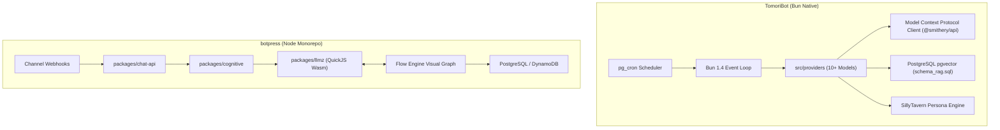
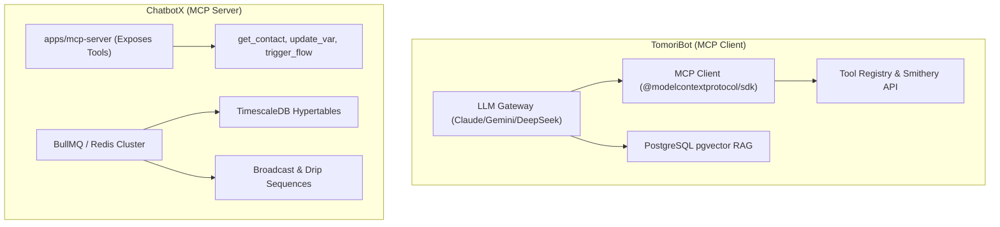
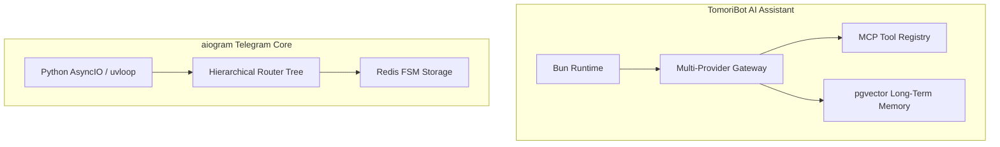
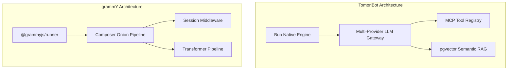
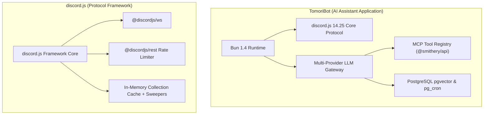
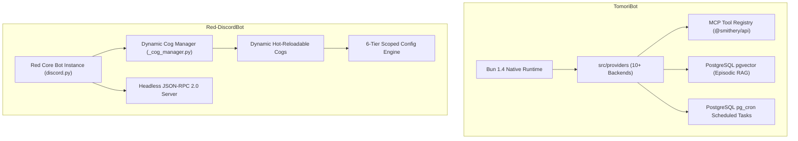

# TomoriBot — Comparative Analysis & Category Evaluation

> **Category**: Conversational AI & Bots  
> **Architectural Role**: Customizable AI Assistant Discord Bot with Bun, Multi-Provider LLMs & MCP  
> **Primary Stack**: TypeScript, Bun 1.4+, discord.js 14.25+, PostgreSQL, pgvector, pg_cron, Model Context Protocol (MCP)  
> **Peer Solutions Compared**: `botpress`, `ChatbotX`, `aiogram`, `grammY`, `discord.js`, `Red-DiscordBot`  
> **Commercial SaaS Benchmarks**: Carl-bot, MEE6, Midjourney bot, Voiceflow, ManyChat  

---

## 1. Executive Overview & Technical Identity: TomoriBot

**TomoriBot** is an advanced, production-grade conversational AI assistant and multi-agent Discord bot engineered on the high-performance Bun runtime. Built to transcend basic chatbots, TomoriBot combines multi-provider LLM orchestration (Anthropic Claude, OpenAI, Google Gemini, DeepSeek, Vertex AI, OpenRouter), standardized tool execution via the Model Context Protocol (MCP), deep episodic memory using vector embeddings in PostgreSQL (`pgvector`), and extensive persona modeling compatible with SillyTavern presets.

### Core Architectural Profile
- **Runtime & Language**: `TypeScript 5.9+ / Bun 1.4+ (Native Bun runtime, bunfig.toml, ultra-fast I/O)`
- **Gateway Client**: `discord.js 14.25+ (Discord Gateway v10 & Application Commands)`
- **LLM Provider Gateway**: `Unified multi-provider client (Anthropic, Gemini, DeepSeek, OpenAI, OpenRouter) with auto-failover`
- **Agent Tool Ecosystem**: `Model Context Protocol (@modelcontextprotocol/sdk) with Smithery registry discovery`
- **Database & Persistence**: `PostgreSQL 16+ (189KB core schema), pgvector (Cosine distance RAG), pg_cron (In-DB scheduling)`
- **Character & Persona System**: `SillyTavern Character Card V2 preset engine (schema_stpreset.sql)`
- **Cross-Platform Bridge**: `Matrix Appservice Bridge (matrix-appservice-bridge) to federated chat networks`
- **Primary Architectural Niche**: `Multi-provider LLM assistant with pgvector RAG, MCP tool registry & presets`
- **License**: `ISC`

---

## 2. Peer Solution Landscape (Conversational AI & Bots)

| Solution | Language & Runtime | Core Architecture | Database / Cache | Queue / Concurrency | Primary Architectural Niche |
| :--- | :--- | :--- | :--- | :--- | :--- |
| **TomoriBot** (Current) | `TypeScript / Bun 1.4+` | Bun Native Runtime, discord.js 14.25 | `PostgreSQL 16+, pgvector, pg_cron` | `Bun Event Loop + Provider Streaming` | Multi-provider LLM assistant with pgvector RAG, MCP tool registry & presets |
| **botpress** | `TypeScript / Node 22+` | Monorepo Studio + QuickJS VM (`llmz`) | `PostgreSQL, DynamoDB, Vector DB` | In-Process Event Loop & Sandboxing | Hybrid visual FSM & sandboxed LLM agent runtime |
| **ChatbotX** | `TypeScript / Node 24+` | Turborepo, Next.js 15, MCP Server | `PostgreSQL 16+, TimescaleDB, Redis 7+` | `BullMQ / Redis Cluster` | Agentic chat marketing, social comment automation & MCP funnels |
| **aiogram** | `Python 3.10-3.14` | AsyncIO, uvloop, aiohttp, Pydantic v2 | `Redis (hiredis), Motor (MongoDB)` | `AsyncIO Event Loop` | High-throughput asynchronous Telegram dispatching with hierarchical routers |
| **grammY** | `TypeScript / Deno / Node` | Composer Onion Middleware, Web APIs | `Redis, PostgreSQL, Keyv, Memory` | `Runner Engine (@grammyjs/runner)` | Cross-runtime type-safe Telegram framework with transformer pipelines |
| **discord.js** | `TypeScript / Node 18-22+` | Modular Monorepo (`@discordjs/ws`, `rest`) | `In-Memory Collection Cache + Sweepers` | `REST Bucket Queues + Sharding` | Low-level object-oriented Discord WebSocket client & REST bucket manager |
| **Red-DiscordBot** | `Python 3.9-3.12+` | discord.py 2.x, Dynamic Cogs Lifecycle | `Red Config (JSON flat, Mongo, Postgres)` | `AsyncIO Task Loop + Cog Manager` | Hot-reloadable modular Discord bot platform with 6-tier scoped Config |

---

## 3. Deep Head-to-Head Comparative Breakdown: TomoriBot vs Peers

### 3.1. TomoriBot vs. botpress

**Comparative Focus**: `Bun-Native Multi-Provider AI Assistant with pgvector & MCP` vs. `Visual Flow Studio & Sandboxed QuickJS VM`

#### Runtime Topology, Event Loops & Concurrency Models
- **TomoriBot** runs natively on the Bun 1.4+ JavaScript runtime. By utilizing Bun's ultra-fast startup, integrated package manager, and high-performance native I/O, TomoriBot achieves minimal memory overhead and streams LLM tokens to Discord channels in real time.
- **botpress** executes on Node.js 22+ across multiple monorepo services governed by Turborepo. It requires heavier container infrastructure to host its visual flow canvas, NLU models, and Chat API.

#### Dialogue Paradigms: Generative Assistant Loop vs. Hybrid Visual FSM
- **TomoriBot** operates as an autonomous cognitive loop. It resolves conversation context dynamically, searches long-term episodic memory via PostgreSQL `pgvector`, and delegates function calls to local tools or remote MCP servers.
- **botpress** relies on a visual node canvas where conversation states and transitions are modeled explicitly. Nodes can yield control to `packages/llmz` for bounded LLM reasoning inside QuickJS WebAssembly sandboxes.

#### Model Resilience & Provider Gateway
- **TomoriBot** features an integrated multi-provider LLM gateway (`src/providers`) supporting Anthropic, OpenAI, Google Gemini, DeepSeek, and OpenRouter with automatic 429/503 failover.
- **botpress** relies on centralized cloud model endpoint configurations without dynamic multi-vendor fallback chains.

#### Architectural Comparison Matrix: TomoriBot vs. botpress

| Architectural Dimension | TomoriBot | botpress |
| :--- | :--- | :--- |
| **JavaScript Runtime** | Bun 1.4+ | Node.js 22+ |
| **Dialogue Architecture** | Dynamic LLM reasoning loop + pgvector RAG | Visual graph state machine + QuickJS VM |
| **LLM Gateway** | Multi-provider with automatic failover (10+ vendors)| Configured cloud LLM endpoints |
| **Tool Calling Standard** | Industry-standard Model Context Protocol (MCP) | Custom `@botpress/zui` schemas |
| **Long-Term Memory** | PostgreSQL `pgvector` cosine similarity | `plugins/knowledge` vector store |
| **Scheduled Jobs** | In-database PostgreSQL `pg_cron` extension | In-process workflow triggers |
| **Primary Platform** | Discord Communities & Matrix Appservice Bridge | Omnichannel (Web, WhatsApp, Slack, Teams, TG) |

#### Distinct Strengths & Tradeoffs
- **Where TomoriBot Excels**: Bun-native speed, multi-provider model redundancy, standardized MCP tool discovery (Smithery API), and episodic memory with pgvector.
- **Where botpress Holds an Advantage**: Visual drag-and-drop conversational authoring, omnichannel deployment across web and mobile messaging, and native human-in-the-loop (HITL) escalation.

---

### 3.2. TomoriBot vs. ChatbotX

**Comparative Focus**: `Bun-Native Multi-Provider AI Assistant with pgvector` vs. `Omnichannel Agentic Marketing Platform & MCP Server`

#### The MCP Dichotomy: Client vs. Server
- **TomoriBot acts as an MCP Client (`src/tools/toolInitializer.ts`)**: It connects to local and remote MCP servers, dynamically loading tool schemas and executing them during the LLM's conversational reasoning loop.
- **ChatbotX acts as an MCP Server (`apps/mcp-server`)**: It exposes the conversational marketing stack (contact records, funnel triggers, custom fields) as tools to external AI agents (like Claude Desktop or OpenClaw).

#### Runtime & Database Specialization
- **TomoriBot** runs on Bun 1.4+, optimizing for low latency, episodic memory via `pgvector` (`schema_rag.sql`), and recurring task execution via `pg_cron`.
- **ChatbotX** runs on Node.js 24 across Next.js and BullMQ worker clusters, optimizing for high-volume broadcast campaigns, WhatsApp rate-limit tiers, and time-series analytics via TimescaleDB hypertables.

#### Architectural Comparison Matrix: TomoriBot vs. ChatbotX

| Architectural Dimension | TomoriBot | ChatbotX |
| :--- | :--- | :--- |
| **JavaScript Runtime** | Bun 1.4+ | Node.js 24+ |
| **Model Context Protocol Role**| **MCP Client** (Consumes tools for AI assistant) | **MCP Server** (Exposes bot tools to external agents)|
| **Database Specialization** | PostgreSQL `pgvector` (Semantic episodic memory) | TimescaleDB (Time-series marketing analytics) |
| **LLM Gateway** | Built-in multi-provider gateway with failover | Relies on external AI agents via MCP |
| **Automation Focus** | In-chat conversational assistant & knowledge RAG | Lead generation funnels, comment-to-DM, drips |
| **Channel Target** | Discord Communities & Matrix Bridge | Meta (WhatsApp/IG), Telegram, Social Webhooks |

#### Distinct Strengths & Tradeoffs
- **Where TomoriBot Excels**: Bun-native performance, turnkey multi-provider model resilience, episodic memory with pgvector, and rich SillyTavern character presets.
- **Where ChatbotX Holds an Advantage**: Visual marketing funnel builder, automated social comment-to-DM triggers (Instagram/Facebook), broadcast sequence pacing, and TimescaleDB analytics.

---

### 3.3. TomoriBot vs. aiogram

**Comparative Focus**: `Bun-Native Multi-Provider AI Assistant with pgvector` vs. `High-Throughput Stateless Python Telegram Framework`

#### Application vs. Protocol Framework
- **TomoriBot** is an autonomous AI assistant application. It provides end-to-end LLM orchestration, model streaming, tool execution, and database memory out of the box.
- **aiogram** is a code-first developer framework for the Telegram Bot API. It provides routing, middlewares, and FSM primitives, leaving AI model integration entirely to the developer.

#### State Architecture: Semantic `pgvector` vs. `RedisStorage`
- **TomoriBot** implements long-term episodic memory using PostgreSQL and `pgvector`. Inbound messages trigger vector similarity searches, allowing the bot to recall facts across months of interactions.
- **aiogram** implements short-lived conversational multi-step wizard state using `RedisStorage`. State is indexed by `(bot_id, chat_id, user_id)` and focuses on deterministic form inputs.

#### Architectural Comparison Matrix: TomoriBot vs. aiogram

| Architectural Dimension | TomoriBot | aiogram |
| :--- | :--- | :--- |
| **Language & Runtime** | TypeScript 5.9+ / Bun 1.4+ | Python 3.10-3.14 / AsyncIO (uvloop) |
| **Target Platform** | Discord Gateway & Matrix Appservice Bridge | Telegram Bot API |
| **AI Integration** | Built-in Multi-Provider Gateway (10+ models) | None (Developer brings own SDK) |
| **Tool Calling Standard** | Industry-standard Model Context Protocol (MCP) | Custom Python functions |
| **State & Memory** | PostgreSQL `pgvector` cosine similarity embeddings | Redis FSM key-value (`RedisStorage`) |
| **Job Scheduling** | PostgreSQL in-database `pg_cron` jobs | External timers / Celery tasks |

#### Distinct Strengths & Tradeoffs
- **Where TomoriBot Excels**: Turnkey multi-provider AI reasoning, standardized MCP tool discovery, episodic memory with pgvector, and native Bun performance.
- **Where aiogram Excels**: Pure Telegram Bot API mastery, ultra-high event throughput, and Python data science ecosystem synergy.

---

### 3.4. TomoriBot vs. grammY

**Comparative Focus**: `Bun-Native Multi-Provider AI Assistant with pgvector` vs. `Universal TypeScript Telegram Onion Engine`

#### Runtime Architecture & Edge Execution
- **TomoriBot** is designed for high-performance servers running Bun 1.4+, maintaining persistent Discord WebSocket gateway connections and persistent PostgreSQL pools.
- **grammY** is engineered around standard Web APIs (`fetch`), allowing it to run as a persistent server or as a serverless edge function on Cloudflare Workers with zero idle cost.

#### AI Assistant vs. Protocol Middleware Engine
- **TomoriBot** focuses on conversational reasoning: managing token budgets (`gpt-tokenizer`), parsing character presets (SillyTavern), and routing function calls through MCP.
- **grammY** focuses on Telegram update routing: compile-time filter queries, context flavoring, and outbound rate limiting via its Transformer Pipeline.

#### Architectural Comparison Matrix: TomoriBot vs. grammY

| Architectural Dimension | TomoriBot | grammY |
| :--- | :--- | :--- |
| **Target Platform** | Discord Gateway & Matrix Appservice Bridge | Telegram Bot API |
| **Language & Runtime** | TypeScript 5.9+ / Bun 1.4+ | TypeScript 5.0+ / Universal Web APIs |
| **Runtime Portability** | Bun Server / Docker | Universal (Node, Deno, Bun, Cloudflare Workers) |
| **AI Integration** | Built-in Multi-Provider Gateway (10+ models) | None (Developer brings own SDK) |
| **Tool Calling Standard** | Industry-standard Model Context Protocol (MCP) | Custom handler functions |
| **Long-Term Memory** | PostgreSQL `pgvector` cosine similarity embeddings | Pluggable session adapters |

#### Distinct Strengths & Tradeoffs
- **Where TomoriBot Excels**: Turnkey multi-provider LLM orchestration, standardized MCP tool discovery, episodic memory with pgvector, and native Bun performance.
- **Where grammY Holds an Advantage**: Cross-runtime edge portability, compile-time type narrowing, and granular outbound rate limiting on Telegram.

---

### 3.5. TomoriBot vs. discord.js

**Comparative Focus**: `AI Assistant Application on Bun` vs. `Low-Level Foundation Framework`

#### Application vs. Underlying Framework
- **TomoriBot** is an advanced AI assistant application that uses `discord.js 14.25.1` as its underlying communication library. It adds multi-provider LLM routing, MCP tool calling, vector search, and character preset systems.
- **discord.js** is the low-level object-oriented library. It provides raw WebSocket management, slash command builders, and REST bucket rate limiting, but contains no AI reasoning logic.

#### Runtime: Bun vs. Node.js
- **TomoriBot** runs on Bun 1.4+, benefiting from faster startup, lower memory usage, and native streaming performance.
- **discord.js** is primarily developed for and benchmarked against standard Node.js (18-22+).

#### Architectural Comparison Matrix: TomoriBot vs. discord.js

| Architectural Dimension | TomoriBot | discord.js |
| :--- | :--- | :--- |
| **Relationship** | AI assistant application built ON discord.js | The underlying protocol framework |
| **JavaScript Runtime** | Bun 1.4+ | Node.js 18-22+ |
| **AI Capabilities** | Multi-provider LLM gateway with automatic failover | None (Protocol library) |
| **Tool Calling Standard** | Model Context Protocol (MCP) & Smithery registry | None |
| **Long-Term Memory** | PostgreSQL `pgvector` cosine similarity embeddings | In-memory cache only |
| **Scheduled Tasks** | PostgreSQL in-database `pg_cron` jobs | External timers |

#### Distinct Strengths & Tradeoffs
- **Where TomoriBot Excels**: Turnkey conversational AI assistant with multi-provider failover, standardized MCP tool discovery, episodic memory with pgvector, and native Bun performance.
- **Where discord.js Holds an Advantage**: Complete architectural freedom to build any type of Discord bot without opinionated AI or database dependencies.

---

### 3.6. TomoriBot vs. Red-DiscordBot

**Comparative Focus**: `Bun-Native Multi-Provider AI Assistant with pgvector` vs. `Modular Self-Hosted Discord Micro-Kernel`

#### Core Focus: Generative AI Assistant vs. Community Governance Platform
- **TomoriBot** is an AI-first conversational assistant. It specializes in multi-provider model routing, RAG retrieval from vector databases, MCP tool execution, and persona steering.
- **Red-DiscordBot** is a community management platform. It specializes in server moderation, role automation, virtual economy (`bank.py`), and audio streaming, controlled via structured chat commands.

#### Modularity: MCP Tools vs. Hot-Reloadable Cogs
- **TomoriBot** extends functionality dynamically via the Model Context Protocol (MCP), querying external tool servers discovered through the Smithery API without writing custom Discord bot code.
- **Red-DiscordBot** extends functionality via Python "Cogs", downloading community code from Git repositories and hot-reloading it at runtime via `_cog_manager.py`.

#### State Management: `pgvector` vs. 6-Tier Scoped Config
- **TomoriBot** leverages PostgreSQL with `pgvector` for episodic dialogue memory and `pg_cron` for scheduled agent routines.
- **Red-DiscordBot** provides the 6-tier `Config` engine (`GLOBAL`, `GUILD`, `CHANNEL`, `ROLE`, `USER`, `MEMBER`) backed by JSON, MongoDB, or PostgreSQL.

#### Architectural Comparison Matrix: TomoriBot vs. Red-DiscordBot

| Architectural Dimension | TomoriBot | Red-DiscordBot |
| :--- | :--- | :--- |
| **Language & Runtime** | TypeScript 5.9+ / Bun 1.4+ | Python 3.9-3.12+ / discord.py |
| **Core Focus** | Conversational AI assistant & tool execution | Community moderation, economy, audio |
| **Modularity System** | Model Context Protocol (MCP) tool registry | Dynamic hot-reloadable Cogs (Git/pip) |
| **Data Persistence** | PostgreSQL 16+ with `pgvector` & `pg_cron` | 6-Tier Scoped Config (JSON, Mongo, Postgres) |
| **LLM Gateway** | Native Multi-Provider Gateway (10+ models) | External community cogs |
| **Persona Steering** | SillyTavern Character Card V2 presets | None |

#### Distinct Strengths & Tradeoffs
- **Where TomoriBot Excels**: Bun-native performance, multi-provider model resilience, standardized MCP tool discovery, and episodic memory with pgvector.
- **Where Red-DiscordBot Holds an Advantage**: Comprehensive community governance, zero-downtime hot-reloading of modules, virtual economy, and audio streaming.

---

## 4. Capability & Feature Comparison Matrix

| Dimension / Capability | TomoriBot | botpress | ChatbotX | aiogram | grammY | discord.js | Red-DiscordBot |
| :--- | :---: | :---: | :---: | :---: | :---: | :---: | :---: |
| **Primary Platform** | **Discord** | Omnichannel | Omnichannel / Meta | Telegram | Telegram | **Discord** | **Discord** |
| **Runtime Language** | **TypeScript / Bun** | TypeScript / Node | TypeScript / Node | Python | TypeScript / Deno | TypeScript / Node | Python |
| **Multi-Provider LLM Gateway**| ✅ 10+ Models | ⚠️ Configured | ⚠️ External | ❌ | ❌ | ❌ | ❌ |
| **Model Auto-Failover (429/503)**| ✅ Native | ❌ | ❌ | ❌ | ❌ | ❌ | ❌ |
| **Native MCP Client** | ✅ Native Client | ❌ | ❌ | ❌ | ❌ | ❌ | ❌ |
| **Native MCP Server** | ❌ | ❌ | ✅ Native Server | ❌ | ❌ | ❌ | ❌ |
| **Vector RAG Ingestion** | ✅ pgvector Core | ✅ Native Plugin | ✅ pgvector Core | ❌ | ❌ | ❌ | ⚠️ Community Cog |
| **In-Database Task Scheduling**| ✅ pg_cron | ❌ | ❌ | ❌ | ❌ | ❌ | ❌ |
| **Character Persona Presets** | ✅ SillyTavern | ⚠️ Personality | ❌ | ❌ | ❌ | ❌ | ❌ |
| **Federated Bridge** | ✅ Matrix Bridge | ❌ | ❌ | ❌ | ❌ | ❌ | ❌ |

---

## 5. Commercial Benchmark Positioning

When benchmarked against commercial SaaS leaders (**Carl-bot, MEE6, Midjourney bot, Voiceflow, ManyChat**):
- **Provider Monoculture Immunity**: Commercial bots break when OpenAI experiences outages. TomoriBot automatically fails over across Anthropic Claude, Google Gemini, DeepSeek, and OpenRouter with zero downtime.
- **Standardized Tool Interoperability**: Adopting the Model Context Protocol (MCP) ensures that TomoriBot can execute thousands of standard tools published by the global AI ecosystem without custom glue code.
- **Long-Term Memory Sovereignty**: Unlike commercial chatbots that suffer context amnesia, TomoriBot indexes customer and server history into PostgreSQL with `pgvector` for persistent semantic recall.

---

## 6. Strategic Takeaways & Role for MarketingStudio

In the unified **MarketingStudio** architecture:
1. **Primary Component to Adopt**: Adopt TomoriBot's multi-provider LLM gateway architecture (`src/providers`) with automatic 429/503 failover for all AI agent reasoning across MarketingStudio.
2. **Episodic Memory Pattern**: Standardize on TomoriBot's `schema_rag.sql` pgvector implementation for community context retrieval and customer conversation memory.
3. **MCP Tool Integration**: Use TomoriBot's MCP client architecture to allow MarketingStudio Discord bots to query CRM leads, check inventory, and execute external APIs seamlessly.
4. **Peer Coexistence**: Deploy `TomoriBot` as the conversational intelligence layer inside Discord communities, while leveraging `discord.js` for low-level gateway infrastructure and `ChatbotX` for outbound social marketing funnels.
