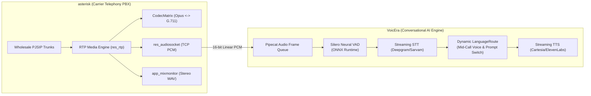
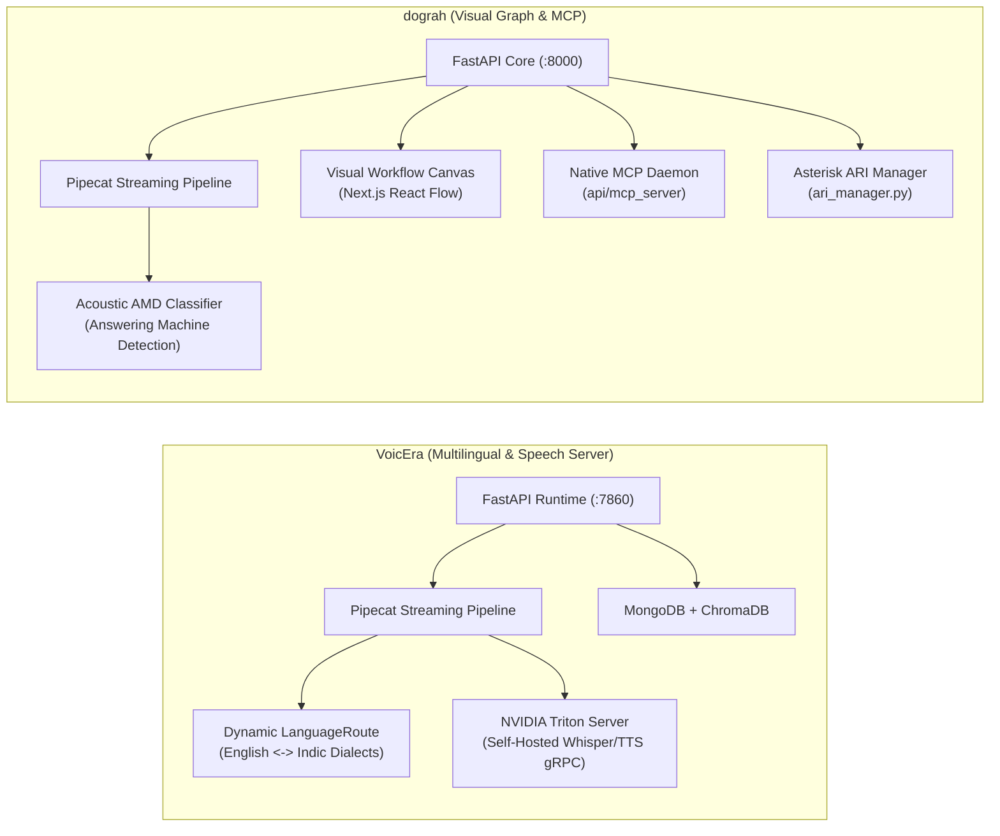

# VoicEra — Comparative Analysis & Category Evaluation

> **Category**: Telephony, Voice & PBX  
> **Architectural Role**: Multilingual real-time conversational voice AI, streaming speech pipeline & carrier XML engine  
> **Primary Stack**: Python 3.11+, FastAPI, Pipecat AI 1.8 | Silero VAD, Deepgram, Cartesia | MongoDB, ChromaDB, MinIO | NVIDIA Triton gRPC | Apache-2.0  
> **Peer Solutions Compared**: `asterisk`, `dograh`  
> **Commercial SaaS Benchmarks**: Vapi.ai, Retell AI, Bland.ai, Twilio Voice, ElevenLabs Conversational AI  

---

## 1. Executive Overview & Technical Identity: VoicEra

**VoicEra** is an enterprise-grade, open-source conversational voice AI platform engineered for real-time telephone and web voice automation. Developed in Python 3.11+ using FastAPI and the Pipecat streaming framework (`pipecat-ai`), VoicEra powers autonomous inbound receptionists, outbound sales qualification bots, and customer support agents capable of sustaining natural, interruptible voice dialogues with sub-500ms end-to-end response latency.

Unlike legacy voice bots that process speech sequentially in slow request-response turns, VoicEra streams continuous audio frames asynchronously through an integrated pipeline of neural Voice Activity Detection (Silero VAD), streaming Speech-to-Text (STT), speculative LLM generation, and chunked Text-to-Speech (TTS). Furthermore, it uniquely incorporates dynamic mid-call language switching for multilingual markets (English, Hindi, Indic dialects), carrier-agnostic XML/WebSocket dispatching (Plivo, Vodafone Idea OBD, Vobiz, Twilio), and optional self-hosted speech inference via NVIDIA Triton Inference Server.

### Core Architectural Profile
- **Runtime & Language**: `Python 3.11+` asynchronous runtime (`asyncio`, `uvicorn`)
- **Voice Framework**: `pipecat-ai 1.8.1` modular frame-based streaming audio pipeline
- **Neural VAD & Barge-In**: `silero-vad` (ONNX Runtime) with sub-100ms speech onset detection and instant audio queue clearing
- **Speech & Reasoning Models**: Deepgram Nova-2, Sarvam AI, Cartesia Sonic, ElevenLabs, OpenAI GPT-4o, Claude 3.5, Groq
- **Carrier Abstraction Layer**: Dynamic stream XML dispatcher supporting Plivo, Vodafone Idea OBD, Vobiz, and Twilio
- **Persistence & Knowledge**: `MongoDB 6+` / `FerretDB`, `ChromaDB` vector store for RAG, and `MinIO / S3` for call audio archiving
- **Self-Hosted Inference**: NVIDIA Triton Server (`tritonclient[grpc]`) for on-premise Whisper ASR and local TTS

---

## 2. Peer Solution Landscape (Telephony, Voice & PBX)

Within this category, `VoicEra` operates alongside two specialized peer solutions:

| Solution | Language & Runtime | Core Framework | Audio & Media Transport | Concurrency & Event Model | Primary Architectural Role | License |
| :--- | :--- | :--- | :--- | :--- | :--- | :--- |
| **VoicEra** (Current) | `Python 3.11+` | `FastAPI, Pipecat AI` | `WebSocket PCM (8k/16k), Carrier XML` | `asyncio` Event Loop + Frame Processors | Multilingual Real-Time Voice AI & Telephony Automation | Apache-2.0 |
| **asterisk** | `ANSI C (POSIX / C99)` | `Native Multi-Threaded Engine` | `SIP, RTP/SRTP, WebRTC, AudioSocket` | `POSIX Threads, Stasis Event Bus` | Carrier SIP Trunking, PBX Media Gateway & Transcoder | GPL-2.0 |
| **dograh** | `Python 3.11+ / TS` | `FastAPI, Next.js 14 + React Flow`| `WebSocket PCM, WebRTC, Asterisk ARI` | `asyncio` + Redis 7 Concurrency Locks | Visual Workflow Voice AI Platform with Native MCP Server | BSD-2-Clause |

---

## 3. Deep Head-to-Head Comparative Breakdown: VoicEra vs Peers

### 3.1. VoicEra vs. asterisk

**Comparative Focus**: High-level conversational voice AI pipeline vs. low-level C telecommunications media switch.

#### Architectural & Stack Differences
- **System Responsibilities & Abstraction Level**: `VoicEra` operates at the cognitive layer of conversational interactions. It ingests audio streams over WebSockets, converts speech to tokens, queries vector knowledge bases (ChromaDB), reasons over dialogues, and flushes speech buffers on user barge-in. `asterisk` is a telecom transport engine operating in ANSI C; it manages physical/virtual SIP trunks, negotiates SDP and DTLS-SRTP encryption, performs zero-copy codec transcoding (e.g. converting browser WebRTC Opus to PSTN G.711), and controls hardware telephony lines.
- **Concurrency & Process Architecture**: `asterisk` manages channels via native POSIX threads and an internal lockless publish-subscribe message bus (`Stasis`), handling thousands of concurrent calls with negligible memory footprint (~50 MB baseline). `VoicEra` is an asynchronous Python/FastAPI service structured into two distinct containers: the Management API (`apps/api` :8000) and the real-time Voice Runtime (`apps/runtime` :7860), where media frames flow through non-blocking asynchronous pipeline queues.
- **Barge-In & Interruption Handling**: `VoicEra` detects interruptions through neural acoustic models (`SileroVAD`), canceling downstream LLM token generation within 100ms and dispatching an audio clear packet down the WebSocket. `asterisk` manages telephony-level signaling interruptions (DTMF RFC 4733 or flash hooks); when connected to VoicEra via `res_audiosocket`, Asterisk passes continuous raw linear PCM audio so VoicEra's neural VAD can govern conversational turn-taking.
- **Architectural Synergy**: The two solutions are complementary rather than mutually exclusive: Asterisk terminates wholesale carrier SIP trunks at rock-bottom telecom rates ($0.003/min) and forwards raw audio via `res_audiosocket` directly into VoicEra's Pipecat pipeline.

#### Architectural Comparison Matrix: VoicEra vs. asterisk

| Dimension | VoicEra | asterisk |
| :--- | :--- | :--- |
| **System Layer** | Conversational Voice AI & Pipeline Orchestration | Telecom Carrier Switching & Media Transcoding |
| **Core Runtime** | Python 3.11+ (FastAPI + Pipecat AI) | ANSI C (POSIX / C99) |
| **Concurrency Model** | Asynchronous event loop (`asyncio`) + frame queues | Multi-threaded POSIX channels + Stasis bus |
| **Media Transport** | WebSocket PCM (8k/16k), Dynamic Carrier XML | SIP, RTP/SRTP, WebRTC, AudioSocket (TCP PCM) |
| **Transcoding Engine** | Offloaded to speech APIs / Triton Server | Native C `CodecMatrix` (Opus, G.711, G.722, G.729) |
| **Interruption Model** | Neural Silero VAD (<100ms barge-in) | DTMF tone interjection / external AudioSocket |
| **Cognitive AI & RAG** | Built-in LLMs, ChromaDB vector store, tools | None (Pure telecommunications PBX) |
| **Persistence Engine** | MongoDB 6+ / FerretDB + MinIO S3 storage | Dynamic ODBC (ARA) to PostgreSQL/MySQL |
| **Memory Footprint** | ~350 MB RAM (Runtime container) | **~50 MB RAM** |

---

### 3.2. VoicEra vs. dograh

**Comparative Focus**: Multilingual streaming voice AI platform with Triton model server vs. visual graph-based voice AI platform with native MCP daemon.

#### Architectural & Stack Differences
- **Conversational Design & Workflow Modeling**: `dograh` replaces traditional prompt configurations with an interactive visual node-based graph editor (`WorkflowDefinitionModel` built with Next.js and React Flow). Conversations are designed as stateful directed graphs with explicit Intent, Router, Tool, Transfer, and End Call nodes. `VoicEra` defines agents through structured system prompts, tools configuration schemas, and Pydantic models managed via REST APIs.
- **Multilingual Support & Language Switching**: `VoicEra` is purpose-built for multilingual environments. Through its `LanguageRoute` mixin (`apps/runtime/services/language_switch/switcher.py`), VoicEra detects mid-call language transitions (e.g. from English to Hindi or regional Indic dialects) and immediately switches the active STT model, neural TTS voice profile, and LLM system prompt without dropping the call leg or resetting context. `dograh` handles multilingual routing by branching across multiple workflow nodes.
- **Inference Hosting & Privacy (Triton Server)**: `VoicEra` includes an optional self-hosted `model-server` based on **NVIDIA Triton Inference Server** communicating over gRPC. Organizations can deploy local Whisper ASR and open-weight speech synthesis models on internal GPU clusters, defending gross margins during high-volume outbound campaigns. `dograh` relies primarily on cloud speech APIs (Deepgram, Cartesia, MiniMax, Speechify).
- **Outbound Power Dialing & Telephony Interfacing**: `dograh` includes real-time acoustic Answering Machine Detection (`answer_classification.py`), a persistent Asterisk ARI bridge daemon (`ari_manager.py`), Coturn STUN/TURN relays, and a native Model Context Protocol (MCP) server for external AI coding assistant control. `VoicEra` specializes in dynamic XML stream generation across diverse carriers (Plivo, VI OBD, Vobiz, Twilio).

#### Architectural Comparison Matrix: VoicEra vs. dograh

| Dimension | VoicEra | dograh |
| :--- | :--- | :--- |
| **Workflow Architecture** | Prompt-driven with dynamic RAG & tool calling | Visual directed node graph (React Flow canvas) |
| **Multilingual Strategy** | Dynamic `LanguageRoute` mid-call switching | Multi-node branching logic |
| **Self-Hosted AI Inference**| Native NVIDIA Triton Server integration (gRPC) | Cloud API endpoints (Deepgram / Cartesia) |
| **Answering Machine AMD** | Basic post-utterance classifier | Real-time acoustic AMD classifier (<2s detection) |
| **Telephony Gateways** | Multi-carrier XML (Plivo, VI OBD, Vobiz, Twilio) | Carrier WebSockets + Built-in Asterisk ARI Manager |
| **AI Assistant Control** | Standard REST API endpoints | Native Model Context Protocol (MCP) Server |
| **Data Persistence** | MongoDB 6+ / FerretDB + ChromaDB | PostgreSQL 17 + `pgvector` (SQLAlchemy async) |
| **Observability** | In-pipeline latency metrics logger | Langfuse tracing & telemetry integration |

---

## 4. Capability & Feature Comparison Matrix

| Feature / Dimension | VoicEra | asterisk | dograh |
| :--- | :---: | :---: | :---: |
| **Sub-500ms End-to-End Latency** | ✅ Pipecat Streaming | ❌ (Media only) | ✅ Pipecat Streaming |
| **Neural VAD Barge-In (<100ms)** | ✅ Silero VAD (ONNX) | ❌ | ✅ Silero VAD (ONNX) |
| **Mid-Call Multilingual Switching** | ✅ Dynamic LanguageRoute | ❌ | ⚠️ Node branching |
| **Self-Hosted Inference (Triton gRPC)**| ✅ NVIDIA Triton Server | ❌ | ⚠️ Endpoint config |
| **Visual Node-Based Conversation Editor**| ❌ (Prompt-based) | ❌ | ✅ React Flow Canvas |
| **Answering Machine Detection (AMD)** | ⚠️ Utterance classifier | ✅ Built-in DSP tone AMD | ✅ Real-time acoustic AMD |
| **Native Asterisk ARI Bridge Daemon** | ❌ (AudioSocket hookup) | ✅ Native Engine Core | ✅ `ari_manager.py` |
| **Model Context Protocol (MCP) Server** | ❌ | ❌ | ✅ `api/mcp_server` |
| **Knowledge Retrieval (RAG)** | ✅ ChromaDB In-call RAG | ❌ | ⚠️ pgvector embeddings |
| **Carrier Abstraction** | ✅ Plivo/VI/Vobiz/Twilio XML | ✅ Wholesale SIP Trunks | ✅ Twilio/Telnyx/Plivo/Vonage |
| **Memory Footprint (Baseline)** | ~350 MB RAM | **~50 MB RAM** | ~400 MB RAM |

---

## 5. Commercial Benchmark Positioning

When benchmarked against commercial conversational voice AI platforms (**Vapi.ai, Retell AI, Bland.ai, Twilio Voice, ElevenLabs**):
- **Against Vapi.ai & Retell AI**: Vapi and Retell charge $0.05–$0.20/minute on top of underlying model and telecom fees. VoicEra provides the exact same sub-500ms streaming audio architecture (Pipecat + Silero VAD + Deepgram + Cartesia) with complete data sovereignty and zero platform fees.
- **Against Bland.ai**: Bland offers proprietary voice agents with phone number provisioning. VoicEra matches Bland's speed while adding dynamic mid-call language switching and carrier independence (supporting cost-effective regional telcos like Vodafone Idea OBD).
- **Against ElevenLabs Conversational AI**: ElevenLabs charges premium rates for proprietary conversational agents. VoicEra allows teams to use ElevenLabs or Cartesia for voice synthesis while maintaining complete control over conversational logic, vector knowledge bases, and call recording storage.

---

## 6. Strategic Takeaways & Role for MarketingStudio

In MarketingStudio's voice telephony architecture:
1. **Primary Component to Adopt**: Deploy VoicEra's **dynamic mid-call language switching (`LanguageRoute`) and carrier XML abstraction layer**, enabling MarketingStudio voice agents to operate across diverse international carrier trunks and multilingual demographics.
2. **Margin Defense via Triton Server**: Utilize VoicEra's NVIDIA Triton Inference Server patterns for high-volume outbound campaigns to run self-hosted Whisper ASR and open-weight TTS, protecting gross margins against cloud API costs.
3. **Synergistic Integration**:
   - Terminate carrier SIP trunks on `asterisk`, streaming linear PCM audio into VoicEra via `res_audiosocket`.
   - Incorporate `dograh`'s acoustic AMD classifier to detect answering machines before engaging VoicEra's multilingual conversational loop.
   - Archive VoicEra call recordings and structured transcripts directly into MarketingStudio CRM contact timelines.
