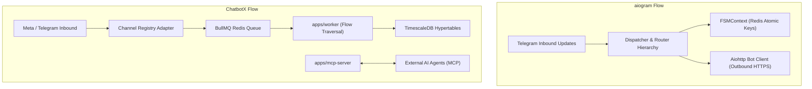
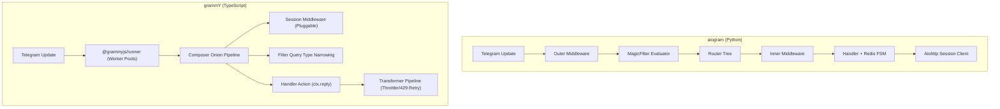
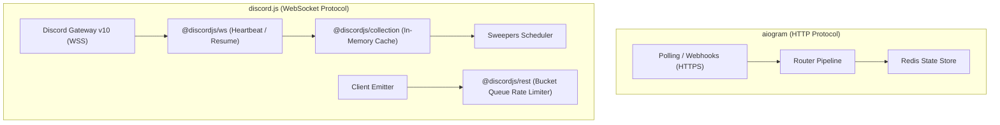
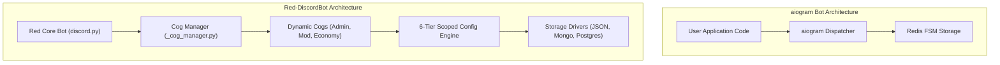
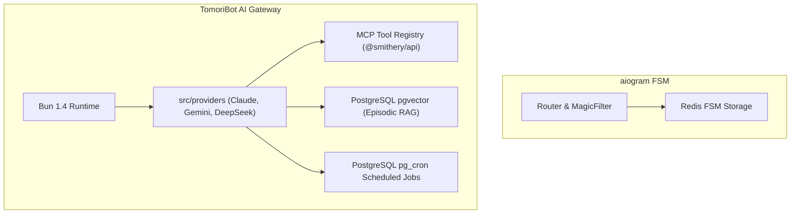

# aiogram — Comparative Analysis & Category Evaluation

> **Category**: Conversational AI & Bots  
> **Architectural Role**: Modern Asynchronous Python Framework for Telegram Bot API  
> **Primary Stack**: Python 3.10-3.14, AsyncIO, uvloop, aiohttp, Pydantic v2, Magic Filter, Redis FSM Storage  
> **Peer Solutions Compared**: `botpress`, `ChatbotX`, `grammY`, `discord.js`, `Red-DiscordBot`, `TomoriBot`  
> **Commercial SaaS Benchmarks**: ManyChat, Botpress Cloud, Voiceflow, Drift  

---

## 1. Executive Overview & Technical Identity: aiogram

**aiogram** (specifically aiogram v3) is the industry-standard asynchronous framework for engineering Telegram bots in Python. Completely redesigned around Python's `asyncio` ecosystem, `aiogram` combines pure non-blocking I/O, rigorous schema validation via Pydantic v2, a modular router-based dispatcher, a two-tier middleware pipeline (outer vs. inner), and distributed Finite State Machine (FSM) persistence backed by Redis.

### Core Architectural Profile
- **Runtime & Language**: `Python 3.10 to 3.14 (Full type annotations conforming to PEP 484 / PEP 561)`
- **Concurrency & Event Loop**: `Native asyncio; optional C-based uvloop (uvloop >= 0.21) and aiodns`
- **Core Dispatcher**: `Hierarchical Router trees with two-tier middleware execution (Outer vs. Inner)`
- **Filtering Engine**: `Declarative attribute inspection via magic-filter (F expressions)`
- **Data Modeling & Validation**: `Pydantic v2 Rust-accelerated schema parsing for 100% of Telegram types`
- **State & FSM Storage**: `Pluggable FSMContext with RedisStorage (hiredis), MongoStorage, and MemoryStorage`
- **Network Transport**: `aiohttp client sessions with connection pooling; long polling & webhook servers`
- **Primary Architectural Niche**: `High-throughput asynchronous Telegram bot dispatching with Redis FSM`
- **License**: `MIT`

---

## 2. Peer Solution Landscape (Conversational AI & Bots)

| Solution | Language & Runtime | Core Architecture | Database / Cache | Queue / Concurrency | Primary Architectural Niche |
| :--- | :--- | :--- | :--- | :--- | :--- |
| **aiogram** (Current) | `Python 3.10-3.14` | AsyncIO, uvloop, aiohttp, Pydantic v2 | `Redis (hiredis), Motor (MongoDB)` | `AsyncIO Event Loop` | High-throughput asynchronous Telegram dispatching with hierarchical routers |
| **botpress** | `TypeScript / Node 22+` | Monorepo Studio + QuickJS VM (`llmz`) | `PostgreSQL, DynamoDB, Vector DB` | In-Process Event Loop & Sandboxing | Hybrid visual FSM & sandboxed LLM agent runtime |
| **ChatbotX** | `TypeScript / Node 24+` | Turborepo, Next.js 15, MCP Server | `PostgreSQL 16+, TimescaleDB, Redis 7+` | `BullMQ / Redis Cluster` | Agentic chat marketing, social comment automation & MCP funnels |
| **grammY** | `TypeScript / Deno / Node` | Composer Onion Middleware, Web APIs | `Redis, PostgreSQL, Keyv, Memory` | `Runner Engine (@grammyjs/runner)` | Cross-runtime type-safe Telegram framework with transformer pipelines |
| **discord.js** | `TypeScript / Node 18-22+` | Modular Monorepo (`@discordjs/ws`, `rest`) | `In-Memory Collection Cache + Sweepers` | `REST Bucket Queues + Sharding` | Low-level object-oriented Discord WebSocket client & REST bucket manager |
| **Red-DiscordBot** | `Python 3.9-3.12+` | discord.py 2.x, Dynamic Cogs Lifecycle | `Red Config (JSON flat, Mongo, Postgres)` | `AsyncIO Task Loop + Cog Manager` | Hot-reloadable modular Discord bot platform with 6-tier scoped Config |
| **TomoriBot** | `TypeScript / Bun 1.4+` | Bun Native Runtime, discord.js 14.25 | `PostgreSQL 16+, pgvector, pg_cron` | `Bun Event Loop + Provider Streaming` | Multi-provider LLM assistant with pgvector RAG, MCP tool registry & presets |

---

## 3. Deep Head-to-Head Comparative Breakdown: aiogram vs Peers

### 3.1. aiogram vs. botpress

**Comparative Focus**: `Code-First AsyncIO Router Tree with Redis FSM` vs. `Visual Flow Studio & Sandboxed QuickJS VM`

```mermaid
flowchart TD
    subgraph AiogramPipeline ["aiogram v3 Pipeline"]
        AIO_Ingress["Telegram Webhook / getUpdates"] --> AIO_Outer["Outer Middlewares (Auth / Throttling)"]
        AIO_Outer --> AIO_Filter["MagicFilter Engine (F.text.startswith)"]
        AIO_Filter --> AIO_Router["Router Tree (AuthRouter, LeadRouter)"]
        AIO_Router --> AIO_Inner["Inner Middlewares (DB Tx / Scopes)"]
        AIO_Inner --> AIO_Handler["Async Handler Function"]
        AIO_Handler <--> AIO_Redis["RedisStorage (FSMContext Key-Value)"]
    end

    subgraph BotpressStudio ["botpress Studio & Engine"]
        BP_Ingress["integrations/telegram"] --> BP_API["packages/chat-api"]
        BP_API --> BP_Cognitive["packages/cognitive"]
        BP_Cognitive --> BP_LLMz["packages/llmz (QuickJS Wasm VM)"]
        BP_LLMz <--> BP_Flow["Flow Engine Visual Canvas"]
        BP_Flow --> BP_DB["PostgreSQL / DynamoDB"]
    end
```

#### Runtime Topology, Event Loops & Concurrency Models
- **aiogram** runs natively on Python's `asyncio` event loop. With optional C-based `uvloop`, it achieves sub-millisecond dispatching with near-zero memory footprint per concurrent update. There is no intermediate abstraction layer: Telegram updates map 1:1 to Pydantic models.
- **botpress** is an omnichannel Node.js enterprise platform. Telegram updates pass through `integrations/telegram`, are converted to canonical Botpress Event models, and are routed through `@botpress/chat-api` and the visual flow engine.

#### Dialogue State Management & Session Persistence
- **aiogram** utilizes a formal Finite State Machine (`aiogram.fsm`). Developers define states via `StatesGroup`. State keys (`bot_id:chat_id:user_id`) and arbitrary JSON data are written to Redis (`RedisStorage`), allowing stateless worker processes to handle sequential turns across cluster restarts.
- **botpress** persists conversation state across four scopes (`conversation`, `user`, `bot`, `workflow`) in PostgreSQL and DynamoDB. Dialogue transitions are governed by visual node connections and condition rules.

#### LLM Orchestration & Tool Calling
- **aiogram** is AI-agnostic. Developers import their preferred Python libraries (OpenAI, LangChain, LiteLLM) and invoke models directly inside async handler functions.
- **botpress** provides native LLM orchestration via `packages/llmz`, using QuickJS WebAssembly sandboxes to safely execute model tool invocations validated with Zui schemas.

#### Architectural Comparison Matrix: aiogram vs. botpress

| Architectural Dimension | aiogram | botpress |
| :--- | :--- | :--- |
| **Language & Runtime** | Python 3.10-3.14 (AsyncIO / uvloop) | TypeScript / Node.js 22+ |
| **Authoring Paradigm** | Code-first declarative Python with MagicFilter | Visual drag-and-drop studio canvas |
| **State Storage** | Redis (`RedisStorage`) / Mongo / Memory | PostgreSQL 15+ & DynamoDB cache |
| **Middleware Architecture** | Two-tier (Outer pre-filter vs. Inner post-filter) | Webhook and SDK plugin lifecycle hooks |
| **Execution Sandbox** | None (Executes directly in Python process) | QuickJS Emscripten WebAssembly sandbox (`llmz`) |
| **Telegram Ecosystem Depth**| 100% complete Telegram API v7+ support | Abstracted through integration plugin |

#### Distinct Strengths & Tradeoffs
- **Where aiogram Excels**: Raw execution speed on Telegram, native Pydantic v2 validation, deep integration with Python AI/ML microservices, and zero overhead.
- **Where botpress Holds an Advantage**: Visual drag-and-drop flow building for non-programmers, out-of-the-box omnichannel deployment (Web, WhatsApp, Slack, Teams), and native RAG document indexing.

---

### 3.2. aiogram vs. ChatbotX

**Comparative Focus**: `High-Throughput Telegram Dispatcher & Redis FSM` vs. `Omnichannel Agentic Marketing Platform & MCP Server`

#### Runtime Topology, Event Loops & Concurrency Models
- **aiogram** manages concurrency within a single Python async process using `asyncio.create_task` or webhook workers. Updates are handled immediately in memory with minimal queueing delay.
- **ChatbotX** decouples ingestion from execution using Redis and BullMQ. Incoming webhooks are pushed into asynchronous worker queues (`apps/worker`), enabling heavy marketing sequences, broadcast throttling, and multi-tenant isolation across Node.js microservices.

#### Dialogue State Management & Analytics
- **aiogram** stores transient user wizard states in Redis keys with automatic TTL expiration. It does not provide built-in marketing attribution or funnel analytics.
- **ChatbotX** combines relational PostgreSQL tables (via Kysely ORM) for contacts and custom fields with TimescaleDB hypertables for logging delivery receipts, button clicks, and conversion rates over time.

#### Agent Protocol & Tool Execution
- **aiogram** requires custom code to bridge with external AI agents.
- **ChatbotX** features a dedicated Model Context Protocol server (`apps/mcp-server`), allowing autonomous AI SDRs (like Claude or OpenClaw) to inspect lead profiles, pause automation, and trigger marketing flows via standardized RPC.

#### Architectural Comparison Matrix: aiogram vs. ChatbotX

| Architectural Dimension | aiogram | ChatbotX |
| :--- | :--- | :--- |
| **Primary Domain** | Telegram bot engineering & custom applications | Omnichannel chat marketing & social lead capture |
| **Concurrency Infrastructure**| In-memory AsyncIO task loop | Distributed BullMQ worker cluster over Redis 7+ |
| **Analytics & Telemetry** | User-managed application logging | TimescaleDB hypertables & continuous aggregates |
| **Agent Interoperability** | Custom Python agent wrappers | Dedicated Model Context Protocol (MCP) server |
| **Multi-Channel Scope** | Dedicated Telegram Bot API | Meta (WhatsApp/IG/Messenger), Telegram, Socials |
| **Workflow Builder** | Python code (`Router`, `StateFilter`) | Next.js visual flow canvas (`apps/builder`) |

#### Distinct Strengths & Tradeoffs
- **Where aiogram Excels**: Ultra-low latency, pure Python async ergonomics, deep Telegram Bot API control, and lightweight deployment.
- **Where ChatbotX Holds an Advantage**: Visual marketing funnel builder, social comment-to-DM triggers (Instagram/Facebook), TimescaleDB funnel metrics, and native MCP server.

---

### 3.3. aiogram vs. grammY

**Comparative Focus**: `Python AsyncIO + Two-Tier Middleware + Redis FSM` vs. `TypeScript Universal + Composer Onion + Runner Engine`

#### Runtime Topology, Event Loops & Concurrency Models
- **aiogram** executes on Python's `asyncio` event loop. It handles polling through `dp.start_polling()` with adaptive backoff or webhooks via `aiohttp.web` / FastAPI.
- **grammY** runs across Node.js, Deno, Bun, and Cloudflare Workers using standard Web APIs (`fetch`). When running under heavy long polling loads, `@grammyjs/runner` manages update queuing across worker pools with configurable concurrency and backpressure.

#### Middleware & Routing Architectures
- **aiogram** separates middlewares into two discrete rings: *Outer Middlewares* (executed before filters, ideal for rate-limiting, metrics, and auth) and *Inner Middlewares* (executed only after filters match, ideal for database transactions).
- **grammY** uses a classic Koa-style *Onion Middleware* (`Composer`). An update cascades through nested layers (`await next()`), allowing pre-processing, post-processing, and error capturing in reverse order. It uses compile-time *Filter Queries* (`bot.on('message:text')`) to narrow TypeScript types without runtime overhead.

#### State Management: FSM vs. Session Adapters
- **aiogram** uses an explicit Finite State Machine with `StatesGroup` and `FSMContext`, persisting to Redis, MongoDB, or Memory.
- **grammY** provides `session()` middleware with pluggable adapters (Redis, PostgreSQL, Keyv). For complex multi-turn dialogs, grammY offers `@grammyjs/conversations`, which enables procedural async-await generator functions instead of rigid FSM state charts.

#### Outbound Rate Limiting & API Resiliency
- **aiogram** relies on client session timeouts and custom outbound throttling middlewares.
- **grammY** features an outbound *Transformer Pipeline* (`bot.api.config.use`), which intercepts outgoing Telegram calls to apply automated retries on 429 errors (`@grammyjs/auto-retry`) and enforce Telegram's 30 msg/sec limit.

#### Architectural Comparison Matrix: aiogram vs. grammY

| Architectural Dimension | aiogram | grammY |
| :--- | :--- | :--- |
| **Language & Typing** | Python 3.10-3.14 / Pydantic v2 | TypeScript 5.0+ / Context Flavoring |
| **Runtime Portability** | Python VM (Linux, Docker) | Universal (Node, Deno, Bun, Cloudflare Workers) |
| **Middleware Pipeline** | Two-tier (Outer pre-filter vs. Inner post-filter)| Onion-layer model (`Composer`) |
| **Concurrency Runner** | AsyncIO task scheduling | `@grammyjs/runner` worker queue engine |
| **Outbound Pacing** | Custom middleware / session pooling | Native Transformer Pipeline (`@grammyjs/auto-retry`)|
| **State Paradigm** | Rigid Finite State Machine (`StatesGroup`) | Pluggable sessions + linear `@grammyjs/conversations`|

#### Distinct Strengths & Tradeoffs
- **Where aiogram Excels**: Python ecosystem alignment (PyTorch, LangChain, Pandas), Rust-backed Pydantic v2 validation, and explicit two-tier middleware isolation.
- **Where grammY Holds an Advantage**: TypeScript compile-time type safety, serverless edge deployment (Cloudflare Workers), and the outbound transformer rate-limiter pipeline.

---

### 3.4. aiogram vs. discord.js

**Comparative Focus**: `AsyncIO Telegram Event Dispatcher` vs. `Low-Level Discord WebSocket Gateway & Cache Infrastructure`

#### Runtime Topology, Event Loops & Concurrency Models
- **aiogram** interacts with Telegram's stateless HTTP REST API (via long polling or HTTPS webhooks). No persistent bidirectional socket state is maintained; updates arrive as independent HTTP requests.
- **discord.js** manages Discord's persistent bidirectional WebSocket Gateway v10. It maintains socket heartbeats, tracks sequence numbers, handles zlib decompression, and coordinates process-level sharding via `ShardingManager`.

#### State Management & Caching Strategies
- **aiogram** offloads state to external Redis databases, maintaining virtually zero state in Python process memory.
- **discord.js** caches active Discord guilds, channels, roles, and members in-memory using `@discordjs/collection`. To prevent memory leaks in large bots, automated `Sweepers` prune idle message histories and offline members.

#### Outbound Rate Limiting
- **aiogram** sends outbound requests over HTTP connection pools via `aiohttp`.
- **discord.js** embeds `@discordjs/rest`, organizing requests into dynamic FIFO sub-queues mapped to Discord's server-assigned bucket hashes (`X-RateLimit-Bucket`).

#### Architectural Comparison Matrix: aiogram vs. discord.js

| Architectural Dimension | aiogram | discord.js |
| :--- | :--- | :--- |
| **Target Platform** | Telegram Bot API | Discord Gateway v10 & REST API |
| **Network Protocol** | Stateless HTTPS Webhook / Long Polling | Stateful WebSocket Stream (WSS) + HTTPS REST |
| **State Storage** | External Redis / MongoDB | In-Memory ES6 `Collection` caches + Sweepers |
| **Rate Limiting** | Outbound client pacing | Dynamic Bucket Hash FIFO sub-queues |
| **Concurrency Scale** | Stateless horizontal worker scaling | WebSocket Sharding (`ShardingManager`) |

#### Distinct Strengths & Tradeoffs
- **Where aiogram Excels**: Lightweight stateless execution, distributed Redis FSM, and minimal server footprint.
- **Where discord.js Holds an Advantage**: Native Discord Gateway protocol management, in-memory caching of complex guild permissions, and rich component builders.

---

### 3.5. aiogram vs. Red-DiscordBot

**Comparative Focus**: `Stateless Python Telegram Framework` vs. `Modular Self-Hosted Discord Micro-Kernel`

#### Runtime Topology, Event Loops & Concurrency Models
- **aiogram** is a developer framework. Building a bot requires writing application logic, setting up routers, and configuring process managers (systemd/Docker). Updates are deployed by restarting worker containers.
- **Red-DiscordBot** is a complete, self-hostable Discord bot operating system. Its dynamic Cog Manager (`_cog_manager.py`) allows administrators to install, load, reload, and configure plugins from remote Git repositories at runtime without restarting the bot.

#### Configuration & Dialogue State Management
- **aiogram** delegates state management to `FSMContext` backed by Redis, focusing on conversational multi-step wizards.
- **Red-DiscordBot** provides a 6-tier scoped `Config` engine (`redbot.core.config`), organizing data into `GLOBAL`, `GUILD`, `CHANNEL`, `ROLE`, `USER`, and `MEMBER` scopes backed by JSON flat-files, MongoDB, or PostgreSQL.

#### Architectural Comparison Matrix: aiogram vs. Red-DiscordBot

| Architectural Dimension | aiogram | Red-DiscordBot |
| :--- | :--- | :--- |
| **Target Ecosystem** | Telegram Bot API | Discord Communities |
| **Solution Nature** | Code-first Developer Framework | Turnkey Modular Application & Micro-Kernel |
| **Plugin Architecture** | Code-level Routers & Modules | Dynamic Hot-Reloadable Cogs (Git/pip) |
| **State Storage** | Redis FSM Key-Value (`RedisStorage`) | 6-Tier Scoped Config (JSON, Mongo, Postgres) |
| **Admin Control** | Custom developer commands / Webhooks | In-Chat Bot Commands & Headless JSON-RPC |
| **License** | MIT | GNU GPLv3 |

#### Distinct Strengths & Tradeoffs
- **Where aiogram Excels**: Clean framework abstractions for custom Telegram applications, extreme throughput, and stateless container deployments.
- **Where Red-DiscordBot Holds an Advantage**: Turnkey out-of-the-box community features, zero-downtime hot-reloading of modules, and rich multi-server permission governance.

---

### 3.6. aiogram vs. TomoriBot

**Comparative Focus**: `Stateless Python Telegram Framework` vs. `Bun-Native Multi-Provider AI Assistant with pgvector`

#### Runtime Topology, Event Loops & Concurrency Models
- **aiogram** executes on Python 3.10-3.14 via `asyncio`. It focuses on processing Telegram events and dispatching messages through aiohttp.
- **TomoriBot** executes on Bun 1.4+ with TypeScript, using Bun's native HTTP/WebSocket engine to deliver high-performance streaming AI conversations to Discord and Matrix communities.

#### AI Reasoning, Memory & Tool Calling
- **aiogram** provides no built-in AI abstractions; all LLM calls and tool execution must be implemented manually by the developer.
- **TomoriBot** features a multi-provider LLM gateway with automatic 429/503 failover, Model Context Protocol (MCP) tool execution, long-term semantic memory via PostgreSQL `pgvector`, and SillyTavern character presets.

#### Architectural Comparison Matrix: aiogram vs. TomoriBot

| Architectural Dimension | aiogram | TomoriBot |
| :--- | :--- | :--- |
| **Language & Runtime** | Python 3.10-3.14 / AsyncIO | TypeScript / Bun 1.4+ |
| **Target Platform** | Telegram Bot API | Discord Gateway & Matrix Appservice Bridge |
| **AI Integration** | None (Developer brings own SDK) | Built-in Multi-Provider Gateway (10+ models) |
| **Tool Calling Standard** | Custom Python functions | Industry-standard Model Context Protocol (MCP) |
| **Persistent Memory** | Redis FSM state keys | PostgreSQL `pgvector` cosine similarity embeddings |
| **Job Scheduling** | External cron / Celery / AsyncIO tasks | PostgreSQL in-database `pg_cron` jobs |

#### Distinct Strengths & Tradeoffs
- **Where aiogram Excels**: Pure Telegram Bot API mastery, ultra-high event throughput, and Python data science ecosystem synergy.
- **Where TomoriBot Holds an Advantage**: Turnkey multi-provider LLM orchestration, standardized MCP tool calling, episodic memory with pgvector, and native Bun performance.

---

## 4. Capability & Feature Comparison Matrix

| Dimension / Capability | aiogram | botpress | ChatbotX | grammY | discord.js | Red-DiscordBot | TomoriBot |
| :--- | :---: | :---: | :---: | :---: | :---: | :---: | :---: |
| **Primary Platform** | **Telegram** | Omnichannel | Omnichannel / Meta | **Telegram** | **Discord** | **Discord** | **Discord** |
| **Runtime Language** | Python 3.10-3.14 | TypeScript / Node | TypeScript / Node | TypeScript / Deno | TypeScript / Node | Python 3.9-3.12 | TypeScript / Bun |
| **FSM State Machine** | ✅ Redis FSM | ✅ Internal Graph | ✅ Node Checkpoints| ⚠️ Conversations | ❌ | ⚠️ State Cogs | ❌ |
| **Two-Tier Middleware** | ✅ Outer & Inner | ❌ | ❌ | ❌ (Onion) | ❌ | ❌ | ❌ |
| **Declarative Filtering** | ✅ MagicFilter | ❌ | ❌ | ✅ Filter Queries | ❌ | ❌ | ❌ |
| **Visual Flow Canvas** | ❌ | ✅ Advanced | ✅ Visual Builder | ❌ | ❌ | ❌ | ❌ |
| **Native MCP Server / Client**| ❌ | ⚠️ Zui Tools | ✅ Native Server | ❌ | ❌ | ❌ | ✅ Native Client |
| **Vector RAG Ingestion** | ❌ | ✅ Native Plugin | ✅ pgvector Core | ❌ | ❌ | ⚠️ Community Cog | ✅ Native pgvector |
| **Hot-Reloading Architecture**| ❌ | ❌ | ❌ | ❌ | ❌ | ✅ Native Cogs | ❌ |

---

## 5. Commercial Benchmark Positioning

When benchmarked against commercial SaaS leaders (**ManyChat, Botpress Cloud, Voiceflow, Drift**):
- **High-Volume Throughput**: `aiogram` handles millions of Telegram messages per day on modest server hardware without the prohibitive per-message costs of SaaS platforms.
- **Developer Freedom**: Full access to raw Telegram Bot API features (custom keyboards, Mini Apps, inline search, payments) that visual SaaS tools restrict.
- **Data Sovereignty**: Complete ownership of user interactions and session states stored securely in private Redis clusters.

---

## 6. Strategic Takeaways & Role for MarketingStudio

In the unified **MarketingStudio** architecture:
1. **Primary Component to Adopt**: Adopt aiogram's two-tier middleware model (`outer` vs. `inner`) and Redis FSM design pattern for high-throughput stateful conversational funnels.
2. **Ecosystem Interoperability**: For Python-based microservices or data science pipelines within MarketingStudio, aiogram provides the definitive interface for Telegram channel automation.
3. **Peer Coexistence**: Where high-load Telegram bot pipelines are required in Python, deploy `aiogram`; where MarketingStudio's TypeScript core handles Telegram, deploy `grammY`; and route multi-channel visual funnels through `botpress` and `ChatbotX`.
