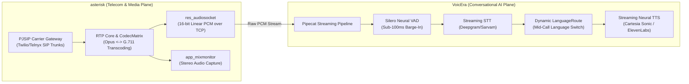
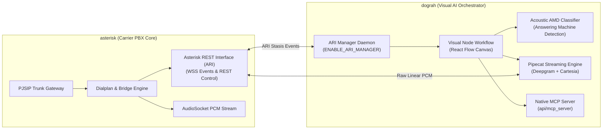

# asterisk — Comparative Analysis & Category Evaluation

> **Category**: Telephony, Voice & PBX  
> **Architectural Role**: Wholesale carrier SIP trunking, telecom media gateway & zero-copy codec transcoder  
> **Primary Stack**: ANSI C (POSIX / C99), PJSIP | Asterisk REST Interface (ARI), Stasis Bus | AudioSocket (TCP PCM), WebRTC | ODBC / PostgreSQL | GPL-2.0  
> **Peer Solutions Compared**: `VoicEra`, `dograh`  
> **Commercial SaaS Benchmarks**: Twilio Voice, Genesys Cloud, FreeSWITCH, Cisco Unified Communications Manager  

---

## 1. Executive Overview & Technical Identity: asterisk

**asterisk** is the world’s preeminent, open-source communications engine and private branch exchange (PBX) framework. Developed in highly optimized ANSI C, Asterisk powers enterprise telecommunications, VoIP gateways, call center automatic call distribution (ACD), interactive voice response (IVR) systems, and WebRTC media bridges globally. It abstracts the complexities of physical PSTN lines, digital telephony protocols, and IP multimedia sessions, enabling external applications to programmatically control audio, video, and signaling across heterogeneous networks.

In modern voice AI architectures, Asterisk acts as a resilient, low-latency media plane. It terminates wholesale SIP trunks, negotiates DTLS-SRTP keys for browser WebRTC, performs zero-copy real-time audio transcoding (Opus, G.711, G.729, linear PCM), records uncompressed dual-channel audio (`app_mixmonitor`), and exposes ultra-low-latency streaming interfaces (`res_audiosocket`, ARI) to attach external AI Speech-to-Text and LLM runtimes.

### Core Architectural Profile
- **Runtime & Language**: `ANSI C (POSIX / C99)` multi-threaded daemon
- **SIP & Networking Core**: `PJSIP Stack` (`pjproject`) supporting RFC 3261, SIP over UDP/TCP/TLS, and WebSockets (WSS)
- **Media & Transcoding Plane**: `res_rtp_asterisk` with zero-copy `CodecMatrix` (Opus, G.711, G.722, G.729, SLIN)
- **Real-Time AI Streaming**: `res_audiosocket` streaming 16-bit signed linear PCM over TCP/Unix sockets (<20ms transport latency)
- **Programmability Interfaces**: Asterisk REST Interface (ARI over WebSockets), Asterisk Manager Interface (AMI :5038), FastAGI
- **Database & Persistence**: Asterisk Realtime Architecture (ARA) via unixODBC to PostgreSQL/MySQL (`ps_endpoints`, `cdr_adaptive_odbc`)
- **Domain Specialization**: Wholesale carrier SIP termination, media transcoding, and high-capacity PBX switching

---

## 2. Peer Solution Landscape (Telephony, Voice & PBX)

Within this category, `asterisk` operates alongside two specialized conversational voice AI engines:

| Solution | Language & Runtime | Core Framework | Audio & Media Transport | Concurrency & Event Model | Primary Architectural Role | License |
| :--- | :--- | :--- | :--- | :--- | :--- | :--- |
| **asterisk** (Current) | `ANSI C (POSIX / C99)` | `Native Multi-Threaded Engine` | `SIP, RTP/SRTP, WebRTC, AudioSocket` | `POSIX Threads, Stasis Event Bus` | Carrier SIP Trunking, PBX Media Gateway & Transcoder | GPL-2.0 |
| **VoicEra** | `Python 3.11+` | `FastAPI, Pipecat AI` | `WebSocket PCM (8k/16k), Carrier XML` | `asyncio` Event Loop + Frame Processors | Multilingual Real-Time Voice AI & Telephony Automation | Apache-2.0 |
| **dograh** | `Python 3.11+ / TS` | `FastAPI, Next.js 14 + React Flow`| `WebSocket PCM, WebRTC, Asterisk ARI` | `asyncio` + Redis 7 Concurrency Locks | Visual Workflow Voice AI Platform with Native MCP Server | BSD-2-Clause |

---

## 3. Deep Head-to-Head Comparative Breakdown: asterisk vs Peers

### 3.1. asterisk vs. VoicEra

**Comparative Focus**: Foundational C telecommunications media switch vs. multilingual frame-based conversational voice AI platform.

#### Architectural & Stack Differences
- **Architectural Scope & Responsibilities**: `asterisk` operates at the telecommunications transport layer. It terminates raw carrier SIP trunks, negotiates cryptographic keys (DTLS-SRTP), performs zero-copy hardware and software codec transcoding, and distributes calls across agent queues (`app_queue`). It does not perform natural language processing or speech synthesis. `VoicEra` operates at the cognitive AI layer: it ingests audio frames, manages Voice Activity Detection (Silero VAD), invokes streaming LLMs, executes vector database lookups (ChromaDB), and synthesizes neural speech.
- **Runtime & Concurrency Models**: `asterisk` is a native multi-threaded ANSI C application. Each call channel is allocated a dedicated POSIX thread, and events are broadcast across the lockless `Stasis` message bus. It handles thousands of concurrent media streams with sub-15ms processing latency and minimal memory overhead (~50 MB baseline). `VoicEra` is an asynchronous Python 3.11+ / FastAPI application utilizing the `pipecat-ai` streaming framework, where audio frames travel through a pipeline of asynchronous frame processors.
- **Media Protocols & Interfaces**: `asterisk` natively terminates SIP, RTP, RTCP, and WebSockets. It bridges to AI engines using `res_audiosocket` (raw 16-bit signed linear PCM over TCP with a 3-byte binary header) or ARI channel snooping. `VoicEra` communicates over WebSockets, ingesting raw PCM audio from cloud telephony carriers (Plivo, Vodafone Idea OBD, Vobiz, Twilio) via dynamically generated XML streams.
- **Failure Modes & Crash Recovery**: In Asterisk, an unhandled C segmentation fault can destabilize the PBX daemon, requiring `systemd` supervisor restarts and state reconstruction. In VoicEra, the API server (:8000) and real-time voice runtime (:7860) run in isolated Docker containers; a crash in the voice runtime drops active calls without corrupting agent metadata or vector collections in MongoDB and ChromaDB.

#### Architectural Comparison Matrix: asterisk vs. VoicEra

| Dimension | asterisk | VoicEra |
| :--- | :--- | :--- |
| **System Layer** | Telecom Carrier Switching & Media Transcoding | Conversational Voice AI & Pipeline Orchestration |
| **Core Language** | ANSI C (POSIX / C99) | Python 3.11+ (FastAPI + Pipecat AI) |
| **Concurrency Model** | Multi-threaded POSIX channels + Stasis bus | Asynchronous event loop (`asyncio`) + frame queues |
| **Audio Transport** | Raw SIP, RTP/SRTP, AudioSocket (TCP PCM) | WebSocket PCM (8k/16k), Carrier Stream XML |
| **Audio Transcoding** | Zero-copy C matrix (Opus, G.711, G.722, G.729) | None (Relies on carrier/runtime 16-bit PCM format) |
| **Barge-In / Interruption**| DTMF tone interjection (RFC 4733) | Neural Silero VAD (<100ms speech onset detection) |
| **AI Capabilities** | None (Requires external AI attachment) | Sub-500ms STT/LLM/TTS, Mid-call language switching |
| **Database Architecture** | Dynamic ODBC (ARA) to PostgreSQL/MySQL | MongoDB 6+ / FerretDB + ChromaDB vector store |
| **Hardware Footprint** | Extremely low (~50 MB RAM, 1000s of channels) | Moderate-High (~350 MB RAM, GPU for Triton models) |

---

### 3.2. asterisk vs. dograh

**Comparative Focus**: Foundational C telephony PBX core vs. visual graph-based conversational voice AI platform with native MCP daemon.

#### Architectural & Stack Differences
- **Telephony & PBX Interoperability**: `asterisk` is the telephony engine. `dograh` ships with a built-in background Asterisk bridge daemon (`api/services/telephony/ari_manager.py`). When enabled (`ENABLE_ARI_MANAGER=true`), Dograh maintains a persistent WebSocket connection to Asterisk's ARI endpoint (`/ari/events?app=dograh`). When a call enters Asterisk, Dograh captures the channel, attaches an external media bridge, streams audio to Pipecat, and issues hangup or transfer commands back to Asterisk via REST.
- **Workflow & Dialogue Management**: In `asterisk`, call routing is defined either through flat text dialplans (`extensions.conf`) or procedural Asterisk Gateway Interface (AGI) scripts. In `dograh`, conversations are designed visually on a Next.js drag-and-drop canvas (`WorkflowDefinitionModel`), allowing non-engineers to construct complex branching dialogue trees, conditional intent routers, tool execution nodes, and automated voicemail drops.
- **Answering Machine Detection (AMD)**: `asterisk` includes traditional DSP tone-based answering machine detection (`app_amd`), which evaluates initial silence duration and voice burst frequency. `dograh` implements real-time acoustic classification (`answer_classification.py`) within its Pipecat pipeline, analyzing spectral patterns during the first two seconds of call pickup to distinguish humans, IVRs, and voicemail beeps, immediately executing automated voicemail drops.
- **AI Agent Extensibility**: `asterisk` has no native AI awareness; it exposes AMI and ARI interfaces for general programming. `dograh` features a native Model Context Protocol (MCP) server (`api/mcp_server`), allowing external AI coding assistants (Claude Code, Cursor) to programmatically inspect, modify, and test voice agent workflows.

#### Architectural Comparison Matrix: asterisk vs. dograh

| Dimension | asterisk | dograh |
| :--- | :--- | :--- |
| **System Role** | Sovereign Carrier PBX & Media Switch | Visual Voice AI Platform & Telephony Orchestrator |
| **Core Runtime** | ANSI C (POSIX / C99) | Python 3.11+ (FastAPI) + Next.js 14 (React Flow) |
| **Asterisk Interfacing**| Native Internal Core | Built-in ARI Bridge Daemon (`ari_manager.py`) |
| **Dialogue Modeling** | Procedural Dialplan (`extensions.conf`) / AGI | Visual Node-Based Directed Graph (`WorkflowModel`) |
| **Answering Machine AMD**| Basic DSP tone analysis (`app_amd.c`) | Real-Time Acoustic Classifier (`answer_classification`)|
| **Media Transport** | SIP, RTP, WebRTC, AudioSocket | WebSockets, WebRTC (Coturn), Asterisk ARI |
| **Agent Tool Protocol** | AMI TCP (:5038), ARI HTTP/WSS | Native Model Context Protocol (MCP) Server |
| **Data Persistence** | Dynamic ODBC (ARA) to PostgreSQL | PostgreSQL 17 + `pgvector` (SQLAlchemy async) |
| **Memory Footprint** | **~50 MB RAM** | ~400 MB RAM |

---

## 4. Capability & Feature Comparison Matrix

| Feature / Dimension | asterisk | VoicEra | dograh |
| :--- | :---: | :---: | :---: |
| **Wholesale Carrier SIP Trunking** | ✅ World Standard (PJSIP) | ❌ (Carrier XML only) | ⚠️ Via Asterisk ARI Bridge |
| **Zero-Copy Codec Transcoding (Opus/G.711)** | ✅ Native C Matrix | ❌ | ❌ |
| **Sub-500ms Conversational Turnaround** | ❌ (Media only) | ✅ Pipecat Streaming | ✅ Pipecat Streaming |
| **Neural VAD Barge-In (Interruption)** | ❌ (DTMF only) | ✅ Silero VAD (<100ms) | ✅ Silero VAD (<100ms) |
| **Answering Machine Detection (AMD)** | ✅ Built-in DSP Tone AMD | ⚠️ Utterance classifier | ✅ Real-Time Acoustic AMD |
| **Visual Node-Based Conversation Builder** | ❌ (Text Dialplan) | ❌ (Code / Prompts) | ✅ React Flow Graph Canvas |
| **Model Context Protocol (MCP) Server** | ❌ | ❌ | ✅ Native MCP Daemon |
| **Mid-Call Multilingual Switching** | ❌ | ✅ Dynamic LanguageRoute | ⚠️ Multi-node branching |
| **Self-Hosted AI Speech Inference** | ❌ | ✅ NVIDIA Triton gRPC | ⚠️ Self-hosted endpoints |
| **Automatic Call Distribution (ACD Queues)**| ✅ `app_queue` Enterprise | ❌ | ⚠️ Campaign Queue |
| **Synchronous Stereo Recording** | ✅ `app_mixmonitor` | ⚠️ S3 Stream Archive | ⚠️ S3 Audio Upload |
| **Memory Footprint (Baseline)** | **~50 MB RAM** | ~350 MB RAM | ~400 MB RAM |

---

## 5. Commercial Benchmark Positioning

When benchmarked against commercial telecommunications leaders (**Twilio Voice, Genesys Cloud, FreeSWITCH, Cisco UCM**):
- **Against Twilio Voice**:
  - Twilio charges $0.013–$0.025/min for voice bridging and SIP trunking. Asterisk terminates wholesale SIP trunks directly from providers like Bandwidth, Telnyx, or Vodafone at wholesale costs ($0.003–$0.005/min), saving 80–90% on telephony infrastructure.
- **Against Genesys Cloud & Cisco UCM**:
  - Proprietary PBX platforms require complex multi-year enterprise contracts and expensive per-seat licenses. Asterisk provides carrier-grade automatic call distribution (`app_queue`), IVRs, conference bridging (`app_confbridge`), and STIR/SHAKEN caller ID authentication with complete source code sovereignty.
- **Against FreeSWITCH**:
  - While FreeSWITCH is also a C-based PBX, Asterisk's PJSIP stack and `res_audiosocket` provide simpler, cleaner bidirectional linear PCM streaming integration for modern real-time AI pipelines.

---

## 6. Strategic Takeaways & Role for MarketingStudio

In MarketingStudio's voice telephony architecture:
1. **Primary Component to Adopt**: Deploy Asterisk as MarketingStudio's **wholesale SIP gateway and media transcoding plane**.
2. **AudioSocket AI Integration**: Utilize `res_audiosocket` to pipe raw, 16-bit linear PCM audio directly between Asterisk channels and MarketingStudio's voice AI engines with sub-20ms latency.
3. **Synergistic Integration**:
   - Bridge Asterisk with `dograh` via its native ARI manager daemon (`ENABLE_ARI_MANAGER=true`) for visual conversational sales workflows and acoustic AMD.
   - Attach `VoicEra`'s multilingual pipeline for mid-call language switching across international target markets.
   - Use `app_mixmonitor` to capture synchronized stereo recordings (caller on left, agent on right) for automated post-call CRM ingestion.
