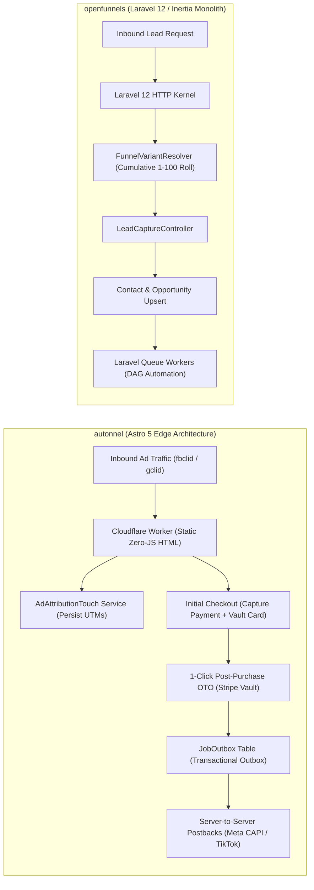
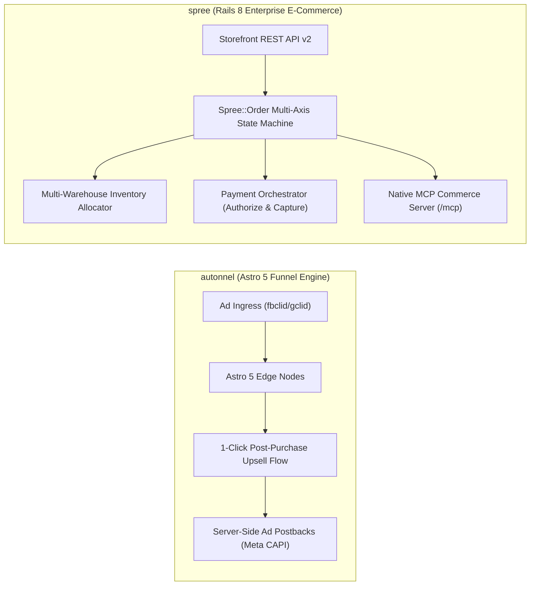

# autonnel — Comparative Analysis & Category Evaluation

> **Category**: Sales Funnels & Checkout Engines  
> **Architectural Role**: Edge-deployable sales funnel builder, 1-click post-purchase upsell engine (OTO) & server-side ad attribution platform  
> **Primary Stack**: TypeScript 5.x | Astro 5 & React | Cloudflare Workers / Node.js | Prisma ORM (Hyperdrive) | PostgreSQL | PUCK Visual Editor  
> **Peer Solutions Compared**: `openfunnels`, `spree`  
> **Commercial SaaS Benchmarks**: ClickFunnels, CartFlows, Systeme.io, GoHighLevel  

---

## 1. Executive Overview & Technical Identity: autonnel

**autonnel** represents the edge-native, direct-response performance marketing tier within the **Sales Funnels & Checkout Engines** domain. Engineered in TypeScript and Astro 5, Autonnel is built as an unencumbered, Apache-2.0 licensed alternative to ClickFunnels and CartFlows. It orchestrates the complete high-converting money path: landing pages, multi-step checkout forms, pre-purchase order bumps, post-purchase 1-click upsells/downsells (OTO), and dynamic order receipts.

Autonnel is architected to solve two critical challenges in paid direct-response advertising:
1. **Zero-Friction 1-Click Post-Purchase Upsells**: On the initial checkout form, Autonnel tokenizes customer payment details using Stripe SetupIntents or Customer Vault. Subsequent upsell offers are charged with a single click—requiring zero credit card re-entry.
2. **Server-Side Conversion Attribution Postbacks**: To counter browser tracking preventions (Apple iOS ITP, ad blockers) that degrade ad campaign optimization, Autonnel captures ad click IDs (`fbclid`, `gclid`, `ttclid`) upon arrival and persists them throughout the checkout journey. It utilizes a **Transactional Outbox Pattern** (`JobOutbox`) to asynchronously dispatch server-to-server postbacks directly to Meta Conversions API (CAPI), TikTok Events API, and Google Ads.

Furthermore, Autonnel features a built-in Model Context Protocol (MCP) server (`src/skills`), enabling autonomous AI agents to programmatically assemble funnels and evaluate conversion analytics.

### Core Architectural Profile
- **Runtime & Language**: `TypeScript 5.x / Edge-compatible runtime (Cloudflare Workers or Node.js)`
- **Core Framework**: `Astro 5 Hybrid Architecture (Zero-JS static HTML + interactive React islands, PUCK editor)`
- **Persistence Layer**: `PostgreSQL (Prisma ORM via Cloudflare Hyperdrive connection pooling) + Workers KV / Redis`
- **Concurrency & Queue Model**: `Transactional Outbox Pattern (JobOutbox) + edge asynchronous worker fetchers`
- **Domain Specialization**: Direct-response sales funnels, 1-click post-purchase upsells, server-side ad postbacks (Meta CAPI) & native AI agent MCP server

---

## 2. Peer Solution Landscape (Sales Funnels & Checkout Engines)

Within this category, `autonnel` operates alongside the following peer solutions:

| Solution | Language & Runtime | Core Framework | Database / Cache | Queue / Concurrency | Primary Architectural Niche |
| :--- | :--- | :--- | :--- | :--- | :--- |
| **autonnel** (Current) | `TypeScript / Edge` | `Astro 5, React` | `PostgreSQL (Hyperdrive)`| `Cloudflare Event Loop` | **Edge 1-click post-purchase upsells (OTO) & server-side ad postbacks** |
| **openfunnels** | `PHP 8.3+ / Laravel 12` | `Inertia.js 2.0, React 19` | `MySQL / PostgreSQL` | `Laravel Queue Workers` | Unified funnel-to-CRM continuity & weighted A/B variant resolver |
| **spree** | `Ruby 3.3+ / Rails 8.0` | `Rails Core, Next/React` | `PostgreSQL 16+, Redis` | `Sidekiq / Redis` | Deterministic `Spree::Order` state machine & native MCP server |

---

## 3. Deep Head-to-Head Comparative Breakdown: autonnel vs Peers

### 3.1. autonnel vs. openfunnels

**Comparative Focus**: `Edge-Native 1-Click Upsells & Server-Side Ad Attribution` vs. `Unified Full-Stack CRM Monolith & Weighted A/B Testing`

#### Detailed Architectural Contrast
- **Runtime Plane & Edge Deployment**: `autonnel` compiles funnels using Astro 5 into static HTML with islands of interactive React, deployable directly on Cloudflare Workers edge nodes with connection pooling via Hyperdrive. It achieves sub-50ms TTFB globally, essential for paid advertising conversion rates. `openfunnels` is an Inertia.js monolithic application running on PHP 8.3/Laravel 12, hosted on traditional server infrastructure.
- **Post-Purchase Upsell Mechanics**: `autonnel` is purpose-built for 1-Click Post-Purchase Upsells (OTO). When an initial order is completed, the payment method is vaulted (Stripe SetupIntents); subsequent upsells are charged with a single click—without re-prompting for card numbers. `openfunnels` supports multi-step forms and standard Stripe payments, but lacks native 1-click post-purchase card vaulting.
- **Advertising Attribution Signal Recovery**: `autonnel` incorporates an asynchronous outbox worker that fires server-to-server conversion events directly to Meta Conversions API (CAPI), TikTok Events API, and Google Ads, bypassing browser ad blockers and Apple ITP tracking restrictions. `openfunnels` stores UTM parameters within the CRM, but does not provide automated server-side advertising postbacks.
- **CRM & Automation Scope**: `openfunnels` provides a complete visual CRM system with deal pipeline kanbans, contact records, and DAG-based automated email workflows. `autonnel` focuses strictly on the transactional checkout path, connecting to external e-commerce backends (Picocart, Shopify, WooCommerce).

#### Architectural Comparison Matrix: autonnel vs. openfunnels

| Dimension | autonnel | openfunnels | Architectural Implication |
| :--- | :--- | :--- | :--- |
| **Execution Plane** | **Cloudflare Workers Global Edge** | **Standard PHP-FPM Server** | Autonnel achieves lower TTFB on cold paid ad traffic; OpenFunnels provides richer admin tools. |
| **Upsell Mechanics** | **Native 1-Click Post-Purchase OTO** | **Standard Multi-Step Checkout** | Autonnel maximizes Average Order Value (AOV) via zero-friction post-purchase charges. |
| **Ad Tracking Durability** | **Server-Side Postbacks (Meta CAPI)** | **First-Party CRM UTM Logging** | Autonnel recovers 15–30% of ad conversions lost to browser ad blockers. |
| **CRM & Deal Pipelines** | **Orders Only (Catalog Agnostic)** | **Full Visual Kanban & Contacts** | OpenFunnels manages the complete sales lifecycle from lead capture to deal close. |
| **A/B Split Testing** | **Basic Variant Routing** | **Mathematical Cumulative Weight** | OpenFunnels offers deeper variant weighting and persistent visitor affinity. |

---

### 3.2. autonnel vs. spree

**Comparative Focus**: `Edge-Native 1-Click Upsells & Server-Side Ad Attribution` vs. `Enterprise Multi-Warehouse Commerce & State Integrity`

#### Detailed Architectural Contrast
- **E-Commerce Scope & Catalog Depth**: `spree` is an enterprise headless commerce platform engineered to manage complex merchandise catalogs: multi-store, multi-currency, multi-warehouse stock allocation (`Spree::StockLocation`), and composable promotion engines. `autonnel` is an agile sales funnel builder designed to maximize conversion velocity on single products, bundles, or digital offers.
- **State Machine Architecture**: `spree` enforces strict, transactional order transitions through `Spree::Order`, decoupling payment states from shipment states to prevent inventory race conditions and double allocations. `autonnel` models the conversion journey as a sequential checkout path (`InitialCheckout` -> `Upsell` -> `Confirmation`), focusing on frictionless payment vaulting.
- **Model Context Protocol (MCP)**: Both platforms incorporate native MCP servers. Spree's MCP server enables autonomous AI shopping agents to programmatically browse catalogs and execute purchases, while Autonnel's MCP server enables AI coding agents to generate complete landing pages and optimize conversion funnels from natural-language prompts.

#### Architectural Comparison Matrix: autonnel vs. spree

| Dimension | autonnel | spree | Architectural Implication |
| :--- | :--- | :--- | :--- |
| **Functional Objective** | **Direct-Response Conversion Funnels** | **Enterprise Headless E-Commerce** | Autonnel drives focused campaign conversions; Spree powers the core retail enterprise. |
| **Post-Purchase Upsells** | **Native 1-Click Post-Purchase OTO** | **Standard Multi-Step Checkout** | Autonnel provides out-of-the-box Stripe Customer Vault 1-click upsells. |
| **Server-Side Ad Tracking** | **Native Outbox Postbacks (Meta CAPI)** | **Order Metadata / External CDP** | Autonnel restores ad conversion tracking lost to client-side ad blockers. |
| **Inventory & Warehouses** | **Catalog Agnostic (Shopify/Woo/Pico)** | **Multi-Warehouse (`StockLocation`)** | Spree manages complex physical inventory distribution across regional hubs. |
| **AI / Agent Interface** | **Native Built-In MCP Server** | **Native Built-In MCP Server (`/mcp`)**| Both support AI agents: Autonnel for funnel authoring; Spree for programmatic commerce. |

---

## 4. Capability & Feature Comparison Matrix

| Dimension / Capability | autonnel | openfunnels | spree |
| :--- | :---: | :---: | :---: |
| **1-Click Post-Purchase Upsells (OTO)** | ✅ Native Core Feature | ⚠️ Stripe API | ⚠️ Custom Gateway |
| **Server-Side Ad Postbacks (Meta CAPI)**| ✅ Native Outbox CAPI | ❌ | ⚠️ Via Webhooks |
| **Edge Deployment (Cloudflare Workers)** | ✅ Native (`@astrojs/cloudflare`)| ❌ | ❌ |
| **Native Model Context Protocol (MCP)** | ✅ Built-in (`src/skills`) | ❌ | ✅ Built-in (`/mcp`) |
| **Deterministic Order State Machine** | ⚠️ Checkout State | ⚠️ Basic Steps | ✅ Strict `Spree::Order` |
| **Multi-Warehouse Stock Allocation** | ❌ | ❌ | ✅ `StockLocation` |
| **Weighted A/B Split Testing** | ⚠️ Basic Variants | ✅ Native Cumulative | ❌ |
| **Unified CRM & Deal Pipelines** | ⚠️ Orders only | ✅ Full CRM | ❌ |
| **Runtime & Language** | TypeScript / Astro 5 | PHP 8.3+ / Laravel 12 | Ruby 3.3+ / Rails 8 |
| **License** | **Apache-2.0** | **MIT** | **BSD 3-Clause** |

---

## 5. Commercial Benchmark Positioning & MarketingStudio Fit

- **Against ClickFunnels**: `autonnel` compiles to edge-native static HTML with zero recurring monthly SaaS fees (\$147–\$297/month), providing lightning-fast load times and complete serverless infrastructure control.
- **Against CartFlows**: `autonnel` operates independently of heavy WordPress/WooCommerce plugin stacks, eliminating plugin conflicts and PHP runtime lag.
- **MarketingStudio Synergy**: `autonnel` serves as the primary direct-response paid advertising checkout engine in MarketingStudio, converting ad traffic through 1-click upsells while feeding server-side conversion signals back to Meta and Google Ads.
