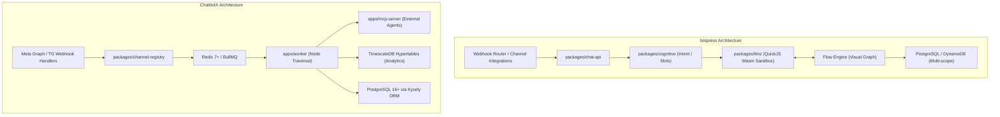
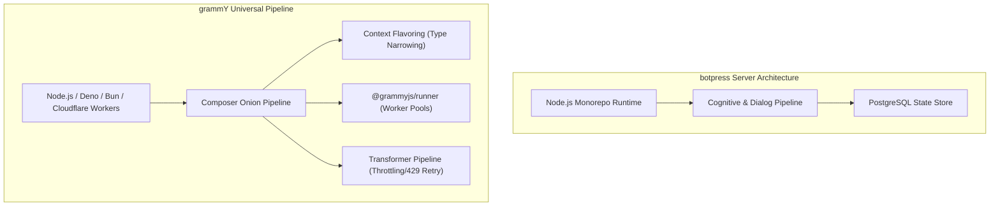
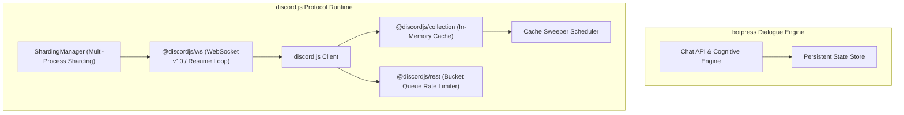
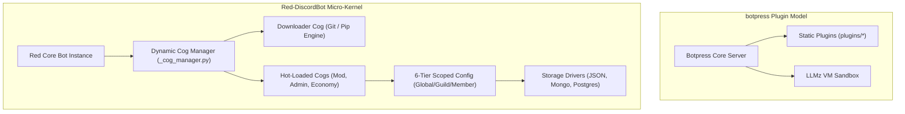
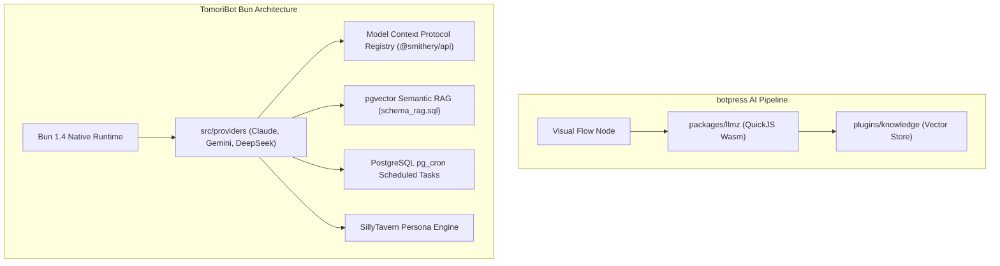

# botpress — Comparative Analysis & Category Evaluation

> **Category**: Conversational AI & Bots  
> **Architectural Role**: Enterprise Autonomous Conversational AI & Hybrid Visual Flow Engine  
> **Primary Stack**: TypeScript, Node.js 22+, Turborepo, QuickJS Emscripten (`llmz`), Zui, PostgreSQL, DynamoDB  
> **Peer Solutions Compared**: `ChatbotX`, `aiogram`, `grammY`, `discord.js`, `Red-DiscordBot`, `TomoriBot`  
> **Commercial SaaS Benchmarks**: Voiceflow, Botpress Cloud, ManyChat, Drift, Ada Support  

---

## 1. Executive Overview & Technical Identity: botpress

**botpress** is an enterprise-grade conversational AI platform and visual bot operating system engineered to bridge deterministic finite state machines (FSM) and non-deterministic autonomous LLM agents. At its architectural core is `packages/llmz`—an isolated WebAssembly QuickJS virtual machine that executes schema-guided LLM tool calling and prompt composition without exposing the host Node.js runtime to security vulnerabilities.

### Core Architectural Profile
- **Runtime & Language**: `TypeScript 5.4+ / Node.js 22+ (pnpm workspaces, Turborepo 2.3+)`
- **Core Framework**: `Decoupled Chat API (@botpress/chat-api), Cognitive Engine, and Flow Studio`
- **Execution Engine**: `Hybrid FSM Canvas + QuickJS Emscripten WebAssembly Sandbox (llmz)`
- **Persistence Layer**: `PostgreSQL 15+ (Relational / Messages), DynamoDB (Fast State Cache), Vector DB`
- **Typing & Validation**: `Zui (Dynamic schema & UI generator extending Zod)`
- **Channel Gateway**: `Modular integrations (integrations/*) for WhatsApp, Slack, Teams, Telegram, WebChat`
- **Primary Architectural Niche**: `Enterprise hybrid deterministic-stochastic dialog engine with sandboxed execution`
- **License**: `AGPL-3.0 / Enterprise`

---

## 2. Peer Solution Landscape (Conversational AI & Bots)

| Solution | Language & Runtime | Core Architecture | Database / Cache | Queue / Concurrency | Primary Architectural Niche |
| :--- | :--- | :--- | :--- | :--- | :--- |
| **botpress** (Current) | `TypeScript / Node 22+` | Monorepo Studio + QuickJS VM (`llmz`) | `PostgreSQL, DynamoDB, Vector DB` | In-Process Event Loop & Sandboxing | Hybrid visual FSM & sandboxed LLM agent runtime |
| **ChatbotX** | `TypeScript / Node 24+` | Turborepo, Next.js 15, MCP Server | `PostgreSQL 16+, TimescaleDB, Redis 7+` | `BullMQ / Redis Cluster` | Agentic chat marketing, social comment automation & MCP funnels |
| **aiogram** | `Python 3.10-3.14` | AsyncIO, uvloop, aiohttp, Pydantic v2 | `Redis (hiredis), Motor (MongoDB)` | `AsyncIO Event Loop` | High-throughput asynchronous Telegram dispatching with hierarchical routers |
| **grammY** | `TypeScript / Deno / Node` | Composer Onion Middleware, Web APIs | `Redis, PostgreSQL, Keyv, Memory` | `Runner Engine (@grammyjs/runner)` | Cross-runtime type-safe Telegram framework with transformer pipelines |
| **discord.js** | `TypeScript / Node 18-22+` | Modular Monorepo (`@discordjs/ws`, `rest`) | `In-Memory Collection Cache + Sweepers` | `REST Bucket Queues + Sharding` | Low-level object-oriented Discord WebSocket client & REST bucket manager |
| **Red-DiscordBot** | `Python 3.9-3.12+` | discord.py 2.x, Dynamic Cogs Lifecycle | `Red Config (JSON flat, Mongo, Postgres)` | `AsyncIO Task Loop + Cog Manager` | Hot-reloadable modular Discord bot platform with 6-tier scoped Config |
| **TomoriBot** | `TypeScript / Bun 1.4+` | Bun Native Runtime, discord.js 14.25 | `PostgreSQL 16+, pgvector, pg_cron` | `Bun Event Loop + Provider Streaming` | Multi-provider LLM assistant with pgvector RAG, MCP tool registry & presets |

---

## 3. Deep Head-to-Head Comparative Breakdown: botpress vs Peers

### 3.1. botpress vs. ChatbotX

**Comparative Focus**: `Hybrid Visual FSM + QuickJS Sandboxed Engine` vs. `Agentic Chat Marketing with TimescaleDB & Dedicated MCP Server`

#### Runtime Topology, Event Loops & Concurrency Models
- **botpress** processes conversational turns synchronously within Node.js, passing execution from the Chat API into `packages/cognitive` and the visual workflow state machine. Custom actions and prompt evaluations are isolated within in-process WebAssembly QuickJS contexts, preventing memory pollution while avoiding heavy process-spawn overhead.
- **ChatbotX** utilizes a decoupled, asynchronous queue topology. Webhooks immediately push normalized message events to Redis, releasing HTTP connections within milliseconds. Concurrency is handled across distributed BullMQ worker pools (`apps/worker`), enabling horizontal scaling under massive viral marketing surges (e.g., thousands of simultaneous Instagram DM replies).

#### Dialogue State Management & Session Persistence
- **botpress** enforces a strict 4-tier state scoping architecture: `conversation` (active session data, expires on timeout), `user` (persistent cross-channel prospect profile), `bot` (global configuration), and `workflow` (transient execution context). State is persisted across PostgreSQL and DynamoDB.
- **ChatbotX** uses a relational Kysely ORM schema across PostgreSQL, storing contacts, conversations, and custom `bot_field` variables. Transient dialogue flow checkpoints are recorded in PostgreSQL and indexed in Redis. Time-series events (read receipts, node transitions, conversions) are streamed to TimescaleDB hypertables for zero-lock funnel analytics.

#### LLM Orchestration, Tool Calling & Sandbox Execution
- **botpress** pairs visual node graph transitions with `packages/llmz`. Tools are declared using `@botpress/zui` (extending Zod schemas). The LLM generates structured tool invocations that execute inside the QuickJS sandbox, providing deterministic bounds on stochastic outputs.
- **ChatbotX** implements a dedicated Model Context Protocol server (`apps/mcp-server`). External autonomous agents (such as Claude Desktop, OpenClaw, or Hermes) connect over STDIO or SSE, invoking tools like `get_contact_profile`, `update_bot_variable`, or `trigger_flow`. Code execution in user-defined nodes is handled by a standalone microservice (`apps/javascript-executor`).

#### Architectural Comparison Matrix: botpress vs. ChatbotX

| Architectural Dimension | botpress | ChatbotX |
| :--- | :--- | :--- |
| **Primary Focus** | General conversational bot OS & Visual Studio | Social marketing automation & Agentic DMs |
| **Queue Architecture** | In-process event bus & synchronous dispatch | Distributed BullMQ over Redis cluster |
| **Time-Series Analytics** | Plugin-based telemetry (`plugins/analytics`) | Native TimescaleDB hypertables & continuous aggregates |
| **Agent Protocol** | Internal Zui schema tool dispatcher | Native Model Context Protocol (MCP) server |
| **Sandbox Isolation** | Embedded QuickJS Wasm (`quickjs-emscripten`) | Standalone QuickJS executor microservice |
| **Database Access** | Custom ORM / SQL query layer | Kysely type-safe query builder |

#### Distinct Strengths & Tradeoffs
- **Where botpress Excels**: Superior visual node canvas for complex branching logic, multi-language translation, built-in slot filling, and turnkey human-in-the-loop (HITL) escalation to Zendesk/Chatwoot.
- **Where ChatbotX Holds an Advantage**: Specialized social marketing capabilities (public comment-to-DM triggers on Instagram/Facebook), native MCP server for external agent orchestration, and TimescaleDB analytics built for high-volume drip campaigns.

---

### 3.2. botpress vs. aiogram

**Comparative Focus**: `Visual Bot Studio & Cognitive Engine` vs. `High-Concurrency AsyncIO Python Telegram Framework`

```mermaid
flowchart TD
    subgraph BotpressTG ["botpress Telegram Flow"]
        BP_TG["Telegram Webhook"] --> BP_Integ["integrations/telegram"]
        BP_Integ --> BP_API["packages/chat-api"]
        BP_API --> BP_FSM["Visual Flow Graph / LLMz"]
    end

    subgraph AiogramTG ["aiogram v3 Telegram Pipeline"]
        TG_Update["Telegram getUpdates / Webhook"] --> Aio_Outer["Outer Middlewares (Metrics/Auth)"]
        Aio_Outer --> Aio_Filter["Filter Engine (MagicFilter & StateFilter)"]
        Aio_Filter --> Aio_Router["Router Hierarchy (Auth, Sales, CRM)"]
        Aio_Router --> Aio_Inner["Inner Middlewares (DB Tx / Scopes)"]
        Aio_Inner --> Aio_Handler["Async Handler + Redis FSM"]
    end
```

#### Runtime Topology, Event Loops & Concurrency Models
- **botpress** is an omnichannel Node.js server where Telegram is an adapter plugin (`integrations/telegram`). Incoming updates undergo canonical transformation into Botpress message schemas before reaching the dialogue engine.
- **aiogram** is a native Python 3.10-3.14 asynchronous framework built on `asyncio` and `aiohttp`. Utilizing C-based `uvloop` and `aiodns`, aiogram processes tens of thousands of Telegram updates per second with zero overhead, operating directly against Telegram's Bot API types via Pydantic v2.

#### Dialogue State Management & Session Persistence
- **botpress** maintains state across database scopes (`conversation`, `user`, `bot`) with visual transition edges defining the next dialogue state.
- **aiogram** employs a formal Finite State Machine (`aiogram.fsm`) using `StatesGroup` and `State` objects. State keys (`bot_id:chat_id:user_id`) are persisted atomically into Redis (`RedisStorage` with `hiredis`), allowing completely stateless worker processes to handle sequential user inputs seamlessly.

#### LLM Orchestration, Tool Calling & Sandbox Execution
- **botpress** provides an integrated visual studio emulator, RAG knowledge connectors, and sandboxed QuickJS prompt runners out of the box.
- **aiogram** is code-first and AI-agnostic. Developers must manually integrate LLM providers (e.g., via `openai` or `langchain` Python packages) and implement custom tool calling loops within handler functions.

#### Architectural Comparison Matrix: botpress vs. aiogram

| Architectural Dimension | botpress | aiogram |
| :--- | :--- | :--- |
| **Language & Runtime** | TypeScript / Node.js 22+ | Python 3.10-3.14 (AsyncIO / uvloop) |
| **Dialogue Representation** | Visual node graph + QuickJS VM | Code-defined `StatesGroup` FSM + Redis |
| **Telegram API Fidelity** | Abstracted via integration adapter | 100% native Telegram Bot API via Pydantic v2 |
| **Middleware Model** | Webhook interceptors & SDK plugin hooks | Two-tier (Outer pre-filter vs. Inner post-filter) |
| **Developer Experience** | Low-code / Pro-code visual studio | Code-first declarative Python with MagicFilter |
| **Throughput on Telegram** | Moderate (Adapter abstraction layer) | Extreme (Pure async Telegram client) |

#### Distinct Strengths & Tradeoffs
- **Where botpress Excels**: Multi-channel abstraction (same bot runs on Web, Slack, and WhatsApp without changes), visual authoring for non-engineers, and built-in RAG document parsing.
- **Where aiogram Holds an Advantage**: Unmatched performance and feature depth on Telegram (Mini Apps, inline queries, group admin controls, custom keyboards) and native integration with Python's scientific and data science ecosystem.

---

### 3.3. botpress vs. grammY

**Comparative Focus**: `Enterprise Conversational Operating System` vs. `Universal Type-Safe Edge Telegram Framework`

#### Runtime Topology, Event Loops & Concurrency Models
- **botpress** requires a heavy Node.js runtime environment backed by PostgreSQL and optionally DynamoDB. It is designed as a standalone enterprise server application.
- **grammY** is built around standard Web APIs (`fetch`, `AbortController`, `Streams`) and platform shims, allowing bots to execute on Node.js, Deno, Bun, or serverless edge environments (Cloudflare Workers, Fastly). When deployed on long-polling servers, `@grammyjs/runner` manages update queuing across worker pools with configurable concurrency and backpressure.

#### Dialogue State Management & Session Persistence
- **botpress** synchronizes state changes to relational or NoSQL tables through the SDK's scoped state interfaces.
- **grammY** uses the `session()` onion middleware with pluggable storage adapters (`@grammyjs/storage-redis`, `@grammyjs/storage-postgres`, Keyv). It supports the `@grammyjs/conversations` plugin, enabling procedural, linear dialogue wizards using async generator functions instead of rigid state tables.

#### Outbound Rate Limiting & API Transformation
- **botpress** handles channel rate limits within integration wrappers.
- **grammY** features an outbound *Transformer Pipeline* (`bot.api.config.use`). Transformers intercept outgoing HTTP requests, enabling automatic retries on 429 rate limit responses (`@grammyjs/auto-retry`) and enforcing Telegram's 30 msg/sec global ceiling.

#### Architectural Comparison Matrix: botpress vs. grammY

| Architectural Dimension | botpress | grammY |
| :--- | :--- | :--- |
| **Target Runtime** | Node.js 22+ (Server / Docker) | Universal (Node, Deno, Bun, Cloudflare Workers) |
| **Middleware Architecture** | Event hook lifecycle | Koa-style Onion Middleware (`Composer`) |
| **Type Safety** | Zod/Zui validation schemas | Context Flavoring & Filter Query Type Narrowing |
| **Outbound Pacing** | Internal queue dispatch | Composable Transformer Pipeline |
| **Multi-Turn Dialog** | Visual graph nodes & LLMz agent loops | `@grammyjs/conversations` or Session middleware |
| **Deployment Footprint** | Multi-container stack (Studio + API + DB) | Single file or serverless edge isolate (<50MB RAM) |

#### Distinct Strengths & Tradeoffs
- **Where botpress Excels**: Full visual flow designer, enterprise multi-channel routing, native RAG knowledge base connectors, and role-based workspace administration.
- **Where grammY Holds an Advantage**: Ultra-lightweight edge deployment, compile-time TypeScript type narrowing, and granular outbound rate-limiting control on Telegram.

---

### 3.4. botpress vs. discord.js

**Comparative Focus**: `Omnichannel Dialogue & NLU Studio` vs. `Low-Level WebSocket Gateway & Cache Infrastructure`

#### Runtime Topology, Event Loops & Concurrency Models
- **botpress** operates over HTTP webhooks and REST APIs. It is not built to maintain stateful, continuous TCP/WebSocket connections to millions of chat guilds.
- **discord.js** is an object-oriented protocol implementation designed around Discord's bidirectional WebSocket Gateway v10. It manages real-time socket heartbeating, zlib decompression, reconnect/resume loops, and process-level sharding via `ShardingManager`.

#### State Management & Caching Strategies
- **botpress** commits all dialogue context to persistent databases (PostgreSQL/DynamoDB). It does not maintain real-time in-memory copies of server channels, user roles, or server hierarchies.
- **discord.js** maintains massive in-memory `Collection` structures (extended ES6 Maps) representing the real-time state of Discord guilds, channels, roles, and members. It features automated `Sweepers` to prune stale message buffers and offline members to prevent memory bloat.

#### Request Pacing & Rate Limiting
- **botpress** relies on standard HTTP retry mechanisms.
- **discord.js** embeds `@discordjs/rest`, which hashes API routes to Discord's server-assigned rate limit buckets (`X-RateLimit-Bucket`) and drains requests through sequential FIFO sub-queues with millisecond precision.

#### Architectural Comparison Matrix: botpress vs. discord.js

| Architectural Dimension | botpress | discord.js |
| :--- | :--- | :--- |
| **Primary Domain** | High-level dialog reasoning & omnichannel routing | Low-level Discord Gateway protocol & cache client |
| **Network Protocol** | HTTPS Webhooks & REST | Persistent WebSocket (WSS v10) & HTTPS REST |
| **State Storage** | PostgreSQL / DynamoDB | In-Memory `Collection` maps with Sweepers |
| **Rate Limiting** | General retry backoff | Sequential Bucket-Hash FIFO queues |
| **Scalability Mechanism** | Stateless container replication behind LB | Sharding across worker threads or child processes |
| **UI Components** | Multi-channel cards, carousels, quick replies | Discord ActionRows, Buttons, Selects, Modals |

#### Distinct Strengths & Tradeoffs
- **Where botpress Excels**: Complete conversational reasoning, visual flow editing, RAG knowledge integration, and cross-channel compatibility.
- **Where discord.js Holds an Advantage**: Unrivaled control over Discord's real-time events, voice channels, slash command interactions, and guild permission hierarchies.

---

### 3.5. botpress vs. Red-DiscordBot

**Comparative Focus**: `Visual Bot Studio & QuickJS Sandbox` vs. `Modular Dynamic Cog Framework with 6-Tier Config`

#### Runtime Topology, Event Loops & Concurrency Models
- **botpress** is authored in TypeScript, compiling plugins and bot definitions into fixed build artifacts governed by Turborepo and pnpm workspaces.
- **Red-DiscordBot** is authored in Python using `discord.py` and `asyncio`. It operates as a dynamic micro-kernel: operators can install, load, unload, and upgrade plugins ("Cogs") from remote Git repositories at runtime (`[p]cog load <name>`) without dropping WebSocket connections or restarting the bot process.

#### Dialogue & Configuration State Management
- **botpress** separates data across four scopes (`conversation`, `user`, `bot`, `workflow`) in PostgreSQL/DynamoDB.
- **Red-DiscordBot** features the innovative 6-tier hierarchical `Config` engine (`redbot.core.config`). State is organized into `GLOBAL`, `GUILD`, `CHANNEL`, `ROLE`, `USER`, and `MEMBER` scopes. Developers interact with config asynchronously (`await conf.guild(ctx.guild).channel.set(id)`) without writing database queries, while the underlying driver can be flat JSON, MongoDB (Motor), or PostgreSQL (asyncpg).

#### External Administration & Headless Control
- **botpress** provides the web-based Studio UI and HTTP Chat API for orchestration.
- **Red-DiscordBot** embeds a headless JSON-RPC 2.0 daemon (`_rpc.py`) over TCP or Unix sockets, allowing command-line tools and external web dashboards to control loaded cogs programmatically.

#### Architectural Comparison Matrix: botpress vs. Red-DiscordBot

| Architectural Dimension | botpress | Red-DiscordBot |
| :--- | :--- | :--- |
| **Language & Core** | TypeScript / Node.js 22+ | Python 3.9-3.12+ / discord.py |
| **Modularity Model** | Build-time plugins & integrations | Runtime hot-reloadable Cogs via Git/pip |
| **State Persistence** | Relational SQL + DynamoDB cache | 6-Tier Scoped Config (JSON, Mongo, Postgres) |
| **Admin Interface** | Web-based Visual Studio & Chat API | Discord Chat Commands & Headless JSON-RPC |
| **Domain Scope** | Omnichannel customer service & marketing | Multi-server Discord community management |
| **License** | AGPL-3.0 / Commercial | GNU GPLv3 |

#### Distinct Strengths & Tradeoffs
- **Where botpress Excels**: Drag-and-drop conversational authoring, omnichannel deployment, sandboxed code execution, and native RAG knowledge bases.
- **Where Red-DiscordBot Holds an Advantage**: Zero-downtime hot-reloading of features, mature community ecosystem of thousands of custom cogs, and turnkey community moderation, economy, and audio streaming.

---

### 3.6. botpress vs. TomoriBot

**Comparative Focus**: `Enterprise Visual Studio & Sandboxed VM` vs. `High-Velocity Multi-Provider AI Assistant on Bun`

#### Runtime Topology, Event Loops & Concurrency Models
- **botpress** executes on Node.js 22+ with Turborepo task orchestration. It handles multi-tenant workspace isolation and routes messages through its Chat API.
- **TomoriBot** runs natively on the Bun 1.4+ JavaScript runtime. By avoiding Node.js startup overhead and utilizing Bun's fast native I/O, TomoriBot delivers ultra-low latency token streaming to Discord channels and minimal memory usage.

#### LLM Orchestration, Memory & Tool Calling
- **botpress** relies on `@botpress/llmz` with Zui schema contracts, focusing on grounding flow nodes with structured outputs and knowledge base citations.
- **TomoriBot** implements a resilient multi-provider LLM gateway (`src/providers`) supporting Anthropic, OpenAI, Google Gemini, DeepSeek, and OpenRouter with automatic 429/503 failover. It integrates the Model Context Protocol (`@modelcontextprotocol/sdk`) for standardized tool calling, `pgvector` for episodic memory, and SillyTavern character presets (`schema_stpreset.sql`) for nuanced persona steering.

#### Autonomous Scheduling
- **botpress** handles scheduled events via internal workflow triggers.
- **TomoriBot** leverages PostgreSQL's native `pg_cron` extension to run scheduled agent tasks (daily prospect summaries, lead digests) directly from the database without risk of in-memory timer loss on restart.

#### Architectural Comparison Matrix: botpress vs. TomoriBot

| Architectural Dimension | botpress | TomoriBot |
| :--- | :--- | :--- |
| **JavaScript Runtime** | Node.js 22+ | Bun 1.4+ |
| **LLM Gateway** | Configured cloud LLM endpoints | Multi-provider with automatic failover (10+ models) |
| **Tool Calling Standard** | Custom `@botpress/zui` schemas | Industry-standard Model Context Protocol (MCP) |
| **Long-Term Memory** | `plugins/knowledge` RAG | Native PostgreSQL `pgvector` cosine similarity |
| **Background Scheduling** | In-process workflow timers | PostgreSQL in-database `pg_cron` |
| **Persona System** | `plugins/personality` prompt prefixing | SillyTavern Character Card V2 preset engine |

#### Distinct Strengths & Tradeoffs
- **Where botpress Excels**: Visual flow builder, comprehensive multi-channel integration (Web, WhatsApp, Slack, Teams), and enterprise human handoff (HITL) workflows.
- **Where TomoriBot Holds an Advantage**: Bun-native performance, multi-provider model resilience, standardized MCP tool discovery (Smithery API), and episodic memory via pgvector.

---

## 4. Capability & Feature Comparison Matrix

| Dimension / Capability | botpress | ChatbotX | aiogram | grammY | discord.js | Red-DiscordBot | TomoriBot |
| :--- | :---: | :---: | :---: | :---: | :---: | :---: | :---: |
| **Visual Flow Canvas** | ✅ Advanced | ✅ Visual Builder | ❌ | ❌ | ❌ | ❌ | ❌ |
| **Native MCP Server / Client** | ⚠️ Zui Tools | ✅ Native Server | ❌ | ❌ | ❌ | ❌ | ✅ Native Client |
| **Sandboxed Execution** | ✅ QuickJS Wasm | ✅ QuickJS Service | ❌ | ❌ | ❌ | ❌ | ❌ |
| **Vector RAG Ingestion** | ✅ Native Plugin | ✅ pgvector Core | ❌ | ❌ | ❌ | ⚠️ Community Cog | ✅ Native pgvector |
| **Telegram Protocol Support** | ⚠️ Channel Plugin | ✅ Via Registry | ✅ Native Master | ✅ Native Master | ❌ | ❌ | ❌ |
| **Discord Gateway Support** | ⚠️ Channel Plugin | ❌ | ❌ | ❌ | ✅ Native Master | ✅ Native Master | ✅ Native Master |
| **Meta Channels (WhatsApp/IG)**| ✅ Integrations | ✅ Native Core | ❌ | ❌ | ❌ | ❌ | ❌ |
| **Hot-Reloading Architecture** | ❌ | ❌ | ❌ | ❌ | ❌ | ✅ Native Cogs | ❌ |
| **Persistent FSM Engine** | ✅ Internal Graph | ✅ Node Checkpoints | ✅ Redis FSM | ⚠️ Conversations | ❌ | ⚠️ State Cogs | ❌ |
| **Edge / Serverless Ready** | ❌ | ❌ | ❌ | ✅ Cloudflare / Deno | ⚠️ Headless Core | ❌ | ❌ |

---

## 5. Commercial Benchmark Positioning

When benchmarked against commercial SaaS leaders (**Voiceflow, Botpress Cloud, ManyChat, Drift, Ada Support**):
- **Cost & Licensing**: `botpress` open-source (AGPL-3.0) eliminates the per-message fees and contact-tier pricing of Voiceflow and Botpress Cloud.
- **Data Sovereignty**: Complete on-premise or private cloud deployment ensures sensitive customer conversations and proprietary knowledge bases never leak to third-party model aggregators.
- **Hybrid Flexibility**: Unlike pure LLM wrappers, Botpress combines deterministic compliance workflows with generative AI reasoning.

---

## 6. Strategic Takeaways & Role for MarketingStudio

In the unified **MarketingStudio** architecture:
1. **Primary Component to Adopt**: Harness `botpress`'s hybrid dialogue philosophy—using visual node graphs for deterministic lead capture and qualification steps while delegating cognitive Q&A to sandboxed QuickJS LLM execution.
2. **Interoperability Seam**: Connect Botpress via standardized webhooks to MarketingStudio's CRM core, syncing lead profiles and triggering sales rep notifications.
3. **Peer Coexistence**: Utilize `botpress` for complex multi-channel web/enterprise chat, while delegating high-volume Telegram community operations to `grammY` and Discord community automation to `discord.js`/`TomoriBot`.
