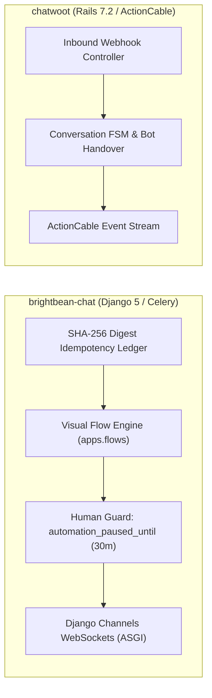
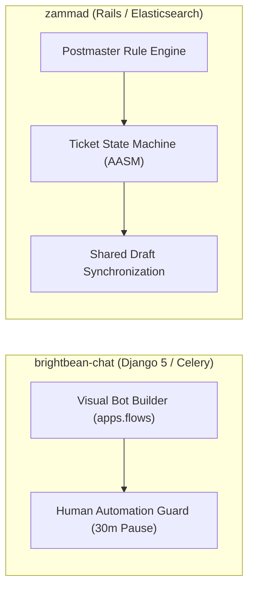
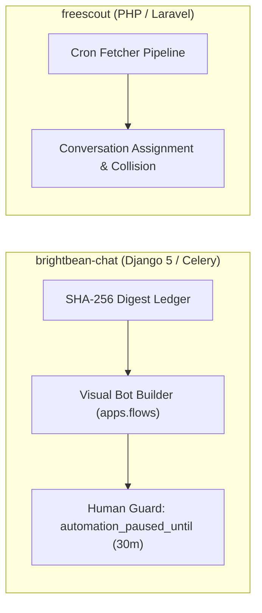
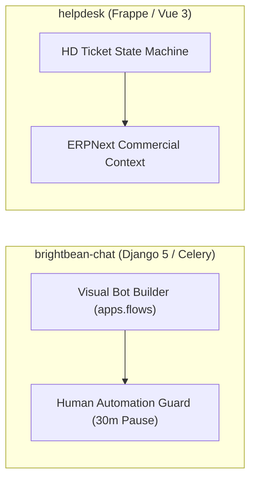
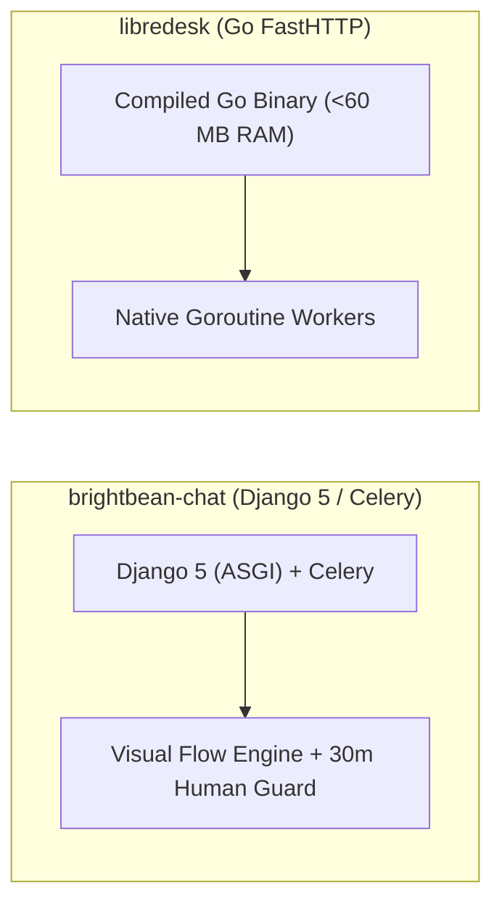
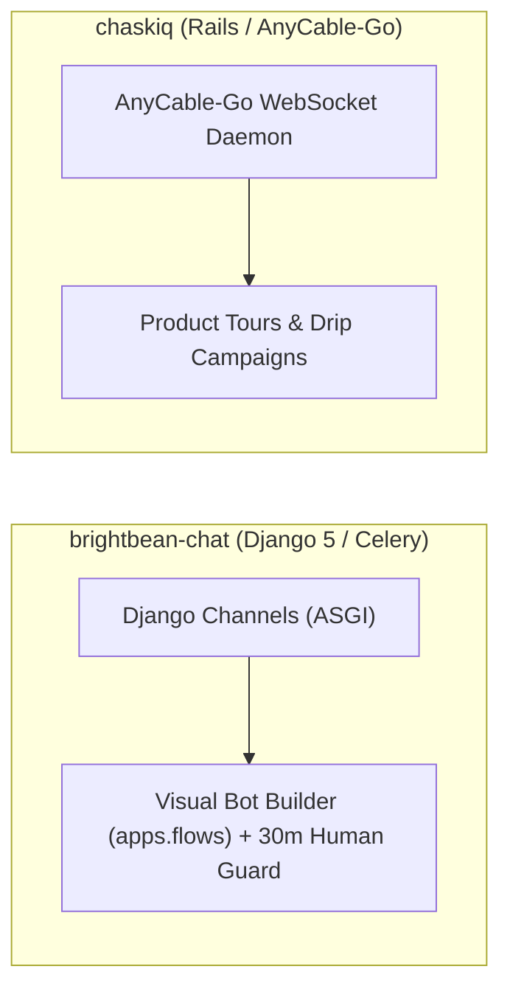

# brightbean-chat — Comparative Analysis & Category Evaluation

> **Category**: Omnichannel Helpdesk & Support  
> **Architectural Role**: Visual bot flow automation, human-takeover contract & collaborative inbox  
> **Primary Stack**: Python 3.11+, Node.js 20+ | Django 5, Django Ninja | PostgreSQL 15+, Redis 7+ | Celery + Django Channels (ASGI)  
> **Peer Solutions Compared**: `chatwoot`, `zammad`, `freescout`, `helpdesk`, `libredesk`, `chaskiq`  
> **Commercial SaaS Benchmarks**: Intercom, Respond.io, ManyChat, Zendesk, Wati  

---

## 1. Executive Overview & Technical Identity: brightbean-chat

**brightbean-chat** represents the visual bot automation and marketing-operations standard within the **Omnichannel Helpdesk & Support** domain, distinguished by its core focus on **Visual drag-and-drop conversational bot builders (`apps.flows`), a deterministic human-takeover contract (`automation_paused_until`), token-bucket outbound pacing (`SendBucket`), and cryptographic webhook idempotency (`InboxRuleApplication.event_ref`)**.

### Core Architectural Profile
- **Runtime & Language**: `Python 3.11+` (Django 5 ASGI/WSGI), `Node.js 20+` (Dashboard build)
- **Core Framework**: `Django 5.x`, `Django Ninja` (OpenAPI Pydantic routers), `Alpine.js`, `Tailwind CSS`
- **Persistence Layer**: `PostgreSQL 15+` (enforcing `WorkspaceScopedModel` multi-tenancy), `Redis 7+`
- **Concurrency & Queue Model**: `Celery 5+` (flow execution workers & `celery-beat` scheduler) + `Django Channels` (ASGI WebSockets)
- **Domain Specialization**: `Multi-tenant visual flow automation, automated lead qualification & human support handoff`

---

## 2. Peer Solution Landscape (Omnichannel Helpdesk & Support)

Within this category, `brightbean-chat` operates alongside the following peer solutions:

| Solution | Language & Runtime | Core Framework | Database / Cache | Queue / Concurrency | Primary Architectural Niche |
| :--- | :--- | :--- | :--- | :--- | :--- |
| **brightbean-chat** (Current) | `Python 3.11+, Node 20+`| `Django 5, Django Ninja` | `PostgreSQL 15+, Redis` | `Celery + Django Channels` | **Multi-tenant visual flow automation with human-takeover contract** |
| **chatwoot** | `Ruby 3.4+` | `Rails 7.2, Vue 3` | `PostgreSQL 14+, Redis` | `Sidekiq + ActionCable` | Polymorphic multi-channel inbox & real-time live chat |
| **zammad** | `Ruby 3.4+` | `Rails 8.1, TypeScript` | `PostgreSQL/MySQL + Elastic 8+` | `Delayed::Job + EventMachine WS` | Enterprise ITIL ticketing, dynamic Object Manager & audit trails |
| **freescout** | `PHP 8.1-8.3` | `Laravel 5.5 LTS, Blade` | `MySQL 8+ / MariaDB / Postgres` | `Laravel Queue / CLI Cron` | Low-overhead shared email inboxes with modular add-ons |
| **helpdesk** | `Python 3.10+, Node 20+`| `Frappe Framework v15, Vue 3`| `MariaDB, Redis, SQLite` | `Python RQ + Node Socket.io` | SLA policies & seamless integration with Frappe/ERPNext apps |
| **libredesk** | `Go 1.25+` | `FastHTTP, Fastglue` | `PostgreSQL 15+, pgvector` | `Native Goroutines + FastHTTP WS` | Sub-60MB RAM footprint with compiled high-concurrency Go |
| **chaskiq** | `Ruby 3.3.5+, Node 20+` | `Rails 7.2, React 18` | `PostgreSQL, Redis, Nightfury` | `Sidekiq + AnyCable-Go WS` | Intercom-style proactive tours, campaigns & outbound messages |

---

## 3. Deep Head-to-Head Comparative Breakdown: brightbean-chat vs Peers

### 3.1. brightbean-chat vs. chatwoot

**Comparative Focus**: `Visual flow automation & human takeover contract` vs. `Support-centric omnichannel inbox`

#### Architectural & Stack Differences
- **Language & Framework Paradigm**: Brightbean-Chat is built on Python 3.11+ and Django 5 (ASGI) utilizing `django-ninja` for high-speed Pydantic REST serialization and Celery workers for async background flows. Chatwoot is built on Ruby 3.4 and Rails 7.2 with Puma, Sidekiq, and ActionCable.
- **Human vs. Bot Conflict Resolution**: Chatwoot relies on manual conversation status changes or external bot handoffs. Brightbean-Chat enforces a strict **Human Automation Guard**: whenever a human agent sends a message from the inbox, `automation_paused_until` is stamped 30 minutes into the future, guaranteeing that automated chatbot trees (`Flow`) are completely suppressed while a human is conversing.
- **Webhook Idempotency & Rate Limiting**: Brightbean-Chat features an explicit cryptographic digest ledger (`InboxRuleApplication.event_ref`) preventing duplicate webhook ingestion, alongside an integrated token-bucket rate limiter (`SendBucket`) to prevent Meta WhatsApp tier blocks during bulk messaging.

#### Where brightbean-chat Excels over chatwoot
- **Drag-and-Drop Visual Flow Builder**: Powerful node-graph bot builder (`apps.flows`) enabling non-technical marketers to construct complex branching chatbots.
- **Rigorous Human-Takeover Contract**: Eliminates embarrassing situations where automated bots interrupt human agent conversations.
- **Token-Bucket Rate Limiting**: Built-in pacing protection for high-volume WhatsApp and SMS outbound campaigns.

#### Where chatwoot Holds an Advantage over brightbean-chat
- **Polished Agent Interface**: Chatwoot's Vue 3 dashboard offers rich keyboard shortcuts, multi-agent collision detection, and comprehensive conversation filtering.
- **Turnkey Omnichannel Breadth**: Extensive channel ecosystem including email, Instagram, Telegram, Line, and live chat widgets out of the box.
- **Built-in SLA & CSAT Pipelines**: Native satisfaction surveys and escalation deadline warnings.

#### Architectural Tradeoffs Matrix

| Architectural Dimension | brightbean-chat | chatwoot |
| :--- | :--- | :--- |
| **Primary Domain Focus** | Visual bot automation & marketing inbox | Omnichannel support & shared inbox |
| **Runtime & Backend** | Python 3.11 / Django 5 (ASGI) / Celery | Ruby 3.4 / Rails 7.2 / Sidekiq |
| **Bot Automation Engine** | Native visual flow graph (`apps.flows`) | External bot webhooks / Dialogflow / Captain |
| **Human Takeover** | Deterministic 30-min pause (`automation_paused_until`)| Agent assignment / bot status toggle |
| **Webhook Idempotency** | Cryptographic SHA-256 digest ledger (`event_ref`) | Application-level deduplication |
| **Outbound Pacing** | Token-bucket rate limiter (`SendBucket`) | Handled in background jobs |
| **Best-Fit Deployment** | Marketing lead generation, automated WhatsApp bots| Multi-agent support operations |

---

### 3.2. brightbean-chat vs. zammad

**Comparative Focus**: `Visual flow automation & human takeover` vs. `Enterprise ITIL ticketing & Elasticsearch`

#### Architectural & Stack Differences
- **Core Technology Stack**: Brightbean-Chat is built on Python 3.11+ and Django 5 with Celery workers, Redis, and Django Channels. Zammad is built on Ruby on Rails 8.1 with Delayed::Job and Elasticsearch.
- **Automation Philosophy**: Brightbean-Chat features a visual drag-and-drop conversational bot builder (`apps.flows`) that executes interactive decision trees across WhatsApp and webchat. Zammad automates ticket handling via rule-based Postmaster filters, triggers, and macros.
- **Collision Prevention**: Brightbean-Chat prevents collisions between bots and humans via `automation_paused_until`. Zammad prevents collisions between agents using live shared drafts (`Ticket::SharedDraftZoom`).

#### Where brightbean-chat Excels over zammad
- **Visual Drag-and-Drop Bot Builder**: Non-technical team members can visually design complex chatbot flows.
- **Deterministic Human-Takeover Guard**: Eliminates bot interference during live human customer conversations.
- **Outbound Pacing Limiter**: Built-in `SendBucket` token-bucket rate limiter prevents WhatsApp bans during bulk campaigns.

#### Where zammad Holds an Advantage over brightbean-chat
- **Enterprise Ticketing & Audit Logs**: Immutable audit history, time tracking per article, and organization hierarchies.
- **Search Performance**: Clustered Elasticsearch handles high-volume message histories with zero query latency.
- **Multi-Calendar SLAs**: Tracks first-response, update, and solution deadlines across multiple global calendars.

#### Architectural Tradeoffs Matrix

| Architectural Dimension | brightbean-chat | zammad |
| :--- | :--- | :--- |
| **Primary Domain Focus** | Visual chatbot automation & shared inbox | Enterprise ITIL ticketing & governance |
| **Runtime & Backend** | Python 3.11 / Django 5 (ASGI) / Celery | Ruby on Rails 8.1 / Delayed::Job |
| **Bot Automation Engine** | Native visual flow graph (`apps.flows`) | Rule triggers and canned macros |
| **Human Takeover** | Deterministic 30-min pause (`automation_paused_until`)| Agent collision locks & shared drafts |
| **Search Engine** | PostgreSQL indexes | Clustered Elasticsearch 8+ |
| **Best-Fit Deployment** | Marketing lead generation, automated WhatsApp bots| Internal IT desks, complex SLA customer support|

---

### 3.3. brightbean-chat vs. freescout

**Comparative Focus**: `Django visual flow automation & human takeover` vs. `Low-overhead PHP shared email mailbox`

#### Architectural & Stack Differences
- **Core Technology Stack**: Brightbean-Chat is built on Python 3.11+ and Django 5 (ASGI) with Celery and Django Channels. FreeScout is built on PHP 8.1+ and Laravel.
- **Automation Paradigm**: Brightbean-Chat features a full visual drag-and-drop conversational bot builder (`apps.flows`) executing complex decision trees across WhatsApp and webchat. FreeScout handles automation through canned responses and optional auto-reply modules.
- **Human vs. Bot Protection**: Brightbean-Chat enforces a 30-minute automation suppression timer (`automation_paused_until`) when a human agent sends a message. FreeScout focuses on human-to-human collision detection.

#### Where brightbean-chat Excels over freescout
- **Visual Conversational Bot Builder**: Build complex multi-step branching chatbots without code.
- **Deterministic Human Takeover**: Prevents bots from interrupting human conversations.
- **Built-in WhatsApp & SMS Rate Limiting**: `SendBucket` token-bucket limiter avoids carrier bans during broadcasts.

#### Where freescout Holds an Advantage over brightbean-chat
- **Lightweight Infrastructure**: ~150 MB RAM vs ~350 MB+ RAM.
- **Battle-Tested Email Ingestion**: Deep RFC-822 header parsing, inline image CID extraction, and spam filtering.
- **Simple Extensibility**: Modular plugin structure in `Modules/`.

#### Architectural Tradeoffs Matrix

| Architectural Dimension | brightbean-chat | freescout |
| :--- | :--- | :--- |
| **Primary Domain Focus** | Visual chatbot automation & shared inbox | Shared email mailbox |
| **Backend Architecture** | Python 3.11+ / Django 5 (ASGI / Celery) | PHP 8.1+ / Laravel (Sync/Cron) |
| **Bot Automation** | Native visual flow builder (`apps.flows`) | Canned responses / auto-reply add-ons |
| **Human Protection** | Human-to-bot 30-min pause (`automation_paused_until`)| Agent-to-agent collision warnings |
| **Messaging Focus** | WhatsApp, Telegram, SMS, WebChat | Email (IMAP/SMTP) |
| **Best-Fit Deployment** | WhatsApp-first sales, automated lead triage | Small email-driven support desks |

---

### 3.4. brightbean-chat vs. helpdesk (Frappe)

**Comparative Focus**: `Django visual flow automation & human takeover` vs. `ERP commercial ticketing`

#### Architectural & Stack Differences
- **Ecosystem & Framework**: Brightbean-Chat is built on Python 3.11+ and Django 5 with PostgreSQL and Celery. Frappe Helpdesk is built on Python/Frappe Framework v15 with MariaDB.
- **Automation Model**: Brightbean-Chat features a visual drag-and-drop conversational bot builder (`apps.flows`) executing multi-step branching decision trees across WhatsApp and webchat. Frappe Helpdesk automates triage via assignment rules and saved replies.
- **Human vs. Bot Protection**: Brightbean-Chat enforces a strict **Human Automation Guard**: sending an agent reply sets `automation_paused_until = now() + 30m`, shutting down automated flows while a human agent is active. Frappe Helpdesk focuses on agent routing and SLA tracking.

#### Where brightbean-chat Excels over helpdesk
- **Visual Drag-and-Drop Bot Builder**: Non-technical users can build complex branching chatbots without code.
- **Deterministic Human Takeover**: Prevents bots from interrupting human conversations.
- **Built-in WhatsApp & SMS Rate Limiting**: `SendBucket` token-bucket limiter prevents carrier bans.

#### Where helpdesk Holds an Advantage over brightbean-chat
- **ERP Commercial Integration**: Instant access to sales orders, invoices, and subscriptions in ERPNext.
- **Dynamic Hold-Time SLA Pausing**: Pauses SLA timers during customer-wait states.
- **Team Queue Balancing**: Advanced assignment rules based on agent capacity and availability flags.

#### Architectural Tradeoffs Matrix

| Architectural Dimension | brightbean-chat | helpdesk (Frappe) |
| :--- | :--- | :--- |
| **Primary Domain Focus** | Visual chatbot automation & shared inbox | Commercial ERP customer ticketing |
| **Framework & ORM** | Django 5 (PostgreSQL / Django ORM) | Frappe Framework v15 (MariaDB/Postgres) |
| **Bot Automation Engine** | Native visual flow graph (`apps.flows`) | Rule assignments & saved replies |
| **Human Takeover** | Deterministic 30-min pause (`automation_paused_until`)| Manual status change |
| **Commercial Context** | External CRM webhooks | Direct native DocType access (ERPNext) |
| **Best-Fit Deployment** | Marketing lead generation, automated WhatsApp bots| Commercial enterprises running ERPNext |

---

### 3.5. brightbean-chat vs. libredesk

**Comparative Focus**: `Django visual flow automation & human takeover contract` vs. `Compiled Go support engine`

#### Architectural & Stack Differences
- **Runtime Stack**: Brightbean-Chat is built on Python 3.11+ and Django 5 with Celery workers, Redis, and Django Channels. LibreDesk is a compiled Go binary utilizing FastHTTP and PostgreSQL `pgvector`.
- **Automation Philosophy**: Brightbean-Chat features a visual drag-and-drop conversational bot builder (`apps.flows`) that executes interactive decision trees across WhatsApp and webchat. LibreDesk automates support via native round-robin assignment and vector AI embeddings.
- **Human-Takeover Contract**: Brightbean-Chat enforces a strict 30-minute automation suppression timer (`automation_paused_until`) when a human agent sends a message. LibreDesk uses agent locking and conversation status updates.

#### Where brightbean-chat Excels over libredesk
- **Visual Drag-and-Drop Bot Builder**: Non-technical team members can visually design complex chatbot flows.
- **Deterministic Human-Takeover Guard**: Eliminates bot interference during live human customer conversations.
- **Outbound Pacing Limiter**: Built-in `SendBucket` token-bucket rate limiter prevents WhatsApp bans during bulk campaigns.

#### Where libredesk Holds an Advantage over brightbean-chat
- **6x Lower Memory Overhead**: Under 60 MB RAM vs ~350 MB+ RAM.
- **Wire-Speed Execution**: FastHTTP delivers microsecond-level latency on message routing.
- **Native Vector AI Embeddings**: Built-in semantic document search via PostgreSQL `pgvector`.

#### Architectural Tradeoffs Matrix

| Architectural Dimension | brightbean-chat | libredesk |
| :--- | :--- | :--- |
| **Primary Domain Focus** | Visual chatbot automation & shared inbox | High-performance compiled support engine |
| **Runtime & Backend** | Python 3.11 / Django 5 (ASGI) / Celery | Go 1.25 compiled binary |
| **Bot Automation Engine** | Native visual flow graph (`apps.flows`) | AI vector retrieval + rule assigner |
| **Human Takeover** | Deterministic 30-min pause (`automation_paused_until`)| Manual status change |
| **Base Production RAM** | ~350 MB RAM | **< 60 MB RAM** |
| **Best-Fit Deployment** | Marketing lead generation, automated WhatsApp bots| High-load cloud-native backends, micro-instances |

---

### 3.6. brightbean-chat vs. chaskiq

**Comparative Focus**: `Visual flow automation & human takeover contract` vs. `Conversational marketing & AnyCable-Go`

#### Architectural & Stack Differences
- **Marketing Automation Paradigm**: Brightbean-Chat focuses on visual drag-and-drop conversational bot decision trees (`apps.flows`) across WhatsApp and live chat. Chaskiq focuses on user onboarding tours (`Tour`) and event-driven email campaigns (`Campaign`) based on audience segments.
- **Human-Takeover Contract**: Brightbean-Chat enforces a strict 30-minute automation suppression timer (`automation_paused_until`) when a human agent sends a message. Chaskiq relies on bot task state transitions.
- **Real-Time Tier**: Brightbean-Chat utilizes standard Django Channels with Redis channel layers. Chaskiq utilizes AnyCable-Go offloading 100k+ connections.

#### Where brightbean-chat Excels over chaskiq
- **Visual Drag-and-Drop Bot Builder**: Non-technical team members can visually design complex chatbot flows.
- **Deterministic Human-Takeover Guard**: Eliminates bot interference during live human customer conversations.
- **Outbound Pacing Limiter**: Built-in `SendBucket` token-bucket rate limiter prevents WhatsApp bans during bulk campaigns.

#### Where chaskiq Holds an Advantage over brightbean-chat
- **Interactive In-App Product Tours**: Guide users through UI elements with step-by-step visual highlights.
- **AnyCable WebSocket Scaling**: Handle massive public visitor traffic without degrading Rails performance.
- **Unified GraphQL Schema**: High developer velocity for complex frontend interactions.

#### Architectural Tradeoffs Matrix

| Architectural Dimension | brightbean-chat | chaskiq |
| :--- | :--- | :--- |
| **Primary Domain Focus** | Visual chatbot automation & shared inbox | Conversational marketing & product tours |
| **Backend Architecture** | Python 3.11 / Django 5 (ASGI) / Celery | Ruby on Rails 7.2 / AnyCable-Go |
| **Bot Automation Engine** | Native visual flow graph (`apps.flows`) | Multi-step `BotTask` & quick replies |
| **Human Takeover** | Deterministic 30-min pause (`automation_paused_until`)| Bot status toggle |
| **Outbound Pacing** | Token-bucket rate limiter (`SendBucket`) | Handled in background Sidekiq jobs |
| **Best-Fit Deployment** | Marketing lead generation, automated WhatsApp bots| Product-led growth SaaS, visitor onboarding |

---

## 4. Capability & Feature Comparison Matrix

| Dimension / Capability | brightbean-chat | chatwoot | zammad | freescout | helpdesk | libredesk | chaskiq |
| :--- | :---: | :---: | :---: | :---: | :---: | :---: | :---: |
| **Primary Architectural Niche** | **Visual flow automation & human-takeover contract** | Polymorphic multi-channel inbox & live chat | Elasticsearch ITIL ticketing & dynamic schema | Low-overhead shared email inboxes | SLA policies & ERPNext commercial context | Sub-60MB RAM footprint with Go binary | Intercom-style proactive tours & AnyCable |
| **Runtime Language** | `Python 3.11+` | `Ruby 3.4+` | `Ruby 3.4+` | `PHP 8.1+` | `Python / JS` | `Go 1.25+` | `Ruby 3.3+` |
| **Database Persistence** | `PostgreSQL, Redis` | `PostgreSQL, Redis` | `PostgreSQL/MySQL + Elastic` | `MySQL / MariaDB` | `MariaDB, Redis` | `PostgreSQL, pgvector`| `PostgreSQL, Redis` |
| **Real-Time Streaming** | Django Channels (ASGI) | ActionCable WebSockets | EventMachine WebSockets | HTTP Polling / Pusher | Node.js Socket.io | Native Go FastHTTP WS | AnyCable-Go Daemon |
| **Search Engine Engine** | PostgreSQL Indexes | PostgreSQL GIN Trigrams | Elasticsearch 8+ Cluster | MySQL B-Tree Indexes | SQLite Local Cache | PostgreSQL Trigrams | PostgreSQL JSONB |
| **Base Production RAM** | ~350 MB RAM | ~2.5 GB RAM | ~3.5 GB RAM | **~150 MB RAM** | ~500 MB RAM | **< 60 MB RAM** | ~2.0 GB RAM |

---

## 5. Commercial Benchmark Positioning

When benchmarked against commercial SaaS leaders (**Intercom, Respond.io, ManyChat, Zendesk, Wati**):
- **Against ManyChat / Wati**: `brightbean-chat` provides an open-source visual chatbot flow builder and WhatsApp messaging platform with zero monthly subscription fees or subscriber-count tier penalizations.
- **Against Respond.io**: Brightbean-Chat replicates Respond.io's multi-channel messaging rules and agent inbox, with the added benefit of strict Python/Django data ownership.
- **Against Intercom**: While Intercom focuses heavily on web tours, Brightbean-Chat excels at multi-channel WhatsApp and Telegram automated lead qualification.

---

## 6. Strategic Takeaways & Role for MarketingStudio

In the unified **MarketingStudio** architecture:
1. **Primary Component to Adopt**: Harvest Brightbean-Chat's **Visual Conversational Bot Flow Builder (`apps.flows`)** for lead capture and qualification automation.
2. **Adopt the Deterministic Human-Takeover Contract**: Implement `automation_paused_until` across all channels to ensure bots never speak over human agents.
3. **Incorporate Token-Bucket Rate Limiting**: Borrow the `SendBucket` algorithm to regulate outbound broadcast pacing and protect numbers from carrier spam blocks.
