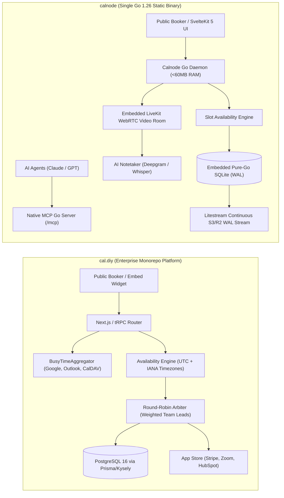

# cal.diy — Comparative Analysis & Category Evaluation

> **Category**: Appointment Scheduling & Calendar Engines  
> **Architectural Role**: Enterprise scheduling infrastructure, multi-host availability engine & calendar orchestration monorepo  
> **Primary Stack**: TypeScript 5+ | Next.js (App Router) & tRPC | PostgreSQL 16+ (Prisma + Kysely) & Redis | Tailwind CSS & Day.js  
> **Peer Solutions Compared**: `calnode`  
> **Commercial SaaS Benchmarks**: Calendly, Acuity Scheduling, Chili Piper, Doodle  

---

## 1. Executive Overview & Technical Identity: cal.diy

**cal.diy** (the open-source foundation of **Cal.com**) represents the enterprise-grade multi-host scheduling and calendar integration monorepo within the **Appointment Scheduling & Calendar Engines** domain. Engineered in TypeScript 5+, Next.js, Prisma ORM, and tRPC, Cal.diy serves as the open-source standard for scheduling infrastructure, countering closed-source SaaS monopolies like Calendly.

Cal.diy abstracts the mathematical complexity of multi-calendar temporal coordination: aggregating real-time busy blocks across heterogeneous external calendars (Google Calendar, Microsoft Outlook, Apple iCloud, Nextcloud CalDAV), calculating timezone shifts across International Daylight Saving Time boundaries, enforcing host buffer margins, and orchestrating complex organizational booking topologies. Its standout capability is its enterprise routing engine—supporting `ROUND_ROBIN` (weighted or balanced sales lead distribution), `COLLECTIVE` (finding mutual availability across multiple team members), and `MANAGED` organizational event templates, supported by a modular App Store with 50+ integrations (Stripe, Zoom, Salesforce, HubSpot).

### Core Architectural Profile
- **Runtime & Language**: `TypeScript 5+ / Node.js 20+ LTS (Turborepo Monorepo)`
- **Core Framework**: `Next.js (App Router), tRPC type-safe API routing (@calcom/trpc), Tailwind CSS`
- **Persistence Layer**: `PostgreSQL 16+ (Prisma ORM for schema management + Kysely query builder for heavy reads) + Redis 7+`
- **Concurrency & Queue Model**: `Redis-backed BullMQ queues + asynchronous tRPC procedures`
- **Domain Specialization**: Enterprise multi-host round-robin lead routing, collective team availability, modular App Store integrations & white-label scheduling embeds

---

## 2. Peer Solution Landscape (Appointment Scheduling & Calendar Engines)

Within this category, `cal.diy` operates alongside the following peer solutions:

| Solution | Language & Runtime | Core Framework | Database / Cache | Video Meeting Mechanism | Primary Architectural Niche |
| :--- | :--- | :--- | :--- | :--- | :--- |
| **cal.diy** (Current) | `TypeScript 5+ / Node` | `Next.js, tRPC` | `PostgreSQL 16+, Redis` | `Modular App Store (Zoom, Meet, Cal Video)` | **Enterprise multi-host round-robin routing & 50+ App Store integrations** |
| **calnode** | `Go 1.26` | `SvelteKit 5 (Embedded), Chi`| `Embedded Pure-Go SQLite` | `Native LiveKit WebRTC + AI Notetaker` | Zero-dependency single static binary, Litestream S3 sync & native MCP server |

---

## 3. Deep Head-to-Head Comparative Breakdown: cal.diy vs Peers

### 3.1. cal.diy vs. calnode

**Comparative Focus**: `Enterprise TypeScript Monorepo & Multi-Host Round-Robin` vs. `Single-Binary Go Engine with Litestream & LiveKit`

#### Detailed Architectural Contrast
- **System Architecture & Operational Footprint**: `cal.diy` is a sprawling, enterprise-grade TypeScript monorepo orchestrated via Turborepo and Yarn. In production, it requires multiple container services (`apps/web`, `apps/api`), PostgreSQL 16+, Redis, and regular dependency maintenance across hundreds of npm packages, consuming **1.5 GB to 2.5 GB of RAM**. `calnode` compiles into a **single static Go executable** with its SvelteKit frontend embedded directly via Go `embed.FS` and all data persisted to an embedded SQLite database. It consumes **< 60 MB of RAM** and requires zero external Docker containers.
- **Team Routing & Scheduling Topologies**: `cal.diy` is the undisputed leader in enterprise sales team routing. Its availability engine supports `ROUND_ROBIN` (distributing incoming prospect bookings across sales team members equally or based on assigned individual conversion weights), `COLLECTIVE` (finding mutual availability across multiple required team members), and `MANAGED` organizational templates. `calnode` is tuned primarily for individual hosts, small teams, and autonomous AI agents.
- **Video Conferencing & Meeting Intelligence**: `cal.diy` coordinates booking times, delegating the actual video call to external providers (Zoom, Google Meet, MS Teams) via OAuth plugins in its App Store. Meeting transcription requires third-party bots (Otter.ai). `calnode` includes native in-browser WebRTC video meeting rooms powered by LiveKit. When a call completes, its integrated AI notetaker automatically transcribes the audio via Whisper/Deepgram and records structured summaries directly into SQLite without third-party bot intrusions.
- **Disaster Recovery & Storage**: `cal.diy` relies on traditional managed PostgreSQL clustering and Point-in-Time Recovery (PITR). `calnode` solves SQLite durability through **Litestream**, continuously streaming SQLite Write-Ahead Log (WAL) frames directly to Cloudflare R2 or AWS S3 with sub-second RPO.
- **AI Agent Integration via MCP**: `calnode` features a built-in Model Context Protocol (MCP) server utilizing the official Go SDK, allowing LLM agents to inspect availability, book meetings, and read transcripts over stdio or Streamable HTTP. `cal.diy` provides traditional REST API v2 and webhook interfaces.

#### Architectural Comparison Matrix: cal.diy vs. calnode

| Dimension | cal.diy | calnode | Architectural Implication |
| :--- | :--- | :--- | :--- |
| **Deployment Footprint** | **Sprawling Monorepo** (1.5–2.5 GB RAM); Node, Postgres, Redis | **Single Static Go Binary** (<60 MB RAM); embedded SQLite | Calnode runs on a 512MB VPS; Cal.diy requires multi-container cluster hosting. |
| **Enterprise Team Routing** | **Advanced Weighted Round-Robin & Collective** | **Basic Team Routing** | Cal.diy is engineered for multi-rep B2B sales teams and complex inbound lead distribution. |
| **Video Meeting Mechanism** | **External Providers** (Zoom, Meet, Cal Video via App Store) | **Native Embedded LiveKit WebRTC** | Calnode eliminates third-party video conferencing subscriptions and software installs. |
| **Meeting AI & Notetaking** | **External Meeting Bots Required** | **Integrated Whisper / Deepgram Transcription** | Calnode generates automated meeting summaries and tasks directly within the engine. |
| **Disaster Recovery** | **Managed PostgreSQL Replication** | **Litestream Continuous S3/R2 WAL Streaming** | Calnode provides zero-maintenance streaming cloud backups for embedded SQLite. |
| **AI / Agent Interface** | **REST API v2 & Webhooks** | **Native Built-In MCP Server (Go SDK)** | Calnode allows AI agents to inspect calendars and book meetings via standard MCP. |
| **Extensibility Ecosystem**| **Modular App Store (50+ Integrations)** | **Focused Core Integrations** | Cal.diy integrates seamlessly with Salesforce, HubSpot, Stripe, and PayPal. |

---

## 4. Capability & Feature Comparison Matrix

| Dimension / Capability | cal.diy | calnode | Calendly |
| :--- | :---: | :---: | :---: |
| **Single Static Binary Deployment** | ❌ | ✅ (<60MB RAM) | ❌ |
| **Team Round-Robin Lead Routing** | ✅ Advanced Weighted | ⚠️ Basic | ✅ Native |
| **Collective Multi-Host Availability** | ✅ Native | ⚠️ Basic | ✅ Native |
| **Native Embedded WebRTC Video** | ⚠️ Cal Video / Apps | ✅ Native LiveKit | ❌ |
| **Integrated AI Call Transcription**| ❌ | ✅ Whisper / Deepgram | ❌ |
| **Native Model Context Protocol (MCP)**| ⚠️ Via API | ✅ Built-in Go SDK | ❌ |
| **Continuous Litestream S3 Sync** | ❌ (PostgreSQL) | ✅ Native | ❌ |
| **App Store (50+ Integrations)** | ✅ Comprehensive | ❌ Focused | ✅ Broad |
| **Primary Database** | PostgreSQL 16+ & Redis | Embedded SQLite (WAL) | Cloud Managed |
| **License** | AGPL-3.0 | **Apache-2.0** | Closed SaaS |

---

## 5. Commercial Benchmark Positioning & MarketingStudio Fit

- **Against Calendly**: `cal.diy` eliminates per-seat SaaS costs (\$12–\$16/user/month), supports self-hosted data residency, and provides complete customization over booking embed styles.
- **Against Chili Piper**: `cal.diy` provides enterprise round-robin lead distribution across sales reps without closed proprietary routing fees.
- **MarketingStudio Synergy**: `cal.diy` serves as the primary inbound team scheduling engine in MarketingStudio, routing inbound marketing leads from sales funnels across account executives based on weighted round-robin policies.
