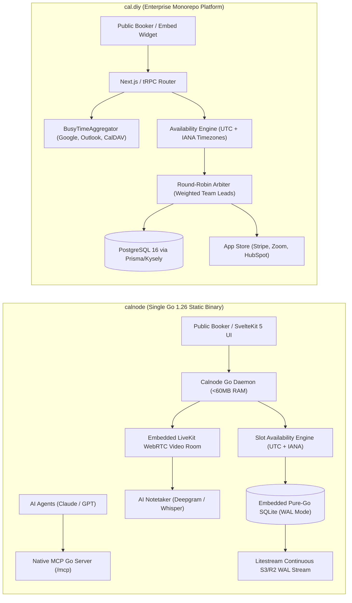

# calnode — Comparative Analysis & Category Evaluation

> **Category**: Appointment Scheduling & Calendar Engines  
> **Architectural Role**: Single-binary Go scheduling engine, embedded SQLite with Litestream S3 replication, native LiveKit WebRTC & agent-native MCP calendar platform  
> **Primary Stack**: Go 1.26 | Embedded SvelteKit 5 (Go embed.FS) | Pure-Go SQLite (WAL mode) | Litestream S3 Sync | LiveKit WebRTC | Official MCP Go SDK  
> **Peer Solutions Compared**: `cal.diy`  
> **Commercial SaaS Benchmarks**: Calendly, Cal.com Cloud, Acuity Scheduling, Zoom Meetings  

---

## 1. Executive Overview & Technical Identity: calnode

**calnode** represents the modern, ultra-lean systems tier within the **Appointment Scheduling & Calendar Engines** domain. Engineered in **Go 1.26** with an embedded **pure-Go SQLite** database and embedded SvelteKit 5 frontend, Calnode is designed as a direct architectural counterpoint to sprawling, resource-intensive scheduling monoliths like Cal.com and Calendly. Calnode compiles into a **single static binary** that requires zero external runtime dependencies—no Redis broker, no PostgreSQL cluster, no Node.js runtime, and no multi-gigabyte container orchestration.

Calnode is purpose-built for modern agentic and AI-augmented workflows:
1. **Agent-Native Model Context Protocol (MCP)**: Natively incorporates an official Go MCP server supporting both stdio and Streamable HTTP transports, allowing autonomous AI agents (Claude, ChatGPT, MarketingStudio bots) to inspect host availability, book appointments, and retrieve post-call meeting transcripts programmatically.
2. **Native WebRTC Video & AI Meeting Intelligence**: Rather than redirecting users to third-party Zoom or Google Meet URLs, Calnode provisions in-browser WebRTC video meeting rooms powered by LiveKit. Upon call completion, an integrated AI notetaker automatically transcribes call audio via Whisper/Deepgram and generates structured summaries and action items without third-party bot intrusions.
3. **Continuous Disaster Recovery via Litestream**: Solves SQLite high-availability and backup concerns through continuous, streaming WAL (Write-Ahead Log) replication directly to S3-compatible object storage (Cloudflare R2, AWS S3, MinIO) with sub-second RPO.

### Core Architectural Profile
- **Runtime & Language**: `Go 1.26 (Compiled static single binary, <60MB RAM footprint)`
- **Core Framework**: `Go standard library HTTP / Chi router, SvelteKit 5 admin UI embedded via embed.FS`
- **Persistence Layer**: `Embedded pure-Go SQLite 3 (WAL mode, sqlc prepared queries, goose migrations)`
- **Disaster Recovery**: `Litestream continuous streaming WAL replication directly to S3 / Cloudflare R2`
- **Video & Media Engine**: `Embedded LiveKit WebRTC gateway + Deepgram / Whisper AI transcription pipeline`
- **AI Agent Interface**: `Native Model Context Protocol (MCP) server built with the official Go SDK`

---

## 2. Peer Solution Landscape (Appointment Scheduling & Calendar Engines)

Within this category, `calnode` operates alongside the following peer solutions:

| Solution | Language & Runtime | Core Framework | Database / Cache | Video Meeting Mechanism | Primary Architectural Niche |
| :--- | :--- | :--- | :--- | :--- | :--- |
| **calnode** (Current) | `Go 1.26` | `SvelteKit 5 (Embedded), Chi`| `Embedded Pure-Go SQLite` | `Native LiveKit WebRTC + AI Notetaker` | **Zero-dependency single static binary, Litestream S3 sync & native MCP server** |
| **cal.diy** | `TypeScript 5+ / Node` | `Next.js, tRPC` | `PostgreSQL 16+, Redis` | `Modular App Store (Zoom, Meet, Cal Video)` | Enterprise multi-host round-robin routing & 50+ App Store integrations |

---

## 3. Deep Head-to-Head Comparative Breakdown: calnode vs Peers

### 3.1. calnode vs. cal.diy

**Comparative Focus**: `Single-Binary Go Engine with Litestream & LiveKit` vs. `Enterprise TypeScript Monorepo & Multi-Host Round-Robin`

#### Detailed Architectural Contrast
- **Operational Footprint & Simplicity**: `calnode` is packaged as a single static Go binary with the SvelteKit 5 frontend embedded via Go `embed.FS` and all data stored in an embedded SQLite database. It boots in under 50 milliseconds, consumes **< 60 MB of RAM**, and requires zero external Docker containers. In contrast, `cal.diy` is a Turborepo monorepo requiring Node.js 20+, a PostgreSQL database, a Redis cache cluster, and multiple containerized processes, consuming **1.5 GB to 2.5 GB of RAM**.
- **Media & AI Meeting Intelligence**: `calnode` includes a built-in LiveKit WebRTC video gateway, generating in-browser video meeting rooms upon booking confirmation without sending attendees to third-party software. Upon call completion, its integrated AI notetaker automatically transcribes the audio via Whisper/Deepgram and generates structured summaries and tasks without external meeting bots. `cal.diy` coordinates booking slots but delegates video calls to external providers (Zoom, Google Meet) via App Store plugins.
- **Continuous Disaster Recovery via Litestream**: `calnode` eliminates SQLite durability risks by integrating Litestream, which streams SQLite WAL (Write-Ahead Log) frame changes continuously to S3 or Cloudflare R2 object storage. If the server crashes, Calnode restores the database state in seconds with sub-second RPO. `cal.diy` relies on conventional PostgreSQL database replica sets and backup pipelines.
- **AI Agent Readiness (Model Context Protocol)**: `calnode` includes a native Model Context Protocol (MCP) server built with the official Go SDK, allowing LLM agents (Claude, ChatGPT, MarketingStudio bots) to programmatically inspect calendars, book appointments, and retrieve call transcripts over stdio or Streamable HTTP. `cal.diy` provides traditional REST API v2 and webhook interfaces.
- **Team Routing Topologies**: `cal.diy` excels at complex enterprise team scheduling: weighted round-robin lead distribution across sales reps, collective multi-host scheduling, and hierarchical managed organizational templates. `calnode` focuses on streamlined individual, small team, and AI agent scheduling.

#### Architectural Comparison Matrix: calnode vs. cal.diy

| Dimension | calnode | cal.diy | Architectural Implication |
| :--- | :--- | :--- | :--- |
| **Operational Overhead** | **Single Static Go Binary** (<60 MB RAM); zero dependencies | **Sprawling Monorepo** (1.5–2.5 GB RAM); Node, Postgres, Redis | Calnode runs on a 512MB VPS; Cal.diy requires multi-container cluster hosting. |
| **Video Meeting Mechanism** | **Native Embedded LiveKit WebRTC** | **External Providers** (Zoom, Meet, Cal Video via App Store) | Calnode eliminates third-party video conferencing subscriptions and software installs. |
| **Meeting AI & Notetaking** | **Integrated Whisper / Deepgram Transcription** | **External Meeting Bots Required** | Calnode generates automated meeting summaries and tasks directly within the engine. |
| **Disaster Recovery** | **Litestream Continuous S3/R2 WAL Streaming** | **Managed PostgreSQL Replication** | Calnode provides zero-maintenance streaming cloud backups for embedded SQLite. |
| **AI / Agent Interface** | **Native Built-In MCP Server (Go SDK)** | **REST API v2 & Webhooks** | Calnode allows AI agents to inspect calendars and book meetings via standard MCP. |
| **Enterprise Team Routing** | **Basic Team Routing** | **Advanced Weighted Round-Robin & Collective** | Cal.diy is engineered for multi-rep B2B sales teams and complex inbound lead distribution. |
| **Integrations Ecosystem** | **Focused Core Integrations** | **Modular App Store (50+ Integrations)** | Cal.diy integrates seamlessly with Salesforce, HubSpot, Stripe, and PayPal. |

---

## 4. Capability & Feature Comparison Matrix

| Dimension / Capability | calnode | cal.diy | Calendly |
| :--- | :---: | :---: | :---: |
| **Single Static Binary Deployment** | ✅ (<60MB RAM) | ❌ | ❌ |
| **Native Embedded WebRTC Video** | ✅ Native LiveKit | ⚠️ Cal Video / Apps | ❌ |
| **Integrated AI Call Transcription**| ✅ Whisper / Deepgram | ❌ | ❌ |
| **Native Model Context Protocol (MCP)**| ✅ Built-in Go SDK | ⚠️ Via API | ❌ |
| **Continuous Litestream S3 Sync** | ✅ Native | ❌ (PostgreSQL) | ❌ |
| **Team Round-Robin Lead Routing** | ⚠️ Basic | ✅ Advanced Weighted | ✅ Native |
| **Collective Multi-Host Availability** | ⚠️ Basic | ✅ Native | ✅ Native |
| **App Store (50+ Integrations)** | ❌ Focused | ✅ Comprehensive | ✅ Broad |
| **Primary Database** | Embedded SQLite (WAL) | PostgreSQL 16+ & Redis | Cloud Managed |
| **License** | **Apache-2.0** | AGPL-3.0 | Closed SaaS |

---

## 5. Commercial Benchmark Positioning & MarketingStudio Fit

- **Against Calendly & Zoom**: `calnode` merges scheduling with WebRTC video conferencing and AI meeting transcription into a single lightweight binary, eliminating two separate subscription bills.
- **Against Cal.com Cloud**: `calnode` provides an ultra-minimal deployment footprint suitable for edge nodes, local workstations, or low-cost VPS instances without container orchestration overhead.
- **MarketingStudio Synergy**: `calnode` is the designated outbound SDR and agentic meeting scheduling engine in MarketingStudio. Autonomous agents can book prospect demos, conduct calls in native LiveKit video rooms, and ingest transcribed meeting notes directly into CRM deal records via MCP.
