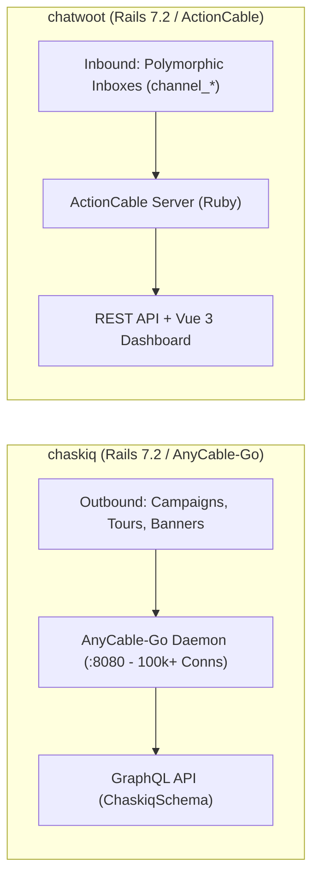
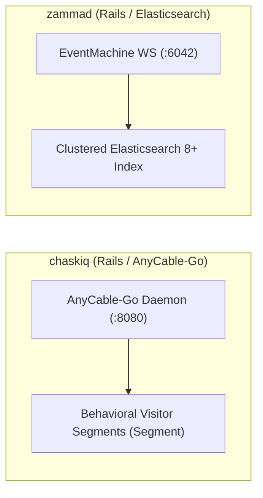
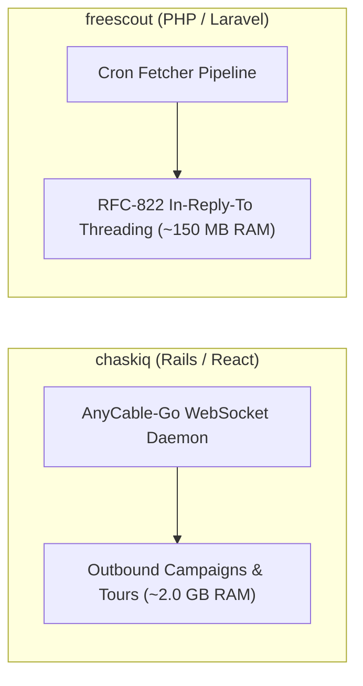
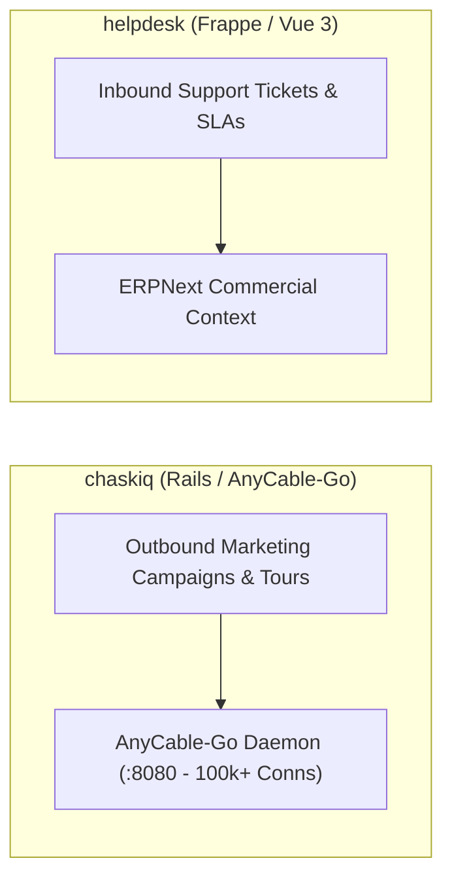
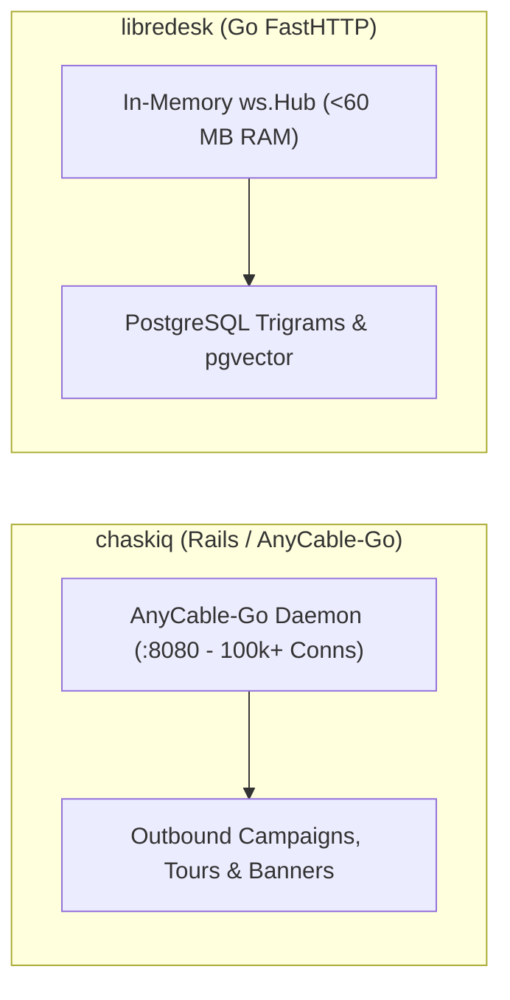
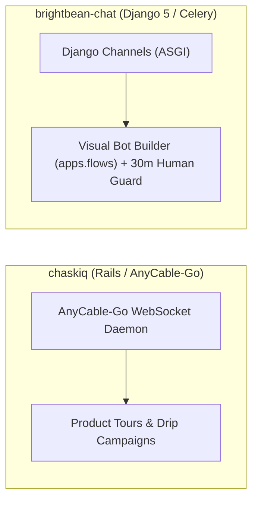

# chaskiq — Comparative Analysis & Category Evaluation

> **Category**: Omnichannel Helpdesk & Support  
> **Architectural Role**: Conversational marketing, visitor engagement & Intercom alternative  
> **Primary Stack**: Ruby 3.3.5+, Node.js 20+ | Rails 7.2, React 18, GraphQL | PostgreSQL 14+, Redis, Nightfury | Sidekiq + AnyCable-Go WS  
> **Peer Solutions Compared**: `chatwoot`, `zammad`, `freescout`, `helpdesk`, `libredesk`, `brightbean-chat`  
> **Commercial SaaS Benchmarks**: Intercom, Drift, Crisp, HubSpot Service Hub, Front  

---

## 1. Executive Overview & Technical Identity: chaskiq

**chaskiq** represents the conversational marketing and customer engagement standard within the **Omnichannel Helpdesk & Support** domain, distinguished by its core focus on **Intercom-style proactive tours, behavioral segmentation, outbound campaigns, and AnyCable-Go WebSocket scaling (100k+ concurrent connections)**.

### Core Architectural Profile
- **Runtime & Language**: `Ruby 3.3.5+` (Rails 7.2 / Puma), `Node.js 20+` (esbuild / React 18)
- **Core Framework**: `Rails 7.2`, `GraphQL Ruby` (`ChaskiqSchema`), `React 18`, `Apollo Client`, `Tailwind CSS`
- **Persistence Layer**: `PostgreSQL 14+` (extensive JSONB `properties`), `Redis 7+` (`kredis`), `Nightfury` (time-series metrics)
- **Concurrency & Queue Model**: `Sidekiq` (multi-queue campaign dispatch) + `AnyCable-Go` (Go WebSocket daemon on port 8080 via gRPC)
- **Domain Specialization**: `Conversational marketing, interactive product tours, in-app banners & outbound drip sequences`

---

## 2. Peer Solution Landscape (Omnichannel Helpdesk & Support)

Within this category, `chaskiq` operates alongside the following peer solutions:

| Solution | Language & Runtime | Core Framework | Database / Cache | Queue / Concurrency | Primary Architectural Niche |
| :--- | :--- | :--- | :--- | :--- | :--- |
| **chaskiq** (Current) | `Ruby 3.3.5+, Node 20+` | `Rails 7.2, React 18` | `PostgreSQL, Redis, Nightfury` | `Sidekiq + AnyCable-Go WS` | **Intercom-style proactive tours, campaigns & outbound messages** |
| **chatwoot** | `Ruby 3.4+` | `Rails 7.2, Vue 3` | `PostgreSQL 14+, Redis` | `Sidekiq + ActionCable` | Polymorphic multi-channel inbox & real-time live chat |
| **zammad** | `Ruby 3.4+` | `Rails 8.1, TypeScript` | `PostgreSQL/MySQL + Elastic 8+` | `Delayed::Job + EventMachine WS` | Enterprise ITIL ticketing, dynamic Object Manager & audit trails |
| **freescout** | `PHP 8.1-8.3` | `Laravel 5.5 LTS, Blade` | `MySQL 8+ / MariaDB / Postgres` | `Laravel Queue / CLI Cron` | Low-overhead shared email inboxes with modular add-ons |
| **helpdesk** | `Python 3.10+, Node 20+`| `Frappe Framework v15, Vue 3`| `MariaDB, Redis, SQLite` | `Python RQ + Node Socket.io` | SLA policies & seamless integration with Frappe/ERPNext apps |
| **libredesk** | `Go 1.25+` | `FastHTTP, Fastglue` | `PostgreSQL 15+, pgvector` | `Native Goroutines + FastHTTP WS` | Sub-60MB RAM footprint with compiled high-concurrency Go |
| **brightbean-chat** | `Python 3.11+, Node 20+`| `Django 5, Django Ninja` | `PostgreSQL 15+, Redis` | `Celery + Django Channels` | Multi-tenant visual flow automation with human-takeover contract |

---

## 3. Deep Head-to-Head Comparative Breakdown: chaskiq vs Peers

### 3.1. chaskiq vs. chatwoot

**Comparative Focus**: `Conversational marketing & AnyCable-Go scale` vs. `Support-centric omnichannel inbox`

#### Architectural & Stack Differences
- **Core Domain Objective**: Chatwoot focuses primarily on inbound customer support triage, agent routing, and SLA compliance. Chaskiq is engineered as a direct Intercom alternative, unifying inbound support with **Conversational Marketing**: outbound marketing drip campaigns (`Campaign`), targeted in-app announcements (`Banner`), and interactive onboarding walkthroughs (`Tour`).
- **WebSocket Scalability Tier**: Chatwoot uses standard Rails ActionCable over Redis Pub/Sub, where connection threads run in Ruby processes. Chaskiq decouples the WebSocket connection tier using **AnyCable-Go** (port 8080), offloading persistent visitor connections to a compiled Go daemon handling 100,000+ concurrent connections while communicating with Rails via gRPC (`ActionCableRPC`).
- **API & Data Representation**: Chatwoot exposes a traditional REST API. Chaskiq is built around a comprehensive **GraphQL API** (`ChaskiqSchema`) with Apollo Client on React 18, utilizing `nightfury` in Redis for granular hourly message delivery analytics.

#### Where chaskiq Excels over chatwoot
- **Outbound Marketing & Product Tours**: Interactive UI walkthroughs and targeted marketing email sequences.
- **AnyCable WebSocket Scalability**: Effortlessly handles massive live-chat visitor traffic on high-traffic web applications with negligible memory overhead.
- **Behavioral Audience Segmentation**: Evaluates dynamic visitor segments (`Segment`) in real time using client session attributes and geolocation.

#### Where chatwoot Holds an Advantage over chaskiq
- **Deep Omnichannel Ingress**: Mature out-of-the-box connectors for WhatsApp Business Cloud API, Instagram, SMS, and Line.
- **Agent Workload Triage**: Robust round-robin auto-assignment algorithms (`AutoAssignment::InboxRoundRobinService`) and agent capacity limits.
- **Enterprise Helpdesk Workflows**: Multi-tier SLA breach tracking and automated CSAT surveys.

#### Architectural Tradeoffs Matrix

| Architectural Dimension | chaskiq | chatwoot |
| :--- | :--- | :--- |
| **Primary Domain Focus** | Conversational marketing & product tours | Omnichannel support & shared inbox |
| **WebSocket Engine** | **AnyCable-Go (Go gRPC daemon, 100k+ conns)** | Rails ActionCable (Ruby thread pool) |
| **Frontend Architecture** | React 18, Apollo Client (GraphQL), esbuild | Vue.js 3, Vite, TailwindCSS |
| **Outbound Campaigns** | Native email campaigns, in-app tours & banners | Basic transactional templates |
| **Audience Segments** | Dynamic behavioral segments (`Segment`) | Contact tags and custom attributes |
| **API Architecture** | GraphQL Schema (`ChaskiqSchema`) | RESTful Controllers (ActiveRecord) |
| **Best-Fit Deployment** | Product-led growth SaaS, visitor onboarding | Multi-channel customer support desks |

---

### 3.2. chaskiq vs. zammad

**Comparative Focus**: `Conversational marketing & AnyCable-Go` vs. `ITIL ticketing & audit compliance`

#### Architectural & Stack Differences
- **Functional Paradigm**: Zammad is an ITIL support ticketing system designed to track SLAs, resolve customer bugs, and maintain audit compliance. Chaskiq is a conversational marketing suite (Intercom clone) focused on acquiring leads, launching in-app product tours (`Tour`), and dispatching targeted marketing campaigns (`Campaign`).
- **Real-Time WebSocket Tier**: Zammad uses `em-websocket` (port 6042) for internal agent collaboration and shared drafts. Chaskiq uses **AnyCable-Go** (port 8080) communicating via gRPC to Rails, allowing it to sustain over 100,000 simultaneous persistent visitor socket connections.
- **Search & Persistence**: Zammad mandates an Elasticsearch cluster for full-text retrieval. Chaskiq uses PostgreSQL JSONB and Redis `nightfury` time-series metrics.

#### Where chaskiq Excels over zammad
- **Outbound Marketing & Product Tours**: Interactive UI walkthroughs and targeted marketing drip campaigns.
- **Massive Visitor Concurrency**: AnyCable-Go effortlessly handles viral traffic spikes on public website widgets.
- **Behavioral Audience Targeting**: Automatically triggers messages based on real-time visitor event tracking.

#### Where zammad Holds an Advantage over chaskiq
- **ITIL Support & SLA Escalations**: Comprehensive response time guarantees, escalation warnings, and business calendar calculations.
- **Clustered Search Speed**: Instant full-text search across large enterprise ticket archives via Elasticsearch.
- **Telephony & Email Multi-Channel Power**: Deep CTI PBX integration and sophisticated Postmaster mail filtering.

#### Architectural Tradeoffs Matrix

| Architectural Dimension | chaskiq | zammad |
| :--- | :--- | :--- |
| **Primary Domain Focus** | Conversational marketing & product tours | Enterprise ITIL ticketing & governance |
| **WebSocket Engine** | **AnyCable-Go (Go gRPC daemon, 100k+ conns)** | EventMachine daemon (`em-websocket`) |
| **Search Mechanism** | PostgreSQL JSONB queries | Elasticsearch 8+ Cluster |
| **Outbound Capabilities** | Drip campaigns, in-app tours, popup banners | Notification emails & auto-replies |
| **Audience Segmentation** | Real-time behavioral segments (`Segment`) | Organization and user groups |
| **Best-Fit Deployment** | SaaS onboarding, product-led growth marketing | Formal customer service & IT service desks |

---

### 3.3. chaskiq vs. freescout

**Comparative Focus**: `Conversational marketing & AnyCable-Go` vs. `Inbound email shared mailbox`

#### Architectural & Stack Differences
- **Functional Paradigm**: FreeScout is dedicated to inbound customer support email management. Chaskiq is a conversational marketing suite (Intercom clone) that unites inbound live chat with outbound email marketing campaigns (`Campaign`), in-app popup banners (`Banner`), and interactive product walkthroughs (`Tour`).
- **WebSocket Scale**: FreeScout relies on HTTP polling. Chaskiq offloads WebSockets to **AnyCable-Go** (port 8080), supporting over 100,000 concurrent visitor connections.
- **Resource Footprint**: FreeScout consumes ~150 MB RAM on a basic LAMP/LEMP virtual server. Chaskiq requires ~2.0 GB RAM to run Rails, Puma, Sidekiq, Redis, and AnyCable-Go.

#### Where chaskiq Excels over freescout
- **Outbound Marketing & Product Tours**: Interactive onboarding tours and targeted marketing email sequences.
- **Massive Webchat Concurrency**: AnyCable-Go sustains viral live chat visitor traffic with minimal CPU.
- **Behavioral Visitor Segmentation**: Dynamic audience segments (`Segment`) triggered by real-time user events.

#### Where freescout Holds an Advantage over chaskiq
- **Resource Footprint**: Consumes ~150 MB RAM compared to Chaskiq's ~2.0 GB RAM footprint.
- **Dedicated Email Workflow**: Superior RFC-822 header threading and collision prevention for pure email support.
- **Operational Simplicity**: Simple PHP/MySQL deployment with zero Redis or gRPC daemon requirements.

#### Architectural Tradeoffs Matrix

| Architectural Dimension | chaskiq | freescout |
| :--- | :--- | :--- |
| **Primary Domain Focus** | Conversational marketing & product tours | Inbound shared email support |
| **Frontend Architecture** | React 18 SPA + Apollo GraphQL | Server-rendered Blade + jQuery |
| **Real-Time Engine** | AnyCable-Go WebSocket daemon (port 8080) | HTTP Polling / Pusher |
| **Outbound Marketing** | Drip campaigns, in-app tours, popups | None (Support email only) |
| **Base Production RAM** | ~2,000 MB RAM | **~150 MB RAM** |
| **Best-Fit Deployment** | SaaS companies focused on growth, activation & tours| Support teams focused exclusively on email |

---

### 3.4. chaskiq vs. helpdesk (Frappe)

**Comparative Focus**: `Conversational marketing, tours & AnyCable-Go` vs. `ERP commercial ticketing`

#### Architectural & Stack Differences
- **Operational Objective**: Chaskiq is engineered for conversational marketing: acquiring visitors via live chat, running onboarding product tours (`Tour`), and dispatching targeted marketing campaigns (`Campaign`). Frappe Helpdesk is designed for resolving inbound customer support issues while inspecting commercial ERP orders.
- **WebSocket Scale**: Chaskiq uses **AnyCable-Go** (port 8080), sustaining over 100,000 simultaneous persistent visitor socket connections with minimal CPU. Frappe Helpdesk uses Node.js Socket.io for internal agent collaboration.
- **API & Data Representation**: Chaskiq is built on Apollo GraphQL (`graphql-ruby`) with React 18. Frappe Helpdesk exposes whitelisted Python RPC endpoints.

#### Where chaskiq Excels over helpdesk
- **Outbound Marketing & Product Tours**: Interactive UI walkthroughs and targeted drip campaigns.
- **AnyCable WebSocket Scalability**: Effortlessly handles viral traffic spikes on public website widgets.
- **Dynamic Audience Segmentation**: Evaluates real-time visitor attributes and geolocation via `Segment`.

#### Where helpdesk Holds an Advantage over chaskiq
- **Deep ERP Commercial Visibility**: Agents see customer billing, order fulfillment, and warranty claims directly inside the ticket.
- **Enterprise SLA Hold-Time Logic**: Sophisticated SLA tracking with calendar awareness and hold-time pausing.
- **Team Load Balancing**: Automated team queues (`HD Team`) and round-robin agent assignment rules.

#### Architectural Tradeoffs Matrix

| Architectural Dimension | chaskiq | helpdesk (Frappe) |
| :--- | :--- | :--- |
| **Primary Domain Focus** | Conversational marketing & product tours | Commercial ERP customer ticketing |
| **Real-Time Engine** | **AnyCable-Go (Go gRPC daemon, 100k+ conns)** | Standalone Node.js Socket.io server |
| **Commercial Context** | External CRM webhooks | Direct native DocType access (ERPNext) |
| **Outbound Capabilities** | Drip campaigns, in-app tours, popup banners | Notification emails & auto-replies |
| **Base Production RAM** | ~2,000 MB RAM | ~500 MB - 1 GB RAM |
| **Best-Fit Deployment** | Product-led growth SaaS, visitor onboarding | B2B, wholesale, manufacturing on ERPNext |

---

### 3.5. chaskiq vs. libredesk

**Comparative Focus**: `Conversational marketing, tours & AnyCable-Go` vs. `Compiled Go support engine`

#### Architectural & Stack Differences
- **Operational Objective**: Chaskiq is engineered for conversational marketing: acquiring visitors via live chat, running onboarding product tours (`Tour`), and dispatching targeted marketing campaigns (`Campaign`). LibreDesk is focused on high-throughput support ticketing and fast agent triage.
- **WebSocket Architecture**: Chaskiq uses **AnyCable-Go** (port 8080) as a standalone daemon communicating via gRPC to Rails controllers. LibreDesk embeds an in-memory WebSocket hub (`ws.Hub`) directly inside its single Go binary.
- **API Architecture**: Chaskiq uses an Apollo GraphQL schema (`ChaskiqSchema`) with React 18. LibreDesk uses FastHTTP REST endpoints.

#### Where chaskiq Excels over libredesk
- **Outbound Marketing & Product Tours**: Interactive UI walkthroughs and targeted marketing email sequences.
- **Massive Webchat Concurrency**: AnyCable-Go sustains viral live chat visitor traffic with minimal CPU.
- **Behavioral Audience Targeting**: Automatically triggers messages based on real-time visitor event tracking (`Segment`).

#### Where libredesk Holds an Advantage over chaskiq
- **30x Lower Memory Footprint**: Less than 60 MB RAM vs ~2.0 GB RAM.
- **Single-Binary Simplicity**: No external Node.js, Redis, or gRPC daemon dependencies.
- **Native Vector AI Copilot**: Direct PostgreSQL `pgvector` integration for instant automated knowledge retrieval.

#### Architectural Tradeoffs Matrix

| Architectural Dimension | chaskiq | libredesk |
| :--- | :--- | :--- |
| **Primary Domain Focus** | Conversational marketing & product tours | High-performance compiled support engine |
| **WebSocket Architecture**| Standalone AnyCable-Go daemon via gRPC | In-memory `ws.Hub` in single Go binary |
| **Outbound Capabilities** | Drip campaigns, in-app tours, popup banners | Transactional replies & auto-assign |
| **Frontend Architecture** | React 18 SPA + Apollo GraphQL | React / Vite SPA |
| **Base Production RAM** | ~2,000 MB RAM | **< 60 MB RAM** |
| **Best-Fit Deployment** | Product-led growth SaaS, visitor onboarding | High-concurrency cloud-native backends, micro-nodes |

---

### 3.6. chaskiq vs. brightbean-chat

**Comparative Focus**: `Conversational marketing & AnyCable-Go` vs. `Visual flow automation & human takeover contract`

#### Architectural & Stack Differences
- **Marketing Automation Paradigm**: Chaskiq focuses on user onboarding tours (`Tour`) and event-driven email campaigns (`Campaign`) based on audience segments. Brightbean-Chat focuses on visual drag-and-drop conversational bot decision trees (`apps.flows`) across WhatsApp and live chat.
- **Human-Takeover Contract**: Brightbean-Chat enforces a strict 30-minute automation suppression timer (`automation_paused_until`) when a human agent sends a message. Chaskiq relies on bot task state transitions.
- **Real-Time Tier**: Chaskiq utilizes AnyCable-Go offloading 100k+ connections. Brightbean-Chat utilizes standard Django Channels with Redis channel layers.

#### Where chaskiq Excels over brightbean-chat
- **Interactive In-App Product Tours**: Guide users through UI elements with step-by-step visual highlights.
- **AnyCable WebSocket Scaling**: Handle massive public visitor traffic without degrading Rails performance.
- **Unified GraphQL Schema**: High developer velocity for complex frontend interactions.

#### Where brightbean-chat Holds an Advantage over chaskiq
- **Visual Drag-and-Drop Bot Builder**: Non-technical team members can visually design complex chatbot flows.
- **Deterministic Human-Takeover Guard**: Eliminates bot interference during live human customer conversations.
- **Outbound Pacing Limiter**: Built-in `SendBucket` token-bucket rate limiter prevents WhatsApp bans during bulk campaigns.

#### Architectural Tradeoffs Matrix

| Architectural Dimension | chaskiq | brightbean-chat |
| :--- | :--- | :--- |
| **Primary Domain Focus** | Conversational marketing & product tours | Visual chatbot automation & shared inbox |
| **Backend Architecture** | Ruby on Rails 7.2 / AnyCable-Go | Python 3.11 / Django 5 (ASGI) / Celery |
| **Bot Automation Engine** | Multi-step `BotTask` & quick replies | Native visual flow graph (`apps.flows`) |
| **Human Takeover** | Bot status toggle | Deterministic 30-min pause (`automation_paused_until`)|
| **Outbound Pacing** | Handled in background Sidekiq jobs | Token-bucket rate limiter (`SendBucket`) |
| **Best-Fit Deployment** | Product-led growth SaaS, visitor onboarding | Marketing lead generation, automated WhatsApp bots|

---

## 4. Capability & Feature Comparison Matrix

| Dimension / Capability | chaskiq | chatwoot | zammad | freescout | helpdesk | libredesk | brightbean-chat |
| :--- | :---: | :---: | :---: | :---: | :---: | :---: | :---: |
| **Primary Architectural Niche** | **Intercom-style proactive tours & AnyCable** | Polymorphic multi-channel inbox & live chat | Elasticsearch ITIL ticketing & dynamic schema | Low-overhead shared email inboxes | SLA policies & ERPNext commercial context | Sub-60MB RAM footprint with Go binary | Visual flow automation & human-takeover contract |
| **Runtime Language** | `Ruby 3.3+` | `Ruby 3.4+` | `Ruby 3.4+` | `PHP 8.1+` | `Python / JS` | `Go 1.25+` | `Python 3.11+` |
| **Database Persistence** | `PostgreSQL, Redis` | `PostgreSQL, Redis` | `PostgreSQL/MySQL + Elastic` | `MySQL / MariaDB` | `MariaDB, Redis` | `PostgreSQL, pgvector`| `PostgreSQL, Redis` |
| **Real-Time Streaming** | AnyCable-Go Daemon | ActionCable WebSockets | EventMachine WebSockets | HTTP Polling / Pusher | Node.js Socket.io | Native Go FastHTTP WS | Django Channels (ASGI) |
| **Search Engine Engine** | PostgreSQL JSONB | PostgreSQL GIN Trigrams | Elasticsearch 8+ Cluster | MySQL B-Tree Indexes | SQLite Local Cache | PostgreSQL Trigrams | PostgreSQL Indexes |
| **Base Production RAM** | ~2.0 GB RAM | ~2.5 GB RAM | ~3.5 GB RAM | **~150 MB RAM** | ~500 MB RAM | **< 60 MB RAM** | ~350 MB RAM |

---

## 5. Commercial Benchmark Positioning

When benchmarked against commercial SaaS leaders (**Intercom, Drift, Crisp, HubSpot Service Hub, Front**):
- **Against Intercom**: `chaskiq` is one of the few open-source solutions that directly matches Intercom's outbound marketing tours, in-app banners, and behavioral visitor segmentation, eliminating Intercom's steep contact-tier pricing.
- **Against Drift**: Chaskiq provides automated conversational bot triage (`BotTask`) and visitor qualification without enterprise contract minimums.
- **Against Crisp**: While Crisp is known for its lightweight messenger, Chaskiq's AnyCable-Go architecture allows self-hosted deployments to achieve equivalent high-concurrency visitor scale.

---

## 6. Strategic Takeaways & Role for MarketingStudio

In the unified **MarketingStudio** architecture:
1. **Primary Component to Adopt**: Harvest Chaskiq's **Interactive Product Tour (`Tour`) and In-App Banner (`Banner`) Engine** to guide new MarketingStudio users through onboarding flows.
2. **Incorporate AnyCable-Go Architecture**: Adopt the AnyCable pattern to offload high-concurrency public live-chat widgets from the main application backend.
3. **Reference Behavioral Audience Segmentation**: Utilize Chaskiq's `Segment` model for targeting in-app messaging based on real-time user event properties.
