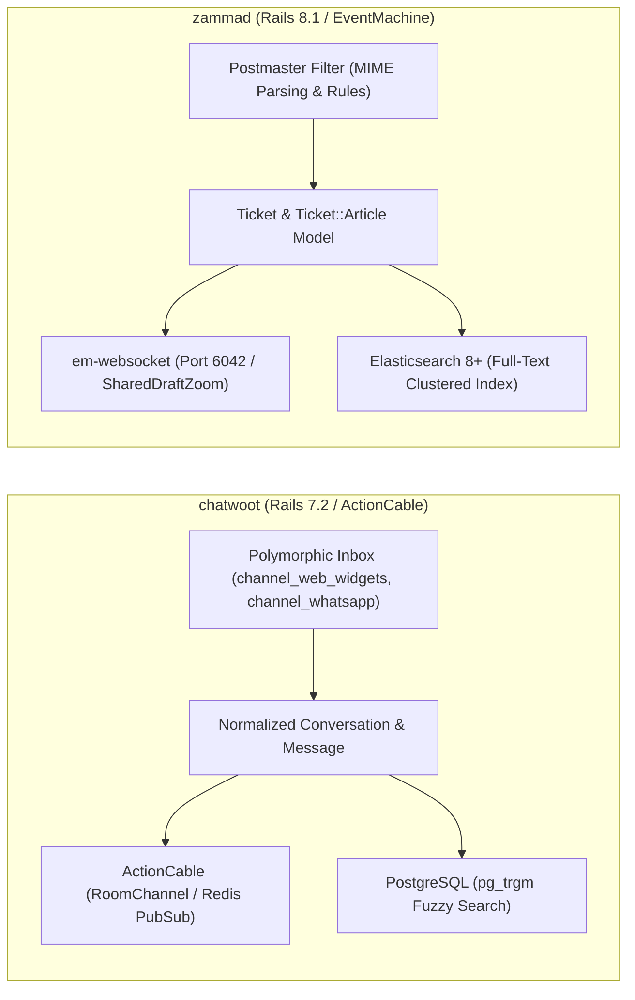
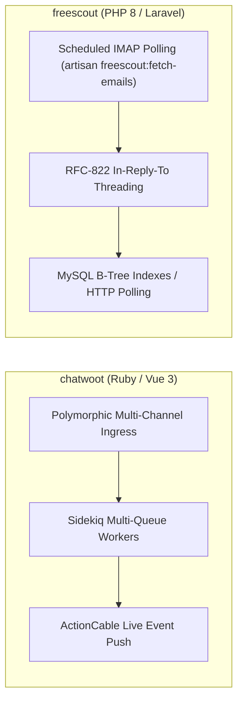
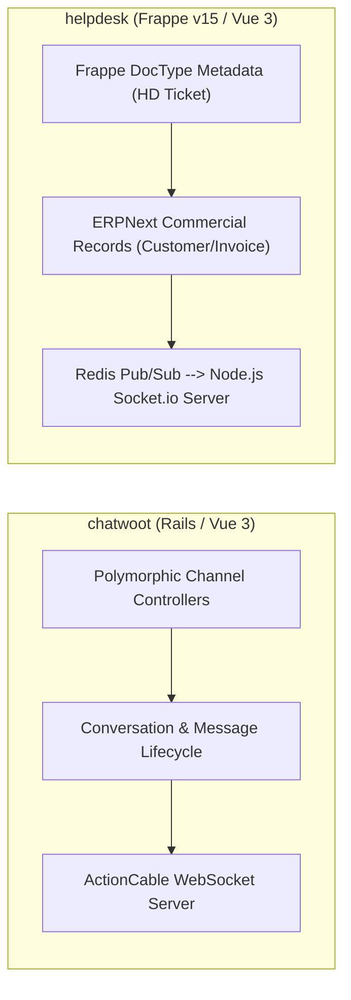
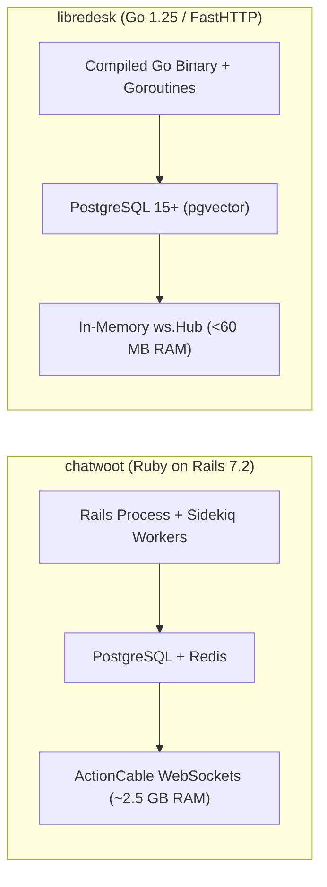
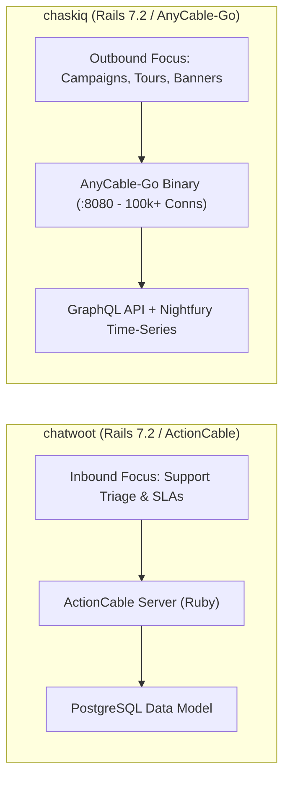
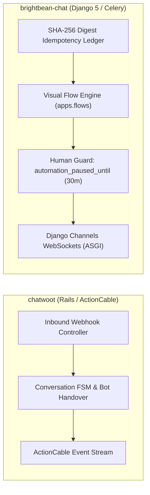

# chatwoot — Comparative Analysis & Category Evaluation

> **Category**: Omnichannel Helpdesk & Support  
> **Architectural Role**: Omnichannel customer engagement & shared inbox multiplexer  
> **Primary Stack**: Ruby 3.4+ | Rails 7.2, Vue.js 3 | PostgreSQL 14+, Redis 7+ | Sidekiq + ActionCable  
> **Peer Solutions Compared**: `zammad`, `freescout`, `helpdesk`, `libredesk`, `chaskiq`, `brightbean-chat`  
> **Commercial SaaS Benchmarks**: Intercom, Zendesk, Help Scout, Front, Freshdesk, Respond.io  

---

## 1. Executive Overview & Technical Identity: chatwoot

**chatwoot** represents a specialized implementation within the **Omnichannel Helpdesk & Support** domain, distinguished by its core focus on **Polymorphic multi-channel inbox multiplexing and real-time conversational engagement**.

### Core Architectural Profile
- **Runtime & Language**: `Ruby 3.4+` (Rails 7.2 API & ActionCable)
- **Core Framework**: `Rails 7.2`, `Vue.js 3`, `Vite`
- **Persistence Layer**: `PostgreSQL 14+` (`pg_trgm` GIN trigrams, JSONB), `Redis 7+` (Sorted Sets, Presence)
- **Concurrency & Queue Model**: `Sidekiq` (multi-threaded queue pools) + `ActionCable` (Redis Pub/Sub)
- **Domain Specialization**: `Omnichannel customer engagement & shared inbox`

---

## 2. Peer Solution Landscape (Omnichannel Helpdesk & Support)

Within this category, `chatwoot` operates alongside the following peer solutions:

| Solution | Language & Runtime | Core Framework | Database / Cache | Queue / Concurrency | Primary Architectural Niche |
| :--- | :--- | :--- | :--- | :--- | :--- |
| **chatwoot** (Current) | `Ruby 3.4+` | `Rails 7.2, Vue 3` | `PostgreSQL 14+, Redis` | `Sidekiq + ActionCable` | **Polymorphic multi-channel inbox & real-time live chat** |
| **zammad** | `Ruby 3.4+` | `Rails 8.1, TypeScript` | `PostgreSQL/MySQL + Elastic 8+` | `Delayed::Job + EventMachine WS` | Enterprise ITIL ticketing, dynamic Object Manager & audit trails |
| **freescout** | `PHP 8.1-8.3` | `Laravel 5.5 LTS, Blade` | `MySQL 8+ / MariaDB / Postgres` | `Laravel Queue / CLI Cron` | Low-overhead shared email inboxes with modular add-ons |
| **helpdesk** | `Python 3.10+, Node 20+`| `Frappe Framework v15, Vue 3`| `MariaDB, Redis, SQLite` | `Python RQ + Node Socket.io` | SLA policies & seamless integration with Frappe/ERPNext apps |
| **libredesk** | `Go 1.25+` | `FastHTTP, Fastglue` | `PostgreSQL 15+, pgvector` | `Native Goroutines + FastHTTP WS` | Sub-60MB RAM footprint with compiled high-concurrency Go |
| **chaskiq** | `Ruby 3.3.5+, Node 20+` | `Rails 7.2, React 18` | `PostgreSQL, Redis, Nightfury` | `Sidekiq + AnyCable-Go WS` | Intercom-style proactive tours, campaigns & outbound messages |
| **brightbean-chat** | `Python 3.11+, Node 20+`| `Django 5, Django Ninja` | `PostgreSQL 15+, Redis` | `Celery + Django Channels` | Multi-tenant visual flow automation with human-takeover contract |

---

## 3. Deep Head-to-Head Comparative Breakdown: chatwoot vs Peers

### 3.1. chatwoot vs. zammad

**Comparative Focus**: `Polymorphic multi-channel live chat` vs. `Elasticsearch ITIL ticketing & dynamic schema management`

#### Architectural & Stack Differences
- **Channel Multiplexing & Ingress Processing**: Chatwoot relies on Active Record polymorphism (`Inbox.belongs_to :channel, polymorphic: true`), separating channel configurations into dedicated tables (`channel_web_widgets`, `channel_email`, `channel_whatsapp`, `channel_facebook_pages`). In contrast, Zammad utilizes an ITIL ticket model where all inbound communications (emails, phone calls via CTI, chat) are converted into `Ticket::Article` rows passing through `Channel::Filter::Postmaster`.
- **Real-Time WebSocket & Concurrency Architecture**: Chatwoot streams real-time updates via Rails `ActionCable` on `RoomChannel`, managing agent presence in Redis Sorted Sets (`OnlineStatusTracker`). Zammad offloads real-time transport from Rails Puma to a standalone `em-websocket` (EventMachine) daemon on port 6042, enabling its signature **Live Shared Draft** synchronization (`Ticket::SharedDraftZoom`) where agents see peer draft text updated in real time.
- **Database Schema, State Machine & Identity Merging**: Chatwoot isolates multi-tenancy strictly by `account_id` and implements `ContactMergeAction` to atomically reassign conversations, messages, and `ContactInbox` rows in a single PostgreSQL transaction. Zammad operates with an `ObjectManager` that dynamically injects custom schema attributes into `Ticket`, `User`, and `Organization` at runtime without DB migration downtime, enforcing ticket merges via immutable `Ticket::MergeHistory` logs and relying on mandatory **Elasticsearch 8+** for sub-millisecond search across millions of historical articles.

#### Where chatwoot Excels over zammad
- **Modern Conversational UX**: Designed for rapid, sub-second social messaging (WhatsApp, Instagram, WebChat) rather than cumbersome enterprise ticketing forms.
- **Simpler Infrastructure Footprint**: Runs on PostgreSQL and Redis without requiring a dedicated multi-gigabyte Elasticsearch JVM cluster.
- **Native Social & Messaging Connectors**: First-class support for Meta Graph APIs, Twilio WhatsApp, Telegram, Line, and direct API channels.

#### Where zammad Holds an Advantage over chatwoot
- **Enterprise ITIL Compliance & Audit Trails**: Unmatched ticket lifecycle tracking, time accounting per article, and granular role permissions.
- **Clustered Full-Text Search**: Instant search across millions of emails and raw MIME attachment bodies via Elasticsearch.
- **Zero-Downtime Dynamic Fields**: Object Manager allows administrators to create custom ticket attributes on the fly.

#### Architectural Tradeoffs Matrix

| Architectural Dimension | chatwoot | zammad |
| :--- | :--- | :--- |
| **Primary Paradigm** | Real-time conversational customer engagement | Enterprise ITIL ticketing & audit compliance |
| **Real-Time Engine** | Rails ActionCable (Redis Pub/Sub) | Standalone EventMachine WebSocket (`em-websocket :6042`) |
| **Search Subsystem** | PostgreSQL `pg_trgm` GIN Trigrams | Clustered Elasticsearch 8+ / OpenSearch |
| **Schema Extensibility** | Static migrations + JSONB custom attributes | Dynamic runtime `ObjectManager` without migrations |
| **Collision Prevention** | Redis typing indicators & viewing locks | Persistent WebSocket shared drafts (`SharedDraftZoom`) |
| **Base Production RAM** | ~2.5 GB RAM (Rails + Sidekiq) | ~3.5 - 5.0 GB RAM (Rails + DelayedJob + Elasticsearch) |
| **Best-Fit Deployment** | D2C brands, SaaS live chat, omnichannel messaging | Enterprise IT support, SLAs with complex business calendars |

---

### 3.2. chatwoot vs. freescout

**Comparative Focus**: `Polymorphic omnichannel suite` vs. `Ultra-lightweight PHP/Laravel shared mailbox`

#### Architectural & Stack Differences
- **Channel Multiplexing & Ingress Processing**: Chatwoot ingests real-time webhooks across 10+ distinct digital channels asynchronously via Sidekiq. FreeScout is designed around the shared email mailbox paradigm (`Mailbox`), polling IMAP/OAuth2 servers via a system cron (`php artisan freescout:fetch-emails`) and threading messages using RFC-822 headers (`In-Reply-To`, `References`) against `threads.message_id`. Non-email channels in FreeScout require optional commercial modules.
- **Real-Time WebSocket & Concurrency Architecture**: Chatwoot maintains persistent WebSocket connections for instant live chat and agent presence. FreeScout defaults to HTTP long-polling or external Pusher integration, prioritizing minimal server overhead over persistent socket infrastructure.
- **Database Schema, State Machine & Identity Merging**: Chatwoot features normalized `Contact` and `ContactInbox` entities with `ContactMergeAction`. FreeScout implements `Customer::mergeWith` directly in `app/Customer.php`, transferring conversation IDs and secondary email aliases across MySQL records within standard Eloquent models.

#### Where chatwoot Excels over freescout
- **True Omnichannel Ingress**: Native support for live webchat, WhatsApp Cloud, Instagram DMs, Telegram, and SMS out of the box.
- **Real-Time Collaboration**: Sub-second agent presence, live typing indicators, and unified multi-brand inboxes.
- **Extensible API First Design**: Fully documented REST and platform APIs for automated provisioning.

#### Where freescout Holds an Advantage over chatwoot
- **Ultra-Low Memory Footprint**: Runs comfortably on a \$5/month VPS with 512MB RAM and standard PHP-FPM / MySQL.
- **Dedicated Email Workflow Fidelity**: 1:1 replication of Help Scout's minimalist shared email workflows without conversational chat bloat.
- **Modular Add-On Architecture**: Over 50+ drop-in modules in `Modules/` that extend functionality without modifying core code.

#### Architectural Tradeoffs Matrix

| Architectural Dimension | chatwoot | freescout |
| :--- | :--- | :--- |
| **Primary Paradigm** | Omnichannel conversational hub | Email shared mailbox & ticket threading |
| **Real-Time Engine** | ActionCable WebSockets over Redis | HTTP Short-Polling / Pusher WebSockets |
| **Ingress Pipeline** | Push Webhooks & Sidekiq background jobs | Cron-based IMAP/POP3 fetch command (`fetch-emails`) |
| **Identity Model** | Decoupled `Contact` + `ContactInbox` | `Customer` with `CustomerEmail` aliases |
| **Base Production RAM** | ~2.5 GB RAM | **~150 MB RAM (LEMP Stack)** |
| **Operational Simplicity**| Moderate (Docker, Redis, Sidekiq, Postgres) | Very Simple (Standard PHP-FPM, MySQL) |
| **Best-Fit Deployment** | Multi-channel customer engagement & live chat | Lean support teams managing high-volume email inboxes |

---

### 3.3. chatwoot vs. helpdesk (Frappe)

**Comparative Focus**: `Conversational customer messaging` vs. `Metadata DocType ticketing deeply bound to ERPNext`

#### Architectural & Stack Differences
- **Channel Multiplexing & Ingress Processing**: Chatwoot normalizes inbound chat and email payloads into its custom schema. Frappe Helpdesk models everything as Frappe DocTypes (`HD Ticket`, `HD Ticket Comment`, `HD Ticket Activity`), integrating with Frappe's global email dispatcher and customer portal.
- **Real-Time WebSocket & Concurrency Architecture**: Chatwoot runs ActionCable natively inside Ruby. Frappe separates concerns: Python WSGI handles business logic and writes doc events to Redis, while an independent Node.js microservice (`helpdesk/realtime/index.js`) consumes Redis events and broadcasts them via Socket.io to Vue 3 SPA agents.
- **ERP Integration & SLA Logic**: Chatwoot tracks basic business-hour SLAs. Frappe Helpdesk features deep business calendar integration with **Hold-Time Clock Pausing**: when a ticket is marked *Waiting on Customer*, the SLA timer halts, recalculating `resolution_by` upon resumption. Furthermore, Frappe Helpdesk provides agents with instant access to ERPNext invoices, orders, and warranty ledgers.

#### Where chatwoot Excels over helpdesk
- **Public Website Live Chat SDK**: Chatwoot provides a pre-compiled, highly customizable embeddable web chat widget (`chatwoot-widget.js`) with proactive messages and conversational bot handoffs.
- **Social Media & Messaging Native Hooks**: Direct integration with WhatsApp, Facebook, Instagram, and Telegram without ERP dependencies.
- **Horizontal Pod Scaling**: Standalone microservice containers easily scaled behind standard ingress controllers.

#### Where helpdesk Holds an Advantage over chatwoot
- **Zero-ETL ERP Commercial Context**: Support agents inspect customer invoices, payment statuses, and subscriptions directly inside the ticket view.
- **Sophisticated SLA Pause Mechanics**: Prevents unfair SLA breaches when awaiting external third-party or customer responses.
- **DocType Customizability**: Custom fields, client scripts, and workflow states can be defined via GUI without code deployment.

#### Architectural Tradeoffs Matrix

| Architectural Dimension | chatwoot | helpdesk (Frappe) |
| :--- | :--- | :--- |
| **Primary Paradigm** | Omnichannel conversational engagement | Commercial ERP customer ticketing |
| **Real-Time Engine** | Rails ActionCable (Ruby thread pool) | Standalone Node.js Socket.io microservice |
| **Commercial Integration**| External webhooks / CRM sync | Native DocType links to ERPNext |
| **SLA Controller** | Threshold timers with Sidekiq Cron | Multi-calendar SLA with dynamic hold-time pausing |
| **Local Search** | PostgreSQL GIN Trigrams | SQLite local client search (`search_sqlite.py`) |
| **Base Production RAM** | ~2.5 GB RAM | ~500 MB - 1 GB RAM (Frappe Bench + Node Realtime) |
| **Best-Fit Deployment** | SaaS startups, marketing teams, customer success | Manufacturing, e-commerce, and B2B using ERPNext |

---

### 3.4. chatwoot vs. libredesk

**Comparative Focus**: `Full-featured Ruby/Rails platform` vs. `Ultra-high-throughput compiled Go binary (<60MB RAM)`

#### Architectural & Stack Differences
- **Runtime Performance & Memory Efficiency**: Chatwoot runs on interpreted Ruby 3.4 with Rails 7.2, requiring Puma web servers, Redis, and multi-threaded Sidekiq workers (consuming 2.5 GB+ RAM). LibreDesk is a single compiled Go binary utilizing `valyala/fasthttp` and `zerodha/fastglue`, consuming under **60 MB of RAM** while handling orders of magnitude more concurrent requests.
- **WebSocket Streaming Architecture**: Chatwoot delegates WebSocket broadcasting to Rails ActionCable backed by Redis. LibreDesk embeds a high-concurrency, thread-safe in-memory WebSocket hub (`ws.Hub`) utilizing `sync.RWMutex` to broadcast JSON-RPC updates to `convSubsList` and `convSubsOpen` subscribers with sub-millisecond latency.
- **Channel Identity Ledger & AI Embeddings**: Chatwoot uses polymorphic ActiveRecord models. LibreDesk utilizes a strict `contact_channel_identities` table `(channel, identifier)` and integrates native vector embeddings via PostgreSQL `pgvector` for autonomous AI copilot knowledge retrieval directly in Go routines.

#### Where chatwoot Excels over libredesk
- **Ecosystem Maturity & Feature Breadth**: Complete UI for canned responses, team round-robin routing, CSAT surveys, localized multi-language agent dashboards, and enterprise SLA policies.
- **Rich Third-Party Integrations**: Turnkey connectors for Meta Graph API, Twilio, Slack, and Zapier.
- **Large Open-Source Community**: Broad enterprise adoption with continuous security audits and battle-tested edge cases.

#### Where libredesk Holds an Advantage over chatwoot
- **Unrivaled Concurrency & Resource Footprint**: 40x lower memory consumption (<60MB vs 2.5GB), enabling deployment on edge devices or low-cost VPS instances.
- **Wire-Speed Ingress**: Native Go IMAP IDLE push listeners (`go-imap/v2`) and pooled SMTP delivery (`knadh/smtppool/v2`).
- **Native Vector Copilot**: Built-in `pgvector` integration for instantaneous semantic document search without external AI orchestration services.

#### Architectural Tradeoffs Matrix

| Architectural Dimension | chatwoot | libredesk |
| :--- | :--- | :--- |
| **Primary Paradigm** | Enterprise customer engagement suite | High-performance compiled support engine |
| **Runtime & Execution** | Ruby 3.4 / Rails 7.2 (Interpreted) | Go 1.25 compiled binary (Native Machine Code) |
| **WebSocket Hub** | ActionCable over Redis Pub/Sub | In-memory `ws.Hub` with `sync.RWMutex` |
| **RAM Footprint (Base)** | ~2,500 MB RAM | **< 60 MB RAM** |
| **AI Knowledge Engine** | External LLM API calls | Native PostgreSQL `pgvector` embeddings |
| **Deployment Artifact** | Multi-container Docker Compose | Single self-contained compiled binary |
| **Best-Fit Deployment** | Established support centers requiring rich UI | High-load cloud-native backends, micro-instances |

---

### 3.5. chatwoot vs. chaskiq

**Comparative Focus**: `Omnichannel support shared inbox` vs. `Conversational marketing, bot tours & AnyCable-Go scale`

#### Architectural & Stack Differences
- **Core Domain Objective**: Chatwoot is built primarily for inbound customer support triage, agent routing, and SLA compliance. Chaskiq is engineered as an open-source alternative to Intercom and Drift, combining inbound support with **Conversational Marketing**: outbound marketing drip campaigns (`Campaign`), targeted in-app announcements (`Banner`), and interactive onboarding walkthroughs (`Tour`).
- **WebSocket Scalability Tier**: Chatwoot uses standard Rails ActionCable. Chaskiq decouples the WebSocket connection tier using **AnyCable-Go** (port 8080), offloading persistent visitor connections to a compiled Go daemon handling 100,000+ concurrent connections while communicating with Rails via gRPC (`ActionCableRPC`).
- **API & Data Representation**: Chatwoot exposes a traditional REST API. Chaskiq is built around a comprehensive **GraphQL API** (`ChaskiqSchema`) with Apollo Client on React 18, utilizing `nightfury` in Redis for granular hourly message delivery analytics.

#### Where chatwoot Excels over chaskiq
- **Deep Omnichannel Ingress**: Mature out-of-the-box connectors for WhatsApp Business Cloud API, Instagram, SMS, and Line.
- **Agent Workload Triage**: Robust round-robin auto-assignment algorithms (`AutoAssignment::InboxRoundRobinService`) and agent capacity limits.
- **Enterprise Helpdesk Workflows**: Multi-tier SLA breach tracking and automated CSAT surveys.

#### Where chaskiq Holds an Advantage over chatwoot
- **Outbound Marketing & User Onboarding**: Native visual builder for element-highlighting interactive product tours and in-app banners.
- **AnyCable WebSocket Scale**: Can host massive live-chat visitor traffic on high-traffic web applications with negligible memory overhead.
- **Behavioral Audience Segmentation**: Evaluates dynamic visitor segments (`Segment`) in real time using client session attributes and geolocation.

#### Architectural Tradeoffs Matrix

| Architectural Dimension | chatwoot | chaskiq |
| :--- | :--- | :--- |
| **Primary Paradigm** | Omnichannel support & shared inbox | Conversational marketing & product tours |
| **WebSocket Engine** | Rails ActionCable (Ruby thread pool) | **AnyCable-Go (Go gRPC daemon, 100k+ conns)** |
| **Frontend Architecture** | Vue.js 3, Vite, TailwindCSS | React 18, Apollo Client (GraphQL), esbuild |
| **Outbound Campaigns** | Basic transactional templates | Native email campaigns, in-app tours & banners |
| **Audience Segments** | Contact tags and custom attributes | Dynamic behavioral segments (`Segment`) |
| **API Architecture** | RESTful Controllers (ActiveRecord) | GraphQL Schema (`ChaskiqSchema`) |
| **Best-Fit Deployment** | Multi-channel customer support desks | Product-led growth SaaS, visitor onboarding |

---

### 3.6. chatwoot vs. brightbean-chat

**Comparative Focus**: `Shared support inbox & social channels` vs. `Visual bot flow automation & deterministic human takeover`

#### Architectural & Stack Differences
- **Language & Architectural Paradigm**: Chatwoot is built on Ruby on Rails 7.2 with ActionCable and Sidekiq. Brightbean-Chat is built on Python 3.11+ and Django 5 (ASGI) utilizing `django-ninja` for Pydantic-typed REST APIs and Celery for distributed task execution.
- **Human vs. Bot Conflict Resolution**: Chatwoot relies on manual conversation status transitions or bot handover states. Brightbean-Chat enforces a strict **Human Automation Guard**: whenever a human agent sends a message from the inbox, `automation_paused_until` is stamped 30 minutes into the future, guaranteeing that automated chatbot trees (`Flow`) are completely suppressed while a human is engaged.
- **Webhook Idempotency & Rate Limiting**: Brightbean-Chat features an explicit cryptographic digest ledger (`InboxRuleApplication.event_ref`) preventing duplicate webhook ingestion, alongside an integrated token-bucket rate limiter (`SendBucket`) to prevent Meta WhatsApp tier blocks during bulk messaging.

#### Where chatwoot Excels over brightbean-chat
- **Polished Agent Interface**: Chatwoot's Vue 3 dashboard offers rich keyboard shortcuts, multi-agent collision detection, and comprehensive conversation filtering.
- **Turnkey Omnichannel Breadth**: Extensive channel ecosystem including email, Instagram, Telegram, Line, and live chat widgets out of the box.
- **Built-in SLA & CSAT Pipelines**: Native satisfaction surveys and escalation deadline warnings.

#### Where brightbean-chat Holds an Advantage over chatwoot
- **Drag-and-Drop Visual Flow Builder**: Powerful node-graph bot builder (`apps.flows`) enabling non-technical marketers to construct complex branching chatbots.
- **Rigorous Human-Takeover Contract**: Eliminates embarrassing situations where automated bots interrupt human agent conversations.
- **Token-Bucket Rate Limiting**: Built-in pacing protection for high-volume WhatsApp and SMS outbound campaigns.

#### Architectural Tradeoffs Matrix

| Architectural Dimension | chatwoot | brightbean-chat |
| :--- | :--- | :--- |
| **Primary Paradigm** | Omnichannel support & shared inbox | Visual bot automation & marketing inbox |
| **Runtime & Backend** | Ruby 3.4 / Rails 7.2 / Sidekiq | Python 3.11 / Django 5 (ASGI) / Celery |
| **Bot Automation Engine** | External bot webhooks / Dialogflow / Captain | Native visual drag-and-drop flow graph (`apps.flows`)|
| **Human Takeover** | Agent assignment / bot status toggle | Deterministic 30-min pause (`automation_paused_until`)|
| **Webhook Idempotency** | Application-level deduplication | Cryptographic SHA-256 digest ledger (`event_ref`) |
| **Outbound Pacing** | Handled in background jobs | Token-bucket rate limiter (`SendBucket`) |
| **Best-Fit Deployment** | Multi-agent support operations | Marketing automation, lead qualification bots |

---

## 4. Capability & Feature Comparison Matrix

| Dimension / Capability | chatwoot | zammad | freescout | helpdesk | libredesk | chaskiq | brightbean-chat |
| :--- | :---: | :---: | :---: | :---: | :---: | :---: | :---: |
| **Primary Architectural Niche** | **Polymorphic multi-channel inbox & real-time live chat** | Elasticsearch ITIL ticketing & dynamic schema | Low-overhead shared email inboxes | SLA policies & ERPNext commercial context | Sub-60MB RAM footprint with Go binary | Intercom-style proactive tours & AnyCable | Visual flow automation & human-takeover contract |
| **Runtime Language** | `Ruby 3.4+` | `Ruby 3.4+` | `PHP 8.1+` | `Python / JS` | `Go 1.25+` | `Ruby 3.3+` | `Python 3.11+` |
| **Database Persistence** | `PostgreSQL, Redis` | `PostgreSQL/MySQL + Elastic` | `MySQL / MariaDB` | `MariaDB, Redis` | `PostgreSQL, pgvector`| `PostgreSQL, Redis` | `PostgreSQL, Redis` |
| **Real-Time Streaming** | ActionCable WebSockets | EventMachine WebSockets | HTTP Polling / Pusher | Node.js Socket.io | Native Go FastHTTP WS | AnyCable-Go Daemon | Django Channels (ASGI) |
| **Search Engine Engine** | PostgreSQL GIN Trigrams | Elasticsearch 8+ Cluster | MySQL B-Tree Indexes | SQLite Local Cache | PostgreSQL Trigrams | PostgreSQL JSONB | PostgreSQL Indexes |
| **Base Production RAM** | ~2.5 GB RAM | ~3.5 GB RAM | **~150 MB RAM** | ~500 MB RAM | **< 60 MB RAM** | ~2.0 GB RAM | ~350 MB RAM |

---

## 5. Commercial Benchmark Positioning

When benchmarked against commercial SaaS leaders (**Intercom, Zendesk, Help Scout, Front, Freshdesk, Respond.io**):
- **Against Intercom**: `chatwoot` delivers 90% of Intercom's live chat messenger and omnichannel inbox functionality without punitive contact-tier pricing or seat limits.
- **Against Zendesk**: While `chatwoot` provides a much cleaner, modern real-time chat interface, organizations requiring complex ITIL ticketing hierarchies, multi-calendar SLAs, and audited time-tracking may prefer `zammad`.
- **Against Help Scout**: For teams with heavy social and live-chat requirements, `chatwoot` far outpaces Help Scout's email-centric model; however, for pure email teams on low-cost infrastructure, `freescout` provides a lighter footprint.
- **Against Respond.io**: `chatwoot` provides an open-source, self-hosted equivalent to Respond.io's multi-channel social inbox, especially when paired with `evolution-api` for WhatsApp.

---

## 6. Strategic Takeaways & Role for MarketingStudio

In the unified **MarketingStudio** architecture:
1. **Primary Component to Adopt**: Standardize on `chatwoot`'s **Polymorphic Channel Data Model** (`Inbox` linked to distinct channel tables) for the core unified inbox UI and multi-agent live chat.
2. **Incorporate Zammad's Shared Drafts**: Augment the WebSocket layer with live typing and viewing locks to eliminate agent collision.
3. **Adopt Brightbean-Chat's Human Takeover Guard**: Enforce a 30-minute automation suppression timer whenever a human agent sends a manual message from the inbox.
4. **Leverage LibreDesk's Vector FAQ Pattern**: Embed PostgreSQL `pgvector` tables to enable instant semantic search and AI copilot answer drafting directly within the agent console.
