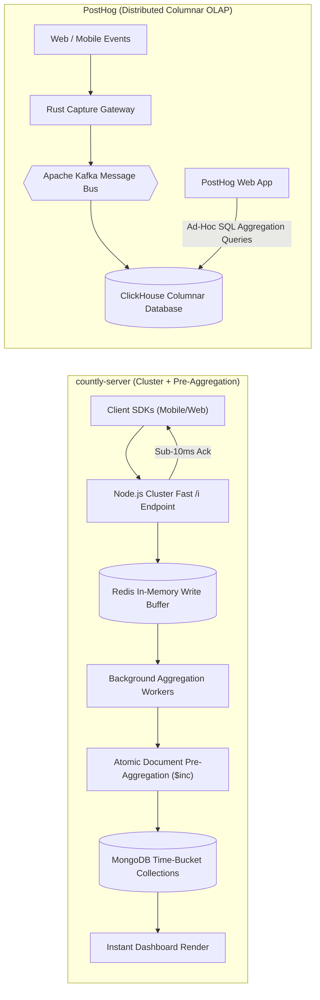
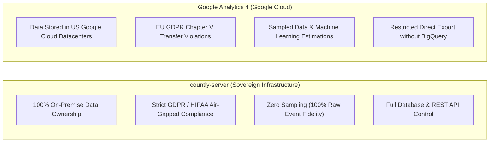
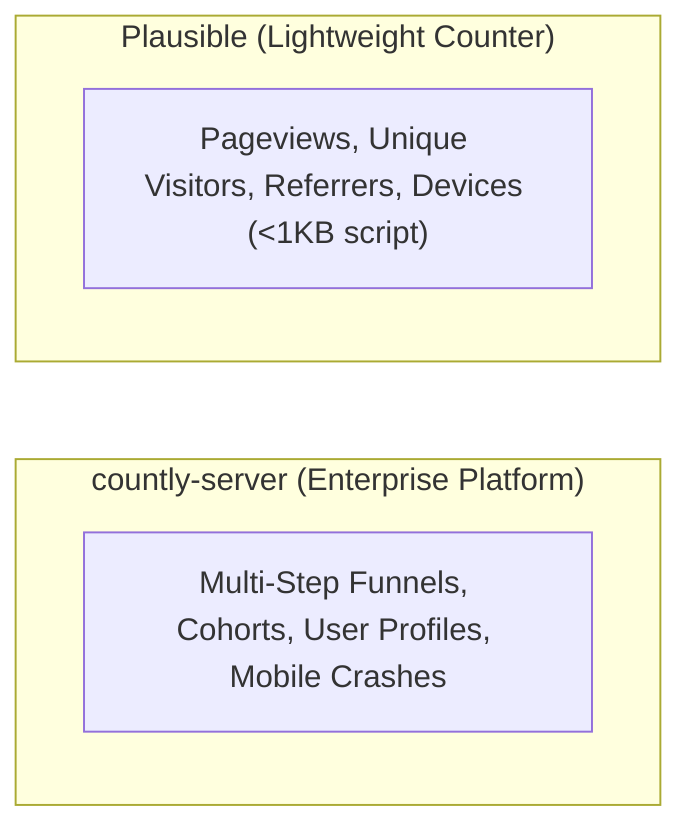

# countly-server — Comparative Analysis & Category Evaluation

> **Category**: Product Analytics & Telemetry  
> **Architectural Role**: Enterprise real-time mobile and web analytics, high-throughput `/i` ingestion engine & crash reporting platform  
> **Primary Stack**: JavaScript / Node.js 20+ LTS | Express.js & Cluster Workers | MongoDB 6.0+ & Redis 7+ | Rate-Limiter-Flexible | MaxMind GeoIP  
> **Peer Solutions Compared**: PostHog (Open-Source Columnar Benchmark), Plausible Analytics (Lightweight Web Benchmark), Google Analytics 4 (Cloud Benchmark)  
> **Commercial SaaS Benchmarks**: Mixpanel, Amplitude, Heap, Firebase Analytics, Google Analytics 4  

---

## 1. Executive Overview & Technical Identity: countly-server

**countly-server** represents the enterprise-grade mobile telemetry, crash diagnostic, and real-time behavioral analytics engine within the **Product Analytics & Telemetry** domain. Engineered in Node.js, Express, MongoDB, and Redis, Countly Server is designed as a privacy-centric, completely self-hostable alternative to Google Analytics, Mixpanel, and Amplitude.

Countly's architecture is uniquely optimized for ultra-high-throughput, sub-second telemetry ingestion across mobile devices (iOS, Android, Flutter, React Native), web applications, desktop clients, and IoT devices. Rather than executing expensive real-time aggregations over billions of raw telemetry rows at query time, Countly employs an in-memory Redis processing queue and an atomic, time-bucketed pre-aggregation database pattern in MongoDB. This ensures that executive dashboards, custom event breakdowns, funnel retention curves, and crash diagnostic reports render instantaneously regardless of total historical data volume.

### Core Architectural Profile
- **Runtime & Language**: `JavaScript / Node.js 20+ / 22+ LTS (Cluster Master/Worker Model)`
- **Core Framework**: `Express.js API routing, plugin micro-kernel architecture, EJS / Vue.js console`
- **Persistence Layer**: `MongoDB 6.0+ (Sharded Replica Sets, Document & Time-Series Collections) + Redis 7+`
- **Concurrency & Queue Model**: `High-throughput non-blocking /i endpoint + Redis write buffer + background processing daemons`
- **Domain Specialization**: Real-time product analytics, sub-10ms telemetry ingestion, mobile crash stack symbolication & 100% GDPR data sovereignty

---

## 2. Peer Solution Landscape (Product Analytics & Telemetry)

Within the product telemetry domain, `countly-server` is evaluated against the following primary open-source and commercial benchmarks:

| Solution | Language & Runtime | Core Framework | Database / Cache | Aggregation Strategy | Primary Workload Focus |
| :--- | :--- | :--- | :--- | :--- | :--- |
| **countly-server** (Current)| `Node.js 20+ LTS` | `Express, Cluster Workers`| `MongoDB 6+, Redis 7+` | **Write-Time Pre-Aggregation** | **Mobile & web telemetry, crash reports & cohorts** |
| **PostHog** | `Python / Rust` | `Django, Rust Capture` | `ClickHouse, PostgreSQL, Kafka`| Read-Time Columnar SQL Queries| Product analytics, session replays & feature flags |
| **Plausible Analytics** | `Elixir / Erlang OTP` | `Phoenix, Cowboy HTTP` | `ClickHouse, PostgreSQL` | Read-Time Columnar Scanning | Lightweight privacy-first web traffic tracking |
| **Google Analytics 4** | `Google Cloud Closed` | `Proprietary Cloud Engine`| `BigQuery Data Warehouse` | Machine Learning Sampling | Cross-platform marketing attribution & ad tracking |

---

## 3. Deep Head-to-Head Comparative Breakdown: countly-server vs Peers

### 3.1. countly-server vs. PostHog

**Comparative Focus**: `Write-Time Pre-Aggregation (MongoDB + Redis)` vs. `Read-Time Columnar OLAP (ClickHouse + Kafka)`

#### Detailed Architectural Contrast
- **Ingestion & Buffer Pipeline**: `countly-server` uses Node.js cluster processes to terminate HTTP connections at the `/i` endpoint, immediately pushing validated event payloads into an in-memory Redis buffer and returning an acknowledgment to the client in under 10ms. `PostHog` uses a high-performance Rust-based Capture API that streams events into an Apache Kafka message bus before writing to ClickHouse.
- **Data Modeling & Query Execution**: `countly-server` utilizes an atomic, write-time pre-aggregation pattern. As background daemons pull events from Redis, metrics are added to hierarchical time-bucketed documents (`year.month.day.hour`) in MongoDB using atomic `$inc` operators. When a dashboard renders, queries are simple index reads requiring near-zero CPU computation. `PostHog` stores raw, immutable event rows in ClickHouse's columnar tables and calculates aggregates, funnels, and retention paths at read time using vectorized SQL queries.
- **Mobile Observability & Crashes**: `countly-server` provides deep native mobile SDKs (iOS, Android, React Native, Flutter, Unity) equipped with symbolicated crash reporting, device hardware metrics (battery, memory, carrier), and breadcrumb tracking. `PostHog` was engineered web-first with session replay and feature flagging, later expanding into mobile.
- **Operational Complexity**:
  - `countly-server`: Straightforward three-component stack: Node.js, MongoDB, and Redis.
  - `PostHog`: Heavy enterprise distributed architecture requiring ClickHouse, ZooKeeper, Apache Kafka, PostgreSQL, Redis, and Python/Django workers.

#### Architectural Comparison Matrix: countly-server vs. PostHog

| Dimension | countly-server | PostHog | Architectural Implication |
| :--- | :--- | :--- | :--- |
| **Storage Architecture** | **MongoDB Document Pre-Aggregation** | **ClickHouse Columnar OLAP** | Countly dashboards load instantly; ClickHouse allows arbitrary retrospective SQL queries. |
| **Ingestion Pipeline** | **Node.js Cluster + Redis Buffer** | **Rust Capture + Apache Kafka** | PostHog scales to billions of raw streaming rows; Countly offers simpler operations. |
| **Mobile & Crash Diagnostics**| **Native Mobile SDKs & Symbolication**| **Session Replay & Feature Flags**| Countly excels at native mobile hardware tracking and app crash symbolication. |
| **Infrastructure Overhead** | **Moderate (Node + Mongo + Redis)** | **High (ClickHouse + Kafka + Postgres)**| Countly runs on modest hardware; PostHog requires multi-node clustering. |
| **Licensing Model** | **AGPL-3.0 Community / Commercial** | **PostHog Public / Commercial** | Both provide on-premise self-hosting capabilities. |

---

### 3.2. countly-server vs. Google Analytics 4 (GA4)

**Comparative Focus**: `Self-Hosted Data Sovereignty & Raw Telemetry` vs. `Proprietary Cloud Ad-Network Tracking`

#### Detailed Architectural Contrast
- **Data Privacy & GDPR Sovereignty**: `countly-server` can be deployed on private cloud servers or on-premise air-gapped infrastructure. No behavioral telemetry is transmitted to third parties, ensuring strict compliance with European GDPR, HIPAA, and financial sector standards. `GA4` transmits user interaction data to Google servers in the United States, which European privacy regulators have repeatedly ruled violates EU cross-border data transfer rules.
- **Measurement Accuracy & Sampling**: `countly-server` records every single event with 100% raw accuracy and zero algorithmic sampling. `GA4` applies heavy machine-learning modeling, conversion modeling, and data sampling on high-volume properties, introducing estimation errors into conversion tracking.

#### Architectural Comparison Matrix: countly-server vs. Google Analytics 4

| Dimension | countly-server | Google Analytics 4 | Architectural Implication |
| :--- | :--- | :--- | :--- |
| **Data Sovereignty** | **100% Self-Hosted & Air-Gapped** | **Hosted on Google Cloud US** | Countly completely eliminates international legal compliance and GDPR fines. |
| **Data Fidelity** | **100% Unsampled Event Accuracy** | **Algorithmic Modeling & Sampling** | Countly guarantees exact conversion counts for mission-critical revenue funnels. |
| **Mobile Diagnostics** | **Integrated Crash & Breadcrumb Tools**| **Requires Separate Firebase Crashlytics**| Countly provides an integrated telemetry and diagnostic dashboard. |
| **Ad-Network Neutrality**| **Zero Data Leakage to Ad Tech** | **Feeds Google Ads Bidding Algorithms** | Countly protects competitive proprietary customer behavioral patterns. |

---

### 3.3. countly-server vs. Plausible Analytics

**Comparative Focus**: `Enterprise Behavioral Funnel & Crash Platform` vs. `Lightweight Cookie-Free Web Counter`

#### Detailed Architectural Contrast
- **Functional Breadth**: `Plausible` is an ultra-lightweight web counter (<1KB JS script) that tracks pageviews, top referrers, and basic devices without using cookies or collecting personal data. `countly-server` is an enterprise behavioral analytics engine that tracks distinct user profiles, multi-step conversion funnels, custom event properties, retention cohort matrices, mobile push notifications, and application crashes.

#### Architectural Comparison Matrix: countly-server vs. Plausible

| Dimension | countly-server | Plausible Analytics | Architectural Implication |
| :--- | :--- | :--- | :--- |
| **Analytical Depth** | **Full Behavioral Cohorts & Funnels** | **Basic Traffic Overview** | Countly analyzes complex product interactions; Plausible tracks surface pageviews. |
| **Mobile & Crash Support** | **Full Native Mobile SDKs + Crashes**| **Web Only (No Mobile SDKs)** | Countly supports mobile apps and desktop clients; Plausible is browser-only. |
| **Script Footprint** | **~10KB SDK (Feature-Rich)** | **<1KB Tracker (Ultra-Light)** | Plausible has minimal browser overhead; Countly captures rich interaction states. |

---

## 4. Capability & Feature Comparison Matrix

| Dimension / Capability | countly-server | PostHog | Plausible | Google Analytics 4 |
| :--- | :---: | :---: | :---: | :---: |
| **Fast Ingestion Endpoint (`/i`)** | ✅ Sub-10ms | ⚠️ Rust API | ⚠️ Elixir Cowboy | ✅ Cloud Edge |
| **Write-Time Pre-Aggregation** | ✅ MongoDB Time-Buckets| ❌ (Read-time OLAP)| ⚠️ Basic | ❌ (Sampled) |
| **Mobile Crash Diagnostics & Stack** | ✅ Integrated | ⚠️ Session Replay | ❌ | ⚠️ Firebase |
| **Conversion Funnels & Cohorts** | ✅ Real-Time | ✅ Advanced SQL | ⚠️ Basic Goals | ✅ Standard |
| **Native Mobile SDKs** | ✅ (iOS, Android, RN, Flutter)| ✅ Expanding | ❌ | ✅ Firebase |
| **Self-Hosted Data Sovereignty** | ✅ 100% Sovereign | ✅ 100% Sovereign | ✅ 100% Sovereign | ❌ Closed Cloud |
| **Push Notification Engine** | ✅ Built-in | ❌ | ❌ | ⚠️ Firebase Cloud|
| **Primary Database** | MongoDB 6+ & Redis | ClickHouse & PostgreSQL| ClickHouse | BigQuery |

---

## 5. Commercial Benchmark Positioning & MarketingStudio Fit

- **Against Mixpanel & Amplitude**: `countly-server` provides deep behavioral cohort tracking and retention analytics without exorbitant SaaS event billing (\$2,000–\$10,000+/mo for high-traffic apps).
- **Against GA4**: `countly-server` ensures compliance with European data privacy regulations (GDPR) and delivers 100% unsampled event fidelity.
- **MarketingStudio Synergy**: `countly-server` serves as the central telemetry backbone for MarketingStudio, tracking user journeys from marketing landing pages to signed contracts and product feature adoption.
