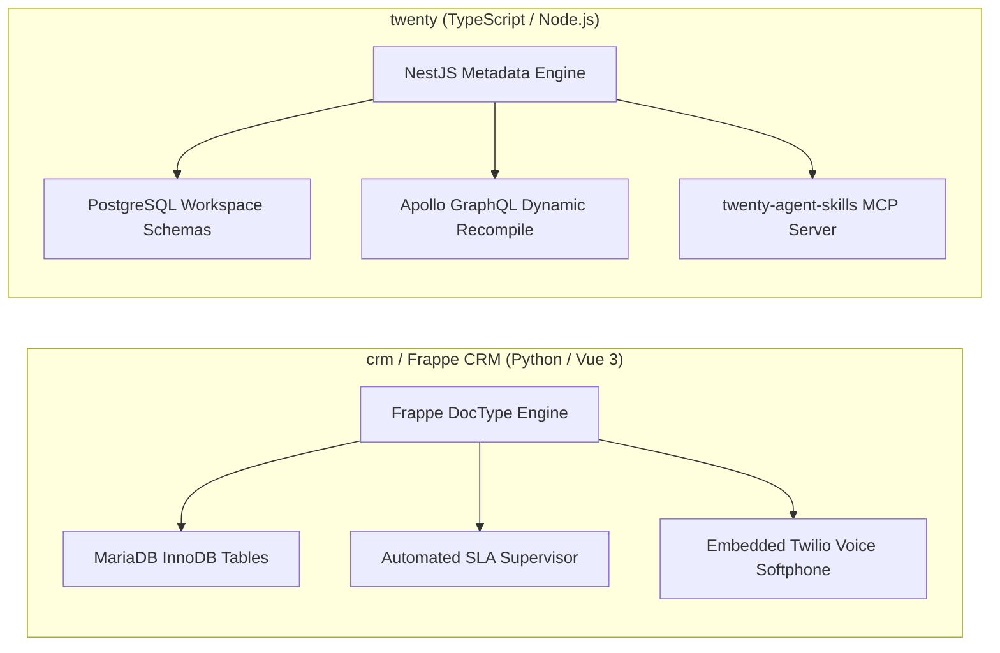
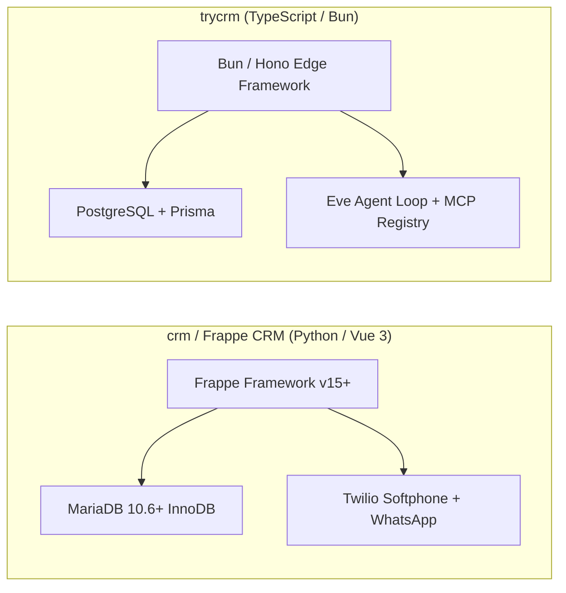
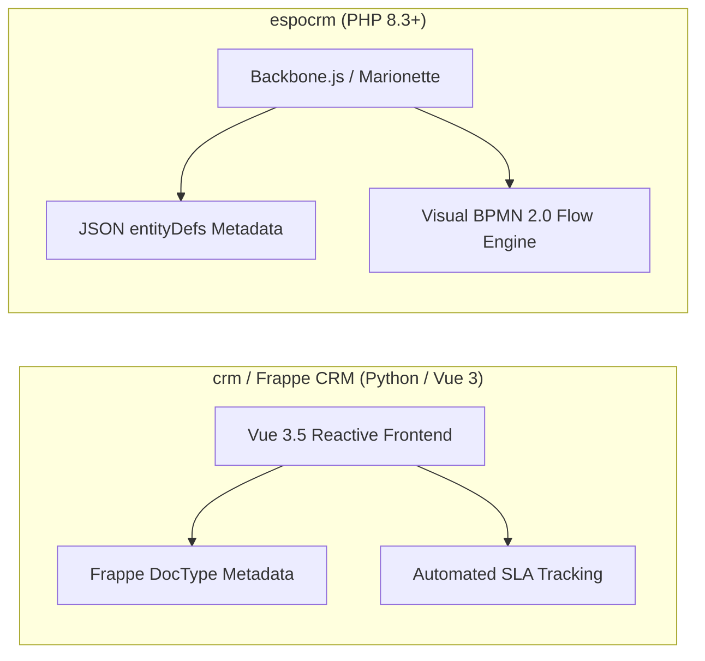
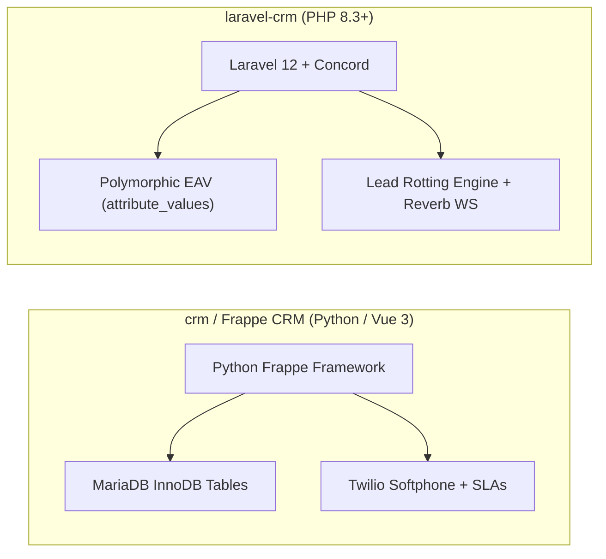
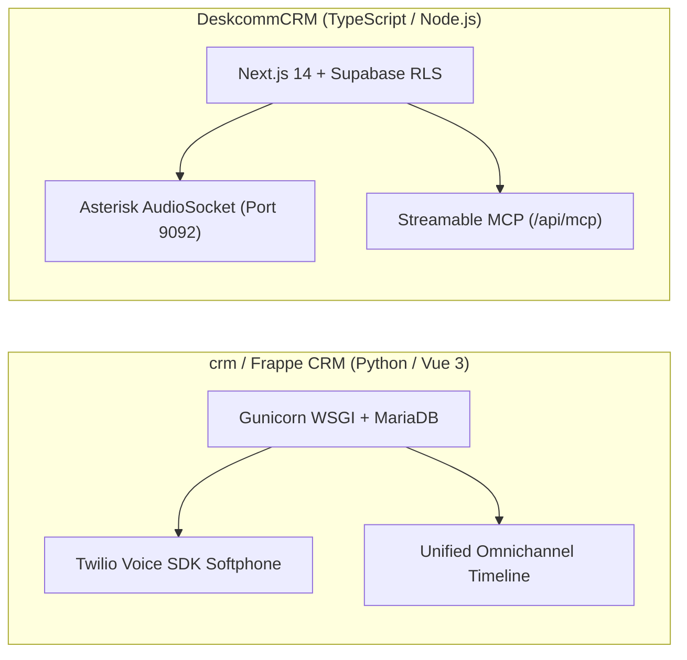
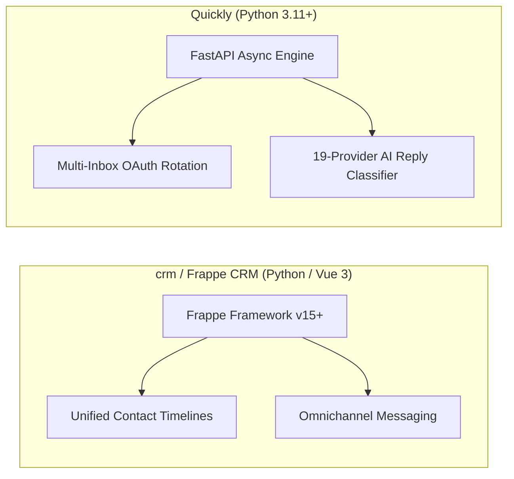
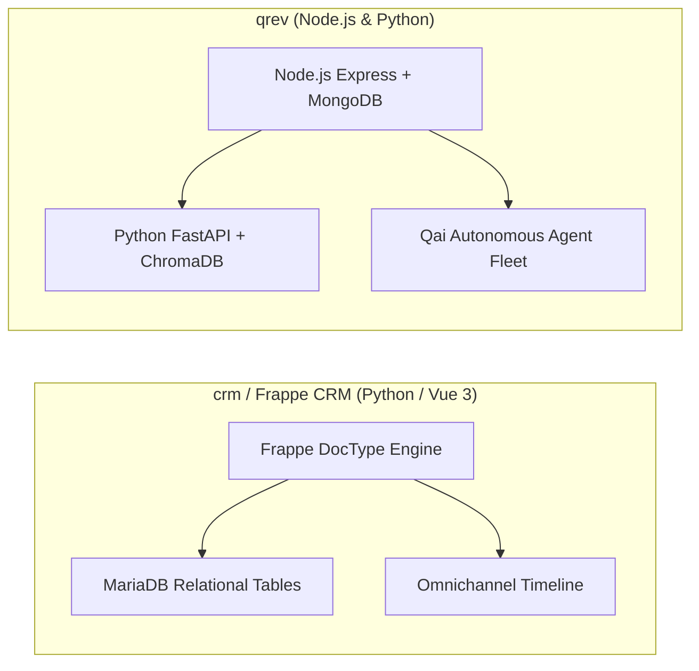
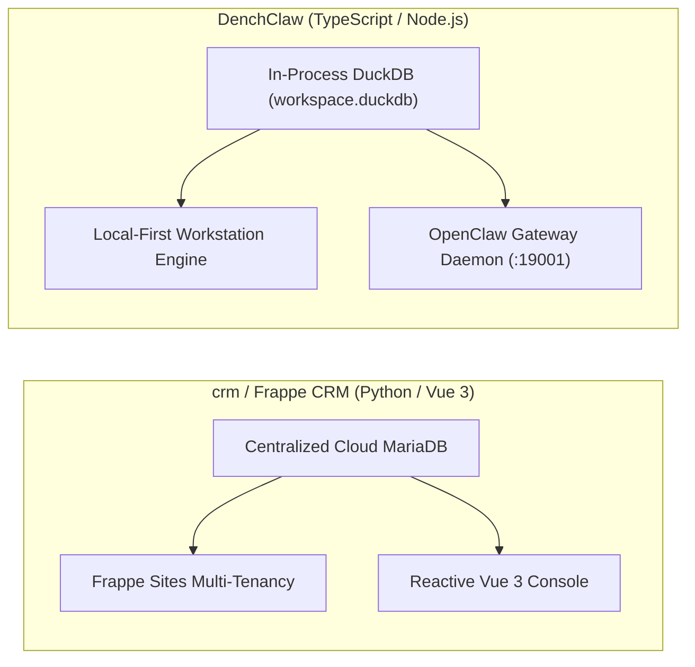
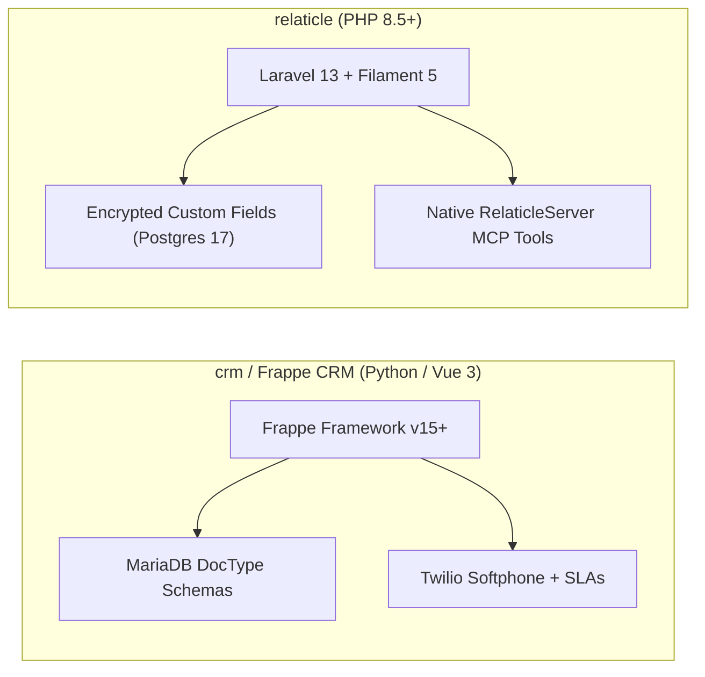

# crm (Frappe CRM) — Comparative Analysis & Category Evaluation

> **Category**: CRM & Contact Management  
> **Architectural Role**: Modern open-source CRM built on Frappe Framework, Python & reactive Vue 3  
> **Primary Stack**: Python 3.10+ | Frappe Framework v15+, Vue 3.5 (`frappe-ui`), Vite 8 | MariaDB 10.6+, Redis | Redis Queue (RQ) / Celery + Socket.io  
> **Peer Solutions Compared**: `twenty`, `trycrm`, `espocrm`, `laravel-crm`, `DeskcommCRM`, `Quickly`, `qrev`, `DenchClaw`, `relaticle`  
> **Commercial SaaS Benchmarks**: Salesforce, HubSpot CRM, Attio, Pipedrive, Close.com  

---

## 1. Executive Overview & Technical Identity: crm (Frappe CRM)

**crm** (commercially known as **Frappe CRM**) is a high-performance open-source customer relationship management system developed by Frappe Technologies (`frappe/crm`). Engineered to eliminate the slowness of legacy monolithic CRMs, Frappe CRM couples the extensible Python-based Frappe Framework with an instantaneous, reactive Vue 3 SPA built using `frappe-ui`, Pinia, and TailwindCSS.

Frappe CRM's core architectural identity is defined by its **DocType Metadata Engine**, its **Automated SLA Supervisor**, and its **Omnichannel Communication Core**. Customer interactions—email threads, WhatsApp business messages, Twilio/Exotel VoIP phone recordings, and collaborative TipTap notes—are indexed into a unified chronological timeline, with automated SLA response timers preventing leads from going cold.

### Core Architectural Profile
- **Runtime & Language**: `Python 3.10+` (dataclasses, typing, async tasks) & `Node.js` (Socket.io daemon, Vite 8 build)
- **Core Framework**: `Frappe Framework v15+` (ORM, metaprogramming, DocType schema manager, hook system)
- **Frontend Architecture**: `Vue 3.5+` (Composition API, `<script setup>`), `frappe-ui` (1.0.0-rc.2), Pinia, Headless UI, TailwindCSS
- **Persistence Layer**: `MariaDB 10.6+ (InnoDB, UTF8MB4)` & `Redis` (caching, pub/sub, session state)
- **Concurrency & Asynchronous Queues**: Python RQ (Redis Queue) and Celery workers managed via `frappe.tasks` hooks, paired with a Node.js Socket.io daemon for real-time document broadcasts
- **Telephony & Real-Time**: Native browser softphone using `@twilio/voice-sdk` 2.10 and Exotel, WhatsApp Cloud API webhooks
- **Domain Specialization**: Modern omnichannel CRM with reactive Vue 3 UX, automated SLA tracking, and deep Frappe ERP ecosystem integration

---

## 2. Peer Solution Landscape (CRM & Contact Management)

| Solution | Language & Runtime | Core Framework | Database / Persistence | Queue & Concurrency | Primary Architectural Niche |
| :--- | :--- | :--- | :--- | :--- | :--- |
| **crm** (Current) | `Python 3.10+, JS` | `Frappe, Vue 3.5` | `MariaDB 10.6+, Redis` | `Redis Queue (RQ) / Celery` | **DocType metadata engine, SLA timers & native Twilio softphone** |
| **twenty** | `TypeScript / Node.js` | `NestJS, React, Vite` | `PostgreSQL 15+, TypeORM` | `BullMQ / Redis` | Dynamic runtime schemas & in-memory GraphQL compilation |
| **trycrm** | `TypeScript / Bun` | `Bun, Hono, Next.js` | `PostgreSQL, Prisma` | `Bun Async Loop / Eve` | Agentic-first CRM with native MCP tool registry & Eve runtime |
| **espocrm** | `PHP 8.3+` | `Slim 4, Backbone.js` | `MySQL 8.0+ / MariaDB` | `Multi-Process daemon.php` | Visual BPMN 2.0 flow execution engine & JSON entityDefs |
| **laravel-crm** (Krayin) | `PHP 8.3+` | `Laravel 12.0, Vue.js` | `MySQL 8.0, Eloquent` | `Laravel Queue / Reverb` | Modular composer packages via Concord & polymorphic typed EAV |
| **DeskcommCRM** | `TypeScript / Node.js`| `Next.js 14, Supabase` | `PostgreSQL 16, pgvector` | `AudioSocket TCP / Workers`| Asterisk AudioSocket binary TCP telephony & streamable MCP |
| **Quickly** | `Python 3.11+` | `FastAPI, Next.js 14` | `PostgreSQL, SQLAlchemy` | `Asyncio Slot Reservation` | High-velocity multi-inbox rotation, jitter scheduler & MCP |
| **qrev** | `Node.js & Python` | `Express & FastAPI` | `MongoDB & ChromaDB` | `Node-cron & FastTasks` | Dual-runtime Qai superagent orchestrator & LangChain RAG |
| **DenchClaw** | `TypeScript / Node.js`| `Next.js 15, DuckDB` | `In-Process DuckDB` | `In-Process SQL / OpenClaw`| Embedded columnar SQL, OpenClaw AI Gateway & Composio MCP |
| **relaticle** | `PHP 8.5+` | `Laravel 13, Filament 5`| `PostgreSQL 17+ (ULID)` | `Laravel Horizon / Redis` | Native `RelaticleServer` MCP tools, per-field encryption & ULIDs |

---

## 3. Deep Head-to-Head Comparative Breakdown: crm vs Peers

### 3.1. crm vs. twenty

#### Metadata Engine & Schema Provisioning
- **crm (Frappe CRM)**: Uses Frappe's declarative **DocType** architecture (`crm/fcrm/doctype/`). Entities (`crm_lead`, `crm_deal`, `crm_organization`) are defined as JSON files. When fields are added via the UI or code, Frappe issues DDL statements to alter MariaDB tables during migrations (`bench migrate`), auto-generating form layouts (`crm_fields_layout`) and REST endpoints (`/api/resource/{DocType}`).
- **twenty**: Employs an in-memory dynamic metadata engine. Core tables (`core.custom_object`) hold entity definitions, while tenant data is isolated in dedicated PostgreSQL schemas (`workspace_<id>`). Adding an object or field immediately issues DDL and recompiles Apollo GraphQL types in memory without running migration scripts.

#### SLA Tracking & Telephony
- **crm (Frappe CRM)**: Features a native **SLA Supervisor** (`crm_service_level_agreement`) that calculates first-response and rolling-response target times, alerting managers before leads go cold. Includes a native browser softphone powered by `@twilio/voice-sdk`.
- **twenty**: Focuses on modern relational views and drag-and-drop pipelines. Telephony and SLA tracking require custom external webhooks and BullMQ workers.

#### Concurrency & Real-Time Communication
- **crm (Frappe CRM)**: Python background tasks run on Redis RQ/Celery. Real-time document updates and presence indicators stream through a dedicated Node.js Socket.io daemon.
- **twenty**: Node.js/NestJS service backed by BullMQ on Redis, with optimistic UI cache updates on the React/Apollo client.

#### Architectural Tradeoffs Matrix: crm vs. twenty

| Dimension | crm (Frappe CRM) | twenty | Architectural Evaluation |
| :--- | :--- | :--- | :--- |
| **Schema Velocity** | JSON DocType + `bench migrate` | Instant runtime DDL + GraphQL recompile | **twenty** provides faster zero-downtime schema changes |
| **SLA & Lead Response** | Built-in automated SLA timers | Custom queue script required | **crm** natively enforces lead response SLAs |
| **Telephony Integration** | Native browser softphone (Twilio SDK) | Third-party webhook logging | **crm** supports out-of-the-box browser calling |
| **Agent / MCP Readiness** | Whitelisted Python RPC endpoints | Native Model Context Protocol (MCP) | **twenty** integrates natively with LLMs |

---

### 3.2. crm vs. trycrm

#### Core Operational Mission
- **crm (Frappe CRM)**: Built for human sales teams requiring streamlined omnichannel communication, telephony recording, WhatsApp messaging, and SLA accountability.
- **trycrm**: Built for autonomous AI sales agents (SDRs). Focuses on giving LLM agents their own workspaces, tool calling registries (MCP), and execution audit ledgers (`AgentAuditEvent`).

#### Communication Architecture
- **crm (Frappe CRM)**: Deep bi-directional communication channels: WhatsApp Cloud API webhooks (`whatsapp.py`), Twilio softphone calling, and email threading into an omnichannel activity timeline (`activities.py`).
- **trycrm**: Focuses on agent tool-mediated outreach (LinkedIn scraping, web search, email sending) and Slack channel collaboration (`SlackMemberMatch`).

#### Stack & Runtime Efficiency
- **crm (Frappe CRM)**: Python 3.10+ WSGI (Gunicorn) with MariaDB and Redis. Highly extensible but heavier memory footprint (~400 MB RAM).
- **trycrm**: Modern Bun 1.1+ runtime with Hono API microservices (~150 MB RAM), delivering sub-millisecond execution loops for AI agents.

#### Architectural Tradeoffs Matrix: crm vs. trycrm

| Dimension | crm (Frappe CRM) | trycrm | Architectural Evaluation |
| :--- | :--- | :--- | :--- |
| **Primary Workflow** | Human sales reps + omnichannel | Autonomous AI agents + tool loops | Distinct operational archetypes |
| **Telephony & Voice** | Native Twilio Voice SDK softphone | External MCP tool required | **crm** enables instant human calling |
| **AI Protocol** | Whitelisted Python REST endpoints | Native Model Context Protocol (MCP) | **trycrm** is purpose-built for AI agents |
| **ERP Connectivity** | Frappe ERPNext ecosystem | Standalone CRM | **crm** connects to accounting and supply chain |

---

### 3.3. crm vs. espocrm

#### Frontend Architecture & Responsiveness
- **crm (Frappe CRM)**: Modern, snappy Single-Page Application built with Vue 3.5, Pinia, TailwindCSS, TipTap editor, and `frappe-ui`. Renders interactive Kanban boards (`vuedraggable`) and maps (`leaflet`) with instant reactivity.
- **espocrm**: Client interface built on older web technologies: Backbone.js, Marionette.js, and Handlebars templates. While functional, it lacks the reactive component architecture of modern Vue 3.

#### Workflow Automation vs. SLA Management
- **crm (Frappe CRM)**: Specializes in SLA enforcement (first-response timers, breach alerts, holiday lists) and round-robin assignment rules (`assignment_rule.py`).
- **espocrm**: Features an enterprise-grade **BPMN 2.0 flowchart engine** supporting visual decision gateways, user approval tasks, timed delays, and automated service execution.

#### Multi-Tenancy Architecture
- **crm (Frappe CRM)**: Implements Frappe Sites multi-tenancy, isolating tenants into completely distinct MariaDB databases per domain/subdomain.
- **espocrm**: Single shared database with application-level User/Team/Role ACL enforcement.

#### Architectural Tradeoffs Matrix: crm vs. espocrm

| Dimension | crm (Frappe CRM) | espocrm | Architectural Evaluation |
| :--- | :--- | :--- | :--- |
| **Frontend UX** | Modern reactive Vue 3.5 + Tailwind | Backbone.js / Marionette (Legacy) | **crm** delivers a modern, snappy user interface |
| **Process Modeling** | DocType state machines & SLAs | Visual BPMN 2.0 flowchart engine | **espocrm** handles complex multi-branch approval workflows |
| **Tenant Isolation** | Database-per-site (Frappe Sites) | Shared database with ACL | **crm** guarantees complete physical database isolation |
| **Built-in VoIP** | Native Twilio Voice SDK | Plugin required | **crm** includes softphone dialing natively |

---

### 3.4. crm vs. laravel-crm (Krayin CRM)

#### Metadata & Custom Field Handling
- **crm (Frappe CRM)**: Uses Frappe DocTypes. When custom fields are added, MariaDB tables are physically altered with native columns during migrations.
- **laravel-crm**: Uses a polymorphic **Entity-Attribute-Value (EAV)** engine (`packages/Webkul/Attribute`). Dynamic attributes are stored in `attribute_values` across typed columns (`text_value`, `integer_value`, etc.). Adding custom fields requires zero DDL table alterations.

#### Lead Hygiene: SLAs vs. Rotting Days
- **crm (Frappe CRM)**: Employs active, granular **SLA timers** measuring exact response minutes, business hours, and holiday schedules to prevent lead neglect.
- **laravel-crm**: Employs passive **lead rotting algorithms** (`rotten_days`), visually flagging deals on Kanban boards that have lingered in a pipeline stage beyond a specified threshold.

#### Quotation & Product Management
- **crm (Frappe CRM)**: Tracks deals with items and currency, linking directly to Frappe ERPNext Quotations and Invoices.
- **laravel-crm**: Includes a complete native **Quotation-to-Close engine** (`packages/Webkul/Quote`), featuring product inventories, tax rules, currency conversions, and automated PDF quotation rendering via DomPDF/mPDF.

#### Architectural Tradeoffs Matrix: crm vs. laravel-crm

| Dimension | crm (Frappe CRM) | laravel-crm | Architectural Evaluation |
| :--- | :--- | :--- | :--- |
| **Custom Field Performance** | Native MariaDB columns | Polymorphic typed EAV | **crm** provides faster multi-attribute SQL queries |
| **Lead Hygiene Strategy** | Active SLA timers & escalation | Passive stage rotting days | **crm** prevents lead stalls before they occur |
| **Quotation Engine** | Delegates to ERPNext | Built-in native PDF quotation generator | **laravel-crm** handles quotes standalone |
| **Telephony** | Native Twilio Voice softphone | Not supported natively | **crm** provides direct phone dialing |

---

### 3.5. crm vs. DeskcommCRM

#### Telephony Architecture: WebRTC vs. Binary AudioSocket
- **crm (Frappe CRM)**: Uses browser WebRTC audio streaming through `@twilio/voice-sdk`. Calls are initiated by human sales representatives directly from contact cards, with recordings saved to private file attachments.
- **DeskcommCRM**: Bypasses WebRTC mixing entirely in favor of Asterisk PBX **AudioSocket** over raw TCP (port 9092). Captures raw binary PCM audio bidirectionally and pipes it directly into streaming LLM voice engines, enabling sub-second AI conversational voice calls.

#### AI Agent Ergonomics
- **crm (Frappe CRM)**: Exposes whitelisted Python RPC endpoints (`/api/method/...`). Designed primarily for human operators.
- **DeskcommCRM**: Provides an official Model Context Protocol (MCP) server at `/api/mcp`, featuring an automated AI-to-human escalation tool (`handoff.ts`) and pgvector semantic retrieval.

#### Architectural Tradeoffs Matrix: crm vs. DeskcommCRM

| Dimension | crm (Frappe CRM) | DeskcommCRM | Architectural Evaluation |
| :--- | :--- | :--- | :--- |
| **Telephony Purpose** | Human rep outbound/inbound calling | Autonomous AI voice agent conversations | Different operational targets |
| **Audio Latency** | Standard WebRTC browser signaling | Binary AudioSocket TCP streaming (sub-second) | **DeskcommCRM** is optimized for conversational AI voice |
| **AI Protocol** | Python RPC endpoints | Native Model Context Protocol (MCP) | **DeskcommCRM** connects natively with LLMs |
| **Omnichannel Breadth** | Email, WhatsApp, Calls, Notes | Phone and WhatsApp primary | **crm** has a broader integrated communication stream |

---

### 3.6. crm vs. Quickly

#### Functional Specialization
- **crm (Frappe CRM)**: Inbound and account relationship management. Tracks contacts, deals, customer service SLAs, and multi-channel communication history.
- **Quickly**: Cold outbound email sequencing. Dispatches automated multi-step sequences across Google Workspace and Microsoft 365 OAuth inboxes with randomized send jitter to maximize deliverability.

#### Python Architecture: Frappe WSGI vs. FastAPI ASGI
- **crm (Frappe CRM)**: Synchronous Python WSGI application running under Gunicorn, backed by Redis Queue (RQ) and Celery workers.
- **Quickly**: Pure asynchronous Python 3.11+ ASGI application running under Uvicorn, backed by SQLAlchemy 2.0 async sessions and `asyncpg`. Slot reservation logic balances outbound queues across hundreds of accounts.

#### Architectural Tradeoffs Matrix: crm vs. Quickly

| Dimension | crm (Frappe CRM) | Quickly | Architectural Evaluation |
| :--- | :--- | :--- | :--- |
| **Primary Focus** | Inbound lead management & CRM | Cold outbound email sequencing | Complementary stages of sales funnel |
| **Outbound Emailing** | Individual transactional emails | Multi-inbox OAuth rotation with jitter | **Quickly** protects domain deliverability |
| **Python Runtime** | WSGI (Gunicorn) + Celery | Async ASGI (FastAPI) + `asyncpg` | **Quickly** handles higher concurrent I/O throughput |
| **AI Reply Analysis** | Manual review by reps | Automated 19-provider LLM classification | **Quickly** auto-categorizes prospect intent |

---

### 3.7. crm vs. qrev

#### Architectural Topology
- **crm (Frappe CRM)**: Single-framework Python/Vue monorepo running atop MariaDB and Redis.
- **qrev**: Decoupled hybrid architecture splitting operational CRM CRUD (Node.js/Express with MongoDB) from compute-heavy AI orchestration (Python FastAPI with LangChain, LlamaIndex, and ChromaDB).

#### Autonomous Prospecting vs. Inbound Execution
- **crm (Frappe CRM)**: Focuses on qualifying and closing leads captured through web forms, emails, and WhatsApp.
- **qrev**: Features autonomous prospecting agents (**Qai**) that scrape company websites via Playwright, search Google Places, and draft personalized cold emails using RAG against company dossiers.

#### Architectural Tradeoffs Matrix: crm vs. qrev

| Dimension | crm (Frappe CRM) | qrev | Architectural Evaluation |
| :--- | :--- | :--- | :--- |
| **Data Consistency** | Strict relational MariaDB ACID | MongoDB document store + ChromaDB | **crm** guarantees relational data integrity |
| **Lead Discovery** | Inbound capture primary | Autonomous Playwright web scrapers | **qrev** discovers and enriches leads automatically |
| **SLA Enforcement** | Automated response timers | Agent task execution loop | **crm** holds sales reps accountable to response targets |
| **Stack Complexity** | Single Python framework | Dual Node.js + Python microservices | **crm** is simpler to operate and maintain |

---

### 3.8. crm vs. DenchClaw

#### Deployment & Data Sovereignty
- **crm (Frappe CRM)**: Cloud-native or private server deployment designed for multi-user sales organizations. Data is stored centrally in MariaDB databases.
- **DenchClaw**: Local-first sovereign sales workspace running directly on an individual operator's workstation. Data resides in an embedded columnar DuckDB file (`workspace.duckdb`).

#### Query Speed: MariaDB vs. Columnar DuckDB
- **crm (Frappe CRM)**: Queries execute against MariaDB over TCP sockets. Large pipeline aggregations require standard relational indexing.
- **DenchClaw**: Queries execute in-process via DuckDB's vectorized columnar engine. Analytical filtering and relationship scoring across hundreds of thousands of entries execute in sub-millisecond timeframes.

#### Architectural Tradeoffs Matrix: crm vs. DenchClaw

| Dimension | crm (Frappe CRM) | DenchClaw | Architectural Evaluation |
| :--- | :--- | :--- | :--- |
| **Multi-User Collaboration** | Cloud-native multi-user teams | Single-user local workstation | **crm** is built for collaborative sales teams |
| **Analytical Query Speed** | MariaDB network queries (5-20ms) | In-process vectorized DuckDB (<1ms) | **DenchClaw** executes local analytics instantaneously |
| **Telephony & Calling** | Native browser Twilio softphone | None (delegates to external tools) | **crm** provides direct phone dialing |
| **Local Tool Execution** | Server-side Python scripts | OpenClaw gateway + local terminal shell | **DenchClaw** allows agents to execute local commands |

---

### 3.9. crm vs. relaticle

#### Technology Stack: Python/Vue vs. PHP 8.5/Filament 5
- **crm (Frappe CRM)**: Python 3.10+ and Frappe Framework with a custom Vue 3 Single-Page Application (`frappe-ui`).
- **relaticle**: PHP 8.5+ and Laravel 13 with an administrative interface powered by Filament 5 and Livewire 4.

#### Custom Field Encryption & Identifiers
- **crm (Frappe CRM)**: Custom fields are stored as unencrypted columns in MariaDB tables. Entities use slugged string names or integer autoincrement IDs.
- **relaticle**: Custom fields are stored in PostgreSQL 17+ with native JSONB and per-field AES application encryption. Uses chronological **ULIDs** across all core models, optimizing B-tree index locality.

#### Agent Integration (MCP)
- **crm (Frappe CRM)**: Whitelisted Python RPC methods. Requires custom function-calling wrappers for AI agents.
- **relaticle**: Native Model Context Protocol (MCP) server (`App\Mcp\Servers\RelaticleServer`) exposing structured tools for pipeline introspection and lead updates directly to LLMs.

#### Architectural Tradeoffs Matrix: crm vs. relaticle

| Dimension | crm (Frappe CRM) | relaticle | Architectural Evaluation |
| :--- | :--- | :--- | :--- |
| **Telephony Integration** | Built-in browser Twilio softphone | Activity timeline logging only | **crm** supports direct phone dialing out of the box |
| **AI Protocol (MCP)** | Python RPC endpoints | Native Model Context Protocol (MCP) | **relaticle** connects natively with AI agents |
| **Data Encryption** | Database-level encryption | Per-field AES application encryption | **relaticle** secures sensitive custom attributes at rest |
| **Primary Keys** | String slugs / Autoincrement | Chronological ULIDs | **relaticle** provides superior index locality |

---

## 4. Capability & Feature Comparison Matrix

| Dimension / Capability | crm (Frappe) | twenty | trycrm | espocrm | laravel-crm | DeskcommCRM | Quickly | qrev | DenchClaw | relaticle |
| :--- | :---: | :---: | :---: | :---: | :---: | :---: | :---: | :---: | :---: | :---: |
| **Dynamic Custom Objects** | ✅ DocType | ✅ Full DDL | ⚠️ JSON facts | ✅ JSON Meta | ⚠️ EAV | ❌ Static | ❌ Static | ⚠️ Mongo | ✅ DuckDB EAV | ✅ Encrypted EAV |
| **Native MCP / AI Skills** | ❌ RPC only | ✅ Full SDK | ✅ Native Core | ❌ REST only | ❌ REST only | ✅ Streamable | ✅ Streamable | ⚠️ LangChain | ✅ Composio MCP | ✅ RelaticleServer |
| **Modern Reactive UI** | ⚠️ Vue/Desk | ✅ Linear UX | ✅ Linear UX | ❌ Backbone | ❌ Blade | ⚠️ Next.js | ⚠️ Tailwind | ⚠️ React | ✅ Next.js 15 | ✅ Filament 5 |
| **Embedded Softphone / CTI** | ✅ Twilio SDK | ❌ | ❌ | ⚠️ Plugin | ❌ | ✅ AudioSocket | ❌ | ❌ | ❌ | ❌ |
| **Automated SLA Timers** | ✅ Enterprise | ⚠️ Custom queues| ❌ | ⚠️ BPM Timers | ⚠️ Rotting Days| ❌ | ❌ | ❌ | ❌ | ⚠️ Horizon Jobs |
| **GraphQL API** | ❌ (REST) | ✅ Auto-gen | ❌ (REST) | ❌ (REST) | ❌ (REST) | ❌ (REST) | ❌ (REST) | ❌ (REST) | ❌ (In-Process) | ❌ (REST) |
| **Multi-Tenant Schemas** | ✅ Frappe Sites| ✅ Schema/Tenant| ⚠️ Org ID | ⚠️ Role ACL | ⚠️ Channels | ✅ Postgres RLS| ⚠️ Single-team | ⚠️ Org ID | ✅ Local File | ✅ Workspace Model |
| **Resource Footprint** | ~400 MB RAM | ~500 MB RAM | ~150 MB RAM | ~120 MB RAM | ~100 MB RAM | ~200 MB RAM | **~60 MB RAM** | ~250 MB RAM | ~100 MB RAM | ~120 MB RAM |

---

## 5. Commercial Benchmark Positioning

When benchmarked against commercial SaaS leaders (**Salesforce, HubSpot CRM, Attio, Pipedrive, Close.com**):
- **Against Salesforce**: Frappe CRM delivers customizable DocType data models, automated SLA tracking, and ERP connectivity without multi-million-dollar implementation contracts or proprietary lock-in.
- **Against HubSpot CRM**: Frappe CRM features an intuitive, modern Vue 3 interface while eliminating punitive tier-based pricing as contact lists scale.
- **Against Close.com**: Frappe CRM provides native browser calling via the Twilio Voice SDK and omnichannel messaging (WhatsApp, email, notes) in a unified activity timeline.
- **Data Sovereignty**: 100% self-hosted on private infrastructure, ensuring compliance with data residency mandates.

---

## 6. Strategic Takeaways & Role for MarketingStudio

In the unified **MarketingStudio** architecture:
1. **Primary Component to Adopt**: Harness Frappe CRM's **Unified Omnichannel Activity Timeline** pattern (`crm/api/activities.py`), consolidating phone calls, WhatsApp messages, emails, notes, and task assignments into a single chronological stream.
2. **SLA Supervisor Pattern**: Replicate Frappe CRM's automated rolling-response SLA calculation engine to monitor sales agent responsiveness and prevent leads from going cold.
3. **Softphone Integration**: Adopt Frappe CRM's Twilio Voice SDK softphone patterns for browser-based sales rep dialing.
