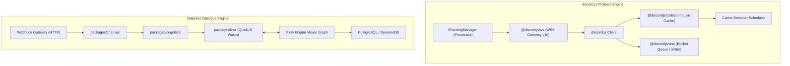
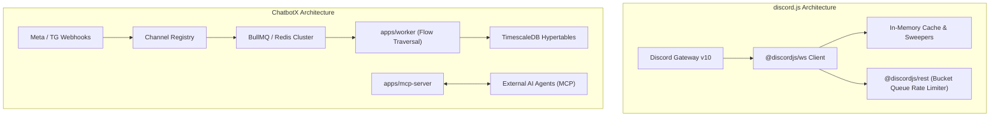
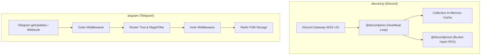
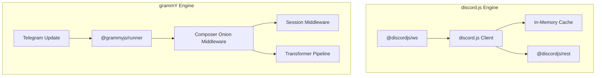
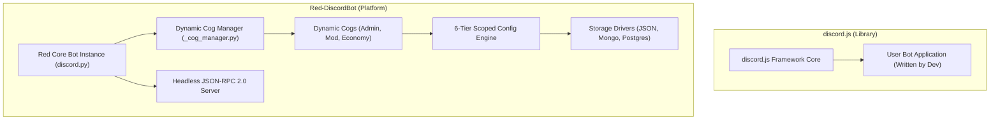
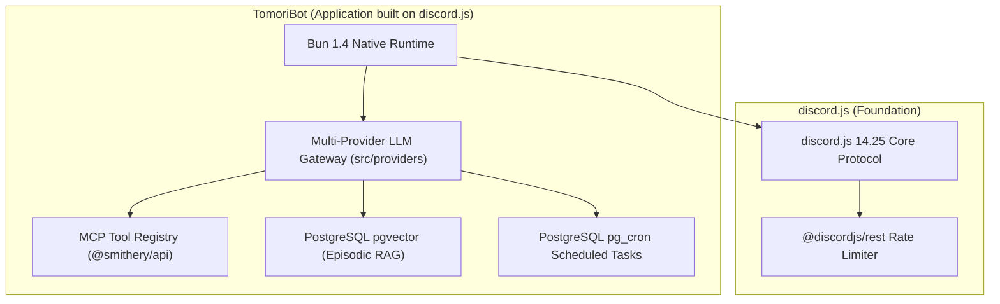

# discord.js — Comparative Analysis & Category Evaluation

> **Category**: Conversational AI & Bots  
> **Architectural Role**: Enterprise Object-Oriented Discord Gateway & REST Client Architecture in TypeScript  
> **Primary Stack**: TypeScript, Node.js 18-22+, WebSocket Gateway v10, REST API v10, Sharding Manager, In-Memory Collections  
> **Peer Solutions Compared**: `botpress`, `ChatbotX`, `aiogram`, `grammY`, `Red-DiscordBot`, `TomoriBot`  
> **Commercial SaaS Benchmarks**: Carl-bot, MEE6, Dyno, ManyChat, Drift  

---

## 1. Executive Overview & Technical Identity: discord.js

**discord.js** is the most widely adopted and architecturally sophisticated TypeScript library for interfacing with the Discord API. Engineering a robust bridge over Discord's dual API surface—high-concurrency WebSocket Gateway event streams and HTTP REST endpoints—discord.js provides an object-oriented, strongly typed abstraction layer that powers millions of community bots, automated moderation systems, and conversational assistants.

### Core Architectural Profile
- **Runtime & Language**: `TypeScript 5.4+ / Node.js 18-22+ (pnpm workspaces, Turborepo 2.3+)`
- **Core Framework**: `Decoupled Monorepo (@discordjs/ws, @discordjs/rest, @discordjs/builders, @discordjs/voice)`
- **Network Protocol**: `Discord Gateway v10 (Persistent WSS with zlib compression) & HTTPS REST API v10`
- **Concurrency & Sharding**: `ShardingManager distributing shard worker threads / child processes`
- **Rate Limiting Engine**: `@discordjs/rest Sequential Bucket Hash FIFO Queues with reset-after tracking`
- **State & Caching Layer**: `In-Memory @discordjs/collection (extended ES6 Map) with configurable Sweepers`
- **UI & Component Architecture**: `Declarative builders for Slash Commands, ActionRows, Buttons, Selects, Modals`
- **Primary Architectural Niche**: `Low-level object-oriented Discord WebSocket client & REST bucket manager`
- **License**: `Apache-2.0`

---

## 2. Peer Solution Landscape (Conversational AI & Bots)

| Solution | Language & Runtime | Core Architecture | Database / Cache | Queue / Concurrency | Primary Architectural Niche |
| :--- | :--- | :--- | :--- | :--- | :--- |
| **discord.js** (Current) | `TypeScript / Node 18-22+` | Modular Monorepo (`@discordjs/ws`, `rest`) | `In-Memory Collection Cache + Sweepers` | `REST Bucket Queues + Sharding` | Low-level object-oriented Discord WebSocket client & REST bucket manager |
| **botpress** | `TypeScript / Node 22+` | Monorepo Studio + QuickJS VM (`llmz`) | `PostgreSQL, DynamoDB, Vector DB` | In-Process Event Loop & Sandboxing | Hybrid visual FSM & sandboxed LLM agent runtime |
| **ChatbotX** | `TypeScript / Node 24+` | Turborepo, Next.js 15, MCP Server | `PostgreSQL 16+, TimescaleDB, Redis 7+` | `BullMQ / Redis Cluster` | Agentic chat marketing, social comment automation & MCP funnels |
| **aiogram** | `Python 3.10-3.14` | AsyncIO, uvloop, aiohttp, Pydantic v2 | `Redis (hiredis), Motor (MongoDB)` | `AsyncIO Event Loop` | High-throughput asynchronous Telegram dispatching with hierarchical routers |
| **grammY** | `TypeScript / Deno / Node` | Composer Onion Middleware, Web APIs | `Redis, PostgreSQL, Keyv, Memory` | `Runner Engine (@grammyjs/runner)` | Cross-runtime type-safe Telegram framework with transformer pipelines |
| **Red-DiscordBot** | `Python 3.9-3.12+` | discord.py 2.x, Dynamic Cogs Lifecycle | `Red Config (JSON flat, Mongo, Postgres)` | `AsyncIO Task Loop + Cog Manager` | Hot-reloadable modular Discord bot platform with 6-tier scoped Config |
| **TomoriBot** | `TypeScript / Bun 1.4+` | Bun Native Runtime, discord.js 14.25 | `PostgreSQL 16+, pgvector, pg_cron` | `Bun Event Loop + Provider Streaming` | Multi-provider LLM assistant with pgvector RAG, MCP tool registry & presets |

---

## 3. Deep Head-to-Head Comparative Breakdown: discord.js vs Peers

### 3.1. discord.js vs. botpress

**Comparative Focus**: `Low-Level WebSocket Gateway & Cache Infrastructure` vs. `Visual Flow Studio & Sandboxed QuickJS VM`

#### Runtime Topology, Event Loops & Concurrency Models
- **discord.js** is an object-oriented protocol foundation engineered to maintain persistent, stateful WebSocket connections to Discord's Gateway v10. It coordinates heartbeat monitoring, zlib frame decompression, session resumption, and multi-process sharding via `ShardingManager`.
- **botpress** is an omnichannel conversational server designed around stateless HTTP webhooks. It evaluates incoming messages against an NLU pipeline and traverses visual flow nodes in-memory.

#### State Representation & Cache Sweepers
- **discord.js** maintains massive in-memory `Collection` maps representing active guilds, roles, channels, and members. Because large bots can experience rapid heap exhaustion, discord.js provides automated `Sweepers` to prune stale message buffers and offline members.
- **botpress** commits all conversational dialogue states to PostgreSQL and DynamoDB across four well-defined scopes (`conversation`, `user`, `bot`, `workflow`).

#### Outbound Rate Limiting & Execution Bounds
- **discord.js** manages route-specific rate limits with `@discordjs/rest`. Requests are grouped by dynamic bucket hashes (`X-RateLimit-Bucket`) and queued sequentially.
- **botpress** executes untrusted user actions and LLM tool calling within WebAssembly QuickJS sandboxes (`packages/llmz`).

#### Architectural Comparison Matrix: discord.js vs. botpress

| Architectural Dimension | discord.js | botpress |
| :--- | :--- | :--- |
| **Primary Domain** | Low-level Discord Gateway client & cache engine | High-level omnichannel conversational studio |
| **Connection Model** | Stateful WebSocket (WSS v10) with heartbeats | Stateless HTTPS Webhook / REST ingress |
| **State Storage** | In-Memory `Collection` maps + Sweepers | Persistent PostgreSQL / DynamoDB |
| **Outbound Rate Limiting**| Dynamic Bucket Hash FIFO sub-queues | Integration retry queues |
| **Scalability Mechanism** | Sharding across child processes/threads | Horizontal container replication behind LB |
| **Authoring Paradigm** | TypeScript code with `@discordjs/builders` | Visual drag-and-drop node canvas |

#### Distinct Strengths & Tradeoffs
- **Where discord.js Excels**: Complete control over Discord's real-time events, voice channels, slash commands, modals, and rich guild permission hierarchies.
- **Where botpress Holds an Advantage**: Turnkey conversational reasoning, visual drag-and-drop flow building, RAG knowledge ingestion, and multi-channel reach.

---

### 3.2. discord.js vs. ChatbotX

**Comparative Focus**: `Low-Level Discord WebSocket Protocol Engine` vs. `Agentic Omnichannel Marketing Hub with MCP Server`

#### Runtime Topology, Event Loops & Concurrency Models
- **discord.js** manages persistent TCP sockets for Discord servers, operating event-driven listeners within the Node.js event loop. Concurrency is scaled vertically across CPU cores via `ShardingManager`.
- **ChatbotX** operates as a distributed marketing queue cluster. Inbound webhooks from Meta and Telegram are placed into Redis, where BullMQ background workers handle visual flow navigation, drip sequence scheduling, and comment auto-replies.

#### Dialogue State & Marketing Analytics
- **discord.js** does not include a dialogue state engine or analytics database out of the box; developers must implement external database persistence for conversation tracking.
- **ChatbotX** includes an 80+ table PostgreSQL schema (via Kysely ORM) for contacts, flows, and sequences, paired with TimescaleDB hypertables for real-time delivery and conversion tracking.

#### AI Agent Protocol: Code vs. MCP Server
- **discord.js** provides declarative builders (`@discordjs/builders`) for Discord UI components, but has no built-in agent protocols.
- **ChatbotX** provides a native Model Context Protocol server (`apps/mcp-server`), exposing CRM contact profiles, funnel triggers, and variable mutators to external AI agents.

#### Architectural Comparison Matrix: discord.js vs. ChatbotX

| Architectural Dimension | discord.js | ChatbotX |
| :--- | :--- | :--- |
| **Primary Domain** | Discord community bot library & client | Omnichannel chat marketing & social lead capture |
| **Protocol Foundation** | Discord Gateway v10 (WSS) & REST API | HTTPS Webhooks & Meta Graph API |
| **State Persistence** | In-Memory `Collection` caches | PostgreSQL 16+ (Kysely) + TimescaleDB |
| **Queue Architecture** | In-memory REST bucket queues | Distributed BullMQ over Redis 7+ cluster |
| **AI Agent Readiness** | Manual integration | Dedicated Model Context Protocol (MCP) server |
| **Marketing Automation** | None (Custom application code) | Native visual builder, comment-to-DM, broadcasts |

#### Distinct Strengths & Tradeoffs
- **Where discord.js Excels**: Direct protocol mastery over Discord guilds, sub-millisecond in-memory cache lookups, and voice channel streaming.
- **Where ChatbotX Holds an Advantage**: Complete marketing automation suite, automated Instagram/Facebook comment triggers, TimescaleDB analytics, and first-class MCP server support.

---

### 3.3. discord.js vs. aiogram

**Comparative Focus**: `TypeScript Discord Gateway Client` vs. `Python AsyncIO Telegram Bot Framework`

#### Runtime Topology, Event Loops & Concurrency Models
- **discord.js** operates over persistent WebSockets on Node.js, managing complex state synchronization across thousands of Discord guilds.
- **aiogram** operates over stateless HTTP long polling or webhooks on Python's `asyncio` event loop. With optional `uvloop`, aiogram handles high-volume Telegram messaging pipelines with minimal overhead.

#### State Management: In-Memory Cache vs. Distributed Redis FSM
- **discord.js** stores the live state of Discord servers (members, channels, roles) directly in memory via `@discordjs/collection`. It relies on `Sweepers` to evict stale entries.
- **aiogram** keeps the bot process stateless, delegating conversational multi-step wizard state to `RedisStorage`. State is indexed by `(bot_id, chat_id, user_id)` and survives process restarts.

#### Architectural Comparison Matrix: discord.js vs. aiogram

| Architectural Dimension | discord.js | aiogram |
| :--- | :--- | :--- |
| **Target Platform** | Discord Gateway v10 & REST API | Telegram Bot API |
| **Language & Concurrency**| TypeScript / Node.js (Event Loop) | Python 3.10-3.14 (AsyncIO / uvloop) |
| **Network Protocol** | Persistent Bidirectional WebSocket | Stateless HTTPS Polling / Webhooks |
| **State Storage** | In-Memory `Collection` maps + Sweepers | External Redis key-value (`RedisStorage`) |
| **Rate Limiting** | Route-specific Bucket Hash FIFO sub-queues | Client session pooling / Custom throttling |
| **Horizontal Scaling** | Multi-process WebSocket sharding | Stateless worker replication behind LB |

#### Distinct Strengths & Tradeoffs
- **Where discord.js Excels**: Native Discord Gateway protocol management, in-memory caching of complex guild permissions, and rich component builders.
- **Where aiogram Excels**: Ultra-high throughput on Telegram, distributed Redis FSM, and seamless integration with Python AI/ML microservices.

---

### 3.4. discord.js vs. grammY

**Comparative Focus**: `Discord WebSocket Gateway & Cache Infrastructure` vs. `Universal Telegram Onion Engine & Transformer Stack`

#### Runtime Topology & Deployment Flexibility
- **discord.js** requires long-running persistent Node.js processes to maintain continuous WebSocket gateway sessions and heartbeats. It cannot run on serverless edge platforms like Cloudflare Workers.
- **grammY** is built strictly on standard Web APIs (`fetch`). It can run as a long-polling server or as a zero-idle-cost serverless edge function on Cloudflare Workers or Deno Deploy.

#### Middleware vs. Event Emitters
- **discord.js** organizes logic around standard Node.js `EventEmitter` patterns (`client.on('interactionCreate', ...)`).
- **grammY** uses an onion-layer middleware architecture (`Composer`). Handlers can wrap upstream processing, inspect context, execute downstream handlers (`await next()`), and post-process results in reverse order.

#### Architectural Comparison Matrix: discord.js vs. grammY

| Architectural Dimension | discord.js | grammY |
| :--- | :--- | :--- |
| **Target Platform** | Discord Gateway v10 & REST API | Telegram Bot API |
| **Runtime Portability** | Node.js 18+ (Persistent process) | Universal (Node, Deno, Bun, Cloudflare Workers) |
| **Execution Architecture**| Event Emitter + In-Memory Cache | Onion Middleware (`Composer`) + Context Flavoring |
| **Rate Limiting Engine** | `@discordjs/rest` Dynamic Bucket Queues | Outbound Transformer Pipeline (`@grammyjs/auto-retry`)|
| **State Storage** | In-Memory `Collection` caches + Sweepers | Pluggable session adapters (Redis, Postgres, Memory) |

#### Distinct Strengths & Tradeoffs
- **Where discord.js Excels**: Object-oriented Discord Gateway client, rich UI builders (ActionRows, Buttons, Selects, Modals), and guild cache management.
- **Where grammY Holds an Advantage**: Serverless edge execution, zero-overhead memory footprint, and compile-time type safety via Filter Queries.

---

### 3.5. discord.js vs. Red-DiscordBot

**Comparative Focus**: `Low-Level Protocol Library` vs. `Turnkey Modular Discord Bot Micro-Kernel`

#### Developer Library vs. Full Application Micro-Kernel
- **discord.js** is a developer framework and protocol library. It provides the building blocks (connecting to the gateway, sending REST requests, caching guilds), but provides no ready-made bot commands, moderation rules, or data persistence.
- **Red-DiscordBot** is a complete, self-hostable Discord bot platform built in Python (`discord.py`). It features a dynamic Cog micro-kernel that allows operators to install, load, reload, and configure plugins from remote Git repositories at runtime without restarting the bot.

#### State Management: In-Memory Collections vs. 6-Tier Config
- **discord.js** provides in-memory `Collection` maps for Discord entities, leaving persistent application data entirely to the developer.
- **Red-DiscordBot** provides the mature 6-tier `Config` engine (`redbot.core.config`), organizing data into `GLOBAL`, `GUILD`, `CHANNEL`, `ROLE`, `USER`, and `MEMBER` scopes backed by JSON flat-files, MongoDB, or PostgreSQL.

#### Architectural Comparison Matrix: discord.js vs. Red-DiscordBot

| Architectural Dimension | discord.js | Red-DiscordBot |
| :--- | :--- | :--- |
| **Solution Category** | Low-level developer library | Full-featured modular application & micro-kernel |
| **Language & Core** | TypeScript / Node.js 18-22+ | Python 3.9-3.12+ / discord.py 2.x |
| **Modularity Model** | Static npm packages & application code | Runtime hot-reloadable Cogs via Git/pip |
| **Data Persistence** | Developer-managed external databases | 6-Tier Scoped Config (JSON, Mongo, Postgres) |
| **Out-of-the-Box Features**| None (Blank canvas) | Moderation, Audio, Economy, Warnings, Customcom |
| **License** | Apache-2.0 | GNU GPLv3 |

#### Distinct Strengths & Tradeoffs
- **Where discord.js Excels**: Complete architectural freedom in TypeScript, zero opinionated bloat, and the foundation for custom commercial bot applications.
- **Where Red-DiscordBot Holds an Advantage**: Turnkey community management, zero-downtime hot-reloading of features, mature community ecosystem of thousands of cogs, and built-in economy/modlog systems.

---

### 3.6. discord.js vs. TomoriBot

**Comparative Focus**: `Low-Level Protocol Library` vs. `Bun-Native Multi-Provider AI Assistant with pgvector`

#### Foundation vs. AI-Augmented Application
- **discord.js** is the low-level foundation that powers TomoriBot (specifically `discord.js 14.25.1`). It handles the raw gateway socket and REST requests.
- **TomoriBot** is a complete, production-grade AI assistant application running on Bun 1.4+. It orchestrates 10+ LLM backends (Claude, OpenAI, Gemini, DeepSeek), connects to Model Context Protocol (MCP) tool servers, indexes chat history into PostgreSQL `pgvector`, and manages character personas via SillyTavern presets.

#### Runtime Performance & Scheduling
- **discord.js** runs standard Node.js event loops.
- **TomoriBot** leverages Bun's high-speed JavaScript engine and native I/O for streaming responses, delegating scheduled tasks to PostgreSQL's native `pg_cron` extension.

#### Architectural Comparison Matrix: discord.js vs. TomoriBot

| Architectural Dimension | discord.js | TomoriBot |
| :--- | :--- | :--- |
| **Relationship** | The underlying protocol framework | AI assistant application built ON discord.js |
| **JavaScript Runtime** | Node.js 18-22+ | Bun 1.4+ |
| **AI Integration** | None (Protocol library) | Multi-provider LLM gateway with automatic failover |
| **Tool Calling Standard** | None | Model Context Protocol (MCP) & Smithery registry |
| **Long-Term Memory** | In-memory cache only | PostgreSQL `pgvector` cosine similarity embeddings |
| **Scheduled Tasks** | External timers | PostgreSQL in-database `pg_cron` jobs |

#### Distinct Strengths & Tradeoffs
- **Where discord.js Excels**: Clean, unopinionated framework providing complete flexibility to build any kind of Discord bot.
- **Where TomoriBot Holds an Advantage**: Turnkey conversational AI assistant with multi-provider failover, standardized MCP tool discovery, episodic memory with pgvector, and native Bun performance.

---

## 4. Capability & Feature Comparison Matrix

| Dimension / Capability | discord.js | botpress | ChatbotX | aiogram | grammY | Red-DiscordBot | TomoriBot |
| :--- | :---: | :---: | :---: | :---: | :---: | :---: | :---: |
| **Primary Platform** | **Discord** | Omnichannel | Omnichannel / Meta | Telegram | Telegram | **Discord** | **Discord** |
| **Protocol Foundation** | **WebSocket v10** | Webhooks | Webhooks / REST | Polling / Webhook| Polling / Webhook| **WebSocket v10**| **WebSocket v10**|
| **Sharding Manager** | ✅ Native Multi-Proc| ❌ | ❌ | ❌ | ❌ | ✅ AutoShardedBot| ⚠️ Base Client |
| **In-Memory Cache Sweepers**| ✅ Sweepers Engine | ❌ | ❌ | ❌ | ❌ | ⚠️ Discord.py | ⚠️ Discord.js |
| **REST Bucket Limiting** | ✅ @discordjs/rest | ⚠️ General | ✅ BullMQ Limiter | ⚠️ Session | ✅ Transformer | ✅ Discord.py | ✅ @discordjs/rest|
| **Visual Flow Canvas** | ❌ | ✅ Advanced | ✅ Visual Builder | ❌ | ❌ | ❌ | ❌ |
| **Native MCP Server / Client**| ❌ | ⚠️ Zui Tools | ✅ Native Server | ❌ | ❌ | ❌ | ✅ Native Client |
| **Vector RAG Ingestion** | ❌ | ✅ Native Plugin | ✅ pgvector Core | ❌ | ❌ | ⚠️ Community Cog | ✅ Native pgvector |
| **Hot-Reloading Architecture**| ❌ | ❌ | ❌ | ❌ | ❌ | ✅ Native Cogs | ❌ |

---

## 5. Commercial Benchmark Positioning

When benchmarked against commercial SaaS leaders (**Carl-bot, MEE6, Dyno, ManyChat**):
- **Zero Paywalls**: `discord.js` allows engineering teams to implement advanced moderation, role automation, and interactive modals without paying recurring SaaS subscription fees.
- **Protocol Currency**: Directly tracks Discord API v10 and new Discord features (monetization, auto-moderation rules, voice soundboards) weeks before commercial SaaS bots.
- **Data Privacy**: Complete sovereignty over Discord member databases and communication logs.

---

## 6. Strategic Takeaways & Role for MarketingStudio

In the unified **MarketingStudio** architecture:
1. **Primary Component to Adopt**: Deploy `discord.js` with `ShardingManager` and aggressive cache sweepers as MarketingStudio's official Discord community gateway.
2. **Rate Limiting Blueprint**: Adopt `@discordjs/rest`'s bucket hash FIFO sub-queue pattern for all rate-limited Discord API interactions.
3. **Peer Coexistence**: Use `discord.js` as the low-level foundation for community moderation and CRM onboarding, while delegating conversational AI reasoning to `TomoriBot` or `ChatbotX` via MCP.
