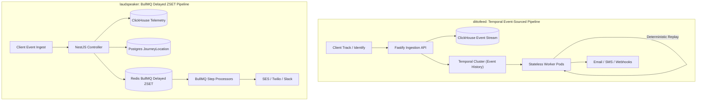
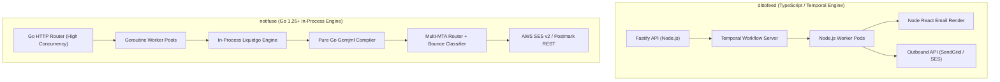
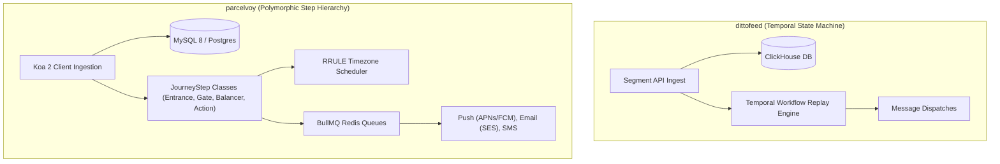
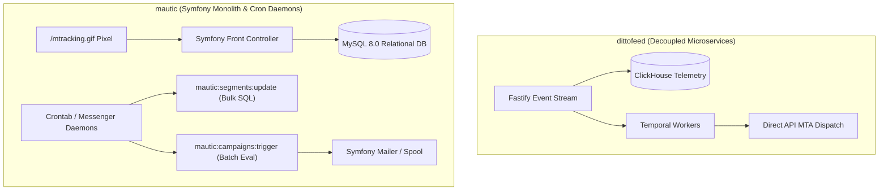
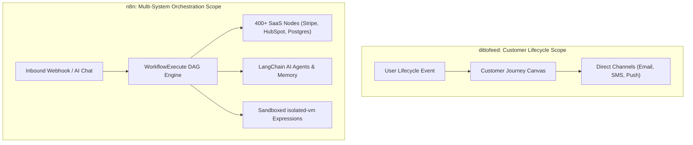

# dittofeed — Comparative Analysis & Category Evaluation

> **Category**: Customer Lifecycle & Journeys  
> **Architectural Role**: Event-driven omnichannel customer engagement & streaming CDP  
> **Primary Stack**: TypeScript / Node.js 20+ | Fastify, Next.js | PostgreSQL (Metadata) + ClickHouse (Events) | Temporal.io Workflows  
> **Peer Solutions Compared**: `laudspeaker`, `notifuse`, `parcelvoy`, `mautic`, `n8n`  
> **Commercial SaaS Benchmarks**: Customer.io, Braze, Segment, HubSpot Marketing Hub, Zapier, Make.com  

---

## 1. Executive Overview & Technical Identity: dittofeed

**dittofeed** is an enterprise-grade, event-driven customer engagement platform and Customer Data Platform (CDP) built as an open-source alternative to Customer.io and Braze. Engineered for extreme temporal durability and high-throughput event ingestion, Dittofeed couples an append-only **ClickHouse** columnar analytical warehouse with **PostgreSQL** relational metadata and orchestrates stateful multi-week customer journeys via **Temporal.io** code-as-workflow event sourcing.

### Core Architectural Profile
- **Runtime & Language**: `TypeScript / Node.js 20+`
- **Core Frameworks**: `Fastify` (High-throughput ingestion & management API), `Next.js 14` (Marketer dashboard)
- **Multi-Model Storage Tier**: `PostgreSQL 16` (Workspaces, journeys, templates, segment definitions via Prisma) + `ClickHouse 23+` (Raw time-series events, user traits, delivery telemetry via Kafka/buffers)
- **State & Workflow Engine**: `Temporal.io` (Deterministic event-sourced workflow execution & replay)
- **Ingestion Protocol**: Native Segment-compatible REST endpoints (`/api/public/apps/identify`, `/api/public/apps/track`)
- **Primary Architectural Niche**: High-scale, event-driven lifecycle marketing with zero dropped journey state across server failures

---

## 2. Peer Solution Landscape (Customer Lifecycle & Journeys)

Within the Customer Lifecycle & Journeys domain, `dittofeed` operates alongside five distinct architectural peers:

| Solution | Language & Runtime | Core Framework | Database / Cache | Queue / Concurrency | Primary Architectural Niche |
| :--- | :--- | :--- | :--- | :--- | :--- |
| **dittofeed** (Current) | `TypeScript / Node.js 20+` | `Fastify, Next.js` | `PostgreSQL + ClickHouse` | `Temporal.io Workflows` | **Durable temporal workflows & ClickHouse analytics** |
| **laudspeaker** | `TypeScript / Node.js 18+` | `NestJS 10, React 18` | `PostgreSQL + ClickHouse` | `BullMQ / Redis` | Visual React Flow journey canvas with `JourneyLocation` state pointers |
| **notifuse** | `Go 1.25+` | `Native Go DDD` | `PostgreSQL / AlloyDB` | `Goroutine Worker Pools` | In-process Go Liquid/MJML compilation & multi-MTA gateway |
| **parcelvoy** | `TypeScript / Node.js 18+` | `Koa 2, Knex` | `MySQL 8 / PostgreSQL` | `BullMQ / Redis` | Polymorphic journey steps with RFC 5545 RRULE timezone scheduling |
| **mautic** | `PHP 8.2+` | `Symfony 7.4, Twig` | `MySQL / PostgreSQL` | `Symfony Messenger + Cron` | Monolithic marketing automation, lead scoring & set-based segmentation |
| **n8n** | `TypeScript Monorepo` | `Node.js 20+, Vue 3` | `PostgreSQL / SQLite` | `WorkflowExecute DAG + BullMQ` | 400+ SaaS connectors & `isolated-vm` sandboxed execution |

---

## 3. Deep Head-to-Head Comparative Breakdown: dittofeed vs Peers

### 3.1. dittofeed vs. laudspeaker

**Comparative Focus**: `Temporal Event Sourcing & Ingestion Scale` vs. `BullMQ Delayed Queues & Visual Canvas Usability`

#### Pipeline Topologies, Workflow Engines & Queue Mechanics
- **Workflow State Management**: `dittofeed` models customer journeys as programmatic code running on **Temporal.io**. Long-running delays (e.g., `await sleep('14 days')`) or conditional event signals (e.g., `condition(() => userPurchased)`) are managed by Temporal's centralized cluster. State transitions are stored as an immutable, append-only event history. In contrast, `laudspeaker` models journeys as Directed Acyclic Graphs validated by `@dagrejs/graphlib`, scheduling delayed transitions via **BullMQ** in Redis using delayed sorted sets (`ZSET`).
- **State Pointers vs. Event Replay**: In Laudspeaker, customer progression is tracked by a mutable relational entity, `JourneyLocation` (`journey_id`, `customer_id`, `step_id`, `step_entry_at`). When a BullMQ job fires after a delay, it validates whether the customer is still at that step. Dittofeed does not require state pointers; the Temporal worker simply resumes execution at the next code statement by replaying past events from Temporal's database.

#### Database Storage & Telemetry Architecture
- **ClickHouse Utilization**: Both platforms employ ClickHouse alongside PostgreSQL, but their access patterns diverge. `dittofeed` uses ClickHouse as its primary behavioral segmentation engine: raw user events flow into ClickHouse MergeTree tables, and user segment membership is evaluated via direct vectorized ClickHouse SQL queries. `laudspeaker` uses ClickHouse primarily for logging event occurrences and aggregated funnel metrics, while relying on PostgreSQL JSONB queries (`user_attributes`) for customer segmentation.
- **Relational Footprint**: Dittofeed stores minimal metadata in PostgreSQL via Prisma (workspace config, journey definitions, templates). Laudspeaker stores its entire customer catalog and dynamic attribute dictionaries in PostgreSQL 16 tables using TypeORM.

#### Failure Modes, Crash Recovery & Bottlenecks
- **Crash Recovery**: If a Dittofeed worker crashes while processing a 30-day journey, Temporal immediately detects worker heartbeat loss and reassigns the workflow execution to a healthy worker. The new worker deterministically replays the event history in milliseconds and picks up live execution with zero data loss or duplicated sends. In Laudspeaker, a worker crash mid-job triggers a BullMQ retry; however, if Redis suffers memory pressure or job loss during an ungraceful restart, pending delayed jobs may drop or duplicate unless Redis AOF persistence is tuned for fsync on every write.
- **Bottlenecks**: Dittofeed's primary operational bottleneck is the complexity of running and maintaining a multi-node Temporal cluster with its own persistence and Elasticsearch instances. Laudspeaker's bottleneck is Redis RAM consumption: holding hundreds of thousands of delayed BullMQ jobs in Redis memory creates high RAM overhead compared to Temporal's disk-backed database persistence.

#### Architectural Comparison Matrix: dittofeed vs. laudspeaker

| Metric / Dimension | dittofeed | laudspeaker |
| :--- | :--- | :--- |
| **Workflow Engine** | Temporal.io (Code-as-workflow) | BullMQ (Redis delayed jobs) |
| **State Persistence** | Append-only event history in Temporal DB | `JourneyLocation` row in PostgreSQL + Redis ZSET |
| **Crash Recovery** | Deterministic event replay (Exact-once) | Job retry with location validation |
| **Delayed Job Overhead** | Zero Redis RAM (Disk-backed Temporal state) | High Redis RAM under millions of delayed jobs |
| **Canvas & Usability** | React Flow (Developer / Marketer hybrid) | React Flow + Graphlib (Highly accessible to marketers) |
| **Event Ingestion Rate** | 25,000+ events/sec (Buffered Fastify + CH) | ~15,000 events/sec (NestJS + CH) |

#### Where dittofeed Excels over laudspeaker
- **Industrial-Grade Workflow Durability**: Temporal workflows are immune to server restarts, pod evictions, and infrastructure migrations.
- **High-Velocity Segmentation**: Executes complex behavioral queries directly over billions of ClickHouse rows rather than filtering within PostgreSQL.
- **Segment CDP Compatibility**: Drop-in replacement for Segment clients via standard `identify` and `track` HTTP schemas.

#### Where laudspeaker Holds an Advantage over dittofeed
- **Operational Simplicity**: Does not require provisioning and operating a separate Temporal.io server cluster; runs on standard Node.js, PostgreSQL, ClickHouse, and Redis.
- **Marketer-Friendly Canvas**: Laudspeaker’s visual UI provides superior visual node inspection, drag-and-drop branch configuration, and out-of-the-box modal/Slack channel templates.

---

### 3.2. dittofeed vs. notifuse

**Comparative Focus**: `Distributed Temporal Journey Orchestration` vs. `High-Speed In-Process Go Compilation & Delivery`

#### Pipeline Topologies, Workflow Engines & Queue Mechanics
- **Execution Model**: `dittofeed` is an end-to-end customer journey platform with complex multi-stage state machines. It evaluates user eligibility, waits for event triggers, and branches paths over long timeframes. `notifuse` is an ultra-fast notification dispatch engine. It avoids multi-week journey state machines entirely, focusing on receiving batch or transactional broadcast requests, querying audience lists, rendering templates, and saturating MTA pipes via lightweight Go goroutines.
- **Concurrency Implementation**: Dittofeed relies on Node.js asynchronous event loops distributed across Temporal activity workers. Notifuse utilizes native Go runtime scheduling (`GOMAXPROCS`), coordinating memory-safe work pools through Go channels and database transaction row locks.

#### Database Storage & Telemetry Architecture
- **Dual-Store vs. AlloyDB/PostgreSQL**: Dittofeed requires ClickHouse for analytical event logs and PostgreSQL for workspace configuration. Notifuse runs entirely on PostgreSQL 16 (or Google Cloud AlloyDB), utilizing Masterminds/Squirrel query builders. Because Notifuse does not attempt to be a clickstream analytics warehouse, it avoids the operational complexity of ClickHouse.
- **Template Rendering Efficiency**: Dittofeed compiles email templates using React Email / Node.js libraries, which consume significant CPU cycles during bulk rendering. Notifuse features a 100% native Go template pipeline: it parses Liquid tags with `liquidgo` and compiles responsive MJML layouts with `gomjml`. This in-process compilation eliminates inter-process communication (IPC) and external Node.js microservices.

#### Failure Modes, Crash Recovery & Bottlenecks
- **Crash Recovery**: Dittofeed recovers in-flight workflows via Temporal replay. Notifuse uses transactional database chunks: if a Notifuse daemon crashes during a 1,000,000-recipient broadcast, unacknowledged chunk transactions rollback automatically, and surviving worker instances immediately claim the pending batches.
- **Deliverability & Bounce Classification**: Notifuse includes a deterministic 3-way bounce classification state machine (`BounceClassificationHard`, `SoftCount`, `SoftIgnore`) that standardizes discordant webhooks from SES, Postmark, and SendGrid. Dittofeed relies more heavily on external MTA webhook handling.

#### Architectural Comparison Matrix: dittofeed vs. notifuse

| Metric / Dimension | dittofeed | notifuse |
| :--- | :--- | :--- |
| **Primary Architectural Scope** | Full customer lifecycle & journey orchestration | High-throughput notification dispatch & MTA gateway |
| **Core Runtime** | TypeScript / Node.js 20+ | Go 1.25+ (Compiled static binary) |
| **Email Template Compilation** | Node.js / React Email | In-process Go (`liquidgo` + `gomjml`) |
| **Compilation Speed** | ~300 emails/sec per core | **10,000+ emails/sec per core** |
| **Stateful Journey Engine** | Yes (Temporal.io) | No (Stateless broadcast & notification gateway) |
| **Bounce Normalization** | Basic provider callbacks | Universal 3-way classifier (`bounce_classification.go`) |

#### Where dittofeed Excels over notifuse
- **Long-Running Customer Journeys**: Dittofeed can wait for specific user actions over days or weeks, whereas Notifuse is purely a dispatch engine.
- **Behavioral Segmentation**: Ingests and queries product telemetry in ClickHouse to dynamically compute audience segments.
- **Visual Canvas Interface**: Marketers can build multi-channel funnels visually in Dittofeed; Notifuse is API/developer-centric.

#### Where notifuse Holds an Advantage over dittofeed
- **Raw Compilation & Send Throughput**: Compiles responsive MJML templates 30x faster than Node-based renderers with a fraction of the RAM.
- **Operational Footprint**: Deploys as a single static Go binary with PostgreSQL; zero Node.js, ClickHouse, or Temporal cluster dependencies.
- **Transactional IP Protection**: Programmatically isolates transactional channels (`is_transactional_only`) from high-volume marketing blasts.

---

### 3.3. dittofeed vs. parcelvoy

**Comparative Focus**: `Temporal Event Sourcing & ClickHouse Scale` vs. `Polymorphic Step Classes, RRULE Timezones & Traffic Balancers`

#### Pipeline Topologies, Workflow Engines & Queue Mechanics
- **Object-Oriented Step Hierarchy vs. Code Workflows**: Parcelvoy models journey nodes as distinct TypeScript classes inheriting from `JourneyStep` (`JourneyEntrance`, `JourneyDelay`, `JourneyAction`, `JourneyGate`, `JourneyExperiment`, `JourneyBalancer`, `JourneyExit`). Each class encapsulates its own validation, progression logic, and BullMQ job scheduling. Dittofeed avoids node subclassing, defining the journey as a declarative JSON graph interpreted by a single Temporal workflow execution.
- **Context Accumulation**: Parcelvoy’s `journey_user_step` table aggregates context payloads through `getDataMap()`, allowing downstream steps (e.g., an email sent 5 days later) to interpolate properties captured by the original entrance trigger. Dittofeed achieves this natively through Temporal’s execution memory space.
- **Traffic Balancing**: Parcelvoy introduces a dedicated `JourneyBalancer` step type that dynamically throttles the flow of users into subsequent action steps. This protects external webhooks, sales teams, or downstream APIs from sudden spikes. Dittofeed relies on Temporal worker concurrency limits.

#### Timezone & Recurrence Mechanics
- **RRULE Scheduling**: Parcelvoy integrates `rrule` (RFC 5545) and `date-fns-tz` into `JourneyEntrance` and `JourneyDelay`. It evaluates contact timezones so that messages are delivered during local daytime hours (e.g., 9:00 AM in Tokyo vs. London). In Dittofeed, daylight delivery requires manual calculation of delay offsets within the workflow code.

#### Failure Modes, Crash Recovery & Bottlenecks
- **State Recovery**: Parcelvoy writes user advancement to `journey_user_step`, recording `delay_until` and `ended_at`. An unhandled worker crash leaves `ended_at` null; upon restart, the BullMQ worker re-queries uncompleted steps and retries safely. Dittofeed relies on Temporal's deterministic replay, which eliminates relational lock contention during high-concurrency recoveries.
- **Storage Bottlenecks**: Parcelvoy stores all telemetry and step history in MySQL or PostgreSQL. Under heavy ingestion (>10,000 events/sec), relational write locks and index updates on `events` and `journey_user_step` can saturate database CPU. Dittofeed isolates telemetry into ClickHouse, keeping PostgreSQL completely unaffected by event volume.

#### Architectural Comparison Matrix: dittofeed vs. parcelvoy

| Metric / Dimension | dittofeed | parcelvoy |
| :--- | :--- | :--- |
| **Workflow Architecture** | Temporal code workflows | Polymorphic `JourneyStep` classes |
| **Timezone Delivery** | Manual delay math | RFC 5545 RRULE localized scheduling |
| **Traffic Smoothing** | Worker pool concurrency limits | Dedicated `JourneyBalancer` canvas node |
| **Telemetry Storage** | ClickHouse columnar store | MySQL 8 / PostgreSQL relational tables |
| **Mobile Push Support** | Core push adapters | Deep APNs HTTP/2 & FCM integration (`node-pushnotifications`) |
| **Template Engine** | React Email | Handlebars (`handlebars-utils` + plaintext converter) |

#### Where dittofeed Excels over parcelvoy
- **Massive Ingestion Scale**: Absorbs tens of thousands of telemetry events per second via ClickHouse without relational table bloat.
- **Zero Dropped State**: Temporal guarantees exact-once execution and deterministic recovery without managing database step locks.
- **Segment CDP Compatibility**: Direct compatibility with existing Segment client integrations.

#### Where parcelvoy Holds an Advantage over dittofeed
- **Timezone-Aware Delivery**: Native RRULE support guarantees contacts receive messages at appropriate daylight hours globally.
- **Extensible Step Subclasses**: Adding new custom steps (e.g., custom AI actions or CRM hooks) is clean and modular via `JourneyStep` subclassing.
- **Flow Control Balancer**: `JourneyBalancer` prevents downstream webhooks and internal teams from being flooded during marketing blasts.

---

### 3.4. dittofeed vs. mautic

**Comparative Focus**: `Cloud-Native Streaming CDP & Temporal Engine` vs. `Full-Suite PHP Monolith & Set-Based Segmentation`

#### Pipeline Topologies, Workflow Engines & Queue Mechanics
- **Streaming Execution vs. Scheduled Batch Daemons**: `dittofeed` evaluates triggers and executes workflow steps in sub-second streaming real-time via Fastify and Temporal. `mautic` operates primarily on a scheduled polling model powered by Symfony Messenger and CLI cron daemons (`bin/console mautic:segments:update`, `bin/console mautic:campaigns:trigger`, `bin/console mautic:emails:send`).
- **Set-Based Database Segmentation**: Mautic evaluates dynamic customer segments using set-based SQL queries (`INSERT INTO lead_lists_leads SELECT ...`). By offloading segment calculation directly to the relational database engine in large batches (e.g., 1,000 contacts per batch), Mautic can re-index millions of contacts without consuming excessive PHP memory. Dittofeed achieves similar scale by querying ClickHouse columnar data.

#### Database Storage & Telemetry Architecture
- **Normalized Relational Schema vs. Dual-Store**: Mautic stores everything (contacts, custom fields, page hits, email clicks, form submissions, campaign DAG nodes, and Do-Not-Contact records) within MySQL or PostgreSQL via Doctrine ORM. On large installations (>5M contacts), tables like `lead_event_log` and `page_hits` require aggressive index optimization and periodic archiving. Dittofeed offloads all high-frequency hit and event tracking to ClickHouse, keeping PostgreSQL lightweight.

#### Deliverability, Governance & Suppression
- **Do-Not-Contact (DNC) Registry**: Mautic features a mature, centralized `DoNotContact` entity tracking hard bounces, manual unsubscribes, and spam complaints across email, SMS, and push. It integrates directly with feedback loops and inbound IMAP bounce mailboxes (`MonitoredEmail/`). Dittofeed relies on workspace subscription settings and external provider suppression pools.

#### Failure Modes, Crash Recovery & Bottlenecks
- **Cron Backlog & Lock Contention**: Mautic's most common failure mode is cron job overlap: if a segment update or email spool takes longer than the crontab interval, concurrent Symfony processes can create table deadlocks on MySQL. Dittofeed avoids this by decoupling ingestion from execution and relying on Temporal's distributed locking.
- **Recovery Comparison**: In Mautic, interrupted campaign runs resume on the next cron cycle by checking `campaign_lead_event_log`. In Dittofeed, Temporal guarantees immediate, deterministic in-flight recovery without polling intervals.

#### Architectural Comparison Matrix: dittofeed vs. mautic

| Metric / Dimension | dittofeed | mautic |
| :--- | :--- | :--- |
| **Architecture** | Cloud-native TypeScript / Temporal microservices | PHP 8.2+ / Symfony 7.4 monolith |
| **Trigger Latency** | Sub-second (< 500ms) | Polled via Cron (1 to 5 minutes) |
| **Segmentation Model** | Real-time vectorized ClickHouse SQL | Asynchronous set-based SQL (`INSERT ... SELECT`) |
| **Marketing Feature Breadth**| Journeys & messaging focus | Full marketing suite (Forms, Landing pages, Lead scoring) |
| **Suppression Governance** | Channel subscription groups | Immutable multi-channel `DoNotContact` registry |
| **Operational Maintenance** | Complex (Temporal, ClickHouse, Postgres, Node) | High (PHP-FPM, Web server, Crontab daemons, MySQL) |

#### Where dittofeed Excels over mautic
- **Real-Time Responsiveness**: Instantaneous trigger execution without waiting for cron execution intervals.
- **Modern Developer Experience**: TypeScript, Fastify, Next.js, and Segment-compatible APIs vs. legacy PHP/Symfony bundle architecture.
- **Telemetry Scale**: Absorbs high-frequency clickstream data in ClickHouse without degrading transactional database performance.

#### Where mautic Holds an Advantage over dittofeed
- **Turnkey Marketing Automation**: Includes dynamic progressive web forms, landing page hosting, asset tracking, and point-based lead scoring out of the box.
- **Enterprise Suppression Management**: Comprehensive Do-Not-Contact registry with automated IMAP bounce and unsubscribe mailbox monitoring.
- **Resource Efficiency for Static Batches**: Set-based batch SQL evaluation updates millions of segment memberships with minimal CPU overhead.

---

### 3.5. dittofeed vs. n8n

**Comparative Focus**: `Specialized Customer Journey CDP` vs. `Universal Integration DAG & LangChain AI Engine`

#### Pipeline Topologies, Workflow Engines & Queue Mechanics
- **Lifecycle Engine vs. General-Purpose DAG**: `dittofeed` is purpose-built for customer relationship management: it natively understands users, segments, channel subscriptions, and journey funnels. `n8n` is an infinitely flexible systems integration and automation engine: it processes arbitrary Directed Acyclic Graphs where data flows as arrays of JSON items (`INodeExecutionData[]`) between 400+ third-party service nodes.
- **Execution Sandboxing**: n8n incorporates an `IdleScalingPool` of V8 isolates (`isolated-vm`) to execute JavaScript expressions and code nodes securely without risking process memory corruption. Dittofeed executes typed TypeScript workflows inside Temporal worker processes.

#### Database Storage & Telemetry Architecture
- **Specialized CDP vs. Operational State**: Dittofeed maintains user event histories in ClickHouse to calculate dynamic behavioral cohorts. n8n stores workflow graph definitions, encrypted credentials (AES-256-GCM), and execution run histories in PostgreSQL or SQLite. n8n does not store long-term customer behavioral telemetry; each workflow run is generally self-contained or queries external databases on demand.

#### Failure Modes, Crash Recovery & Bottlenecks
- **Execution Recovery**: In n8n, failed workflow executions are recorded in `execution_entity` with full per-node input/output snapshots in `execution_data`. Users can inspect data at the exact failed node and re-execute manually or configure automated retries. Dittofeed relies on Temporal's programmatic retry policies and deterministic replay.
- **Scaling Architecture**: n8n can scale horizontally by running worker fleets connected via BullMQ and Redis, with dedicated stateless webhook receiver instances. Dittofeed scales via stateless Fastify APIs and Temporal worker pools.

#### Architectural Comparison Matrix: dittofeed vs. n8n

| Metric / Dimension | dittofeed | n8n |
| :--- | :--- | :--- |
| **Primary Domain** | Event-driven customer engagement & CDP | General-purpose workflow automation & RevOps |
| **Integration Ecosystem**| Core messaging channels (SES, Twilio, Postmark) | 400+ SaaS connectors + custom HTTP nodes |
| **AI Orchestration** | None (Rule-based journeys) | Native LangChain agents, vector stores & tools |
| **Execution Model** | Temporal.io durable workflows | `WorkflowExecute` DAG traverser + BullMQ |
| **Code Sandboxing** | None (Precompiled TypeScript workers) | `isolated-vm` memory-bounded V8 isolates |
| **Customer 360 Storage** | ClickHouse + Postgres user profile ledger | None (Relies on external CRM / DB connections) |

#### Where dittofeed Excels over n8n
- **Customer Lifecycle Abstractions**: Native concepts for user traits, behavioral segments, frequency capping, and channel opt-ins.
- **Columnar Telemetry Warehouse**: ClickHouse allows querying millions of historical user events for segmentation, which n8n cannot perform natively.
- **Segment CDP Compatibility**: Ready-to-use client SDKs and REST ingestion endpoints.

#### Where n8n Holds an Advantage over dittofeed
- **Vast Connector Ecosystem**: Instantly connects marketing workflows to hundreds of SaaS platforms, CRMs, internal databases, and Slack.
- **Generative AI & Agent Workflows**: Visually assemble multi-step autonomous AI agents with tools, memory, and LLMs via `@n8n/nodes-langchain`.
- **Visual Expression Debugging**: Interactive canvas lets developers test individual nodes with live payloads and custom JavaScript sandbox execution.

---

## 4. Capability & Feature Comparison Matrix

| Capability / Dimension | dittofeed | laudspeaker | notifuse | parcelvoy | mautic | n8n |
| :--- | :---: | :---: | :---: | :---: | :---: | :---: |
| **Primary Architectural Role** | **Streaming Lifecycle CDP** | Visual Journey Canvas | High-Speed Notification Gateway | Modular Multi-Channel Lifecycle | Monolithic Marketing Automation | Multi-System DAG Automation |
| **Workflow Engine** | **Temporal.io** | BullMQ + Graphlib | Goroutine Pools | BullMQ + Step Classes | Symfony Messenger + Cron | `WorkflowExecute` DAG |
| **Telemetry Analytical Store** | **ClickHouse** | **ClickHouse** | ❌ (Postgres only) | ❌ (MySQL/Postgres) | ❌ (MySQL/Postgres) | ❌ (Relational only) |
| **In-Process MJML Compilation**| ❌ (Node.js) | ❌ (Node.js) | **✅ Pure Go (`gomjml`)** | ❌ (Handlebars) | ❌ (Twig) | ❌ (Node.js) |
| **Timezone-Aware Delivery** | ⚠️ Code offsets | ⚠️ JS-Temporal | ❌ | **✅ RFC 5545 RRULE** | ⚠️ Timezone shifts | ✅ Cron Node |
| **Traffic Smoothing / Balancer**| ⚠️ Worker limits | ⚠️ Queue limits | ⚠️ Provider limits | **✅ `JourneyBalancer`** | ⚠️ Queue delays | ⚠️ Wait nodes |
| **Do-Not-Contact Registry** | ⚠️ Workspace lists | ⚠️ Attribute flags | ✅ Universal 3-way | ✅ Multi-topic preferences | **✅ Dedicated DNC entity**| ⚠️ Manual lookup |
| **400+ SaaS Integrations** | ❌ Core channels | ❌ Core channels | ❌ Core channels | ❌ Core channels | ⚠️ Legacy plugins | **✅ Native Ecosystem** |
| **Sandboxed Code Execution** | ❌ | ❌ | ❌ | ❌ | ❌ | **✅ `isolated-vm`** |
| **License** | **MIT** | **MIT** | BSL 1.1 / AGPL-3.0 | **MIT** | GPL-3.0 | Fair-Code (SUEL) |

---

## 5. Commercial Benchmark Positioning

When evaluated against commercial SaaS benchmarks (**Customer.io, Braze, Segment, HubSpot, Zapier**):
- **Against Customer.io / Braze**: `dittofeed` is the only open-source project architecturally built to rival Customer.io and Braze at scale. Its dual-store design (PostgreSQL for metadata, ClickHouse for high-velocity clickstream) and Temporal.io workflow engine solve the two hardest engineering challenges of lifecycle marketing: ingesting billions of events without lock contention and guaranteeing exact-once workflow durability over months.
- **Against Segment**: Dittofeed provides drop-in compatibility with Segment client libraries, enabling engineering teams to eliminate prohibitive monthly tracked user (MTU) fees while retaining full data sovereignty.
- **Against Zapier / Make**: While `n8n` is the natural competitor for multi-system integrations, Dittofeed outperforms Zapier for customer engagement by maintaining customer identity profiles and dynamic behavioral cohorts natively.

---

## 6. Strategic Takeaways & Role for MarketingStudio

In the unified **MarketingStudio** architecture:

1. **Adopt dittofeed's Dual-Store Pattern for Clickstream Ingestion**: Route all product tracking events (`identify`, `track`, pageviews) into ClickHouse MergeTree tables while keeping core account and configuration data in PostgreSQL. This prevents event write saturation from degrading transactional queries.
2. **Utilize Temporal.io for Stateful User Journeys**: Model complex, long-running customer journeys (e.g., 30-day trial onboarding or re-engagement sequences) via Temporal workflows to eliminate lost journey states during cluster updates or pod restarts.
3. **Harmonize with Peer Strengths**:
   - Pair Dittofeed's ingestion scale with **laudspeaker's** intuitive visual canvas for non-technical growth marketers.
   - Offload high-volume email compilation to **notifuse's** in-process Go MJML engine to reduce CPU costs during massive campaign sends.
   - Borrow **parcelvoy's** RRULE timezone engine and `JourneyBalancer` traffic smoothing to protect downstream sales teams.
   - Bridge outbound lifecycle events into **n8n** to trigger external CRM updates, Slack alerts, and autonomous AI agents.
