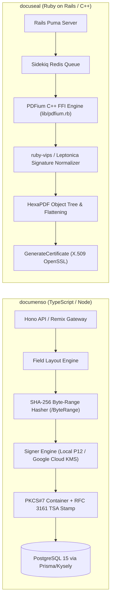
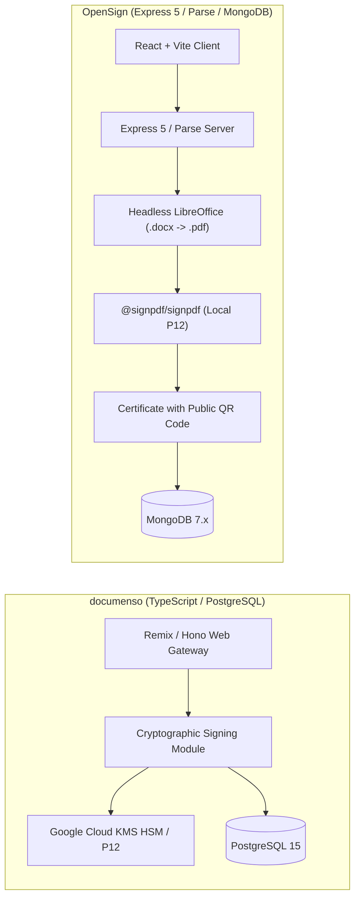
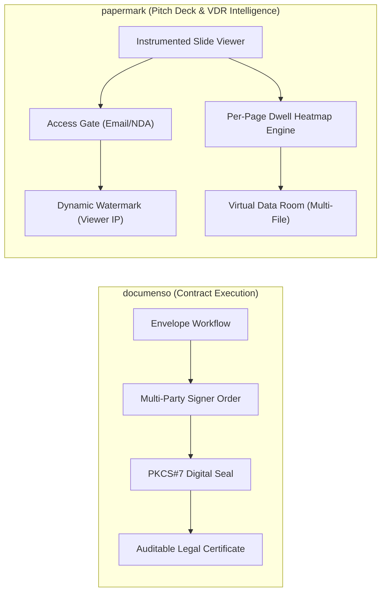

# documenso — Comparative Analysis & Category Evaluation

> **Category**: E-Signature & Document Tracking  
> **Architectural Role**: Enterprise cryptographic e-signature platform, ISO 32000-1 PKCS#7 byte-range sealing engine & developer SDK  
> **Primary Stack**: TypeScript 5.x | React Router v7 (Remix) & Hono | PostgreSQL 15 (Prisma ORM + Kysely) | Inngest / Local Queue | Google Cloud KMS HSM / Local P12  
> **Peer Solutions Compared**: `docuseal`, `OpenSign`, `papermark`  
> **Commercial SaaS Benchmarks**: DocuSign, Adobe Sign, PandaDoc, Dropbox Sign (HelloSign)  

---

## 1. Executive Overview & Technical Identity: documenso

**documenso** represents the enterprise-grade cryptographic signing and developer-first infrastructure tier within the **E-Signature & Document Tracking** domain. Engineered as a modern TypeScript monorepo (Turborepo), Documenso is built to serve as an unencumbered, transparent, and legally binding alternative to proprietary e-sign vendors such as DocuSign and Adobe Sign.

Documenso pairs a Remix (React Router v7) frontend and headless Hono REST/tRPC API server with an advanced PDF manipulation subsystem (`@libpdf/core`, `pdfjs-dist`). Rather than merely pasting static signature images over PDF pages, Documenso adheres strictly to international digital signature specifications (**ISO 32000-1 Section 12.8**). It calculates SHA-256 byte-range hashes over document binaries, embeds DER-encoded PKCS#7/CMS cryptographic containers, and supports hardware-backed key protection via Google Cloud KMS HSM alongside RFC 3161 trusted timestamp authorities (TSA) to deliver Advanced Electronic Signatures (AES) and Qualified Electronic Signatures (QES).

### Core Architectural Profile
- **Runtime & Language**: `TypeScript 5.x / Node.js 20+ LTS`
- **Core Framework**: `React Router v7 (Remix) web interface + Hono headless API server (Port 3000)`
- **Persistence Layer**: `PostgreSQL 15 (Prisma ORM + Kysely query builder for high-performance reads)`
- **Concurrency & Queue Model**: `Inngest asynchronous job engine / local database queue`
- **Domain Specialization**: Legally binding cryptographic electronic signatures, ISO 32000-1 byte-range sealing, developer SDK (`@documenso/embed`) & Cloud KMS HSM integration

---

## 2. Peer Solution Landscape (E-Signature & Document Tracking)

Within this category, `documenso` operates alongside the following peer solutions:

| Solution | Language & Runtime | Core Framework | Database / Cache | Queue / Concurrency | Primary Architectural Niche |
| :--- | :--- | :--- | :--- | :--- | :--- |
| **documenso** (Current) | `TypeScript / Node.js` | `Remix, Hono, tRPC` | `PostgreSQL 15 (Prisma+Kysely)`| `Inngest / DB Queue` | **ISO 32000-1 PKCS#7 cryptographic sealing & Cloud KMS** |
| **docuseal** | `Ruby 3.3+ / C++` | `Rails 7.2/8.0, Vue.js` | `PostgreSQL / SQLite3` | `Sidekiq / Redis` | High-throughput native C++ PDFium FFI & `<docuseal-form>` component |
| **OpenSign** | `JavaScript / Node.js` | `Express 5, Parse Server`| `MongoDB 7.x, Local/S3` | `Parse Cloud Code` | Turnkey Parse Server e-signature & LibreOffice `.docx` conversion |
| **papermark** | `TypeScript / Node.js` | `Next.js, Tailwind` | `PostgreSQL (Prisma)` | `Trigger.dev Workers` | Open-source DocSend alternative for per-page dwell heatmaps & VDR |

---

## 3. Deep Head-to-Head Comparative Breakdown: documenso vs Peers

### 3.1. documenso vs. docuseal

**Comparative Focus**: `Remix/Hono TypeScript & ISO 32000-1 Cloud KMS Sealing` vs. `Ruby on Rails & Native C++ PDFium FFI Acceleration`

#### Detailed Architectural Contrast
- **Rendering & Manipulation Subsystem**: `documenso` handles PDF coordinate mapping, field placement, and parsing using pure TypeScript and Web standards (`@libpdf/core`, `pdfjs-dist`). `docuseal` relies on low-level native C++ libraries via Ruby FFI (`pdfium.rb`), leveraging Chromium's PDFium engine for rasterization and text extraction, paired with `ruby-vips` for ultra-fast image processing and HexaPDF for incremental saves.
- **Cryptographic Assurance & Standards**: `documenso` delivers enterprise-grade cryptographic sealing following ISO 32000-1 specifications. It computes byte-range exclusions (`/ByteRange`), injects PKCS#7/CMS signature blocks, and supports hardware security modules (Google Cloud KMS HSM) and RFC 3161 Time-Stamp Authorities (TSA), resulting in verified green ribbons in Adobe Acrobat. `docuseal` applies X.509 digital certificates and generates a detailed audit trail certificate, but does not provide Cloud KMS HSM key management.
- **Embedding Paradigm**: `documenso` provides a TypeScript SDK and React embed library (`@documenso/embed`), optimizing for React/Next.js single-page applications. `docuseal` ships a zero-dependency HTML custom web component (`<docuseal-form>`), which can be embedded in any backend or frontend with a single script tag.
- **Failure Modes & Bottlenecks**:
  - `documenso`: Memory overhead increases during large multi-hundred-page PDF manipulations within Node.js V8 heap limits. External TSA calls introduce network latency if the timestamp authority is unreachable.
  - `docuseal`: Requires compiled C++ binaries and shared dynamic libraries (`libpdfium.so`, `libleptonica.so`), complicating minimal container builds.

#### Architectural Comparison Matrix: documenso vs. docuseal

| Dimension | documenso | docuseal | Architectural Implication |
| :--- | :--- | :--- | :--- |
| **PDF Engine** | **`@libpdf/core` + PDF.js** | **Google PDFium (C++ FFI)** | Docuseal renders and rasterizes pages faster; Documenso requires no C++ native compilation. |
| **Digital Signature Standard** | **ISO 32000-1 PKCS#7 / CMS** | **X.509 OpenSSL Seal** | Documenso achieves formal eIDAS AES/QES compliance with verified Adobe Acrobat trust. |
| **Hardware Key Protection** | **Google Cloud KMS HSM** | **Local File Certificates** | Documenso protects private signing keys in FIPS 140-2 Level 3 hardware modules. |
| **Web Embedding** | **React `@documenso/embed`** | **Native `<docuseal-form>`** | Docuseal's web component embeds into any framework; Documenso offers deeper React integration. |
| **Database Access** | **Prisma ORM + Kysely** | **ActiveRecord (PostgreSQL/SQLite)**| Documenso pairs Prisma type safety with Kysely high-performance SQL query compilation. |

---

### 3.2. documenso vs. OpenSign

**Comparative Focus**: `Modern Remix/Hono Monorepo & Cloud KMS` vs. `Parse Server Architecture & LibreOffice Conversion`

#### Detailed Architectural Contrast
- **Backend Architecture & Database**: `documenso` uses modern TypeScript tooling (Hono, tRPC, Prisma, Kysely) on PostgreSQL 15. `OpenSign` is built on Express 5 and Parse Server, using MongoDB for document storage and Parse's object-level Access Control Lists (ACLs) for multi-tenancy.
- **Document Ingestion Capabilities**: `documenso` accepts pre-rendered PDF files. `OpenSign` includes a native headless LibreOffice conversion pipeline (`libreoffice-convert`), allowing users to upload `.docx`, `.odt`, or `.rtf` files and automatically convert them into vector-perfect PDFs on the server.
- **Public Verification**: `OpenSign` embeds a public QR code on its Certificate of Completion, allowing any third party to verify document authenticity with a mobile camera. `documenso` verifies authenticity through cryptographic PDF viewers (Adobe Acrobat, Preview) and internal audit log APIs.

#### Architectural Comparison Matrix: documenso vs. OpenSign

| Dimension | documenso | OpenSign | Architectural Implication |
| :--- | :--- | :--- | :--- |
| **Backend Framework** | **Hono + Remix + tRPC** | **Express 5 + Parse Server** | Documenso offers modern type-safe developer ergonomics; OpenSign uses Parse Server BaaS patterns. |
| **Office Doc Conversion** | **Not Supported (PDF Only)** | **Native LibreOffice (.docx/.odt)** | OpenSign automatically converts Word documents; Documenso requires upstream PDF generation. |
| **Database Paradigm** | **Relational (PostgreSQL 15)** | **Document Store (MongoDB 7.x)** | Documenso enforces strict relational integrity; OpenSign uses flexible BSON document collections. |
| **Verification Method** | **PDF Cryptographic Container** | **Public QR Code + PDF Signature** | OpenSign simplifies human verification via smartphone QR scanning. |

---

### 3.3. documenso vs. papermark

**Comparative Focus**: `Cryptographically Binding Electronic Signatures` vs. `Per-Page Dwell Telemetry & Virtual Data Rooms`

#### Detailed Architectural Contrast
- **Functional Domain**: `documenso` executes legally binding electronic contracts (NDAs, master services agreements, enterprise orders). `papermark` tracks viewer engagement on sales pitch decks, investor presentations, and due diligence Virtual Data Rooms (VDR).
- **Core Security Focus**: `documenso` provides tamper-evident cryptographic protection (SHA-256 byte-range hashes, digital certificates). `papermark` provides access security and leak deterrence (dynamic watermarks displaying viewer email and IP, email gating, password protection, and clickwrap NDAs).
- **Telemetry & Interaction**: `documenso` captures signer events (viewed, signed, rejected). `papermark` streams continuous per-second dwell time beacons for every page, revealing exactly which slides prospects read and where they dropped off.

#### Architectural Comparison Matrix: documenso vs. papermark

| Dimension | documenso | papermark | Architectural Implication |
| :--- | :--- | :--- | :--- |
| **Core Objective** | **Contract Execution & Legal Signature** | **Pitch Deck Telemetry & VDR Sharing** | Complementary deal stages: Papermark qualifies interest; Documenso seals the contract. |
| **Security Mechanism** | **PKCS#7 / CMS Cryptographic Hashes** | **Dynamic Watermarking & Gating** | Documenso prevents document tampering; Papermark prevents document leaking. |
| **Viewer Analytics** | **Lifecycle Audit Timestamps** | **Per-Page Dwell Duration Heatmaps** | Papermark provides deep slide-by-slide reading behavior analytics. |
| **Data Room Support** | **Envelopes & Templates** | **Full Multi-Folder VDR** | Papermark organizes multi-document M&A due diligence with Q&A threads. |

---

## 4. Capability & Feature Comparison Matrix

| Dimension / Capability | documenso | docuseal | OpenSign | papermark |
| :--- | :---: | :---: | :---: | :---: |
| **ISO 32000-1 PKCS#7 Digital Signatures** | ✅ Native | ⚠️ X.509 Seal | ✅ @signpdf | ❌ |
| **Hardware KMS HSM Integration** | ✅ (Google Cloud KMS) | ❌ | ❌ | ❌ |
| **Native C++ PDFium Acceleration** | ❌ | ✅ (lib/pdfium.rb) | ❌ | ❌ |
| **Office (.docx) Auto-Conversion** | ❌ | ⚠️ (HTML to PDF) | ✅ (LibreOffice) | ⚠️ (PPTX) |
| **Embeddable Web Component** | ⚠️ React SDK | ✅ `<docuseal-form>` | ⚠️ iFrame | ⚠️ iFrame |
| **Public QR Verification Code** | ❌ | ❌ | ✅ | ❌ |
| **Per-Page Dwell Time Heatmaps** | ❌ | ❌ | ❌ | ✅ |
| **Virtual Data Rooms (VDR)** | ❌ | ❌ | ❌ | ✅ |
| **Dynamic Identity Watermarking** | ❌ | ❌ | ❌ | ✅ |
| **Primary Database** | PostgreSQL 15 | PostgreSQL / SQLite | MongoDB 7.x | PostgreSQL |

---

## 5. Commercial Benchmark Positioning & MarketingStudio Fit

- **Against DocuSign & Adobe Sign**: `documenso` eliminates punitive per-envelope fees (\$2-\$5 per envelope on commercial APIs), providing full infrastructure sovereignty and HSM-backed digital signing.
- **MarketingStudio Synergy**: `documenso` serves as the primary legal contract and agreement execution engine in MarketingStudio, invoked whenever deals in CRM pipelines advance to the "Closing" stage.
