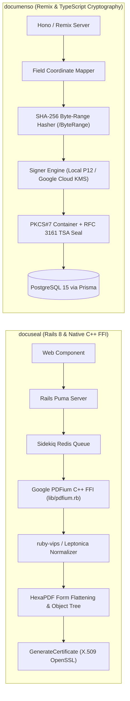
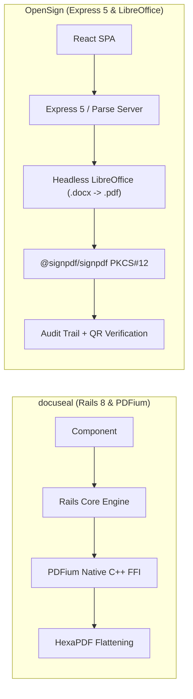
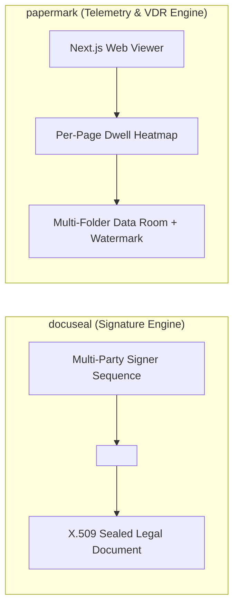

# docuseal — Comparative Analysis & Category Evaluation

> **Category**: E-Signature & Document Tracking  
> **Architectural Role**: High-throughput embeddable document signing engine, native C++ PDFium FFI rasterizer & mobile signature platform  
> **Primary Stack**: Ruby 3.3+ / Rails 7.2/8.0 (Puma) | Google PDFium (C++ FFI) | HexaPDF | ruby-vips | Sidekiq + Redis | PostgreSQL / SQLite3  
> **Peer Solutions Compared**: `documenso`, `OpenSign`, `papermark`  
> **Commercial SaaS Benchmarks**: DocuSign, PandaDoc, SignNow, Dropbox Sign (HelloSign)  

---

## 1. Executive Overview & Technical Identity: docuseal

**docuseal** represents the high-throughput, embedded signing engine within the **E-Signature & Document Tracking** domain. Built with Ruby on Rails and engineered for seamless embedding, DocuSeal allows businesses to integrate mobile-first, zero-friction contract signing into web applications, SaaS platforms, and mobile checkouts via a native HTML custom element (`<docuseal-form>`).

DocuSeal bypasses the performance bottlenecks of headless browsers and interpreted PDF parsers by utilizing direct C++ FFI bindings (`lib/pdfium.rb`) to Google's Chromium PDFium rendering engine. This enables sub-second page rasterization, dimension extraction, and thumbnail generation at native hardware speeds. Combined with `ruby-vips` for signature normalization, pure-Ruby HexaPDF for incremental saves and form field flattening, and Sidekiq background queues, DocuSeal provides an ultra-fast document execution engine capable of processing high-volume contract workflows on minimal server resources.

### Core Architectural Profile
- **Runtime & Language**: `Ruby 3.3+ (Puma application server cluster) + native C++ libraries via FFI`
- **Core Framework**: `Ruby on Rails 7.2/8.0, Hotwire (Turbo/Stimulus), Vue.js for custom client elements`
- **Persistence Layer**: `PostgreSQL / SQLite3 / Trilogy (ActiveRecord + ActiveStorage)`
- **Concurrency & Queue Model**: `Sidekiq asynchronous workers backed by Redis`
- **Domain Specialization**: Frictionless embedded signing (`<docuseal-form>`), native C++ PDFium FFI rendering, multi-party submission flows & mobile-optimized signatures

---

## 2. Peer Solution Landscape (E-Signature & Document Tracking)

Within this category, `docuseal` operates alongside the following peer solutions:

| Solution | Language & Runtime | Core Framework | Database / Cache | Queue / Concurrency | Primary Architectural Niche |
| :--- | :--- | :--- | :--- | :--- | :--- |
| **docuseal** (Current) | `Ruby 3.3+ / C++` | `Rails 7.2/8.0, Vue.js` | `PostgreSQL / SQLite3` | `Sidekiq / Redis` | **High-throughput native C++ PDFium FFI & `<docuseal-form>` component** |
| **documenso** | `TypeScript / Node.js` | `Remix, Hono, tRPC` | `PostgreSQL 15 (Prisma+Kysely)`| `Inngest / DB Queue` | ISO 32000-1 PKCS#7 cryptographic sealing & Cloud KMS |
| **OpenSign** | `JavaScript / Node.js` | `Express 5, Parse Server`| `MongoDB 7.x, Local/S3` | `Parse Cloud Code` | Turnkey Parse Server e-signature & LibreOffice `.docx` conversion |
| **papermark** | `TypeScript / Node.js` | `Next.js, Tailwind` | `PostgreSQL (Prisma)` | `Trigger.dev Workers` | Open-source DocSend alternative for per-page dwell heatmaps & VDR |

---

## 3. Deep Head-to-Head Comparative Breakdown: docuseal vs Peers

### 3.1. docuseal vs. documenso

**Comparative Focus**: `Ruby on Rails & Native C++ PDFium FFI Acceleration` vs. `Remix/Hono TypeScript & ISO 32000-1 Cloud KMS Sealing`

#### Detailed Architectural Contrast
- **Rendering & Manipulation Architecture**: `docuseal` binds directly to Google Chromium's C++ PDFium library via Ruby FFI (`lib/pdfium.rb`). Page rasterization, text bounding-box extraction, and thumbnail generation execute at compiled C++ speeds, outperforming JavaScript-based PDF parsers. Image transforms (signature resizing, anti-aliasing) are accelerated via `ruby-vips` and `libleptonica`. In contrast, `documenso` relies on pure TypeScript/JavaScript engines (`@libpdf/core`, `pdfjs-dist`) executing within Node.js V8 isolates.
- **Client Embedding Experience**: `docuseal` provides unmatched embedding ergonomics through its native HTML custom element (`<docuseal-form>`). It can be embedded into any web page, CRM portal, or mobile webview with a single `<script>` tag. `documenso` delivers a React-specific embedding library (`@documenso/embed`), requiring React or iFrames.
- **Cryptographic Enforceability**: `documenso` leads in formal cryptographic standards compliance, generating ISO 32000-1 compliant byte-range hashes (`/ByteRange`), embedding DER-encoded PKCS#7/CMS signatures, and integrating with Google Cloud KMS HSM hardware modules and RFC 3161 timestamping authorities. `docuseal` applies X.509 certificates and generates an audit certificate, but lacks native Cloud KMS HSM hardware integration.
- **Failure Modes & Bottlenecks**:
  - `docuseal`: Requires compiled C++ shared libraries (`libpdfium.so`, `libleptonica.so`), which complicates scratch container builds and cross-compilation.
  - `documenso`: Suffers higher memory consumption when rasterizing large multi-page PDF documents in Node.js V8 memory.

#### Architectural Comparison Matrix: docuseal vs. documenso

| Dimension | docuseal | documenso | Architectural Implication |
| :--- | :--- | :--- | :--- |
| **PDF Rendering Engine** | **Google PDFium (Native C++ FFI)** | **`@libpdf/core` + PDF.js** | Docuseal rasterizes documents up to 5x faster with lower memory footprint. |
| **Component Embedding** | **Zero-Dependency Web Component** | **React `@documenso/embed` SDK** | Docuseal embeds across any stack (PHP, Rails, Python, JS); Documenso targets React ecosystems. |
| **Cryptographic Standards** | **X.509 OpenSSL Digital Seal** | **ISO 32000-1 PKCS#7 / CMS** | Documenso provides strict Adobe Acrobat verified green ribbon trust and eIDAS QES. |
| **Key Storage** | **Local Certificate Files** | **Google Cloud KMS HSM** | Documenso protects private keys in tamper-proof cloud hardware security modules. |
| **Async Queue Engine** | **Sidekiq + Redis** | **Inngest / Local Database Queue** | Docuseal relies on battle-tested Ruby Sidekiq queues; Documenso uses event-driven Inngest. |

---

### 3.2. docuseal vs. OpenSign

**Comparative Focus**: `Native C++ PDF Engine & Embeddable Web Component` vs. `Parse Server Architecture & LibreOffice Office Document Conversion`

#### Detailed Architectural Contrast
- **PDF Manipulation Speed**: `docuseal` uses native Google PDFium and HexaPDF to execute instant page previews and field flattening. `OpenSign` uses JavaScript-based `pdf-lib` and `@signpdf/signpdf` within Node.js.
- **Document Format Flexibility**: `OpenSign` excels at handling raw Microsoft Office documents (`.docx`, `.odt`), running headless LibreOffice in the background to convert them to PDFs automatically. `docuseal` accepts PDFs or converts HTML/CSS templates to PDF, but lacks native `.docx` conversion out of the box.
- **Verification UX**: `OpenSign` prints a scannable QR code on the final Certificate of Completion for public mobile verification. `docuseal` provides a secure URL audit trail and cryptographic hash verification.

#### Architectural Comparison Matrix: docuseal vs. OpenSign

| Dimension | docuseal | OpenSign | Architectural Implication |
| :--- | :--- | :--- | :--- |
| **Native Speed** | **C++ PDFium FFI** | **Node.js `pdf-lib`** | Docuseal delivers significantly faster rasterization and lower latency on large PDFs. |
| **Office Doc Ingestion** | **PDF / HTML Templates** | **Native `.docx`/`.odt` via LibreOffice** | OpenSign converts Word documents on the fly; Docuseal expects pre-rendered PDFs. |
| **Verification Method** | **URL Audit Trail + Hash** | **Public QR Code Scanning** | OpenSign simplifies document verification for mobile users via QR codes. |
| **Backend Architecture** | **Rails 8 Monolith** | **Express 5 + Parse Server** | Docuseal uses cohesive Rails conventions; OpenSign utilizes Parse BaaS primitives. |

---

### 3.3. docuseal vs. papermark

**Comparative Focus**: `Executable Contract Signature Engine` vs. `Per-Page Slide Telemetry & Virtual Data Rooms`

#### Detailed Architectural Contrast
- **Functional Separation**: `docuseal` executes legal contracts with signature fields, initial tags, and submitter chains. `papermark` tracks reading behavior on sales proposals and due diligence data rooms.
- **Security Primitives**: `docuseal` applies cryptographic digital signatures and audit certificates. `papermark` enforces viewing gates (email capture, password, NDA) and dynamic watermarking (stamping the viewer's IP and email across pages) to deter unauthorized document distribution.

#### Architectural Comparison Matrix: docuseal vs. papermark

| Dimension | docuseal | papermark | Architectural Implication |
| :--- | :--- | :--- | :--- |
| **Core Objective** | **Document Signature & Execution** | **Proposal Telemetry & VDR Distribution** | Docuseal closes deals; Papermark qualifies prospect engagement and prevents leaks. |
| **Embedding** | **`<docuseal-form>` Web Component** | **Hosted URL / iFrame Viewer** | Docuseal embeds signature forms directly into checkout workflows. |
| **Telemetry** | **Audit Log Timestamps** | **Per-Page Dwell Time Graphs** | Papermark records granular engagement curves showing which slides captured interest. |

---

## 4. Capability & Feature Comparison Matrix

| Dimension / Capability | docuseal | documenso | OpenSign | papermark |
| :--- | :---: | :---: | :---: | :---: |
| **Native C++ PDFium Acceleration** | ✅ (C++ FFI) | ❌ | ❌ | ❌ |
| **Embeddable Web Component** | ✅ `<docuseal-form>` | ⚠️ React SDK | ⚠️ iFrame | ⚠️ iFrame |
| **ISO 32000-1 PKCS#7 Digital Signatures** | ⚠️ X.509 Seal | ✅ Full PKCS#7 | ✅ @signpdf | ❌ |
| **Google Cloud KMS HSM Key Protection** | ❌ | ✅ | ❌ | ❌ |
| **Office (.docx) Auto-Conversion** | ⚠️ (HTML to PDF) | ❌ | ✅ (LibreOffice) | ⚠️ (PPTX) |
| **Public QR Verification Code** | ❌ | ❌ | ✅ | ❌ |
| **Mobile-Responsive Signature Flow** | ✅ Optimized Touch | ✅ Smooth Canvas | ⚠️ Standard | ✅ Mobile Viewer |
| **Per-Page Dwell Time Telemetry** | ❌ | ❌ | ❌ | ✅ |
| **Virtual Data Rooms (VDR)** | ❌ | ❌ | ❌ | ✅ |
| **Primary Database** | PostgreSQL / SQLite | PostgreSQL 15 | MongoDB 7.x | PostgreSQL |

---

## 5. Commercial Benchmark Positioning & MarketingStudio Fit

- **Against SignNow & PandaDoc**: `docuseal` provides sub-second document rendering and instant custom-element embedding with zero per-document transaction fees.
- **MarketingStudio Synergy**: `docuseal` is the recommended signing engine when embedding contract forms directly into customer checkouts, onboarding questionnaires, or client portals where mobile responsiveness and zero-redirect completion are paramount.
