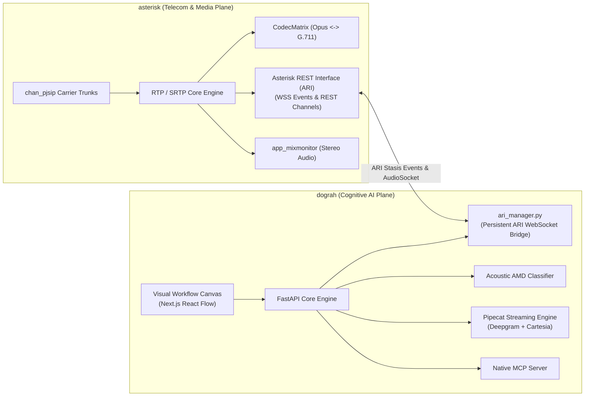
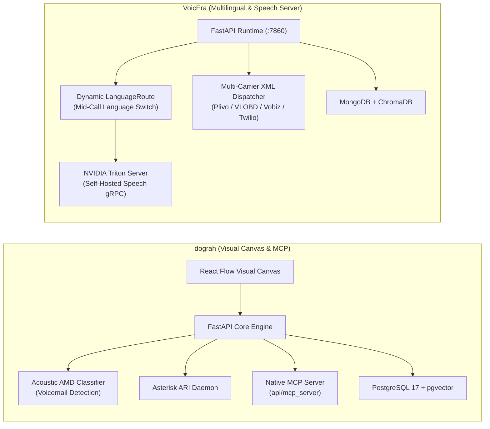

# dograh — Comparative Analysis & Category Evaluation

> **Category**: Telephony, Voice & PBX  
> **Architectural Role**: Visual workflow conversational voice AI platform, acoustic AMD engine & Asterisk ARI bridge  
> **Primary Stack**: Python 3.11+, FastAPI, Next.js 14 (React Flow) | Pipecat AI, Silero VAD, Deepgram, Cartesia | PostgreSQL 17 (pgvector), Redis 7 | Asterisk ARI, Coturn, Native MCP | BSD-2-Clause  
> **Peer Solutions Compared**: `asterisk`, `VoicEra`  
> **Commercial SaaS Benchmarks**: Vapi.ai, Retell AI, Bland.ai, Twilio Voice, Air.ai  

---

## 1. Executive Overview & Technical Identity: dograh

**dograh** is an open-source, self-hostable conversational voice AI platform engineered as a direct, sovereign alternative to proprietary cloud voice platforms like Vapi and Retell AI. Built on a high-concurrency Python 3.11+ / FastAPI backend, PostgreSQL 17 with `pgvector`, and a modern Next.js visual workflow canvas, Dograh enables engineering and revenue teams to design, test, deploy, and monitor production voice agents without per-minute platform markups, closed vendor lock-in, or customer audio privacy compromises.

While commercial platforms restrict custom telephony infrastructure, Dograh allows organizations to bring their own SIP trunks, bridge directly to private Asterisk PBX clusters via the Asterisk REST Interface (ARI), and orchestrate complex multi-turn conversational agents through an intuitive node-based graph editor. Furthermore, Dograh introduces deep AI coding assistant extensibility through a native Model Context Protocol (MCP) server, allowing external LLMs to inspect, construct, and validate voice agent workflows programmatically.

### Core Architectural Profile
- **Runtime & Language**: `Python 3.11+` (FastAPI / Uvicorn multi-worker) + `TypeScript` (Next.js 14 frontend)
- **Visual Workflow Engine**: Drag-and-drop node-based graph editor built with React Flow (`WorkflowDefinitionModel`)
- **Voice Pipeline**: `pipecat-ai` streaming audio framework with ONNX `silero-vad` for sub-100ms barge-in detection
- **Acoustic AMD**: Real-time acoustic classification (`answer_classification.py`) distinguishing humans, IVRs, and voicemail beeps
- **Telephony & PBX Interoperability**: Built-in Asterisk ARI Manager daemon (`ari_manager.py`) + carrier adapters (Twilio, Telnyx, Plivo, Vonage)
- **Persistence & Vector Storage**: `PostgreSQL 17` with `pgvector` via `SQLAlchemy 2.0` (asyncpg) and `Redis 7.x` for trunk concurrency locking
- **AI Tool Protocol**: Native `Model Context Protocol (MCP)` server (`api/mcp_server`) for programmatic workflow orchestration

---

## 2. Peer Solution Landscape (Telephony, Voice & PBX)

Within this category, `dograh` operates alongside two specialized peer solutions:

| Solution | Language & Runtime | Core Framework | Audio & Media Transport | Concurrency & Event Model | Primary Architectural Role | License |
| :--- | :--- | :--- | :--- | :--- | :--- | :--- |
| **dograh** (Current) | `Python 3.11+ / TS` | `FastAPI, Next.js 14 + React Flow`| `WebSocket PCM, WebRTC, Asterisk ARI` | `asyncio` + Redis 7 Concurrency Locks | Visual Workflow Voice AI Platform with Native MCP Server | BSD-2-Clause |
| **asterisk** | `ANSI C (POSIX / C99)` | `Native Multi-Threaded Engine` | `SIP, RTP/SRTP, WebRTC, AudioSocket` | `POSIX Threads, Stasis Event Bus` | Carrier SIP Trunking, PBX Media Gateway & Transcoder | GPL-2.0 |
| **VoicEra** | `Python 3.11+` | `FastAPI, Pipecat AI` | `WebSocket PCM (8k/16k), Carrier XML` | `asyncio` Event Loop + Frame Processors | Multilingual Real-Time Voice AI & Telephony Automation | Apache-2.0 |

---

## 3. Deep Head-to-Head Comparative Breakdown: dograh vs Peers

### 3.1. dograh vs. asterisk

**Comparative Focus**: Visual conversational voice AI platform with ARI daemon vs. foundational C telecommunications PBX core.

#### Architectural & Stack Differences
- **Architectural Separation of Concerns**: `asterisk` is the telecommunications media switch. It terminates wholesale SIP trunks, negotiates carrier signaling, transcodes audio codecs, manages physical PSTN trunks, and enforces carrier compliance (STIR/SHAKEN). `dograh` operates at the application and intelligence layer, orchestrating the Conversational AI loop (STT, LLM, TTS, visual dialogue graphs, and tool executions).
- **The ARI Integration Bridge**: Rather than competing, Dograh natively connects to Asterisk. Dograh includes a dedicated background Asterisk daemon (`api/services/telephony/ari_manager.py`, toggled via `ENABLE_ARI_MANAGER=true`). When Asterisk channels enter the designated Stasis application, Dograh programmatically captures channel audio over WebSockets or AudioSocket, pipes it into Pipecat, and issues REST commands back to Asterisk for call bridging, warm/cold transfers (`call_transfer_manager.py`), or termination.
- **Dialogue Representation**: In Asterisk, call logic is authored as static procedural dialplans (`extensions.conf`) or procedural FastAGI scripts. In Dograh, conversations are designed visually as stateful directed graphs using Next.js and React Flow (`WorkflowDefinitionModel`), enabling revenue teams to design multi-branch conversations with conditional intent routing and tool execution without writing code.
- **Answering Machine Detection (AMD)**: Asterisk relies on traditional DSP audio energy threshold analysis (`app_amd.c`). Dograh implements a modern acoustic classifier (`answer_classification.py`) that analyzes spectral patterns within the first two seconds of audio pickup, accurately differentiating between live humans, interactive IVRs, and voicemail beeps to trigger automated message drops.

#### Architectural Comparison Matrix: dograh vs. asterisk

| Dimension | dograh | asterisk |
| :--- | :--- | :--- |
| **System Identity** | Visual Conversational Voice AI Platform | Sovereign Telecom Carrier PBX & Media Switch |
| **Core Technology** | Python 3.11+ (FastAPI) + Next.js 14 (React Flow) | ANSI C (POSIX / C99) Multi-Threaded Engine |
| **PBX Interfacing** | Built-in Asterisk ARI Bridge Daemon (`ari_manager.py`)| Native Asterisk REST Interface (ARI) Server |
| **Dialogue Modeling** | Visual Directed Node Graph (`WorkflowModel`) | Procedural Dialplans (`extensions.conf`) / AGI |
| **Answering Machine AMD**| Real-Time Acoustic Spectral Classifier (<2s) | Traditional DSP silence/voice burst analysis (`app_amd`)|
| **Audio Media Plane** | WebSocket PCM, WebRTC (Coturn), Asterisk ARI | SIP, RTP/SRTP, WebRTC DTLS, AudioSocket (TCP PCM) |
| **AI Coding Assistant** | Native Model Context Protocol (MCP) Server | None (Standard AMI/ARI APIs) |
| **Database Engine** | PostgreSQL 17 + `pgvector` (SQLAlchemy asyncpg) | Dynamic ODBC (ARA) to PostgreSQL/MySQL |
| **Memory Footprint** | ~400 MB RAM (API + UI containers) | **~50 MB RAM** |

---

### 3.2. dograh vs. VoicEra

**Comparative Focus**: Visual node graph voice platform with native MCP daemon vs. multilingual voice AI platform with Triton model server.

#### Architectural & Stack Differences
- **Dialogue Authoring & Execution**: `dograh` features a visual drag-and-drop canvas (`WorkflowDefinitionModel`) that models multi-step decision trees with explicit node types: Greetings, Intent Routers, Spoken Tool Calling (`spoken_tool_calls.py`), Transfers, and End Call nodes. `VoicEra` configures agents through structured JSON schemas, prompts, and Pydantic models managed via REST APIs.
- **Multilingual Dynamics**: `VoicEra` specializes in dynamic mid-call language switching for multilingual markets (English, Hindi, Indic dialects). Through its `LanguageRoute` mixin, VoicEra dynamically swaps the active STT model, neural TTS voice, and prompt context mid-dialogue without resetting the call session. In `dograh`, multilingual flows require explicit branching across workflow node paths.
- **Self-Hosted AI Inference (Triton Server)**: `VoicEra` incorporates a dedicated NVIDIA Triton Inference Server (`model-server`) using gRPC, enabling private hosting of Whisper ASR and local TTS models on internal GPUs to eliminate per-minute third-party cloud API costs. `dograh` is architected primarily for cloud speech providers (Deepgram Nova-2, Cartesia Sonic, MiniMax, Speechify), though custom self-hosted endpoints can be configured.
- **Developer & Agent Tooling (MCP vs. REST)**: `dograh` ships with a native **Model Context Protocol (MCP)** server (`api/mcp_server`). This allows external LLM agents (Claude Code, Cursor) to inspect call transcripts, construct workflows, and validate node connections programmatically. `VoicEra` provides standard OpenAPI REST endpoints.
- **Persistence Architecture**: `dograh` utilizes **PostgreSQL 17** with the `pgvector` extension via asynchronous SQLAlchemy (asyncpg), storing both structured workflow state and document embeddings within a single relational database. `VoicEra` utilizes **MongoDB** for document persistence paired with a standalone **ChromaDB** collection for vector search.

#### Architectural Comparison Matrix: dograh vs. VoicEra

| Dimension | dograh | VoicEra |
| :--- | :--- | :--- |
| **Workflow Authoring** | Drag-and-drop node graph canvas (React Flow) | Prompt templates with dynamic RAG & tools |
| **Multilingual Strategy** | Multi-node branching logic | Dynamic `LanguageRoute` mid-call switching |
| **Answering Machine AMD** | Real-time acoustic classifier (<2s detection) | Basic post-utterance classifier |
| **Self-Hosted Inference** | Cloud APIs preferred (Deepgram / Cartesia) | Native NVIDIA Triton Server integration (gRPC) |
| **AI Assistant Control** | Native Model Context Protocol (MCP) Server | Standard FastAPI REST endpoints |
| **Telephony Integration** | Built-in Asterisk ARI Bridge + Carrier WebSockets | Multi-carrier XML (Plivo, VI OBD, Vobiz, Twilio) |
| **Data Persistence** | PostgreSQL 17 + `pgvector` (SQLAlchemy async) | MongoDB 6+ / FerretDB + ChromaDB vector store |
| **Observability** | Langfuse tracing & telemetry | In-pipeline latency metrics observer |

---

## 4. Capability & Feature Comparison Matrix

| Feature / Dimension | dograh | asterisk | VoicEra |
| :--- | :---: | :---: | :---: |
| **Sub-500ms Conversational Turnaround** | ✅ Pipecat Streaming | ❌ (Media only) | ✅ Pipecat Streaming |
| **Neural VAD Barge-In (<100ms)** | ✅ Silero VAD (ONNX) | ❌ | ✅ Silero VAD (ONNX) |
| **Visual Node Graph Conversation Editor**| ✅ React Flow Canvas | ❌ | ❌ |
| **Acoustic Answering Machine AMD** | ✅ Real-Time Classifier | ✅ Built-in DSP AMD | ⚠️ Utterance classifier |
| **Native Model Context Protocol (MCP)** | ✅ `api/mcp_server` | ❌ | ❌ |
| **Asterisk ARI Manager Daemon** | ✅ `ari_manager.py` | ✅ Native Core | ❌ (AudioSocket hookup) |
| **Mid-Call Multilingual Switching** | ⚠️ Node branching | ❌ | ✅ Dynamic LanguageRoute |
| **Self-Hosted AI Inference (Triton gRPC)**| ⚠️ Endpoint config | ❌ | ✅ NVIDIA Triton Server |
| **Wholesale Carrier SIP Trunking** | ⚠️ Via Asterisk Bridge | ✅ World Standard | ❌ (Carrier XML only) |
| **In-Browser WebRTC Calling (Coturn)** | ✅ Native STUN/TURN | ✅ Native WebRTC | ✅ Native WebRTC |
| **Memory Footprint (Baseline)** | ~400 MB RAM | **~50 MB RAM** | ~350 MB RAM |

---

## 5. Commercial Benchmark Positioning

When benchmarked against commercial conversational voice leaders (**Vapi.ai, Retell AI, Bland.ai, Twilio Voice, Air.ai**):
- **Against Vapi.ai & Retell AI**:
  - Vapi and Retell charge $0.05–$0.20/minute platform fees. Dograh provides an open-source, self-hosted equivalent with identical sub-500ms turnaround latency, visual graph workflows, and barge-in handling, completely eliminating platform markups.
- **Against Bland.ai**:
  - Bland emphasizes programmatic phone agents with prompt instructions. Dograh provides superior conversational predictability through its visual node graph canvas (`WorkflowDefinitionModel`), ensuring agents adhere to strict compliance paths and fallback logic.
- **Against Air.ai**:
  - Air.ai charges high upfront enterprise retainers for conversational sales bots. Dograh provides full source code sovereignty, self-hosted Docker deployments, and native Asterisk PBX connectivity.

---

## 6. Strategic Takeaways & Role for MarketingStudio

In MarketingStudio's voice telephony architecture:
1. **Primary Component to Adopt**: Deploy `dograh` as MarketingStudio's **visual conversational voice AI workflow engine**.
2. **Utilize Acoustic AMD for Outbound Dialing**: Leverage Dograh's `answer_classification.py` in power dialing campaigns to instantly drop voicemails or hang up, preserving rep and trunk capacity.
3. **Bridge to Asterisk via ARI Daemon**: Enable Dograh's `ENABLE_ARI_MANAGER` to capture wholesale SIP calls terminated on Asterisk, providing carrier-grade switching with sub-500ms voice AI reasoning.
4. **Leverage the Native MCP Server**: Connect MarketingStudio's AI coding assistants directly to Dograh's MCP daemon (`api/mcp_server`) to autonomously generate, optimize, and test voice agent workflows.
5. **Synergistic Integration**:
   - Terminate wholesale carrier SIP trunks on `asterisk`.
   - Incorporate `VoicEra`'s multilingual `LanguageRoute` mixin for international campaigns.
   - Sync completed call recordings and structured transcripts directly into MarketingStudio CRM contact records.
